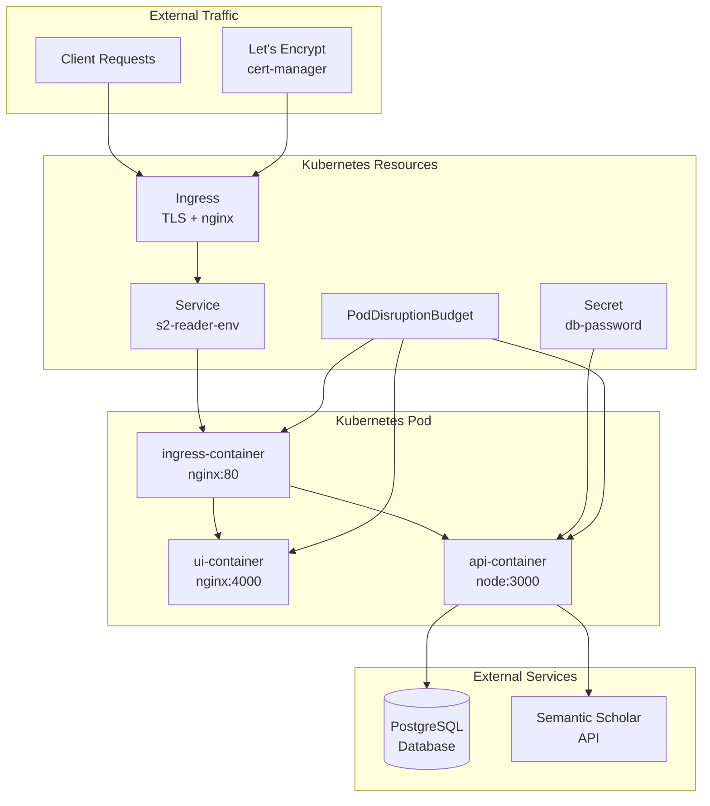
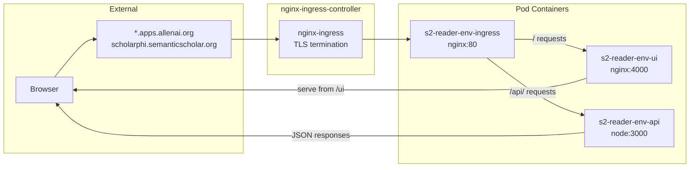
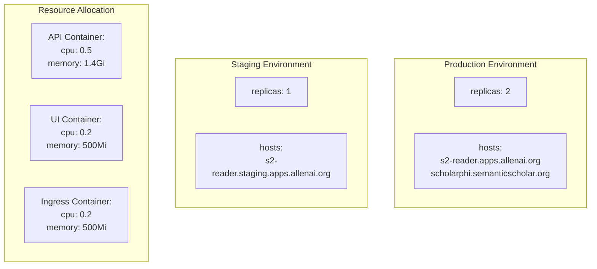
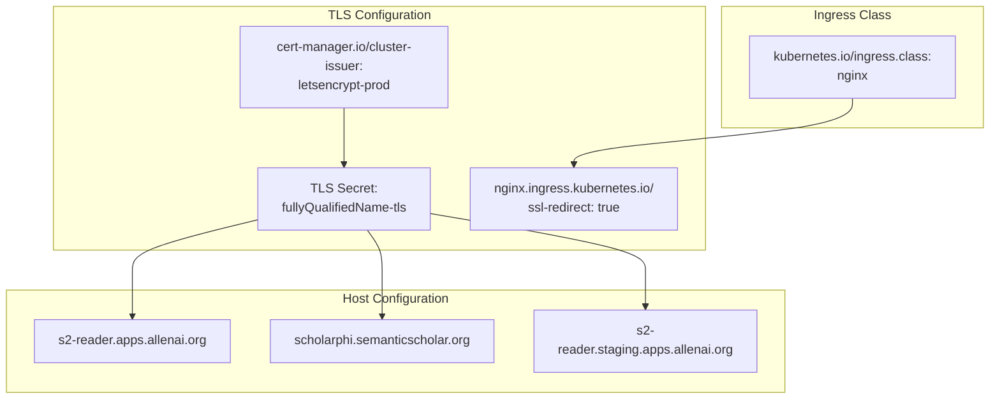

<!-- source: DeepWiki mcp.deepwiki.com · repo allenai/scholarphi · page 5.1 Kubernetes Deployment · fetched 2026-10-26 -->

# Kubernetes Deployment

<details>
<summary>Relevant source files</summary>

The following files were used as context for generating this wiki page:

- [.skiff/webapp.jsonnet](.skiff/webapp.jsonnet)
- [ingress/nginx.conf](ingress/nginx.conf)
- [skiff.json](skiff.json)
- [ui/nginx.conf](ui/nginx.conf)
- [ui/src/logging.ts](ui/src/logging.ts)

</details>


This document covers the Kubernetes deployment configuration and infrastructure setup for the Scholar Reader system. It describes how the application is containerized, orchestrated, and deployed using Kubernetes, including ingress configuration, service definitions, and deployment strategies. For information about the overall system architecture, see [Overview](#1). For details about the backend API server configuration, see [API Server and Endpoints](#3.1).

## Deployment Architecture Overview

The Scholar Reader system uses a three-tier containerized architecture deployed on Kubernetes, with separate containers for ingress routing, UI serving, and API processing.

### Container Architecture



Sources: [.skiff/webapp.jsonnet:1-291](), [ingress/nginx.conf:1-72](), [ui/nginx.conf:1-67]()

### Request Flow Architecture



Sources: [.skiff/webapp.jsonnet:120-141](), [ingress/nginx.conf:60-69](), [ui/nginx.conf:51-65]()

## Kubernetes Resource Configuration

The deployment is defined using JSONNET templates that generate standard Kubernetes resources. The main configuration function takes deployment parameters and creates a complete resource stack.

### Core Resources

| Resource Type | Name Pattern | Purpose |
|---------------|--------------|---------|
| Namespace | `config.appName` | Isolation boundary (`s2-reader`) |
| Deployment | `config.appName-env` | Pod orchestration (`s2-reader-staging`) |
| Service | `config.appName-env` | Internal networking |
| Ingress | `config.appName-env` | External traffic routing |
| PodDisruptionBudget | `config.appName-env` | Availability guarantees |

### Environment Configuration

The deployment supports multiple environments with different scaling characteristics:



Sources: [.skiff/webapp.jsonnet:20-34](), [.skiff/webapp.jsonnet:192-241]()

## Container Specifications

### API Container

The API container runs the Node.js Hapi server with the following configuration:

- **Image**: `apiImage` parameter (Node.js application)
- **Port**: `3000`
- **Health Check**: `GET /api/health`
- **Resources**: 0.5 CPU, 1.4Gi memory
- **Secrets**: Database password mounted at `/secrets/secret.json`
- **Environment**: `SECRETS_FILE=/secrets/secret.json`

### UI Container  

The UI container serves static files using nginx:

- **Image**: `uiImage` parameter (nginx + static files)
- **Port**: `4000` 
- **Health Check**: `GET /?check=rdy`
- **Resources**: 0.2 CPU, 500Mi memory
- **Document Root**: `/ui`

### Ingress Container

The ingress container acts as a reverse proxy:

- **Image**: `ingressImage` parameter (nginx proxy)
- **Port**: `80`
- **Health Check**: `GET /?check=rdy`  
- **Resources**: 0.2 CPU, 500Mi memory
- **Proxy Rules**: 
  - `/api/` → `http://localhost:3000`
  - `/` → `http://localhost:4000`

Sources: [.skiff/webapp.jsonnet:183-242](), [ingress/nginx.conf:66-69]()

## Networking and Ingress Configuration

### TLS and SSL Configuration

The ingress uses automatic TLS certificate provisioning through cert-manager and Let's Encrypt:



Sources: [.skiff/webapp.jsonnet:107-111](), [.skiff/webapp.jsonnet:114-119]()

### Service Discovery

The Kubernetes Service uses label selectors to route traffic to the correct pods:

- **Selector Labels**: `app: s2-reader`, `env: <environment>`
- **Service Port**: `80` (maps to ingress container port `80`)
- **Service Type**: ClusterIP (internal)

Sources: [.skiff/webapp.jsonnet:248-266](), [.skiff/webapp.jsonnet:59-62]()

## Configuration Management

### Secrets Management

Database credentials are managed through Kubernetes Secrets:

- **Secret Name**: `db`
- **Mount Path**: `/secrets` (in API container)
- **File**: `secret.json`
- **Environment Variable**: `SECRETS_FILE=/secrets/secret.json`

### Logging Configuration

Both nginx containers use structured JSON logging format for integration with log aggregation systems:

```json
{
  "time": "$time_iso8601",
  "request_method": "$request_method", 
  "request_uri": "$scheme://$host$request_uri",
  "status": "$status",
  "user_agent": "$http_user_agent",
  "realip": "$realip_remote_addr"
}
```

The frontend also includes a `RemoteLogger` class that sends structured logs to the API endpoint `/api/log` with debouncing and error handling capabilities.

Sources: [.skiff/webapp.jsonnet:175-210](), [ingress/nginx.conf:35-48](), [ui/nginx.conf:36-49](), [ui/src/logging.ts:30-76]()

## Deployment Strategy

### Rolling Updates

The deployment uses a rolling update strategy to minimize downtime:

- **Strategy Type**: `RollingUpdate`
- **Max Surge**: Equal to replica count (faster deployments)
- **Revision History Limit**: 3 deployments

### High Availability

Production deployments include availability safeguards:

- **Pod Disruption Budget**: Minimum 1 available pod when replicas > 1
- **Multiple Replicas**: 2 in production, 1 in staging
- **Health Checks**: All containers have readiness probes

### Deployment Metadata

Each deployment includes comprehensive metadata for auditing and debugging:

- **Change Cause**: Deployment trigger reason
- **Git SHA**: Source commit hash  
- **Branch**: Source branch name
- **Repository**: Source repository
- **Build ID**: CI/CD build identifier

Sources: [.skiff/webapp.jsonnet:156-161](), [.skiff/webapp.jsonnet:268-282](), [.skiff/webapp.jsonnet:66-71]()