# Page: Overview

# Overview

<details>
<summary>Relevant source files</summary>

The following files were used as context for generating this wiki page:

- [README.md](README.md)
- [api/src/api.ts](api/src/api.ts)
- [api/src/db-connection.ts](api/src/db-connection.ts)
- [api/src/tests/api.test.ts](api/src/tests/api.test.ts)
- [api/src/types/api.ts](api/src/types/api.ts)
- [api/src/types/validation.ts](api/src/types/validation.ts)
- [ui/README.md](ui/README.md)
- [ui/src/ScholarReader.tsx](ui/src/ScholarReader.tsx)
- [ui/src/state.ts](ui/src/state.ts)

</details>


This document provides a comprehensive overview of the Scholar Reader system, an augmented PDF reader for academic papers that enhances the reading experience through automated entity extraction and interactive annotations. The system comprises a React/TypeScript frontend, Node.js/Hapi.js backend API, and Python-based data processing pipeline.

For detailed information about the frontend components and UI architecture, see [Frontend (UI System)](#2). For backend API implementation details, see [Backend (API System)](#3). For data processing and entity extraction specifics, see [Data Processing Pipeline](#4).

## System Architecture

Scholar Reader operates as a three-tier system where academic papers flow through a processing pipeline to generate an interactive PDF reading experience with entity annotations.

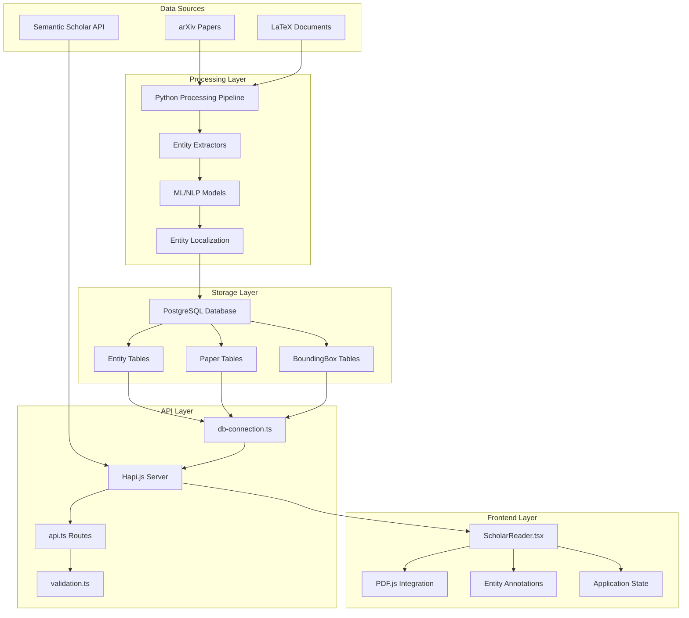

Sources: [ui/src/ScholarReader.tsx:1-1160](), [api/src/api.ts:1-352](), [api/src/db-connection.ts:1-767](), [README.md:1-79]()

## Data Flow Architecture

The system transforms raw academic papers into interactive, annotated PDF experiences through a multi-stage pipeline.

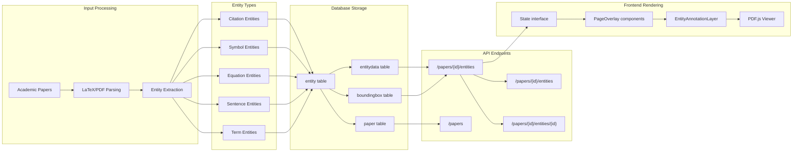

Sources: [api/src/types/api.ts:92-441](), [ui/src/state.ts:15-202](), [api/src/api.ts:178-268]()

## Core Component Architecture

The `ScholarReader` component serves as the main orchestrator, managing PDF viewing, entity annotations, and user interactions.

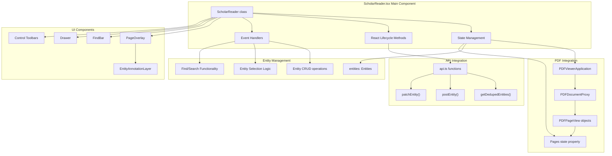

Sources: [ui/src/ScholarReader.tsx:69-124](), [ui/src/ScholarReader.tsx:665-678](), [ui/src/ScholarReader.tsx:711-730]()

## Entity Type System

Scholar Reader supports five primary entity types, each with specific attributes and relationships defined in the type system.

| Entity Type | TypeScript Interface | Key Attributes | Primary Use Case |
|-------------|---------------------|----------------|------------------|
| Citation | `Citation` | `paper_id` | Reference to other papers |
| Symbol | `Symbol` | `tex`, `mathml`, `definitions` | Mathematical notation |
| Equation | `Equation` | `tex` | Mathematical expressions |
| Sentence | `Sentence` | `text`, `tex_start`, `tex_end` | Text segmentation |
| Term | `Term` | `name`, `definitions`, `term_type` | Technical vocabulary |

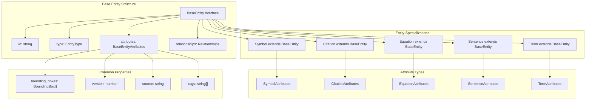

Sources: [api/src/types/api.ts:108-398](), [api/src/types/api.ts:114-123](), [ui/src/state.ts:151-159]()

## Database Schema Integration

The system uses PostgreSQL with a normalized schema that separates entity metadata, attributes, and spatial information.

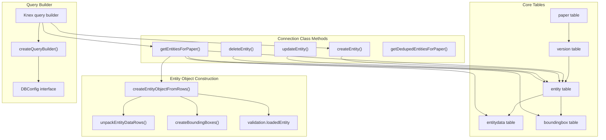

Sources: [api/src/db-connection.ts:24-35](), [api/src/db-connection.ts:276-406](), [api/src/db-connection.ts:242-274]()

## API Route Structure

The Hapi.js server exposes RESTful endpoints for paper and entity management with validation and authentication.

| HTTP Method | Route Pattern | Handler Function | Purpose |
|-------------|---------------|------------------|---------|
| GET | `/papers/list` | Paper listing | Paginated paper discovery |
| GET | `/papers/{paperSelector}` | Paper existence check | Verify paper availability |
| GET | `/papers/{paperSelector}/entities` | `getEntitiesForPaper()` | Retrieve all entities |
| GET | `/papers/{paperSelector}/entities-deduped` | `getDedupedEntitiesForPaper()` | Optimized entity retrieval |
| POST | `/papers/{arxivSelector}/entities` | `createEntity()` | Create new entities |
| PATCH | `/papers/{arxivSelector}/entities/{id}` | `updateEntity()` | Modify existing entities |
| DELETE | `/papers/{arxivSelector}/entities/{id}` | `deleteEntity()` | Remove entities |

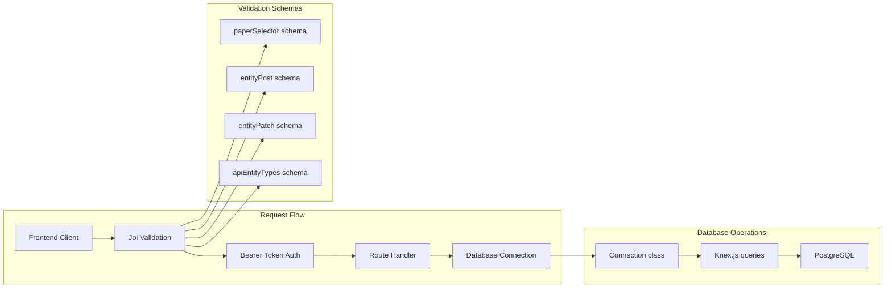

Sources: [api/src/api.ts:73-351](), [api/src/types/validation.ts:31-282](), [api/src/api.ts:55-70]()

The Scholar Reader system demonstrates a sophisticated architecture for enhancing academic paper consumption through automated entity extraction, spatial annotation, and interactive user interfaces. The modular design enables independent development of data processing, API services, and frontend components while maintaining strong type safety and data consistency throughout the system.

---

# Page: Frontend (UI System)

# Frontend (UI System)

<details>
<summary>Relevant source files</summary>

The following files were used as context for generating this wiki page:

- [ui/jest.config.ts](ui/jest.config.ts)
- [ui/package-lock.json](ui/package-lock.json)
- [ui/package.json](ui/package.json)
- [ui/src/ScholarReader.tsx](ui/src/ScholarReader.tsx)
- [ui/src/selectors/index.ts](ui/src/selectors/index.ts)
- [ui/src/settings.ts](ui/src/settings.ts)
- [ui/src/state.ts](ui/src/state.ts)
- [ui/src/style/equation-diagram.less](ui/src/style/equation-diagram.less)
- [ui/src/types/pdfjs-viewer.ts](ui/src/types/pdfjs-viewer.ts)

</details>


The Frontend (UI System) provides the interactive web interface for Scholar Reader, implementing an augmented PDF viewer built on React and TypeScript. This system integrates PDF.js for document rendering with a sophisticated annotation overlay system that displays extracted entities (symbols, citations, equations, terms) as interactive elements overlaid on the PDF pages.

The frontend serves as the primary user interface for browsing academic papers with enhanced navigation and search capabilities. For backend API integration details, see [Backend (API System)](#3). For information about how entities are processed and extracted, see [Data Processing Pipeline](#4).

## Core Architecture

The frontend is built as a single-page React application centered around the `ScholarReader` component, which orchestrates PDF viewing, entity annotation, search functionality, and user interface controls.

### Component Hierarchy

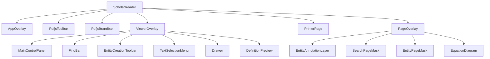

Sources: [ui/src/ScholarReader.tsx:1-1200]()

### State Management Architecture

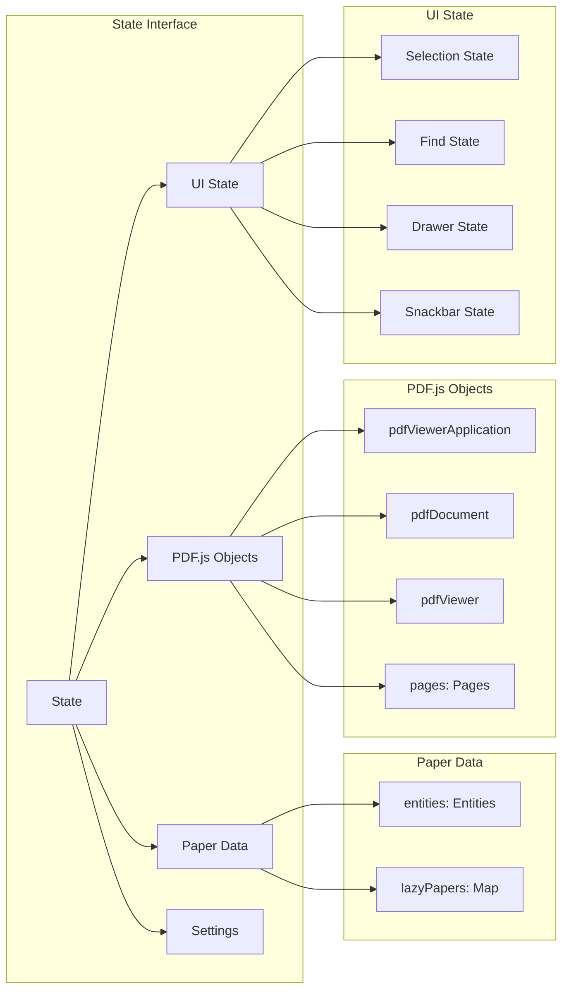

Sources: [ui/src/state.ts:43-149]()

## PDF.js Integration

The frontend integrates Mozilla's PDF.js library to provide core PDF viewing capabilities while extending it with custom annotation overlays.

### PDF Viewer Integration Flow

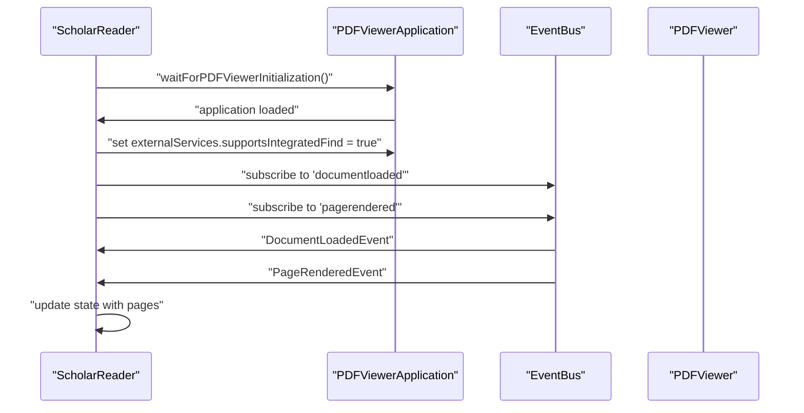

Sources: [ui/src/ScholarReader.tsx:665-709](), [ui/src/types/pdfjs-viewer.ts:37-154]()

### Page Rendering and Overlay System

Each PDF page gets corresponding overlay components that render annotations on top of the PDF content:

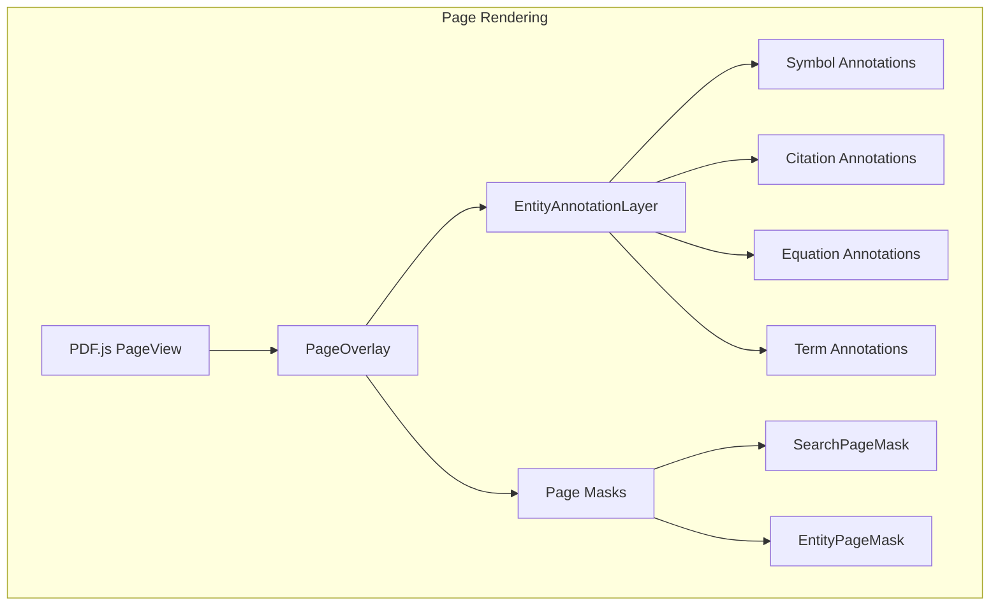

Sources: [ui/src/ScholarReader.tsx:1000-1200]()

## State Management

The `ScholarReader` component manages all application state through React's built-in state management, implementing a flat state structure for performance optimization.

### State Categories

| Category | Properties | Purpose |
|----------|------------|---------|
| **Paper Data** | `entities`, `lazyPapers` | Entity data from API, cached paper metadata |
| **PDF.js Objects** | `pdfViewerApplication`, `pdfDocument`, `pdfViewer`, `pages` | References to PDF.js viewer components |
| **Selection State** | `selectedEntityIds`, `selectedAnnotationIds`, `multiselectEnabled` | User selection tracking |
| **Find State** | `isFindActive`, `findMode`, `findQuery`, `findMatchedEntities` | Search functionality |
| **UI State** | `drawerMode`, `snackbarMode`, `controlPanelShowing` | Interface visibility |

Sources: [ui/src/state.ts:43-149]()

### Entity Data Structure

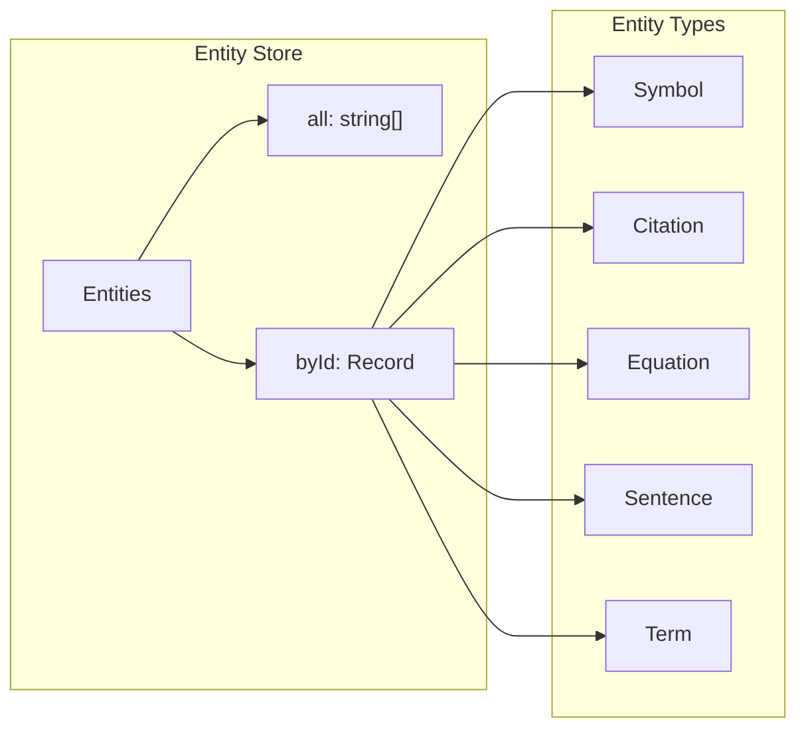

Sources: [ui/src/state.ts:151-161](), [ui/src/api/types.ts]()

## Settings and Configuration

The frontend uses a flexible settings system that supports presets and runtime configuration.

### Settings Architecture

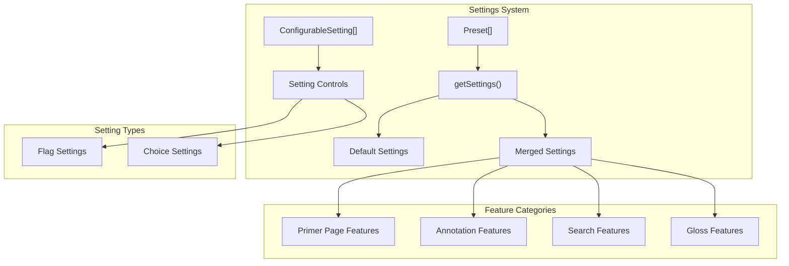

Sources: [ui/src/settings.ts:10-301]()

## Component Integration Patterns

### Event Handling Flow

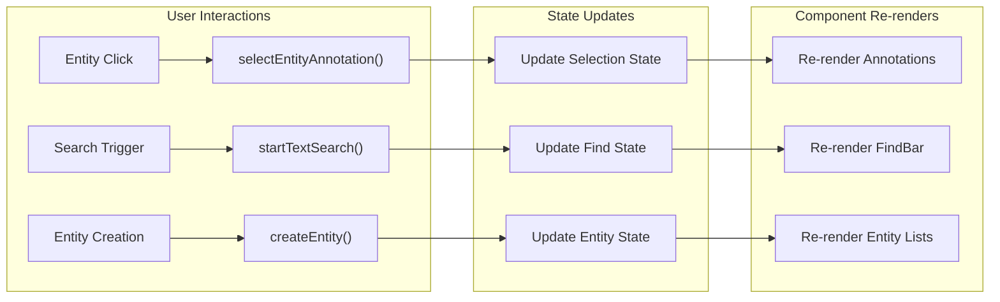

Sources: [ui/src/ScholarReader.tsx:167-284](), [ui/src/ScholarReader.tsx:583-663]()

### API Integration

The frontend integrates with the backend API for entity data and paper metadata:

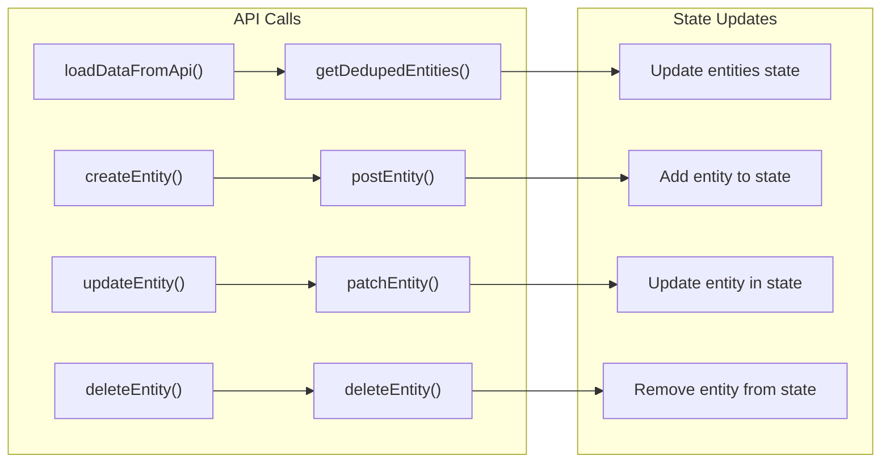

Sources: [ui/src/ScholarReader.tsx:711-730](), [ui/src/ScholarReader.tsx:317-542]()

This frontend architecture provides a scalable foundation for the Scholar Reader interface, with clear separation between PDF viewing, entity annotation, search functionality, and user interface controls. The component-based design allows for modular development and testing while maintaining performant rendering through careful state management.

---

# Page: Core Architecture and State Management

# Core Architecture and State Management

<details>
<summary>Relevant source files</summary>

The following files were used as context for generating this wiki page:

- [ui/src/ScholarReader.tsx](ui/src/ScholarReader.tsx)
- [ui/src/index.tsx](ui/src/index.tsx)
- [ui/src/selectors/entity.ts](ui/src/selectors/entity.ts)
- [ui/src/selectors/symbol.ts](ui/src/selectors/symbol.ts)
- [ui/src/state.ts](ui/src/state.ts)
- [ui/src/utils/ui.test.ts](ui/src/utils/ui.test.ts)
- [ui/src/utils/ui.ts](ui/src/utils/ui.ts)

</details>


This document covers the core frontend architecture of the Scholar Reader system, focusing on the main `ScholarReader` component and the centralized state management patterns. It explains how the application orchestrates the PDF viewer, entity annotations, and user interactions through a single state container.

For information about PDF.js integration specifics, see [PDF Viewer Integration](#2.2). For details about the annotation rendering system, see [Annotation and Entity System](#2.3).

## Overview

The Scholar Reader frontend follows a centralized state management pattern where a single `ScholarReader` component acts as the main orchestrator for the entire application. This component manages all global state, coordinates between the PDF viewer and annotation systems, and handles user interactions.

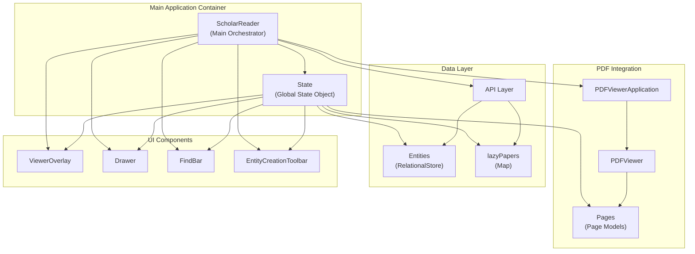

**Sources:** [ui/src/ScholarReader.tsx:69-124](), [ui/src/state.ts:43-149]()

## ScholarReader Component Architecture

The `ScholarReader` component serves as the main application container, implementing a class-based React component that manages all global state and coordinates between subsystems.

### Component Responsibilities

| Responsibility | Methods | State Properties |
|----------------|---------|------------------|
| **State Management** | `setState`, `constructor` | All state properties |
| **Entity Operations** | `selectEntity`, `createEntity`, `updateEntity`, `deleteEntity` | `selectedEntityIds`, `entities` |
| **Navigation & Search** | `jumpToEntity`, `startTextSearch`, `setFindQuery` | `jumpTarget`, `isFindActive`, `findQuery` |
| **UI Coordination** | `openDrawer`, `showSnackbarMessage`, `toggleControlPanelShowing` | `drawerMode`, `snackbarMode`, `controlPanelShowing` |
| **PDF Integration** | `subscribeToPDFViewerStateChanges`, `loadDataFromApi` | `pdfViewerApplication`, `pdfViewer`, `pages` |

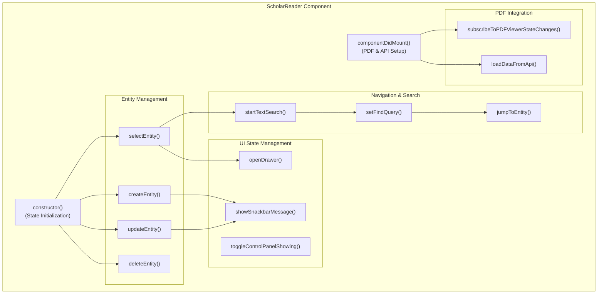

**Sources:** [ui/src/ScholarReader.tsx:69-124](), [ui/src/ScholarReader.tsx:665-677](), [ui/src/ScholarReader.tsx:711-730]()

## State Structure and Management

The application state is defined by the `State` interface, which extends the `Settings` interface and contains all global application data. The state follows a flat structure to avoid complex nested updates and enable precise control over re-rendering.

### Core State Categories

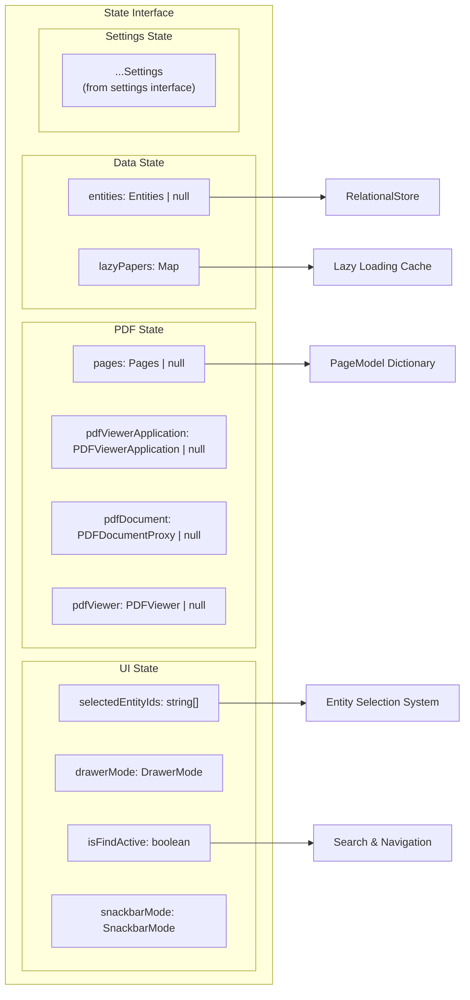

**Sources:** [ui/src/state.ts:43-149](), [ui/src/state.ts:198-201]()

### RelationalStore Pattern

The application uses a `RelationalStore` pattern for managing collections of entities, providing both ordered access and constant-time lookups.

```typescript
// From ui/src/state.ts:198-201
export interface RelationalStore<T> {
  all: string[];        // Ordered list of IDs
  byId: { [id: string]: T };  // Map for O(1) lookup
}
```

| Property | Purpose | Usage Pattern |
|----------|---------|---------------|
| `all` | Maintains insertion/display order | Iteration, rendering lists |
| `byId` | Enables fast entity lookup | Direct access by ID |

**Sources:** [ui/src/state.ts:189-201]()

## State Flow Patterns

The Scholar Reader implements several key state flow patterns to manage the complexity of coordinating between PDF viewing, entity management, and user interactions.

### Entity Selection Flow

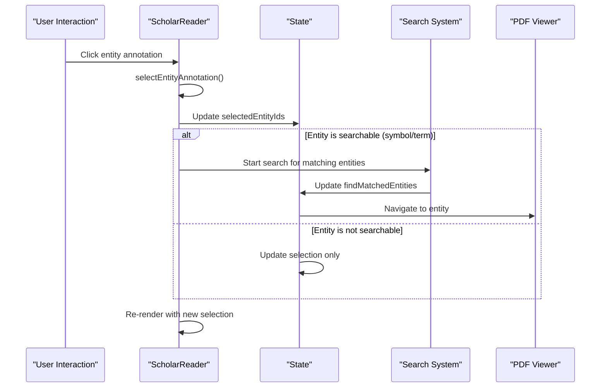

**Sources:** [ui/src/ScholarReader.tsx:167-284]()

### PDF Integration Flow

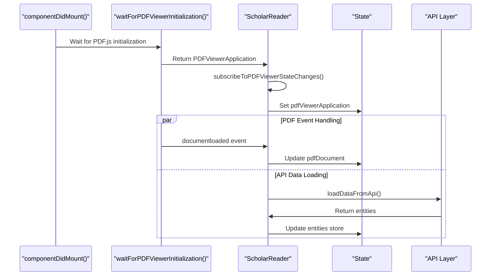

**Sources:** [ui/src/ScholarReader.tsx:665-677](), [ui/src/ScholarReader.tsx:680-709](), [ui/src/ScholarReader.tsx:711-730]()

### State Update Patterns

The component uses React's `setState` with functional updates to ensure state consistency, especially for complex operations like entity updates that may affect multiple entities.

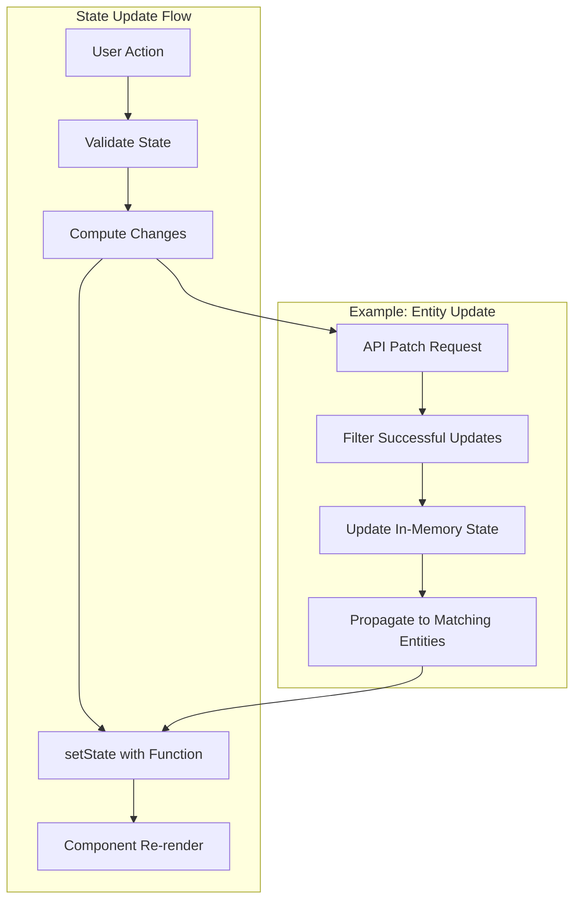

**Sources:** [ui/src/ScholarReader.tsx:423-503](), [ui/src/ScholarReader.tsx:317-342]()

## Component Integration Architecture

The `ScholarReader` component integrates multiple subsystems through prop-based data flow, avoiding context to maintain precise control over re-rendering performance.

```mermaid
graph TB
    subgraph "ScholarReader State Distribution"
        SR["ScholarReader<br/>(State Owner)"]
        
        subgraph "PDF Integration"
            VO["ViewerOverlay"]
            PO["PageOverlay"]
            EAL["EntityAnnotationLayer"]
        end
        
        subgraph "UI Controls"
            FB["FindBar"]
            DR["Drawer"]
            ECT["EntityCreationToolbar"]
            TSM["TextSelectionMenu"]
        end
        
        subgraph "Data Components"
            DP["DefinitionPreview"]
            PP["PrimerPage"]
        end
    end
    
    SR -->|"pdfViewer, handleSetTextSelection"| VO
    SR -->|"entities, selectedEntityIds, pages"| PO
    SR -->|"entities, selectedEntityIds"| EAL
    
    SR -->|"findQuery, matchIndex, mode"| FB
    SR -->|"entities, selectedEntityIds"| DR
    SR -->|"entityType, selectionMethod"| ECT
    SR -->|"textSelection, pages"| TSM
    
    SR -->|"entities, selectedEntityIds"| DP
    SR -->|"entities, paperId"| PP
```

**Sources:** [ui/src/ScholarReader.tsx:832-1224]()

## Key Architectural Decisions

### Centralized State Management

The application uses a single component for state management rather than external state management libraries like Redux. This design choice provides:

| Benefit | Implementation |
|---------|----------------|
| **Simplified Data Flow** | All state updates go through `ScholarReader.setState` |
| **Performance Control** | Precise control over which components re-render |
| **Type Safety** | Full TypeScript integration with state shape |
| **Debugging** | Single location for all state changes |

**Sources:** [ui/src/state.ts:16-42]()

### Prop-Based Distribution

Rather than using React Context, the application passes state through props to maintain performance:

```typescript
// Example from render method
<PageOverlay
  key={key}
  pageView={pageView}
  entities={entities}
  selectedEntityIds={selectedEntityIds}
  selectedAnnotationIds={selectedAnnotationIds}
  // ... other props
/>
```

This pattern allows components to use strict equality comparisons for re-render optimization.

**Sources:** [ui/src/ScholarReader.tsx:1000-1067]()

### Memoized Selectors

The application uses memoized selectors for expensive computations, particularly for entity filtering and ordering:

```typescript
// From selectors
export const orderByPosition = defaultMemoize(
  (entityIds: string[], entities: Entities) => {
    // Expensive sorting operation
  }
);
```

**Sources:** [ui/src/selectors/symbol.ts:70-76](), [ui/src/selectors/entity.ts:206-224]()

---

# Page: PDF Viewer Integration

# PDF Viewer Integration

<details>
<summary>Relevant source files</summary>

The following files were used as context for generating this wiki page:

- [ui/bin/build_pdf.js.sh](ui/bin/build_pdf.js.sh)
- [ui/jest.config.ts](ui/jest.config.ts)
- [ui/package-lock.json](ui/package-lock.json)
- [ui/package.json](ui/package.json)
- [ui/public/pdf.viewer.js](ui/public/pdf.viewer.js)
- [ui/public/pdf.worker.min.js](ui/public/pdf.worker.min.js)
- [ui/public/viewer.css](ui/public/viewer.css)
- [ui/public/viewer.html](ui/public/viewer.html)
- [ui/public/viewer.js.map](ui/public/viewer.js.map)
- [ui/src/ScholarReader.tsx](ui/src/ScholarReader.tsx)
- [ui/src/components/pdfjs/PdfjsBrandbar.tsx](ui/src/components/pdfjs/PdfjsBrandbar.tsx)
- [ui/src/selectors/index.ts](ui/src/selectors/index.ts)
- [ui/src/state.ts](ui/src/state.ts)
- [ui/src/style/brandbar.less](ui/src/style/brandbar.less)
- [ui/src/types/pdfjs-viewer.ts](ui/src/types/pdfjs-viewer.ts)
- [ui/webpack.config.js](ui/webpack.config.js)

</details>


This document describes how PDF.js is integrated into the Scholar Reader system to provide PDF viewing capabilities. It covers the initialization process, state management of PDF.js objects, event handling, and UI customization.

For information about the overall frontend architecture, see [Core Architecture and State Management](#2.1). For details about annotation overlays that are rendered on top of the PDF viewer, see [Annotation and Entity System](#2.3).

## Architecture Overview

The Scholar Reader system builds upon the Mozilla PDF.js viewer, extending it with academic paper annotation capabilities. The integration follows a layered approach where PDF.js handles core PDF rendering while Scholar Reader adds semantic overlays and interactive features.

```mermaid
graph TB
    subgraph "Scholar Reader Layer"
        SR[ScholarReader Component]
        AO[Annotation Overlays]
        EL[Entity Layers]
        UI[Custom UI Components]
    end
    
    subgraph "PDF.js Integration"
        VA[PDFViewerApplication]
        VW[PDFViewer]
        DOC[PDFDocument]
        PAGES[Page Views]
    end
    
    subgraph "PDF.js Core"
        CANVAS[Canvas Rendering]
        TEXT[Text Layer]
        ANNOT[PDF Annotations]
    end
    
    SR --> VA
    SR --> VW
    SR --> DOC
    AO --> PAGES
    EL --> PAGES
    UI --> VA
    
    VA --> CANVAS
    VW --> TEXT
    VW --> ANNOT
    PAGES --> CANVAS
```

The integration maintains separation of concerns by keeping PDF.js responsible for document parsing and rendering while Scholar Reader handles academic-specific features like entity annotations and interactive elements.

Sources: [ui/src/ScholarReader.tsx:1-100](), [ui/src/state.ts:50-60](), [ui/src/types/pdfjs-viewer.ts:1-50]()

## PDF.js State Management

Scholar Reader maintains references to key PDF.js objects in its central state store. These objects provide access to the PDF document, viewer controls, and rendered pages.

```mermaid
graph LR
    subgraph "Application State"
        PVA[pdfViewerApplication]
        PV[pdfViewer]
        PD[pdfDocument]
        PS[pages]
    end
    
    subgraph "PDF.js Objects"
        APP[PDFViewerApplication]
        VIEWER[PDFViewer]
        DOC[PDFDocumentProxy]
        PAGEVIEWS[PDFPageView[]]
    end
    
    PVA --> APP
    PV --> VIEWER
    PD --> DOC
    PS --> PAGEVIEWS
    
    APP --> VIEWER
    APP --> DOC
    VIEWER --> PAGEVIEWS
```

| State Property | Type | Purpose |
|---|---|---|
| `pdfViewerApplication` | `PDFViewerApplication \| null` | Main PDF.js application controller |
| `pdfViewer` | `PDFViewer \| null` | PDF viewer component for rendering |
| `pdfDocument` | `PDFDocumentProxy \| null` | Loaded PDF document proxy |
| `pages` | `Pages \| null` | Page view objects with render timestamps |

The `Pages` type is a custom mapping that tracks PDF.js page views along with rendering metadata:

```typescript
type Pages = { [pageNumber: number]: PageModel };

interface PageModel {
  timeOfLastRender: number;  // Timestamp for React re-rendering
  view: PDFPageView;         // PDF.js page view object
}
```

Sources: [ui/src/state.ts:51-56](), [ui/src/state.ts:171-182](), [ui/src/types/pdfjs-viewer.ts:148-154]()

## Initialization Process

The PDF viewer initialization follows a specific sequence that waits for PDF.js to load before Scholar Reader components can interact with it.

```mermaid
sequenceDiagram
    participant SR as ScholarReader
    participant WAIT as waitForPDFViewerInitialization
    participant PDFJS as PDF.js Application
    participant API as loadDataFromApi
    
    SR->>+WAIT: componentDidMount()
    WAIT->>+PDFJS: Check application.initialized
    PDFJS-->>-WAIT: PDFViewerApplication
    WAIT->>PDFJS: Set externalServices.supportsIntegratedFind
    WAIT-->>-SR: application object
    
    par PDF.js Setup
        SR->>SR: setState(pdfViewerApplication)
        SR->>SR: subscribeToPDFViewerStateChanges()
    and Data Loading
        SR->>+API: loadDataFromApi()
        API-->>-SR: entities data
    end
```

The initialization process includes several key steps:

1. **Wait for PDF.js**: The `waitForPDFViewerInitialization` function polls until PDF.js is fully loaded
2. **Configure external services**: Sets `supportsIntegratedFind = true` to override PDF.js find functionality
3. **Subscribe to events**: Registers listeners for PDF.js document and page events
4. **Load application data**: Fetches entities and annotations from the API

Sources: [ui/src/ScholarReader.tsx:665-677](), [ui/src/ScholarReader.tsx:680-709]()

## Event Handling and Subscriptions

Scholar Reader subscribes to PDF.js events to track document loading and page rendering. This enables the annotation system to respond to PDF viewer state changes.

```mermaid
graph TD
    subgraph "PDF.js Events"
        DL[documentloaded]
        PR[pagerendered]
    end
    
    subgraph "Scholar Reader Handlers"
        SDL[setState pdfDocument]
        SPR[setState pages with timestamp]
        AO[Update Annotation Overlays]
    end
    
    DL --> SDL
    PR --> SPR
    SPR --> AO
```

### Document Loading Events

When a PDF document loads, Scholar Reader updates its state to reference the loaded document:

```typescript
eventBus.on("documentloaded", (eventData: DocumentLoadedEvent) => {
  this.setState({ pdfDocument: eventData.source });
});
```

### Page Rendering Events

Page rendering events are critical for annotation positioning. Each time a page renders, Scholar Reader:

1. Updates the page model with a new timestamp
2. Stores the PDF.js page view reference  
3. Triggers React re-renders of annotation overlays

```typescript
eventBus.on("pagerendered", (eventData: PageRenderedEvent) => {
  this.setState({
    pdfDocument: pdfViewerApplication.pdfDocument,
    pages: {
      ...this.state.pages,
      [getPageNumber(eventData.source)]: {
        timeOfLastRender: eventData.timestamp,
        view: eventData.source,
      },
    },
  });
});
```

Sources: [ui/src/ScholarReader.tsx:689-708](), [ui/src/types/pdfjs-viewer.ts:60-65](), [ui/src/types/pdfjs-viewer.ts:92-94]()

## Navigation and Entity Jumping

Scholar Reader extends PDF.js navigation capabilities to support jumping to specific entities within the document. This is essential for features like symbol search and citation navigation.

### Jump to Entity Implementation

The `jumpToEntity` function demonstrates how Scholar Reader uses PDF.js navigation APIs:

```mermaid
graph TD
    JE[jumpToEntity called]
    --> VE[Validate entity exists]
    --> GB[Get bounding box]
    --> CC[Convert coordinates]
    --> NAV[Use pdfLinkService.navigateTo]
    --> US[Update state with jumpTarget]
```

Key implementation details:

1. **Coordinate conversion**: Transforms entity bounding boxes to PDF coordinate system
2. **Navigation service**: Uses `pdfLinkService.navigateTo()` with XYZ destination format
3. **History integration**: Navigation calls save current position to browser history
4. **Offset adjustment**: Applies scroll offsets for optimal entity visibility

```typescript
const SCROLL_OFFSET_X = -200;
const SCROLL_OFFSET_Y = +100;

pdfViewerApplication.pdfLinkService.navigateTo([
  dest.page,
  { name: "XYZ" },
  left + SCROLL_OFFSET_X,
  top + SCROLL_OFFSET_Y,
]);
```

Sources: [ui/src/ScholarReader.tsx:751-803](), [ui/src/types/pdfjs-viewer.ts:120-141]()

## UI Integration and Customization

Scholar Reader customizes the PDF.js viewer interface by injecting React components into designated container elements within the PDF.js HTML structure.

### Toolbar Integration

Custom toolbar components are integrated using React portals to render into PDF.js toolbar containers:

```mermaid
graph LR
    subgraph "PDF.js HTML"
        RT[readerBrandbar div]
        SC[scholarReaderControls div]
        TB[PDF.js toolbar]
    end
    
    subgraph "React Components"
        PB[PdfjsBrandbar]
        PT[PdfjsToolbar]
        CC[Custom Controls]
    end
    
    PB -.->|ReactDOM.createPortal| RT
    PT -.->|ReactDOM.createPortal| SC
    CC --> TB
```

### Brand Bar Integration

The `PdfjsBrandbar` component demonstrates the portal pattern used throughout the system:

```typescript
const elControlsContainer = document.getElementById("readerBrandbar");
const portalValue = (
  <div className="brandbar">
    <div className="brandbar__left">
      <S2LogoMarkOnly />
      <span className="brandbar__app-title">
        <span className="brandbar__app-title__word1">SEMANTIC</span>&nbsp;
        <span className="brandbar__app-title__word2">READER</span>
      </span>
    </div>
  </div>
);

return elControlsContainer 
  ? ReactDOM.createPortal(portalValue, elControlsContainer)
  : null;
```

### Viewer HTML Structure

The base PDF.js viewer HTML includes custom integration points:

| Element ID | Purpose |
|---|---|
| `readerBrandbar` | Scholar Reader branding and title |
| `scholarReaderControls` | Custom control panels and toolbars |
| `viewerContainer` | Main PDF viewing area with overlays |

Sources: [ui/src/components/pdfjs/PdfjsBrandbar.tsx:7-30](), [ui/public/viewer.html:238-264](), [ui/src/ScholarReader.tsx:850-862]()

## Page Overlay Management

Scholar Reader renders annotation overlays on top of each PDF page by creating `PageOverlay` components that align with PDF.js page views.

```mermaid
graph TD
    subgraph "Page Rendering Loop"
        PS[pages state]
        --> MAP[Object.keys.map]
        --> PO[PageOverlay component]
        --> AEL[Annotation/Entity Layers]
    end
    
    subgraph "React Key Strategy"
        KEY[page-timestamp key]
        --> RR[Force re-render on page update]
    end
    
    MAP --> KEY
```

The overlay system uses a composite React key that combines page number with render timestamp:

```typescript
const key = `${pageNumber}-${pageModel.timeOfLastRender}`;

return (
  <PageOverlay key={key} pageView={pageView}>
    {/* Annotation components */}
  </PageOverlay>
);
```

This ensures that overlays re-render whenever PDF.js re-renders a page, maintaining proper alignment between PDF content and Scholar Reader annotations.

Sources: [ui/src/ScholarReader.tsx:1000-1015](), [ui/src/ScholarReader.tsx:1068-1070]()

---

# Page: Annotation and Entity System

# Annotation and Entity System

<details>
<summary>Relevant source files</summary>

The following files were used as context for generating this wiki page:

- [ui/src/ScholarReader.tsx](ui/src/ScholarReader.tsx)
- [ui/src/api/api.ts](ui/src/api/api.ts)
- [ui/src/api/deduped.ts](ui/src/api/deduped.ts)
- [ui/src/components/entity/EntityAnnotationLayer.tsx](ui/src/components/entity/EntityAnnotationLayer.tsx)
- [ui/src/components/entity/citation/CitationGloss.tsx](ui/src/components/entity/citation/CitationGloss.tsx)
- [ui/src/components/entity/citation/LazyCitationGloss.tsx](ui/src/components/entity/citation/LazyCitationGloss.tsx)
- [ui/src/state.ts](ui/src/state.ts)
- [ui/src/style/control-panel.less](ui/src/style/control-panel.less)
- [ui/src/style/paper-summary.less](ui/src/style/paper-summary.less)
- [ui/src/style/viewer-overlay.less](ui/src/style/viewer-overlay.less)
- [ui/src/types/ui.ts](ui/src/types/ui.ts)

</details>


## Purpose and Scope

This document describes the frontend annotation and entity system that overlays interactive annotations on top of PDF pages in the Scholar Reader. The system handles rendering, selection, and interaction with various types of extracted entities (symbols, citations, equations, terms, and sentences) as visual annotations positioned over the corresponding text in the PDF viewer.

For information about the backend API that serves entity data, see [Backend (API System)](#3). For details about the data processing pipeline that extracts these entities, see [Data Processing Pipeline](#4).

## Entity Data Model

The annotation system operates on five primary entity types, each with specific attributes and rendering behavior. The entity data flows from the backend API through a normalized relational store structure in the application state.

### Entity Type Hierarchy

```mermaid
graph TD
    Entity["Entity (Base)"] --> Citation["Citation"]
    Entity --> Symbol["Symbol"] 
    Entity --> Equation["Equation"]
    Entity --> Sentence["Sentence"]
    Entity --> Term["Term"]
    
    Citation --> CitationAttrs["attributes.paper_id<br/>attributes.bounding_boxes"]
    Symbol --> SymbolAttrs["attributes.tex<br/>attributes.type<br/>attributes.mathml<br/>relationships.equation<br/>relationships.parent<br/>relationships.children"]
    Equation --> EquationAttrs["attributes.tex<br/>attributes.bounding_boxes"]
    Sentence --> SentenceAttrs["attributes.text<br/>attributes.tex<br/>attributes.tex_start/tex_end"]
    Term --> TermAttrs["attributes.name<br/>attributes.term_type<br/>attributes.definitions"]
```

The entity data is stored in a `RelationalStore` structure with two main properties: `all` (ordered list of IDs) and `byId` (map from IDs to entity objects). This allows constant-time lookups while maintaining referential relationships between entities.

**Sources:** [ui/src/api/types.ts](), [ui/src/api/deduped.ts](), [ui/src/state.ts:189-201]()

### Entity State Management

```mermaid
graph TB
    API["api.getDedupedEntities()"] --> StateUtils["stateUtils.createRelationalStoreFromArray()"]
    StateUtils --> EntitiesStore["state.entities: RelationalStore<Entity>"]
    
    EntitiesStore --> SelectedIds["state.selectedEntityIds: string[]"]
    EntitiesStore --> SelectedAnnotations["state.selectedAnnotationIds: string[]"] 
    EntitiesStore --> FindMatches["state.findMatchedEntities: string[]"]
    EntitiesStore --> JumpTarget["state.jumpTarget: string"]
    
    SelectedIds --> EntitySelection["Entity Selection Logic"]
    SelectedAnnotations --> EntitySelection
    FindMatches --> FindBar["FindBar Component"]
    JumpTarget --> Navigation["Jump Navigation"]
```

**Sources:** [ui/src/ScholarReader.tsx:714-717](), [ui/src/state.ts:43-149]()

## Annotation Rendering Architecture

The annotation rendering system uses a layered approach where `EntityAnnotationLayer` components are positioned over each PDF page to render interactive annotations for entities with bounding boxes on that page.

### Page Overlay System

```mermaid
graph TB
    ScholarReader["ScholarReader Component"] --> PageOverlay["PageOverlay (per page)"]
    PageOverlay --> EntityAnnotationLayer["EntityAnnotationLayer"]
    
    EntityAnnotationLayer --> CitationAnnotation["EntityAnnotation (citation)"]
    EntityAnnotationLayer --> SymbolAnnotation["EntityAnnotation (symbol)"]
    EntityAnnotationLayer --> EquationAnnotation["EntityAnnotation (equation)"]
    EntityAnnotationLayer --> TermAnnotation["EntityAnnotation (term)"]
    EntityAnnotationLayer --> SentenceAnnotation["EntityAnnotation (sentence)"]
    
    CitationAnnotation --> LazyCitationGloss["LazyCitationGloss"]
    SymbolAnnotation --> SimpleSymbolGloss["SimpleSymbolGloss"]
    TermAnnotation --> SimpleTermGloss["SimpleTermGloss"]
```

Each `EntityAnnotation` component handles positioning, visual styling, and interaction for a single entity instance. The positioning is calculated by converting entity bounding box coordinates to PDF page coordinates using `uiUtils.convertBoxToPdfCoordinates()`.

**Sources:** [ui/src/ScholarReader.tsx:1000-1067](), [ui/src/components/entity/EntityAnnotationLayer.tsx:155-185]()

### Entity Filtering and Rendering Logic

The `EntityAnnotationLayer` applies complex filtering logic to determine which entities should be rendered as interactive annotations:

| Entity Type | Rendering Conditions |
|-------------|---------------------|
| **Citation** | `citationAnnotationsEnabled` and `entity.attributes.paper_id !== null` |
| **Symbol** | Type must be "identifier" or "function", not in selected equation, and meets selectability criteria |
| **Equation** | `equationDiagramsEnabled`, has >1 top-level symbols, no selected symbols in equation |
| **Term** | `termAnnotationsEnabled`, `term_type !== "symbol"`, and `term_type !== "ignore"` |
| **Sentence** | Always rendered but only interactive if `copySentenceOnClick` enabled |

**Sources:** [ui/src/components/entity/EntityAnnotationLayer.tsx:229-465]()

## Entity Selection and Interaction

The selection system supports both single and multi-select modes, with automatic search initiation for searchable entity types (symbols and terms).

### Selection State Flow

```mermaid
graph TD
    UserClick["User clicks annotation"] --> SelectEntityAnnotation["selectEntityAnnotation()"]
    SelectEntityAnnotation --> UpdateState["Update selectedEntityIds<br/>selectedAnnotationIds<br/>selectedAnnotationSpanIds"]
    
    UpdateState --> CheckEntityType{"Entity type?"}
    CheckEntityType -->|"symbol"| StartSymbolSearch["Start symbol search<br/>findMode: 'symbol'"]
    CheckEntityType -->|"term"| StartTermSearch["Start term search<br/>findMode: 'term'"]
    CheckEntityType -->|"other"| SelectOnly["Selection only"]
    
    StartSymbolSearch --> MatchingSymbols["selectors.matchingSymbols()"]
    StartTermSearch --> MatchingTerms["selectors.matchingTerms()"]
    
    MatchingSymbols --> FindState["Update findMatchedEntities<br/>findMatchCount<br/>findMatchIndex"]
    MatchingTerms --> FindState
```

Multi-select behavior is controlled by the `multiselectEnabled` state flag. When enabled, clicking additional entities adds them to the selection rather than replacing it.

**Sources:** [ui/src/ScholarReader.tsx:167-284]()

### Symbol Hierarchy Selection

Symbols have a parent-child hierarchy that affects selection behavior. The system allows refinement of symbol selection by enabling interaction with child symbols when their parent is selected:

```mermaid
graph TB
    TopLevelSymbol["Top-level Symbol<br/>(selectable)"] --> ChildSymbol1["Child Symbol 1<br/>(selectable when parent selected)"]
    TopLevelSymbol --> ChildSymbol2["Child Symbol 2<br/>(selectable when parent selected)"]
    
    SelectedParent["Selected Parent Symbol<br/>(becomes non-interactive)"] --> SelectableChild["Child Symbol<br/>(becomes interactive)"]
    
    SelectableChild --> LeafSymbol["Leaf Symbol<br/>(interactive when selected)"]
```

This hierarchy is managed through the `isSelectable`, `isSelectionChild`, and `isSelectionDescendant` logic in the annotation layer.

**Sources:** [ui/src/components/entity/EntityAnnotationLayer.tsx:341-398]()

## Gloss System

The gloss system provides contextual information popups for entities, with different content and styling based on entity type and user settings.

### Gloss Architecture

```mermaid
graph TB
    EntityAnnotation["EntityAnnotation Component"] --> GlossContent{"Gloss Content Type"}
    
    GlossContent -->|"citation"| LazyCitationGloss["LazyCitationGloss"]
    GlossContent -->|"symbol"| SimpleSymbolGloss["SimpleSymbolGloss"] 
    GlossContent -->|"term"| SimpleTermGloss["SimpleTermGloss"]
    
    LazyCitationGloss --> PaperCache["lazyPapers cache"]
    LazyCitationGloss --> GetPaper["api.getPaper()"]
    LazyCitationGloss --> PaperSummary["PaperSummary Component"]
    
    SimpleSymbolGloss --> DefinitionData["Symbol definitions<br/>nicknames<br/>snippets"]
    SimpleTermGloss --> TermData["Term definitions<br/>sources"]
```

### Gloss Display Modes

The system supports multiple gloss display styles controlled by the `glossStyle` setting:

| Style | Behavior |
|-------|----------|
| **tooltip** | Shows on hover, positioned near cursor |
| **overlay** | Shows as persistent overlay panel |
| **sidebar** | Shows in drawer/sidebar panel |

**Sources:** [ui/src/components/entity/EntityAnnotationLayer.tsx:428-440](), [ui/src/components/entity/citation/LazyCitationGloss.tsx]()

## Search and Find Integration

The annotation system integrates with the find bar to support entity-based search, allowing users to navigate between matching entities of the same type.

### Find System Architecture

```mermaid
graph TB
    UserAction["User selects entity<br/>OR<br/>User types Ctrl+F"] --> FindMode{"Find Mode"}
    
    FindMode -->|"symbol"| SymbolSearch["Symbol Search"]
    FindMode -->|"term"| TermSearch["Term Search"] 
    FindMode -->|"pdfjs-builtin-find"| TextSearch["PDF.js Text Search"]
    
    SymbolSearch --> MatchingSymbols["matchingSymbols()<br/>with filters"]
    TermSearch --> MatchingTerms["matchingTerms()"]
    
    MatchingSymbols --> FindResults["findMatchedEntities[]<br/>findMatchCount<br/>findMatchIndex"]
    MatchingTerms --> FindResults
    
    FindResults --> FindBar["FindBar Component"]
    FindResults --> NavigationControls["Prev/Next Navigation"]
    FindResults --> JumpToEntity["jumpToEntity()"]
```

When a symbol or term is selected, the system automatically starts a search for matching entities and highlights them on all pages. Users can navigate between matches using the find bar controls.

**Sources:** [ui/src/ScholarReader.tsx:252-282](), [ui/src/ScholarReader.tsx:597-663]()

### Entity Matching Logic

The matching algorithms differ by entity type:

- **Symbols**: Match based on TeX content (`entity.attributes.tex`)
- **Terms**: Match based on name (`entity.attributes.name`) 
- **Symbol Filters**: Additional filtering based on symbol attributes like `mathml_near_matches`

**Sources:** [ui/src/selectors.ts](), [ui/src/ScholarReader.tsx:617-649]()

---

# Page: Styling and Visual Design

# Styling and Visual Design

<details>
<summary>Relevant source files</summary>

The following files were used as context for generating this wiki page:

- [ui/src/style/annotation.less](ui/src/style/annotation.less)
- [ui/src/style/citation.less](ui/src/style/citation.less)
- [ui/src/style/document-snippets.less](ui/src/style/document-snippets.less)
- [ui/src/style/drawer.less](ui/src/style/drawer.less)
- [ui/src/style/feedback.less](ui/src/style/feedback.less)
- [ui/src/style/formatted-text.less](ui/src/style/formatted-text.less)
- [ui/src/style/global.less](ui/src/style/global.less)
- [ui/src/style/gloss.less](ui/src/style/gloss.less)
- [ui/src/style/index.less](ui/src/style/index.less)
- [ui/src/style/pdf-viewer.less](ui/src/style/pdf-viewer.less)
- [ui/src/style/tooltip.less](ui/src/style/tooltip.less)
- [ui/src/style/variables.less](ui/src/style/variables.less)

</details>


This document covers the LESS-based styling system used throughout the Scholar Reader frontend, including design variables, component styles, annotation appearance, and visual consistency mechanisms. The styling system provides unified visual treatment across PDF viewing, annotation overlays, tooltips, and UI components.

For information about the React components that use these styles, see [Core Architecture and State Management](#2.1). For PDF rendering integration details, see [PDF Viewer Integration](#2.2).

## Architecture Overview

The Scholar Reader uses LESS as its CSS preprocessor, organizing styles through a modular import system with shared variables and component-specific stylesheets.

```mermaid
graph TB
    subgraph "Style Entry Point"
        INDEX["index.less"]
    end
    
    subgraph "Foundation"
        VARS["variables.less"]
        GLOBAL["global.less"]
    end
    
    subgraph "Core Systems"
        ANNOT["annotation.less"]
        TOOLTIP["tooltip.less"]
        GLOSS["gloss.less"]
    end
    
    subgraph "Component Styles"
        DRAWER["drawer.less"]
        CITATION["citation.less"]
        FEEDBACK["feedback.less"]
        DOCSNIP["document-snippets.less"]
    end
    
    subgraph "Integration Styles"
        PDFVIEWER["pdf-viewer.less"]
        MATERIALUI["material-ui.less"]
        BRANDBAR["brandbar.less"]
    end
    
    INDEX --> VARS
    INDEX --> GLOBAL
    INDEX --> ANNOT
    INDEX --> TOOLTIP
    INDEX --> GLOSS
    INDEX --> DRAWER
    INDEX --> CITATION
    INDEX --> FEEDBACK
    INDEX --> DOCSNIP
    INDEX --> PDFVIEWER
    INDEX --> MATERIALUI
    INDEX --> BRANDBAR
    
    VARS -.-> ANNOT
    VARS -.-> TOOLTIP
    VARS -.-> GLOSS
    VARS -.-> DRAWER
    
    style INDEX fill:#e1f5fe
    style VARS fill:#fff3e0
    style ANNOT fill:#f3e5f5
```

Sources: [ui/src/style/index.less:1-30]()

## Design System Variables

The design system is built around a comprehensive set of LESS variables that ensure visual consistency across all components.

### Color System

```mermaid
graph LR
    subgraph "Base Colors"
        WHITE["@white: #fff"]
        BLACK["@black: #222"]
    end
    
    subgraph "Semantic Scholar Brand"
        S2LINK["@s2-link-default: #5492ef"]
        S2VISITED["@s2-link-visited: #654cb3"]
        S2TEXT["@s2-text-default: #2e414f"]
        S2LIGHT["@s2-text-light: #8c9296"]
        S2BORDER["@s2-border-light: #e0e0e0"]
    end
    
    subgraph "Highlight System"
        HLCOLOR["@highlight-color"]
        HLOPACITY["@highlight-opacity: 0.4"]
        HLHOVER["@highlight-hover-opacity: 0.2"]
        HLBORDER["@highlight-border-color: #88f"]
    end
    
    S2LINK --> HLCOLOR
    HLCOLOR --> HLOPACITY
    HLCOLOR --> HLHOVER
    
    style S2LINK fill:#e1f5fe
    style HLCOLOR fill:#f3e5f5
```

The color system defines semantic colors used throughout the application:

| Variable | Value | Usage |
|----------|-------|-------|
| `@s2-link-default` | `#5492ef` | Primary links and interactive elements |
| `@s2-text-default` | `#2e414f` | Main text content |
| `@s2-text-light` | `#8c9296` | Secondary text and subtle elements |
| `@highlight-color` | `darken(@s2-link-default, 20%)` | Annotation highlights |
| `@s2-border-light` | `#e0e0e0` | Component borders |

Sources: [ui/src/style/variables.less:16-30](), [ui/src/style/variables.less:32-42]()

### Layout and Spacing

```mermaid
graph TB
    subgraph "Typography"
        FAMILY["@s2-font-family: Roboto"]
        XLARGE["@x-large: 2rem"]
        LARGE["@large: 1.2rem"] 
        MEDIUM["@medium: 1rem"]
        SMALL["@small: 0.8rem"]
        LINEHEIGHT["@line-height-ratio: 1.2"]
    end
    
    subgraph "Spacing"
        PADDING["@padding: @small"]
        MARGIN["@margin: @small"]
        TOOLTIP_PAD["@tooltip-content-vertical-padding"]
    end
    
    subgraph "Component Dimensions"
        BRANDBAR["@brandbar-height: 48px"]
        PAPER_WIDTH["@paper-summary-width: 400px"]
        TOOLTIP_WIDTH["@tooltip-paper-clipping-width: 320px"]
        DRAWER_WIDTH["@document-snippets-container-width: 300px"]
    end
    
    SMALL --> PADDING
    SMALL --> MARGIN
    SMALL --> TOOLTIP_PAD
    
    style FAMILY fill:#e1f5fe
    style PADDING fill:#fff3e0
    style BRANDBAR fill:#f3e5f5
```

Sources: [ui/src/style/variables.less:67-96]()

### Z-Index Management

The system uses a structured z-index hierarchy to prevent visual layering conflicts:

```mermaid
graph TB
    subgraph "Z-Index Hierarchy"
        BASE["@base-annotation-z-index: 1000"]
        SENTENCE["@sentence-annotation-z-index: @base"]
        EQUATION["@equation-annotation-z-index: @sentence + 1"]
        DEFAULT["@default-annotation-z-index: @equation + 1"]
        MASK["@page-mask-z-index: @default + 1"]
        DIAGRAM["@equation-diagram-z-index: @mask + 1"]
        TOOLTIP["@tooltip-z-index: @mask + 1"]
        TOOLBAR["@toolbar-z-index: @tooltip + 1"]
        DRAWER_CLOSE["@drawer-close-button-z-index: 1200"]
    end
    
    BASE --> SENTENCE
    SENTENCE --> EQUATION
    EQUATION --> DEFAULT
    DEFAULT --> MASK
    MASK --> DIAGRAM
    MASK --> TOOLTIP
    TOOLTIP --> TOOLBAR
    
    style BASE fill:#e1f5fe
    style TOOLBAR fill:#f3e5f5
```

Sources: [ui/src/style/variables.less:98-114]()

## Annotation Styling System

The annotation system provides visual feedback for interactive elements overlaid on PDF pages.

### Base Annotation Structure

```mermaid
graph TB
    subgraph "Annotation Components"
        SPAN["scholar-reader-annotation-span"]
        ANNOTATION["scholar-reader-annotation"]
        HITBOX["Enlarged Hitbox"]
        HIGHLIGHT["Highlight Effects"]
    end
    
    subgraph "States"
        HOVER["hover"]
        SELECTED["selected"]
        INACTIVE["inactive"]
        FINDMATCH["find-match"]
        FINDSEL["find-selection"]
    end
    
    subgraph "Entity Types"
        SENTENCE["sentence-annotation"]
        EQUATION["equation-annotation"]
        SYMBOL["symbol-annotation"]
        CITATION["citation-annotation"]
    end
    
    SPAN --> ANNOTATION
    SPAN --> HITBOX
    ANNOTATION --> HIGHLIGHT
    
    ANNOTATION --> HOVER
    ANNOTATION --> SELECTED
    ANNOTATION --> INACTIVE
    
    SPAN --> SENTENCE
    SPAN --> EQUATION
    SPAN --> SYMBOL
    SPAN --> CITATION
    
    style SPAN fill:#e1f5fe
    style ANNOTATION fill:#f3e5f5
```

The `.scholar-reader-annotation-span` class provides absolute positioning and enlarged hitboxes:

```less
.scholar-reader-annotation-span {
  position: absolute;
  margin: -@highlight-hitbox-padding * 2/3 -@highlight-hitbox-padding;
  padding: @highlight-hitbox-padding * 2/3 @highlight-hitbox-padding;
}
```

Sources: [ui/src/style/annotation.less:4-14]()

### Highlight and Selection States

The annotation system provides consistent visual feedback across different interaction states:

| State | Styling | Purpose |
|-------|---------|---------|
| `:hover` | `fade(@highlight-color, @highlight-hover-opacity-percent)` | Interactive feedback |
| `.selected` | `fade(@highlight-color, @highlight-opacity-percent)` | Active selection |
| `.find-match` | `fade(@highlight-color, @highlight-hover-opacity-percent)` | Search results |
| `.find-selection` | `fade(@highlight-color, @highlight-opacity-percent)` | Current search match |
| `.jump-target` | Temporary highlight with fade animation | Navigation target |

Sources: [ui/src/style/annotation.less:19-79]()

### Entity-Specific Styling

Different entity types have specialized visual treatments:

```mermaid
graph LR
    subgraph "Symbol Annotations"
        SYMBOL_SEL["selected:not(.leaf-symbol)"]
        SYMBOL_HINT["selection-hint"]
        SYMBOL_EQ["in-selected-equation"]
    end
    
    subgraph "Equation Annotations"
        EQ_SEL["annotation-selected"]
        EQ_NOINTER["pointer-events: none"]
    end
    
    subgraph "Sentence Annotations"
        SENT_UNDER["underline:not(.ancestor-of-selection)"]
        SENT_ZINDEX["z-index: @sentence-annotation-z-index"]
    end
    
    SYMBOL_SEL --> SYMBOL_HINT
    SYMBOL_HINT --> SYMBOL_EQ
    EQ_SEL --> EQ_NOINTER
    
    style SYMBOL_SEL fill:#e1f5fe
    style EQ_SEL fill:#f3e5f5
    style SENT_UNDER fill:#fff3e0
```

Sources: [ui/src/style/annotation.less:117-155]()

## Component Styling System

### Gloss and Tooltip System

The gloss system provides contextual information overlays with consistent styling:

```mermaid
graph TB
    subgraph "Gloss Components"
        GLOSS["gloss"]
        SIMPLE["simple-gloss"]
        SECTION["gloss__section"]
        HEADER["gloss__header"]
        ACTIONS["gloss__action-buttons"]
    end
    
    subgraph "Gloss Types"
        SYMBOL_GLOSS["symbol-gloss"]
        TERM_GLOSS["term-gloss"]
        INLINE_GLOSS["inline-gloss"]
    end
    
    subgraph "Content Elements"
        DEFINITION["simple-gloss__definition-container"]
        TABLE["gloss-entry-table"]
        VOTE["vote-button"]
    end
    
    GLOSS --> SIMPLE
    GLOSS --> SECTION
    GLOSS --> HEADER
    GLOSS --> ACTIONS
    
    SIMPLE --> SYMBOL_GLOSS
    SIMPLE --> TERM_GLOSS
    GLOSS --> INLINE_GLOSS
    
    SIMPLE --> DEFINITION
    SECTION --> TABLE
    TABLE --> VOTE
    
    style GLOSS fill:#e1f5fe
    style SIMPLE fill:#f3e5f5
```

Key gloss styling features:
- Maximum width of 420px with minimum width of 200px for non-simple glosses
- Symbol and term glosses use `max-content` width up to 350px
- Nested list elements with `list-style-position: inside`
- Action buttons aligned to the right with consistent spacing

Sources: [ui/src/style/gloss.less:4-13](), [ui/src/style/gloss.less:19-51](), [ui/src/style/gloss.less:82-91]()

### Drawer System

The drawer provides slide-out panels with consistent positioning and styling:

```mermaid
graph TB
    subgraph "Drawer Structure"
        DRAWER_ROOT["@{drawer}"]
        DRAWER_HEADER["drawer__header"]
        DRAWER_CONTENT["drawer__content"]
        DRAWER_CLOSE["drawer__close_icon"]
    end
    
    subgraph "Content Types"
        CONTENT_HEADER["drawer__content__header"]
        CONTENT_P["p:not(&__header)"]
    end
    
    subgraph "Positioning"
        TOP["top: @pdfjs-toolbarViewer-height"]
        HEIGHT["height: calc(100% - @pdfjs-toolbarViewer-height)"]
        BORDER["border-left: @border"]
    end
    
    DRAWER_ROOT --> DRAWER_HEADER
    DRAWER_ROOT --> DRAWER_CONTENT
    DRAWER_ROOT --> DRAWER_CLOSE
    
    DRAWER_CONTENT --> CONTENT_HEADER
    DRAWER_CONTENT --> CONTENT_P
    
    DRAWER_ROOT --> TOP
    DRAWER_ROOT --> HEIGHT
    DRAWER_ROOT --> BORDER
    
    style DRAWER_ROOT fill:#e1f5fe
    style DRAWER_CONTENT fill:#f3e5f5
```

The drawer uses the `@{drawer}` selector variable for high specificity targeting of Material-UI components.

Sources: [ui/src/style/drawer.less:4-7](), [ui/src/style/drawer.less:12-14](), [ui/src/style/drawer.less:35-48]()

## PDF Viewer Integration

The styling system integrates with PDF.js viewer components while maintaining visual consistency:

### Viewer Container Transitions

```mermaid
graph TB
    subgraph "Viewer Container States"
        CONTAINER["#viewerContainer"]
        ENTITY_EDITOR["drawer-entity-property-editor"]
        USAGES["drawer-usages"]
        DEF_FORMULAS["drawer-defining-formulas"]
        DEFINITIONS["drawer-definitions"]
    end
    
    subgraph "Layout Adjustments"
        RIGHT_ENTITY["right: @entity-property-editor-width"]
        RIGHT_SNIPPETS["right: @document-snippets-container-width"]
        TRANSITION["transition-property: left, right"]
    end
    
    CONTAINER --> ENTITY_EDITOR
    CONTAINER --> USAGES
    CONTAINER --> DEF_FORMULAS
    CONTAINER --> DEFINITIONS
    
    ENTITY_EDITOR --> RIGHT_ENTITY
    USAGES --> RIGHT_SNIPPETS
    DEF_FORMULAS --> RIGHT_SNIPPETS
    DEFINITIONS --> RIGHT_SNIPPETS
    
    CONTAINER --> TRANSITION
    
    style CONTAINER fill:#e1f5fe
    style TRANSITION fill:#f3e5f5
```

### PDF.js Style Overrides

The system overrides specific PDF.js styles for consistency:

| Override | Purpose | Implementation |
|----------|---------|----------------|
| `.linkAnnotation a[href^="#cite"]` | Hide default citation links | `display: none` |
| `.annotationLayer .linkAnnotation > a` | Remove hyperref borders | `border: none !important` |
| `.textLayer .highlight` | Consistent find highlights | Uses `@highlight-color` variables |
| `.pdfjs-toolbar__button` | Custom toolbar buttons | Flex layout with auto sizing |

Sources: [ui/src/style/pdf-viewer.less:5-17](), [ui/src/style/pdf-viewer.less:22-34](), [ui/src/style/pdf-viewer.less:39-61]()

## Material-UI Integration

The styling system uses high-specificity selectors to override Material-UI components without `!important` declarations:

```mermaid
graph TB
    subgraph "MUI Selector Variables"
        TOOLTIP_SEL["@mui-tooltip"]
        SNACKBAR_SEL["@mui-snackbar"]
        BUTTON_SEL["@mui-button-base"]
        TAB_SEL["@mui-tab"]
        FORM_SEL["@form-control"]
    end
    
    subgraph "Component Overrides"
        FEEDBACK["feedback-button"]
        TOOLBAR_FEEDBACK["toolbar__feedback-button"]
        VOTE_BUTTON["citation-gloss__vote-button"]
    end
    
    subgraph "Styling Properties"
        PADDING["padding: @medium * 0.25"]
        BORDER_RADIUS["border-radius: 50%"]
        COLOR["color: @s2-text-light"]
        FLOAT["float: right"]
    end
    
    BUTTON_SEL --> FEEDBACK
    FEEDBACK --> TOOLBAR_FEEDBACK
    TOOLTIP_SEL --> VOTE_BUTTON
    
    FEEDBACK --> PADDING
    FEEDBACK --> BORDER_RADIUS
    FEEDBACK --> COLOR
    FEEDBACK --> FLOAT
    
    style TOOLTIP_SEL fill:#e1f5fe
    style FEEDBACK fill:#f3e5f5
```

The selector variables use LESS's `~"..."` syntax to create high-specificity CSS selectors without requiring `!important`.

Sources: [ui/src/style/variables.less:4-12](), [ui/src/style/feedback.less:5-15](), [ui/src/style/citation.less:41-45]()

---

# Page: Search and Navigation

# Search and Navigation

<details>
<summary>Relevant source files</summary>

The following files were used as context for generating this wiki page:

- [ui/src/index.tsx](ui/src/index.tsx)
- [ui/src/selectors/entity.ts](ui/src/selectors/entity.ts)
- [ui/src/selectors/symbol.ts](ui/src/selectors/symbol.ts)
- [ui/src/style/find-bar.less](ui/src/style/find-bar.less)
- [ui/src/style/page-overlay.less](ui/src/style/page-overlay.less)
- [ui/src/utils/ui.test.ts](ui/src/utils/ui.test.ts)
- [ui/src/utils/ui.ts](ui/src/utils/ui.ts)

</details>


This document covers the search and navigation functionality within the Scholar Reader's PDF viewer interface. The system provides multiple ways for users to find and navigate to specific content, including a find bar for text search, symbol filtering for mathematical notation, entity-based navigation, and URL-based document loading.

For information about the PDF viewer integration and page management, see [PDF Viewer Integration](#2.2). For details about annotation display and interaction, see [Annotation and Entity System](#2.3).

## Find Bar Search System

The Scholar Reader implements a comprehensive find bar system that allows users to search for text content and filter mathematical symbols within academic papers. The find bar appears as an overlay component with search input, navigation controls, and filtering options.

```mermaid
graph TB
    subgraph "Find Bar Components"
        FB[FindBar]
        QF[Query Field]
        SF[Symbol Filters]
        NC[Navigation Controls]
        PM[Progress Message]
    end
    
    subgraph "Search Processing"
        SS[Symbol Search]
        MS[matchingSymbols]
        SF_FUNC[symbolFilters]
        MML[MathML Matching]
    end
    
    subgraph "Results Display"
        HL[Highlight Overlay]
        PO[Page Overlay]
        AM[Annotation Markers]
    end
    
    FB --> QF
    FB --> SF
    FB --> NC
    FB --> PM
    
    QF --> SS
    SF --> SF_FUNC
    SS --> MS
    MS --> MML
    
    MS --> HL
    HL --> PO
    PO --> AM
    
    style FB fill:#e1f5fe
    style SS fill:#f3e5f5
    style HL fill:#fff3e0
```

The find bar is styled as an opaque overlay with higher z-index than annotation markers, ensuring it remains visible during search operations. The component includes query input fields, filter buttons for symbol types, and navigation controls for moving between search results.

**Sources:** [ui/src/style/find-bar.less:1-50](), [ui/src/selectors/symbol.ts:1-20]()

## Symbol Search and Filtering

The symbol search system provides sophisticated matching capabilities for mathematical notation, using MathML normalization to ensure precise matches across similar mathematical expressions.

```mermaid
graph LR
    subgraph "Symbol Selection"
        SI[Symbol Input]
        SID[symbolId or symbolIds]
        MS[matchingSymbols]
    end
    
    subgraph "Filtering Process"
        SF[SymbolFilter array]
        SMSS[symbolsMatchingSingleSymbol]
        MML_COMP[MathML Comparison]
        FA[Filter Active Check]
    end
    
    subgraph "Result Processing"
        OBP[orderByPosition]
        SYMIDS[symbolIds]
        ED[Entity Deduplication]
        POS_SORT[Position Sorting]
    end
    
    SI --> SID
    SID --> MS
    MS --> SMSS
    
    SF --> FA
    SMSS --> MML_COMP
    FA --> MML_COMP
    
    MML_COMP --> OBP
    OBP --> SYMIDS
    SYMIDS --> ED
    ED --> POS_SORT
    
    style SI fill:#e1f5fe
    style SF fill:#f3e5f5
    style OBP fill:#fff3e0
```

The `matchingSymbols` function handles both single symbol IDs and arrays of symbol IDs, applying filters when provided. The system uses MathML attributes for matching rather than raw TeX, as MathML provides more reliable normalized representations for mathematical expressions.

**Sources:** [ui/src/selectors/symbol.ts:78-142](), [ui/src/selectors/symbol.ts:102-142]()

## Entity Positioning and Navigation

The navigation system includes sophisticated entity positioning logic that orders entities by their appearance in the document, taking into account page numbers, vertical alignment, and horizontal positioning.

```mermaid
graph TB
    subgraph "Position Calculation"
        BB[BoundingBox]
        CB[compareBoxes]
        CP[comparePosition]
        VRT[areBoxesVerticallyAligned]
    end
    
    subgraph "Entity Ordering"
        OBP[orderByPosition]
        ES[Entity Sorting]
        FL[firstPage]
        TOP_BOX[Top Box Selection]
    end
    
    subgraph "Navigation Functions"
        AC[adjacentContext]
        AD[adjacentDefinition]
        ND[nearbyDefinition]
        ORDER_EX[orderExcerpts]
    end
    
    BB --> CB
    CB --> VRT
    CB --> CP
    
    CP --> OBP
    OBP --> ES
    ES --> FL
    FL --> TOP_BOX
    
    AC --> ORDER_EX
    AD --> ORDER_EX
    ND --> AD
    ORDER_EX --> OBP
    
    style BB fill:#e1f5fe
    style OBP fill:#f3e5f5
    style AC fill:#fff3e0
```

The positioning system uses a sophisticated comparison algorithm that first compares page numbers, then checks for vertical alignment, and finally compares horizontal or vertical positions accordingly. This ensures entities are ordered in reading order throughout the document.

**Sources:** [ui/src/selectors/entity.ts:153-182](), [ui/src/selectors/entity.ts:206-224](), [ui/src/selectors/entity.ts:351-391]()

## Page Coordinate System

The navigation system includes comprehensive coordinate conversion utilities for translating between different coordinate systems used in PDF rendering and annotation positioning.

| Function | Purpose | Input Coordinates | Output Coordinates |
|----------|---------|-------------------|-------------------|
| `convertBoxToPdfCoordinates` | PDF coordinate conversion | Ratio coordinates | PDF points |
| `getPositionInPageView` | Annotation positioning | Ratio coordinates | Pixel positions |
| `getBoundingBoxesForSelection` | Selection processing | Client rectangles | Ratio coordinates |
| `getPageViewDimensions` | Viewport sizing | PDFPageView | Pixel dimensions |

```mermaid
graph LR
    subgraph "Coordinate Systems"
        RC[Ratio Coordinates]
        PDF_C[PDF Coordinates]
        PIX_C[Pixel Coordinates]
        CLIENT_C[Client Coordinates]
    end
    
    subgraph "Conversion Functions"
        CBP[convertBoxToPdfCoordinates]
        GPP[getPositionInPageView]
        GBB[getBoundingBoxesForSelection]
        GPD[getPageViewDimensions]
    end
    
    subgraph "Page Models"
        PV[PDFPageView]
        PM[PageModel]
        VPT[Viewport]
        DIV[Page Div Element]
    end
    
    RC --> CBP
    CBP --> PDF_C
    
    RC --> GPP
    GPP --> PIX_C
    
    CLIENT_C --> GBB
    GBB --> RC
    
    PV --> GPD
    GPD --> PIX_C
    
    PV --> VPT
    PM --> DIV
    VPT --> PIX_C
    
    style RC fill:#e1f5fe
    style CBP fill:#f3e5f5
    style PV fill:#fff3e0
```

The coordinate system supports precise positioning of annotations and search results across different rendering contexts, ensuring consistent visual alignment regardless of zoom level or viewport changes.

**Sources:** [ui/src/utils/ui.ts:132-175](), [ui/src/utils/ui.ts:181-266](), [ui/src/utils/ui.ts:273-281]()

## URL-Based Navigation and Document Loading

The application supports URL-based navigation through query parameters that control document loading, annotation presets, and visual highlighting options.

```mermaid
graph TB
    subgraph "URL Parameters"
        FILE[file parameter]
        PRESET[preset parameter]
        AC[annotateCitations]
        AS[annotateSymbols]
        AE[annotateEquations]
        P_PARAM[p parameter]
    end
    
    subgraph "Processing Functions"
        QS[queryString.parse]
        EAI[extractArxivId]
        PID[PaperId generation]
        STYLE[Dynamic styling]
    end
    
    subgraph "Application State"
        SR[ScholarReader]
        PAPER_ID[paperId prop]
        PRESETS[presets prop]
        CONTEXT[context prop]
    end
    
    FILE --> QS
    QS --> EAI
    EAI --> PID
    PID --> PAPER_ID
    
    PRESET --> PRESETS
    P_PARAM --> CONTEXT
    
    AC --> STYLE
    AS --> STYLE
    AE --> STYLE
    
    PAPER_ID --> SR
    PRESETS --> SR
    CONTEXT --> SR
    STYLE --> SR
    
    style FILE fill:#e1f5fe
    style QS fill:#f3e5f5
    style SR fill:#fff3e0
```

The URL parameter system supports dynamic annotation highlighting through runtime CSS injection, allowing different visual emphasis for citations, symbols, and equations based on query parameters.

**Sources:** [ui/src/index.tsx:25-96](), [ui/src/utils/ui.ts:398-401]()

## Page Overlay and Visual Navigation

The page overlay system provides visual feedback for search results and navigation, positioning highlight elements and labels precisely over PDF content.

```mermaid
graph TB
    subgraph "Overlay Structure"
        SPO[scholar-reader-page-overlay]
        PM[page-mask]
        HL[highlight elements]
        LL[highlight-label]
        UL[underline elements]
    end
    
    subgraph "Positioning System"
        ABS[Absolute positioning]
        PTR[Pointer events]
        WH[Width/Height 100%]
        Z_INDEX[Z-index layering]
    end
    
    subgraph "Visual Elements"
        FILL[Highlight fill]
        OPACITY[Opacity 0.3]
        STROKE[Label borders]
        FONT[Font family]
    end
    
    SPO --> ABS
    SPO --> PTR
    SPO --> WH
    SPO --> Z_INDEX
    
    PM --> HL
    PM --> LL
    PM --> UL
    
    HL --> FILL
    HL --> OPACITY
    LL --> STROKE
    LL --> FONT
    
    style SPO fill:#e1f5fe
    style PM fill:#f3e5f5
    style HL fill:#fff3e0
```

The overlay system uses absolute positioning with full width and height coverage, while setting `pointer-events: none` on the container to maintain interactivity with underlying PDF content. Child elements automatically restore pointer events for interactive elements.

**Sources:** [ui/src/style/page-overlay.less:1-48](), [ui/src/style/find-bar.less:4-10]()

---

# Page: Paper and Citation Components

# Paper and Citation Components

<details>
<summary>Relevant source files</summary>

The following files were used as context for generating this wiki page:

- [ui/src/api/types.ts](ui/src/api/types.ts)
- [ui/src/components/entity/citation/PaperAbstract.tsx](ui/src/components/entity/citation/PaperAbstract.tsx)
- [ui/src/components/entity/citation/PaperSummary.tsx](ui/src/components/entity/citation/PaperSummary.tsx)
- [ui/src/components/icon/ChartIcon.tsx](ui/src/components/icon/ChartIcon.tsx)
- [ui/src/components/icon/InboundCitationIcon.tsx](ui/src/components/icon/InboundCitationIcon.tsx)
- [ui/src/components/icon/InfluentialCitationIcon.tsx](ui/src/components/icon/InfluentialCitationIcon.tsx)
- [ui/src/components/icon/OutboundCitationIcon.tsx](ui/src/components/icon/OutboundCitationIcon.tsx)
- [ui/src/components/icon/index.ts](ui/src/components/icon/index.ts)
- [ui/src/style/citation.less](ui/src/style/citation.less)

</details>


This page documents the React components responsible for displaying paper metadata, citation information, and related UI elements within the Scholar Reader system. These components handle the presentation of academic paper details including titles, authors, abstracts, citation metrics, and links to external resources like Semantic Scholar.

For information about the backend API that provides paper data, see [Backend (API System)](#3). For details about the annotation system that overlays entities on papers, see [Annotation and Entity System](#2.3).

## Data Model and Types

The paper and citation components work with strongly-typed data structures defined in the API types. The core `Paper` interface represents academic paper metadata with citation metrics from Semantic Scholar.

```mermaid
graph TB
    subgraph "Core Paper Types"
        Paper["Paper Interface"]
        Author["Author Interface"] 
        Citation["Citation Entity"]
        PaperWithEntityCounts["PaperWithEntityCounts"]
    end
    
    subgraph "Paper Attributes"
        s2Id["s2Id: string"]
        title["title: string"]
        abstract["abstract: string"]
        authors["authors: Author[]"]
        year["year: number | null"]
        url["url: string"]
        venue["venue: string"]
    end
    
    subgraph "Citation Metrics"
        influentialCitationCount["influentialCitationCount: number"]
        citationVelocity["citationVelocity: number"]
        inboundCitations["inboundCitations: number"]
        outboundCitations["outboundCitations: number"]
    end
    
    Paper --> s2Id
    Paper --> title
    Paper --> abstract
    Paper --> authors
    Paper --> year
    Paper --> url
    Paper --> venue
    Paper --> influentialCitationCount
    Paper --> citationVelocity
    Paper --> inboundCitations
    Paper --> outboundCitations
    
    authors --> Author
```

**Sources:** [ui/src/api/types.ts:38-50](), [ui/src/api/types.ts:80-84](), [ui/src/api/types.ts:313-325]()

## PaperSummary Component Architecture

The `PaperSummary` component serves as the primary container for displaying comprehensive paper information. It orchestrates several sub-components and handles the presentation of both metadata and citation metrics.

```mermaid
graph TB
    subgraph "PaperSummary Component"
        PaperSummary["PaperSummary"]
        
        subgraph "Sub-Components"
            S2Link["S2Link"]
            AuthorList["AuthorList"]
            PaperAbstract["PaperAbstract"]
            FeedbackButton["FeedbackButton"]
        end
        
        subgraph "Citation Icons"
            InfluentialCitationIcon["InfluentialCitationIcon"]
            ChartIcon["ChartIcon"]
            InboundCitationIcon["InboundCitationIcon"]
            OutboundCitationIcon["OutboundCitationIcon"]
        end
        
        subgraph "Material-UI"
            Tooltip["Tooltip"]
        end
    end
    
    PaperSummary --> S2Link
    PaperSummary --> AuthorList
    PaperSummary --> PaperAbstract
    PaperSummary --> FeedbackButton
    PaperSummary --> InfluentialCitationIcon
    PaperSummary --> ChartIcon
    PaperSummary --> InboundCitationIcon
    PaperSummary --> OutboundCitationIcon
    PaperSummary --> Tooltip
```

The component renders paper information in structured sections:

| Section | Content | Code Reference |
|---------|---------|----------------|
| Title | Paper title with S2 link | [ui/src/components/entity/citation/PaperSummary.tsx:36-40]() |
| Authors | Author list with links | [ui/src/components/entity/citation/PaperSummary.tsx:41-47]() |
| Year | Publication year | [ui/src/components/entity/citation/PaperSummary.tsx:48-52]() |
| Abstract | Expandable abstract text | [ui/src/components/entity/citation/PaperSummary.tsx:53-57]() |
| Metrics | Citation metrics with icons | [ui/src/components/entity/citation/PaperSummary.tsx:60-138]() |
| Feedback | Error reporting button | [ui/src/components/entity/citation/PaperSummary.tsx:140-146]() |

**Sources:** [ui/src/components/entity/citation/PaperSummary.tsx:23-150]()

## Citation Metrics Visualization

The citation metrics system displays quantitative information about papers using specialized icons and tooltips. Each metric type has its own icon and conditional rendering logic.

```mermaid
graph LR
    subgraph "Metrics Display Logic"
        hasMetrics["hasMetrics Check"]
        
        subgraph "Metric Types"
            influential["Influential Citations"]
            velocity["Citation Velocity"]
            inbound["Inbound Citations"]
            outbound["Outbound Citations"]
        end
        
        subgraph "Icon Components"
            InfluentialIcon["InfluentialCitationIcon"]
            ChartIcon["ChartIcon"]
            InboundIcon["InboundCitationIcon"]
            OutboundIcon["OutboundCitationIcon"]
        end
        
        subgraph "UI Elements"
            Tooltip["Material-UI Tooltip"]
            MetricDiv["metrics__metric div"]
        end
    end
    
    hasMetrics --> influential
    hasMetrics --> velocity
    hasMetrics --> inbound
    hasMetrics --> outbound
    
    influential --> InfluentialIcon
    velocity --> ChartIcon
    inbound --> InboundIcon
    outbound --> OutboundIcon
    
    InfluentialIcon --> Tooltip
    ChartIcon --> Tooltip
    InboundIcon --> Tooltip
    OutboundIcon --> Tooltip
    
    Tooltip --> MetricDiv
```

The metrics rendering follows this pattern:
- Check if metric value exists and is non-zero
- Render appropriate icon with value
- Wrap in tooltip with descriptive text
- Apply conditional pluralization for tooltip text

**Sources:** [ui/src/components/entity/citation/PaperSummary.tsx:27-31](), [ui/src/components/entity/citation/PaperSummary.tsx:61-137]()

## Abstract Display Component

The `PaperAbstract` component handles expandable text display with truncation for lengthy abstracts. It implements show more/less functionality with state management.

```mermaid
stateDiagram-v2
    [*] --> CollapsedState
    CollapsedState --> ExpandedState : toggleFullAbstract()
    ExpandedState --> CollapsedState : toggleFullAbstract()
    
    CollapsedState : showFullAbstract = false
    CollapsedState : Display truncated text
    CollapsedState : Show "show more" link
    
    ExpandedState : showFullAbstract = true
    ExpandedState : Display full text
    ExpandedState : Show "show less" link
```

Key implementation details:
- Uses `truncateText` utility function with 300 character limit
- Compares truncated vs. full text to determine if expansion needed
- Toggle functionality updates component state
- Conditional rendering based on text length and state

**Sources:** [ui/src/components/entity/citation/PaperAbstract.tsx:13-50](), [ui/src/utils/ui.ts]()

## Citation Icon System

The system includes four specialized SVG icons for different types of citation metrics, each with consistent sizing props and semantic data attributes.

| Icon Component | Purpose | SVG Dimensions | Usage |
|----------------|---------|----------------|-------|
| `InfluentialCitationIcon` | Highly-cited papers indicator | 32x32 viewBox | Influential citation count |
| `ChartIcon` | Citation velocity trends | 36x36 viewBox | Citations per year |
| `InboundCitationIcon` | Papers citing this work | 36x36 viewBox | Citation count |
| `OutboundCitationIcon` | References made by paper | 27x24 viewBox | Reference count |

```mermaid
graph TB
    subgraph "Icon Interface"
        Props["Props Interface"]
        width["width: string"]
        height["height: string"]
    end
    
    subgraph "Icon Components"
        Influential["InfluentialCitationIcon"]
        Chart["ChartIcon"] 
        Inbound["InboundCitationIcon"]
        Outbound["OutboundCitationIcon"]
    end
    
    subgraph "SVG Rendering"
        svg["SVG Element"]
        dataIcon["data-icon attribute"]
        path["Path definitions"]
    end
    
    Props --> width
    Props --> height
    
    Influential --> svg
    Chart --> svg
    Inbound --> svg
    Outbound --> svg
    
    svg --> dataIcon
    svg --> path
```

Each icon component follows the same pattern:
- Accepts `width` and `height` string props
- Renders SVG with appropriate `viewBox`
- Includes `data-icon` attribute for CSS targeting
- Uses semantic naming for accessibility

**Sources:** [ui/src/components/icon/InfluentialCitationIcon.tsx:8-16](), [ui/src/components/icon/ChartIcon.tsx:8-12](), [ui/src/components/icon/InboundCitationIcon.tsx:8-19](), [ui/src/components/icon/OutboundCitationIcon.tsx:8-12]()

## Styling and CSS Classes

The citation components use LESS-based styling with semantic class naming and consistent spacing variables.

```mermaid
graph TB
    subgraph "CSS Class Hierarchy"
        paperSummary["paper-summary"]
        section["paper-summary__section"]
        
        subgraph "Content Classes"
            title["paper-summary__title"]
            year["paper-summary__year"]
            abstract["paper-summary__abstract"]
            metrics["paper-summary__metrics"]
            feedback["paper-summary__feedback"]
        end
        
        subgraph "Interactive Classes"
            showMore["paper-summary__abstract__show-more-label"]
            metric["paper-summary__metrics__metric"]
        end
    end
    
    paperSummary --> section
    section --> title
    section --> year
    section --> abstract
    section --> metrics
    section --> feedback
    
    abstract --> showMore
    metrics --> metric
```

Key styling features:
- BEM-style class naming convention
- Consistent padding using LESS variables (`@padding`, `@medium`)
- Semantic Scholar link styling with hover states
- Citation-specific spacing and typography rules

**Sources:** [ui/src/style/citation.less:1-46](), [ui/src/components/entity/citation/PaperSummary.tsx:34-147]()

## Integration with Backend API

The paper components consume data from the Hapi.js backend through typed interfaces, with caching and external API integration for Semantic Scholar data.

```mermaid
sequenceDiagram
    participant UI as "PaperSummary Component"
    participant API as "Hapi.js Server"
    participant S2 as "Semantic Scholar API"
    participant Cache as "LRU Cache"
    
    UI->>API: Request paper data
    API->>Cache: Check cached paper info
    alt Cache Miss
        API->>S2: Fetch paper metadata
        S2-->>API: Paper + citation metrics
        API->>Cache: Store in cache
    else Cache Hit
        Cache-->>API: Cached paper data
    end
    API-->>UI: Paper interface object
    UI->>UI: Render PaperSummary with metrics
```

The data flow ensures:
- Type safety through TypeScript interfaces
- Efficient caching of Semantic Scholar API responses
- Graceful handling of missing or null metric values
- Consistent data structure across frontend components

**Sources:** [ui/src/api/types.ts:38-50](), [api/src/]()

---

# Page: Backend (API System)

# Backend (API System)

<details>
<summary>Relevant source files</summary>

The following files were used as context for generating this wiki page:

- [api/.vscode/launch.json](api/.vscode/launch.json)
- [api/package-lock.json](api/package-lock.json)
- [api/package.json](api/package.json)
- [api/src/api.ts](api/src/api.ts)
- [api/src/db-connection.ts](api/src/db-connection.ts)
- [api/src/index.ts](api/src/index.ts)
- [api/src/server.ts](api/src/server.ts)
- [api/src/tests/api.test.ts](api/src/tests/api.test.ts)
- [api/src/types/api.ts](api/src/types/api.ts)
- [api/src/types/validation.ts](api/src/types/validation.ts)

</details>


## Purpose and Scope

The Backend (API System) provides a REST API server that serves paper and entity data to the Scholar Reader frontend. This Node.js/Hapi.js system acts as the primary data access layer, managing database interactions, external API integrations, and request validation. For information about the frontend UI components that consume this API, see [Frontend (UI System)](#2). For details about the data processing pipeline that populates the database, see [Data Processing Pipeline](#4).

## System Architecture Overview

The backend is built using Hapi.js as the web framework, with PostgreSQL as the primary database accessed through Knex.js query builder. The system integrates with the Semantic Scholar API for paper metadata enrichment and implements bearer token authentication for administrative operations.

### Core Architecture

```mermaid
graph TB
    subgraph "API Server"
        HapiServer["Hapi.js Server<br/>(server.ts)"]
        APIPlugin["API Plugin<br/>(api.ts)"] 
        Routes["REST Routes"]
        Auth["Bearer Auth"]
    end
    
    subgraph "Database Layer"
        Connection["Connection Class<br/>(db-connection.ts)"]
        Knex["Knex Query Builder"]
        PostgreSQL["PostgreSQL Database"]
    end
    
    subgraph "External Services"
        S2API["Semantic Scholar API<br/>(s2-api.ts)"]
        LRUCache["LRU Cache"]
    end
    
    subgraph "Validation Layer"
        JoiSchemas["Joi Validation<br/>(validation.ts)"]
        TypeDefs["TypeScript Types<br/>(api.ts)"]
    end
    
    HapiServer --> APIPlugin
    APIPlugin --> Routes
    APIPlugin --> Auth
    Routes --> Connection
    Connection --> Knex
    Knex --> PostgreSQL
    Routes --> S2API
    S2API --> LRUCache
    Routes --> JoiSchemas
    JoiSchemas --> TypeDefs
```

**Sources:** [api/src/server.ts:1-150](), [api/src/api.ts:1-352](), [api/src/db-connection.ts:1-767]()

### Request Flow Architecture

```mermaid
graph LR
    Client["Frontend Client"]
    
    subgraph "Hapi.js Server Process"
        Server["server.init()"]
        Router["Route Handler"]
        Validator["Joi Validation"]
        Handler["Business Logic"]
    end
    
    subgraph "Data Sources"
        DBConn["dbConnection"]
        S2["s2Api.getPapers()"]
        Cache["LRU Cache"]
    end
    
    Client --> Server
    Server --> Router
    Router --> Validator
    Validator --> Handler
    Handler --> DBConn
    Handler --> S2
    S2 --> Cache
    
    Handler --> Client
```

**Sources:** [api/src/api.ts:49-351](), [api/src/server.ts:24-93]()

## API Server and Endpoints

The `ApiServer` class in [api/src/server.ts]() orchestrates the Hapi.js server lifecycle, while the main API plugin in [api/src/api.ts]() defines the REST endpoints.

### Core Server Configuration

The server initializes with CORS support for `*.semanticscholar.org` and `*.allenai.org` domains, runs on port 3000, and registers the API plugin under the `/api/v0/` prefix.

| Component | Implementation | Purpose |
|-----------|----------------|---------|
| `ApiServer.init()` | [server.ts:24-93]() | Server setup and plugin registration |
| `ApiServer.start()` | [server.ts:95-111]() | Server startup and event binding |
| `ApiServer.destroy()` | [server.ts:124-132]() | Resource cleanup and connection closure |

### REST API Endpoints

```mermaid
graph TB
    subgraph "Paper Endpoints"
        PapersList["/papers/list<br/>GET"]
        PaperById["/paper/{s2Id}<br/>GET"]
        PapersMultiple["/papers<br/>GET"]
        PaperExists["/papers/{paperSelector}<br/>GET"]
        PaperVersion["/papers/{arxivSelector}/version<br/>GET"]
    end
    
    subgraph "Entity Endpoints"
        EntitiesGet["/papers/{paperSelector}/entities<br/>GET"]
        EntitiesDeduped["/papers/{paperSelector}/entities-deduped<br/>GET"]
        EntityCreate["/papers/{arxivSelector}/entities<br/>POST"]
        EntityUpdate["/papers/{arxivSelector}/entities/{id}<br/>PATCH"]
        EntityDelete["/papers/{arxivSelector}/entities/{id}<br/>DELETE"]
    end
    
    subgraph "Utility Endpoints"
        Health["/health<br/>GET"]
        Logging["/log<br/>POST"]
    end
    
    subgraph "Authentication"
        AdminAuth["Bearer Token Auth<br/>admin-token strategy"]
    end
    
    EntityUpdate --> AdminAuth
    EntityDelete --> AdminAuth
```

**Sources:** [api/src/api.ts:73-350](), [api/src/server.ts:65-92]()

### Key Route Handlers

| Route | Handler Function | Purpose |
|-------|------------------|---------|
| `GET /papers/list` | [api.ts:76-114]() | Paginated paper list with S2 metadata |
| `GET /papers/{paperSelector}/entities` | [api.ts:196-229]() | Entity retrieval with type filtering |
| `POST /papers/{arxivSelector}/entities` | [api.ts:274-288]() | Entity creation for arXiv papers |
| `PATCH /papers/{arxivSelector}/entities/{id}` | [api.ts:292-308]() | Entity updates (admin-only) |

## Database Integration

The `Connection` class in [api/src/db-connection.ts]() provides a typed interface to the PostgreSQL database using Knex.js as the query builder.

### Database Connection Setup

```mermaid
graph LR
    subgraph "Connection Initialization"
        Config["DBConfig"]
        KnexConfig["Knex.Config"]
        QueryBuilder["createQueryBuilder()"]
    end
    
    subgraph "Connection Pool"
        Pool["Connection Pool<br/>min: 0, max: 10"]
        Timeout["idleTimeoutMillis: 500"]
    end
    
    Config --> KnexConfig
    KnexConfig --> QueryBuilder
    QueryBuilder --> Pool
    Pool --> Timeout
```

**Sources:** [api/src/db-connection.ts:24-35]()

### Core Database Operations

| Method | Purpose | Implementation |
|--------|---------|----------------|
| `getAllPapers()` | [db-connection.ts:68-101]() | Paginated paper listing with entity counts |
| `getEntitiesForPaper()` | [db-connection.ts:276-406]() | Entity retrieval with validation |
| `createEntity()` | [db-connection.ts:600-666]() | Entity creation with bounding boxes |
| `updateEntity()` | [db-connection.ts:668-738]() | Entity modification |
| `getDedupedEntitiesForPaper()` | [db-connection.ts:416-492]() | Memory-optimized entity retrieval |

### Entity Data Processing

The system handles complex entity data unpacking from the database's EAV (Entity-Attribute-Value) model:

```mermaid
graph TB
    subgraph "Entity Construction Process"
        EntityRow["EntityRow<br/>(entity table)"]
        BoundingBoxRows["BoundingBoxRow[]<br/>(boundingbox table)"]
        EntityDataRows["EntityDataRow[]<br/>(entitydata table)"]
        
        EntityRow --> CreateEntity["createEntityObjectFromRows()"]
        BoundingBoxRows --> CreateEntity
        EntityDataRows --> CreateEntity
        
        CreateEntity --> UnpackData["unpackEntityDataRows()"]
        UnpackData --> Attributes["GenericAttributes"]
        UnpackData --> Relationships["GenericRelationships"]
        
        Attributes --> Validation["Joi Validation"]
        Relationships --> Validation
        Validation --> TypedEntity["Typed Entity"]
    end
```

**Sources:** [api/src/db-connection.ts:242-274](), [api/src/db-connection.ts:188-237]()

## External API Integration

The system integrates with the Semantic Scholar API for paper metadata enrichment, implementing caching strategies to optimize performance.

### Semantic Scholar API Integration

```mermaid
graph LR
    subgraph "S2 API Module"
        GetPapers["s2Api.getPapers()"]
        GetPaperUncached["s2Api.getPaperUncached()"]
        LRUCache["LRU Cache<br/>Paper Metadata"]
    end
    
    subgraph "API Usage"
        PapersList["GET /papers/list"]
        SinglePaper["GET /paper/{s2Id}"]
        MultiPapers["GET /papers"]
    end
    
    PapersList --> GetPapers
    SinglePaper --> GetPaperUncached
    MultiPapers --> GetPapers
    GetPapers --> LRUCache
```

**Sources:** [api/src/api.ts:86-95](), [api/src/api.ts:122-134](), [api/src/api.ts:158-161]()

The paper list endpoint demonstrates the integration pattern:

1. Fetch paper IDs from local database
2. Batch request metadata from Semantic Scholar API
3. Merge local and S2 data into unified response
4. Return paginated results with combined information

## Authentication and Validation

### Bearer Token Authentication

The system implements bearer token authentication using the `hapi-auth-bearer-token` plugin for administrative operations:

```mermaid
graph TB
    subgraph "Authentication Strategy"
        Strategy["admin-token strategy"]
        Validate["validate function"]
        Config["config.adminToken"]
    end
    
    subgraph "Protected Routes"
        EntityPatch["PATCH /entities/{id}"]
        EntityDelete["DELETE /entities/{id}"]
    end
    
    Strategy --> Validate
    Validate --> Config
    EntityPatch --> Strategy
    EntityDelete --> Strategy
```

**Sources:** [api/src/api.ts:55-70](), [api/src/api.ts:300](), [api/src/api.ts:319]()

### Request Validation

Joi schemas provide comprehensive request validation:

| Validation Schema | Purpose | Implementation |
|-------------------|---------|----------------|
| `paperSelector` | [validation.ts:31-37]() | S2 ID or arXiv ID validation |
| `entityPost` | [validation.ts:225-238]() | Entity creation validation |
| `entityPatch` | [validation.ts:240-254]() | Entity update validation |
| `apiEntityTypes` | [validation.ts:264-281]() | Entity type filtering |

### Type Safety

TypeScript interfaces ensure type safety across the API:

```mermaid
graph LR
    subgraph "Core Types"
        Entity["Entity Union Type"]
        Symbol["Symbol extends BaseEntity"]
        Citation["Citation extends BaseEntity"]
        Paper["Paper Interface"]
    end
    
    subgraph "API Types"
        CreatePayload["EntityCreatePayload"]
        UpdatePayload["EntityUpdatePayload"]
        GetResponse["EntityGetResponse"]
    end
    
    Entity --> Symbol
    Entity --> Citation
    CreatePayload --> Entity
    UpdatePayload --> Entity
    GetResponse --> Entity
```

**Sources:** [api/src/types/api.ts:108-109](), [api/src/types/api.ts:174-183](), [api/src/types/api.ts:190-199]()

## Error Handling and Logging

The system provides structured error handling and logging capabilities:

### Error Response Patterns

| Error Type | HTTP Status | Implementation |
|------------|-------------|----------------|
| Validation Error | 400 | [api.ts:517](), [api.ts:623]() |
| Not Found | 404 | [api.ts:126-127](), [api.ts:184]() |
| Internal Error | 500 | [api.ts:131](), [api.ts:207]() |

### Logging System

The `/api/log` endpoint accepts structured log entries with client IP tracking:

```mermaid
graph LR
    Client["Frontend Client"]
    LogEndpoint["/api/log<br/>POST"]
    LogEntry["LogEntryCreatePayload"]
    Database["logentry table"]
    
    Client --> LogEndpoint
    LogEndpoint --> LogEntry
    LogEntry --> Database
```

**Sources:** [api/src/server.ts:67-92](), [api/src/types/api.ts:435-441]()

---

# Page: API Server and Endpoints

# API Server and Endpoints

<details>
<summary>Relevant source files</summary>

The following files were used as context for generating this wiki page:

- [api/.vscode/launch.json](api/.vscode/launch.json)
- [api/package-lock.json](api/package-lock.json)
- [api/package.json](api/package.json)
- [api/src/api.ts](api/src/api.ts)
- [api/src/db-connection.ts](api/src/db-connection.ts)
- [api/src/index.ts](api/src/index.ts)
- [api/src/server.ts](api/src/server.ts)
- [api/src/tests/api.test.ts](api/src/tests/api.test.ts)
- [api/src/types/api.ts](api/src/types/api.ts)
- [api/src/types/validation.ts](api/src/types/validation.ts)

</details>


This document covers the Node.js/Hapi.js backend API server that serves paper and entity data to the Scholar Reader frontend. The API provides REST endpoints for retrieving papers, entities, and their metadata, along with CRUD operations for entity management. For database integration details, see [Database Integration](#3.2). For external API integration with Semantic Scholar, see [External API Integration](#3.3).

## Server Architecture

The API server is built using Hapi.js and follows a plugin-based architecture. The main server wrapper is the `ApiServer` class which manages server lifecycle, database connections, and plugin registration.

### Server Initialization Flow

```mermaid
graph TD
    START["new ApiServer(config)"] --> INIT["server.init()"]
    INIT --> CREATE_HAPI["new Server({port: 3000})"]
    CREATE_HAPI --> DB_CONN["new Connection(config.db)"]
    DB_CONN --> REG_AUTH["register HapiAuthBearer"]
    REG_AUTH --> REG_API["register api.plugin with /api/v0/ prefix"]
    REG_API --> HEALTH["route: GET /api/health"]
    HEALTH --> LOG["route: POST /api/log"]
    LOG --> START_SERVER["server.start()"]
    START_SERVER --> READY["Server Ready on Port 3000"]
```

The `ApiServer` class encapsulates the Hapi.js server and provides lifecycle management methods:

- `init()` - Creates server instance, database connection, and registers plugins
- `start()` - Starts the HTTP server
- `stop()` - Stops the HTTP server  
- `destroy()` - Closes database connections and cleans up resources

**Sources:** [api/src/server.ts:13-149](), [api/src/index.ts:21-22]()

### Core Configuration

The server is configured with CORS support for `*.semanticscholar.org` and `*.allenai.org` domains, runs on port 3000, and uses PostgreSQL as the backend database. Configuration is managed through `nconf` with support for environment variables, command line arguments, and configuration files.

**Sources:** [api/src/server.ts:25-39](), [api/src/index.ts:5-14]()

## Authentication System

The API uses a bearer token authentication strategy powered by `hapi-auth-bearer-token`. Authentication is configured with the strategy name `admin-token` and supports tokens passed via query parameters or headers.

```mermaid
graph LR
    REQ["Incoming Request"] --> CHECK_TOKEN["Extract Bearer Token"]
    CHECK_TOKEN --> VALIDATE["token === config.adminToken"]
    VALIDATE -->|Valid| AUTH_SUCCESS["isValid: true"]
    VALIDATE -->|Invalid/Missing| AUTH_FAIL["isValid: false"]
    AUTH_SUCCESS --> PROTECTED_ROUTE["Access Protected Route"]
    AUTH_FAIL --> UNAUTHORIZED["401 Unauthorized"]
```

Protected routes include entity modification operations (PATCH, DELETE) that require the `admin-token` authentication strategy. The token validation compares the provided token against `config.adminToken`.

**Sources:** [api/src/api.ts:55-70](), [api/src/api.ts:300](), [api/src/api.ts:319]()

## API Endpoint Structure

The API follows REST conventions and is organized around two main resource types: papers and entities. All endpoints are prefixed with `/api/v0/`.

### Endpoint Overview

```mermaid
graph TD
    API_ROOT["/api/v0/"] --> PAPERS_LIST["/papers/list"]
    API_ROOT --> PAPER_DETAIL["/paper/{s2Id}"]
    API_ROOT --> PAPERS_BATCH["/papers?id=..."]
    API_ROOT --> PAPER_CHECK["/papers/{paperSelector}"]
    
    PAPER_CHECK --> ENTITIES["/papers/{paperSelector}/entities"]
    PAPER_CHECK --> ENTITIES_DEDUP["/papers/{paperSelector}/entities-deduped"]
    PAPER_CHECK --> VERSION["/papers/{paperSelector}/version"]
    
    ENTITIES --> ENTITY_POST["POST /papers/{arxivSelector}/entities"]
    ENTITIES --> ENTITY_PATCH["PATCH /papers/{arxivSelector}/entities/{id}"]
    ENTITIES --> ENTITY_DELETE["DELETE /papers/{arxivSelector}/entities/{id}"]
    
    API_ROOT --> HEALTH["/api/health"]
    API_ROOT --> LOG["/api/log"]
```

**Sources:** [api/src/api.ts:73-350](), [api/src/server.ts:65](), [api/src/server.ts:67-92]()

### Paper Endpoints

| Endpoint | Method | Purpose | Authentication |
|----------|---------|---------|----------------|
| `/papers/list` | GET | Paginated list of papers with metadata | None |
| `/paper/{s2Id}` | GET | Individual paper details from S2 API | None |
| `/papers` | GET | Batch fetch papers by ID list | None |
| `/papers/{paperSelector}` | GET | Check if paper exists (204/404) | None |

The `paperSelector` parameter accepts either S2 IDs (40-character hex strings) or arXiv IDs in formats like `arxiv:2101.12345` or `arxiv:cs.AI/0101001`.

**Sources:** [api/src/api.ts:75-191](), [api/src/types/validation.ts:21-48]()

### Entity Endpoints

| Endpoint | Method | Purpose | Authentication |
|----------|---------|---------|----------------|
| `/papers/{paperSelector}/entities` | GET | Get entities for paper | None |
| `/papers/{paperSelector}/entities-deduped` | GET | Get deduplicated entities | None |
| `/papers/{arxivSelector}/entities` | POST | Create new entity | None |
| `/papers/{arxivSelector}/entities/{id}` | PATCH | Update entity | Required |
| `/papers/{arxivSelector}/entities/{id}` | DELETE | Delete entity | Required |
| `/papers/{arxivSelector}/version` | GET | Get processed version info | None |

Entity endpoints support filtering by type (`citation`, `symbol`, `equation`, `sentence`, `term`) and offer a `slim` mode for reduced payload size.

**Sources:** [api/src/api.ts:194-349](), [api/src/types/validation.ts:263-281]()

## Request Processing Pipeline

The API implements a comprehensive request processing pipeline with validation, authentication, and error handling.

### Request Flow

```mermaid
graph TD
    REQUEST["HTTP Request"] --> ROUTE_MATCH["Hapi Route Matching"]
    ROUTE_MATCH --> AUTH_CHECK["Authentication Check"]
    AUTH_CHECK --> VALIDATION["Joi Schema Validation"]
    VALIDATION --> HANDLER["Route Handler Execution"]
    
    HANDLER --> DB_QUERY["Database Query via Connection"]
    DB_QUERY --> S2_API["External S2 API Call"]
    S2_API --> RESPONSE_BUILD["Build Response Object"]
    RESPONSE_BUILD --> RESPONSE["HTTP Response"]
    
    AUTH_CHECK -->|Fail| AUTH_ERROR["401 Unauthorized"]
    VALIDATION -->|Fail| VALIDATION_ERROR["400 Bad Request"] 
    HANDLER -->|Error| HANDLER_ERROR["Boom Error Response"]
```

**Sources:** [api/src/api.ts:49-350](), [api/src/server.ts:32-38]()

### Validation System

Request validation uses Joi schemas defined in the validation module. The system validates:

- URL parameters (`paperSelector`, entity IDs)
- Query parameters (entity types, pagination)
- Request payloads for POST/PATCH operations

Entity type validation supports a special `"all"` value that returns all entity types, and comma-separated lists for multiple types.

**Sources:** [api/src/types/validation.ts:1-281](), [api/src/api.ts:136-140](), [api/src/api.ts:163-175]()

### Error Handling

The API uses `@hapi/boom` for standardized HTTP error responses. Common error scenarios include:

- 400 Bad Request: Invalid request format or parameters
- 401 Unauthorized: Missing or invalid authentication token  
- 404 Not Found: Paper or entity not found
- 500 Internal Server Error: Database or external API failures

**Sources:** [api/src/api.ts:125-133](), [api/src/api.ts:205-208](), [api/src/api.ts:248-250]()

### Response Format

API responses follow a consistent structure with `data` wrappers for collections and proper HTTP status codes. Entity responses include comprehensive metadata:

```typescript
{
  "data": [
    {
      "id": "123",
      "type": "symbol", 
      "attributes": {
        "version": 1,
        "source": "extractor",
        "bounding_boxes": [...],
        "tex": "\\alpha",
        "mathml": "<math>...</math>"
      },
      "relationships": {
        "sentence": {"type": "sentence", "id": "456"}
      }
    }
  ]
}
```

**Sources:** [api/src/api.ts:218](), [api/src/types/api.ts:88-90](), [api/src/types/api.ts:115-123]()

---

# Page: Database Integration

# Database Integration

<details>
<summary>Relevant source files</summary>

The following files were used as context for generating this wiki page:

- [api/src/api.ts](api/src/api.ts)
- [api/src/db-connection.ts](api/src/db-connection.ts)
- [api/src/tests/api.test.ts](api/src/tests/api.test.ts)
- [api/src/types/api.ts](api/src/types/api.ts)
- [api/src/types/validation.ts](api/src/types/validation.ts)

</details>


## Purpose and Scope

This document covers the PostgreSQL database integration layer in the Scholar Reader backend system. It details how the API server connects to the database, manages entity data, and performs CRUD operations for academic papers and their extracted entities. For information about the API endpoints that use this database layer, see [API Server and Endpoints](#3.1). For details about external data sources and caching, see [External API Integration](#3.3).

## Database Architecture

The database integration uses PostgreSQL with Knex.js as the query builder. The system stores academic papers and their extracted entities (symbols, citations, sentences, equations, terms) with comprehensive relationship tracking.

```mermaid
graph TB
    subgraph "Database Tables"
        paper["paper table<br/>s2_id, arxiv_id"]
        version["version table<br/>paper_id, index"]
        entity["entity table<br/>id, paper_id, type, version, source"]
        boundingbox["boundingbox table<br/>entity_id, page, left, top, width, height"]
        entitydata["entitydata table<br/>entity_id, key, value, item_type, of_list"]
        logentry["logentry table<br/>username, level, event_type, data"]
    end
    
    subgraph "Connection Class Methods"
        getAllPapers["getAllPapers()"]
        getEntitiesForPaper["getEntitiesForPaper()"]
        getDedupedEntitiesForPaper["getDedupedEntitiesForPaper()"]
        createEntity["createEntity()"]
        updateEntity["updateEntity()"]
        deleteEntity["deleteEntity()"]
    end
    
    subgraph "Knex Query Builder"
        knex["Knex instance<br/>PostgreSQL client"]
        queryBuilder["createQueryBuilder()"]
    end
    
    paper --> version
    version --> entity
    entity --> boundingbox
    entity --> entitydata
    
    getAllPapers --> paper
    getAllPapers --> version
    getAllPapers --> entity
    
    getEntitiesForPaper --> entity
    getEntitiesForPaper --> boundingbox
    getEntitiesForPaper --> entitydata
    
    createEntity --> entity
    createEntity --> boundingbox
    createEntity --> entitydata
    
    queryBuilder --> knex
    knex --> paper
    knex --> entity
    knex --> boundingbox
    knex --> entitydata
```

Sources: [api/src/db-connection.ts:24-35](), [api/src/db-connection.ts:55-58]()

## Connection Management

The `Connection` class provides the primary interface for database operations. It uses Knex.js for query building and connection pooling.

### Database Configuration

The connection is established through the `createQueryBuilder` function which accepts database configuration parameters:

| Parameter | Type | Description |
|-----------|------|-------------|
| `host` | string | PostgreSQL server hostname |
| `port` | number | Database port |
| `database` | string | Database name |
| `user` | string | Database username |
| `password` | string | Database password |
| `schema` | string | Optional schema search path |

The connection pool is configured with a minimum of 0 connections, maximum of 10, and an idle timeout of 500ms.

Sources: [api/src/db-connection.ts:24-35]()

### Connection Class Interface

```mermaid
graph TB
    subgraph "Connection Class"
        constructor["constructor(params: DBConfig)"]
        close["close()"]
        
        subgraph "Paper Operations"
            getAllPapers["getAllPapers(offset, size, entity_type)"]
            checkPaper["checkPaper(paperSelector)"]
            getLatestPaperDataVersion["getLatestPaperDataVersion(paperSelector)"]
            getLatestProcessedArxivVersion["getLatestProcessedArxivVersion(paperSelector)"]
            getPaperEntityCount["getPaperEntityCount(paperSelector, entityType)"]
        end
        
        subgraph "Entity Operations"
            getEntitiesForPaper["getEntitiesForPaper(paperSelector, entityTypes, includeDuplicateSymbolData, slim, version)"]
            getDedupedEntitiesForPaper["getDedupedEntitiesForPaper(paperSelector, entityTypes, version)"]
            createEntity["createEntity(paperSelector, data)"]
            updateEntity["updateEntity(data)"]
            deleteEntity["deleteEntity(entity_id)"]
        end
        
        subgraph "Data Transformation"
            createEntityObjectFromRows["createEntityObjectFromRows(entityRow, boundingBoxRows, entityDataRows, slim)"]
            unpackEntityDataRows["unpackEntityDataRows(rows, slim)"]
            createBoundingBoxes["createBoundingBoxes(boundingBoxRows)"]
            createEntityDataRows["createEntityDataRows(entity_id, source, attributes, relationships)"]
        end
        
        subgraph "Logging"
            insertLogEntry["insertLogEntry(logEntry)"]
        end
    end
    
    constructor --> knex["_knex: Knex instance"]
    getAllPapers --> paper_table["paper, version, entity tables"]
    getEntitiesForPaper --> entity_tables["entity, boundingbox, entitydata tables"]
    createEntity --> insert_ops["INSERT operations"]
    updateEntity --> update_ops["UPDATE/DELETE operations"]
```

Sources: [api/src/db-connection.ts:55-745]()

## Database Schema and Entity Types

### Core Tables

The database schema supports multiple entity types with flexible attribute storage:

```mermaid
erDiagram
    paper {
        string s2_id PK
        string arxiv_id
    }
    
    version {
        int id PK
        string paper_id FK
        int index
    }
    
    entity {
        int id PK
        string paper_id FK
        string type
        int version
        string source
    }
    
    boundingbox {
        int id PK
        int entity_id FK
        string source
        int page
        float left
        float top
        float width
        float height
    }
    
    entitydata {
        int id PK
        int entity_id FK
        string source
        string key
        string value
        string item_type
        boolean of_list
        string relation_type
    }
    
    logentry {
        int id PK
        string username
        string level
        string event_type
        json data
        timestamp created_at
    }
    
    paper ||--o{ version : "has versions"
    version ||--o{ entity : "contains entities"
    entity ||--o{ boundingbox : "has bounding boxes"
    entity ||--o{ entitydata : "has attributes/relationships"
```

Sources: [api/src/db-connection.ts:68-101](), [api/src/types/api.ts:92-104]()

### Supported Entity Types

The system supports six main entity types, each with specific attributes:

| Entity Type | Description | Key Attributes |
|-------------|-------------|----------------|
| `citation` | Paper references | `paper_id` |
| `symbol` | Mathematical symbols | `tex`, `mathml`, `type`, `definitions` |
| `sentence` | Text sentences | `text`, `tex`, `tex_start`, `tex_end` |
| `equation` | Mathematical equations | `tex` |
| `term` | Technical terms | `name`, `term_type`, `definitions` |
| `definition` | Definitions | Custom attributes |

Sources: [api/src/types/api.ts:92-104](), [api/src/types/validation.ts:104-166]()

## Entity Operations

### Retrieving Entities

The primary method for fetching entities is `getEntitiesForPaper`, which supports filtering by entity type and optimization options:

```typescript
getEntitiesForPaper(
  paperSelector: PaperSelector,
  entityTypes: EntityType[],
  includeDuplicateSymbolData: boolean,
  slim: boolean,
  version?: number
): Promise<Entity[]>
```

**Parameters:**
- `paperSelector`: Either `{arxiv_id: string}` or `{s2_id: string}`
- `entityTypes`: Array of entity types to filter by
- `includeDuplicateSymbolData`: Whether to include redundant symbol data
- `slim`: Return minimal data for performance
- `version`: Specific data version (defaults to latest)

Sources: [api/src/db-connection.ts:276-406]()

### Deduplication Strategy

For symbols, the system provides `getDedupedEntitiesForPaper` to reduce data duplication by sharing common attributes across symbol instances:

```mermaid
graph TB
    subgraph "Symbol Deduplication Process"
        entities["Raw Entity Results"]
        filter["Filter Symbol Entities"]
        group["Group by mathml (disambiguated_id)"]
        exemplar["Select Exemplar Entity per Group"]
        lookup["Fetch Shared Data for Exemplars"]
        merge["Return Entities + Shared Symbol Data"]
    end
    
    entities --> filter
    filter --> group
    group --> exemplar
    exemplar --> lookup
    lookup --> merge
    
    subgraph "Shared Symbol Fields"
        defining_formula_equations["defining_formula_equations"]
        defining_formulas["defining_formulas"]
        definition_sentences["definition_sentences"]
        definition_texs["definition_texs"]
        definitions["definitions"]
        snippets["snippets"]
        snippet_sentences["snippet_sentences"]
        sources["sources"]
    end
    
    lookup --> defining_formula_equations
    lookup --> defining_formulas
    lookup --> definition_sentences
```

Sources: [api/src/db-connection.ts:416-492](), [api/src/types/api.ts:220-239]()

### Creating and Updating Entities

Entity creation involves three steps:
1. Insert entity record
2. Insert bounding boxes
3. Insert entity data (attributes and relationships)

```mermaid
graph TB
    subgraph "Entity Creation Flow"
        validate_paper["Validate Paper Exists"]
        determine_version["Determine Data Version"]
        insert_entity["Insert Entity Record"]
        insert_bboxes["Insert Bounding Boxes"]
        insert_data["Insert Entity Data"]
        return_entity["Return Complete Entity"]
    end
    
    validate_paper --> determine_version
    determine_version --> insert_entity
    insert_entity --> insert_bboxes
    insert_bboxes --> insert_data
    insert_data --> return_entity
    
    subgraph "Entity Data Types"
        string_attr["String Attributes"]
        int_attr["Integer Attributes"]
        float_attr["Float Attributes"]
        bool_attr["Boolean Attributes"]
        relation_attr["Relationship IDs"]
    end
    
    insert_data --> string_attr
    insert_data --> int_attr
    insert_data --> float_attr
    insert_data --> bool_attr
    insert_data --> relation_attr
```

Sources: [api/src/db-connection.ts:600-666](), [api/src/db-connection.ts:668-738]()

## Data Transformation

### Attribute and Relationship Unpacking

The `unpackEntityDataRows` method converts raw database rows into typed attributes and relationships:

```typescript
// Entity data storage format
interface EntityDataRow {
  entity_id: number;
  key: string;
  value: string;
  item_type: "string" | "integer" | "float" | "boolean" | "relation-id";
  of_list: boolean;
  relation_type: string | null;
}
```

**Type Conversion:**
- `integer` → `parseInt(value)`
- `float` → `parseFloat(value)`
- `string` → `value`
- `boolean` → `truthy(1)` / `falsy(0)`
- `relation-id` → `{type: relation_type, id: value}`

Sources: [api/src/db-connection.ts:188-237]()

### Bounding Box Handling

Bounding boxes are stored as relative coordinates (ratios to page dimensions):

```typescript
interface BoundingBox {
  source: string;
  page: number;      // Page index (0-based)
  left: number;      // Ratio to page width
  top: number;       // Ratio to page height  
  width: number;     // Ratio to page width
  height: number;    // Ratio to page height
}
```

Sources: [api/src/types/api.ts:420-430](), [api/src/db-connection.ts:170-181]()

## Query Patterns

### Paper Selection

The system supports querying papers by either Semantic Scholar ID or arXiv ID:

```typescript
type PaperSelector = ArxivIdPaperSelector | S2IdPaperSelector;

interface ArxivIdPaperSelector {
  arxiv_id: string;  // Format: "1234.5678" or "1234.5678v1"
}

interface S2IdPaperSelector {
  s2_id: string;     // Format: 40-character hex string
}
```

### Version Management

The system tracks multiple data versions per paper, with queries typically using the latest version:

```sql
SELECT MAX(index) AS index, paper_id
FROM version
GROUP BY paper_id
```

Sources: [api/src/db-connection.ts:750-766](), [api/src/db-connection.ts:137-144]()

### Entity Counting and Pagination

The `getAllPapers` method provides paginated results with entity counts:

```sql
SELECT paper.arxiv_id,
       paper.s2_id, 
       version.index AS version,
       COUNT(*) OVER() as total_count
FROM paper
JOIN (SELECT MAX(index) AS index, paper_id FROM version GROUP BY paper_id) AS version
  ON version.paper_id = paper.s2_id
JOIN entity ON entity.paper_id = paper.s2_id
  AND entity.version = version.index
  AND entity.type = ?
GROUP BY paper.s2_id, paper.arxiv_id, version.index
ORDER BY paper.arxiv_id DESC
OFFSET ? LIMIT ?
```

Sources: [api/src/db-connection.ts:68-101]()

---

# Page: External API Integration

# External API Integration

<details>
<summary>Relevant source files</summary>

The following files were used as context for generating this wiki page:

- [api/src/s2-api.ts](api/src/s2-api.ts)
- [api/src/types/s2-api.ts](api/src/types/s2-api.ts)
- [data-processing/common/commands/fetch_s2_data.py](data-processing/common/commands/fetch_s2_data.py)
- [data-processing/tests/common/__init__.py](data-processing/tests/common/__init__.py)
- [data-processing/tests/common/commands/__init__.py](data-processing/tests/common/commands/__init__.py)
- [data-processing/tests/common/commands/test_fetch_s2_data.py](data-processing/tests/common/commands/test_fetch_s2_data.py)

</details>


This document covers the Scholar Reader system's integration with external APIs, primarily the Semantic Scholar (S2) Public API. The system integrates with S2's API to enrich paper metadata, fetch citation information, and provide enhanced academic paper context. For database integration patterns, see [Database Integration](#3.2). For API server endpoints, see [API Server and Endpoints](#3.1).

## Overview

The Scholar Reader system integrates with the Semantic Scholar Public API in two primary contexts: the Node.js backend API server and the Python data processing pipeline. Both implementations handle API authentication, rate limiting, caching, and data transformation to support the system's paper enrichment capabilities.

```mermaid
graph TB
    subgraph "External APIs"
        S2API["Semantic Scholar API<br/>api.semanticscholar.org"]
    end
    
    subgraph "Scholar Reader System"
        subgraph "Frontend/Backend"
            CACHE["LRU Cache<br/>(s2-api.ts)"]
            API_CLIENT["S2 API Client<br/>getPaper, getPapers"]
            TRANSFORM["Data Transform<br/>toPaper()"]
        end
        
        subgraph "Data Processing Pipeline"
            FETCH_CMD["FetchS2Metadata<br/>Command"]
            PIPELINE_CLIENT["Pipeline API Client<br/>_mk_api_request()"]
            METADATA_STORE["S2 Metadata Storage<br/>CSV files"]
        end
        
        subgraph "Error Handling"
            RATE_LIMIT["Rate Limiting<br/>S2ApiRateLimitingException"]
            NOT_FOUND["Paper Not Found<br/>S2PaperNotFoundException"]
            GENERIC_ERR["Generic Errors<br/>S2ApiException"]
        end
    end
    
    S2API --> API_CLIENT
    S2API --> PIPELINE_CLIENT
    
    API_CLIENT --> CACHE
    API_CLIENT --> TRANSFORM
    
    PIPELINE_CLIENT --> FETCH_CMD
    FETCH_CMD --> METADATA_STORE
    
    API_CLIENT --> RATE_LIMIT
    API_CLIENT --> NOT_FOUND
    PIPELINE_CLIENT --> RATE_LIMIT
    PIPELINE_CLIENT --> NOT_FOUND
    PIPELINE_CLIENT --> GENERIC_ERR
```

Sources: [api/src/s2-api.ts:1-127](), [data-processing/common/commands/fetch_s2_data.py:1-208]()

## Frontend API Client Implementation

The frontend API client is implemented in TypeScript and provides functions for fetching paper data from the Semantic Scholar API. The main client interface consists of the `getPaper`, `getPapers`, and `getPaperUncached` functions.

### Core API Functions

The `getPaper` function serves as the primary interface with built-in caching, while `getPaperUncached` provides direct API access. The `getPapers` function handles batch requests with configurable error handling:

```mermaid
graph LR
    REQUEST["API Request"] --> CHECK_CACHE["Check LRU Cache<br/>cache.get(s2Id)"]
    CHECK_CACHE --> CACHED_HIT["Cache Hit"] 
    CHECK_CACHE --> CACHE_MISS["Cache Miss"]
    
    CACHED_HIT --> RETURN_CACHED["Return Cached Paper"]
    
    CACHE_MISS --> GET_UNCACHED["getPaperUncached()"]
    GET_UNCACHED --> HTTP_REQ["axios.get()<br/>S2 API Call"]
    HTTP_REQ --> TRANSFORM_RESP["Transform Response<br/>toPaper()"]
    TRANSFORM_RESP --> CACHE_SET["cache.set(s2Id, paper)"]
    CACHE_SET --> RETURN_PAPER["Return Paper"]
    
    subgraph "Batch Processing"
        BATCH_REQ["getPapers()"] --> PROMISE_ALL["Promise.all()"]
        PROMISE_ALL --> INDIVIDUAL["Individual getPaper calls"]
        INDIVIDUAL --> FILTER["Filter undefined results"]
    end
```

Sources: [api/src/s2-api.ts:65-79](), [api/src/s2-api.ts:29-38](), [api/src/s2-api.ts:89-126]()

### Request Configuration and Authentication

The API client configures requests with proper headers and optional API key authentication. The `getPaperUncached` function constructs the request configuration including user agent identification and API key headers:

| Configuration Element | Value | Purpose |
|---------------------|-------|---------|
| Base URL | `https://api.semanticscholar.org/graph/v1` | S2 API endpoint |
| User Agent | `Semantic Reader API Client (https://scholarphi.semanticscholar.org)` | Client identification |
| API Key Header | `x-api-key` | Rate limit elevation |
| Transform Response | Custom `toPaper` function | Data normalization |

Sources: [api/src/s2-api.ts:99-125]()

## Data Processing Pipeline Integration

The Python data processing pipeline includes a dedicated command `FetchS2Metadata` for retrieving paper metadata and references during batch processing operations.

### Pipeline Command Structure

```mermaid
graph TD
    subgraph "FetchS2Metadata Command"
        LOAD["load()<br/>Iterator[ArxivId]"]
        PROCESS["process()<br/>_mk_api_request()"]
        SAVE["save()<br/>CSV + s2_id files"]
    end
    
    subgraph "API Request Flow"
        STRIP_VER["_strip_arxiv_version()<br/>Remove version suffix"]
        BUILD_URL["Build API URL<br/>arXiv:{versionless_id}"]
        SET_FIELDS["Set fields param<br/>references.authors,title,etc"]
        SET_HEADERS["Set headers<br/>x-api-key if available"]
        HTTP_CALL["requests.get()"]
    end
    
    subgraph "Response Processing"
        CHECK_STATUS["Check HTTP Status"]
        PARSE_JSON["Parse JSON Response"]
        EXTRACT_REFS["Extract References"]
        BUILD_METADATA["Build S2Metadata object"]
    end
    
    LOAD --> PROCESS
    PROCESS --> STRIP_VER
    STRIP_VER --> BUILD_URL
    BUILD_URL --> SET_FIELDS
    SET_FIELDS --> SET_HEADERS
    SET_HEADERS --> HTTP_CALL
    
    HTTP_CALL --> CHECK_STATUS
    CHECK_STATUS --> PARSE_JSON
    PARSE_JSON --> EXTRACT_REFS
    EXTRACT_REFS --> BUILD_METADATA
    BUILD_METADATA --> SAVE
```

Sources: [data-processing/common/commands/fetch_s2_data.py:48-144](), [data-processing/common/commands/fetch_s2_data.py:167-208]()

### Reference Data Extraction

The pipeline extracts detailed reference information including author data, external identifiers, and publication metadata. The `process` method handles the transformation of S2 API response data into structured `Reference` objects:

Sources: [data-processing/common/commands/fetch_s2_data.py:104-133]()

## Caching Strategy

The frontend implementation uses an LRU (Least Recently Used) cache to improve performance and reduce API calls to the Semantic Scholar service.

### Cache Configuration

```mermaid
graph LR
    subgraph "LRU Cache Configuration"
        MAX_SIZE["max: 1000<br/>Maximum entries"]
        MAX_AGE["maxAge: 2 hours<br/>7,200,000 ms"]
        KEY_FORMAT["Key: s2Id<br/>(SHA hash)"]
        VALUE_FORMAT["Value: Paper object<br/>(transformed)"]
    end
    
    subgraph "Cache Operations"
        GET_OP["cache.get(s2Id)"]
        SET_OP["cache.set(s2Id, paper)"]
        EVICTION["Automatic eviction<br/>LRU + age-based"]
    end
    
    MAX_SIZE --> EVICTION
    MAX_AGE --> EVICTION
    KEY_FORMAT --> GET_OP
    VALUE_FORMAT --> SET_OP
```

Sources: [api/src/s2-api.ts:13-18]()

## Error Handling and Rate Limiting

Both the frontend and pipeline implementations include comprehensive error handling for various API failure scenarios.

### Exception Hierarchy

The Python pipeline defines a structured exception hierarchy for different API error conditions:

```mermaid
graph TD
    S2API_EXC["S2ApiException<br/>(Base class)"]
    
    S2API_EXC --> RATE_LIMIT["S2ApiRateLimitingException<br/>HTTP 429"]
    S2API_EXC --> METADATA_EXC["S2MetadataException<br/>(Data issues)"]
    
    METADATA_EXC --> PAPER_NOT_FOUND["S2PaperNotFoundException<br/>HTTP 404"]
    METADATA_EXC --> REFS_NOT_FOUND["S2ReferencesNotFoundException<br/>Empty references"]
    
    subgraph "Error Responses"
        HTTP_429["HTTP 429<br/>Rate Limited"]
        HTTP_404["HTTP 404<br/>Paper Not Found"]
        HTTP_5XX["HTTP 5xx<br/>Server Errors"]
        TIMEOUT["Request Timeout"]
        NO_REFS["Empty References Array"]
    end
    
    HTTP_429 --> RATE_LIMIT
    HTTP_404 --> PAPER_NOT_FOUND
    HTTP_5XX --> S2API_EXC
    TIMEOUT --> S2API_EXC
    NO_REFS --> REFS_NOT_FOUND
```

Sources: [data-processing/common/commands/fetch_s2_data.py:22-46](), [data-processing/common/commands/fetch_s2_data.py:134-142]()

### Rate Limiting Considerations

The pipeline includes a configurable delay between requests to respect API rate limits:

| Component | Rate Limiting Strategy |
|-----------|----------------------|
| Pipeline | 3-second delay between requests (`FETCH_DELAY`) |
| Frontend | Warning message when API key not configured |
| Both | Support for `x-api-key` header for higher limits |

Sources: [data-processing/common/commands/fetch_s2_data.py:19](), [api/src/s2-api.ts:91-97]()

## Data Transformation

The system transforms S2 API response data into internal data structures optimized for the Scholar Reader application.

### Frontend Data Transformation

The `toPaper` function converts S2 API responses to the internal `Paper` format:

```mermaid
graph LR
    subgraph "S2ApiPaper Fields"
        S2_TITLE["title"]
        S2_ABSTRACT["abstract"]
        S2_AUTHORS["authors[]"]
        S2_YEAR["year (string)"]
        S2_VENUE["venue"]
        S2_URL["url"]
        S2_CITATIONS["numCitedBy, numCiting"]
        S2_INFLUENCE["influentialCitationCount"]
        S2_VELOCITY["citationVelocity"]
    end
    
    subgraph "Internal Paper Fields"
        PAPER_TITLE["title"]
        PAPER_ABSTRACT["abstract"]
        PAPER_AUTHORS["authors: Author[]"]
        PAPER_YEAR["year: number | null"]
        PAPER_VENUE["venue"]
        PAPER_URL["url"]
        PAPER_INBOUND["inboundCitations"]
        PAPER_OUTBOUND["outboundCitations"]
        PAPER_INFLUENCE["influentialCitationCount"]
        PAPER_VELOCITY["citationVelocity"]
    end
    
    S2_TITLE --> PAPER_TITLE
    S2_ABSTRACT --> PAPER_ABSTRACT
    S2_AUTHORS --> PAPER_AUTHORS
    S2_YEAR --> PAPER_YEAR
    S2_VENUE --> PAPER_VENUE
    S2_URL --> PAPER_URL
    S2_CITATIONS --> PAPER_INBOUND
    S2_CITATIONS --> PAPER_OUTBOUND
    S2_INFLUENCE --> PAPER_INFLUENCE
    S2_VELOCITY --> PAPER_VELOCITY
```

Sources: [api/src/s2-api.ts:43-63](), [api/src/types/s2-api.ts:2-21]()

### Pipeline Data Structures

The pipeline creates `S2Metadata` objects containing paper references with detailed author and publication information, saved as CSV files for further processing:

Sources: [data-processing/common/commands/fetch_s2_data.py:145-166]()

## API Authentication

Both implementations support optional API key authentication to access higher rate limits on the Semantic Scholar API.

### Authentication Configuration

| Environment Variable | Usage | Default |
|---------------------|-------|---------|
| `S2_PARTNER_API_TOKEN` | Pipeline authentication | None |
| API key parameter | Frontend authentication | None |

The frontend client issues warnings when API keys are not configured, indicating potential rate limiting issues:

Sources: [data-processing/common/commands/fetch_s2_data.py:51](), [api/src/s2-api.ts:90-97]()

---

# Page: Data Processing Pipeline

# Data Processing Pipeline

<details>
<summary>Relevant source files</summary>

The following files were used as context for generating this wiki page:

- [.gitignore](.gitignore)
- [data-processing/.dockerignore](data-processing/.dockerignore)
- [data-processing/Dockerfile](data-processing/Dockerfile)
- [data-processing/common/file_utils.py](data-processing/common/file_utils.py)
- [data-processing/common/types.py](data-processing/common/types.py)
- [data-processing/config.ini](data-processing/config.ini)
- [data-processing/requirements.txt](data-processing/requirements.txt)
- [data-processing/scripts/run_pipeline.py](data-processing/scripts/run_pipeline.py)

</details>


## Purpose and Scope

The Data Processing Pipeline is a Python-based system that processes academic papers from arXiv to extract structured entities such as mathematical symbols, equations, citations, and definitions. The pipeline converts LaTeX source documents into annotated data that powers the Scholar Reader's augmented PDF viewing experience.

This document provides an overview of the pipeline architecture, data flow, and orchestration mechanisms. For detailed information about specific components, see:
- Pipeline orchestration and command structure: [Pipeline Architecture and Orchestration](#4.1)
- Document parsing and mathematical notation handling: [LaTeX and MathML Parsing](#4.2)  
- Entity detection algorithms: [Entity Extraction Systems](#4.3)
- ML models for definition detection: [Machine Learning and NLP Models](#4.4)
- Visual entity localization methods: [Entity Localization and Visualization](#4.5)
- Docker environment and dependencies: [Environment and Dependencies](#4.6)

## Pipeline Architecture Overview

The data processing pipeline transforms academic papers through multiple stages, from raw LaTeX sources to structured entities with precise location data.

```mermaid
graph TB
    subgraph "Input Sources"
        ARXIV["arXiv.org"]
        S3_SOURCES["S3 arXiv Sources"]
        RECENT_IDS["FetchNewArxivIds"]
    end
    
    subgraph "Pipeline Orchestration"
        RUN_PIPELINE["run_pipeline.py"]
        COMMAND_LIST["CommandList"]
        TEX_PREP["TEX_PREPARATION_COMMANDS"]
        ENTITY_CMDS["ENTITY_COMMANDS"]
    end
    
    subgraph "Processing Stages"
        FETCH_SOURCES["FetchArxivSources"]
        PARSE_TEX["LaTeX/TeX Parsing"]
        EXTRACT_ENTITIES["Entity Extractors"]
        LOCATE_ENTITIES["LocateEntitiesCommand"]
        DB_UPLOAD["DatabaseUploadCommand"]
    end
    
    subgraph "Data Storage"
        CSV_FILES["CSV Entity Files"]
        POSTGRES_DB["PostgreSQL Database"]
        S3_RESULTS["S3 Results Storage"]
    end
    
    ARXIV --> FETCH_SOURCES
    S3_SOURCES --> FETCH_SOURCES
    RECENT_IDS --> RUN_PIPELINE
    
    RUN_PIPELINE --> COMMAND_LIST
    COMMAND_LIST --> TEX_PREP
    COMMAND_LIST --> ENTITY_CMDS
    
    TEX_PREP --> FETCH_SOURCES
    TEX_PREP --> PARSE_TEX
    ENTITY_CMDS --> EXTRACT_ENTITIES
    ENTITY_CMDS --> LOCATE_ENTITIES
    ENTITY_CMDS --> DB_UPLOAD
    
    FETCH_SOURCES --> PARSE_TEX
    PARSE_TEX --> EXTRACT_ENTITIES
    EXTRACT_ENTITIES --> CSV_FILES
    CSV_FILES --> LOCATE_ENTITIES
    LOCATE_ENTITIES --> DB_UPLOAD
    DB_UPLOAD --> POSTGRES_DB
    
    RUN_PIPELINE --> S3_RESULTS
```

Sources: [data-processing/scripts/run_pipeline.py:31-36](), [data-processing/scripts/run_pipeline.py:104]()

## Entity Processing Data Flow

The pipeline processes different types of entities through specialized extraction and localization workflows.

```mermaid
graph LR
    subgraph "Entity Types"
        CITATIONS["Citations"]
        SYMBOLS["Symbols"] 
        EQUATIONS["Equations"]
        DEFINITIONS["Definitions"]
        SENTENCES["Sentences"]
    end
    
    subgraph "Extraction Phase"
        TEX_SOURCES["TeX Sources"]
        CITATION_EXT["Citation Extractor"]
        SYMBOL_EXT["Symbol Extractor"]
        EQUATION_EXT["Equation Extractor"]
        DEF_EXT["Definition Extractor"]
        SENT_EXT["Sentence Extractor"]
    end
    
    subgraph "Serialization"
        SERIALIZABLE_ENT["SerializableEntity"]
        CSV_STORAGE["CSV Files"]
        LOAD_FUNCTIONS["load_symbols()<br/>load_equations()<br/>load_tokens()"]
    end
    
    subgraph "Localization"
        COLORIZE_TEX["TeX Colorization"]
        COMPILE_TEX["TeX Compilation"]
        RASTER_PDF["PDF Rasterization"]
        BBOX_DETECT["BoundingBox Detection"]
    end
    
    TEX_SOURCES --> CITATION_EXT
    TEX_SOURCES --> SYMBOL_EXT
    TEX_SOURCES --> EQUATION_EXT
    TEX_SOURCES --> DEF_EXT
    TEX_SOURCES --> SENT_EXT
    
    CITATION_EXT --> CITATIONS
    SYMBOL_EXT --> SYMBOLS
    EQUATION_EXT --> EQUATIONS
    DEF_EXT --> DEFINITIONS
    SENT_EXT --> SENTENCES
    
    CITATIONS --> SERIALIZABLE_ENT
    SYMBOLS --> SERIALIZABLE_ENT
    EQUATIONS --> SERIALIZABLE_ENT
    DEFINITIONS --> SERIALIZABLE_ENT
    SENTENCES --> SERIALIZABLE_ENT
    
    SERIALIZABLE_ENT --> CSV_STORAGE
    CSV_STORAGE --> LOAD_FUNCTIONS
    LOAD_FUNCTIONS --> COLORIZE_TEX
    
    COLORIZE_TEX --> COMPILE_TEX
    COMPILE_TEX --> RASTER_PDF
    RASTER_PDF --> BBOX_DETECT
```

Sources: [data-processing/common/types.py:138-182](), [data-processing/common/file_utils.py:330-446]()

## Core Entity Data Structures

The pipeline defines specific data classes for different entity types, each inheriting from `SerializableEntity` to enable CSV storage and retrieval.

| Entity Type | Core Class | Key Attributes | File Storage |
|-------------|------------|----------------|--------------|
| Equations | `Equation` | `i`, `content_tex`, `katex_compatible_tex` | `detected-equations/entities.csv` |
| Symbols | `SerializableSymbol` | `mathml`, `type_`, `is_definition` | `detected-symbols/entities.csv` |
| Tokens | `SerializableToken` | `text`, `type_`, `relative_start` | `detected-equation-tokens/entities.csv` |
| Citations | Various | Citation key, reference data | `citations/entities.csv` |
| Definitions | `Term` | `text`, `definitions`, `sources` | `definitions/entities.csv` |

Sources: [data-processing/common/types.py:191-241](), [data-processing/common/file_utils.py:330-355]()

## Pipeline Command Structure

The `run_pipeline.py` script orchestrates processing through a sequence of commands, each implementing the command pattern with standardized argument parsing.

```mermaid
graph TD
    subgraph "Command Execution Flow"
        ARGS_PARSER["ArgumentParser"]
        PIPELINE_ARGS["pipeline_args"]
        COMMAND_CLASSES["CommandClasses"]
        RUN_COMMANDS["run_commands_for_arxiv_ids()"]
    end
    
    subgraph "Command Types"
        FETCH_CMD["FetchArxivSources"]
        TEX_CMD["TeX Processing Commands"]
        EXTRACT_CMD["Entity Extraction Commands"]
        LOCATE_CMD["LocateEntitiesCommand"]
        UPLOAD_CMD["DatabaseUploadCommand"]
        STORE_CMD["StoreResults<br/>StorePipelineLog"]
    end
    
    subgraph "Command Filtering"
        ENTITY_FILTER["--entities filter"]
        COMMAND_FILTER["--commands filter"] 
        START_END["--start/--end range"]
        EXTRACTION_ONLY["--extraction-only"]
    end
    
    ARGS_PARSER --> PIPELINE_ARGS
    PIPELINE_ARGS --> COMMAND_CLASSES
    COMMAND_CLASSES --> RUN_COMMANDS
    
    RUN_COMMANDS --> FETCH_CMD
    RUN_COMMANDS --> TEX_CMD
    RUN_COMMANDS --> EXTRACT_CMD
    RUN_COMMANDS --> LOCATE_CMD
    RUN_COMMANDS --> UPLOAD_CMD
    RUN_COMMANDS --> STORE_CMD
    
    ENTITY_FILTER --> COMMAND_CLASSES
    COMMAND_FILTER --> COMMAND_CLASSES
    START_END --> COMMAND_CLASSES
    EXTRACTION_ONLY --> COMMAND_CLASSES
```

Sources: [data-processing/scripts/run_pipeline.py:44-99](), [data-processing/scripts/run_pipeline.py:401-453]()

## Configuration and Environment

The pipeline requires a comprehensive environment including LaTeX, Perl, Python ML libraries, and database connectivity.

### Key Dependencies

- **LaTeX Processing**: TeXLive 2020, AutoTeX via Perl 5.22.4
- **ML/NLP**: spaCy, SciSpacy, transformers, pytorch-crf 
- **Database**: PostgreSQL via peewee ORM
- **Image Processing**: OpenCV, ImageMagick, GhostScript
- **Cloud Storage**: AWS CLI for S3 integration

### Configuration Structure

```mermaid
graph LR
    subgraph "config.ini Sections"
        TEX_CONFIG["[tex]<br/>texlive_path<br/>texlive_bin_path"]
        RASTER_CONFIG["[rasterers]<br/>pdf/ps commands"]
        PERL_CONFIG["[perl]<br/>binary path"]
        DB_CONFIG["[input-db]<br/>[output-db]<br/>credentials"]
        DIGEST_CONFIG["[digest]<br/>email settings"]
    end
    
    subgraph "Environment Variables"
        PYTHONPATH["PYTHONPATH=/data-processing"]
        DB_VARS["READER_DB_*<br/>environment variables"]
    end
    
    subgraph "Docker Environment"
        UBUNTU_BASE["ubuntu:bionic"]
        DEPENDENCIES["Multi-stage installation"]
        RUNTIME_ENV["Production container"]
    end
    
    TEX_CONFIG --> DEPENDENCIES
    RASTER_CONFIG --> DEPENDENCIES  
    PERL_CONFIG --> DEPENDENCIES
    DB_CONFIG --> DB_VARS
    DIGEST_CONFIG --> DEPENDENCIES
    
    PYTHONPATH --> RUNTIME_ENV
    DB_VARS --> RUNTIME_ENV
    DEPENDENCIES --> RUNTIME_ENV
```

Sources: [data-processing/config.ini:10-66](), [data-processing/Dockerfile:1-80](), [data-processing/requirements.txt:1-35]()

## Processing Modes and Execution

The pipeline supports flexible execution modes for different use cases, from development to production batch processing.

### Execution Modes

| Mode | Flag | Description | Use Case |
|------|------|-------------|----------|
| Batch Processing | Default | Process all papers together | Production runs |
| One-at-a-time | `--one-paper-at-a-time` | Process papers sequentially | Memory-constrained environments |
| Extraction Only | `--extraction-only` | Skip localization and database upload | Entity extraction testing |
| Dry Run | `--dry-run` | Skip database writes | Testing and validation |

### Input Sources

The pipeline can process papers from multiple sources:

- **Recent Papers**: `--days N` fetches recent arXiv submissions via `FetchNewArxivIds`
- **Specific Papers**: `--arxiv-ids` or `--arxiv-ids-file` for targeted processing  
- **S3 Job Specs**: `--s3-job-spec` for cloud-orchestrated batch jobs
- **Source Location**: `--source arxiv|s3` determines download location

Sources: [data-processing/scripts/run_pipeline.py:164-244](), [data-processing/scripts/run_pipeline.py:466-489]()

## Output and Results Storage

The pipeline generates structured outputs at multiple stages, with configurable storage options for different deployment scenarios.

### Data Output Structure

```mermaid
graph TB
    subgraph "Local File System"
        ENTITY_CSV["Entity CSV Files<br/>entities.csv"]
        LOCATION_CSV["Location CSV Files<br/>entity_locations.csv"] 
        COMPILATION["Compilation Results<br/>compilation_results/"]
        LOGS["Pipeline Logs<br/>pipeline-*.log"]
    end
    
    subgraph "Database Upload"
        ENTITIES_TABLE["Entities Table"]
        BBOX_TABLE["BoundingBox Table"]
        PAPERS_TABLE["Papers Table"]
        VERSION_CONTROL["Data Versioning"]
    end
    
    subgraph "S3 Storage"
        RESULTS_BUCKET["S3 Results Bucket"]
        LOGS_BUCKET["S3 Logs Bucket"]
        DIGEST_EMAIL["Email Digest"]
    end
    
    ENTITY_CSV --> ENTITIES_TABLE
    LOCATION_CSV --> BBOX_TABLE
    COMPILATION --> PAPERS_TABLE
    
    ENTITIES_TABLE --> VERSION_CONTROL
    BBOX_TABLE --> VERSION_CONTROL
    PAPERS_TABLE --> VERSION_CONTROL
    
    LOGS --> RESULTS_BUCKET
    ENTITY_CSV --> RESULTS_BUCKET
    LOCATION_CSV --> RESULTS_BUCKET
    
    LOGS --> LOGS_BUCKET
    RESULTS_BUCKET --> DIGEST_EMAIL
    LOGS_BUCKET --> DIGEST_EMAIL
```

Sources: [data-processing/scripts/run_pipeline.py:250-275](), [data-processing/scripts/run_pipeline.py:491-506](), [data-processing/common/file_utils.py:82-146]()

---

# Page: Pipeline Architecture and Orchestration

# Pipeline Architecture and Orchestration

<details>
<summary>Relevant source files</summary>

The following files were used as context for generating this wiki page:

- [data-processing/common/colorize_tex.py](data-processing/common/colorize_tex.py)
- [data-processing/common/commands/locate_entities.py](data-processing/common/commands/locate_entities.py)
- [data-processing/common/file_utils.py](data-processing/common/file_utils.py)
- [data-processing/common/types.py](data-processing/common/types.py)
- [data-processing/entities/citations/colorize.py](data-processing/entities/citations/colorize.py)
- [data-processing/entities/common.py](data-processing/entities/common.py)
- [data-processing/entities/equations/__init__.py](data-processing/entities/equations/__init__.py)
- [data-processing/entities/glossary_terms/__init__.py](data-processing/entities/glossary_terms/__init__.py)
- [data-processing/entities/glossary_terms/upload.py](data-processing/entities/glossary_terms/upload.py)
- [data-processing/entities/sentences/commands/extract_contexts.py](data-processing/entities/sentences/commands/extract_contexts.py)
- [data-processing/entities/symbols/__init__.py](data-processing/entities/symbols/__init__.py)
- [data-processing/scripts/run_pipeline.py](data-processing/scripts/run_pipeline.py)

</details>


This document describes the architecture and orchestration of the Scholar Reader data processing pipeline, which extracts structured entities from academic papers and determines their visual locations in the rendered documents. The pipeline processes LaTeX/PDF documents from arXiv to create annotated data for the frontend reader interface.

For information about specific entity extraction algorithms, see [Entity Extraction Systems](#4.3). For details about LaTeX parsing and compilation, see [LaTeX and MathML Parsing](#4.2).

## Pipeline Entry Point and Command Orchestration

The pipeline is orchestrated through the main script [`run_pipeline.py`](data-processing/scripts/run_pipeline.py:1-507), which provides a command-line interface for processing batches of academic papers. The script coordinates the execution of multiple processing commands in sequence.

### Main Pipeline Script Architecture

```mermaid
graph TB
    CLI["run_pipeline.py CLI"] --> CONFIG["Pipeline Configuration"]
    CLI --> ARXIV_IDS["arXiv ID Selection"]
    
    CONFIG --> JOB_SPEC["S3 Job Specification"]
    CONFIG --> CMD_FILTER["Command Filtering"]
    
    ARXIV_IDS --> FETCH_IDS["FetchNewArxivIds"]
    ARXIV_IDS --> FILE_IDS["read_arxiv_ids_from_file"]
    
    CMD_FILTER --> TEX_PREP["TEX_PREPARATION_COMMANDS"]
    CMD_FILTER --> ENTITY_CMDS["ENTITY_COMMANDS"]
    CMD_FILTER --> UPLOAD_CMDS["Upload Commands"]
    
    TEX_PREP --> EXEC["run_commands_for_arxiv_ids"]
    ENTITY_CMDS --> EXEC
    UPLOAD_CMDS --> EXEC
    
    EXEC --> DIGEST["PipelineDigest"]
    DIGEST --> EMAIL["Email Notifications"]
    DIGEST --> S3_LOGS["S3 Log Storage"]
```

**Sources:** [data-processing/scripts/run_pipeline.py:102-507]()

### Command Architecture and Types

The pipeline uses a command pattern where each processing step is implemented as a `Command` class. Commands are organized into sequences that define the complete processing workflow.

```mermaid
graph TB
    subgraph "Command Base Classes"
        BASE_CMD["ArxivBatchCommand"]
        LOCATE_CMD["LocateEntitiesCommand"]
        UPLOAD_CMD["DatabaseUploadCommand"]
    end
    
    subgraph "TEX Preparation Commands"
        FETCH_SRC["FetchArxivSources"]
        NORM_TEX["NormalizeTeX"]
        COMP_TEX["CompileTeX"]
    end
    
    subgraph "Entity Commands by Type"
        EXTRACT_ENT["Extract Entities"]
        COLORIZE["Colorize Entities"]
        LOCATE["Locate Entities"]
        UPLOAD["Upload Entities"]
    end
    
    subgraph "Specific Entity Types"
        SYMBOLS["symbols commands"]
        EQUATIONS["equations commands"]
        CITATIONS["citations commands"]
        TERMS["glossary-terms commands"]
    end
    
    BASE_CMD --> LOCATE_CMD
    BASE_CMD --> UPLOAD_CMD
    
    FETCH_SRC --> NORM_TEX
    NORM_TEX --> COMP_TEX
    
    EXTRACT_ENT --> COLORIZE
    COLORIZE --> LOCATE
    LOCATE --> UPLOAD
    
    LOCATE_CMD --> LOCATE
    UPLOAD_CMD --> UPLOAD
    
    SYMBOLS --> EXTRACT_ENT
    EQUATIONS --> EXTRACT_ENT
    CITATIONS --> EXTRACT_ENT
    TERMS --> EXTRACT_ENT
```

**Sources:** [data-processing/scripts/run_pipeline.py:31-41](), [data-processing/common/commands/locate_entities.py:38-52]()

## Entity Processing Workflow

Each entity type follows a standardized processing pipeline that includes extraction, localization, and database upload. The workflow is designed to handle the complex process of finding visual locations of entities in compiled documents.

### Entity Pipeline Stages

```mermaid
graph LR
    TEX_SRC["LaTeX Sources"] --> EXTRACT["Entity Extraction"]
    EXTRACT --> CONTEXT["Context Extraction"]
    CONTEXT --> COLORIZE["TeX Colorization"]
    COLORIZE --> COMPILE["TeX Compilation"]
    COMPILE --> RASTER["Page Rasterization"]
    RASTER --> DIFF["Image Differencing"]
    DIFF --> LOCATE["Hue Location Detection"]
    LOCATE --> BBOX["Bounding Box Calculation"]
    BBOX --> UPLOAD["Database Upload"]
    
    EXTRACT --> ENTITIES["SerializableEntity CSV"]
    CONTEXT --> CONTEXTS["Context CSV"]
    COLORIZE --> COLORED_TEX["Colorized TeX Files"]
    COMPILE --> PDF_OUT["PDF/PS Output"]
    RASTER --> PAGE_IMGS["Page Images"]
    DIFF --> DIFF_IMGS["Difference Images"]
    LOCATE --> LOCATIONS["EntityLocationInfo CSV"]
    BBOX --> DB["PostgreSQL Database"]
```

**Sources:** [data-processing/entities/common.py:14-65](), [data-processing/common/commands/locate_entities.py:151-205]()

### Entity Type Registration and Commands

Entity types are registered through the `EntityPipeline` system, which defines the complete command sequence for each entity type:

```mermaid
graph TB
    subgraph "Symbol Pipeline"
        SYM_EXTRACT["ExtractSymbols"]
        SYM_MATCH["FindSymbolMatches"]
        SYM_CONTEXT["extract_contexts_command"]
        SYM_TOKENS["locate equation-tokens"]
        SYM_AFFIXES["locate symbols-with-affixes"]
        SYM_COMPOSITE["LocateCompositeSymbols"]
        SYM_COLLECT["CollectSymbolLocations"]
        SYM_UPLOAD["upload_symbols"]
    end
    
    subgraph "Equation Pipeline"
        EQ_EXTRACT["EquationExtractor"]
        EQ_LOCATE["locate_entities_command"]
        EQ_UPLOAD["upload_equations"]
    end
    
    subgraph "Citation Pipeline"
        CIT_EXTRACT["CitationExtractor"]
        CIT_LOCATE["locate_entities_command"]
        CIT_UPLOAD["upload_citations"]
    end
    
    SYM_EXTRACT --> SYM_MATCH
    SYM_MATCH --> SYM_CONTEXT
    SYM_CONTEXT --> SYM_TOKENS
    SYM_TOKENS --> SYM_AFFIXES
    SYM_AFFIXES --> SYM_COMPOSITE
    SYM_COMPOSITE --> SYM_COLLECT
    SYM_COLLECT --> SYM_UPLOAD
    
    EQ_EXTRACT --> EQ_LOCATE
    EQ_LOCATE --> EQ_UPLOAD
    
    CIT_EXTRACT --> CIT_LOCATE
    CIT_LOCATE --> CIT_UPLOAD
```

**Sources:** [data-processing/entities/symbols/__init__.py:98-153](), [data-processing/entities/equations/__init__.py:21-32](), [data-processing/entities/common.py:14-65]()

## Batch Processing and Fault Tolerance

The pipeline implements sophisticated batch processing with fault tolerance to handle the complexities of LaTeX compilation and entity colorization. The `LocateEntitiesCommand` is the core component that manages this process.

### Batch Processing Architecture

```mermaid
graph TB
    subgraph "Batch Queue Management"
        TO_PROCESS["to_process: Deque[str]"]
        TO_PROCESS_ALONE["to_process_alone: Deque[str]"]
        BATCH_SIZE["args.batch_size (default: 30)"]
    end
    
    subgraph "Processing Loop"
        NEXT_BATCH["next_batch()"]
        COLORIZE_BATCH["Colorize Entity Batch"]
        COMPILE_CHECK["Compilation Success?"]
        VISUAL_CHECK["Visual Validation"]
        LOCATION_DETECT["Entity Location Detection"]
    end
    
    subgraph "Error Recovery"
        COMP_ERROR["Compilation Error"]
        SHIFT_ERROR["Entity Position Shift"]
        PROBLEM_ENTITY["Isolate Problem Entity"]
        REQUEUE["Requeue Remaining Entities"]
    end
    
    TO_PROCESS --> NEXT_BATCH
    TO_PROCESS_ALONE --> NEXT_BATCH
    BATCH_SIZE --> NEXT_BATCH
    
    NEXT_BATCH --> COLORIZE_BATCH
    COLORIZE_BATCH --> COMPILE_CHECK
    COMPILE_CHECK -->|"No"| COMP_ERROR
    COMPILE_CHECK -->|"Yes"| VISUAL_CHECK
    VISUAL_CHECK --> LOCATION_DETECT
    
    COMP_ERROR --> PROBLEM_ENTITY
    SHIFT_ERROR --> PROBLEM_ENTITY
    PROBLEM_ENTITY --> TO_PROCESS_ALONE
    PROBLEM_ENTITY --> REQUEUE
    REQUEUE --> TO_PROCESS
    
    LOCATION_DETECT --> SHIFT_ERROR
```

**Sources:** [data-processing/common/commands/locate_entities.py:237-574]()

### Error Detection and Recovery

The pipeline implements multiple levels of error detection and recovery:

| Error Type | Detection Method | Recovery Strategy |
|------------|------------------|-------------------|
| Compilation Failure | `compilation_result.success` | Isolate problematic entity using `get_last_colorized_entity()` |
| Visual Layout Shift | Black pixels in difference images | Skip batch if visual validation enabled |
| Entity Position Drift | Compare expected vs actual entity positions | Remove first shifted entity, reprocess remainder |
| Colorization Overlap | Entity overlap detection during colorization | Queue overlapping entities for separate processing |

**Sources:** [data-processing/common/commands/locate_entities.py:381-574]()

## Data Flow and Storage Management

The pipeline manages complex data flows through a structured directory system and intermediate file management. Each processing stage produces specific outputs that are consumed by subsequent stages.

### Directory Structure and Data Flow

```mermaid
graph TB
    subgraph "Input Directories"
        SOURCES["sources/"]
        NORM_SRC["normalized-sources/"]
        COMP_SRC["compiled-normalized-sources/"]
    end
    
    subgraph "Entity Data"
        DET_ENT["detected-{entity_name}/"]
        CONTEXTS["contexts-for-{entity_name}/"]
    end
    
    subgraph "Colorization Outputs"
        COLOR_SRC["sources-with-colorized-{entity_name}/"]
        COLOR_COMP["compiled-sources-with-colorized-{entity_name}/"]
        PAPER_IMG["paper-images-with-colorized-{entity_name}/"]
        DIFF_IMG["diffed-images-with-colorized-{entity_name}/"]
    end
    
    subgraph "Location Results"
        ENT_LOC["{entity_name}-locations/"]
        LOC_CSV["entity_locations.csv"]
    end
    
    SOURCES --> NORM_SRC
    NORM_SRC --> COMP_SRC
    COMP_SRC --> DET_ENT
    
    DET_ENT --> COLOR_SRC
    COLOR_SRC --> COLOR_COMP
    COLOR_COMP --> PAPER_IMG
    PAPER_IMG --> DIFF_IMG
    DIFF_IMG --> ENT_LOC
    ENT_LOC --> LOC_CSV
    
    DET_ENT --> CONTEXTS
```

**Sources:** [data-processing/common/commands/locate_entities.py:54-66](), [data-processing/common/directories.py]()

### Core Data Types and Processing Results

The pipeline uses strongly-typed data structures to ensure consistency across processing stages:

```mermaid
graph TB
    subgraph "Entity Types"
        SER_ENT["SerializableEntity"]
        SER_SYM["SerializableSymbol"]
        SER_TOK["SerializableToken"]
        EQUATION["Equation"]
        TERM["Term"]
    end
    
    subgraph "Location Types"
        BBOX["BoundingBox"]
        ENT_LOC_INFO["EntityLocationInfo"]
        HUE_LOC_INFO["HueLocationInfo"]
        CONTEXT["Context"]
    end
    
    subgraph "Processing Results"
        ENT_EXTRACT["EntityExtractionResult"]
        PAPER_RESULT["PaperProcessingResult"]
        PIPELINE_DIGEST["PipelineDigest"]
        ENT_UPLOAD["EntityUploadInfo"]
    end
    
    SER_ENT --> SER_SYM
    SER_ENT --> SER_TOK
    SER_ENT --> EQUATION
    SER_ENT --> TERM
    
    BBOX --> ENT_LOC_INFO
    ENT_LOC_INFO --> HUE_LOC_INFO
    
    SER_ENT --> ENT_EXTRACT
    ENT_LOC_INFO --> ENT_EXTRACT
    CONTEXT --> ENT_EXTRACT
    
    ENT_EXTRACT --> PAPER_RESULT
    PAPER_RESULT --> PIPELINE_DIGEST
    
    ENT_EXTRACT --> ENT_UPLOAD
```

**Sources:** [data-processing/common/types.py:139-710]()

### File Management and Cleanup

The pipeline implements careful file management to handle the large storage requirements of processing academic papers:

```mermaid
graph LR
    subgraph "Processing Lifecycle"
        CREATE["Create Iteration Directory"]
        PROCESS["Process Entity Batch"]
        CLEANUP["Cleanup Intermediate Files"]
        NEXT["Next Batch"]
    end
    
    subgraph "Storage Options"
        KEEP_INTER["--keep-intermediate-files"]
        ONE_PAPER["--one-paper-at-a-time"]
        KEEP_PAPER["--keep-paper-data"]
    end
    
    subgraph "Cleanup Actions"
        DEL_COLOR["Delete Colorized Sources"]
        DEL_COMP["Delete Compilation Results"]
        DEL_RASTER["Delete Page Rasters"]
        DEL_DIFF["Delete Difference Images"]
        DEL_PAPER["Delete Paper Data"]
    end
    
    CREATE --> PROCESS
    PROCESS --> CLEANUP
    CLEANUP --> NEXT
    
    KEEP_INTER -->|"False"| DEL_COLOR
    KEEP_INTER -->|"False"| DEL_COMP
    KEEP_INTER -->|"False"| DEL_RASTER
    KEEP_INTER -->|"False"| DEL_DIFF
    
    ONE_PAPER --> DEL_PAPER
    KEEP_PAPER -->|"False"| DEL_PAPER
```

**Sources:** [data-processing/scripts/run_pipeline.py:249-268](), [data-processing/scripts/run_pipeline.py:466-483](), [data-processing/common/file_utils.py:291-314]()

---

# Page: LaTeX and MathML Parsing

# LaTeX and MathML Parsing

<details>
<summary>Relevant source files</summary>

The following files were used as context for generating this wiki page:

- [data-processing/common/parse_equation.py](data-processing/common/parse_equation.py)
- [data-processing/common/parse_tex.py](data-processing/common/parse_tex.py)
- [data-processing/entities/citations/extractor.py](data-processing/entities/citations/extractor.py)
- [data-processing/entities/sentences/extractor.py](data-processing/entities/sentences/extractor.py)
- [data-processing/entities/sentences/types.py](data-processing/entities/sentences/types.py)
- [data-processing/tests/mathml-fragments/bar_x.xml](data-processing/tests/mathml-fragments/bar_x.xml)
- [data-processing/tests/mathml-fragments/d.xml](data-processing/tests/mathml-fragments/d.xml)
- [data-processing/tests/mathml-fragments/delta_a_d_b.xml](data-processing/tests/mathml-fragments/delta_a_d_b.xml)
- [data-processing/tests/mathml-fragments/dot.xml](data-processing/tests/mathml-fragments/dot.xml)
- [data-processing/tests/mathml-fragments/forall.xml](data-processing/tests/mathml-fragments/forall.xml)
- [data-processing/tests/test_colorize_sentences.py](data-processing/tests/test_colorize_sentences.py)
- [data-processing/tests/test_locate_symbols.py](data-processing/tests/test_locate_symbols.py)
- [data-processing/tests/test_parse_equation.py](data-processing/tests/test_parse_equation.py)
- [data-processing/tests/test_parse_tex.py](data-processing/tests/test_parse_tex.py)

</details>


This document covers the LaTeX source code parsing and MathML equation processing systems within Scholar Reader's data processing pipeline. These systems extract structured mathematical notation and convert LaTeX documents into processable formats for entity detection and localization.

For information about entity extraction that uses these parsers, see [Entity Extraction Systems](#4.3). For details on the broader data processing pipeline architecture, see [Pipeline Architecture and Orchestration](#4.1).

## Overview

The parsing system consists of two primary components: LaTeX document parsing for extracting text and structural elements, and MathML processing for analyzing mathematical expressions. The LaTeX parser converts raw TeX source into plaintext while preserving equation boundaries, while the MathML parser extracts mathematical symbols and their relationships from rendered equations.

## LaTeX Document Parsing System

### Core Parsing Architecture

```mermaid
graph TB
    subgraph "LaTeX Input Processing"
        TEX_INPUT["LaTeX Source Files"]
        EXTRACT_PLAINTEXT["extract_plaintext()"]
        EQUATION_EXTRACTOR["EquationExtractor"]
        DELIMIT_EQUATIONS["delimit_equations()"]
    end
    
    subgraph "Text Processing Pipeline"
        SCANNER["TexScanner (scan_tex)"]
        PATTERNS["Math Environment Patterns"]
        JOURNALED_STRING["JournaledString"]
    end
    
    subgraph "Entity Extractors"
        PHRASE_EXTRACTOR["PhraseExtractor"]
        SENTENCE_EXTRACTOR["SentenceExtractor"]
        BIBITEM_EXTRACTOR["BibitemExtractor"]
        MACRO_EXTRACTOR["MacroExtractor"]
    end
    
    subgraph "Output Products"
        PLAINTEXT["Plaintext with Equation Markers"]
        EQUATIONS["Equation Objects"]
        ENTITIES["SerializableEntity Objects"]
    end
    
    TEX_INPUT --> EXTRACT_PLAINTEXT
    TEX_INPUT --> EQUATION_EXTRACTOR
    
    EXTRACT_PLAINTEXT --> SCANNER
    EQUATION_EXTRACTOR --> SCANNER
    SCANNER --> PATTERNS
    SCANNER --> DELIMIT_EQUATIONS
    
    DELIMIT_EQUATIONS --> JOURNALED_STRING
    JOURNALED_STRING --> PLAINTEXT
    
    EQUATION_EXTRACTOR --> EQUATIONS
    
    PLAINTEXT --> PHRASE_EXTRACTOR
    PLAINTEXT --> SENTENCE_EXTRACTOR
    TEX_INPUT --> BIBITEM_EXTRACTOR
    TEX_INPUT --> MACRO_EXTRACTOR
    
    PHRASE_EXTRACTOR --> ENTITIES
    SENTENCE_EXTRACTOR --> ENTITIES
    BIBITEM_EXTRACTOR --> ENTITIES
    MACRO_EXTRACTOR --> ENTITIES
```

The LaTeX parsing system processes documents through multiple stages, beginning with equation detection and proceeding to text extraction and entity identification.

Sources: [data-processing/common/parse_tex.py:359-472](), [data-processing/common/parse_tex.py:140-209](), [data-processing/common/scan_tex.py]()

### Equation Detection and Processing

```mermaid
graph LR
    subgraph "Math Environment Specs"
        DOLLAR["DelimitedEnv('$')"]
        BRACKET["StartEndEnv('\\[', '\\]')"]
        EQUATION_ENV["NamedEnv('equation')"]
        ALIGN_ENV["NamedEnv('align')"]
    end
    
    subgraph "Pattern Generation"
        MAKE_PATTERNS["make_math_environment_patterns()"]
        REGEX_PATTERNS["Pattern Objects"]
    end
    
    subgraph "Equation Processing"
        TEX_SCANNER["TexScanner"]
        PROCESS_TOKEN["_process_token()"]
        EQUATION_STACK["Match Stack"]
        SANITIZE["sanitize_equation()"]
    end
    
    subgraph "Output"
        EQUATION_OBJ["Equation Objects"]
        KATEX_TEX["KaTeX-compatible TeX"]
    end
    
    DOLLAR --> MAKE_PATTERNS
    BRACKET --> MAKE_PATTERNS
    EQUATION_ENV --> MAKE_PATTERNS
    ALIGN_ENV --> MAKE_PATTERNS
    
    MAKE_PATTERNS --> REGEX_PATTERNS
    REGEX_PATTERNS --> TEX_SCANNER
    
    TEX_SCANNER --> PROCESS_TOKEN
    PROCESS_TOKEN --> EQUATION_STACK
    PROCESS_TOKEN --> SANITIZE
    
    SANITIZE --> KATEX_TEX
    EQUATION_STACK --> EQUATION_OBJ
```

The `EquationExtractor` uses a stack-based approach to match opening and closing delimiters for mathematical environments, supporting nested equations and multiple math environment types.

Sources: [data-processing/common/parse_tex.py:140-209](), [data-processing/common/parse_tex.py:85-137](), [data-processing/common/parse_tex.py:265-304]()

### Text Processing and Entity Extraction

The plaintext extraction system transforms LaTeX source into processable text while maintaining character offset mappings through `JournaledString` objects.

| Pattern Category | Examples | Processing Action |
|-----------------|----------|-------------------|
| Keep Patterns | `EQUATION_DEPTH_*_START/END` | Preserve verbatim |
| Replace Patterns | `\\section{title}` → `title.` | Pattern substitution |
| Skip Patterns | `\\input{file}`, `\\macro` | Remove from output |

The system processes citations, references, and sectioning commands specially to maintain semantic meaning in the extracted plaintext.

Sources: [data-processing/common/parse_tex.py:378-472](), [data-processing/common/parse_tex.py:386-422]()

## MathML Symbol Parsing System

### MathML Processing Architecture

```mermaid
graph TB
    subgraph "Input Processing"
        MATHML_INPUT["MathML Strings"]
        BEAUTIFUL_SOUP["BeautifulSoup Parser"]
        CLEAN_DOCUMENT["clean_equation_document()"]
    end
    
    subgraph "Cleaning Pipeline"
        REMOVE_EMPTY["remove_empty_strings()"]
        REPAIR_OPERATORS["repair_operator_tags()"]
        MERGE_DERIVATIVES["make_derivatives_into_operators()"]
        MERGE_ROWS["merge_row_elements()"]
        MERGE_FUNCTIONS["merge_functions()"]
    end
    
    subgraph "Symbol Extraction"
        PARSE_ELEMENT["parse_element()"]
        PARSE_IDENTIFIER["parse_identifier()"]
        PARSE_FUNCTION["parse_function()"]
        PARSE_OPERATOR["parse_operator()"]
    end
    
    subgraph "Node Tree Construction"
        NODE_OBJECTS["Node Objects"]
        SYMBOL_TOKENS["Token Objects"]
        CHILD_RELATIONSHIPS["Parent-Child Links"]
    end
    
    subgraph "Output"
        SYMBOL_LIST["List[Node] (symbols)"]
        BREADTH_FIRST["Breadth-first ordering"]
    end
    
    MATHML_INPUT --> BEAUTIFUL_SOUP
    BEAUTIFUL_SOUP --> CLEAN_DOCUMENT
    
    CLEAN_DOCUMENT --> REMOVE_EMPTY
    REMOVE_EMPTY --> REPAIR_OPERATORS
    REPAIR_OPERATORS --> MERGE_DERIVATIVES
    MERGE_DERIVATIVES --> MERGE_ROWS
    MERGE_ROWS --> MERGE_FUNCTIONS
    
    MERGE_FUNCTIONS --> PARSE_ELEMENT
    PARSE_ELEMENT --> PARSE_IDENTIFIER
    PARSE_ELEMENT --> PARSE_FUNCTION
    PARSE_ELEMENT --> PARSE_OPERATOR
    
    PARSE_IDENTIFIER --> NODE_OBJECTS
    PARSE_FUNCTION --> NODE_OBJECTS
    PARSE_OPERATOR --> NODE_OBJECTS
    
    NODE_OBJECTS --> SYMBOL_TOKENS
    NODE_OBJECTS --> CHILD_RELATIONSHIPS
    
    SYMBOL_TOKENS --> SYMBOL_LIST
    CHILD_RELATIONSHIPS --> SYMBOL_LIST
    SYMBOL_LIST --> BREADTH_FIRST
```

The MathML parsing system processes mathematical markup through a multi-stage cleaning and extraction pipeline, producing structured symbol trees for further analysis.

Sources: [data-processing/common/parse_equation.py:74-93](), [data-processing/common/parse_equation.py:299-319](), [data-processing/common/parse_equation.py:322-344]()

### Symbol Node Classification

```mermaid
graph LR
    subgraph "Node Types"
        IDENTIFIER["identifier"]
        FUNCTION["function"]
        OPERATOR["operator"]
        DEF_OPERATOR["definition-operator"]
    end
    
    subgraph "Detection Logic"
        IS_MI["element.name == 'mi'"]
        IS_SUBSCRIPT["element.name in ['msubsup', 'msub', 'msup']"]
        IS_FUNCTION_FLAG["element.get('s2:is_function')"]
        IS_EQUALS["element.text in ['=', '≈', '≥', ...]"]
    end
    
    subgraph "Token Classification"
        ATOM_TOKEN["Token(type='atom')"]
        AFFIX_TOKEN["Token(type='affix')"]
    end
    
    subgraph "Symbol Properties"
        IS_SYMBOL["node.is_symbol"]
        DEFINED["node.defined"]
        CONTAINS_AFFIX["node.contains_affix_token"]
    end
    
    IS_MI --> IDENTIFIER
    IS_SUBSCRIPT --> IDENTIFIER
    IS_FUNCTION_FLAG --> FUNCTION
    IS_EQUALS --> DEF_OPERATOR
    
    IDENTIFIER --> ATOM_TOKEN
    FUNCTION --> ATOM_TOKEN
    OPERATOR --> ATOM_TOKEN
    DEF_OPERATOR --> AFFIX_TOKEN
    
    IDENTIFIER --> IS_SYMBOL
    FUNCTION --> IS_SYMBOL
    OPERATOR --> IS_SYMBOL
    
    ATOM_TOKEN --> CONTAINS_AFFIX
    AFFIX_TOKEN --> CONTAINS_AFFIX
    
    DEF_OPERATOR --> DEFINED
```

The system classifies MathML elements into semantic categories based on tag names and content patterns, with special handling for mathematical functions and definition operators.

Sources: [data-processing/common/parse_equation.py:432-452](), [data-processing/common/parse_equation.py:455-474](), [data-processing/common/parse_equation.py:477-511]()

## Integration with Entity Processing

### Sentence Processing Integration

The LaTeX parsing system integrates with the sentence extraction pipeline to provide clean text while preserving mathematical content boundaries.

```mermaid
graph TB
    subgraph "SentenceExtractor Flow"
        TEX_INPUT_S["TeX Input"]
        EXTRACT_PLAIN["extract_plaintext()"]
        PYSBD_SEGMENT["pysbd.Segmenter"]
        CONTEXT_EXTRACT["get_context()"]
    end
    
    subgraph "Equation Handling"
        EQUATION_MARKERS["EQUATION_DEPTH_*_START/END"]
        BOUNDARY_CHECK["is_boundary_in_equation"]
        SENTENCE_SPLIT["Character Range Detection"]
    end
    
    subgraph "Context Analysis"
        SECTION_DETECT["Section Detection"]
        ENVIRONMENT_DETECT["Figure/Table Detection"]
        MACRO_EXTRACT["TeX Macro Extraction"]
    end
    
    subgraph "Output Processing"
        SENTENCE_OBJECTS["Sentence Objects"]
        VALIDITY_GUESS["validity_guess"]
        SANITIZED_TEXT["sanitized text"]
    end
    
    TEX_INPUT_S --> EXTRACT_PLAIN
    EXTRACT_PLAIN --> EQUATION_MARKERS
    EXTRACT_PLAIN --> PYSBD_SEGMENT
    
    PYSBD_SEGMENT --> BOUNDARY_CHECK
    BOUNDARY_CHECK --> SENTENCE_SPLIT
    
    SENTENCE_SPLIT --> CONTEXT_EXTRACT
    CONTEXT_EXTRACT --> SECTION_DETECT
    CONTEXT_EXTRACT --> ENVIRONMENT_DETECT
    CONTEXT_EXTRACT --> MACRO_EXTRACT
    
    SECTION_DETECT --> VALIDITY_GUESS
    ENVIRONMENT_DETECT --> VALIDITY_GUESS
    VALIDITY_GUESS --> SENTENCE_OBJECTS
    
    MACRO_EXTRACT --> SANITIZED_TEXT
    SANITIZED_TEXT --> SENTENCE_OBJECTS
```

The sentence extractor uses equation markers from the LaTeX parser to avoid splitting sentences in the middle of mathematical expressions, while also analyzing the structural context of each sentence.

Sources: [data-processing/entities/sentences/extractor.py:61-315](), [data-processing/entities/sentences/extractor.py:95-105]()

### Citation and Bibliography Processing

```mermaid
graph LR
    subgraph "Citation Detection"
        CITATION_PATTERN["CITATION_PATTERN regex"]
        CITE_COMMANDS["\\cite, \\textcite, \\parencite, etc."]
        BIBITEM_PATTERN["\\bibitem pattern"]
    end
    
    subgraph "BibitemExtractor"
        EXTRACT_KEY["_extract_key()"]
        EXTRACT_TEXT["_extract_text()"]
        TEXSOUP_PARSE["parse_soup()"]
    end
    
    subgraph "Text Processing"
        HREF_EXTRACT["Hyperlink text extraction"]
        RARG_EXTRACT["Curly brace content"]
        CLEAN_TEXT["_clean_bibitem_text()"]
    end
    
    subgraph "Output"
        BIBITEM_OBJECTS["Bibitem Objects"]
        CITATION_REFS["Citation References"]
    end
    
    CITATION_PATTERN --> CITE_COMMANDS
    CITE_COMMANDS --> CITATION_REFS
    
    BIBITEM_PATTERN --> TEXSOUP_PARSE
    TEXSOUP_PARSE --> EXTRACT_KEY
    TEXSOUP_PARSE --> EXTRACT_TEXT
    
    EXTRACT_TEXT --> HREF_EXTRACT
    EXTRACT_TEXT --> RARG_EXTRACT
    RARG_EXTRACT --> CLEAN_TEXT
    
    EXTRACT_KEY --> BIBITEM_OBJECTS
    CLEAN_TEXT --> BIBITEM_OBJECTS
```

The citation processing system handles both inline citations in document text and bibliography entries, using TexSoup for robust parsing of complex LaTeX bibliography formats.

Sources: [data-processing/entities/citations/extractor.py:12-89](), [data-processing/common/parse_tex.py:475-555]()

## Testing Infrastructure

The parsing systems include comprehensive test suites covering both successful parsing cases and edge case handling:

| Test Category | Coverage | Key Test Files |
|---------------|----------|----------------|
| LaTeX Parsing | Equation extraction, plaintext conversion, macro handling | `test_parse_tex.py` |
| MathML Processing | Symbol detection, function parsing, error handling | `test_parse_equation.py` |
| Entity Integration | Sentence extraction, citation parsing | `test_colorize_sentences.py` |
| Fragment Testing | Individual MathML elements | `mathml-fragments/*.xml` |

The test infrastructure uses XML fragment files to validate MathML parsing behavior and includes comprehensive coverage of nested equations, mathematical functions, and symbol classification.

Sources: [data-processing/tests/test_parse_tex.py:1-514](), [data-processing/tests/test_parse_equation.py:1-268](), [data-processing/tests/mathml-fragments/]()

---

# Page: Entity Extraction Systems

# Entity Extraction Systems

<details>
<summary>Relevant source files</summary>

The following files were used as context for generating this wiki page:

- [data-processing/common/parse_tex.py](data-processing/common/parse_tex.py)
- [data-processing/common/upload_entities.py](data-processing/common/upload_entities.py)
- [data-processing/entities/citations/extractor.py](data-processing/entities/citations/extractor.py)
- [data-processing/entities/definitions/__init__.py](data-processing/entities/definitions/__init__.py)
- [data-processing/entities/definitions/types.py](data-processing/entities/definitions/types.py)
- [data-processing/entities/definitions/upload.py](data-processing/entities/definitions/upload.py)
- [data-processing/entities/sentences/extractor.py](data-processing/entities/sentences/extractor.py)
- [data-processing/entities/sentences/types.py](data-processing/entities/sentences/types.py)
- [data-processing/entities/symbols/upload.py](data-processing/entities/symbols/upload.py)
- [data-processing/tests/test_colorize_sentences.py](data-processing/tests/test_colorize_sentences.py)
- [data-processing/tests/test_parse_tex.py](data-processing/tests/test_parse_tex.py)

</details>


## Purpose and Scope

The Entity Extraction Systems form the core data processing layer that analyzes LaTeX source documents and extracts structured entities for the Scholar Reader system. These extractors parse academic papers to identify and locate sentences, mathematical equations, symbols, citations, and other semantic elements within the TeX source code.

This document covers the various entity extractor implementations and their methodologies. For information about symbol processing and localization, see [Entity Localization and Visualization](#4.5). For details about the machine learning pipeline that processes extracted entities, see [Machine Learning and NLP Models](#4.4).

## Entity Extraction Architecture

The entity extraction system is built around a common interface that provides consistent parsing capabilities across different entity types.

### Core Extraction Framework

```mermaid
graph TB
    subgraph "Base Framework"
        EntityExtractor["EntityExtractor<br/>(ABC)"]
        SerializableEntity["SerializableEntity<br/>(Base Type)"]
    end
    
    subgraph "Text Processing Utilities"
        scan_tex["scan_tex()<br/>(TexScanner)"]
        extract_plaintext["extract_plaintext()"]
        parse_soup["parse_soup()<br/>(TexSoup)"]
    end
    
    subgraph "Concrete Extractors"
        SentenceExtractor["SentenceExtractor"]
        EquationExtractor["EquationExtractor"] 
        PhraseExtractor["PhraseExtractor"]
        MacroExtractor["MacroExtractor"]
        BibitemExtractor["BibitemExtractor"]
        DocumentclassExtractor["DocumentclassExtractor"]
    end
    
    subgraph "Output Entity Types"
        Sentence["Sentence"]
        Equation["Equation"]
        Phrase["Phrase"]
        Macro["Macro"]
        Bibitem["Bibitem"]
        Documentclass["Documentclass"]
    end
    
    EntityExtractor -.-> SentenceExtractor
    EntityExtractor -.-> EquationExtractor
    EntityExtractor -.-> PhraseExtractor
    EntityExtractor -.-> MacroExtractor
    EntityExtractor -.-> BibitemExtractor
    EntityExtractor -.-> DocumentclassExtractor
    
    SentenceExtractor --> scan_tex
    SentenceExtractor --> extract_plaintext
    EquationExtractor --> scan_tex
    PhraseExtractor --> extract_plaintext
    MacroExtractor --> scan_tex
    BibitemExtractor --> parse_soup
    DocumentclassExtractor --> scan_tex
    
    SentenceExtractor --> Sentence
    EquationExtractor --> Equation
    PhraseExtractor --> Phrase
    MacroExtractor --> Macro
    BibitemExtractor --> Bibitem
    DocumentclassExtractor --> Documentclass
    
    SerializableEntity -.-> Sentence
    SerializableEntity -.-> Equation
    SerializableEntity -.-> Phrase
    SerializableEntity -.-> Macro
    SerializableEntity -.-> Bibitem
    SerializableEntity -.-> Documentclass
```

**Sources:** [common/parse_tex.py:38-53](), [common/types.py](), [common/scan_tex.py]()

## Core Text Processing Extractors

### Sentence Extraction

The `SentenceExtractor` is the most sophisticated extractor, responsible for identifying and segmenting natural language sentences from LaTeX documents while preserving their context and metadata.

```mermaid
graph TB
    subgraph "SentenceExtractor Processing Pipeline"
        tex_input["LaTeX Input"]
        check_chars["check_for_pysbd_reserved_characters()"]
        plaintext_extract["extract_plaintext()"]
        pysbd_segment["pysbd.Segmenter<br/>(language='en')"]
        context_analysis["Context Analysis<br/>(sections, figures, tables)"]
        validation["Validity Assessment"]
        sanitization["Text Sanitization<br/>(citations, refs, URLs)"]
        sentence_output["Sentence Entity"]
    end
    
    subgraph "Context Detection Patterns"
        section_pattern["section regex"]
        figure_pattern["figure environment regex"]
        table_pattern["table environment regex"]
        citation_pattern["citation regex"]
        url_pattern["url regex"]
    end
    
    tex_input --> check_chars
    check_chars --> plaintext_extract
    plaintext_extract --> pysbd_segment
    pysbd_segment --> context_analysis
    context_analysis --> validation
    validation --> sanitization
    sanitization --> sentence_output
    
    context_analysis --> section_pattern
    context_analysis --> figure_pattern
    context_analysis --> table_pattern
    sanitization --> citation_pattern
    sanitization --> url_pattern
```

The `SentenceExtractor` performs several key functions:

- **Plaintext Conversion**: Uses `extract_plaintext()` to convert LaTeX to processable text while preserving equation boundaries
- **Sentence Segmentation**: Employs the `pysbd` library for sentence boundary detection with custom handling for equations
- **Context Recognition**: Detects surrounding LaTeX environments (sections, figures, tables) using regex patterns
- **Validity Assessment**: Applies heuristics to determine if extracted text represents genuine sentences
- **Text Sanitization**: Replaces citations, references, and URLs with standardized tokens

**Sources:** [entities/sentences/extractor.py:38-316](), [entities/sentences/types.py:8-42]()

### Phrase Extraction

The `PhraseExtractor` identifies predefined phrases and terms within the document text using n-gram matching techniques.

```mermaid
graph LR
    subgraph "PhraseExtractor Algorithm"
        phrases_list["Input Phrase List"]
        plaintext["extract_plaintext()"]
        shingles["get_shingles()<br/>(n-gram generation)"]
        candidates["Candidate Generation<br/>(strip punctuation, lowercase, plurals)"]
        matching["Phrase Matching"]
        phrase_entity["Phrase Entity"]
    end
    
    phrases_list --> matching
    plaintext --> shingles
    shingles --> candidates
    candidates --> matching
    matching --> phrase_entity
```

**Sources:** [common/parse_tex.py:566-625](), [common/types.py]()

## LaTeX and Mathematical Content Extractors

### Equation Extraction

The `EquationExtractor` identifies mathematical expressions across multiple LaTeX equation environments and inline math delimiters.

```mermaid
graph TB
    subgraph "Math Environment Specifications"
        MATH_ENVIRONMENT_SPECS["MATH_ENVIRONMENT_SPECS<br/>Dict[str, EnvSpec]"]
        DelimitedEnv["DelimitedEnv<br/>($, $$)"]
        StartEndEnv["StartEndEnv<br/>(\\[, \\])"]
        NamedEnv["NamedEnv<br/>(equation, align, etc.)"]
    end
    
    subgraph "EquationExtractor Processing"
        pattern_gen["make_math_environment_patterns()"]
        tex_scan["scan_tex()"]
        stack_process["Stack-based Processing<br/>(nested equation handling)"]
        equation_create["Equation Entity Creation"]
        sanitize["sanitize_equation()<br/>(KaTeX compatibility)"]
    end
    
    MATH_ENVIRONMENT_SPECS --> DelimitedEnv
    MATH_ENVIRONMENT_SPECS --> StartEndEnv  
    MATH_ENVIRONMENT_SPECS --> NamedEnv
    
    MATH_ENVIRONMENT_SPECS --> pattern_gen
    pattern_gen --> tex_scan
    tex_scan --> stack_process
    stack_process --> equation_create
    equation_create --> sanitize
```

The extractor supports these equation types:
- **Inline Math**: `$...$`, `\(...\)`
- **Display Math**: `$$...$$`, `\[...\]`, `equation`, `align`, `gather`, etc.
- **Nested Equations**: Handles equations within other LaTeX constructs

**Sources:** [common/parse_tex.py:140-209](), [common/parse_tex.py:85-102]()

### Macro and Document Structure Extraction

Additional extractors handle LaTeX document structure and macro definitions:

| Extractor | Purpose | Key Patterns |
|-----------|---------|--------------|
| `MacroExtractor` | Custom macro instances | Follows TeXBook argument parsing (p203-4) |
| `DocumentclassExtractor` | Document class declarations | `\documentclass[options]{class}` |
| `BeginDocumentExtractor` | Document start markers | `\begin{document}` |

**Sources:** [common/parse_tex.py:688-775](), [common/parse_tex.py:638-686](), [common/parse_tex.py:627-636]()

## Citation and Bibliography Extractors

### Bibliography Item Extraction

The `BibitemExtractor` processes bibliography entries to extract citation metadata and reference text.

```mermaid
graph LR
    subgraph "BibitemExtractor Workflow"
        bibitem_pattern["bibitem Pattern<br/>\\bibitem.*?(?=\\bibitem|\\n\\n|$|\\end{})"]
        tex_scan["scan_tex()"]
        parse_soup_step["parse_soup()<br/>(TexSoup parsing)"]
        key_extract["_extract_key()<br/>(citation key)"]
        text_extract["_extract_text()<br/>(reference text)"]
        clean_text["_clean_bibitem_text()"]
        bibitem_entity["Bibitem Entity"]
    end
    
    bibitem_pattern --> tex_scan
    tex_scan --> parse_soup_step
    parse_soup_step --> key_extract
    parse_soup_step --> text_extract
    text_extract --> clean_text
    key_extract --> bibitem_entity
    clean_text --> bibitem_entity
```

The extractor handles complex bibliography formats including:
- Optional label arguments: `\bibitem[label]{key}`
- Hyperlink extraction from `\href{url}{text}` commands  
- Forced capitalization patterns using curly braces
- Multi-line and commented bibliography entries

**Sources:** [entities/citations/extractor.py:12-94]()

## Integration with Processing Pipeline

### Entity Type Registration and Upload

The extraction systems integrate with the broader pipeline through standardized upload mechanisms:

```mermaid
graph TB
    subgraph "Pipeline Integration"
        EntityPipeline["EntityPipeline<br/>('definitions')"]
        CommandList["CommandList"]
        DetectDefinitions["DetectDefinitions"]
        extract_contexts["extract_contexts_command"]
        locate_entities["locate_entities_command"]
        upload_entities["upload_entities_command"]
    end
    
    subgraph "Entity Upload System"
        upload_definitions["upload_definitions()"]
        upload_term_definitions["upload_term_definitions()"]
        upload_symbol_definitions["upload_symbol_definitions()"]
        EntityUploadInfo["EntityUploadInfo"]
        make_data_models["make_data_models()"]
        make_relationship_models["make_relationship_models()"]
    end
    
    EntityPipeline --> CommandList
    CommandList --> DetectDefinitions
    CommandList --> extract_contexts
    CommandList --> locate_entities
    CommandList --> upload_entities
    
    upload_entities --> upload_definitions
    upload_definitions --> upload_term_definitions
    upload_definitions --> upload_symbol_definitions
    upload_term_definitions --> EntityUploadInfo
    upload_symbol_definitions --> make_data_models
    upload_symbol_definitions --> make_relationship_models
```

Each extractor follows this pattern:
1. **Entity Detection**: Parse LaTeX source to identify entity instances
2. **Context Extraction**: Gather surrounding text and structural information
3. **Location Processing**: Determine precise character offsets and bounding boxes
4. **Database Upload**: Store entities with relationships and metadata

**Sources:** [entities/definitions/__init__.py:52-71](), [entities/definitions/upload.py:32-294](), [common/upload_entities.py:43-129]()

---

# Page: Machine Learning and NLP Models

# Machine Learning and NLP Models

<details>
<summary>Relevant source files</summary>

The following files were used as context for generating this wiki page:

- [data-processing/entities/definitions/commands/detect_definitions.py](data-processing/entities/definitions/commands/detect_definitions.py)
- [data-processing/entities/definitions/model/configuration.py](data-processing/entities/definitions/model/configuration.py)
- [data-processing/entities/definitions/model/load_data.py](data-processing/entities/definitions/model/load_data.py)
- [data-processing/entities/definitions/model/model/modeling_joint_roberta.py](data-processing/entities/definitions/model/model/modeling_joint_roberta.py)
- [data-processing/entities/definitions/model/trainer.py](data-processing/entities/definitions/model/trainer.py)
- [data-processing/entities/definitions/model/utils.py](data-processing/entities/definitions/model/utils.py)
- [data-processing/entities/definitions/nlp.py](data-processing/entities/definitions/nlp.py)
- [data-processing/tests/test_extract_definitions.py](data-processing/tests/test_extract_definitions.py)

</details>


This page documents the machine learning and natural language processing models used in the Scholar Reader data processing pipeline for detecting and extracting definitions, abbreviations, and symbol nicknames from academic papers. These models form the core intelligence of the definition detection system, transforming raw text into structured term-definition pairs.

For information about the broader entity extraction systems that utilize these models, see [Entity Extraction Systems](#4.3). For details about how these models fit into the overall data processing workflow, see [Pipeline Architecture and Orchestration](#4.1).

## ML/NLP Architecture Overview

The definition detection system uses a multi-task transformer-based approach built on RoBERTa, combining intent classification with sequence labeling to identify definitions in academic text.

```mermaid
graph TB
    subgraph "Input Processing"
        RAW[Raw Sentence Text]
        SPACY[spaCy NLP Pipeline]
        FEATURES[Feature Extraction]
    end
    
    subgraph "DefinitionDetectionModel"
        ROBERTA[RoBERTa Base Model]
        INTENT[Intent Classifiers]
        SLOT[Slot Classifiers]
        CRF[CRF Layers]
    end
    
    subgraph "Multi-Task Heads"
        W00[Term-Definition Detection]
        AI2020[Abbreviation-Expansion]
        DOCDEF2[Symbol-Nickname]
    end
    
    subgraph "Post-Processing"
        FILTERS[Heuristic Filters]
        CONSOLIDATE[consolidate_keyword_definitions]
        PAIRS[TermDefinitionPair Objects]
    end
    
    RAW --> SPACY
    SPACY --> FEATURES
    FEATURES --> ROBERTA
    
    ROBERTA --> INTENT
    ROBERTA --> SLOT
    SLOT --> CRF
    
    INTENT --> W00
    INTENT --> AI2020
    INTENT --> DOCDEF2
    
    SLOT --> W00
    SLOT --> AI2020
    SLOT --> DOCDEF2
    
    W00 --> FILTERS
    AI2020 --> FILTERS
    DOCDEF2 --> FILTERS
    
    FILTERS --> CONSOLIDATE
    CONSOLIDATE --> PAIRS
```

Sources: [data-processing/entities/definitions/nlp.py:27-340](), [data-processing/entities/definitions/commands/detect_definitions.py:603-647]()

## DefinitionDetectionModel Class

The `DefinitionDetectionModel` class serves as the main interface for definition detection, encapsulating model loading, feature extraction, and inference.

### Model Initialization and Download

```mermaid
graph LR
    subgraph "Model Cache Management"
        CACHE_DIR["./cache/{prediction_type}_model"]
        S3_URLS[S3 Model URLs]
        ZIP_FILES[Model ZIP Files]
    end
    
    subgraph "Model Types"
        W00_MODEL[W00: termdef.zip]
        AI2020_MODEL[AI2020: abbrexp.zip] 
        DOCDEF2_MODEL[DocDef2: symnick.zip]
        JOINT_MODEL[Joint: joint_symnick_abbrexp_termdef.zip]
    end
    
    subgraph "Components"
        SPACY_NLP[en_core_sci_md]
        ABBREV_DETECTOR[AbbreviationDetector]
        VERB_MATCHER[Verb Phrase Matcher]
        ROBERTA_MODEL[JointRoberta Model]
    end
    
    S3_URLS --> ZIP_FILES
    ZIP_FILES --> CACHE_DIR
    
    W00_MODEL --> CACHE_DIR
    AI2020_MODEL --> CACHE_DIR
    DOCDEF2_MODEL --> CACHE_DIR
    JOINT_MODEL --> CACHE_DIR
    
    CACHE_DIR --> SPACY_NLP
    CACHE_DIR --> ABBREV_DETECTOR
    CACHE_DIR --> VERB_MATCHER
    CACHE_DIR --> ROBERTA_MODEL
```

The model automatically downloads pre-trained weights from S3 on first use and caches them locally. The download URLs and model types are defined in the `model_paths` dictionary.

Sources: [data-processing/entities/definitions/nlp.py:51-111](), [data-processing/entities/definitions/nlp.py:217-243]()

### Feature Extraction Pipeline

The `featurize` method extracts multiple types of linguistic features from input text:

| Feature Type | Description | Implementation |
|--------------|-------------|----------------|
| **tokens** | Word-level tokenization | spaCy tokenizer |
| **pos** | Part-of-speech tags | `token.tag_` |
| **head** | Dependency parse heads | `token.head` |
| **entities** | Named entity recognition | spaCy NER |
| **np** | Noun phrase detection | `doc.noun_chunks` |
| **vp** | Verb phrase detection | spaCy Matcher patterns |
| **abbreviation** | Abbreviation detection | AbbreviationDetector |

```mermaid
graph TD
    subgraph "Feature Extraction Flow"
        TEXT[Input Text]
        DOC[spaCy Doc Object]
        
        subgraph "Feature Extractors"
            TOK[Token Features]
            POS[POS Features] 
            ENT[Entity Features]
            NP[Noun Phrase Features]
            VP[Verb Phrase Features]
            ABB[Abbreviation Features]
        end
        
        FEATURES[Feature Dictionary]
    end
    
    TEXT --> DOC
    DOC --> TOK
    DOC --> POS
    DOC --> ENT
    DOC --> NP
    DOC --> VP
    DOC --> ABB
    
    TOK --> FEATURES
    POS --> FEATURES
    ENT --> FEATURES
    NP --> FEATURES
    VP --> FEATURES
    ABB --> FEATURES
```

Sources: [data-processing/entities/definitions/nlp.py:261-310]()

## Joint RoBERTa Model Architecture

The `JointRoberta` class implements a multi-task transformer model that can simultaneously handle three different definition detection tasks.

### Model Components

```mermaid
graph TB
    subgraph "Input Embeddings"
        TOKEN_EMB[Token Embeddings]
        POS_EMB[POS Embeddings]
        NP_EMB[NP Features]
        VP_EMB[VP Features]
        ENT_EMB[Entity Features]
        ACR_EMB[Acronym Features]
    end
    
    subgraph "RoBERTa Backbone"
        ROBERTA_LAYERS[RoBERTa Transformer Layers]
        SEQ_OUT[Sequence Output]
        POOL_OUT[Pooled Output]
    end
    
    subgraph "Task-Specific Heads"
        INTENT_HEADS[Intent Classifiers]
        SLOT_HEADS[Slot Classifiers]
        CRF_HEADS[CRF Layers]
    end
    
    subgraph "Multi-Task Outputs"
        INTENT_LOGITS[Intent Predictions]
        SLOT_LOGITS[Slot Predictions]
    end
    
    TOKEN_EMB --> ROBERTA_LAYERS
    POS_EMB --> ROBERTA_LAYERS
    NP_EMB --> ROBERTA_LAYERS
    VP_EMB --> ROBERTA_LAYERS
    ENT_EMB --> ROBERTA_LAYERS
    ACR_EMB --> ROBERTA_LAYERS
    
    ROBERTA_LAYERS --> SEQ_OUT
    ROBERTA_LAYERS --> POOL_OUT
    
    POOL_OUT --> INTENT_HEADS
    SEQ_OUT --> SLOT_HEADS
    SLOT_HEADS --> CRF_HEADS
    
    INTENT_HEADS --> INTENT_LOGITS
    CRF_HEADS --> SLOT_LOGITS
```

The model supports optional feature embeddings that can be enabled via configuration flags (`use_pos`, `use_np`, `use_vp`, `use_entity`, `use_acronym`).

Sources: [data-processing/entities/definitions/model/model/modeling_joint_roberta.py:15-69](), [data-processing/entities/definitions/model/model/modeling_joint_roberta.py:84-127]()

### Loss Function Computation

The model computes separate losses for intent classification and slot filling across all tasks:

```mermaid
graph LR
    subgraph "Loss Components"
        INTENT_LOSS[Intent Cross-Entropy Loss]
        SLOT_LOSS[Slot Cross-Entropy Loss]
        CRF_LOSS[CRF Negative Log-Likelihood]
    end
    
    subgraph "Task-Specific Losses"
        W00_LOSS[W00 Task Loss]
        AI2020_LOSS[AI2020 Task Loss]
        DOCDEF2_LOSS[DocDef2 Task Loss]
    end
    
    TOTAL_LOSS[Total Combined Loss]
    
    INTENT_LOSS --> W00_LOSS
    SLOT_LOSS --> W00_LOSS
    CRF_LOSS --> W00_LOSS
    
    INTENT_LOSS --> AI2020_LOSS
    SLOT_LOSS --> AI2020_LOSS
    CRF_LOSS --> AI2020_LOSS
    
    INTENT_LOSS --> DOCDEF2_LOSS
    SLOT_LOSS --> DOCDEF2_LOSS
    CRF_LOSS --> DOCDEF2_LOSS
    
    W00_LOSS --> TOTAL_LOSS
    AI2020_LOSS --> TOTAL_LOSS
    DOCDEF2_LOSS --> TOTAL_LOSS
```

Sources: [data-processing/entities/definitions/model/model/modeling_joint_roberta.py:129-167]()

## Training and Inference Pipeline

### Trainer Class Architecture

The `Trainer` class manages model inference and applies post-processing filters to improve prediction quality.

```mermaid
graph TD
    subgraph "Inference Pipeline"
        DATASET[TensorDataset]
        DATALOADER[DataLoader]
        MODEL_EVAL[Model Evaluation]
        RAW_PREDS[Raw Predictions]
    end
    
    subgraph "Post-Processing Filters"
        COMMON_FILTERS[common_filters]
        TASK_FILTERS[Task-Specific Filters]
        TERM_DEF_FILTERS[term_def_filters]
        SYM_NICK_FILTERS[sym_nick_filters]
        ABBR_EXP_FILTERS[abbr_exp_filters]
    end
    
    subgraph "Output Processing"
        INTENT_PREDS[Intent Predictions]
        SLOT_PREDS[Slot Predictions]
        CONFIDENCE[Prediction Confidence]
    end
    
    DATASET --> DATALOADER
    DATALOADER --> MODEL_EVAL
    MODEL_EVAL --> RAW_PREDS
    
    RAW_PREDS --> COMMON_FILTERS
    COMMON_FILTERS --> TASK_FILTERS
    
    TASK_FILTERS --> TERM_DEF_FILTERS
    TASK_FILTERS --> SYM_NICK_FILTERS
    TASK_FILTERS --> ABBR_EXP_FILTERS
    
    TERM_DEF_FILTERS --> INTENT_PREDS
    SYM_NICK_FILTERS --> SLOT_PREDS
    ABBR_EXP_FILTERS --> CONFIDENCE
```

Sources: [data-processing/entities/definitions/model/trainer.py:278-425]()

### Heuristic Filtering Rules

The system applies several heuristic filters to improve prediction quality:

| Filter Type | Purpose | Implementation |
|-------------|---------|----------------|
| **Common Filters** | Remove term-only or definition-only predictions | `common_filters` |
| **Term-Definition Filters** | Fill gaps in term/definition spans | `term_def_filters` |
| **Symbol-Nickname Filters** | Validate symbol predictions contain "SYMBOL" | `sym_nick_filters` |
| **Label Correction** | Fix B-/I- label inconsistencies | Multiple filter functions |

Sources: [data-processing/entities/definitions/model/trainer.py:86-276]()

## Definition Extraction and Consolidation

### TermDefinitionPair Processing

The `consolidate_keyword_definitions` function converts model predictions into structured term-definition pairs:

```mermaid
graph TD
    subgraph "Input Processing"
        TEXT[Input Text]
        TOKENS[Token List]
        SLOTS[Slot Predictions]
        CONFIDENCE[Slot Confidence]
    end
    
    subgraph "Token Range Mapping"
        CHAR_RANGES[get_token_character_ranges]
        TERM_RANGES[Term Token Ranges]
        DEF_RANGES[Definition Token Ranges]
    end
    
    subgraph "Pair Extraction"
        TERM_GROUPS[Term Groups]
        DEF_GROUPS[Definition Groups]
        PAIR_MATCHING[Sequential Pair Matching]
    end
    
    subgraph "Output"
        TERM_DEF_PAIRS[TermDefinitionPair Objects]
    end
    
    TEXT --> CHAR_RANGES
    TOKENS --> CHAR_RANGES
    SLOTS --> TERM_RANGES
    SLOTS --> DEF_RANGES
    CONFIDENCE --> TERM_RANGES
    CONFIDENCE --> DEF_RANGES
    
    CHAR_RANGES --> TERM_GROUPS
    TERM_RANGES --> TERM_GROUPS
    DEF_RANGES --> DEF_GROUPS
    
    TERM_GROUPS --> PAIR_MATCHING
    DEF_GROUPS --> PAIR_MATCHING
    PAIR_MATCHING --> TERM_DEF_PAIRS
```

Sources: [data-processing/entities/definitions/commands/detect_definitions.py:112-217]()

### Symbol TeX Extraction

For symbol definitions, the system extracts LaTeX representations using parallel sentence processing:

```mermaid
graph LR
    subgraph "Symbol Processing"
        SYMBOL_SENT[Sentence with SYMBOL tags]
        FORMULA_SENT[Sentence with FORMULA markers]
        SYMBOL_MAPPING[get_symbol_texs]
        TEX_LOOKUP[Symbol TeX Lookup]
    end
    
    subgraph "Pattern Matching"
        SYMBOL_PATTERN["SYMBOL"]
        FORMULA_PATTERN["(((FORMULA:tex)))"]
        OFFSET_MAPPING[Character Offset Mapping]
    end
    
    SYMBOL_SENT --> SYMBOL_PATTERN
    FORMULA_SENT --> FORMULA_PATTERN
    SYMBOL_PATTERN --> OFFSET_MAPPING
    FORMULA_PATTERN --> OFFSET_MAPPING
    OFFSET_MAPPING --> SYMBOL_MAPPING
    SYMBOL_MAPPING --> TEX_LOOKUP
```

Sources: [data-processing/entities/definitions/commands/detect_definitions.py:71-109]()

## Model Tasks and Prediction Types

The system supports three main definition detection tasks, each with specific label schemes:

### Task Configuration

| Task Code | Full Name | Term Type | Definition Type | Purpose |
|-----------|-----------|-----------|-----------------|---------|
| **W00** | Term-Definition | `term` | `definition` | General concept definitions |
| **AI2020** | Abbreviation-Expansion | `abbreviation` | `expansion` | Acronym/abbreviation detection |
| **DocDef2** | Symbol-Nickname | `symbol` | `nickname` | Mathematical symbol definitions |

### Joint Model Training

The joint model (`DocDef2+AI2020+W00`) combines all three tasks in a single model, allowing for shared representations and improved performance across tasks.

```mermaid
graph TB
    subgraph "Training Data"
        W00_DATA[W00 Dataset]
        AI2020_DATA[AI2020 Dataset]
        DOCDEF2_DATA[DocDef2 Dataset]
    end
    
    subgraph "Shared Representation"
        SHARED_ENCODER[RoBERTa Encoder]
    end
    
    subgraph "Task-Specific Heads"
        W00_HEAD[W00 Classification Heads]
        AI2020_HEAD[AI2020 Classification Heads]
        DOCDEF2_HEAD[DocDef2 Classification Heads]
    end
    
    subgraph "Joint Loss"
        COMBINED_LOSS[Multi-Task Loss Function]
    end
    
    W00_DATA --> SHARED_ENCODER
    AI2020_DATA --> SHARED_ENCODER
    DOCDEF2_DATA --> SHARED_ENCODER
    
    SHARED_ENCODER --> W00_HEAD
    SHARED_ENCODER --> AI2020_HEAD
    SHARED_ENCODER --> DOCDEF2_HEAD
    
    W00_HEAD --> COMBINED_LOSS
    AI2020_HEAD --> COMBINED_LOSS
    DOCDEF2_HEAD --> COMBINED_LOSS
```

Sources: [data-processing/entities/definitions/nlp.py:51-72](), [data-processing/entities/definitions/commands/detect_definitions.py:193-217]()

---

# Page: Entity Localization and Visualization

# Entity Localization and Visualization

<details>
<summary>Relevant source files</summary>

The following files were used as context for generating this wiki page:

- [data-processing/common/colorize_tex.py](data-processing/common/colorize_tex.py)
- [data-processing/common/commands/locate_entities.py](data-processing/common/commands/locate_entities.py)
- [data-processing/entities/citations/colorize.py](data-processing/entities/citations/colorize.py)
- [data-processing/entities/common.py](data-processing/entities/common.py)
- [data-processing/entities/equations/__init__.py](data-processing/entities/equations/__init__.py)
- [data-processing/entities/glossary_terms/__init__.py](data-processing/entities/glossary_terms/__init__.py)
- [data-processing/entities/glossary_terms/upload.py](data-processing/entities/glossary_terms/upload.py)
- [data-processing/entities/sentences/commands/extract_contexts.py](data-processing/entities/sentences/commands/extract_contexts.py)
- [data-processing/entities/symbols/__init__.py](data-processing/entities/symbols/__init__.py)
- [data-processing/tests/test_colorize_tex.py](data-processing/tests/test_colorize_tex.py)

</details>


This document covers the system responsible for determining the visual locations of detected entities within PDF documents. The system takes extracted entities (symbols, equations, citations, etc.) and finds their precise bounding boxes by colorizing them in the LaTeX source, compiling to PDF, rasterizing pages, and detecting the colored regions through image analysis.

For information about the entity extraction process that precedes localization, see [Entity Extraction Systems](#4.3). For details about the machine learning models used in entity detection, see [Machine Learning and NLP Models](#4.4).

## System Architecture

The entity localization system follows a multi-stage pipeline that transforms textual entity positions into visual bounding boxes:

```mermaid
graph TD
    subgraph "Input"
        ENTITIES["SerializableEntity[]<br/>from detection"]
        TEX_SOURCE["Normalized TeX<br/>Sources"]
    end
    
    subgraph "Colorization Stage"
        COLORIZE["colorize_entities()<br/>common/colorize_tex.py"]
        HUE_GEN["generate_hues()<br/>30 distinct hues"]
        COLOR_MACROS["add_color_macros()<br/>TeX preamble injection"]
    end
    
    subgraph "Compilation Stage" 
        COPY_SOURCES["Copy sources with<br/>colorized TeX"]
        COMPILE["compile_tex()<br/>AutoTeX compilation"]
        OUTPUT_PDF["Colorized PDF<br/>with hued entities"]
    end
    
    subgraph "Rasterization Stage"
        RASTER["raster_pages()<br/>PDF to images"]
        DIFF["diff_images_in_raster_dirs()<br/>Original vs Colorized"]
        DIFF_IMAGES["Difference images<br/>showing colored regions"]
    end
    
    subgraph "Detection Stage"
        LOCATE["locate_entities()<br/>Hue detection in diffs"]
        BBOX["BoundingBox[]<br/>Visual coordinates"]
    end
    
    ENTITIES --> COLORIZE
    TEX_SOURCE --> COLORIZE
    COLORIZE --> HUE_GEN
    COLORIZE --> COLOR_MACROS
    
    COLOR_MACROS --> COPY_SOURCES
    COPY_SOURCES --> COMPILE
    COMPILE --> OUTPUT_PDF
    
    OUTPUT_PDF --> RASTER
    RASTER --> DIFF
    DIFF --> DIFF_IMAGES
    
    DIFF_IMAGES --> LOCATE
    LOCATE --> BBOX
```

Sources: [data-processing/common/commands/locate_entities.py:38-52](), [data-processing/common/colorize_tex.py:193-259]()

## TeX Colorization System

The colorization system assigns unique hues to entities and injects color commands into LaTeX source:

### Core Colorization Process

```mermaid
graph LR
    subgraph "Entity Processing"
        ENT_FILTER["Filter overlapping<br/>entities"]
        ENT_SORT["Sort by position<br/>(reverse order)"]
        ENT_BATCH["Batch by hue<br/>availability"]
    end
    
    subgraph "Hue Management"
        HUE_POOL["HUES = linspace(0,1,30)<br/>NUM_HUES = 30"]
        HUE_GEN["generate_hues()<br/>Iterator[float]"]
        HSV_RGB["hsv_to_rgb()<br/>Conversion"]
    end
    
    subgraph "TeX Instrumentation"
        COLOR_START["\scholarsetcolor[rgb]<br/>{r,g,b}"]
        COLOR_END["\scholarrevertcolor{}<br/>\message{...}"]
        WRAP["wrap_span()<br/>Insert around entity"]
    end
    
    ENT_FILTER --> ENT_SORT
    ENT_SORT --> ENT_BATCH
    ENT_BATCH --> HUE_GEN
    HUE_GEN --> HUE_POOL
    HUE_POOL --> HSV_RGB
    HSV_RGB --> COLOR_START
    COLOR_START --> WRAP
    COLOR_END --> WRAP
```

Sources: [data-processing/common/colorize_tex.py:80-96](), [data-processing/common/colorize_tex.py:131-169]()

### Macro Injection Strategy

The system injects colorization macros at strategic locations in the TeX document:

| Document Type | Macro Location | Purpose |
|---------------|----------------|---------|
| LaTeX | After `\documentclass`, before `\begin{document}` | Base macros and imports |
| LaTeX | After `\begin{document}` | Main color commands |
| Plain TeX | Beginning of file | All macros together |

Sources: [data-processing/common/colorize_tex.py:51-78]()

### Color Command Structure

Each entity is wrapped with colorization commands that include error recovery information:

```
\scholarsetcolor[rgb]{0.5,0.8,0.2}entity_text\scholarrevertcolor{}\message{S2: Colorized entity 'entity_id'.}
```

The message component enables the pipeline to identify which entity was last processed before compilation failures.

Sources: [data-processing/common/colorize_tex.py:163-169]()

## Batch Processing and Error Recovery

The `LocateEntitiesCommand` implements sophisticated error recovery mechanisms to handle colorization failures:

```mermaid
graph TD
    subgraph "Batch Management"
        QUEUE["Entity Queue<br/>to_process: Deque[str]"]
        SINGLE["Single Entity Queue<br/>to_process_alone: Deque[str]"]
        BATCH_SIZE["Batch Size<br/>default: 30 entities"]
    end
    
    subgraph "Error Detection"
        COMPILE_FAIL["Compilation Failure<br/>get_last_colorized_entity()"]
        VISUAL_FAIL["Visual Validation<br/>black_pixels_found"]
        SHIFT_DETECT["Position Shift<br/>shifted_entities"]
    end
    
    subgraph "Recovery Actions"
        ISOLATE["Move problematic<br/>entity to single queue"]
        REQUEUE["Requeue remaining<br/>entities for retry"]
        SKIP["Skip entity if fails<br/>when isolated"]
    end
    
    QUEUE --> BATCH_SIZE
    BATCH_SIZE --> COMPILE_FAIL
    COMPILE_FAIL --> ISOLATE
    VISUAL_FAIL --> ISOLATE
    SHIFT_DETECT --> ISOLATE
    ISOLATE --> SINGLE
    ISOLATE --> REQUEUE
    SINGLE --> SKIP
```

Sources: [data-processing/common/commands/locate_entities.py:269-610]()

### Failure Recovery Strategies

1. **Compilation Failures**: The system identifies the last successfully colorized entity from compilation logs and isolates the problematic entity for separate processing.

2. **Visual Validation**: Image differences are checked for black pixels indicating layout shifts. Entities causing layout changes are processed individually.

3. **Position Shifting**: When entities move during colorization, the first shifted entity is isolated and others are requeued.

Sources: [data-processing/common/commands/locate_entities.py:381-433](), [data-processing/common/commands/locate_entities.py:499-586]()

## Entity-Specific Colorization Options

Different entity types require specialized colorization approaches:

```mermaid
graph TB
    subgraph "Symbols"
        SYM_ATOMS["Atom tokens only<br/>filter_atom_tokens()"]
        SYM_AFFIXES["Symbols with affixes<br/>filter_symbols_with_affixes()"]
        SYM_GROUPS["Non-overlapping groups<br/>divide_symbols_into_nonoverlapping_groups()"]
        SYM_ADJUST["Position adjustment<br/>adjust_color_positions()"]
    end
    
    subgraph "Equations" 
        EQ_DEPTH["Depth filtering<br/>equation.depth == 0"]
        EQ_CONTENT["Content boundaries<br/>content_start to content_end"]
    end
    
    subgraph "Citations"
        CIT_CUSTOM["Custom colorization<br/>colorize_citations()"]
        CIT_PREAMBLE["Preamble injection<br/>scholarregistercitecolor"]
    end
    
    subgraph "Terms"
        TERM_ADJUST["Position adjustment<br/>adjust_color_positions()"]
    end
    
    SYM_ATOMS --> SYM_ADJUST
    SYM_AFFIXES --> SYM_GROUPS
    SYM_GROUPS --> SYM_ADJUST
    
    EQ_DEPTH --> EQ_CONTENT
    
    CIT_CUSTOM --> CIT_PREAMBLE
    
    TERM_ADJUST
```

Sources: [data-processing/entities/symbols/__init__.py:45-86](), [data-processing/entities/equations/__init__.py:11-18](), [data-processing/entities/citations/colorize.py:13-42]()

## Compilation and Rasterization Pipeline

After colorization, the system processes documents through compilation and image generation:

### Directory Structure

Each processing iteration creates a structured set of output directories:

| Directory Pattern | Purpose |
|-------------------|---------|
| `sources-with-colorized-{entity_name}` | Colorized TeX sources |
| `compiled-sources-with-colorized-{entity_name}` | Compilation outputs |
| `paper-images-with-colorized-{entity_name}` | Rasterized page images |
| `diffed-images-with-colorized-{entity_name}` | Difference images |
| `{entity_name}-locations` | Final bounding box results |

Sources: [data-processing/common/commands/locate_entities.py:59-65]()

### Compilation Process

The system copies colorized sources and compiles them using AutoTeX, preserving compilation results for error analysis:

```mermaid
graph LR
    subgraph "Source Preparation"
        COPY["shutil.copytree()<br/>Copy colorized sources"]
        SAVE_TEX["Save colorized TeX<br/>with encoding preservation"]
        SAVE_HUES["Save entity_hues.csv<br/>ColorizationRecord"]
    end
    
    subgraph "Compilation"
        AUTOTEX["compile_tex()<br/>AutoTeX compilation"]
        COMP_RESULT["CompilationResult<br/>success + output_files"]
        SAVE_RESULT["save_compilation_result()<br/>Preserve logs"]
    end
    
    subgraph "Error Analysis"
        LOG_SCAN["Scan auto_gen_ps.log<br/>for last entity"]
        COMPILER_ID["get_last_autotex_compiler()<br/>Identify compiler used"]
        ENTITY_ID["get_last_colorized_entity_id()<br/>Find failure point"]
    end
    
    COPY --> SAVE_TEX
    SAVE_TEX --> SAVE_HUES
    SAVE_HUES --> AUTOTEX
    AUTOTEX --> COMP_RESULT
    COMP_RESULT --> SAVE_RESULT
    SAVE_RESULT --> LOG_SCAN
    LOG_SCAN --> COMPILER_ID
    COMPILER_ID --> ENTITY_ID
```

Sources: [data-processing/common/commands/locate_entities.py:376-432](), [data-processing/common/commands/locate_entities.py:634-707]()

## Command Factory Pattern

The system uses factory functions to create entity-specific localization commands:

### make_locate_entities_command Factory

```mermaid
classDiagram
    class LocateEntitiesCommand {
        <<abstract>>
        +get_entity_name() str
        +get_input_dirkey() str  
        +get_colorize_options() ColorizeOptions
        +get_colorize_func() ColorizeFunc
        +should_sanity_check_images() bool
        +process(LocationTask) Iterator[HueLocationInfo]
    }
    
    class GeneratedCommand {
        +get_entity_name() "symbols"
        +get_input_dirkey() "detected-symbols"
        +get_colorize_options() ColorizeOptions(...)
        +get_colorize_func() None
    }
    
    LocateEntitiesCommand <|-- GeneratedCommand
    
    note for GeneratedCommand "Created by make_locate_entities_command()<br/>with entity-specific parameters"
```

Sources: [data-processing/common/commands/locate_entities.py:747-804]()

### Entity Pipeline Integration

Entity pipelines use the factory to create localization commands with appropriate options:

```python
# Symbols pipeline with custom grouping and filtering
make_locate_entities_command(
    "symbols-with-affixes",
    input_entity_name="symbols", 
    DetectedEntityType=SerializableSymbol,
    colorize_options=ColorizeOptions(
        adjust_color_positions=adjust_color_positions,
        braces=True,
        when=filter_symbols_with_affixes,
        group=divide_symbols_into_nonoverlapping_groups,
    ),
)
```

Sources: [data-processing/entities/symbols/__init__.py:118-128](), [data-processing/entities/common.py:14-65]()

## Output Data Structure

The localization process produces `HueLocationInfo` records containing precise bounding box coordinates:

| Field | Type | Description |
|-------|------|-------------|
| `tex_path` | `RelativePath` | Source file containing entity |
| `iteration` | `str` | Processing iteration identifier |
| `hue` | `float` | Color hue used for detection |
| `entity_id` | `str` | Unique entity identifier |
| `page` | `int` | PDF page number |
| `left`, `top`, `width`, `height` | `float` | Bounding box coordinates |

These records are saved to CSV files and consumed by upload commands to store entity locations in the database.

Sources: [data-processing/common/commands/locate_entities.py:596-628]()

---

# Page: Environment and Dependencies

# Environment and Dependencies

<details>
<summary>Relevant source files</summary>

The following files were used as context for generating this wiki page:

- [.gitignore](.gitignore)
- [data-processing/.dockerignore](data-processing/.dockerignore)
- [data-processing/.vscode/launch.json](data-processing/.vscode/launch.json)
- [data-processing/Dockerfile](data-processing/Dockerfile)
- [data-processing/config.ini](data-processing/config.ini)
- [data-processing/requirements.txt](data-processing/requirements.txt)

</details>


This document covers the Python environment setup, Docker containerization, and dependency management for the Scholar Reader data processing pipeline. It details the complex multi-language environment required to process academic papers, including Python packages, system-level dependencies, and containerized deployment.

For information about the pipeline architecture and command orchestration, see [Pipeline Architecture and Orchestration](#4.1). For details about deployment infrastructure, see [Kubernetes Deployment](#5.1).

## Python Dependencies and Requirements

The data processing pipeline relies on a carefully curated set of Python packages specified in `requirements.txt`. The dependencies fall into several categories:

### Core ML/NLP Dependencies

```mermaid
graph TD
    subgraph "NLP_STACK[\"NLP Processing Stack\"]"
        SPACY["spacy==2.2.4"]
        SCISPACY["scispacy==0.2.4"]
        NLTK["nltk==3.4.5"]
        TRANSFORMERS["transformers==2.11.0"]
    end
    
    subgraph "ML_FRAMEWORKS[\"ML Frameworks\"]"  
        TORCH["torch==1.5.1"]
        CRF["pytorch-crf==0.7.2"]
        NUMPY["numpy==1.17.4"]
    end
    
    subgraph "SCISPACY_MODELS[\"SciSpacy Models\"]"
        EN_CORE_SCI_SM["en_core_sci_sm-0.2.4"]
        EN_CORE_SCI_MD["en_core_sci_md-0.2.4"]
    end
    
    subgraph "TEXT_PROCESSING[\"Text Processing\"]"
        TEXSOUP["TexSoup==0.2.0"]
        PYSBD["pysbd==0.3.0"]
        BS4["beautifulsoup4==4.8.0"]
        LXML["lxml==4.4.2"]
    end
    
    SPACY --> SCISPACY
    SCISPACY --> EN_CORE_SCI_SM
    SCISPACY --> EN_CORE_SCI_MD
    TORCH --> CRF
    
    style NLP_STACK fill:#f9f9f9
    style ML_FRAMEWORKS fill:#f9f9f9
    style SCISPACY_MODELS fill:#f9f9f9
    style TEXT_PROCESSING fill:#f9f9f9
```

The pipeline uses specialized scientific NLP models from SciSpacy that are downloaded directly from S3 URLs during installation [data-processing/requirements.txt:25-27]().

### Database and Infrastructure Dependencies

```mermaid
graph TD
    subgraph "DATABASE[\"Database Layer\"]"
        PEEWEE["peewee==3.12.0"]
        PSYCOPG2["psycopg2-binary"]
    end
    
    subgraph "WEB_APIS[\"Web APIs\"]"
        REQUESTS["requests==2.22.0"]
        AWSCLI["awscli==1.16.303"]
    end
    
    subgraph "UTILITIES[\"Utilities\"]"
        TQDM["tqdm"]
        WANDB["wandb==0.10.11"]
        OPENCV["opencv-python-headless==3.4.8.29"]
    end
    
    subgraph "DEV_TOOLS[\"Development Tools\"]"
        BLACK["black==19.10b0"]
        MYPY["mypy==0.782"]
        PYLINT["pylint==2.4.4"]
        PYTEST["pytest==5.3.1"]
    end
    
    PEEWEE -.-> PSYCOPG2
    
    style DATABASE fill:#f9f9f9
    style WEB_APIS fill:#f9f9f9
    style UTILITIES fill:#f9f9f9
    style DEV_TOOLS fill:#f9f9f9
```

The `peewee` ORM is pinned to version 3.12.0 due to compatibility issues with batch inserts in newer versions [data-processing/requirements.txt:7-11]().

Sources: [data-processing/requirements.txt:1-35]()

## Docker Environment Configuration

The containerized environment requires multiple programming languages and complex system dependencies:

### Multi-Language Runtime Stack

```mermaid
graph TD
    subgraph "BASE_IMAGE[\"ubuntu:bionic\"]"
        UBUNTU["Ubuntu 18.04 LTS"]
    end
    
    subgraph "LANGUAGE_RUNTIMES[\"Language Runtimes\"]"
        PERL["Perl 5.22.4<br/>(perlbrew)"]
        PYTHON["Python 3.7"]
        NODEJS["Node.js 12.x"]
    end
    
    subgraph "TEX_SYSTEM[\"TeX System\"]"
        TEXLIVE["TeXLive 2020"]
        AUTOTEX["TeX::AutoTeX"]
        ARXIV_TEX["arXivTeXLive2020.tar.gz"]
    end
    
    subgraph "SYSTEM_TOOLS[\"System Tools\"]"
        POSTGRES["PostgreSQL"]
        IMAGEMAGICK["ImageMagick"]
        GHOSTSCRIPT["GhostScript"]
        BUILD_ESSENTIAL["build-essential"]
    end
    
    UBUNTU --> LANGUAGE_RUNTIMES
    LANGUAGE_RUNTIMES --> TEX_SYSTEM
    UBUNTU --> SYSTEM_TOOLS
    PERL --> AUTOTEX
    TEXLIVE --> ARXIV_TEX
    
    style BASE_IMAGE fill:#f9f9f9
    style LANGUAGE_RUNTIMES fill:#f9f9f9
    style TEX_SYSTEM fill:#f9f9f9
    style SYSTEM_TOOLS fill:#f9f9f9
```

### Critical System Dependencies

| Component | Version/Source | Purpose |
|-----------|----------------|---------|
| `perl` | 5.22.4 via perlbrew | Required for `TeX::AutoTeX` compatibility |
| `texlive` | 2020 from arXiv bundle | LaTeX compilation and processing |
| `imagemagick` | 6.q16 with PDF policy | PDF to image rasterization |
| `ghostscript` | system package | PostScript/PDF processing |
| `postgresql` | system package | Database client |

The Perl installation uses an older version specifically because `TeX::AutoTeX` relies on deprecated language features [data-processing/Dockerfile:11-17]().

Sources: [data-processing/Dockerfile:1-80]()

## Configuration Management

The pipeline uses a comprehensive configuration system defined in `config.ini`:

### TeX System Configuration

```mermaid
graph LR
    subgraph "CONFIG_SECTIONS[\"Configuration Sections\"]"
        TEX_CONFIG["[tex]"]
        RASTERERS["[rasterers]"]
        PERL_CONFIG["[perl]"]
        INPUT_DB["[input-db]"]
        OUTPUT_DB["[output-db]"]
        DIGEST["[digest]"]
    end
    
    subgraph "TEX_PATHS[\"TeX Paths\"]"
        TEXLIVE_PATH["texlive_path"]
        TEXLIVE_BIN["texlive_bin_path"]
    end
    
    subgraph "RASTER_COMMANDS[\"Rasterization Commands\"]"
        PDF_RASTER["pdf rasterizer"]
        PS_RASTER["ps rasterizer"]
    end
    
    TEX_CONFIG --> TEX_PATHS
    RASTERERS --> RASTER_COMMANDS
    
    style CONFIG_SECTIONS fill:#f9f9f9
    style TEX_PATHS fill:#f9f9f9
    style RASTER_COMMANDS fill:#f9f9f9
```

Key configuration parameters:

- `texlive_path`: Points to TeXLive installation directory [data-processing/config.ini:12]()
- `texlive_bin_path`: Includes both TeX binaries and system utilities [data-processing/config.ini:17]()
- PDF/PS rasterizers use GhostScript commands with template placeholders [data-processing/config.ini:31-32]()

### Database and Service Configuration

The configuration supports multiple database connections and external services:

```yaml
# Database configurations
input-db:   # Source data database
  - db_name, user, password, host, port

output-db:  # Results database (uses environment variables)
  - READER_DB_NAME, READER_DB_USER, etc.

# Email service for digest notifications
digest:
  - SMTP configuration for scholarphi.bot@gmail.com
```

Sources: [data-processing/config.ini:1-66]()

## Development Environment Setup

### VS Code Configuration

The repository includes VS Code launch configurations for debugging the pipeline:

```mermaid
graph TD
    subgraph "VSCODE_CONFIG[\"VS Code Debug Configs\"]"
        RUN_PIPELINE["Run Pipeline"]
        COMPUTE_ACCURACY["Compute Accuracy"]
    end
    
    subgraph "PIPELINE_ARGS[\"Pipeline Arguments\"]"
        ARXIV_IDS["--arxiv-ids"]
        ENTITIES["--entities"]
        START_END["--start/--end"]
        VERBOSE["-v"]
    end
    
    subgraph "ENV_VARS[\"Environment Variables\"]"
        PYTHONPATH["PYTHONPATH=."]
        NODE_PATH["PATH with Node.js"]
    end
    
    RUN_PIPELINE --> PIPELINE_ARGS
    RUN_PIPELINE --> ENV_VARS
    COMPUTE_ACCURACY --> PIPELINE_ARGS
    
    style VSCODE_CONFIG fill:#f9f9f9
    style PIPELINE_ARGS fill:#f9f9f9
    style ENV_VARS fill:#f9f9f9
```

The debug configuration shows typical pipeline invocation patterns:
- Processing specific arXiv IDs [data-processing/.vscode/launch.json:15-16]()
- Targeting specific entity types [data-processing/.vscode/launch.json:17-21]()
- Pipeline stage control with `--start`/`--end` flags [data-processing/.vscode/launch.json:22-24]()

### Docker Build Context

The `.dockerignore` file excludes development artifacts from the Docker build:

```
mypy.ini          # Type checking configuration
node/node_modules # Node.js dependencies (rebuilt in container)
.vscode          # Editor configuration
venv             # Local Python virtual environment
cache, data      # Runtime data directories
```

Sources: [data-processing/.vscode/launch.json:1-66](), [data-processing/.dockerignore:1-8]()

## Environment Variable Requirements

The pipeline expects several environment variables for database connectivity:

| Variable | Purpose | Usage |
|----------|---------|--------|
| `READER_DB_NAME` | Output database name | [config.ini:53]() |
| `READER_DB_USER` | Database username | [config.ini:54]() |
| `READER_DB_PASSWORD` | Database password | [config.ini:55]() |
| `READER_DB_HOST` | Database host | [config.ini:56]() |
| `READER_DB_PORT` | Database port | [config.ini:57]() |
| `PYTHONPATH` | Python module search path | [.vscode/launch.json:40]() |

These variables are interpolated into the configuration using Python's `ConfigParser` with `%(VARIABLE)s` syntax.

Sources: [data-processing/config.ini:53-57](), [data-processing/.vscode/launch.json:39-42]()

---

# Page: Deployment and Infrastructure

# Deployment and Infrastructure

<details>
<summary>Relevant source files</summary>

The following files were used as context for generating this wiki page:

- [.skiff/webapp.jsonnet](.skiff/webapp.jsonnet)
- [ingress/nginx.conf](ingress/nginx.conf)
- [skiff.json](skiff.json)
- [ui/nginx.conf](ui/nginx.conf)
- [ui/src/logging.ts](ui/src/logging.ts)

</details>


This document covers the deployment architecture, infrastructure configuration, and operational aspects of the Scholar Reader system. It details how the system is containerized, deployed to Kubernetes, and configured for different environments.

For information about the data processing pipeline infrastructure, see [Data Processing Pipeline](#4). For backend API server configuration, see [API Server and Endpoints](#3.1).

## Overview

The Scholar Reader system is deployed as a multi-container application on Kubernetes infrastructure. The deployment uses a three-tier architecture with separate containers for the ingress proxy, UI frontend, and API backend. The system is configured to run on AllenAI's Kubernetes cluster with automatic SSL/TLS certificate management and environment-specific configurations.

## Deployment Architecture

The system follows a containerized microservices architecture deployed on Kubernetes. The main deployment consists of three containers working together to serve the Scholar Reader application:

```mermaid
graph TB
    subgraph "External Traffic"
        INTERNET["Internet Traffic"]
        DNS["*.apps.allenai.org"]
    end
    
    subgraph "Kubernetes Cluster"
        subgraph "Ingress Layer"
            K8S_ING["Kubernetes Ingress"]
            CERT["cert-manager"]
            LB["Load Balancer"]
        end
        
        subgraph "Application Pod"
            ING_CONT["scholarphi-ingress<br/>nginx:80"]
            UI_CONT["scholarphi-ui<br/>nginx:4000"]
            API_CONT["scholarphi-api<br/>node:3000"]
        end
        
        subgraph "Configuration"
            SECRETS["Kubernetes Secrets<br/>(DB credentials)"]
            CONFIGMAP["ConfigMaps"]
        end
    end
    
    subgraph "External Services"
        PG_DB["PostgreSQL Database"]
        S2_API["Semantic Scholar API"]
    end
    
    INTERNET --> DNS
    DNS --> K8S_ING
    K8S_ING --> LB
    LB --> ING_CONT
    
    ING_CONT --> UI_CONT
    ING_CONT --> API_CONT
    
    SECRETS --> API_CONT
    CONFIGMAP --> UI_CONT
    CONFIGMAP --> API_CONT
    
    API_CONT --> PG_DB
    API_CONT --> S2_API
    
    CERT --> K8S_ING
```

Sources: [.skiff/webapp.jsonnet:1-291](), [skiff.json:1-6]()

## Container Architecture

The deployment consists of three main containers that work together within a single Kubernetes pod:

```mermaid
graph LR
    subgraph "Pod: s2-reader"
        subgraph "ingress-container"
            ING_NGINX["nginx<br/>Port 80"]
            ING_CONF["nginx.conf"]
        end
        
        subgraph "ui-container"
            UI_NGINX["nginx<br/>Port 4000"]
            UI_STATIC["Static Files<br/>/ui"]
        end
        
        subgraph "api-container"
            API_NODE["node.js<br/>Port 3000"]
            API_HAPI["Hapi.js Server"]
        end
        
        subgraph "volumes"
            DB_SECRET["db-password<br/>Secret Volume"]
        end
    end
    
    ING_NGINX --> UI_NGINX
    ING_NGINX --> API_NODE
    ING_CONF --> ING_NGINX
    UI_STATIC --> UI_NGINX
    API_HAPI --> API_NODE
    DB_SECRET --> API_NODE
```

Sources: [.skiff/webapp.jsonnet:183-242](), [ingress/nginx.conf:1-72](), [ui/nginx.conf:1-67]()

### Ingress Container

The ingress container runs nginx as a reverse proxy that routes incoming requests to the appropriate backend services:

| Route Pattern | Destination | Port |
|---------------|-------------|------|
| `/api/*` | API Container | 3000 |
| `/*` | UI Container | 4000 |

The ingress nginx configuration includes structured JSON logging and forwards real IP addresses from the Kubernetes ingress controller.

Sources: [ingress/nginx.conf:62-69](), [ingress/nginx.conf:35-48]()

### UI Container

The UI container serves the React frontend application as static files through nginx. It listens on port 4000 and serves the built application from the `/ui` directory.

Sources: [ui/nginx.conf:51-66](), [.skiff/webapp.jsonnet:212-226]()

### API Container

The API container runs the Node.js backend with the Hapi.js server. It includes:

- **Environment Variables**: `SECRETS_FILE` pointing to mounted database credentials
- **Volume Mounts**: Database password secret mounted at `/secrets`
- **Health Check**: HTTP GET to `/api/health`
- **Resource Limits**: 0.5 CPU, 1.4Gi memory

Sources: [.skiff/webapp.jsonnet:184-211]()

## Kubernetes Configuration

The deployment is defined using Jsonnet templates that generate standard Kubernetes resources:

### Resource Configuration

| Resource Type | Purpose | Key Configuration |
|---------------|---------|-------------------|
| `Namespace` | Isolation | `s2-reader` |
| `Deployment` | Pod management | Rolling updates, 2 replicas in prod |
| `Service` | Load balancing | Port 80 to ingress container |
| `Ingress` | External access | SSL/TLS, custom domains |
| `PodDisruptionBudget` | Availability | Minimum 1 replica in prod |

### Environment Management

The system supports multiple deployment environments with different configurations:

```mermaid
graph TB
    subgraph "Environment Configuration"
        JSONNET["webapp.jsonnet"]
        VARS["Environment Variables"]
    end
    
    subgraph "Production"
        PROD_HOSTS["s2-reader.apps.allenai.org<br/>scholarphi.semanticscholar.org"]
        PROD_REP["2 Replicas"]
        PROD_PDB["PDB: minAvailable=1"]
    end
    
    subgraph "Staging"
        STAG_HOSTS["s2-reader.staging.apps.allenai.org"]
        STAG_REP["1 Replica"]
        STAG_PDB["PDB: minAvailable=0"]
    end
    
    JSONNET --> VARS
    VARS --> PROD_HOSTS
    VARS --> PROD_REP
    VARS --> PROD_PDB
    VARS --> STAG_HOSTS
    VARS --> STAG_REP
    VARS --> STAG_PDB
```

Sources: [.skiff/webapp.jsonnet:20-34](), [.skiff/webapp.jsonnet:268-282]()

### SSL/TLS Configuration

The system uses automatic SSL/TLS certificate management through cert-manager and Let's Encrypt:

- **Certificate Issuer**: `letsencrypt-prod`
- **SSL Redirect**: Forced HTTPS for all traffic
- **Secret Management**: TLS certificates stored as Kubernetes secrets

Sources: [.skiff/webapp.jsonnet:107-111](), [.skiff/webapp.jsonnet:114-119]()

## Networking and Load Balancing

### Request Flow

```mermaid
sequenceDiagram
    participant User
    participant K8sIngress as "Kubernetes Ingress"
    participant IngressNginx as "Ingress Container"
    participant UIContainer as "UI Container"
    participant APIContainer as "API Container"
    
    User->>K8sIngress: HTTPS Request
    K8sIngress->>IngressNginx: Forward to Pod
    
    alt API Request (/api/*)
        IngressNginx->>APIContainer: Proxy to :3000
        APIContainer->>IngressNginx: API Response
    else UI Request (/*)
        IngressNginx->>UIContainer: Proxy to :4000
        UIContainer->>IngressNginx: Static Files
    end
    
    IngressNginx->>K8sIngress: Response
    K8sIngress->>User: HTTPS Response
```

Sources: [ingress/nginx.conf:62-69]()

### Health Checks

Each container implements health check endpoints:

| Container | Health Check Path | Port |
|-----------|-------------------|------|
| API | `/api/health` | 3000 |
| UI | `/?check=rdy` | 4000 |
| Ingress | `/?check=rdy` | 80 |

Sources: [.skiff/webapp.jsonnet:76-89](), [.skiff/webapp.jsonnet:187-190]()

## Configuration Management

### Secrets Management

Database credentials are stored as Kubernetes secrets and mounted as volumes:

- **Secret Name**: `db`
- **Mount Path**: `/secrets`
- **Environment Variable**: `SECRETS_FILE=/secrets/secret.json`

Sources: [.skiff/webapp.jsonnet:176-181](), [.skiff/webapp.jsonnet:199-209]()

### Application Configuration

The application configuration is defined in `skiff.json`:

```json
{
    "appName": "s2-reader",
    "contact": "andrewhead", 
    "team": "s2research"
}
```

Sources: [skiff.json:1-6]()

## Monitoring and Logging

### Structured Logging

Both nginx containers use structured JSON logging for observability:

```json
{
    "time": "$time_iso8601",
    "request_method": "$request_method", 
    "request_uri": "$scheme://$host$request_uri",
    "status": $status,
    "user_agent": "$http_user_agent",
    "realip": "$realip_remote_addr"
}
```

Sources: [ingress/nginx.conf:35-48](), [ui/nginx.conf:36-49]()

### Remote Logging

The frontend includes a `RemoteLogger` class that sends application events to the API backend:

- **Endpoint**: `/api/log`
- **Features**: Debouncing, context injection, error handling
- **Log Levels**: error, warning, info, debug

Sources: [ui/src/logging.ts:1-107]()

## Resource Management

### Resource Requests

Each container has defined resource requests to ensure proper scheduling:

| Container | CPU Request | Memory Request |
|-----------|-------------|----------------|
| API | 0.5 cores | 1.4Gi |
| UI | 0.2 cores | 500Mi |
| Ingress | 0.2 cores | 500Mi |

Sources: [.skiff/webapp.jsonnet:192-196](), [.skiff/webapp.jsonnet:220-225](), [.skiff/webapp.jsonnet:235-240]()

### Deployment Strategy

The deployment uses a rolling update strategy with the following configuration:

- **Strategy Type**: `RollingUpdate`
- **Max Surge**: Equal to replica count for faster deployments
- **Revision History**: 3 versions retained

Sources: [.skiff/webapp.jsonnet:156-161]()

---

# Page: Kubernetes Deployment

# Kubernetes Deployment

<details>
<summary>Relevant source files</summary>

The following files were used as context for generating this wiki page:

- [.skiff/webapp.jsonnet](.skiff/webapp.jsonnet)
- [ingress/nginx.conf](ingress/nginx.conf)
- [skiff.json](skiff.json)
- [ui/nginx.conf](ui/nginx.conf)
- [ui/src/logging.ts](ui/src/logging.ts)

</details>


This document covers the Kubernetes deployment configuration and infrastructure setup for the Scholar Reader system. It describes how the application is containerized, orchestrated, and deployed using Kubernetes, including ingress configuration, service definitions, and deployment strategies. For information about the overall system architecture, see [Overview](#1). For details about the backend API server configuration, see [API Server and Endpoints](#3.1).

## Deployment Architecture Overview

The Scholar Reader system uses a three-tier containerized architecture deployed on Kubernetes, with separate containers for ingress routing, UI serving, and API processing.

### Container Architecture

```mermaid
graph TB
    subgraph "Kubernetes Pod"
        INGRESS["ingress-container<br/>nginx:80"]
        UI["ui-container<br/>nginx:4000"] 
        API["api-container<br/>node:3000"]
    end
    
    subgraph "External Traffic"
        CLIENT["Client Requests"]
        LETSENCRYPT["Let's Encrypt<br/>cert-manager"]
    end
    
    subgraph "External Services"
        POSTGRES[("PostgreSQL<br/>Database")]
        S2API["Semantic Scholar<br/>API"]
    end
    
    subgraph "Kubernetes Resources"
        SERVICE["Service<br/>s2-reader-env"]
        INGRESS_RESOURCE["Ingress<br/>TLS + nginx"]
        SECRETS["Secret<br/>db-password"]
        PDB["PodDisruptionBudget"]
    end
    
    CLIENT --> INGRESS_RESOURCE
    LETSENCRYPT --> INGRESS_RESOURCE
    INGRESS_RESOURCE --> SERVICE
    SERVICE --> INGRESS
    
    INGRESS --> UI
    INGRESS --> API
    
    API --> POSTGRES
    API --> S2API
    
    SECRETS --> API
    PDB --> INGRESS
    PDB --> UI  
    PDB --> API
```

Sources: [.skiff/webapp.jsonnet:1-291](), [ingress/nginx.conf:1-72](), [ui/nginx.conf:1-67]()

### Request Flow Architecture

```mermaid
graph LR
    subgraph "External"
        BROWSER["Browser"]
        DOMAIN["*.apps.allenai.org<br/>scholarphi.semanticscholar.org"]
    end
    
    subgraph "nginx-ingress-controller"
        NGINX_INGRESS["nginx-ingress<br/>TLS termination"]
    end
    
    subgraph "Pod Containers"
        INGRESS_NGINX["s2-reader-env-ingress<br/>nginx:80"]
        UI_NGINX["s2-reader-env-ui<br/>nginx:4000"]
        API_HAPI["s2-reader-env-api<br/>node:3000"]
    end
    
    BROWSER --> DOMAIN
    DOMAIN --> NGINX_INGRESS
    NGINX_INGRESS --> INGRESS_NGINX
    
    INGRESS_NGINX -->|"/ requests"| UI_NGINX
    INGRESS_NGINX -->|"/api/ requests"| API_HAPI
    
    UI_NGINX -->|"serve from /ui"| BROWSER
    API_HAPI -->|"JSON responses"| BROWSER
```

Sources: [.skiff/webapp.jsonnet:120-141](), [ingress/nginx.conf:60-69](), [ui/nginx.conf:51-65]()

## Kubernetes Resource Configuration

The deployment is defined using JSONNET templates that generate standard Kubernetes resources. The main configuration function takes deployment parameters and creates a complete resource stack.

### Core Resources

| Resource Type | Name Pattern | Purpose |
|---------------|--------------|---------|
| Namespace | `config.appName` | Isolation boundary (`s2-reader`) |
| Deployment | `config.appName-env` | Pod orchestration (`s2-reader-staging`) |
| Service | `config.appName-env` | Internal networking |
| Ingress | `config.appName-env` | External traffic routing |
| PodDisruptionBudget | `config.appName-env` | Availability guarantees |

### Environment Configuration

The deployment supports multiple environments with different scaling characteristics:

```mermaid
graph TB
    subgraph "Production Environment"
        PROD_REPLICAS["replicas: 2"]
        PROD_HOSTS["hosts:<br/>s2-reader.apps.allenai.org<br/>scholarphi.semanticscholar.org"]
    end
    
    subgraph "Staging Environment"  
        STAGING_REPLICAS["replicas: 1"]
        STAGING_HOSTS["hosts:<br/>s2-reader.staging.apps.allenai.org"]
    end
    
    subgraph "Resource Allocation"
        API_RESOURCES["API Container:<br/>cpu: 0.5<br/>memory: 1.4Gi"]
        UI_RESOURCES["UI Container:<br/>cpu: 0.2<br/>memory: 500Mi"] 
        INGRESS_RESOURCES["Ingress Container:<br/>cpu: 0.2<br/>memory: 500Mi"]
    end
```

Sources: [.skiff/webapp.jsonnet:20-34](), [.skiff/webapp.jsonnet:192-241]()

## Container Specifications

### API Container

The API container runs the Node.js Hapi server with the following configuration:

- **Image**: `apiImage` parameter (Node.js application)
- **Port**: `3000`
- **Health Check**: `GET /api/health`
- **Resources**: 0.5 CPU, 1.4Gi memory
- **Secrets**: Database password mounted at `/secrets/secret.json`
- **Environment**: `SECRETS_FILE=/secrets/secret.json`

### UI Container  

The UI container serves static files using nginx:

- **Image**: `uiImage` parameter (nginx + static files)
- **Port**: `4000` 
- **Health Check**: `GET /?check=rdy`
- **Resources**: 0.2 CPU, 500Mi memory
- **Document Root**: `/ui`

### Ingress Container

The ingress container acts as a reverse proxy:

- **Image**: `ingressImage` parameter (nginx proxy)
- **Port**: `80`
- **Health Check**: `GET /?check=rdy`  
- **Resources**: 0.2 CPU, 500Mi memory
- **Proxy Rules**: 
  - `/api/` → `http://localhost:3000`
  - `/` → `http://localhost:4000`

Sources: [.skiff/webapp.jsonnet:183-242](), [ingress/nginx.conf:66-69]()

## Networking and Ingress Configuration

### TLS and SSL Configuration

The ingress uses automatic TLS certificate provisioning through cert-manager and Let's Encrypt:

```mermaid
graph TB
    subgraph "TLS Configuration"
        CERT_MANAGER["cert-manager.io/cluster-issuer:<br/>letsencrypt-prod"]
        TLS_SECRET["TLS Secret:<br/>fullyQualifiedName-tls"]
        SSL_REDIRECT["nginx.ingress.kubernetes.io/<br/>ssl-redirect: true"]
    end
    
    subgraph "Ingress Class"
        NGINX_CLASS["kubernetes.io/ingress.class:<br/>nginx"]
    end
    
    subgraph "Host Configuration"
        PROD_DOMAIN["s2-reader.apps.allenai.org"]
        S2_DOMAIN["scholarphi.semanticscholar.org"]
        STAGING_DOMAIN["s2-reader.staging.apps.allenai.org"]
    end
    
    CERT_MANAGER --> TLS_SECRET
    TLS_SECRET --> PROD_DOMAIN
    TLS_SECRET --> S2_DOMAIN
    TLS_SECRET --> STAGING_DOMAIN
    
    NGINX_CLASS --> SSL_REDIRECT
```

Sources: [.skiff/webapp.jsonnet:107-111](), [.skiff/webapp.jsonnet:114-119]()

### Service Discovery

The Kubernetes Service uses label selectors to route traffic to the correct pods:

- **Selector Labels**: `app: s2-reader`, `env: <environment>`
- **Service Port**: `80` (maps to ingress container port `80`)
- **Service Type**: ClusterIP (internal)

Sources: [.skiff/webapp.jsonnet:248-266](), [.skiff/webapp.jsonnet:59-62]()

## Configuration Management

### Secrets Management

Database credentials are managed through Kubernetes Secrets:

- **Secret Name**: `db`
- **Mount Path**: `/secrets` (in API container)
- **File**: `secret.json`
- **Environment Variable**: `SECRETS_FILE=/secrets/secret.json`

### Logging Configuration

Both nginx containers use structured JSON logging format for integration with log aggregation systems:

```json
{
  "time": "$time_iso8601",
  "request_method": "$request_method", 
  "request_uri": "$scheme://$host$request_uri",
  "status": "$status",
  "user_agent": "$http_user_agent",
  "realip": "$realip_remote_addr"
}
```

The frontend also includes a `RemoteLogger` class that sends structured logs to the API endpoint `/api/log` with debouncing and error handling capabilities.

Sources: [.skiff/webapp.jsonnet:175-210](), [ingress/nginx.conf:35-48](), [ui/nginx.conf:36-49](), [ui/src/logging.ts:30-76]()

## Deployment Strategy

### Rolling Updates

The deployment uses a rolling update strategy to minimize downtime:

- **Strategy Type**: `RollingUpdate`
- **Max Surge**: Equal to replica count (faster deployments)
- **Revision History Limit**: 3 deployments

### High Availability

Production deployments include availability safeguards:

- **Pod Disruption Budget**: Minimum 1 available pod when replicas > 1
- **Multiple Replicas**: 2 in production, 1 in staging
- **Health Checks**: All containers have readiness probes

### Deployment Metadata

Each deployment includes comprehensive metadata for auditing and debugging:

- **Change Cause**: Deployment trigger reason
- **Git SHA**: Source commit hash  
- **Branch**: Source branch name
- **Repository**: Source repository
- **Build ID**: CI/CD build identifier

Sources: [.skiff/webapp.jsonnet:156-161](), [.skiff/webapp.jsonnet:268-282](), [.skiff/webapp.jsonnet:66-71]()