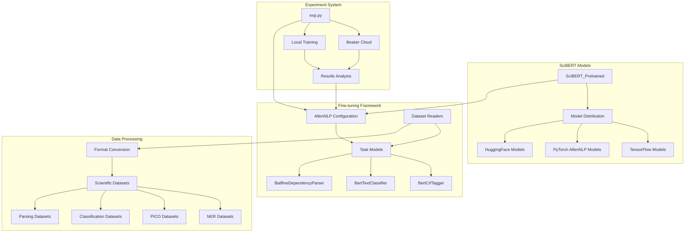
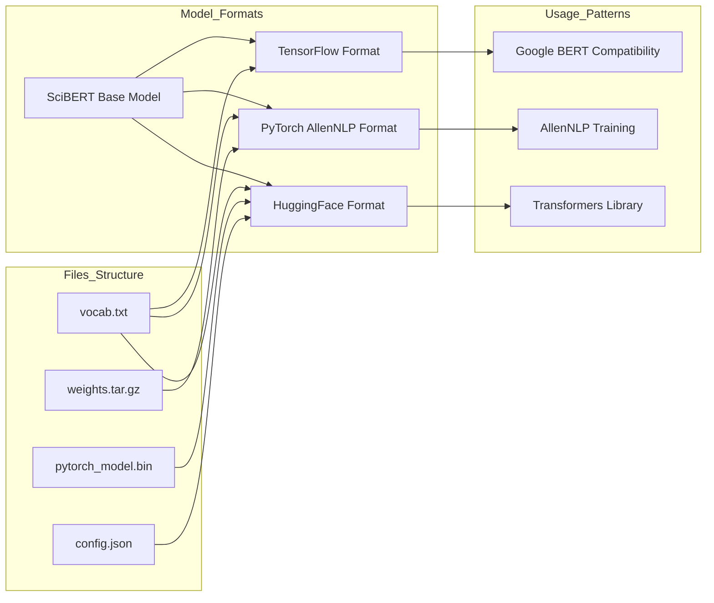
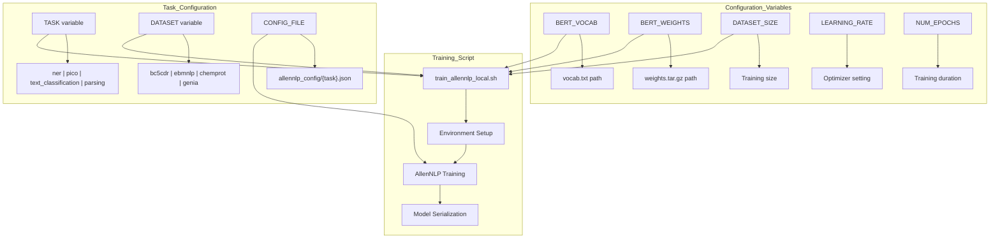

<!-- source: DeepWiki mcp.deepwiki.com · repo allenai/scibert · page 1 Overview · fetched 2026-10-26 -->

# Overview

Relevant source files

The following files were used as context for generating this wiki page:

- [.dockerignore](.dockerignore)
- [README.md](README.md)
- [scripts/train_allennlp_local.sh](scripts/train_allennlp_local.sh)

## Purpose and Scope

This document provides a comprehensive overview of the SciBERT repository, a specialized BERT model and fine-tuning framework designed for scientific natural language processing tasks. SciBERT is pretrained on scientific literature and optimized for downstream tasks including named entity recognition, text classification, dependency parsing, and relation extraction in scientific domains.

This overview covers the repository's architecture, core components, and systems. For specific implementation details about fine-tuning on particular tasks, see [Fine-tuning Guide](#3). For experiment management and hyperparameter optimization, see [Experiment Management](#5). For pretraining infrastructure details, see [Pretraining Pipeline](#7).

## What is SciBERT

SciBERT is a domain-specific BERT model trained on scientific text from the Semantic Scholar corpus, containing 1.14 million papers and 3.1 billion tokens. Unlike general-purpose BERT models, SciBERT uses full-text scientific papers during pretraining rather than just abstracts, making it more effective for scientific NLP tasks.

The model is available in four variants, combining two vocabulary types with two casing options:

| Vocabulary Type | Casing | Description |
|----------------|--------|-------------|
| `scivocab` | `uncased` | **Recommended** - Scientific vocabulary, lowercase |
| `scivocab` | `cased` | Scientific vocabulary, preserves casing |
| `basevocab` | `uncased` | Original BERT vocabulary, lowercase |
| `basevocab` | `cased` | Original BERT vocabulary, preserves casing |

## Repository Architecture

The repository implements a complete pipeline for scientific NLP, from model pretraining to task-specific fine-tuning and evaluation.

### Core System Components

Sources: [README.md:1-141](), [scripts/train_allennlp_local.sh:1-35]()

### Model Distribution Formats

SciBERT models are distributed in three formats to support different frameworks:

Sources: [README.md:44-60]()

## Scientific NLP Tasks

The repository supports comprehensive evaluation across multiple scientific NLP tasks, organized by domain and task type.

### Task Categories and Datasets

| Task Category | Datasets | Purpose |
|---------------|----------|---------|
| **Named Entity Recognition** | BC5CDR, NCBI-disease, JNLPBA, SciIE | Extract biomedical entities |
| **PICO Extraction** | EBMNLP | Extract clinical study components |
| **Text Classification** | ChemProt, Citation Intent, MAG, RCT-20k | Classify scientific text |
| **Dependency Parsing** | GENIA | Parse syntactic structure |
| **Relation Extraction** | ChemProt, SciIE | Extract semantic relationships |

### Training Configuration System

The fine-tuning process uses AllenNLP configurations with environment variables for flexible experimentation:

Sources: [scripts/train_allennlp_local.sh:1-35]()

## Key Features

### Domain Specialization
- **Scientific Vocabulary**: Custom vocabulary (`scivocab`) built from scientific corpus
- **Full-text Training**: Uses complete research papers, not just abstracts
- **Domain Coverage**: Broad scientific domains including biomedical, computer science, and chemistry

### Framework Integration
- **AllenNLP Integration**: Native support for AllenNLP training and evaluation
- **Multi-framework Support**: TensorFlow, PyTorch, and HuggingFace compatible models
- **Plug-and-play**: Drop-in replacement for standard BERT models

### Evaluation Infrastructure
- **Comprehensive Benchmarks**: Evaluation across 8+ scientific NLP tasks
- **Statistical Analysis**: Confidence intervals and significance testing
- **Reproducible Results**: Standardized evaluation protocols and seeds

## Getting Started

To use SciBERT in your research:

1. **Download Models**: Use HuggingFace integration or download pre-trained models
2. **Set Up Environment**: Install dependencies with `pip install -r requirements.txt`
3. **Configure Training**: Set environment variables in training scripts
4. **Run Experiments**: Use provided AllenNLP configurations for your task

For detailed setup instructions, see [Getting Started](#2). For specific task examples, see [Fine-tuning Guide](#3).

Sources: [README.md:67-121](), [.dockerignore:1-8]()

---

