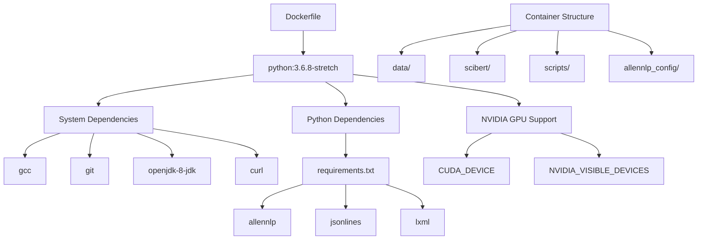
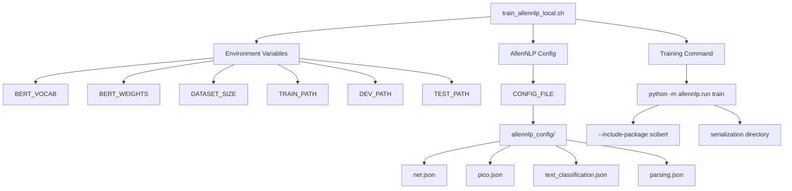
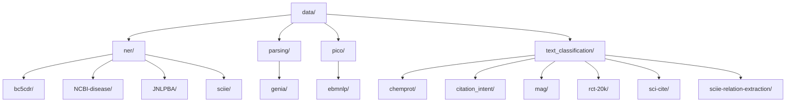
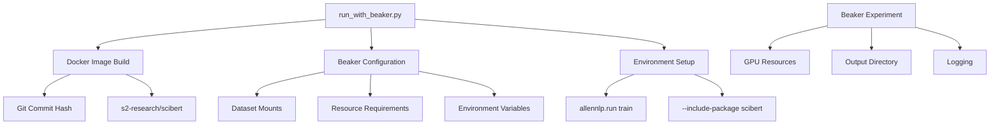

<!-- source: DeepWiki mcp.deepwiki.com · repo allenai/scibert · page 2 Getting Started · fetched 2026-10-26 -->

# Getting Started

<details>
<summary>Relevant source files</summary>

The following files were used as context for generating this wiki page:

- [.dockerignore](.dockerignore)
- [Dockerfile](Dockerfile)
- [README.md](README.md)
- [requirements.txt](requirements.txt)
- [scibert/models/bert_text_classifier.py](scibert/models/bert_text_classifier.py)
- [scripts/run_with_beaker.py](scripts/run_with_beaker.py)
- [scripts/train_allennlp_local.sh](scripts/train_allennlp_local.sh)

</details>


This page provides a quick start guide for using SciBERT pre-trained models and setting up the environment for fine-tuning on scientific NLP tasks. For comprehensive fine-tuning instructions, see [Fine-tuning Guide](#3). For experiment management and hyperparameter searches, see [Experiment Management](#5).

## Overview

SciBERT is a BERT model pre-trained on scientific text from 1.14M papers containing 3.1B tokens. The repository provides:

- Pre-trained models in multiple formats (TensorFlow, PyTorch, HuggingFace)
- Four model variants: `scivocab`/`basevocab` × `cased`/`uncased`
- Fine-tuning configurations for scientific NLP tasks
- Evaluation datasets and benchmarks

## Using Pre-trained Models

### HuggingFace Integration (Recommended)

The simplest way to use SciBERT is through the HuggingFace Transformers library:

```python
from transformers import AutoTokenizer, AutoModel

# Recommended: scivocab uncased model
tokenizer = AutoTokenizer.from_pretrained('allenai/scibert_scivocab_uncased')
model = AutoModel.from_pretrained('allenai/scibert_scivocab_uncased')

# Alternative: scivocab cased model
tokenizer = AutoTokenizer.from_pretrained('allenai/scibert_scivocab_cased')
model = AutoModel.from_pretrained('allenai/scibert_scivocab_cased')
```

### Model Variants

SciBERT provides four model combinations:

| Vocabulary | Casing | Recommended |
|------------|---------|-------------|
| `scivocab` | `uncased` | ✅ Best performance |
| `scivocab` | `cased` | |
| `basevocab` | `uncased` | |
| `basevocab` | `cased` | |

The `scivocab` vocabulary is built specifically for scientific text and typically outperforms `basevocab` (original BERT vocabulary).

### Pre-trained Model Formats

#### Model Distribution Architecture

```mermaid
graph TB
    A[SciBERT_Pretraining] --> B["TensorFlow Models"]
    A --> C["PyTorch AllenNLP Models"]
    A --> D["PyTorch HuggingFace Models"]
    A --> E["HuggingFace Hub"]
    
    B --> F["scibert_scivocab_uncased.tar.gz"]
    B --> G["scibert_scivocab_cased.tar.gz"]
    B --> H["scibert_basevocab_uncased.tar.gz"]
    B --> I["scibert_basevocab_cased.tar.gz"]
    
    C --> J["scibert_scivocab_uncased.tar"]
    C --> K["scibert_scivocab_cased.tar"]
    C --> L["scibert_basevocab_uncased.tar"]
    C --> M["scibert_basevocab_cased.tar"]
    
    D --> N["scibert_scivocab_uncased.tar"]
    D --> O["scibert_scivocab_cased.tar"]
    D --> P["scibert_basevocab_uncased.tar"]
    D --> Q["scibert_basevocab_cased.tar"]
    
    E --> R["allenai/scibert_scivocab_uncased"]
    E --> S["allenai/scibert_scivocab_cased"]
    
    T["AutoTokenizer.from_pretrained"] --> R
    T --> S
    U["AutoModel.from_pretrained"] --> R
    U --> S
```


Sources: [README.md:29-61]()

## Environment Setup

### Docker Environment (Recommended)

The repository includes a complete Docker environment for reproducible experiments:

```bash
# Build Docker image
docker build -t scibert .

# Run container
docker run -it --gpus all scibert /bin/bash
```

#### Docker Configuration


Sources: [Dockerfile:1-48](), [requirements.txt:1-3]()

### Local Environment

For local development, install dependencies:

```bash
pip install -r requirements.txt
python -m spacy download en_core_web_sm
```

Key dependencies:
- `allennlp` (custom fork with FP16 support)
- `jsonlines` for data processing
- `lxml` for XML parsing
- `spacy` for tokenization

## Basic Training Workflow

### Local Training Setup

The repository provides a script template for local training:

#### Training Script Configuration


Sources: [scripts/train_allennlp_local.sh:1-35]()

### Model and Data Paths

Before training, set up the model and data paths:

```bash
# Download and extract PyTorch model
tar -xvf scibert_scivocab_uncased.tar

# Set environment variables
export BERT_VOCAB=path-to/scibert_scivocab_uncased/vocab.txt
export BERT_WEIGHTS=path-to/scibert_scivocab_uncased/weights.tar.gz
export TRAIN_PATH=data/ner/bc5cdr/train.txt
export DEV_PATH=data/ner/bc5cdr/dev.txt
export TEST_PATH=data/ner/bc5cdr/test.txt
```

### Available Tasks and Datasets

The repository includes datasets for multiple scientific NLP tasks:

#### Dataset Structure


Sources: [README.md:77-95]()

## Cloud Training with Beaker

For large-scale experiments, use the Beaker integration:

```bash
python scripts/run_with_beaker.py allennlp_config/ner.json \
    --name "scibert-ner-experiment" \
    --env BERT_VOCAB=path-to-vocab \
    --env BERT_WEIGHTS=path-to-weights
```

#### Beaker Integration Components


Sources: [scripts/run_with_beaker.py:22-145]()

## Next Steps

After completing the basic setup:

1. **Task-Specific Fine-tuning**: See [Fine-tuning Guide](#3) for detailed instructions on NER, PICO extraction, text classification, and parsing
2. **Model Architecture**: Explore [Model Architecture](#4) to understand the implementation details
3. **Experiment Management**: Use [Experiment Management](#5) for hyperparameter searches and result analysis
4. **Data Processing**: See [Data Processing](#6) for custom dataset preparation

The `scibert-scivocab-uncased` model is recommended for most scientific NLP tasks and provides state-of-the-art performance across multiple benchmarks.

---

