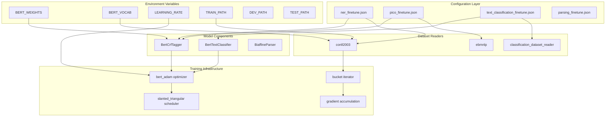
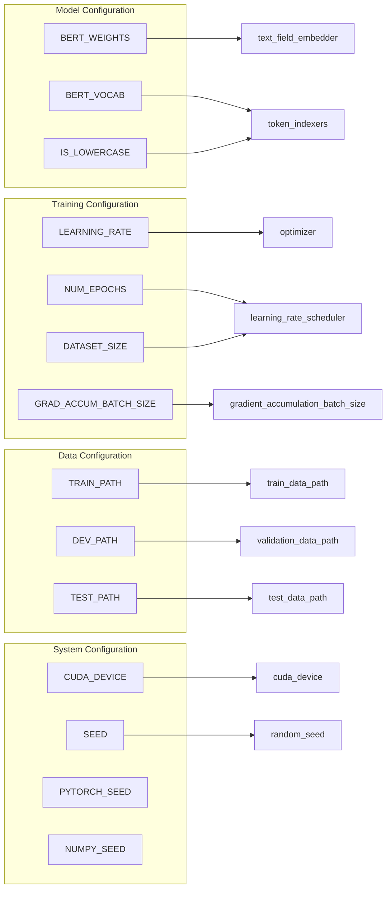
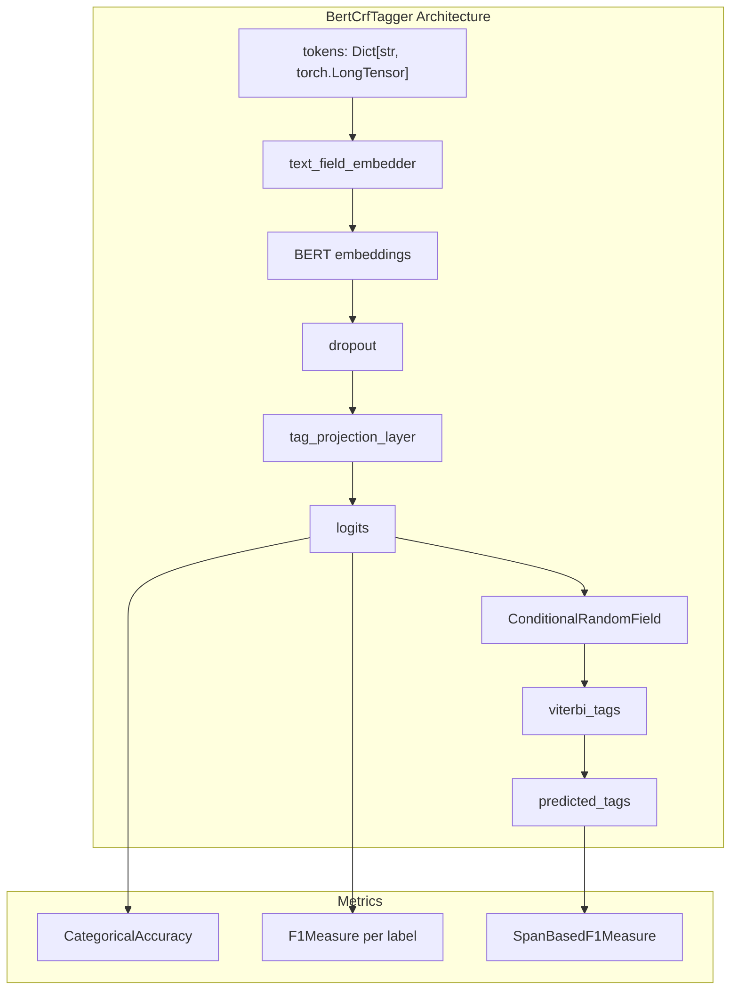

<!-- source: DeepWiki mcp.deepwiki.com · repo allenai/scibert · page 3 Fine-tuning Guide · fetched 2026-10-26 -->

# Fine-tuning Guide

<details>
<summary>Relevant source files</summary>

The following files were used as context for generating this wiki page:

- [allennlp_config/ner_finetune.json](allennlp_config/ner_finetune.json)
- [allennlp_config/pico_finetune.json](allennlp_config/pico_finetune.json)
- [allennlp_config/text_classification_finetune.json](allennlp_config/text_classification_finetune.json)
- [scibert/models/bert_crf_tagger.py](scibert/models/bert_crf_tagger.py)

</details>


This document provides a comprehensive guide to fine-tuning SciBERT models for downstream scientific NLP tasks using the AllenNLP framework. The fine-tuning system supports multiple task types including named entity recognition, PICO extraction, text classification, and dependency parsing through a unified configuration-based approach.

For information about the underlying model architecture, see [Model Architecture](#4). For large-scale experiment management and hyperparameter sweeps, see [Experiment Management](#5). For data preprocessing and format conversion, see [Data Processing](#6).

## Fine-tuning System Overview

The fine-tuning system is built on AllenNLP's configuration framework and supports multiple scientific NLP tasks through task-specific models and dataset readers. The system uses environment variables for parameterization and supports both local and cloud-based training.



Sources: [allennlp_config/ner_finetune.json:1-70](), [allennlp_config/pico_finetune.json:1-67](), [allennlp_config/text_classification_finetune.json:1-64]()

## Configuration System

### Core Configuration Structure

All fine-tuning configurations follow a consistent AllenNLP JSON structure with environment variable substitution using the `std.extVar()` function. The configurations define five main components:

| Component | Purpose | Key Parameters |
|-----------|---------|----------------|
| `dataset_reader` | Data loading and preprocessing | `type`, `token_indexers`, `coding_scheme` |
| `model` | Task-specific model architecture | `type`, `text_field_embedder`, task-specific parameters |
| `iterator` | Batch processing and data iteration | `type`, `batch_size`, `sorting_keys` |
| `trainer` | Training loop configuration | `optimizer`, `learning_rate_scheduler`, `validation_metric` |
| `random_seed` | Reproducibility controls | `random_seed`, `pytorch_seed`, `numpy_seed` |

### Environment Variable System

The configuration system relies on environment variables for parameterization, enabling easy hyperparameter sweeps and experiment management:



Sources: [allennlp_config/ner_finetune.json:2-4](), [allennlp_config/ner_finetune.json:12-13](), [allennlp_config/ner_finetune.json:37-38](), [allennlp_config/ner_finetune.json:53-68]()

## Task-Specific Models

### BertCrfTagger

The `BertCrfTagger` model is used for sequence labeling tasks including NER and PICO extraction. It combines BERT embeddings with a Conditional Random Field (CRF) layer for structured prediction.

Key configuration parameters:
- `label_encoding`: Tagging scheme (`"BIOUL"`, `"BIO"`, `"IOB1"`, `"BMES"`)
- `constrain_crf_decoding`: Enforces valid tag sequences
- `calculate_span_f1`: Enables span-level F1 evaluation
- `include_start_end_transitions`: CRF start/end transitions



Sources: [scibert/models/bert_crf_tagger.py:18-19](), [scibert/models/bert_crf_tagger.py:65-85](), [scibert/models/bert_crf_tagger.py:165-176]()

### Training Configuration

All tasks use a consistent training setup optimized for BERT fine-tuning:

| Parameter | Value | Purpose |
|-----------|-------|---------|
| Optimizer | `bert_adam` | BERT-specific Adam variant |
| Learning Rate Scheduler | `slanted_triangular` | Gradual warmup and decay |
| Batch Processing | `bucket` iterator | Groups similar-length sequences |
| Gradient Accumulation | Configurable via `GRAD_ACCUM_BATCH_SIZE` | Effective larger batch sizes |
| Weight Decay | 0.0 for bias and LayerNorm | Prevents overfitting |

The training pipeline includes several BERT-specific optimizations:
- Parameter groups with different weight decay settings for bias and LayerNorm parameters
- Slanted triangular learning rate schedule with warmup
- Gradient accumulation for effective large batch training
- Top-layer-only fine-tuning with `"requires_grad": 'all'` and `"top_layer_only": true`

Sources: [allennlp_config/ner_finetune.json:48-68](), [allennlp_config/pico_finetune.json:48-66](), [allennlp_config/text_classification_finetune.json:44-63]()

## Dataset Readers and Token Indexers

### Token Indexer Configuration

All tasks use the `bert-pretrained` token indexer with consistent configuration:

```json
"token_indexers": {
  "bert": {
    "type": "bert-pretrained",
    "pretrained_model": std.extVar("BERT_VOCAB"),
    "do_lowercase": std.extVar("IS_LOWERCASE"),
    "use_starting_offsets": true
  }
}
```

### Task-Specific Dataset Readers

| Task | Dataset Reader | Key Features |
|------|---------------|--------------|
| NER | `conll2003` | `tag_label: "ner"`, `coding_scheme: "BIOUL"` |
| PICO | `ebmnlp` | Medical text sequence labeling |
| Classification | `classification_dataset_reader` | Text classification format |

The dataset readers handle format-specific parsing and convert text into AllenNLP's internal representation using the configured token indexers.

Sources: [allennlp_config/ner_finetune.json:5-16](), [allennlp_config/pico_finetune.json:5-14](), [allennlp_config/text_classification_finetune.json:5-14]()

## Validation and Evaluation

### Validation Metrics

Each task type uses task-appropriate validation metrics for model selection:

| Task | Validation Metric | Purpose |
|------|------------------|---------|
| NER | `+f1-measure-overall` | Span-level F1 for entity recognition |
| PICO | `+avg_f1` | Average F1 across PICO components |
| Classification | `+average_F1` | Macro-averaged F1 for classification |

### Evaluation Configuration

All configurations enable test set evaluation with `"evaluate_on_test": true` and maintain model checkpoints with `"num_serialized_models_to_keep": 3`.

The `BertCrfTagger` provides comprehensive metrics including:
- Token-level accuracy (`CategoricalAccuracy`)
- Per-label F1 scores (`F1Measure` for each label)
- Span-level F1 when `calculate_span_f1: true`
- Average F1 across all labels

Sources: [allennlp_config/ner_finetune.json:58](), [allennlp_config/pico_finetune.json:55](), [allennlp_config/text_classification_finetune.json:52](), [scibert/models/bert_crf_tagger.py:111-125]()

## Integration with Experiment Management

The fine-tuning configurations integrate with the experiment management system through environment variable parameterization. The [Experiment Management](#5) system uses these configurations to run hyperparameter sweeps and statistical comparisons across different models and datasets.

For details on running experiments, see [Experiment Orchestration](#5.1). For cloud-based training, see [Cloud Training](#5.2).

---

