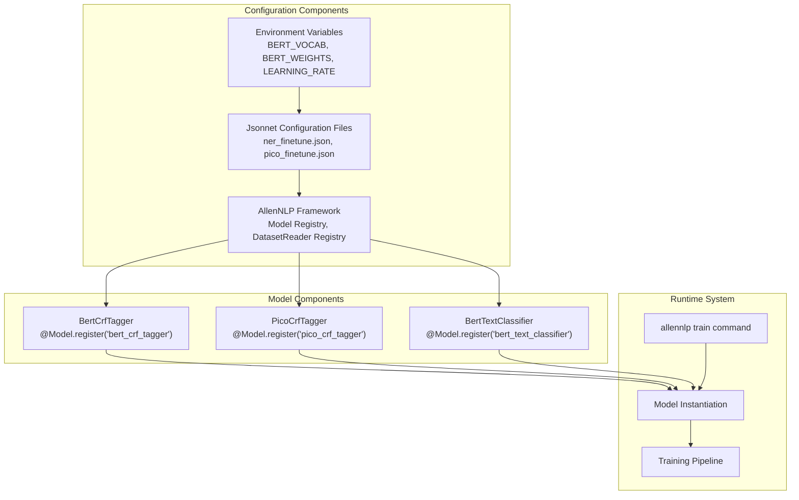
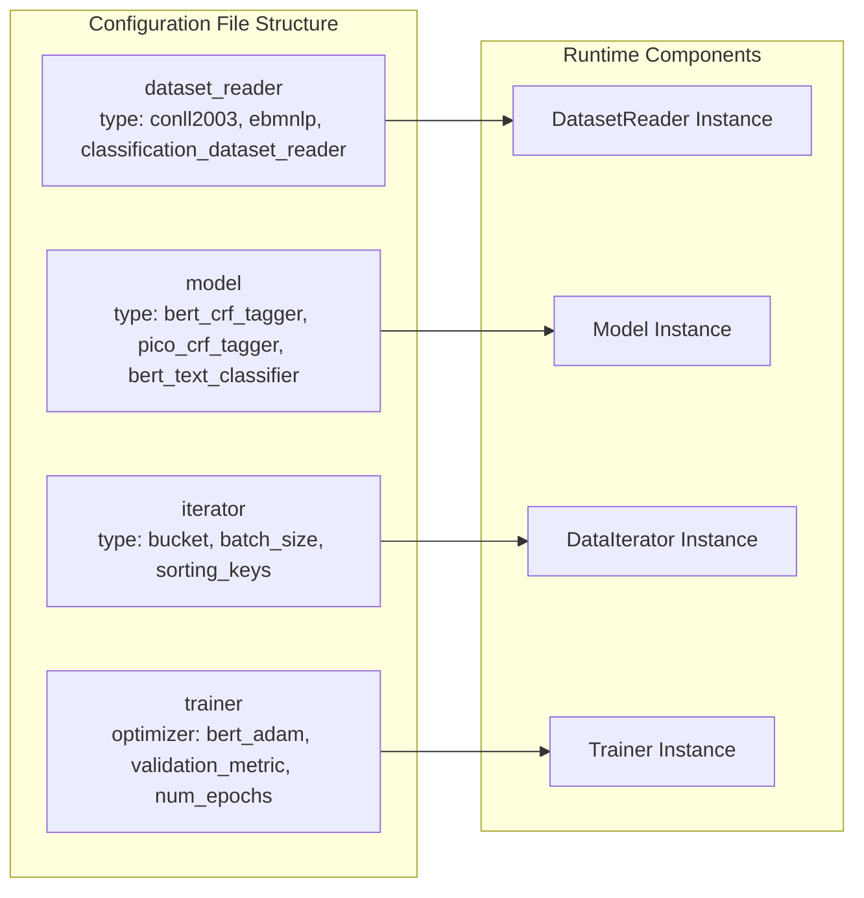
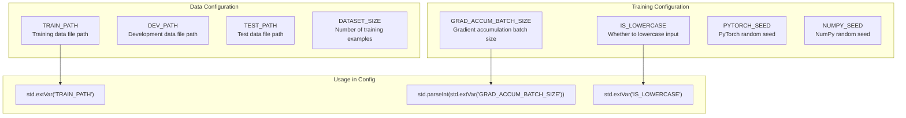
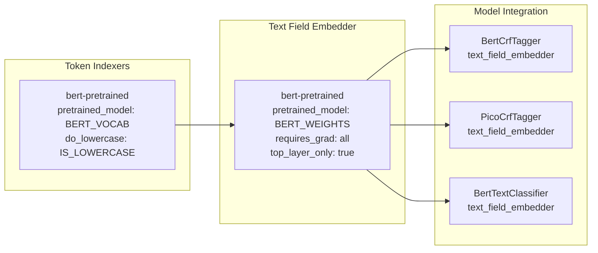
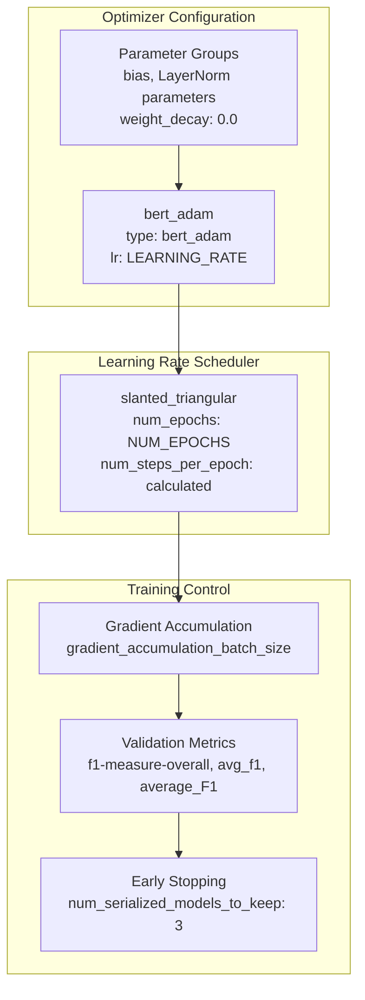

<!-- source: DeepWiki mcp.deepwiki.com · repo allenai/scibert · page 3.1 Configuration System · fetched 2026-10-26 -->

# Configuration System

<details>
<summary>Relevant source files</summary>

The following files were used as context for generating this wiki page:

- [allennlp_config/ner_finetune.json](allennlp_config/ner_finetune.json)
- [allennlp_config/pico.json](allennlp_config/pico.json)
- [allennlp_config/pico_finetune.json](allennlp_config/pico_finetune.json)
- [allennlp_config/text_classification_finetune.json](allennlp_config/text_classification_finetune.json)
- [scibert/models/bert_crf_tagger.py](scibert/models/bert_crf_tagger.py)
- [scibert/models/pico_crf_tagger.py](scibert/models/pico_crf_tagger.py)

</details>


This document covers the AllenNLP-based configuration system used for fine-tuning SciBERT models on downstream tasks. The configuration system uses JSON files with Jsonnet extensions to define model architectures, training parameters, and data processing pipelines.

For information about running experiments with these configurations, see [Experiment Orchestration](#5.1). For details about the specific models being configured, see [Core Models](#4.1).

## Overview

The configuration system is built on AllenNLP's declarative configuration framework, which allows defining entire training pipelines through JSON configuration files. The system uses Jsonnet to enable parameterization through environment variables, making configurations reusable across different experimental settings.



Sources: [allennlp_config/ner_finetune.json:1-70](), [allennlp_config/pico_finetune.json:1-67](), [allennlp_config/text_classification_finetune.json:1-64]()

## Configuration Structure

### Core Configuration Sections

All configurations follow the standard AllenNLP structure with four main sections:

| Section | Purpose | Key Components |
|---------|---------|----------------|
| `dataset_reader` | Data loading and preprocessing | Token indexers, data format specification |
| `model` | Model architecture and parameters | Model type, embedders, task-specific heads |
| `iterator` | Batching and data iteration | Batch size, sorting keys, caching |
| `trainer` | Training configuration | Optimizer, learning rate scheduler, validation metrics |



Sources: [allennlp_config/ner_finetune.json:5-17](), [allennlp_config/ner_finetune.json:22-43](), [allennlp_config/ner_finetune.json:44-49](), [allennlp_config/ner_finetune.json:50-69]()

## Environment Variable System

The configuration system uses Jsonnet's `std.extVar()` function to read environment variables, enabling parameterization without modifying configuration files.

### Core Environment Variables

| Variable | Purpose | Example Values |
|----------|---------|---------------|
| `BERT_VOCAB` | Vocabulary file path | `scibert_scivocab_uncased` |
| `BERT_WEIGHTS` | Model weights path | `scibert_scivocab_uncased` |
| `LEARNING_RATE` | Training learning rate | `5e-5`, `2e-5` |
| `NUM_EPOCHS` | Number of training epochs | `3`, `5` |
| `SEED` | Random seed for reproducibility | `13370`, `1337` |
| `CUDA_DEVICE` | GPU device index | `0`, `1` |

### Data and Training Variables



Sources: [allennlp_config/ner_finetune.json:2-4](), [allennlp_config/ner_finetune.json:12-13](), [allennlp_config/ner_finetune.json:18-20](), [allennlp_config/ner_finetune.json:47](), [allennlp_config/ner_finetune.json:67-68]()

## Model Configuration

### BERT Text Field Embedder

All models use a consistent BERT text field embedder configuration:



Sources: [allennlp_config/ner_finetune.json:10-16](), [allennlp_config/ner_finetune.json:29-42](), [scibert/models/bert_crf_tagger.py:27-28]()

### Task-Specific Model Types

#### BertCrfTagger Configuration

Used for NER and PICO fine-tuning tasks:

```json
{
  "type": "bert_crf_tagger",
  "label_encoding": "BIOUL",
  "constrain_crf_decoding": true,
  "calculate_span_f1": true,
  "dropout": 0.1,
  "include_start_end_transitions": false
}
```

#### PicoCrfTagger Configuration

Alternative PICO implementation with LSTM encoder:

```json
{
  "type": "pico_crf_tagger",
  "dropout": 0.5,
  "include_start_end_transitions": false,
  "encoder": {
    "type": "lstm",
    "input_size": 768,
    "hidden_size": 200,
    "num_layers": 2,
    "dropout": 0.5,
    "bidirectional": true
  }
}
```

Sources: [allennlp_config/ner_finetune.json:22-43](), [allennlp_config/pico.json:20-44](), [scibert/models/bert_crf_tagger.py:18](), [scibert/models/pico_crf_tagger.py:18]()

## Training Configuration

### Optimizer Configuration

All configurations use the `bert_adam` optimizer with task-specific parameter groups:



Sources: [allennlp_config/ner_finetune.json:51-56](), [allennlp_config/ner_finetune.json:62-66](), [allennlp_config/ner_finetune.json:67]()

### Task-Specific Validation Metrics

| Task | Validation Metric | Purpose |
|------|------------------|---------|
| NER | `+f1-measure-overall` | Span-based F1 score |
| PICO | `+avg_f1` | Average F1 across PICO labels |
| Text Classification | `+average_F1` | Average F1 across classes |

Sources: [allennlp_config/ner_finetune.json:58](), [allennlp_config/pico_finetune.json:55](), [allennlp_config/text_classification_finetune.json:52]()

## Configuration Files by Task

### Named Entity Recognition

Configuration: `allennlp_config/ner_finetune.json`

- Dataset Reader: `conll2003` with `BIOUL` encoding
- Model: `bert_crf_tagger` with span F1 calculation
- Validation Metric: `f1-measure-overall`

### PICO Extraction

Two configurations available:

1. **Fine-tuning version**: `allennlp_config/pico_finetune.json`
   - Model: `bert_crf_tagger` without span F1
   - Dataset Reader: `ebmnlp`

2. **LSTM version**: `allennlp_config/pico.json`  
   - Model: `pico_crf_tagger` with LSTM encoder
   - Includes bidirectional LSTM with 200 hidden units

### Text Classification

Configuration: `allennlp_config/text_classification_finetune.json`

- Dataset Reader: `classification_dataset_reader`
- Model: `bert_text_classifier` with verbose metrics
- Validation Metric: `average_F1`

Sources: [allennlp_config/ner_finetune.json:1-70](), [allennlp_config/pico_finetune.json:1-67](), [allennlp_config/pico.json:1-69](), [allennlp_config/text_classification_finetune.json:1-64]()

## Usage with AllenNLP

The configurations are used with the AllenNLP command-line interface:

```bash
allennlp train allennlp_config/ner_finetune.json \
  --serialization-dir output/ \
  --include-package scibert
```

Environment variables must be set before running the command:

```bash
export BERT_VOCAB=scibert_scivocab_uncased
export BERT_WEIGHTS=scibert_scivocab_uncased  
export LEARNING_RATE=5e-5
export NUM_EPOCHS=3
# ... other required variables
```

Sources: [allennlp_config/ner_finetune.json:1-70](), [scibert/models/bert_crf_tagger.py:18]()

---

