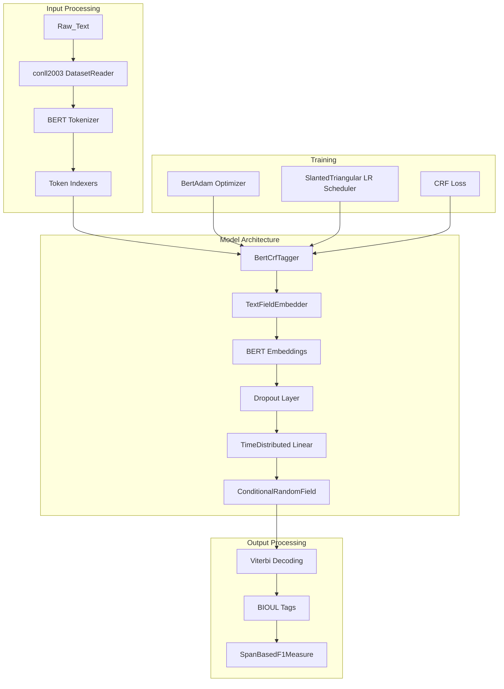
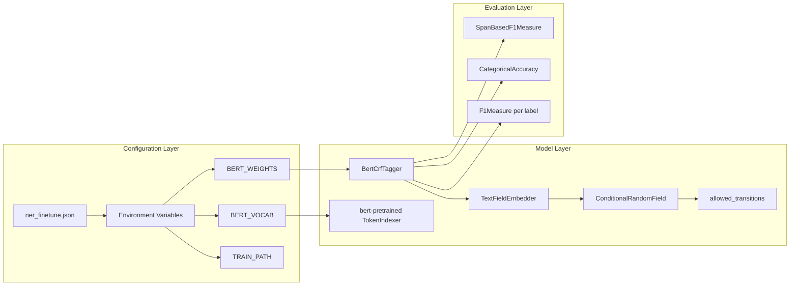

<!-- source: DeepWiki mcp.deepwiki.com · repo allenai/scibert · page 3.2 Named Entity Recognition · fetched 2026-10-26 -->

# Named Entity Recognition

<details>
<summary>Relevant source files</summary>

The following files were used as context for generating this wiki page:

- [.gitignore](.gitignore)
- [allennlp_config/ner_finetune.json](allennlp_config/ner_finetune.json)
- [allennlp_config/pico_finetune.json](allennlp_config/pico_finetune.json)
- [allennlp_config/text_classification_finetune.json](allennlp_config/text_classification_finetune.json)
- [scibert/models/bert_crf_tagger.py](scibert/models/bert_crf_tagger.py)

</details>


Named Entity Recognition (NER) is a key downstream task supported by the SciBERT fine-tuning system. This page covers the configuration, model architecture, and training pipeline for NER tasks using biomedical datasets such as BC5CDR, NCBI-disease, and JNLPBA.

For PICO extraction, which is a specialized form of NER for medical literature, see [PICO Extraction](#3.3). For general text classification tasks, see [Text Classification](#3.4).

## Architecture Overview

The NER system uses a BERT-CRF architecture that combines SciBERT embeddings with a Conditional Random Field for sequence labeling.

### NER Pipeline Architecture



Sources: [allennlp_config/ner_finetune.json:1-70](), [scibert/models/bert_crf_tagger.py:1-233]()

### Model Component Mapping



Sources: [allennlp_config/ner_finetune.json:1-70](), [scibert/models/bert_crf_tagger.py:18-233]()

## Configuration System

The NER system uses AllenNLP's configuration system with environment variable substitution. The main configuration file is `ner_finetune.json`.

### Key Configuration Parameters

| Parameter | Purpose | Default/Example |
|-----------|---------|-----------------|
| `dataset_reader.type` | Dataset format | `"conll2003"` |
| `dataset_reader.coding_scheme` | Label encoding | `"BIOUL"` |
| `model.type` | Model class | `"bert_crf_tagger"` |
| `model.label_encoding` | CRF constraints | `"BIOUL"` |
| `model.constrain_crf_decoding` | Valid sequence constraint | `true` |
| `model.calculate_span_f1` | Span-level evaluation | `true` |

### Environment Variables

The configuration uses several environment variables for flexibility:

- `BERT_WEIGHTS`: Path to pretrained BERT model weights
- `BERT_VOCAB`: Path to BERT vocabulary file  
- `TRAIN_PATH`, `DEV_PATH`, `TEST_PATH`: Dataset file paths
- `LEARNING_RATE`: Optimizer learning rate
- `NUM_EPOCHS`: Training epochs
- `GRAD_ACCUM_BATCH_SIZE`: Gradient accumulation batch size

Sources: [allennlp_config/ner_finetune.json:1-70]()

## Model Architecture

### BertCrfTagger Class

The core NER model is implemented in the `BertCrfTagger` class, which extends AllenNLP's `Model` base class.

#### Key Components

1. **Text Field Embedder**: Converts tokens to BERT embeddings
2. **Tag Projection Layer**: Maps embeddings to tag logits
3. **Conditional Random Field**: Enforces valid tag sequences
4. **Metrics**: Tracks accuracy and F1 scores

#### Model Initialization

The model accepts these key parameters:
- `text_field_embedder`: BERT-based embedding layer
- `label_encoding`: Tag encoding scheme (BIO, BIOUL, etc.)
- `constrain_crf_decoding`: Whether to enforce valid transitions
- `calculate_span_f1`: Whether to compute span-level metrics
- `dropout`: Dropout rate for regularization

Sources: [scibert/models/bert_crf_tagger.py:65-126]()

### Forward Pass

The model's forward pass follows this sequence:

1. **Embedding**: Convert input tokens to BERT embeddings
2. **Dropout**: Apply dropout for regularization  
3. **Projection**: Project embeddings to tag space
4. **CRF Decoding**: Use Viterbi algorithm to find best tag sequence
5. **Loss Computation**: Calculate negative log-likelihood loss (training only)

```python
# Key forward pass steps from BertCrfTagger.forward()
embedded_text_input = self.text_field_embedder(tokens)
mask = util.get_text_field_mask(tokens)
embedded_text_input = self.dropout(embedded_text_input)
logits = self.tag_projection_layer(embedded_text_input)
best_paths = self.crf.viterbi_tags(logits, mask)
```

Sources: [scibert/models/bert_crf_tagger.py:165-176]()

## Training Pipeline

### Training Configuration

The training pipeline uses several specialized components:

| Component | Configuration | Purpose |
|-----------|---------------|---------|
| Optimizer | `bert_adam` | BERT-optimized Adam optimizer |
| LR Scheduler | `slanted_triangular` | Triangular learning rate schedule |
| Iterator | `bucket` | Batch by sequence length |
| Validation Metric | `+f1-measure-overall` | Primary metric for model selection |

### Optimizer Configuration

The optimizer uses different weight decay settings for different parameter groups:

```json
"optimizer": {
    "type": "bert_adam",
    "lr": std.extVar("LEARNING_RATE"),
    "parameter_groups": [
        [["bias", "LayerNorm.bias", "LayerNorm.weight", "layer_norm.weight"], 
         {"weight_decay": 0.0}]
    ]
}
```

Sources: [allennlp_config/ner_finetune.json:51-56]()

### Learning Rate Scheduling

The training uses a slanted triangular learning rate schedule:

```json
"learning_rate_scheduler": {
    "type": "slanted_triangular",
    "num_epochs": std.parseInt(std.extVar("NUM_EPOCHS")),
    "num_steps_per_epoch": std.parseInt(std.extVar("DATASET_SIZE")) / 
                           std.parseInt(std.extVar("GRAD_ACCUM_BATCH_SIZE"))
}
```

Sources: [allennlp_config/ner_finetune.json:62-66]()

## Evaluation Metrics

### Metrics Computation

The `BertCrfTagger` computes multiple types of metrics:

1. **Token-level Accuracy**: `CategoricalAccuracy` for individual token predictions
2. **Per-label F1**: `F1Measure` for each entity type
3. **Span-level F1**: `SpanBasedF1Measure` for complete entity spans
4. **Average F1**: Mean F1 across all entity types

### Metric Implementation

```python
self.metrics = {
    "accuracy": CategoricalAccuracy(),
    "accuracy3": CategoricalAccuracy(top_k=3)
}
for index, label in self.vocab.get_index_to_token_vocabulary(label_namespace).items():
    self.metrics['F1_' + label] = F1Measure(positive_label=index)
```

The span-based F1 metric is configured when `calculate_span_f1=True`:

```python
if calculate_span_f1:
    self._f1_metric = SpanBasedF1Measure(vocab,
                                         tag_namespace=label_namespace,
                                         label_encoding=label_encoding)
```

Sources: [scibert/models/bert_crf_tagger.py:111-124]()

### Validation Metric

The training process uses `+f1-measure-overall` as the primary validation metric for model selection, which represents the overall span-level F1 score.

Sources: [allennlp_config/ner_finetune.json:58]()

## Label Encoding

The NER system supports multiple label encoding schemes through the `label_encoding` parameter:

- **BIO**: Begin-Inside-Outside
- **BIOUL**: Begin-Inside-Outside-Unit-Last  
- **IOB1**: Inside-Outside-Begin (variant)
- **BMES**: Begin-Middle-End-Single

The default configuration uses `BIOUL` encoding, which provides more fine-grained control over entity boundaries.

### CRF Constraints

When `constrain_crf_decoding=True`, the system enforces valid tag transitions based on the label encoding:

```python
if constrain_crf_decoding:
    labels = self.vocab.get_index_to_token_vocabulary(label_namespace)
    constraints = allowed_transitions(label_encoding, labels)
else:
    constraints = None
```

Sources: [scibert/models/bert_crf_tagger.py:96-103]()

---

