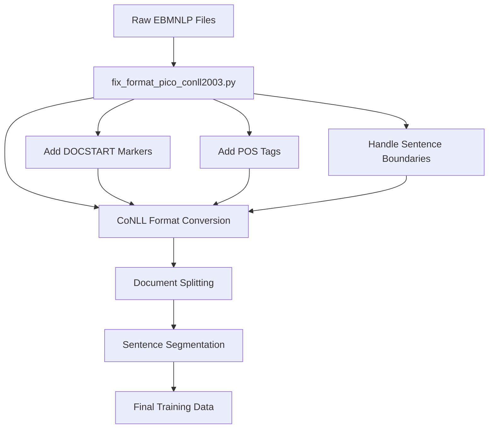
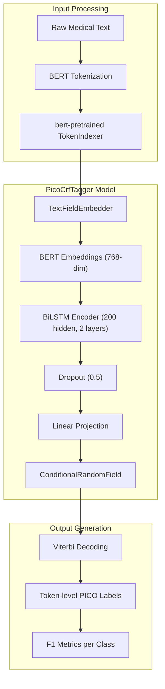
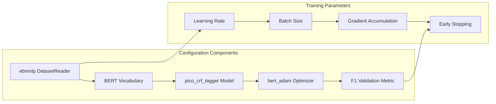
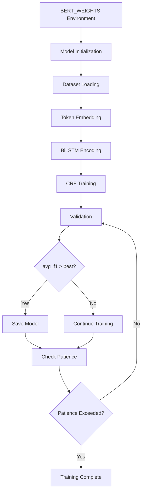

<!-- source: DeepWiki mcp.deepwiki.com · repo allenai/scibert · page 3.3 PICO Extraction · fetched 2026-10-26 -->

# PICO Extraction

<details>
<summary>Relevant source files</summary>

The following files were used as context for generating this wiki page:

- [allennlp_config/pico.json](allennlp_config/pico.json)
- [data/pico/ebmnlp/dev.txt](data/pico/ebmnlp/dev.txt)
- [data/pico/ebmnlp/test.txt](data/pico/ebmnlp/test.txt)
- [data/pico/ebmnlp/train.txt](data/pico/ebmnlp/train.txt)
- [scibert/models/pico_crf_tagger.py](scibert/models/pico_crf_tagger.py)
- [scripts/fix_format_pico_conll2003.py](scripts/fix_format_pico_conll2003.py)

</details>


This document covers the PICO extraction system in SciBERT, which performs structured information extraction from medical literature. PICO extraction identifies Population, Intervention, Comparison, and Outcome elements from clinical research papers to support evidence-based medicine.

For general fine-tuning guidance, see [Fine-tuning Guide](#3). For other NLP tasks like named entity recognition, see [Named Entity Recognition](#3.2).

## Overview

PICO extraction is a specialized named entity recognition task that identifies four key components in clinical research:

- **Population (PAR)**: The patients or subjects being studied
- **Intervention (INT)**: The treatment or exposure being investigated  
- **Comparison (not used in this implementation)**: The control or alternative treatment
- **Outcome (OUT)**: The measured results or endpoints

The system uses a BERT-based CRF tagger to perform token-level sequence labeling on medical abstracts, extracting these structured elements to support systematic reviews and evidence synthesis.

## Data Format and Processing

### EBMNLP Dataset Format

The PICO extraction system uses the EBMNLP (Evidence-Based Medicine NLP) dataset, which follows a CoNLL-style format with four columns per token:

```
Token    POS    NER    PICO_Label
patients NN     O      I-PAR
with     NN     O      I-PAR
diabetes NN     O      I-PAR
received NN     O      O
aspirin  NN     O      I-INT
therapy  NN     O      I-INT
```

The PICO labels follow IO encoding:
- `I-PAR`: Inside Population
- `I-INT`: Inside Intervention  
- `I-OUT`: Inside Outcome
- `O`: Outside any PICO element

### Data Preprocessing Pipeline



The preprocessing script handles several data format issues:
- Converts 2-column format to 4-column CoNLL format
- Concatenates individual paper files into single training files
- Adds document boundaries with `-DOCSTART-` markers
- Performs basic sentence splitting on periods

**Sources:** [scripts/fix_format_pico_conll2003.py:1-50](), [data/pico/ebmnlp/test.txt:1-100](), [data/pico/ebmnlp/dev.txt:1-100]()

## Model Architecture

### PICO CRF Tagger Components



The `PicoCrfTagger` class extends AllenNLP's `Model` and implements several key components:

- **Text Field Embedder**: Converts tokens to BERT embeddings using `bert-pretrained` embedder
- **Sequence Encoder**: BiLSTM with 200 hidden units and 2 layers processes contextualized embeddings
- **CRF Layer**: `ConditionalRandomField` performs structured prediction for sequence labeling
- **Metrics**: Per-class F1 scores for PAR, INT, and OUT labels plus overall accuracy

**Sources:** [scibert/models/pico_crf_tagger.py:18-139]()

### Model Configuration

The training configuration uses several key components:



Key configuration parameters:
- Dataset reader: `ebmnlp` with BERT token indexers
- Model: `pico_crf_tagger` with dropout=0.5
- Optimizer: `bert_adam` with configurable learning rate
- Validation metric: `avg_f1` across all PICO classes
- Early stopping: patience=10 epochs

**Sources:** [allennlp_config/pico.json:1-69]()

## Training Process

### Model Training Pipeline



The training process involves:

1. **Initialization**: Load pre-trained BERT weights specified by `BERT_WEIGHTS` environment variable
2. **Forward Pass**: Process tokens through BERT → BiLSTM → CRF layers
3. **Loss Calculation**: Negative log-likelihood from CRF layer
4. **Validation**: Calculate per-class F1 scores and average F1
5. **Model Selection**: Save best model based on validation `avg_f1` metric

**Sources:** [allennlp_config/pico.json:51-68]()

### Evaluation Metrics

The `PicoCrfTagger` tracks multiple evaluation metrics:

```python
# From get_metrics method
metrics_to_return = {}
for metric_name, metric_obj in self.metrics.items():
    if metric_name.startswith('F1_'):
        p, r, f1 = metric_obj.get_metric(reset)
        metrics_to_return[metric_name] = f1
        total_f1 += f1
        total_classes += 1
metrics_to_return['avg_f1'] = total_f1 / total_classes
```

Metrics include:
- `F1_I-PAR`: F1 score for Population labels
- `F1_I-INT`: F1 score for Intervention labels  
- `F1_I-OUT`: F1 score for Outcome labels
- `F1_O`: F1 score for Outside labels
- `avg_f1`: Average F1 across all classes (validation metric)
- `accuracy`: Token-level accuracy
- `accuracy3`: Top-3 accuracy

**Sources:** [scibert/models/pico_crf_tagger.py:124-139]()

## Usage and Integration

### Environment Variables

The PICO extraction system uses several environment variables for configuration:

- `BERT_WEIGHTS`: Path to pre-trained BERT model weights
- `BERT_VOCAB`: Path to BERT vocabulary file
- `IS_LOWERCASE`: Whether to use lowercase BERT model
- `TRAIN_PATH`, `DEV_PATH`, `TEST_PATH`: Dataset file paths
- `LEARNING_RATE`: Optimizer learning rate
- `NUM_EPOCHS`: Maximum training epochs
- `GRAD_ACCUM_BATCH_SIZE`: Gradient accumulation batch size
- `CUDA_DEVICE`: GPU device number

### Integration with Experiment System

The PICO extraction model integrates with the broader experiment management system for hyperparameter tuning and evaluation. For details on running experiments, see [Experiment Management](#5).

**Sources:** [allennlp_config/pico.json:2-11](), [allennlp_config/pico.json:16-18](), [allennlp_config/pico.json:32](), [allennlp_config/pico.json:48](), [allennlp_config/pico.json:54](), [allennlp_config/pico.json:58](), [allennlp_config/pico.json:65](), [allennlp_config/pico.json:67]()

---

