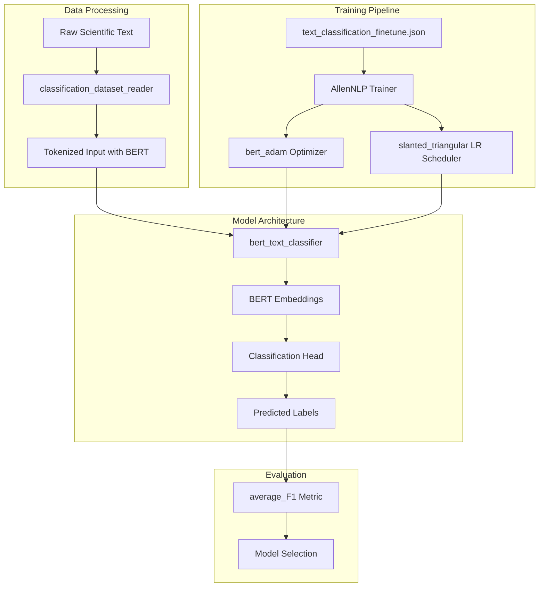
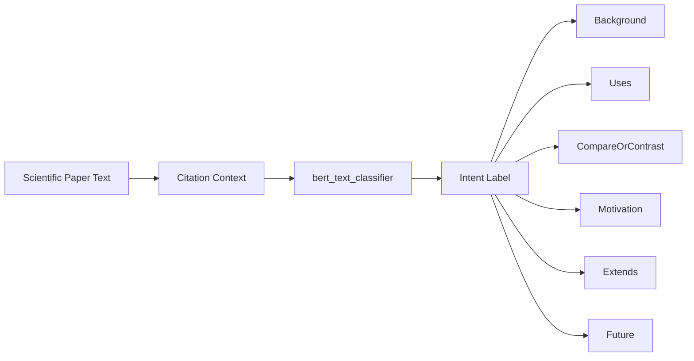
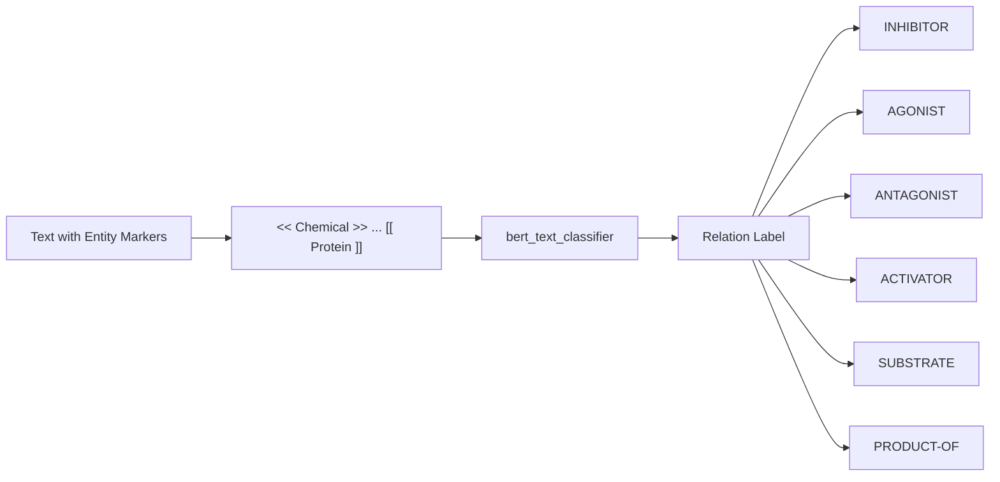
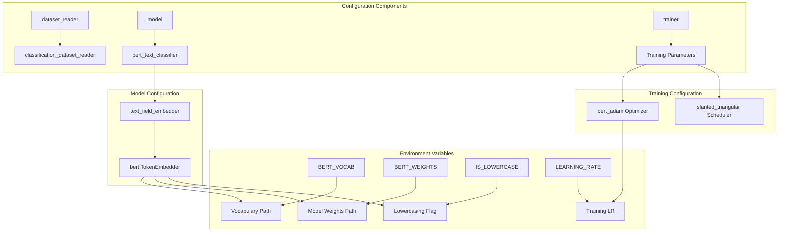
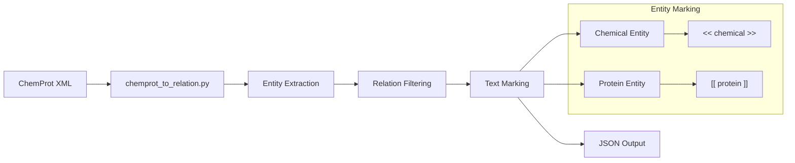
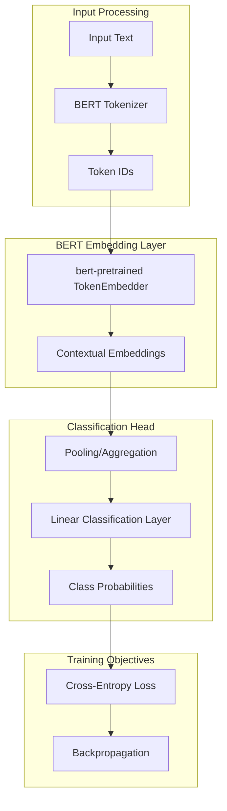
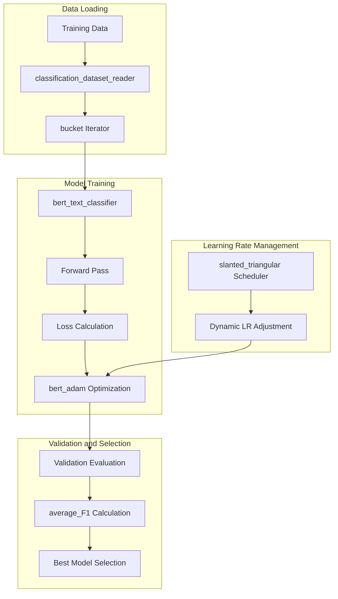

<!-- source: DeepWiki mcp.deepwiki.com · repo allenai/scibert · page 3.4 Text Classification · fetched 2026-10-26 -->

# Text Classification

<details>
<summary>Relevant source files</summary>

The following files were used as context for generating this wiki page:

- [allennlp_config/ner_finetune.json](allennlp_config/ner_finetune.json)
- [allennlp_config/pico_finetune.json](allennlp_config/pico_finetune.json)
- [allennlp_config/text_classification_finetune.json](allennlp_config/text_classification_finetune.json)
- [data/text_classification/chemprot/dev.txt](data/text_classification/chemprot/dev.txt)
- [data/text_classification/chemprot/test.txt](data/text_classification/chemprot/test.txt)
- [data/text_classification/chemprot/train.txt](data/text_classification/chemprot/train.txt)
- [data/text_classification/citation_intent/dev.txt](data/text_classification/citation_intent/dev.txt)
- [data/text_classification/citation_intent/test.txt](data/text_classification/citation_intent/test.txt)
- [data/text_classification/citation_intent/train.txt](data/text_classification/citation_intent/train.txt)
- [data/text_classification/sci-cite/dev.txt](data/text_classification/sci-cite/dev.txt)
- [data/text_classification/sci-cite/test.txt](data/text_classification/sci-cite/test.txt)
- [data/text_classification/sci-cite/train.txt](data/text_classification/sci-cite/train.txt)
- [scibert/models/bert_crf_tagger.py](scibert/models/bert_crf_tagger.py)
- [scripts/chemprot_to_relation.py](scripts/chemprot_to_relation.py)

</details>


This document covers the text classification system for fine-tuning SciBERT on scientific text classification tasks. The system uses AllenNLP's framework to train BERT-based classifiers for various scientific NLP tasks including citation intent classification and chemical-protein relation extraction.

For information about named entity recognition, see [Named Entity Recognition](#3.2). For dependency parsing, see [Dependency Parsing](#3.5).

## System Architecture

The text classification system follows a standard supervised learning pipeline built on AllenNLP's framework. It takes scientific text with entity markers and classifies the relationships or intents expressed.



**Sources**: [allennlp_config/text_classification_finetune.json:1-64]()

## Supported Tasks and Datasets

The system supports multiple scientific text classification tasks with different label schemas:

| Task | Dataset | Labels | Description |
|------|---------|--------|-------------|
| Citation Intent | sci-cite | Background, Uses, CompareOrContrast, Motivation, Extends, Future | Classify the intent behind scientific citations |
| Chemical-Protein Relations | chemprot | INHIBITOR, AGONIST, ANTAGONIST, ACTIVATOR, SUBSTRATE, etc. | Classify relationships between chemical entities and proteins |

### Citation Intent Classification



**Sources**: [data/text_classification/sci-cite/train.txt:1-100](), [data/text_classification/citation_intent/train.txt:1-100]()

### Chemical-Protein Relation Classification

The system handles entity-marked text where chemicals and proteins are highlighted with special markers:



**Sources**: [data/text_classification/chemprot/train.txt:1-100](), [scripts/chemprot_to_relation.py:47-62]()

## Configuration System

The text classification system is configured through AllenNLP's JSON configuration format:



**Sources**: [allennlp_config/text_classification_finetune.json:5-15](), [allennlp_config/text_classification_finetune.json:20-36](), [allennlp_config/text_classification_finetune.json:44-68]()

## Data Format and Processing

### Input Data Format

Text classification data is stored in JSON Lines format with the following structure:

```json
{
  "text": "Text content with optional entity markers",
  "label": "Classification label", 
  "metadata": {}
}
```

### ChemProt Data Conversion

The `chemprot_to_relation.py` script converts XML-formatted ChemProt data into the required JSON format:



**Sources**: [scripts/chemprot_to_relation.py:25-65]()

## Model Architecture

The `bert_text_classifier` model implements a standard BERT-based classification architecture:



The model configuration specifies key parameters:
- `verbose_metrics: true` - Enables detailed per-class metrics
- `top_layer_only: true` - Only uses the top BERT layer
- `requires_grad: 'all'` - All BERT parameters are trainable

**Sources**: [allennlp_config/text_classification_finetune.json:20-36]()

## Training Process

### Optimization Configuration

The training uses specialized components optimized for BERT fine-tuning:

| Component | Configuration | Purpose |
|-----------|---------------|---------|
| Optimizer | `bert_adam` | BERT-specific Adam variant |
| LR Scheduler | `slanted_triangular` | Triangular learning rate schedule |
| Validation Metric | `+average_F1` | F1-score for model selection |
| Batch Processing | `bucket` iterator | Efficient batching by sequence length |

### Training Pipeline Flow



The training configuration includes gradient accumulation and efficient memory usage through:
- `gradient_accumulation_batch_size` for handling large effective batch sizes
- `cache_instances: true` for faster data loading
- `num_serialized_models_to_keep: 3` for model checkpointing

**Sources**: [allennlp_config/text_classification_finetune.json:44-68]()

---

