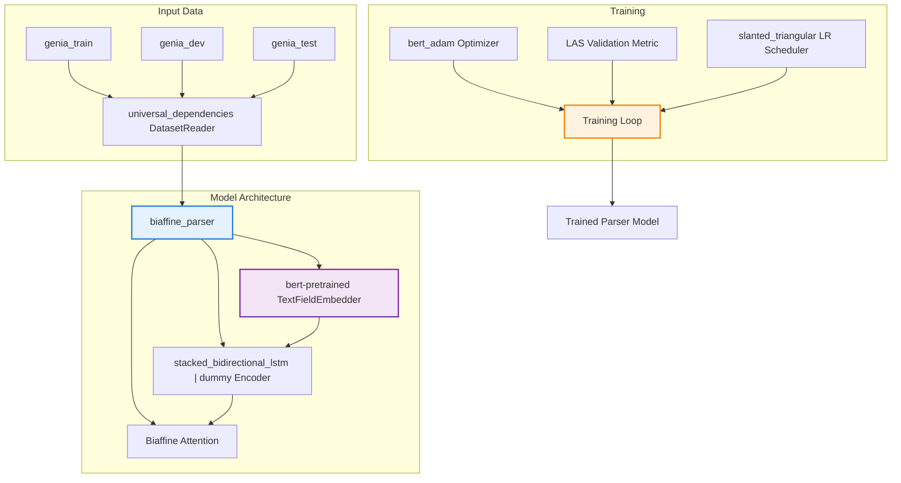
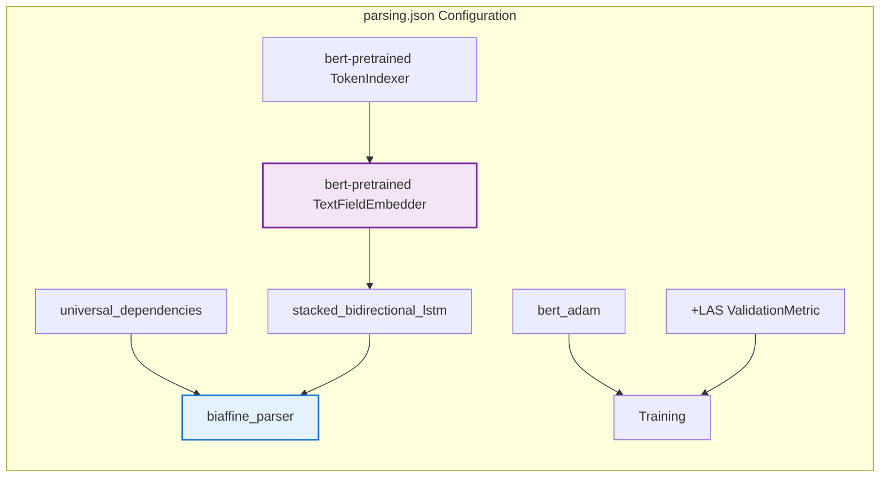
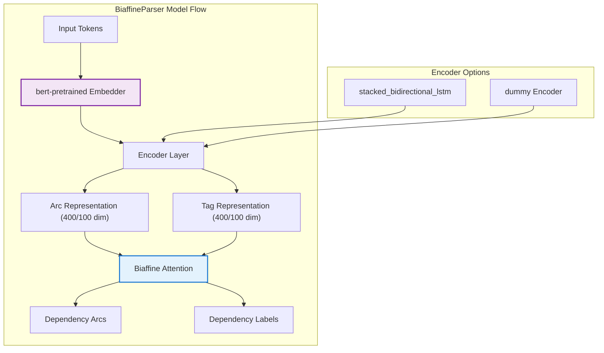
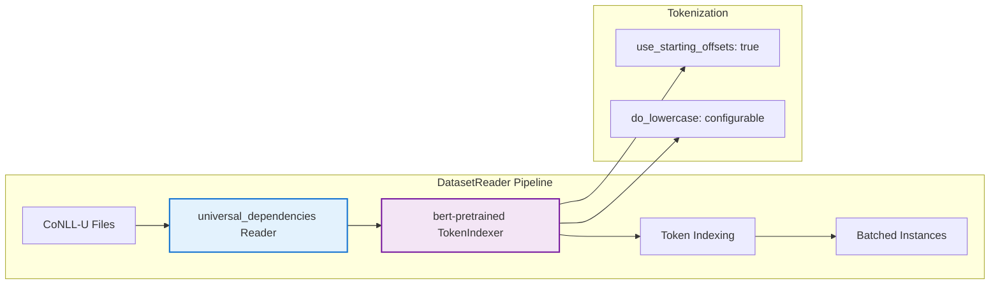
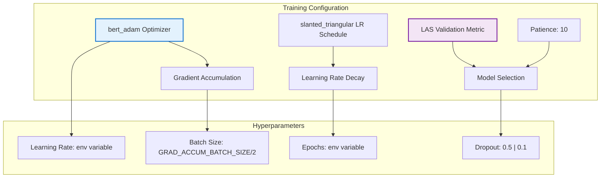
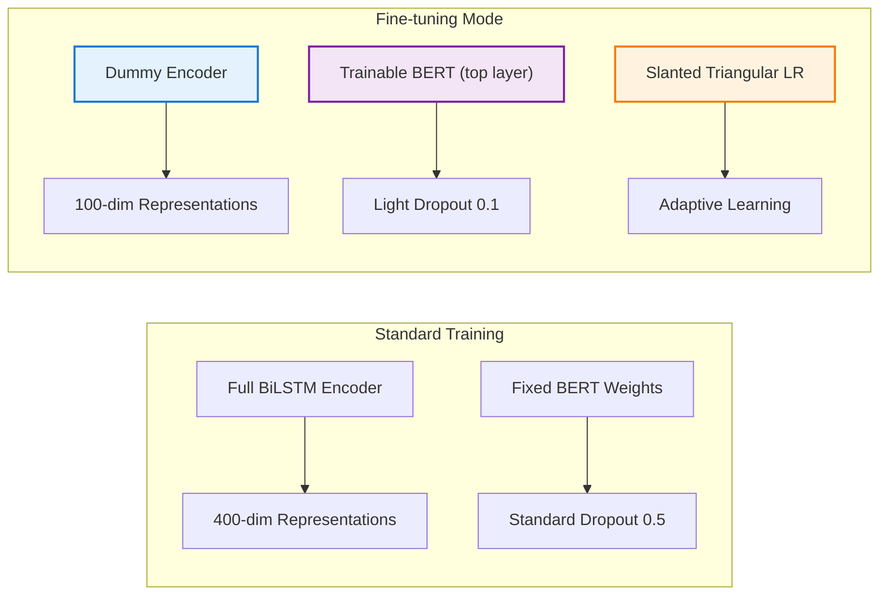

<!-- source: DeepWiki mcp.deepwiki.com · repo allenai/scibert · page 3.5 Dependency Parsing · fetched 2026-10-26 -->

# Dependency Parsing

<details>
<summary>Relevant source files</summary>

The following files were used as context for generating this wiki page:

- [allennlp_config/parsing.json](allennlp_config/parsing.json)
- [allennlp_config/parsing_finetune.json](allennlp_config/parsing_finetune.json)
- [data/parsing/genia/dev.txt](data/parsing/genia/dev.txt)
- [data/parsing/genia/test.txt](data/parsing/genia/test.txt)
- [data/parsing/genia/train.txt](data/parsing/genia/train.txt)
- [scibert/models/dummy_seq2seq.py](scibert/models/dummy_seq2seq.py)

</details>


This document covers the dependency parsing system in SciBERT, which enables syntactic parsing of scientific text using biaffine parser models. The system is built on AllenNLP and provides infrastructure for training and evaluating dependency parsers on scientific literature datasets.

For information about other fine-tuning tasks, see [Named Entity Recognition](#3.2), [PICO Extraction](#3.3), [Text Classification](#3.4), and [Relation Extraction](#3.6).

## System Overview

The dependency parsing system implements syntactic parsing for scientific text using a biaffine parser architecture. It supports both standard training and fine-tuning configurations, utilizing BERT embeddings to capture contextual representations of scientific language.



**Sources:** [allennlp_config/parsing.json:1-72](), [allennlp_config/parsing_finetune.json:1-73]()

## Configuration System

The system provides two distinct configuration modes through AllenNLP configuration files:

### Standard Training Configuration

The standard configuration uses a full BiLSTM encoder with the following key components:

| Component | Type | Parameters |
|-----------|------|------------|
| Dataset Reader | `universal_dependencies` | CoNLL-U format parsing |
| Model | `biaffine_parser` | Arc/tag representation dims: 400 |
| Encoder | `stacked_bidirectional_lstm` | 2 layers, 400 hidden size |
| Text Embedder | `bert-pretrained` | 768-dim BERT embeddings |
| Optimizer | `bert_adam` | Configurable learning rate |



### Fine-tuning Configuration

The fine-tuning configuration uses a minimal dummy encoder to rely primarily on BERT representations:

| Component | Difference from Standard |
|-----------|-------------------------|
| Encoder | `dummy` instead of BiLSTM |
| Arc/Tag Dims | 100 instead of 400 |
| Dropout | 0.1 instead of 0.5 |
| BERT Training | `requires_grad: 'all'`, `top_layer_only: true` |
| LR Scheduler | `slanted_triangular` enabled |

**Sources:** [allennlp_config/parsing.json:20-46](), [allennlp_config/parsing_finetune.json:20-44]()

## Model Components

### Biaffine Parser Architecture

The core parsing model implements a biaffine attention mechanism for dependency parsing:



**Sources:** [allennlp_config/parsing.json:21-46](), [allennlp_config/parsing_finetune.json:21-44]()

### Dummy Encoder Implementation

The `DummyEncoder` provides a passthrough encoder for fine-tuning scenarios:

```python
# Key characteristics from scibert/models/dummy_seq2seq.py
@Seq2SeqEncoder.register("dummy")
class DummyEncoder(Seq2SeqEncoder):
    def forward(self, inputs: torch.Tensor, mask: torch.Tensor):
        return inputs  # Identity function
```

This encoder enables the model to rely entirely on BERT's contextual representations without additional sequence modeling.

**Sources:** [scibert/models/dummy_seq2seq.py:6-36]()

## Data Processing

### GENIA Corpus Format

The system processes dependency parsing data in CoNLL-U format from the GENIA corpus:

| Field | Position | Description |
|-------|----------|-------------|
| ID | 1 | Token index |
| FORM | 2 | Token text |
| LEMMA | 3 | Lemmatized form |
| UPOS | 4 | Universal POS tag |
| XPOS | 5 | Language-specific POS |
| HEAD | 7 | Head token index |
| DEPREL | 8 | Dependency relation |

Example data structure:
```
1	Generation	generation	NN	NN	_	0	root	_	_
2	of	of	IN	IN	_	5	case	_	_
3	CD1+RelB+	cd1+relb+	JJ	JJ	_	5	amod	_	_
```

### Dataset Reader Configuration

The `universal_dependencies` reader handles tokenization and indexing:



**Sources:** [allennlp_config/parsing.json:5-14](), [data/parsing/genia/train.txt:1-50]()

## Training Process

### Optimization Strategy

The training process uses BERT-specific optimization with configurable parameters:



### Environment Variables

The system relies on environment variables for flexible configuration:

| Variable | Purpose | Used In |
|----------|---------|---------|
| `BERT_VOCAB` | BERT vocabulary path | TokenIndexer |
| `BERT_WEIGHTS` | BERT model weights | TextFieldEmbedder |
| `LEARNING_RATE` | Optimizer learning rate | Training |
| `GRAD_ACCUM_BATCH_SIZE` | Batch size for training | Iterator |
| `NUM_EPOCHS` | Training epochs | Trainer |
| `IS_LOWERCASE` | Lowercase tokens | TokenIndexer |

### Validation and Metrics

The system uses Labeled Attachment Score (LAS) as the primary validation metric:

- **Validation Metric**: `+LAS` (maximization objective)
- **Model Persistence**: Keep 3 best models based on validation LAS
- **Early Stopping**: Patience of 10 epochs without improvement

**Sources:** [allennlp_config/parsing.json:54-71](), [allennlp_config/parsing_finetune.json:52-71]()

## Fine-tuning Differences

The fine-tuning configuration optimizes for transfer learning from pre-trained BERT:



Key differences in fine-tuning mode:
- Enables BERT parameter updates with `requires_grad: 'all'`
- Uses only top BERT layer with `top_layer_only: true`
- Implements slanted triangular learning rate scheduling
- Reduces model complexity with smaller representation dimensions

**Sources:** [allennlp_config/parsing_finetune.json:35-68]()

---

