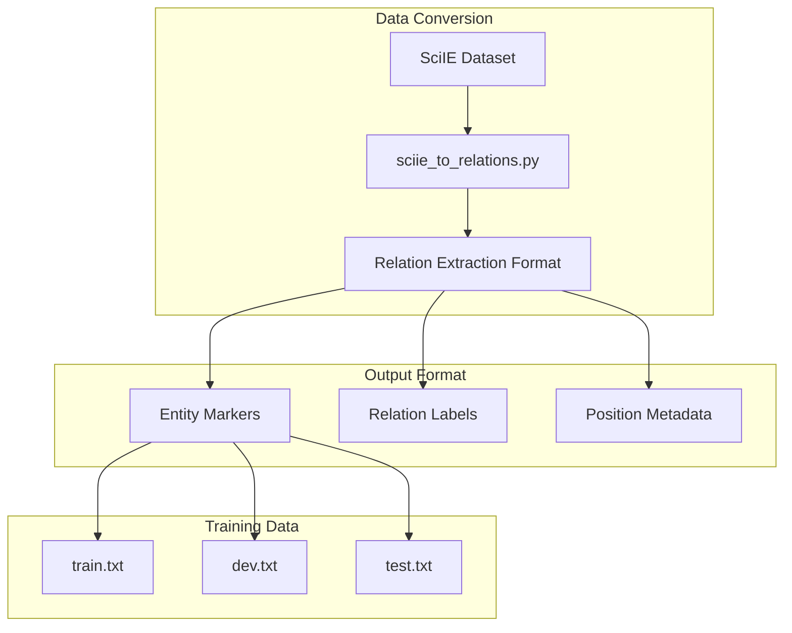
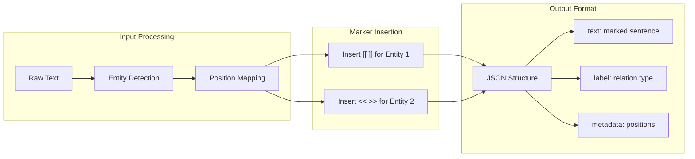
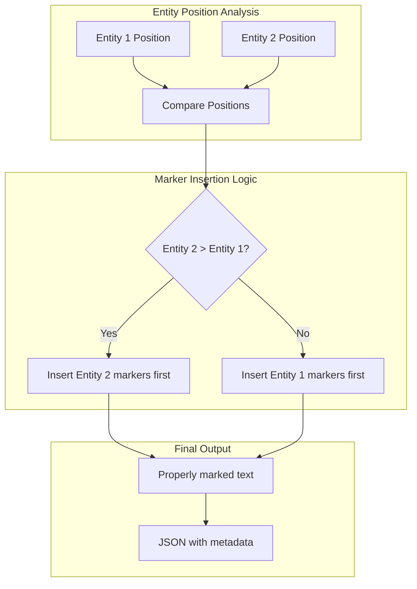
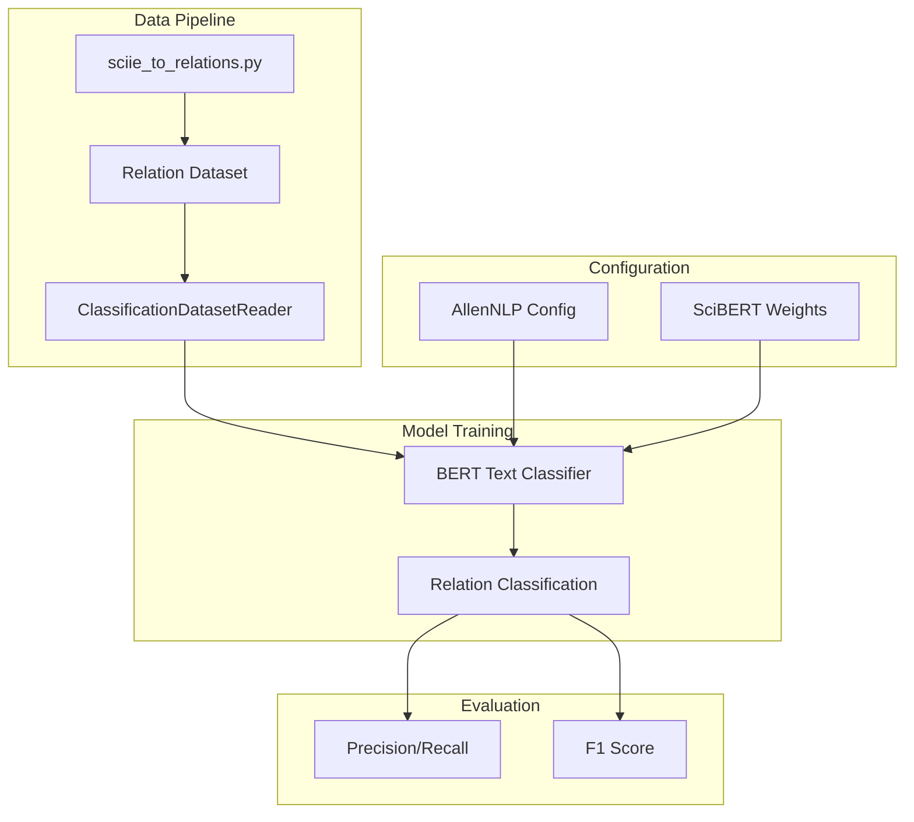

<!-- source: DeepWiki mcp.deepwiki.com · repo allenai/scibert · page 3.6 Relation Extraction · fetched 2026-10-26 -->

# Relation Extraction

Relevant source files

The following files were used as context for generating this wiki page:

- [data/text_classification/sciie-relation-extraction/dev.txt](data/text_classification/sciie-relation-extraction/dev.txt)
- [data/text_classification/sciie-relation-extraction/test.txt](data/text_classification/sciie-relation-extraction/test.txt)
- [data/text_classification/sciie-relation-extraction/train.txt](data/text_classification/sciie-relation-extraction/train.txt)
- [scripts/sciie_to_relations.py](scripts/sciie_to_relations.py)

## Purpose and Scope

This document covers the relation extraction capabilities in the SciBERT codebase, which enables the identification of semantic relationships between entities in scientific text. The relation extraction system processes scientific literature to extract structured relationships such as "USED-FOR", "PART-OF", and "CONJUNCTION" between scientific concepts.

For general text classification tasks, see [Text Classification](#3.4). For named entity recognition, see [Named Entity Recognition](#3.2).

## Data Processing Pipeline

The relation extraction system begins with the SciIE dataset, which is converted to a standardized format using the preprocessing script. The conversion process adds entity markers to highlight the entities involved in each relation.

The conversion script `sciie_to_relations.py` processes the original SciIE format and outputs relation instances with entity markers. The script handles entity positioning and adds visual markers to clearly delineate the entities involved in each relation.

**Sources:** [scripts/sciie_to_relations.py:1-52]()

## Dataset Format and Structure

The relation extraction dataset uses a specific format where entities are marked with distinct brackets to indicate their roles in the relationship. The format includes:

- **Entity 1**: Marked with `[[ ]]` brackets
- **Entity 2**: Marked with `<< >>` brackets  
- **Relation Label**: Indicates the semantic relationship type
- **Metadata**: Contains entity position information

Each relation instance is stored as a JSON object with the following structure:
- `text`: The sentence with entity markers inserted
- `label`: The relation type (e.g., "USED-FOR", "PART-OF")
- `metadata`: Array containing entity positions `[e1_from, e1_to, e2_from, e2_to]`

**Sources:** [scripts/sciie_to_relations.py:35-48](), [data/text_classification/sciie-relation-extraction/train.txt:1-10]()

## Relation Types and Labels

The relation extraction system supports multiple semantic relationship types commonly found in scientific literature:

| Relation Type | Description | Example |
|---------------|-------------|---------|
| `USED-FOR` | Entity 1 is used for Entity 2 | `[[ algorithm ]] for << parsing >>` |
| `PART-OF` | Entity 1 is part of Entity 2 | `[[ component ]] in << system >>` |
| `CONJUNCTION` | Entities are conjoined | `[[ method ]] and << technique >>` |
| `HYPONYM-OF` | Entity 1 is a type of Entity 2 | `[[ SVM ]] is a << classifier >>` |
| `FEATURE-OF` | Entity 1 is a feature of Entity 2 | `[[ accuracy ]] of << model >>` |
| `COMPARE` | Entities are compared | `[[ method A ]] vs << method B >>` |
| `EVALUATE-FOR` | Entity 1 evaluates Entity 2 | `[[ metric ]] for << performance >>` |

**Sources:** [data/text_classification/sciie-relation-extraction/train.txt:1-50](), [data/text_classification/sciie-relation-extraction/test.txt:1-50]()

## Entity Marker Processing

The preprocessing script handles entity marker insertion based on the relative positions of entities in the text. The algorithm ensures proper marker placement regardless of entity order:

The script adjusts entity positions relative to sentence boundaries and handles marker insertion to avoid position conflicts when entities overlap or are adjacent.

**Sources:** [scripts/sciie_to_relations.py:30-46]()

## Integration with Fine-tuning Framework

The relation extraction task integrates with the broader SciBERT fine-tuning system through the text classification pipeline. The processed relation data can be used with standard classification models:

The relation extraction task follows the same configuration patterns as other text classification tasks, utilizing the AllenNLP framework for model training and evaluation.

**Sources:** [scripts/sciie_to_relations.py:1-52](), [data/text_classification/sciie-relation-extraction/train.txt:1-10]()

## Usage and Implementation

To use the relation extraction system:

1. **Data Preparation**: Convert SciIE data using the preprocessing script
2. **Configuration**: Set up AllenNLP configuration for text classification
3. **Training**: Use the processed relation data for model training
4. **Evaluation**: Assess performance on relation extraction metrics

The system outputs structured relationship information that can be used for downstream tasks such as knowledge graph construction, semantic search, and scientific literature analysis.

**Sources:** [scripts/sciie_to_relations.py:10-21](), [data/text_classification/sciie-relation-extraction/]()

---

