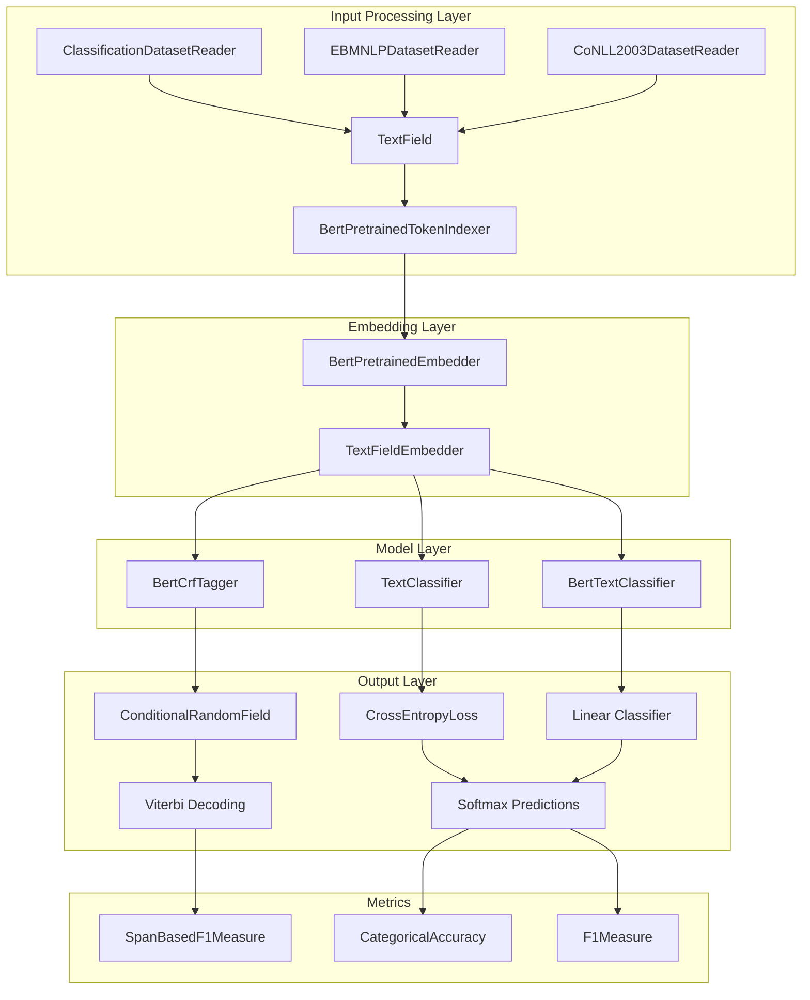
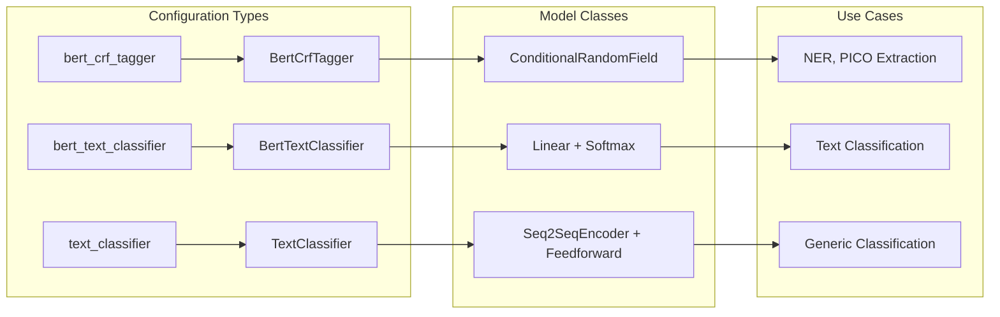
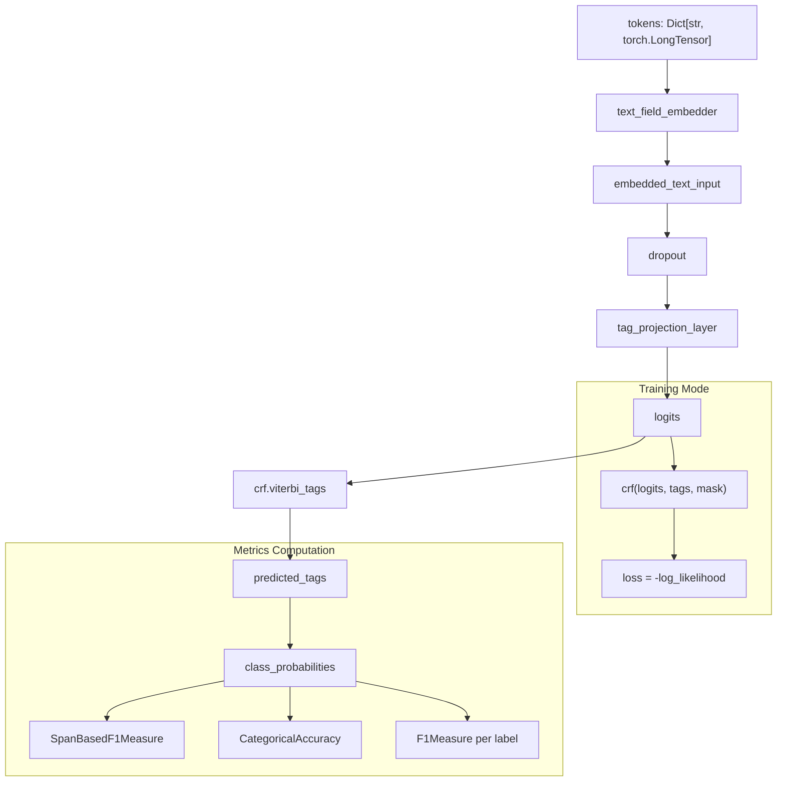
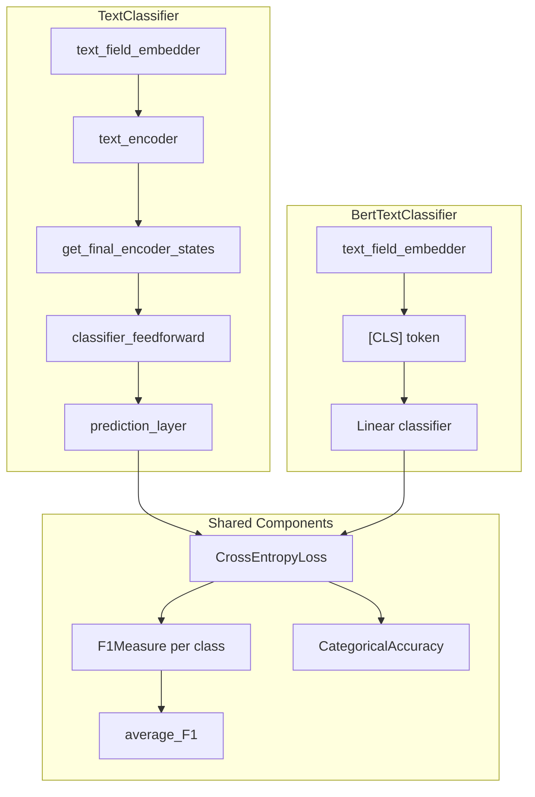
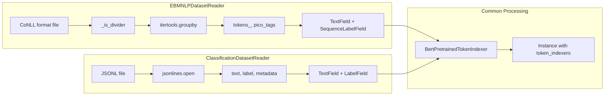
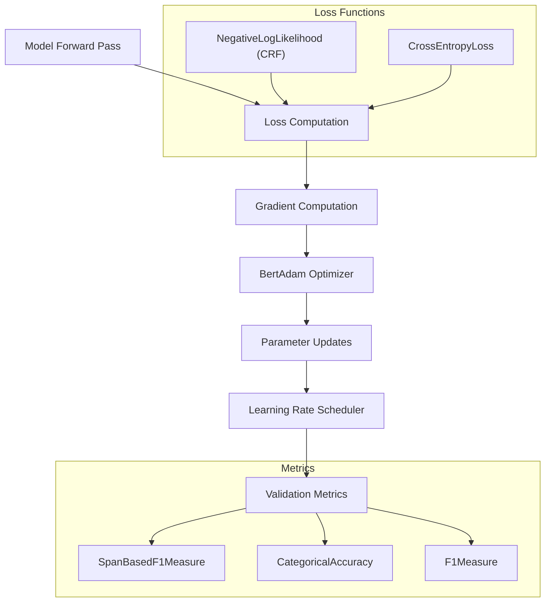

<!-- source: DeepWiki mcp.deepwiki.com · repo allenai/scibert · page 4 Model Architecture · fetched 2026-10-26 -->

# Model Architecture

<details>
<summary>Relevant source files</summary>

The following files were used as context for generating this wiki page:

- [allennlp_config/ner_finetune.json](allennlp_config/ner_finetune.json)
- [allennlp_config/pico_finetune.json](allennlp_config/pico_finetune.json)
- [allennlp_config/text_classification_finetune.json](allennlp_config/text_classification_finetune.json)
- [scibert/__init__.py](scibert/__init__.py)
- [scibert/dataset_readers/__init__.py](scibert/dataset_readers/__init__.py)
- [scibert/dataset_readers/classification_dataset_reader.py](scibert/dataset_readers/classification_dataset_reader.py)
- [scibert/dataset_readers/ebmnlp.py](scibert/dataset_readers/ebmnlp.py)
- [scibert/models/__init__.py](scibert/models/__init__.py)
- [scibert/models/bert_crf_tagger.py](scibert/models/bert_crf_tagger.py)
- [scibert/models/text_classifier.py](scibert/models/text_classifier.py)

</details>


This document provides a comprehensive overview of the SciBERT model architecture implementation, covering the core model components, their relationships, and integration patterns within the AllenNLP framework. The architecture supports multiple downstream tasks including named entity recognition, PICO extraction, text classification, and dependency parsing.

For task-specific fine-tuning procedures, see [Fine-tuning Guide](#3). For experiment management and orchestration, see [Experiment Management](#5).

## Architecture Overview

The SciBERT model architecture follows a modular design built on the AllenNLP framework. The system consists of three primary layers: dataset readers for input processing, core models for computation, and task-specific heads for output generation.

### Core Architecture Components



**Title: SciBERT Model Architecture Components**

The architecture implements a consistent pattern across all models: input tokenization and indexing, BERT-based text embedding, task-specific processing, and evaluation metrics computation.

Sources: [scibert/models/bert_crf_tagger.py:1-233](), [scibert/models/text_classifier.py:1-124](), [scibert/dataset_readers/ebmnlp.py:1-76](), [scibert/dataset_readers/classification_dataset_reader.py:1-61]()

## Model Configuration System

The model architecture is configured through AllenNLP's JSON-based configuration system. Each model type has specific configuration requirements that define the complete processing pipeline.

### Configuration Structure

| Component | Configuration Key | Purpose |
|-----------|------------------|---------|
| Dataset Reader | `dataset_reader` | Defines input data processing and tokenization |
| Text Embedder | `text_field_embedder` | Configures BERT embedding parameters |
| Model Type | `model.type` | Specifies which model class to instantiate |
| Training | `trainer` | Defines optimization and learning rate scheduling |
| Evaluation | `iterator` | Controls batching and data iteration |

### Model Type Mapping



**Title: Model Configuration to Implementation Mapping**

Sources: [allennlp_config/ner_finetune.json:22-43](), [allennlp_config/pico_finetune.json:20-40](), [allennlp_config/text_classification_finetune.json:20-37]()

## Core Model Components

### BertCrfTagger

The `BertCrfTagger` class implements sequence labeling using BERT embeddings with a Conditional Random Field (CRF) layer for structured prediction.

**Key Components:**
- **Text Field Embedder**: Handles BERT token embedding with configurable parameters
- **Tag Projection Layer**: `TimeDistributed(Linear)` mapping embeddings to tag scores
- **CRF Layer**: `ConditionalRandomField` for sequence-level predictions
- **Metrics**: `SpanBasedF1Measure`, `CategoricalAccuracy`, per-label `F1Measure`



**Title: BertCrfTagger Forward Pass Architecture**

Sources: [scibert/models/bert_crf_tagger.py:129-196](), [scibert/models/bert_crf_tagger.py:65-126]()

### TextClassifier and BertTextClassifier

The text classification models implement document-level classification with different architectural approaches.

**TextClassifier Architecture:**
- Uses `Seq2SeqEncoder` (e.g., BiLSTM) after embedding
- Employs `get_final_encoder_states` for sequence pooling
- Applies `FeedForward` layer before final classification

**BertTextClassifier Architecture:**
- Direct BERT embedding to classification layer
- Simplified architecture for BERT-based models
- Uses CLS token representation for classification



**Title: Text Classification Model Architectures**

Sources: [scibert/models/text_classifier.py:54-98](), [allennlp_config/text_classification_finetune.json:20-37]()

## Dataset Reader Architecture

Dataset readers implement the `DatasetReader` interface and handle task-specific data preprocessing and tokenization.

### Dataset Reader Types

| Reader Class | Registration Name | Input Format | Output Fields |
|-------------|------------------|--------------|---------------|
| `EBMNLPDatasetReader` | `ebmnlp` | CoNLL-style with PICO tags | `tokens`, `tags`, `metadata` |
| `ClassificationDatasetReader` | `classification_dataset_reader` | JSONL format | `text`, `label`, `metadata` |
| CoNLL2003DatasetReader | `conll2003` | Standard CoNLL format | `tokens`, `tags`, `metadata` |

### Data Processing Pipeline



**Title: Dataset Reader Processing Pipeline**

Sources: [scibert/dataset_readers/ebmnlp.py:42-75](), [scibert/dataset_readers/classification_dataset_reader.py:37-60]()

## Token Indexing and Embedding

The architecture uses BERT-specific token indexing and embedding components that integrate with AllenNLP's `TextField` system.

### Token Processing Configuration

```python
"token_indexers": {
    "bert": {
        "type": "bert-pretrained",
        "pretrained_model": std.extVar("BERT_VOCAB"),
        "do_lowercase": std.extVar("IS_LOWERCASE"),
        "use_starting_offsets": true
    }
}
```

### Embedding Configuration

```python
"text_field_embedder": {
    "allow_unmatched_keys": true,
    "embedder_to_indexer_map": {
        "bert": ["bert", "bert-offsets"]
    },
    "token_embedders": {
        "bert": {
            "type": "bert-pretrained",
            "pretrained_model": std.extVar("BERT_WEIGHTS"),
            "requires_grad": 'all',
            "top_layer_only": true
        }
    }
}
```

Sources: [allennlp_config/ner_finetune.json:9-16](), [allennlp_config/ner_finetune.json:29-42]()

## Training and Optimization

The architecture uses specialized optimizers and learning rate schedules designed for BERT fine-tuning.

### Optimization Configuration

| Component | Configuration | Purpose |
|-----------|--------------|---------|
| Optimizer | `bert_adam` | BERT-specific Adam optimizer |
| Learning Rate | Variable via `LEARNING_RATE` | Task-specific learning rates |
| Scheduler | `slanted_triangular` | Gradual learning rate increase then decrease |
| Weight Decay | Excluded for bias and LayerNorm | Prevents overfitting while preserving important parameters |

### Training Pipeline



**Title: Training Pipeline Architecture**

Sources: [allennlp_config/ner_finetune.json:50-69](), [allennlp_config/text_classification_finetune.json:44-64]()

## Integration Patterns

The architecture follows consistent patterns for AllenNLP integration across all model types.

### Model Registration Pattern

All models use the `@Model.register()` decorator for automatic discovery:
- `@Model.register("bert_crf_tagger")` for `BertCrfTagger`
- `@Model.register("text_classifier")` for `TextClassifier`
- `@DatasetReader.register("ebmnlp")` for `EBMNLPDatasetReader`

### Common Interface Methods

| Method | Purpose | Return Type |
|--------|---------|-------------|
| `forward()` | Main computation with loss calculation | `Dict[str, torch.Tensor]` |
| `decode()` | Post-processing for human-readable output | `Dict[str, torch.Tensor]` |
| `get_metrics()` | Training/validation metrics computation | `Dict[str, float]` |

Sources: [scibert/models/bert_crf_tagger.py:18](), [scibert/models/text_classifier.py:14](), [scibert/dataset_readers/ebmnlp.py:32]()

---

