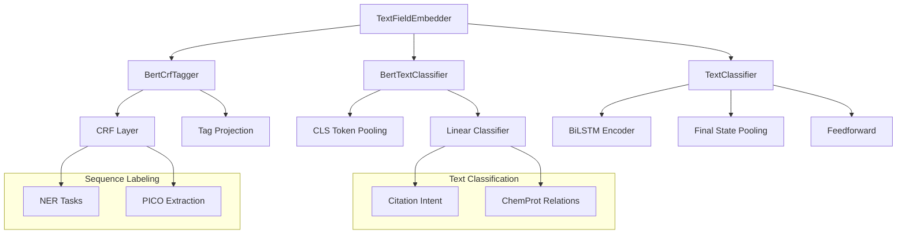
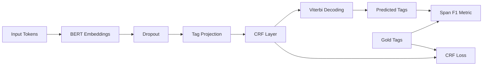
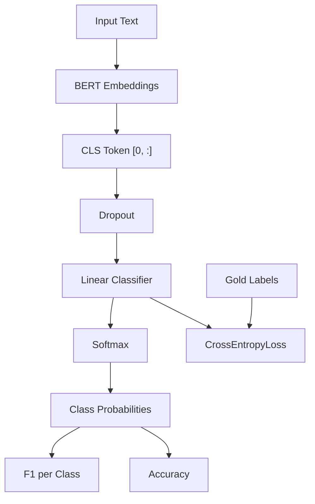
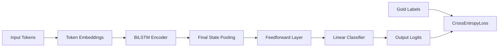
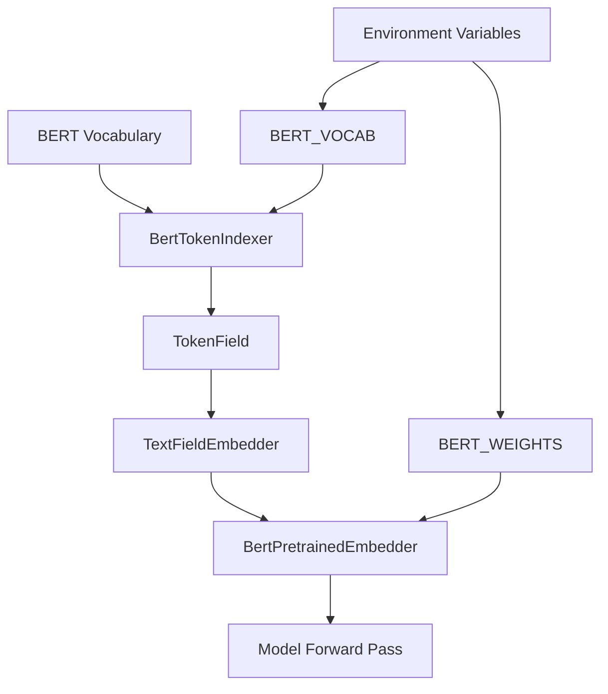

<!-- source: DeepWiki mcp.deepwiki.com · repo allenai/scibert · page 4.1 Core Models · fetched 2026-10-26 -->

# Core Models

<details>
<summary>Relevant source files</summary>

The following files were used as context for generating this wiki page:

- [Dockerfile](Dockerfile)
- [allennlp_config/ner_finetune.json](allennlp_config/ner_finetune.json)
- [allennlp_config/pico_finetune.json](allennlp_config/pico_finetune.json)
- [allennlp_config/text_classification_finetune.json](allennlp_config/text_classification_finetune.json)
- [requirements.txt](requirements.txt)
- [scibert/__init__.py](scibert/__init__.py)
- [scibert/dataset_readers/__init__.py](scibert/dataset_readers/__init__.py)
- [scibert/dataset_readers/classification_dataset_reader.py](scibert/dataset_readers/classification_dataset_reader.py)
- [scibert/dataset_readers/ebmnlp.py](scibert/dataset_readers/ebmnlp.py)
- [scibert/models/__init__.py](scibert/models/__init__.py)
- [scibert/models/bert_crf_tagger.py](scibert/models/bert_crf_tagger.py)
- [scibert/models/bert_text_classifier.py](scibert/models/bert_text_classifier.py)
- [scibert/models/text_classifier.py](scibert/models/text_classifier.py)
- [scripts/run_with_beaker.py](scripts/run_with_beaker.py)

</details>


This document covers the implementation details of the core neural network models used in SciBERT fine-tuning. These models serve as the backbone for downstream scientific NLP tasks including named entity recognition, PICO extraction, and text classification. 

For information about using these models in experiments, see [Experiment Orchestration](#5.1). For dataset processing components that feed these models, see [Dataset Readers](#4.2).

## Model Architecture Overview

The SciBERT codebase implements three primary model architectures, all built on top of AllenNLP's framework and designed to work with pretrained BERT embeddings:



*Sources: [scibert/models/bert_crf_tagger.py:18-233](), [scibert/models/bert_text_classifier.py:15-91](), [scibert/models/text_classifier.py:14-124]()*

## BertCrfTagger

The `BertCrfTagger` is the primary model for sequence labeling tasks, combining BERT embeddings with a Conditional Random Field (CRF) layer for structured prediction.

### Architecture Components

| Component | Purpose | Implementation |
|-----------|---------|----------------|
| `text_field_embedder` | Token embeddings from BERT | `TextFieldEmbedder` with BERT backend |
| `tag_projection_layer` | Projects embeddings to tag space | `TimeDistributed(Linear)` |
| `crf` | Structured prediction layer | `ConditionalRandomField` |
| `dropout` | Regularization | `torch.nn.Dropout` |

### Key Features

The model supports several advanced features for sequence labeling:

- **Label Encoding**: Supports BIO, BIOUL, IOB1, and BMES tagging schemes
- **Constrained Decoding**: CRF constraints ensure valid tag sequences
- **Span-based F1**: Calculates entity-level metrics in addition to token-level
- **Viterbi Decoding**: Finds optimal tag sequence using dynamic programming



*Sources: [scibert/models/bert_crf_tagger.py:65-126](), [scibert/models/bert_crf_tagger.py:164-196]()*

### Configuration Usage

The model is configured through AllenNLP JSON files with the following key parameters:

```json
{
  "model": {
    "type": "bert_crf_tagger",
    "label_encoding": "BIOUL",
    "constrain_crf_decoding": true,
    "calculate_span_f1": true,
    "dropout": 0.1
  }
}
```

*Sources: [allennlp_config/ner_finetune.json:22-42](), [allennlp_config/pico_finetune.json:20-39]()*

## BertTextClassifier

The `BertTextClassifier` is designed for document-level classification tasks, using BERT's CLS token representation for classification decisions.

### Architecture Design



### Implementation Details

The model inherits from `TextClassifier` but overrides the pooling strategy to use BERT's CLS token:

| Method | Purpose | Key Implementation |
|--------|---------|-------------------|
| `__init__` | Model initialization | Sets up linear classifier and F1 metrics |
| `forward` | Forward pass | Extracts CLS token: `embedded_text[:, 0, :]` |
| `get_metrics` | Metric calculation | Computes per-class and average F1 scores |

*Sources: [scibert/models/bert_text_classifier.py:25-91](), [scibert/models/text_classifier.py:106-123]()*

### Configuration Parameters

```json
{
  "model": {
    "type": "bert_text_classifier",
    "verbose_metrics": true,
    "text_field_embedder": {
      "token_embedders": {
        "bert": {
          "type": "bert-pretrained",
          "top_layer_only": true
        }
      }
    }
  }
}
```

*Sources: [allennlp_config/text_classification_finetune.json:20-36]()*

## TextClassifier

The base `TextClassifier` provides a more traditional approach using bidirectional LSTM encoding with final state pooling.

### Architecture Flow



### Pooling Strategy

The model uses `get_final_encoder_states` for bidirectional pooling:

```python
self.pool = lambda text, mask: util.get_final_encoder_states(text, mask, bidirectional=True)
```

This extracts the final hidden states from both directions of the BiLSTM encoder.

*Sources: [scibert/models/text_classifier.py:25-52](), [scibert/models/text_classifier.py:78-98]()*

## Model Registration and Usage

All models use AllenNLP's registration system for configuration-based instantiation:

| Model Class | Registration Name | Primary Use Cases |
|-------------|-------------------|-------------------|
| `BertCrfTagger` | `"bert_crf_tagger"` | NER, PICO extraction |
| `BertTextClassifier` | `"bert_text_classifier"` | Scientific text classification |
| `TextClassifier` | `"text_classifier"` | General text classification |

### Integration with BERT Embeddings

All models integrate with BERT through the `text_field_embedder` component:



*Sources: [allennlp_config/ner_finetune.json:10-15](), [allennlp_config/ner_finetune.json:29-42](), [allennlp_config/text_classification_finetune.json:7-14]()*

## Metrics and Evaluation

### Sequence Labeling Metrics

The `BertCrfTagger` computes comprehensive metrics for sequence labeling:

- **Token-level Accuracy**: Standard classification accuracy
- **Per-label F1**: F1 score for each entity type
- **Span-based F1**: Entity-level precision, recall, and F1
- **Average F1**: Mean F1 across all labels

### Classification Metrics

Both text classifiers provide:

- **Accuracy**: Overall classification accuracy
- **Per-class F1**: F1 score for each class
- **Average F1**: Macro-averaged F1 across classes

*Sources: [scibert/models/bert_crf_tagger.py:212-233](), [scibert/models/bert_text_classifier.py:106-123]()*

---

