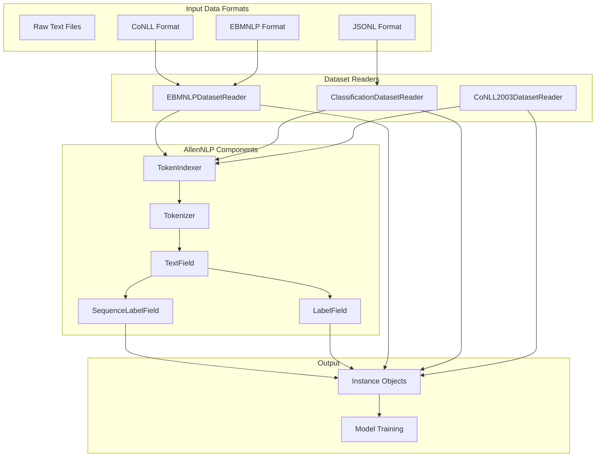
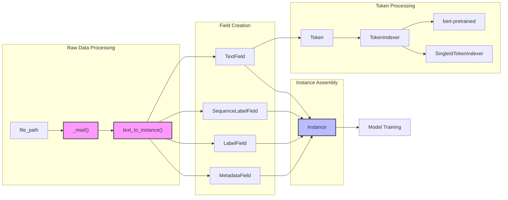
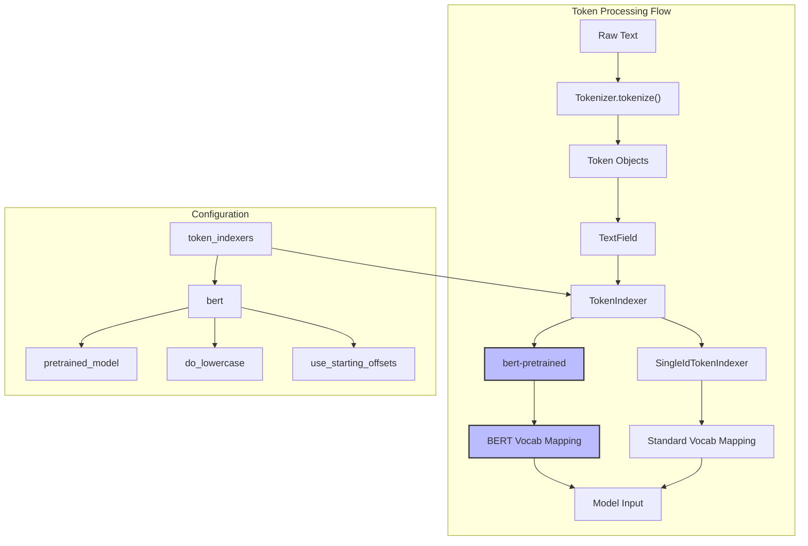

<!-- source: DeepWiki mcp.deepwiki.com · repo allenai/scibert · page 4.2 Dataset Readers · fetched 2026-10-26 -->

# Dataset Readers

<details>
<summary>Relevant source files</summary>

The following files were used as context for generating this wiki page:

- [allennlp_config/pico.json](allennlp_config/pico.json)
- [scibert/__init__.py](scibert/__init__.py)
- [scibert/dataset_readers/__init__.py](scibert/dataset_readers/__init__.py)
- [scibert/dataset_readers/classification_dataset_reader.py](scibert/dataset_readers/classification_dataset_reader.py)
- [scibert/dataset_readers/ebmnlp.py](scibert/dataset_readers/ebmnlp.py)
- [scibert/models/__init__.py](scibert/models/__init__.py)
- [scibert/models/pico_crf_tagger.py](scibert/models/pico_crf_tagger.py)
- [scibert/models/text_classifier.py](scibert/models/text_classifier.py)

</details>


Dataset readers are AllenNLP components that handle data loading and preprocessing for different scientific NLP tasks in the SciBERT codebase. They convert raw text data from various formats into structured `Instance` objects that can be consumed by models during training and inference.

This page covers the implementation and usage of dataset readers for scientific text processing tasks. For information about the models that consume this data, see [Core Models](#4.1). For details about experiment configuration, see [Configuration System](#3.1).

## Overview

Dataset readers in SciBERT serve as the bridge between raw scientific text data and the model training pipeline. They handle format parsing, tokenization, and field creation for different task types including named entity recognition, text classification, and PICO extraction.



Sources: [scibert/dataset_readers/ebmnlp.py:1-76](), [scibert/dataset_readers/classification_dataset_reader.py:1-61]()

## Data Processing Pipeline

The dataset readers follow a consistent processing pipeline that transforms raw text into structured data for model consumption:



Sources: [scibert/dataset_readers/ebmnlp.py:42-61](), [scibert/dataset_readers/classification_dataset_reader.py:37-44]()

## EBMNLP Dataset Reader

The `EBMNLPDatasetReader` handles evidence-based medicine natural language processing data, specifically for PICO (Population, Intervention, Comparison, Outcome) extraction tasks.

### Implementation Details

| Component | Description | Location |
|-----------|-------------|-----------|
| Class Name | `EBMNLPDatasetReader` | [scibert/dataset_readers/ebmnlp.py:33]() |
| Registration | `@DatasetReader.register("ebmnlp")` | [scibert/dataset_readers/ebmnlp.py:32]() |
| Input Format | CoNLL-style with 4 columns: token, _, _, pico_tag | [scibert/dataset_readers/ebmnlp.py:54-57]() |
| Output Fields | `tokens`, `tags`, `metadata` | [scibert/dataset_readers/ebmnlp.py:67-74]() |

### Key Methods

The reader implements two core methods:

- `_read(file_path)`: Parses input file using `itertools.groupby()` to separate sentences by dividers
- `text_to_instance(tokens, pico_tags)`: Creates `Instance` objects with `TextField` and `SequenceLabelField`

### Data Format Processing

The reader processes files where each line contains:
```
token _ _ pico_tag
```

Lines beginning with `-DOCSTART-` or empty lines serve as sentence dividers. The reader extracts tokens and PICO tags, creating structured instances for sequence labeling.

Sources: [scibert/dataset_readers/ebmnlp.py:21-30](), [scibert/dataset_readers/ebmnlp.py:42-61](), [scibert/dataset_readers/ebmnlp.py:64-75]()

## Classification Dataset Reader

The `ClassificationDatasetReader` handles text classification tasks for scientific documents, processing data in JSONL format.

### Implementation Details

| Component | Description | Location |
|-----------|-------------|-----------|
| Class Name | `ClassificationDatasetReader` | [scibert/dataset_readers/classification_dataset_reader.py:19]() |
| Registration | `@DatasetReader.register("classification_dataset_reader")` | [scibert/dataset_readers/classification_dataset_reader.py:18]() |
| Input Format | JSONL with keys: `text`, `label`, `metadata` | [scibert/dataset_readers/classification_dataset_reader.py:24-25]() |
| Output Fields | `text`, `label`, `metadata` | [scibert/dataset_readers/classification_dataset_reader.py:52-59]() |

### Processing Pipeline

The reader processes each line as a JSON object:
1. Extracts `text`, `label`, and optional `metadata` fields
2. Tokenizes text using configurable `Tokenizer` (defaults to `WordTokenizer`)
3. Creates `TextField` with `TokenIndexer` mappings
4. Adds `LabelField` for classification target
5. Includes `MetadataField` for additional context

### Configuration Options

| Parameter | Type | Default | Purpose |
|-----------|------|---------|---------|
| `lazy` | bool | `False` | Memory-efficient reading |
| `tokenizer` | `Tokenizer` | `WordTokenizer()` | Text tokenization strategy |
| `token_indexers` | `Dict[str, TokenIndexer]` | `SingleIdTokenIndexer()` | Token to index mapping |

Sources: [scibert/dataset_readers/classification_dataset_reader.py:18-34](), [scibert/dataset_readers/classification_dataset_reader.py:37-44](), [scibert/dataset_readers/classification_dataset_reader.py:47-60]()

## Configuration Integration

Dataset readers are configured through AllenNLP's configuration system, typically in JSON files that specify the reader type and parameters.

### PICO Configuration Example

The PICO task configuration demonstrates reader integration:

```json
"dataset_reader": {
  "type": "ebmnlp",
  "token_indexers": {
    "bert": {
      "type": "bert-pretrained",
      "pretrained_model": std.extVar("BERT_VOCAB"),
      "do_lowercase": std.extVar("IS_LOWERCASE"),
      "use_starting_offsets": true
    }
  }
}
```

### Key Configuration Elements

| Element | Purpose | Example |
|---------|---------|---------|
| `type` | Specifies reader class | `"ebmnlp"`, `"classification_dataset_reader"` |
| `token_indexers` | Maps tokens to indices | `bert-pretrained`, `SingleIdTokenIndexer` |
| `label_namespace` | Namespace for labels | `"labels"` |

The configuration system allows for flexible reader selection and parameterization across different scientific NLP tasks.

Sources: [allennlp_config/pico.json:5-15]()

## Token Indexing Integration

Dataset readers work closely with AllenNLP's token indexing system to prepare text for BERT-based models:



The token indexing system enables seamless integration with SciBERT's pretrained embeddings while maintaining compatibility with standard AllenNLP workflows.

Sources: [scibert/dataset_readers/ebmnlp.py:38](), [scibert/dataset_readers/classification_dataset_reader.py:34](), [allennlp_config/pico.json:7-14]()

---

