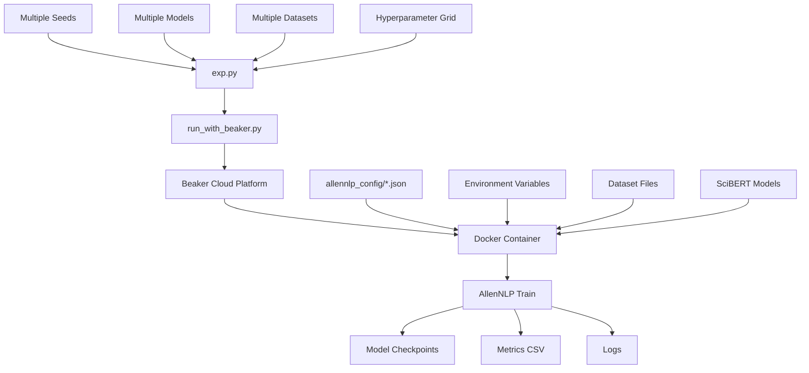
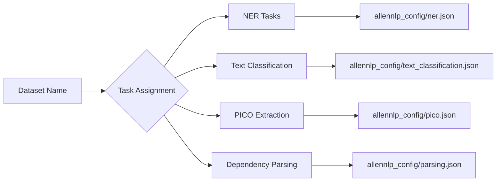
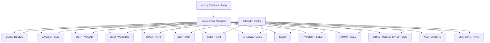
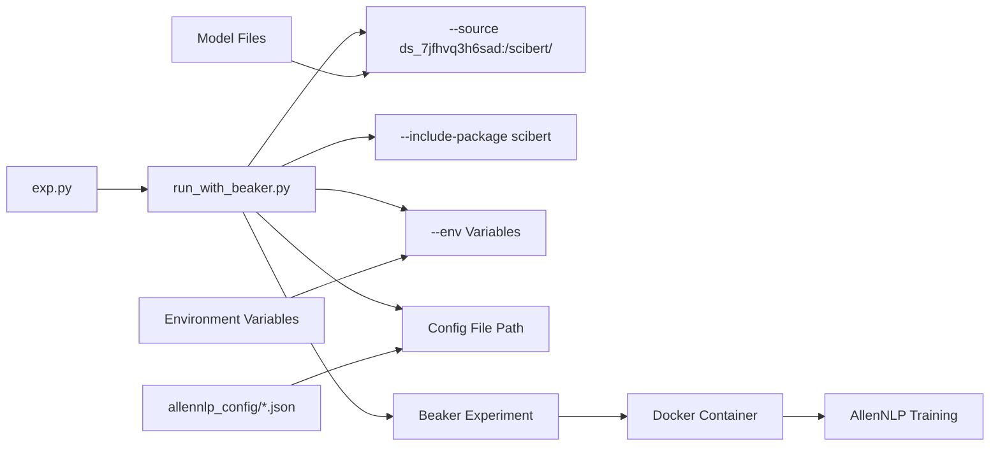

<!-- source: DeepWiki mcp.deepwiki.com · repo allenai/scibert · page 5 Experiment Management · fetched 2026-10-26 -->

# Experiment Management

<details>
<summary>Relevant source files</summary>

The following files were used as context for generating this wiki page:

- [allennlp_config/ner.json](allennlp_config/ner.json)
- [allennlp_config/text_classification.json](allennlp_config/text_classification.json)
- [scripts/exp.py](scripts/exp.py)

</details>


This system provides automated experiment orchestration for large-scale hyperparameter searches and model evaluation across multiple scientific NLP tasks. The experiment management framework handles grid search over hyperparameters, model variants, datasets, and random seeds to ensure statistically robust results.

For detailed information about individual fine-tuning tasks, see [Fine-tuning Guide](#3). For cloud training infrastructure details, see [Cloud Training](#5.2). For statistical analysis of experiment results, see [Results Analysis](#5.3).

## System Overview

The experiment management system coordinates large-scale experiments through a combination of Python orchestration scripts, AllenNLP configuration templates, and cloud execution platforms. The system automates the process of running hundreds of experiments across different hyperparameter combinations to identify optimal model configurations.



Sources: [scripts/exp.py:1-161]()

## Experiment Orchestration

The primary orchestration is handled by `exp.py`, which generates and executes experiment commands across a comprehensive parameter space. The script defines dataset sizes, iterates through experimental conditions, and constructs Beaker execution commands.

### Dataset and Task Mapping

The experiment system supports multiple scientific NLP tasks with predefined dataset sizes:

| Dataset | Task Type | Size | Code Reference |
|---------|-----------|------|----------------|
| NCBI-disease | NER | 5,424 | [scripts/exp.py:19]() |
| bc5cdr | NER | 4,942 | [scripts/exp.py:20]() |
| JNLPBA | NER | 18,607 | [scripts/exp.py:21]() |
| chemprot | Text Classification | 4,169 | [scripts/exp.py:23]() |
| citation_intent | Text Classification | 1,688 | [scripts/exp.py:24]() |
| ebmnlp | PICO | 38,124 | [scripts/exp.py:29]() |
| genia | Parsing | 14,326 | [scripts/exp.py:30]() |

The task assignment logic automatically determines the appropriate configuration file based on dataset type:



Sources: [scripts/exp.py:103-112]()

### Hyperparameter Grid Search

The experiment system performs systematic grid search across multiple dimensions:

**Model Variants**: [scripts/exp.py:66-76]()
- `bertbase_basevocab_uncased`
- `bertbase_basevocab_cased`
- `biobert_pmc_basevocab_cased`
- `biobert_pubmed_pmc_basevocab_cased`
- `biobert_pubmed_basevocab_cased`
- `scibert_basevocab_uncased`
- `scibert_basevocab_cased`
- `scibert_scivocab_uncased`
- `scibert_scivocab_cased`

**Random Seeds**: [scripts/exp.py:47-61]()
Multiple seeds (15370, 15570, 15680, etc.) ensure statistical significance with derived `pytorch_seed` and `numpy_seed` values.

**Training Hyperparameters**: [scripts/exp.py:87-101]()
- Number of epochs: 2, 3, 4, 5
- Learning rates: 5e-6, 1e-5, 2e-5, 5e-5
- Gradient accumulation batch size: 32

## Configuration System

The experiment system uses environment variable-based configuration to parameterize AllenNLP training runs. This approach enables dynamic configuration without modifying JSON files.

### Environment Variable Framework

Each experiment execution sets comprehensive environment variables:



Sources: [scripts/exp.py:133-152]()

### AllenNLP Configuration Templates

The configuration files use Jsonnet templating to inject environment variables into AllenNLP configurations. Key configuration patterns include:

**Random Seed Configuration**: [allennlp_config/ner.json:2-4]()
```jsonnet
"random_seed": std.parseInt(std.extVar("SEED")),
"pytorch_seed": std.parseInt(std.extVar("PYTORCH_SEED")),
"numpy_seed": std.parseInt(std.extVar("NUMPY_SEED"))
```

**BERT Model Configuration**: [allennlp_config/ner.json:10-14]()
```jsonnet
"bert": {
    "type": "bert-pretrained",
    "pretrained_model": std.extVar("BERT_VOCAB"),
    "do_lowercase": std.extVar("IS_LOWERCASE"),
    "use_starting_offsets": true
}
```

**Training Configuration**: [allennlp_config/ner.json:57-74]()
```jsonnet
"trainer": {
    "optimizer": {
        "type": "bert_adam",
        "lr": std.extVar("LEARNING_RATE")
    },
    "num_epochs": std.parseInt(std.extVar("NUM_EPOCHS")),
    "gradient_accumulation_batch_size": std.parseInt(std.extVar("GRAD_ACCUM_BATCH_SIZE")),
    "cuda_device": std.parseInt(std.extVar("CUDA_DEVICE"))
}
```

Sources: [allennlp_config/ner.json:1-76](), [allennlp_config/text_classification.json:1-77]()

## Command Generation and Execution

The experiment system generates Beaker execution commands that integrate model files, data paths, and configuration parameters:



The command structure includes:
- **Configuration file**: `allennlp_config/{task}{with_finetuning}.json`
- **Model source**: Beaker dataset `ds_7jfhvq3h6sad:/scibert/`
- **Package inclusion**: `--include-package scibert`
- **Environment variables**: All hyperparameters and paths
- **Description**: Experiment description for tracking

Sources: [scripts/exp.py:133-152]()

## Model and Data Path Resolution

The system automatically resolves model and data paths based on experimental parameters:

**BERT Model Paths**: [scripts/exp.py:125-126]()
```python
bert_vocab = f'/scibert/{model}/vocab.txt'
bert_weights = f'/scibert/{model}/weights.tar.gz'
```

**Dataset Paths**: [scripts/exp.py:129-131]()
```python
train_path = f'data/{task}/{dataset}/train.txt'
dev_path = f'data/{task}/{dataset}/dev.txt'
test_path = f'data/{task}/{dataset}/test.txt'
```

**Casing Detection**: [scripts/exp.py:116-119]()
```python
if 'uncased' in model:
    is_lowercase = 'true'
else:
    is_lowercase = 'false'
```

Sources: [scripts/exp.py:114-131]()

## Execution Control

The experiment system provides dry-run capabilities for command validation and actual execution control:

```python
@plac.annotations(
    desc=("description", "positional", None, str),
    not_dry_run=("actually run it ?", "flag", "not_dry_run", bool),
)
def main(desc: str, not_dry_run: bool = False):
```

Commands are printed for inspection, and execution only occurs when `not_dry_run` is True. This allows for command validation and selective execution during development.

Sources: [scripts/exp.py:12-16](), [scripts/exp.py:156-158]()

---

