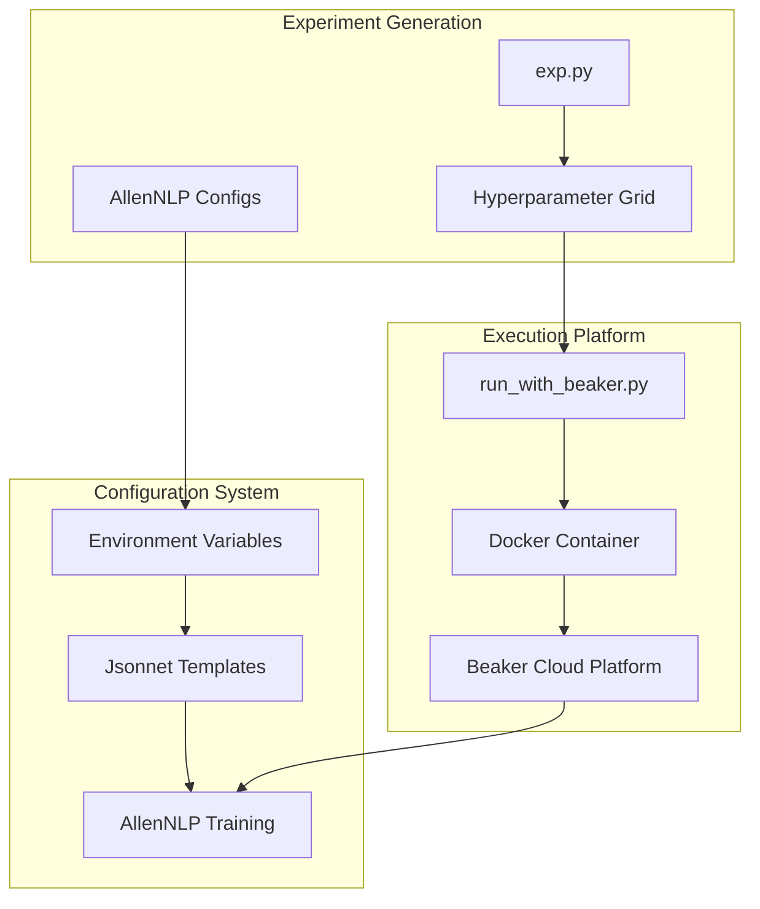
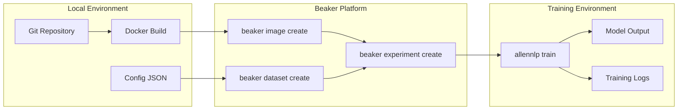
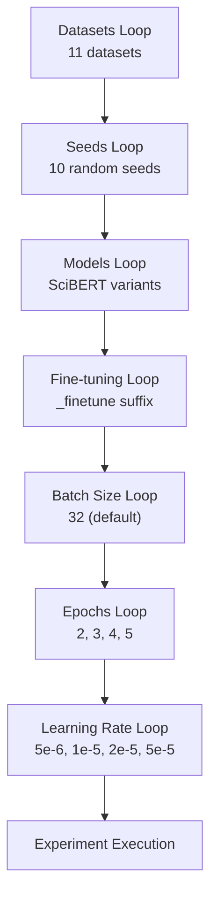
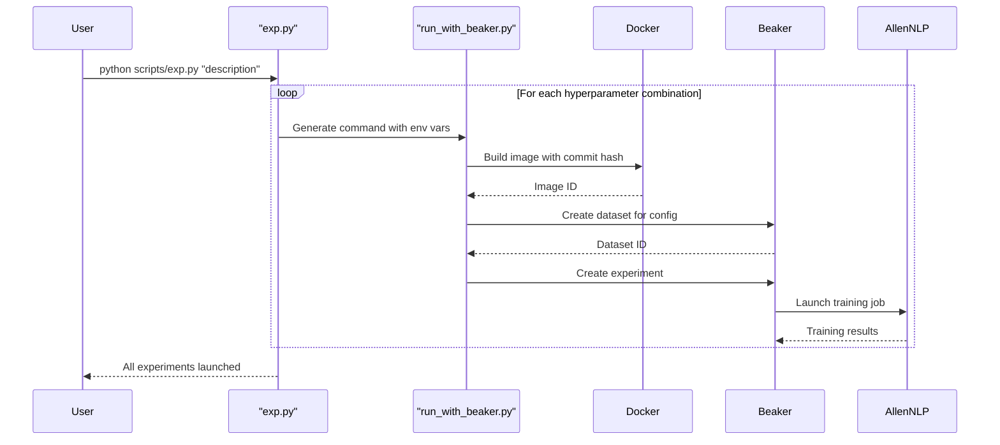

<!-- source: DeepWiki mcp.deepwiki.com · repo allenai/scibert · page 5.1 Experiment Orchestration · fetched 2026-10-26 -->

# Experiment Orchestration

<details>
<summary>Relevant source files</summary>

The following files were used as context for generating this wiki page:

- [Dockerfile](Dockerfile)
- [allennlp_config/ner.json](allennlp_config/ner.json)
- [allennlp_config/text_classification.json](allennlp_config/text_classification.json)
- [requirements.txt](requirements.txt)
- [scibert/models/bert_text_classifier.py](scibert/models/bert_text_classifier.py)
- [scripts/exp.py](scripts/exp.py)
- [scripts/run_with_beaker.py](scripts/run_with_beaker.py)

</details>


## Purpose and Scope

This page documents the experiment orchestration system used to run large-scale hyperparameter sweeps and model comparisons across multiple SciBERT variants and downstream tasks. The system automates the execution of training experiments on cloud infrastructure using standardized configurations and statistical analysis.

For information about individual task configurations, see [Configuration System](#3.1). For cloud platform setup and Docker environments, see [Cloud Training](#5.2). For statistical analysis of experiment results, see [Results Analysis](#5.3).

## System Overview

The experiment orchestration system centers around two main components: `exp.py` for generating experiment configurations and `run_with_beaker.py` for executing them on the Beaker cloud platform. The system supports systematic hyperparameter sweeps across multiple dimensions including datasets, models, learning rates, epochs, and random seeds.



**Experiment Orchestration Architecture**

Sources: [scripts/exp.py:1-161](), [scripts/run_with_beaker.py:1-146]()

## Core Components

### Experiment Generator (`exp.py`)

The main orchestration script `exp.py` generates experiment configurations through nested loops across multiple hyperparameter dimensions. It supports systematic exploration of:

| Parameter | Options | Purpose |
|-----------|---------|---------|
| Datasets | 11 scientific NLP datasets | Task variety |
| Models | SciBERT, BioBERT, BERT variants | Model comparison |
| Seeds | 10 different random seeds | Statistical significance |
| Learning Rates | 4 rates (5e-6 to 5e-5) | Optimization tuning |
| Epochs | 2-5 epochs | Training duration |
| Batch Sizes | 32 (configurable) | Memory management |

The script maps datasets to task types automatically:

```python
if dataset in ['NCBI-disease', 'bc5cdr', 'JNLPBA', 'sciie']:
    task = 'ner'
elif dataset in ['chemprot', 'citation_intent', 'mag', 'rct-20k', 'sciie-relation-extraction', 'sci-cite']:
    task = 'text_classification'
elif dataset in ['ebmnlp']:
    task = 'pico'
elif dataset in ['genia']:
    task = 'parsing'
```

Sources: [scripts/exp.py:103-112]()

### Beaker Integration (`run_with_beaker.py`)

The `run_with_beaker.py` script handles cloud execution by:

1. Building Docker images with git commit hashes
2. Creating Beaker datasets for configurations
3. Mounting data sources and model files
4. Setting up environment variables
5. Launching AllenNLP training jobs



**Beaker Experiment Execution Pipeline**

Sources: [scripts/run_with_beaker.py:22-127]()

## Hyperparameter Grid Search

The orchestration system implements a comprehensive grid search across multiple dimensions. The nested loop structure in `exp.py` generates all possible combinations:



**Hyperparameter Grid Search Structure**

The system calculates derived seeds for reproducibility:
- `pytorch_seed = seed // 10`
- `numpy_seed = pytorch_seed // 10`

Sources: [scripts/exp.py:33-102](), [scripts/exp.py:63-64]()

## Environment Variable System

The orchestration system uses environment variables to parameterize AllenNLP configurations dynamically. Key variables include:

| Variable | Purpose | Example |
|----------|---------|---------|
| `BERT_VOCAB` | Vocabulary file path | `/scibert/scibert_scivocab_uncased/vocab.txt` |
| `BERT_WEIGHTS` | Model weights path | `/scibert/scibert_scivocab_uncased/weights.tar.gz` |
| `TRAIN_PATH` | Training data path | `data/ner/NCBI-disease/train.txt` |
| `LEARNING_RATE` | Optimizer learning rate | `2e-5` |
| `NUM_EPOCHS` | Training epochs | `4` |
| `SEED` | Random seed | `15370` |
| `CUDA_DEVICE` | GPU device ID | `0` |

These variables are injected into Jsonnet configuration templates using `std.extVar()`:

```jsonnet
"learning_rate": std.extVar("LEARNING_RATE"),
"num_epochs": std.parseInt(std.extVar("NUM_EPOCHS")),
"random_seed": std.parseInt(std.extVar("SEED"))
```

Sources: [scripts/exp.py:133-152](), [allennlp_config/ner.json:2-4](), [allennlp_config/text_classification.json:2-4]()

## Execution Workflow

The complete experiment execution follows this workflow:



**Experiment Execution Sequence**

The system supports dry-run mode for testing configurations without actual execution:

```bash
python scripts/exp.py "test_run" --not_dry_run
```

Sources: [scripts/exp.py:16](), [scripts/exp.py:156-158]()

## Configuration Templates

The system uses AllenNLP configuration templates that are parameterized through environment variables. Key configuration elements include:

### NER Configuration Structure
- **Model**: `crf_tagger` with BERT embeddings
- **Dataset Reader**: `conll2003` with BIOUL encoding
- **Optimizer**: `bert_adam` with configurable learning rate
- **Trainer**: Gradient accumulation and early stopping

### Text Classification Configuration Structure
- **Model**: `text_classifier` with BERT + LSTM encoder
- **Dataset Reader**: `classification_dataset_reader`
- **Optimizer**: `bert_adam` with configurable learning rate
- **Trainer**: Similar to NER with different validation metrics

Sources: [allennlp_config/ner.json:22-48](), [allennlp_config/text_classification.json:20-49]()

## Dataset and Model Management

The orchestration system maintains mappings for dataset sizes and model paths:

```python
dataset_sizes = {
    'NCBI-disease': 5424,
    'bc5cdr': 4942,
    'JNLPBA': 18607,
    'sciie': 2211,
    'chemprot': 4169,
    'citation_intent': 1688,
    'mag': 84000,
    'rct-20k': 180040,
    'sciie-relation-extraction': 3219,
    'sci-cite': 7320,
    'ebmnlp': 38124,
    'genia': 14326,
}
```

Model paths follow the pattern `/scibert/{model_name}/` with separate files for vocabulary (`vocab.txt`) and weights (`weights.tar.gz`).

Sources: [scripts/exp.py:18-31](), [scripts/exp.py:125-126]()

---

