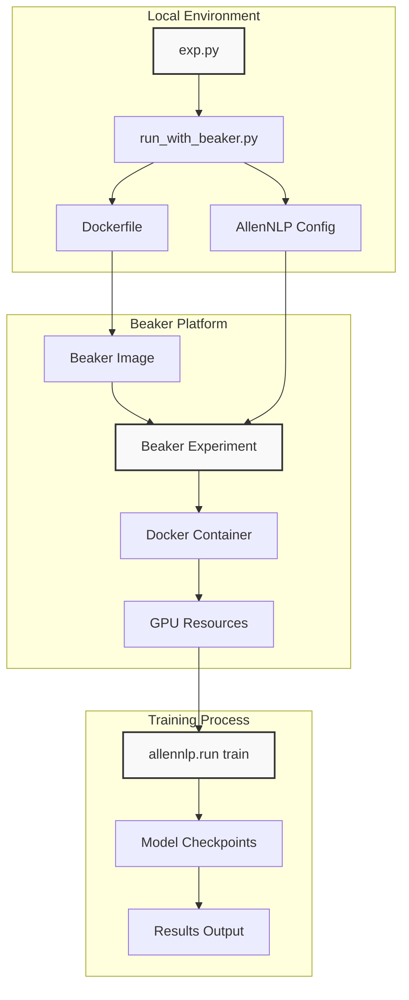
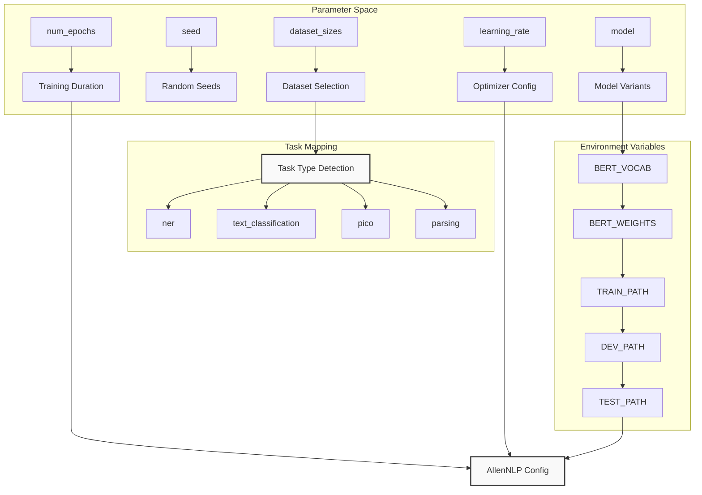
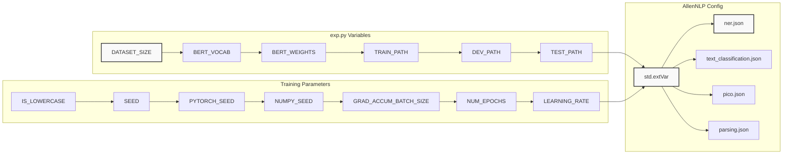
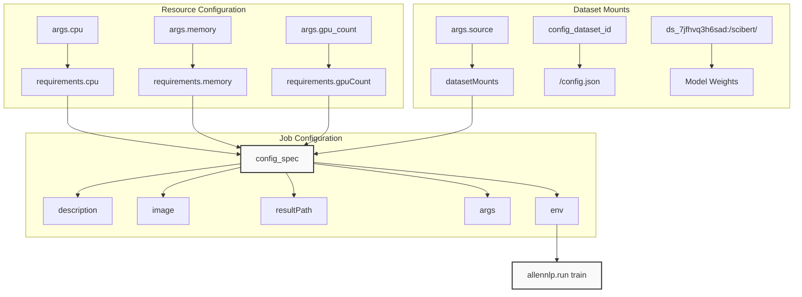
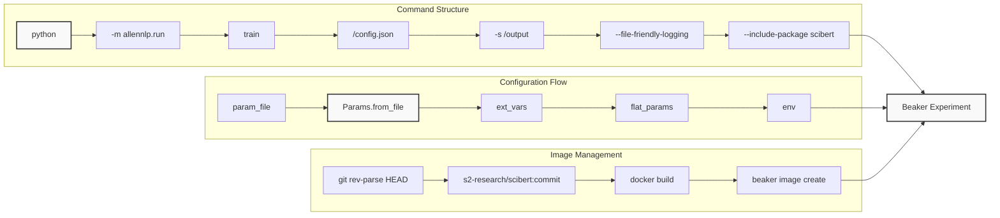

<!-- source: DeepWiki mcp.deepwiki.com · repo allenai/scibert · page 5.2 Cloud Training · fetched 2026-10-26 -->

# Cloud Training

<details>
<summary>Relevant source files</summary>

The following files were used as context for generating this wiki page:

- [Dockerfile](Dockerfile)
- [allennlp_config/ner.json](allennlp_config/ner.json)
- [allennlp_config/text_classification.json](allennlp_config/text_classification.json)
- [requirements.txt](requirements.txt)
- [scibert/models/bert_text_classifier.py](scibert/models/bert_text_classifier.py)
- [scripts/exp.py](scripts/exp.py)
- [scripts/run_with_beaker.py](scripts/run_with_beaker.py)

</details>


This document covers the cloud-based training infrastructure used to run SciBERT fine-tuning experiments at scale using the Beaker platform. The system enables distributed hyperparameter sweeps across multiple datasets, models, and configurations using Docker containers for reproducible environments.

For information about the experiment orchestration logic and hyperparameter sweep configuration, see [Experiment Orchestration](#5.1). For details on analyzing experiment results and statistical comparisons, see [Results Analysis](#5.3).

## Beaker Platform Integration

The cloud training system integrates with Beaker, a research platform for managing distributed machine learning experiments. The integration is handled through `run_with_beaker.py`, which creates Beaker experiment specifications and manages job submission.



**Sources:** [scripts/run_with_beaker.py:1-146](), [scripts/exp.py:133-152]()

## Docker Environment Setup

The training environment is containerized using Docker to ensure reproducibility across different cloud instances. The container includes all necessary dependencies, data, and code for running SciBERT experiments.

### Container Configuration

The `Dockerfile` defines a complete Python 3.6 environment with CUDA support for GPU training:

```mermaid
graph TB
    subgraph "Base Image"
        A[python:3.6.8-stretch] --> B[NVIDIA CUDA Support]
        B --> C[System Dependencies]
    end
    
    subgraph "Python Environment"
        D[requirements.txt] --> E[AllenNLP Fork]
        E --> F[spacy en_core_web_sm]
    end
    
    subgraph "Code and Data"
        G[scibert/] --> H[allennlp_config/]
        H --> I[data/]
        I --> J[scripts/]
    end
    
    C --> D
    F --> G
    J --> K[/work Working Directory]
    
    style A fill:#f9f9f9,stroke:#333,stroke-width:2px
    style E fill:#f9f9f9,stroke:#333,stroke-width:2px
    style K fill:#f9f9f9,stroke:#333,stroke-width:2px
```

Key Docker configuration elements:
- **Base Image**: `python:3.6.8-stretch` with NVIDIA GPU support
- **CUDA Environment**: Environment variables for GPU access (`NVIDIA_VISIBLE_DEVICES`, `NVIDIA_DRIVER_CAPABILITIES`)
- **Dependencies**: Custom AllenNLP fork with BERT support
- **Working Directory**: `/work` contains all experiment code and data

**Sources:** [Dockerfile:1-48](), [requirements.txt:1-3]()

## Experiment Orchestration

The `exp.py` script coordinates large-scale hyperparameter sweeps by generating Beaker job configurations for different combinations of datasets, models, and training parameters.

### Hyperparameter Grid

The experiment system explores a comprehensive hyperparameter space:

| Parameter | Values | Purpose |
|-----------|--------|---------|
| `dataset` | `NCBI-disease`, `bc5cdr`, `JNLPBA`, `citation_intent`, etc. | Target task |
| `model` | `scibert_basevocab_uncased`, `scibert_scivocab_uncased`, etc. | Pre-trained model variant |
| `seed` | 15370, 15570, 15680, 15780, 15210, etc. | Random seed for reproducibility |
| `num_epochs` | 2, 3, 4, 5 | Training duration |
| `learning_rate` | 5e-6, 1e-5, 2e-5, 5e-5 | Optimizer learning rate |
| `grad_accum_batch_size` | 32 | Gradient accumulation batch size |



**Sources:** [scripts/exp.py:18-31](), [scripts/exp.py:33-46](), [scripts/exp.py:47-61](), [scripts/exp.py:103-112]()

## Configuration Management

Each experiment uses environment variables to parameterize AllenNLP configuration files, allowing the same config template to be used across different experimental conditions.

### Environment Variable System

The system passes experiment parameters as environment variables that are consumed by Jsonnet configuration files:



Key environment variables:
- **Model Configuration**: `BERT_VOCAB`, `BERT_WEIGHTS`, `IS_LOWERCASE`
- **Data Paths**: `TRAIN_PATH`, `DEV_PATH`, `TEST_PATH`
- **Training Parameters**: `LEARNING_RATE`, `NUM_EPOCHS`, `GRAD_ACCUM_BATCH_SIZE`
- **Reproducibility**: `SEED`, `PYTORCH_SEED`, `NUMPY_SEED`

**Sources:** [scripts/exp.py:139-151](), [allennlp_config/ner.json:2-4](), [allennlp_config/text_classification.json:2-4]()

## Resource Management

The Beaker integration provides flexible resource allocation for different experiment requirements, including GPU access, memory limits, and CPU allocation.

### Beaker Job Specification

The `run_with_beaker.py` script generates Beaker experiment specifications with configurable resource requirements:



Resource allocation features:
- **GPU Support**: Configurable GPU count (default: 1)
- **Memory Management**: Flexible memory allocation
- **CPU Allocation**: Fractional CPU resource allocation
- **Dataset Mounting**: Remote dataset access via Beaker datasets
- **Output Management**: Results written to `/output` path

**Sources:** [scripts/run_with_beaker.py:87-102](), [scripts/run_with_beaker.py:75-81](), [scripts/run_with_beaker.py:60-69]()

## Training Command Generation

The system generates standardized AllenNLP training commands with consistent parameters across all experiments:



The training command structure ensures consistency across experiments:
- **Module Execution**: Uses `python -m allennlp.run` for reproducible execution
- **Configuration**: Loads `/config.json` with environment variable substitution
- **Output Directory**: Results saved to `/output` for Beaker collection
- **Logging**: File-friendly logging format for cloud environments
- **Package Integration**: Includes `scibert` package for custom models

**Sources:** [scripts/run_with_beaker.py:60-73](), [scripts/run_with_beaker.py:22-39](), [scripts/run_with_beaker.py:23-24]()

---

