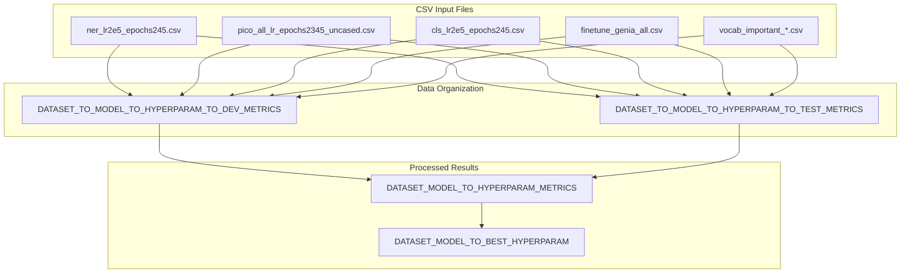
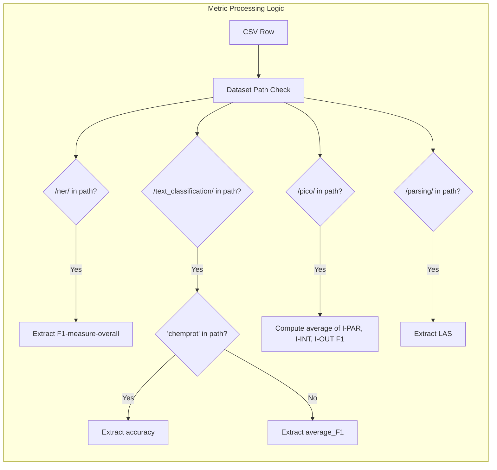
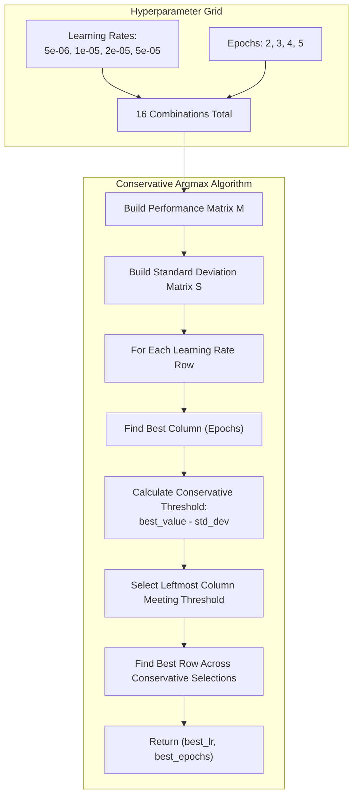
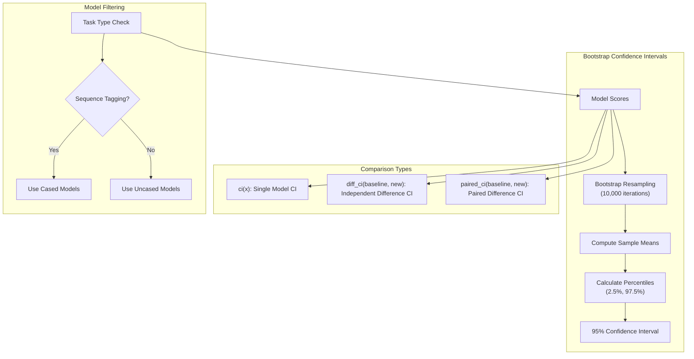
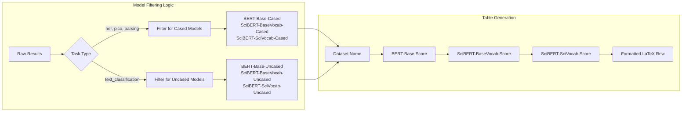
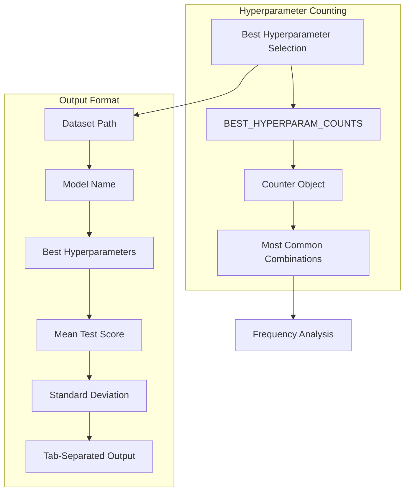
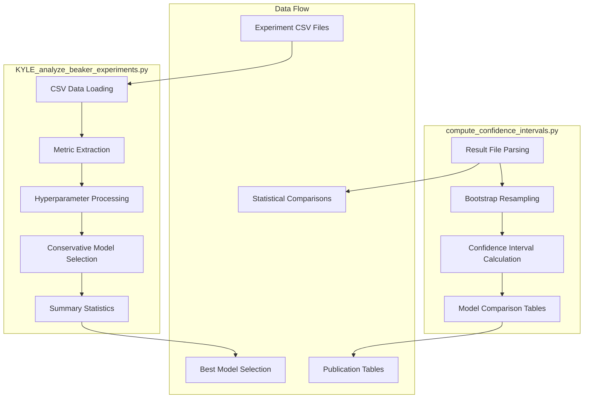

<!-- source: DeepWiki mcp.deepwiki.com · repo allenai/scibert · page 5.3 Results Analysis · fetched 2026-10-26 -->

# Results Analysis

Relevant source files

The following files were used as context for generating this wiki page:

- [misc/results.tsv](misc/results.tsv)
- [results/LOCAL_genia.txt](results/LOCAL_genia.txt)
- [results/analyze.xlsx](results/analyze.xlsx)
- [results/cls_lr2e5_epochs245.csv](results/cls_lr2e5_epochs245.csv)
- [results/finetune_genia_all.csv](results/finetune_genia_all.csv)
- [results/ner_lr2e5_epochs245.csv](results/ner_lr2e5_epochs245.csv)
- [results/ner_lr2e5_epochs3.csv](results/ner_lr2e5_epochs3.csv)
- [results/ner_lr5e61e55e5_epochs2345.csv](results/ner_lr5e61e55e5_epochs2345.csv)
- [scripts/KYLE_analyze_beaker_experiments.py](scripts/KYLE_analyze_beaker_experiments.py)
- [scripts/compute_confidence_intervals.py](scripts/compute_confidence_intervals.py)

## Purpose and Scope

This document covers the statistical analysis and interpretation of experimental results from SciBERT fine-tuning experiments. The results analysis system processes CSV output files from experiment runs, computes statistical metrics, performs model selection, and generates confidence intervals for model comparisons.

For information about running the experiments that generate these results, see [Experiment Orchestration](#5.1). For details on the cloud training infrastructure, see [Cloud Training](#5.2).

## Result Data Organization

The results analysis system processes CSV files containing experimental outputs from multiple hyperparameter sweeps and model comparisons. The primary analysis script organizes results into nested data structures for systematic processing.

The analysis script loads results from multiple CSV files and organizes them into nested dictionaries indexed by dataset path, model weights path, and hyperparameter combinations. Each hyperparameter combination stores lists of metric values across different random seeds.

**Sources:** [scripts/KYLE_analyze_beaker_experiments.py:51-112]()

## Task-Specific Metric Processing

Different downstream tasks use different evaluation metrics, which are extracted and normalized by the results processing pipeline:

| Task Type | Metric Extraction | Validation Metric | Test Metric |
|-----------|------------------|-------------------|-------------|
| NER | F1-measure-overall | `metric_best_validation_f1-measure-overall` | `metric_test_f1-measure-overall` |
| Text Classification (non-ChemProt) | Average F1 | `metric_best_validation_average_F1` | `metric_test_average_F1` |
| Text Classification (ChemProt) | Accuracy | `metric_best_validation_accuracy` | `metric_test_accuracy` |
| PICO | Average of I-PAR, I-INT, I-OUT F1 | Average of three F1 components | Average of three F1 components |
| Parsing | LAS (Labeled Attachment Score) | `metric_best_validation_LAS` | `metric_test_LAS` |

**Sources:** [scripts/KYLE_analyze_beaker_experiments.py:78-105]()

## Conservative Argmax Model Selection

The results analysis implements a "conservative argmax" strategy for hyperparameter selection that favors simpler hyperparameter settings when performance differences are within one standard deviation.

The `conservative_argmax` function implements this strategy by:

1. **Matrix Construction**: Building matrices `M` and `S` for mean performance and standard deviations across hyperparameter combinations
2. **Row-wise Best Selection**: For each learning rate, finding the best number of epochs
3. **Conservative Bias**: Selecting the leftmost (smallest) number of epochs that performs within one standard deviation of the best
4. **Global Selection**: Choosing the learning rate with the best conservative performance

**Sources:** [scripts/KYLE_analyze_beaker_experiments.py:8-47]()

## Statistical Analysis and Confidence Intervals

The confidence interval computation system provides bootstrap-based statistical comparisons between different models and configurations.

The confidence interval system supports three types of statistical analysis:

- **Single Model CI**: Bootstrap confidence intervals for individual model performance using `ci(x)` function
- **Independent Difference CI**: Confidence intervals for performance differences between models using `diff_ci(baseline_scores, new_scores)`
- **Paired Difference CI**: Confidence intervals for paired differences when comparing models on the same test instances using `paired_ci(baseline_scores, new_scores)`

**Sources:** [scripts/compute_confidence_intervals.py:32-50]()

## Model Comparison Tables

The analysis system generates formatted comparison tables that filter models based on task requirements and compute statistical comparisons across different SciBERT variants.

The table generation process includes:

1. **Task-Specific Filtering**: Cased models for sequence tagging tasks (NER, PICO, parsing) and uncased models for text classification
2. **Score Extraction**: Computing mean performance across random seeds for each model variant
3. **LaTeX Formatting**: Generating publication-ready table rows with rounded scores

**Sources:** [scripts/compute_confidence_intervals.py:52-111]()

## Hyperparameter Distribution Analysis

The results analysis tracks the distribution of selected hyperparameters across different tasks and models to identify common patterns.

The system tracks hyperparameter selection patterns by:

1. **Selection Recording**: Storing the best hyperparameter combination for each (dataset, model) pair
2. **Frequency Counting**: Using `Counter` to track how often each hyperparameter combination is selected as optimal
3. **Pattern Analysis**: Identifying the most frequently selected combinations across all experiments

**Sources:** [scripts/KYLE_analyze_beaker_experiments.py:145-154]()

## Implementation Architecture

The results analysis system is implemented through two main scripts that handle different aspects of statistical processing:

**Key Components:**

- **`KYLE_analyze_beaker_experiments.py`**: Main analysis script that processes experimental results, implements conservative model selection, and generates summary statistics
- **`compute_confidence_intervals.py`**: Statistical analysis script that computes bootstrap confidence intervals and generates comparison tables
- **Result CSV Files**: Raw experimental outputs from Beaker experiments containing metrics, hyperparameters, and model configurations

**Sources:** [scripts/KYLE_analyze_beaker_experiments.py:1-162](), [scripts/compute_confidence_intervals.py:1-170]()

---

