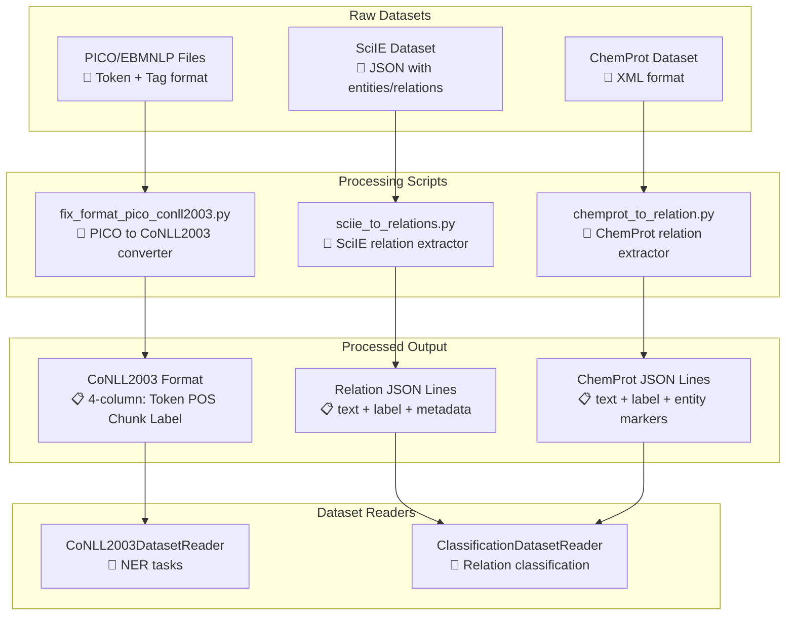
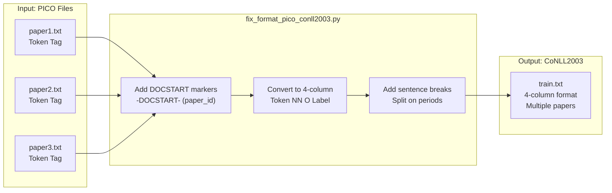
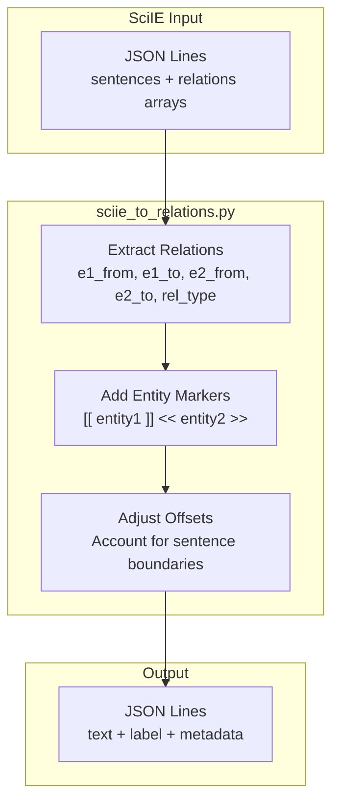
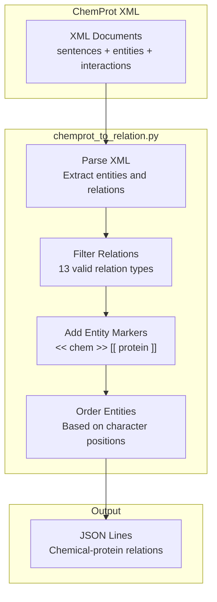
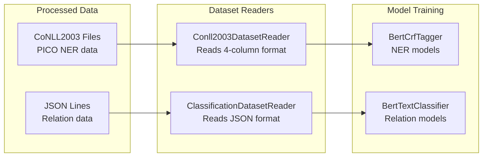

<!-- source: DeepWiki mcp.deepwiki.com · repo allenai/scibert · page 6 Data Processing · fetched 2026-10-26 -->

# Data Processing

<details>
<summary>Relevant source files</summary>

The following files were used as context for generating this wiki page:

- [data/text_classification/chemprot/dev.txt](data/text_classification/chemprot/dev.txt)
- [data/text_classification/chemprot/test.txt](data/text_classification/chemprot/test.txt)
- [data/text_classification/chemprot/train.txt](data/text_classification/chemprot/train.txt)
- [scripts/chemprot_to_relation.py](scripts/chemprot_to_relation.py)
- [scripts/fix_format_pico_conll2003.py](scripts/fix_format_pico_conll2003.py)
- [scripts/sciie_to_relations.py](scripts/sciie_to_relations.py)

</details>


## Purpose and Scope

The data processing system handles format conversion and preprocessing of scientific NLP datasets for fine-tuning SciBERT models. This includes converting various dataset formats to standardized formats compatible with AllenNLP dataset readers, adding entity markers for relation extraction tasks, and preparing data for specific downstream tasks like named entity recognition, PICO extraction, and text classification.

For information about model training and fine-tuning workflows, see [Fine-tuning Guide](#3). For dataset readers that consume the processed data, see [Dataset Readers](#4.2).

## Data Processing Pipeline

The data processing system consists of format conversion scripts that transform raw scientific datasets into standardized formats suitable for model training.



**Sources:** [scripts/fix_format_pico_conll2003.py:1-50](), [scripts/sciie_to_relations.py:1-52](), [scripts/chemprot_to_relation.py:1-68]()

## Format Conversion Scripts

### PICO to CoNLL2003 Converter

The `fix_format_pico_conll2003.py` script addresses three formatting issues with PICO/EBMNLP data:

1. **Column Format**: Converts 2-column (Token, Tag) to 4-column CoNLL2003 format
2. **File Consolidation**: Merges separate per-paper files into single train/dev/test files
3. **Sentence Segmentation**: Adds sentence breaks at periods to prevent BERT truncation issues



Key implementation details:
- Adds placeholder `NN` for POS tags and `O` for chunk labels at [scripts/fix_format_pico_conll2003.py:43]()
- Inserts sentence breaks when encountering periods with `O` labels at [scripts/fix_format_pico_conll2003.py:46-47]()
- Paper IDs extracted from filenames and used in DOCSTART markers at [scripts/fix_format_pico_conll2003.py:34-36]()

**Sources:** [scripts/fix_format_pico_conll2003.py:1-50]()

### SciIE Relation Extractor

The `sciie_to_relations.py` script extracts relation information from the SciIE dataset and optionally adds entity markers for relation classification tasks.



Entity marker placement logic handles overlapping entities by inserting markers in the correct order at [scripts/sciie_to_relations.py:35-45](). The script adjusts character offsets relative to sentence boundaries at [scripts/sciie_to_relations.py:31-34]().

**Sources:** [scripts/sciie_to_relations.py:1-52]()

### ChemProt Relation Extractor

The `chemprot_to_relation.py` script processes ChemProt XML data to extract chemical-protein relations with entity highlighting.



The script filters for specific relation types defined at [scripts/chemprot_to_relation.py:42-45]() and handles entity ordering based on character positions at [scripts/chemprot_to_relation.py:47-62]().

**Sources:** [scripts/chemprot_to_relation.py:1-68]()

## Output Data Formats

### CoNLL2003 Format

The processed PICO data follows the standard CoNLL2003 4-column format:

| Column | Content | Example |
|--------|---------|---------|
| Token | Word/token | `patients` |
| POS | Part-of-speech | `NN` |
| Chunk | Chunk label | `O` |
| NER | Named entity | `B-Population` |

Document boundaries are marked with `-DOCSTART- (paper_id)` lines, and sentence boundaries are indicated by blank lines.

### Relation Classification Format

Both SciIE and ChemProt outputs use JSON Lines format with entity markers:

```json
{
  "text": "<< Epidermal growth factor receptor >> inhibitors include [[ gefitinib ]]",
  "label": "INHIBITOR", 
  "metadata": []
}
```

Entity markers distinguish between the two entities in each relation:
- `<< entity1 >>` - First entity (typically chemical/drug)
- `[[ entity2 ]]` - Second entity (typically protein/gene)

**Sources:** [data/text_classification/chemprot/train.txt:1-10](), [data/text_classification/chemprot/dev.txt:1-10](), [data/text_classification/chemprot/test.txt:1-10]()

## Integration with Training Pipeline

The processed datasets integrate with the AllenNLP-based fine-tuning system through specific dataset readers:



The data processing scripts ensure compatibility with AllenNLP's expected input formats, enabling seamless integration with the model training pipeline described in the fine-tuning configurations.

**Sources:** [scripts/fix_format_pico_conll2003.py:1-50](), [scripts/sciie_to_relations.py:1-52](), [scripts/chemprot_to_relation.py:1-68]()

---

