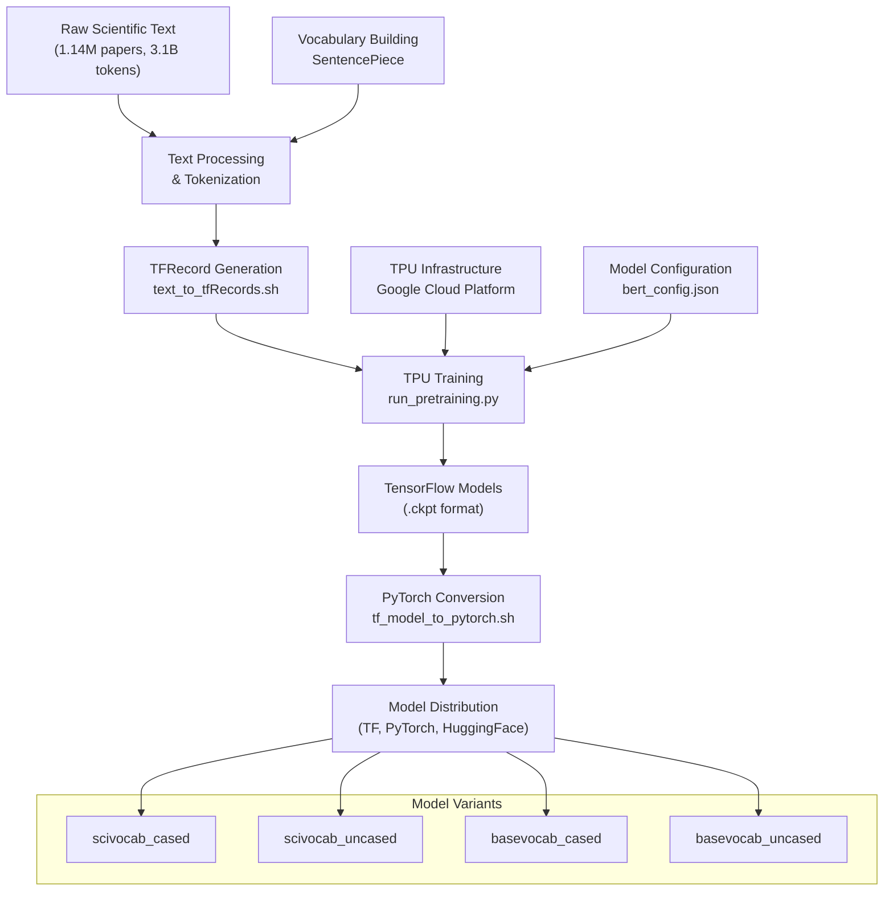
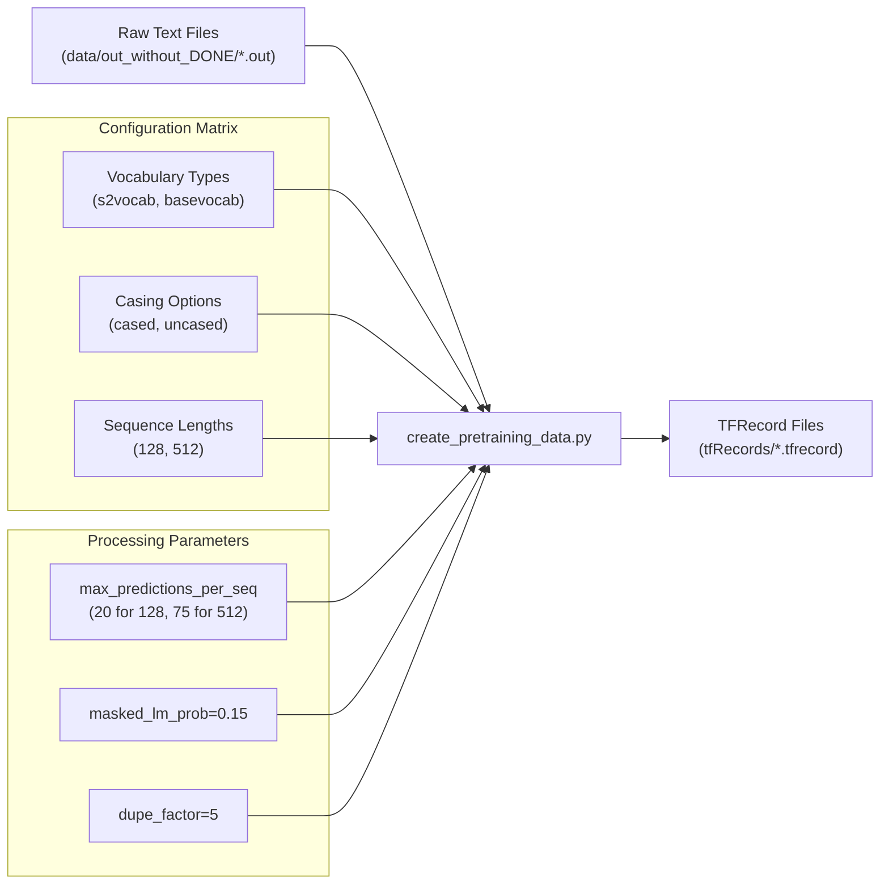
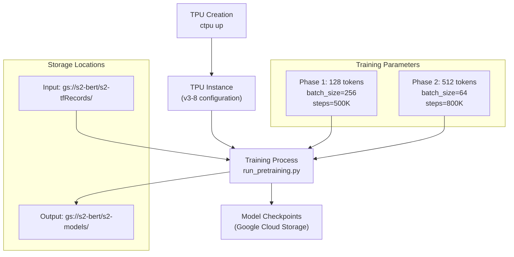
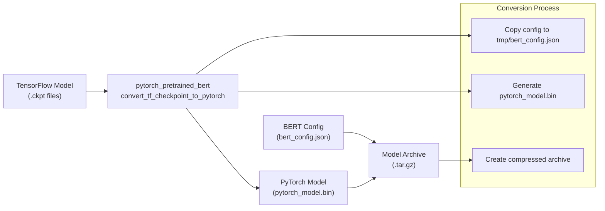
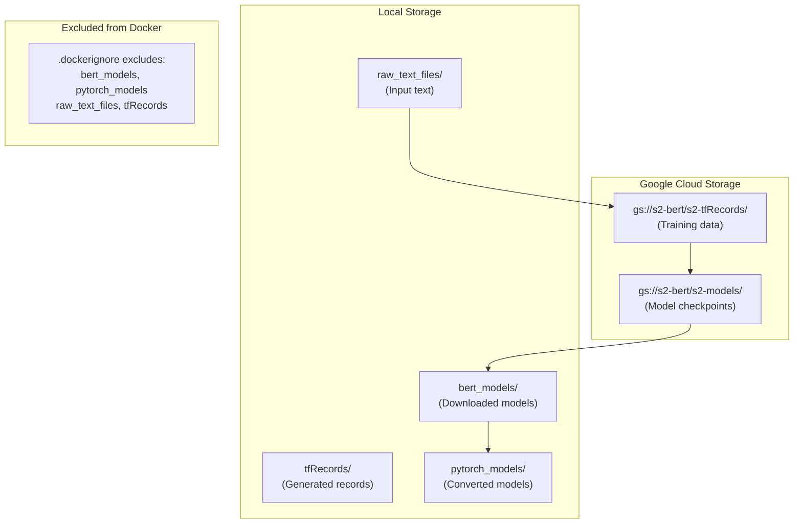

<!-- source: DeepWiki mcp.deepwiki.com · repo allenai/scibert · page 7 Pretraining Pipeline · fetched 2026-10-26 -->

# Pretraining Pipeline

<details>
<summary>Relevant source files</summary>

The following files were used as context for generating this wiki page:

- [.dockerignore](.dockerignore)
- [README.md](README.md)
- [scripts/cheatsheet.txt](scripts/cheatsheet.txt)
- [scripts/text_to_tfRecords.sh](scripts/text_to_tfRecords.sh)
- [scripts/tf_model_to_pytorch.sh](scripts/tf_model_to_pytorch.sh)
- [scripts/train_allennlp_local.sh](scripts/train_allennlp_local.sh)

</details>


This document covers the infrastructure and processes used to pretrain SciBERT models from scratch on scientific text corpora. The pretraining pipeline transforms raw scientific text into trained BERT models distributed in multiple formats (TensorFlow, PyTorch, HuggingFace).

For information about using pre-trained SciBERT models, see [Getting Started](#2). For fine-tuning pretrained models on downstream tasks, see [Fine-tuning Guide](#3).

## Overview

The SciBERT pretraining pipeline processes 1.14M scientific papers (3.1B tokens) from Semantic Scholar into trained language models. The pipeline supports multiple model variants across vocabulary types (`scivocab` vs `basevocab`) and casing (`cased` vs `uncased`), producing a total of 4 model combinations.



**Sources:** [README.md:22-24](), [scripts/cheatsheet.txt:4-6](), [scripts/text_to_tfRecords.sh:3-8]()

## Data Preparation Pipeline

The data preparation phase converts raw scientific text into TensorFlow records suitable for BERT pretraining. This process handles multiple vocabulary types, sequence lengths, and casing configurations.

### TFRecord Generation

The `text_to_tfRecords.sh` script orchestrates the conversion of raw text files into TensorFlow records using Google's `create_pretraining_data.py` script. The process generates records for all combinations of vocabulary, casing, and sequence length parameters.



The script processes 251 input files (0-250) in parallel using the `sem` command for job control. Key parameters include:

| Parameter | Value | Description |
|-----------|-------|-------------|
| `max_seq_length` | 128 or 512 | Maximum sequence length for training |
| `max_predictions_per_seq` | 20 or 75 | Maximum masked tokens per sequence |
| `masked_lm_prob` | 0.15 | Probability of masking tokens |
| `dupe_factor` | 5 | Number of duplicates with different masking |

**Sources:** [scripts/text_to_tfRecords.sh:1-34]()

### Vocabulary Management

The pipeline supports two vocabulary types:
- **`scivocab`**: Custom vocabulary built specifically for scientific text
- **`basevocab`**: Original BERT vocabulary for comparison

Vocabulary generation uses SentencePiece with the following configuration:

```
spm.SentencePieceTrainer.Train('--input=combined.out --model_prefix=100B_9999_cased --vocab_size=31000 --character_coverage=0.9999 --model_type=bpe --input_sentence_size=100000000 --shuffle_input_sentence=true')
```

**Sources:** [scripts/cheatsheet.txt:4-6]()

## TPU Training Infrastructure

SciBERT pretraining uses Google Cloud TPUs for efficient large-scale training. The training process involves two phases: initial training on 128-token sequences followed by fine-tuning on 512-token sequences.

### TPU Setup and Configuration

TPU instances are created using the `ctpu` command-line tool:



**Sources:** [scripts/cheatsheet.txt:8-16]()

### Training Command Examples

The training process uses different parameters for each sequence length phase:

**Phase 1 (128 tokens):**
```bash
python3 run_pretraining.py \
  --input_file=gs://s2-bert/s2-tfRecords/tfRecords_s2vocab_uncased_128/*.tfrecord \
  --output_dir=gs://s2-bert/s2-models/3B-s2vocab_uncased_128 \
  --train_batch_size=256 \
  --max_seq_length=128 \
  --max_predictions_per_seq=20 \
  --num_train_steps=500000 \
  --learning_rate=1e-4
```

**Phase 2 (512 tokens):**
```bash
python3 run_pretraining.py \
  --input_file=gs://s2-bert/s2-tfRecords/tfRecords_s2vocab_uncased_512/*.tfrecord \
  --output_dir=gs://s2-bert/s2-models/3B-s2vocab_uncased_512_finetune128 \
  --train_batch_size=64 \
  --max_seq_length=512 \
  --max_predictions_per_seq=75 \
  --num_train_steps=800000 \
  --learning_rate=1e-5
```

**Sources:** [scripts/cheatsheet.txt:11-16]()

## Model Conversion Pipeline

After TPU training produces TensorFlow checkpoints, the models are converted to PyTorch format for broader compatibility. The conversion process uses the `pytorch_pretrained_bert` library.

### TensorFlow to PyTorch Conversion

The `tf_model_to_pytorch.sh` script handles the conversion process:



The conversion script performs the following steps:
1. Converts TensorFlow checkpoint to PyTorch binary using `pytorch_pretrained_bert convert_tf_checkpoint_to_pytorch`
2. Copies the BERT configuration file to the temporary directory
3. Creates a compressed archive containing both the model weights and configuration

**Sources:** [scripts/tf_model_to_pytorch.sh:1-11]()

### Model Distribution Formats

The final models are distributed in three formats:

| Format | Use Case | File Structure |
|--------|----------|----------------|
| TensorFlow | Original BERT compatibility | `.ckpt` files + config |
| PyTorch AllenNLP | AllenNLP integration | `weights.tar.gz` + `vocab.txt` |
| PyTorch HuggingFace | HuggingFace Transformers | `pytorch_model.bin` + config |

**Sources:** [README.md:44-60]()

## Infrastructure Components

The pretraining pipeline relies on several infrastructure components for storage, monitoring, and development.

### Storage and Data Management



**Sources:** [scripts/cheatsheet.txt:23-28](), [.dockerignore:1-8]()

### Monitoring and Profiling

The pipeline includes monitoring capabilities for TPU training:

- **Tensorboard Profiling**: `cloud_tpu_profiler.main.run_main()` for TPU performance analysis
- **Model Monitoring**: Tensorboard server monitoring all models at `gs://s2-bert/s2-models`

**Sources:** [scripts/cheatsheet.txt:31-36]()

### Development Environment

The pretraining pipeline is containerized for reproducible training environments. The Docker configuration excludes large model directories and temporary files to minimize image size.

**Sources:** [.dockerignore:1-8]()

---

