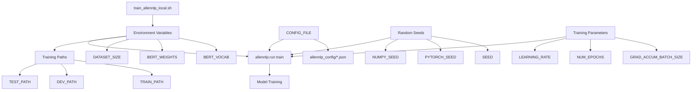
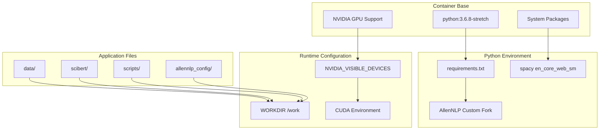
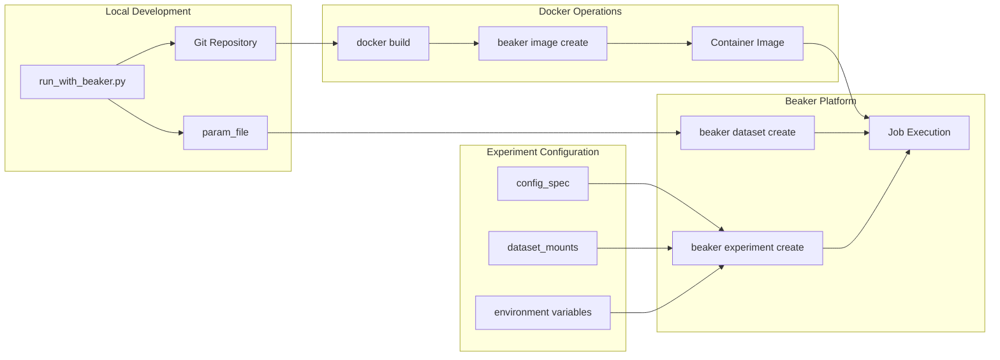
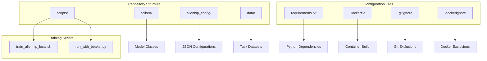

<!-- source: DeepWiki mcp.deepwiki.com · repo allenai/scibert · page 8 Development Setup · fetched 2026-10-26 -->

# Development Setup

<details>
<summary>Relevant source files</summary>

The following files were used as context for generating this wiki page:

- [.dockerignore](.dockerignore)
- [.gitignore](.gitignore)
- [Dockerfile](Dockerfile)
- [README.md](README.md)
- [requirements.txt](requirements.txt)
- [scibert/models/bert_text_classifier.py](scibert/models/bert_text_classifier.py)
- [scripts/run_with_beaker.py](scripts/run_with_beaker.py)
- [scripts/train_allennlp_local.sh](scripts/train_allennlp_local.sh)

</details>


This page covers the infrastructure and development environment setup for the SciBERT repository. It includes local development environment configuration, Docker containerization, and cloud-based training infrastructure using Beaker. For information about running experiments and hyperparameter sweeps, see [Experiment Management](#5). For details about fine-tuning models, see [Fine-tuning Guide](#3).

## Environment Requirements

The SciBERT development environment requires Python 3.6 and specific dependencies managed through `requirements.txt`. The system supports both local development and containerized deployment.

### Python Environment
The project uses Python 3.6.8 as specified in the `Dockerfile` base image. Dependencies are managed through a custom AllenNLP fork that includes FP16 support and other optimizations.

```bash
pip install -r requirements.txt
```

### Core Dependencies
- Custom AllenNLP fork with FP16 support: `git://github.com/ibeltagy/allennlp@fp16_and_others`
- `jsonlines` for data processing
- `lxml` for XML parsing
- `spacy` with `en_core_web_sm` model

Sources: [requirements.txt:1-3](), [Dockerfile:40](), [README.md:71]()

## Local Development Setup

Local development uses shell scripts to configure environment variables and launch training jobs. The primary entry point is the `train_allennlp_local.sh` script.

### Environment Configuration Workflow



### Key Environment Variables

| Variable | Purpose | Example Value |
|----------|---------|---------------|
| `BERT_VOCAB` | Path to SciBERT vocabulary file | `/path/to/scibert_scivocab_uncased/vocab.txt` |
| `BERT_WEIGHTS` | Path to SciBERT model weights | `/path/to/scibert_scivocab_uncased/weights.tar.gz` |
| `DATASET_SIZE` | Size of training dataset | `38124` |
| `TRAIN_PATH` | Training data file path | `data/pico/ebmnlp/train.txt` |
| `CUDA_DEVICE` | GPU device ID | `0` |

Sources: [scripts/train_allennlp_local.sh:10-34]()

### Training Script Execution

The local training script executes the AllenNLP training command with the scibert package included:

```bash
python -m allennlp.run train $CONFIG_FILE --include-package scibert -s "$@"
```

Sources: [scripts/train_allennlp_local.sh:35]()

## Docker Environment

The containerized development environment provides consistent deployment across different systems and cloud platforms. The Docker setup includes GPU support for NVIDIA hardware.

### Docker Container Architecture



### GPU Configuration

The Docker container includes NVIDIA GPU support with environment variables for device visibility and driver capabilities:

```dockerfile
ENV NVIDIA_VISIBLE_DEVICES all
ENV NVIDIA_DRIVER_CAPABILITIES compute,utility
```

Sources: [Dockerfile:13-15]()

### Container Build Process

The Dockerfile follows a multi-stage approach:

1. **Base System Setup**: Python 3.6.8 with system packages
2. **NVIDIA Configuration**: GPU environment variables and labels
3. **Package Installation**: System dependencies and Python packages
4. **Application Copy**: Source code and configuration files

Sources: [Dockerfile:1-47]()

## Cloud Development with Beaker

The Beaker integration provides cloud-based training capabilities through the `run_with_beaker.py` script. This system automates Docker image building, experiment configuration, and job submission.

### Beaker Workflow Architecture



### Beaker Command Construction

The script builds AllenNLP training commands for cloud execution:

```python
allennlp_command = [
    "python", "-m", "allennlp.run", "train",
    "/config.json", "-s", "/output",
    "--file-friendly-logging"
]
```

Sources: [scripts/run_with_beaker.py:60-69]()

### Environment Variable Handling

The Beaker script processes configuration parameters and converts them to environment variables:

```python
params = Params.from_file(param_file, overrides, ext_vars)
flat_params = params.as_flat_dict()
env = {}
for k, v in flat_params.items():
    k = str(k).replace('.', '_')
    env[k] = str(v)
```

Sources: [scripts/run_with_beaker.py:34-39]()

## Development Tools and File Structure

The development environment integrates with standard tools for version control, dependency management, and code organization.

### File Organization



### Git Configuration

The `.gitignore` file excludes standard Python artifacts, IDE files, and project-specific directories:

- Python bytecode and cache files
- Distribution and build artifacts
- IDE configuration files (`.idea/`)
- macOS system files (`.DS_Store`)

Sources: [.gitignore:1-110]()

### Docker Ignore Configuration

The `.dockerignore` file excludes large model files and temporary directories from Docker builds:

- `.git` repository history
- `bert_models` and `pytorch_models` directories
- `tfRecords` and temporary files

Sources: [.dockerignore:1-8]()

## Development Workflow

### Local Development Cycle

1. **Environment Setup**: Configure Python 3.6 and install dependencies
2. **Model Download**: Extract SciBERT model weights and vocabulary
3. **Configuration**: Set environment variables in training script
4. **Execution**: Run `train_allennlp_local.sh` with serialization directory

### Container Development Cycle

1. **Image Build**: Docker builds container with all dependencies
2. **Volume Mounting**: Mount local code and data directories
3. **GPU Access**: Configure NVIDIA container runtime
4. **Training Execution**: Run training inside container

### Cloud Development Cycle

1. **Configuration**: Prepare AllenNLP configuration files
2. **Image Creation**: Build and push Docker image to Beaker
3. **Job Submission**: Submit experiment through `run_with_beaker.py`
4. **Monitoring**: Track experiment progress and retrieve results

Sources: [README.md:69-121](), [scripts/run_with_beaker.py:22-127]()