# Page: Overview

# Overview

<details>
<summary>Relevant source files</summary>

The following files were used as context for generating this wiki page:

- [.dockerignore](.dockerignore)
- [README.md](README.md)
- [scripts/train_allennlp_local.sh](scripts/train_allennlp_local.sh)

</details>


## Purpose and Scope

This document provides a comprehensive overview of the SciBERT repository, a specialized BERT model and fine-tuning framework designed for scientific natural language processing tasks. SciBERT is pretrained on scientific literature and optimized for downstream tasks including named entity recognition, text classification, dependency parsing, and relation extraction in scientific domains.

This overview covers the repository's architecture, core components, and systems. For specific implementation details about fine-tuning on particular tasks, see [Fine-tuning Guide](#3). For experiment management and hyperparameter optimization, see [Experiment Management](#5). For pretraining infrastructure details, see [Pretraining Pipeline](#7).

## What is SciBERT

SciBERT is a domain-specific BERT model trained on scientific text from the Semantic Scholar corpus, containing 1.14 million papers and 3.1 billion tokens. Unlike general-purpose BERT models, SciBERT uses full-text scientific papers during pretraining rather than just abstracts, making it more effective for scientific NLP tasks.

The model is available in four variants, combining two vocabulary types with two casing options:

| Vocabulary Type | Casing | Description |
|----------------|--------|-------------|
| `scivocab` | `uncased` | **Recommended** - Scientific vocabulary, lowercase |
| `scivocab` | `cased` | Scientific vocabulary, preserves casing |
| `basevocab` | `uncased` | Original BERT vocabulary, lowercase |
| `basevocab` | `cased` | Original BERT vocabulary, preserves casing |

## Repository Architecture

The repository implements a complete pipeline for scientific NLP, from model pretraining to task-specific fine-tuning and evaluation.

### Core System Components

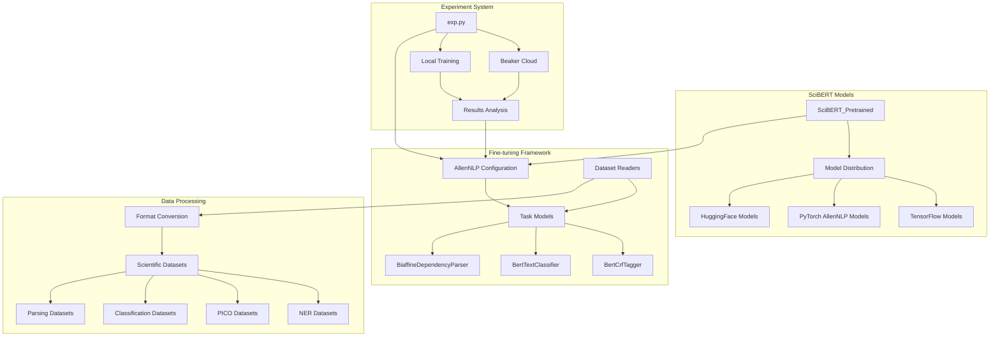

Sources: [README.md:1-141](), [scripts/train_allennlp_local.sh:1-35]()

### Model Distribution Formats

SciBERT models are distributed in three formats to support different frameworks:

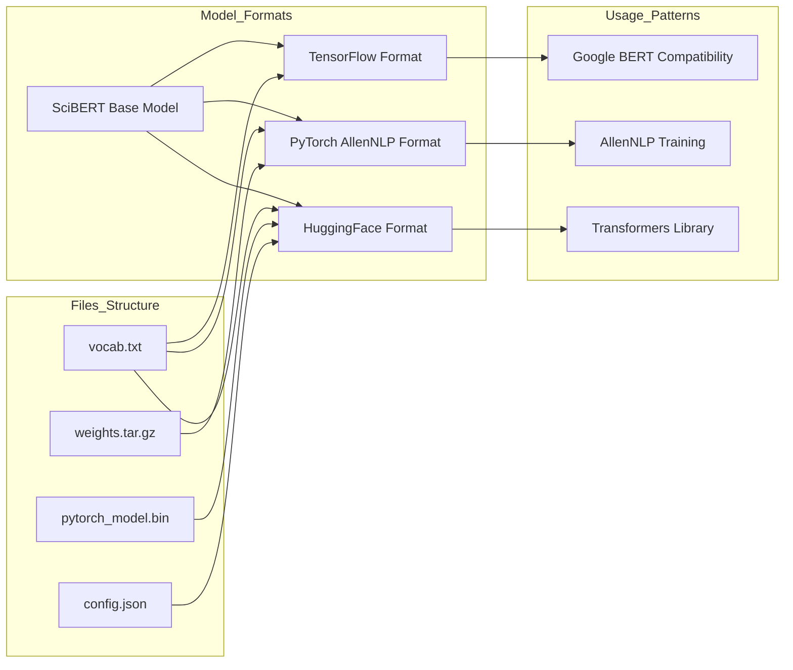

Sources: [README.md:44-60]()

## Scientific NLP Tasks

The repository supports comprehensive evaluation across multiple scientific NLP tasks, organized by domain and task type.

### Task Categories and Datasets

| Task Category | Datasets | Purpose |
|---------------|----------|---------|
| **Named Entity Recognition** | BC5CDR, NCBI-disease, JNLPBA, SciIE | Extract biomedical entities |
| **PICO Extraction** | EBMNLP | Extract clinical study components |
| **Text Classification** | ChemProt, Citation Intent, MAG, RCT-20k | Classify scientific text |
| **Dependency Parsing** | GENIA | Parse syntactic structure |
| **Relation Extraction** | ChemProt, SciIE | Extract semantic relationships |

### Training Configuration System

The fine-tuning process uses AllenNLP configurations with environment variables for flexible experimentation:

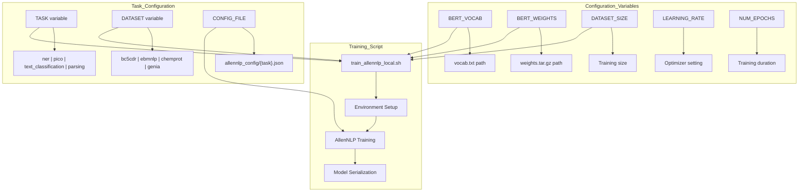

Sources: [scripts/train_allennlp_local.sh:1-35]()

## Key Features

### Domain Specialization
- **Scientific Vocabulary**: Custom vocabulary (`scivocab`) built from scientific corpus
- **Full-text Training**: Uses complete research papers, not just abstracts
- **Domain Coverage**: Broad scientific domains including biomedical, computer science, and chemistry

### Framework Integration
- **AllenNLP Integration**: Native support for AllenNLP training and evaluation
- **Multi-framework Support**: TensorFlow, PyTorch, and HuggingFace compatible models
- **Plug-and-play**: Drop-in replacement for standard BERT models

### Evaluation Infrastructure
- **Comprehensive Benchmarks**: Evaluation across 8+ scientific NLP tasks
- **Statistical Analysis**: Confidence intervals and significance testing
- **Reproducible Results**: Standardized evaluation protocols and seeds

## Getting Started

To use SciBERT in your research:

1. **Download Models**: Use HuggingFace integration or download pre-trained models
2. **Set Up Environment**: Install dependencies with `pip install -r requirements.txt`
3. **Configure Training**: Set environment variables in training scripts
4. **Run Experiments**: Use provided AllenNLP configurations for your task

For detailed setup instructions, see [Getting Started](#2). For specific task examples, see [Fine-tuning Guide](#3).

Sources: [README.md:67-121](), [.dockerignore:1-8]()

---

# Page: Getting Started

# Getting Started

<details>
<summary>Relevant source files</summary>

The following files were used as context for generating this wiki page:

- [.dockerignore](.dockerignore)
- [Dockerfile](Dockerfile)
- [README.md](README.md)
- [requirements.txt](requirements.txt)
- [scibert/models/bert_text_classifier.py](scibert/models/bert_text_classifier.py)
- [scripts/run_with_beaker.py](scripts/run_with_beaker.py)
- [scripts/train_allennlp_local.sh](scripts/train_allennlp_local.sh)

</details>


This page provides a quick start guide for using SciBERT pre-trained models and setting up the environment for fine-tuning on scientific NLP tasks. For comprehensive fine-tuning instructions, see [Fine-tuning Guide](#3). For experiment management and hyperparameter searches, see [Experiment Management](#5).

## Overview

SciBERT is a BERT model pre-trained on scientific text from 1.14M papers containing 3.1B tokens. The repository provides:

- Pre-trained models in multiple formats (TensorFlow, PyTorch, HuggingFace)
- Four model variants: `scivocab`/`basevocab` × `cased`/`uncased`
- Fine-tuning configurations for scientific NLP tasks
- Evaluation datasets and benchmarks

## Using Pre-trained Models

### HuggingFace Integration (Recommended)

The simplest way to use SciBERT is through the HuggingFace Transformers library:

```python
from transformers import AutoTokenizer, AutoModel

# Recommended: scivocab uncased model
tokenizer = AutoTokenizer.from_pretrained('allenai/scibert_scivocab_uncased')
model = AutoModel.from_pretrained('allenai/scibert_scivocab_uncased')

# Alternative: scivocab cased model
tokenizer = AutoTokenizer.from_pretrained('allenai/scibert_scivocab_cased')
model = AutoModel.from_pretrained('allenai/scibert_scivocab_cased')
```

### Model Variants

SciBERT provides four model combinations:

| Vocabulary | Casing | Recommended |
|------------|---------|-------------|
| `scivocab` | `uncased` | ✅ Best performance |
| `scivocab` | `cased` | |
| `basevocab` | `uncased` | |
| `basevocab` | `cased` | |

The `scivocab` vocabulary is built specifically for scientific text and typically outperforms `basevocab` (original BERT vocabulary).

### Pre-trained Model Formats

#### Model Distribution Architecture
```mermaid
graph TB
    A[SciBERT_Pretraining] --> B["TensorFlow Models"]
    A --> C["PyTorch AllenNLP Models"]
    A --> D["PyTorch HuggingFace Models"]
    A --> E["HuggingFace Hub"]
    
    B --> F["scibert_scivocab_uncased.tar.gz"]
    B --> G["scibert_scivocab_cased.tar.gz"]
    B --> H["scibert_basevocab_uncased.tar.gz"]
    B --> I["scibert_basevocab_cased.tar.gz"]
    
    C --> J["scibert_scivocab_uncased.tar"]
    C --> K["scibert_scivocab_cased.tar"]
    C --> L["scibert_basevocab_uncased.tar"]
    C --> M["scibert_basevocab_cased.tar"]
    
    D --> N["scibert_scivocab_uncased.tar"]
    D --> O["scibert_scivocab_cased.tar"]
    D --> P["scibert_basevocab_uncased.tar"]
    D --> Q["scibert_basevocab_cased.tar"]
    
    E --> R["allenai/scibert_scivocab_uncased"]
    E --> S["allenai/scibert_scivocab_cased"]
    
    T["AutoTokenizer.from_pretrained"] --> R
    T --> S
    U["AutoModel.from_pretrained"] --> R
    U --> S
```

Sources: [README.md:29-61]()

## Environment Setup

### Docker Environment (Recommended)

The repository includes a complete Docker environment for reproducible experiments:

```bash
# Build Docker image
docker build -t scibert .

# Run container
docker run -it --gpus all scibert /bin/bash
```

#### Docker Configuration
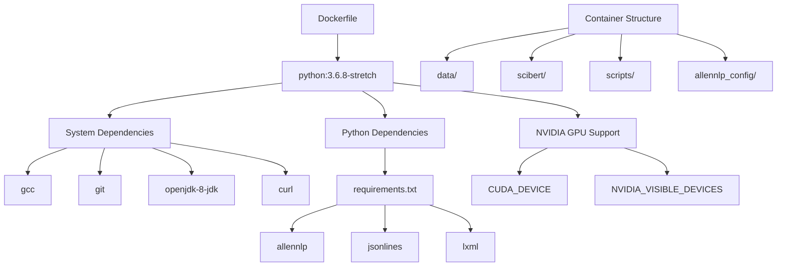

Sources: [Dockerfile:1-48](), [requirements.txt:1-3]()

### Local Environment

For local development, install dependencies:

```bash
pip install -r requirements.txt
python -m spacy download en_core_web_sm
```

Key dependencies:
- `allennlp` (custom fork with FP16 support)
- `jsonlines` for data processing
- `lxml` for XML parsing
- `spacy` for tokenization

## Basic Training Workflow

### Local Training Setup

The repository provides a script template for local training:

#### Training Script Configuration
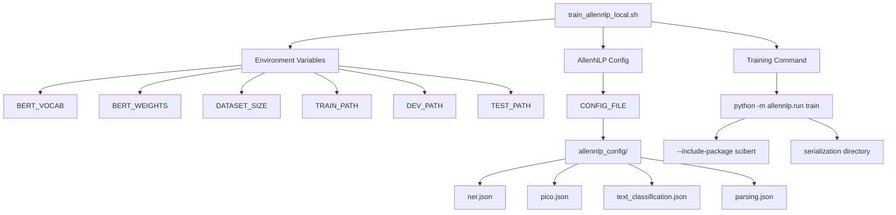

Sources: [scripts/train_allennlp_local.sh:1-35]()

### Model and Data Paths

Before training, set up the model and data paths:

```bash
# Download and extract PyTorch model
tar -xvf scibert_scivocab_uncased.tar

# Set environment variables
export BERT_VOCAB=path-to/scibert_scivocab_uncased/vocab.txt
export BERT_WEIGHTS=path-to/scibert_scivocab_uncased/weights.tar.gz
export TRAIN_PATH=data/ner/bc5cdr/train.txt
export DEV_PATH=data/ner/bc5cdr/dev.txt
export TEST_PATH=data/ner/bc5cdr/test.txt
```

### Available Tasks and Datasets

The repository includes datasets for multiple scientific NLP tasks:

#### Dataset Structure
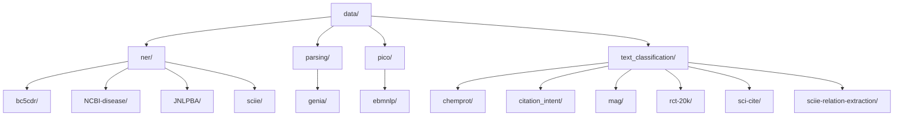

Sources: [README.md:77-95]()

## Cloud Training with Beaker

For large-scale experiments, use the Beaker integration:

```bash
python scripts/run_with_beaker.py allennlp_config/ner.json \
    --name "scibert-ner-experiment" \
    --env BERT_VOCAB=path-to-vocab \
    --env BERT_WEIGHTS=path-to-weights
```

#### Beaker Integration Components
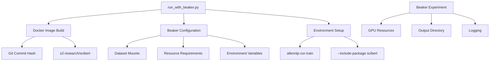

Sources: [scripts/run_with_beaker.py:22-145]()

## Next Steps

After completing the basic setup:

1. **Task-Specific Fine-tuning**: See [Fine-tuning Guide](#3) for detailed instructions on NER, PICO extraction, text classification, and parsing
2. **Model Architecture**: Explore [Model Architecture](#4) to understand the implementation details
3. **Experiment Management**: Use [Experiment Management](#5) for hyperparameter searches and result analysis
4. **Data Processing**: See [Data Processing](#6) for custom dataset preparation

The `scibert-scivocab-uncased` model is recommended for most scientific NLP tasks and provides state-of-the-art performance across multiple benchmarks.

---

# Page: Fine-tuning Guide

# Fine-tuning Guide

<details>
<summary>Relevant source files</summary>

The following files were used as context for generating this wiki page:

- [allennlp_config/ner_finetune.json](allennlp_config/ner_finetune.json)
- [allennlp_config/pico_finetune.json](allennlp_config/pico_finetune.json)
- [allennlp_config/text_classification_finetune.json](allennlp_config/text_classification_finetune.json)
- [scibert/models/bert_crf_tagger.py](scibert/models/bert_crf_tagger.py)

</details>


This document provides a comprehensive guide to fine-tuning SciBERT models for downstream scientific NLP tasks using the AllenNLP framework. The fine-tuning system supports multiple task types including named entity recognition, PICO extraction, text classification, and dependency parsing through a unified configuration-based approach.

For information about the underlying model architecture, see [Model Architecture](#4). For large-scale experiment management and hyperparameter sweeps, see [Experiment Management](#5). For data preprocessing and format conversion, see [Data Processing](#6).

## Fine-tuning System Overview

The fine-tuning system is built on AllenNLP's configuration framework and supports multiple scientific NLP tasks through task-specific models and dataset readers. The system uses environment variables for parameterization and supports both local and cloud-based training.

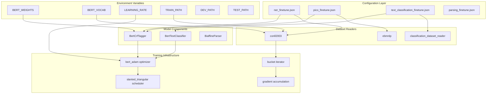

Sources: [allennlp_config/ner_finetune.json:1-70](), [allennlp_config/pico_finetune.json:1-67](), [allennlp_config/text_classification_finetune.json:1-64]()

## Configuration System

### Core Configuration Structure

All fine-tuning configurations follow a consistent AllenNLP JSON structure with environment variable substitution using the `std.extVar()` function. The configurations define five main components:

| Component | Purpose | Key Parameters |
|-----------|---------|----------------|
| `dataset_reader` | Data loading and preprocessing | `type`, `token_indexers`, `coding_scheme` |
| `model` | Task-specific model architecture | `type`, `text_field_embedder`, task-specific parameters |
| `iterator` | Batch processing and data iteration | `type`, `batch_size`, `sorting_keys` |
| `trainer` | Training loop configuration | `optimizer`, `learning_rate_scheduler`, `validation_metric` |
| `random_seed` | Reproducibility controls | `random_seed`, `pytorch_seed`, `numpy_seed` |

### Environment Variable System

The configuration system relies on environment variables for parameterization, enabling easy hyperparameter sweeps and experiment management:

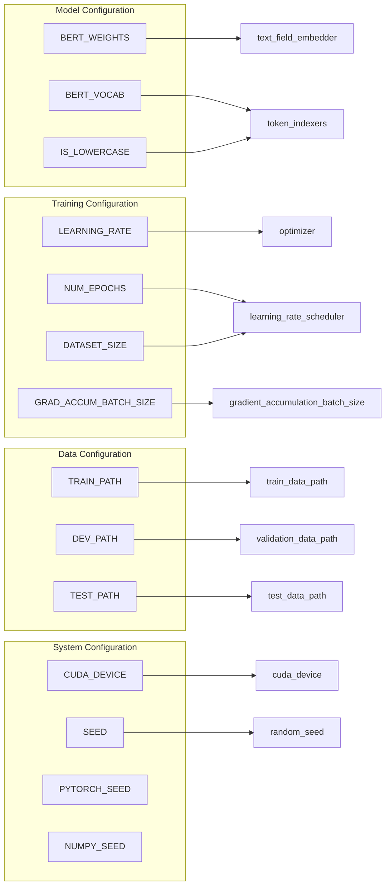

Sources: [allennlp_config/ner_finetune.json:2-4](), [allennlp_config/ner_finetune.json:12-13](), [allennlp_config/ner_finetune.json:37-38](), [allennlp_config/ner_finetune.json:53-68]()

## Task-Specific Models

### BertCrfTagger

The `BertCrfTagger` model is used for sequence labeling tasks including NER and PICO extraction. It combines BERT embeddings with a Conditional Random Field (CRF) layer for structured prediction.

Key configuration parameters:
- `label_encoding`: Tagging scheme (`"BIOUL"`, `"BIO"`, `"IOB1"`, `"BMES"`)
- `constrain_crf_decoding`: Enforces valid tag sequences
- `calculate_span_f1`: Enables span-level F1 evaluation
- `include_start_end_transitions`: CRF start/end transitions

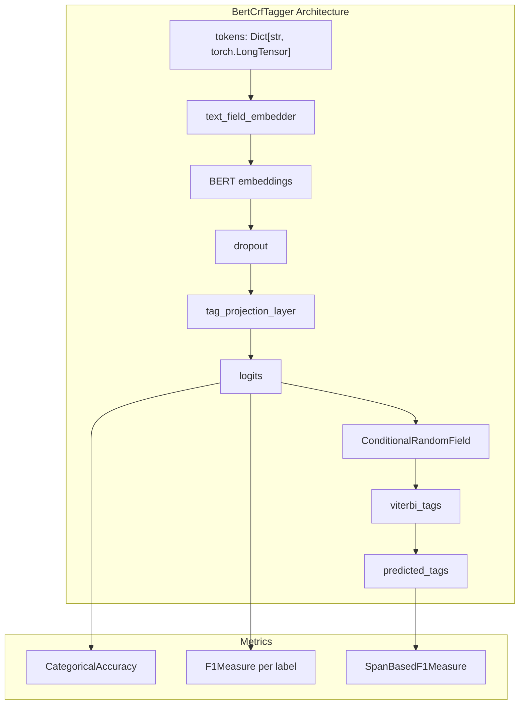

Sources: [scibert/models/bert_crf_tagger.py:18-19](), [scibert/models/bert_crf_tagger.py:65-85](), [scibert/models/bert_crf_tagger.py:165-176]()

### Training Configuration

All tasks use a consistent training setup optimized for BERT fine-tuning:

| Parameter | Value | Purpose |
|-----------|-------|---------|
| Optimizer | `bert_adam` | BERT-specific Adam variant |
| Learning Rate Scheduler | `slanted_triangular` | Gradual warmup and decay |
| Batch Processing | `bucket` iterator | Groups similar-length sequences |
| Gradient Accumulation | Configurable via `GRAD_ACCUM_BATCH_SIZE` | Effective larger batch sizes |
| Weight Decay | 0.0 for bias and LayerNorm | Prevents overfitting |

The training pipeline includes several BERT-specific optimizations:
- Parameter groups with different weight decay settings for bias and LayerNorm parameters
- Slanted triangular learning rate schedule with warmup
- Gradient accumulation for effective large batch training
- Top-layer-only fine-tuning with `"requires_grad": 'all'` and `"top_layer_only": true`

Sources: [allennlp_config/ner_finetune.json:48-68](), [allennlp_config/pico_finetune.json:48-66](), [allennlp_config/text_classification_finetune.json:44-63]()

## Dataset Readers and Token Indexers

### Token Indexer Configuration

All tasks use the `bert-pretrained` token indexer with consistent configuration:

```json
"token_indexers": {
  "bert": {
    "type": "bert-pretrained",
    "pretrained_model": std.extVar("BERT_VOCAB"),
    "do_lowercase": std.extVar("IS_LOWERCASE"),
    "use_starting_offsets": true
  }
}
```

### Task-Specific Dataset Readers

| Task | Dataset Reader | Key Features |
|------|---------------|--------------|
| NER | `conll2003` | `tag_label: "ner"`, `coding_scheme: "BIOUL"` |
| PICO | `ebmnlp` | Medical text sequence labeling |
| Classification | `classification_dataset_reader` | Text classification format |

The dataset readers handle format-specific parsing and convert text into AllenNLP's internal representation using the configured token indexers.

Sources: [allennlp_config/ner_finetune.json:5-16](), [allennlp_config/pico_finetune.json:5-14](), [allennlp_config/text_classification_finetune.json:5-14]()

## Validation and Evaluation

### Validation Metrics

Each task type uses task-appropriate validation metrics for model selection:

| Task | Validation Metric | Purpose |
|------|------------------|---------|
| NER | `+f1-measure-overall` | Span-level F1 for entity recognition |
| PICO | `+avg_f1` | Average F1 across PICO components |
| Classification | `+average_F1` | Macro-averaged F1 for classification |

### Evaluation Configuration

All configurations enable test set evaluation with `"evaluate_on_test": true` and maintain model checkpoints with `"num_serialized_models_to_keep": 3`.

The `BertCrfTagger` provides comprehensive metrics including:
- Token-level accuracy (`CategoricalAccuracy`)
- Per-label F1 scores (`F1Measure` for each label)
- Span-level F1 when `calculate_span_f1: true`
- Average F1 across all labels

Sources: [allennlp_config/ner_finetune.json:58](), [allennlp_config/pico_finetune.json:55](), [allennlp_config/text_classification_finetune.json:52](), [scibert/models/bert_crf_tagger.py:111-125]()

## Integration with Experiment Management

The fine-tuning configurations integrate with the experiment management system through environment variable parameterization. The [Experiment Management](#5) system uses these configurations to run hyperparameter sweeps and statistical comparisons across different models and datasets.

For details on running experiments, see [Experiment Orchestration](#5.1). For cloud-based training, see [Cloud Training](#5.2).

---

# Page: Configuration System

# Configuration System

<details>
<summary>Relevant source files</summary>

The following files were used as context for generating this wiki page:

- [allennlp_config/ner_finetune.json](allennlp_config/ner_finetune.json)
- [allennlp_config/pico.json](allennlp_config/pico.json)
- [allennlp_config/pico_finetune.json](allennlp_config/pico_finetune.json)
- [allennlp_config/text_classification_finetune.json](allennlp_config/text_classification_finetune.json)
- [scibert/models/bert_crf_tagger.py](scibert/models/bert_crf_tagger.py)
- [scibert/models/pico_crf_tagger.py](scibert/models/pico_crf_tagger.py)

</details>


This document covers the AllenNLP-based configuration system used for fine-tuning SciBERT models on downstream tasks. The configuration system uses JSON files with Jsonnet extensions to define model architectures, training parameters, and data processing pipelines.

For information about running experiments with these configurations, see [Experiment Orchestration](#5.1). For details about the specific models being configured, see [Core Models](#4.1).

## Overview

The configuration system is built on AllenNLP's declarative configuration framework, which allows defining entire training pipelines through JSON configuration files. The system uses Jsonnet to enable parameterization through environment variables, making configurations reusable across different experimental settings.

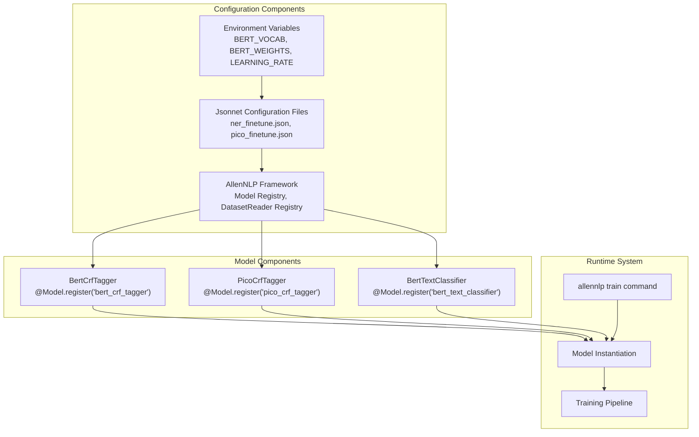

Sources: [allennlp_config/ner_finetune.json:1-70](), [allennlp_config/pico_finetune.json:1-67](), [allennlp_config/text_classification_finetune.json:1-64]()

## Configuration Structure

### Core Configuration Sections

All configurations follow the standard AllenNLP structure with four main sections:

| Section | Purpose | Key Components |
|---------|---------|----------------|
| `dataset_reader` | Data loading and preprocessing | Token indexers, data format specification |
| `model` | Model architecture and parameters | Model type, embedders, task-specific heads |
| `iterator` | Batching and data iteration | Batch size, sorting keys, caching |
| `trainer` | Training configuration | Optimizer, learning rate scheduler, validation metrics |

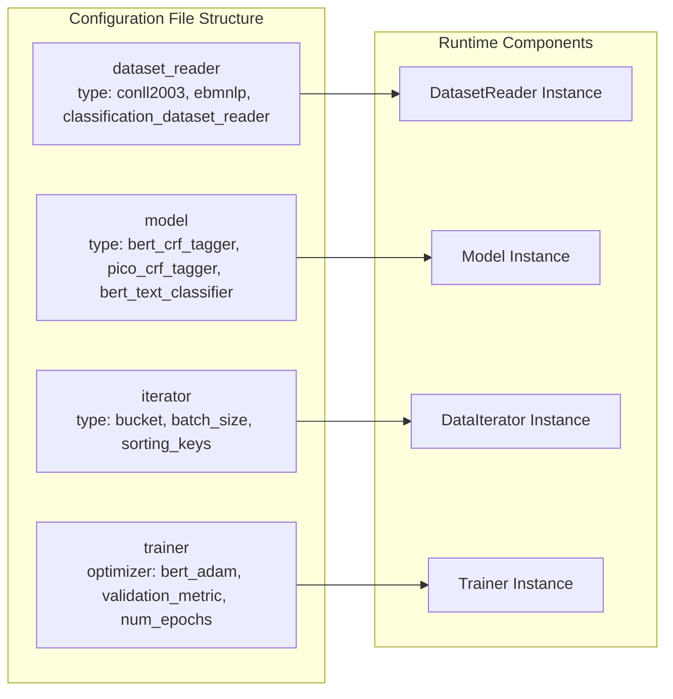

Sources: [allennlp_config/ner_finetune.json:5-17](), [allennlp_config/ner_finetune.json:22-43](), [allennlp_config/ner_finetune.json:44-49](), [allennlp_config/ner_finetune.json:50-69]()

## Environment Variable System

The configuration system uses Jsonnet's `std.extVar()` function to read environment variables, enabling parameterization without modifying configuration files.

### Core Environment Variables

| Variable | Purpose | Example Values |
|----------|---------|---------------|
| `BERT_VOCAB` | Vocabulary file path | `scibert_scivocab_uncased` |
| `BERT_WEIGHTS` | Model weights path | `scibert_scivocab_uncased` |
| `LEARNING_RATE` | Training learning rate | `5e-5`, `2e-5` |
| `NUM_EPOCHS` | Number of training epochs | `3`, `5` |
| `SEED` | Random seed for reproducibility | `13370`, `1337` |
| `CUDA_DEVICE` | GPU device index | `0`, `1` |

### Data and Training Variables

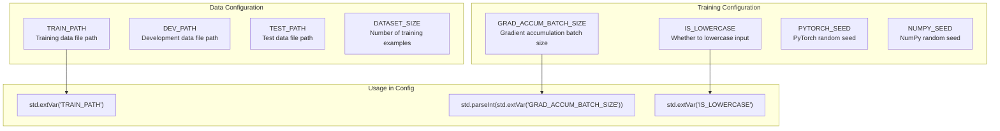

Sources: [allennlp_config/ner_finetune.json:2-4](), [allennlp_config/ner_finetune.json:12-13](), [allennlp_config/ner_finetune.json:18-20](), [allennlp_config/ner_finetune.json:47](), [allennlp_config/ner_finetune.json:67-68]()

## Model Configuration

### BERT Text Field Embedder

All models use a consistent BERT text field embedder configuration:

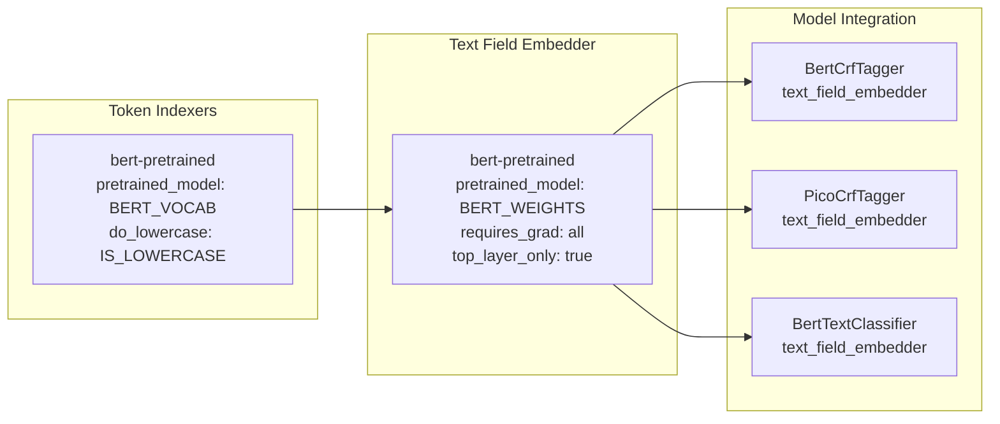

Sources: [allennlp_config/ner_finetune.json:10-16](), [allennlp_config/ner_finetune.json:29-42](), [scibert/models/bert_crf_tagger.py:27-28]()

### Task-Specific Model Types

#### BertCrfTagger Configuration

Used for NER and PICO fine-tuning tasks:

```json
{
  "type": "bert_crf_tagger",
  "label_encoding": "BIOUL",
  "constrain_crf_decoding": true,
  "calculate_span_f1": true,
  "dropout": 0.1,
  "include_start_end_transitions": false
}
```

#### PicoCrfTagger Configuration

Alternative PICO implementation with LSTM encoder:

```json
{
  "type": "pico_crf_tagger",
  "dropout": 0.5,
  "include_start_end_transitions": false,
  "encoder": {
    "type": "lstm",
    "input_size": 768,
    "hidden_size": 200,
    "num_layers": 2,
    "dropout": 0.5,
    "bidirectional": true
  }
}
```

Sources: [allennlp_config/ner_finetune.json:22-43](), [allennlp_config/pico.json:20-44](), [scibert/models/bert_crf_tagger.py:18](), [scibert/models/pico_crf_tagger.py:18]()

## Training Configuration

### Optimizer Configuration

All configurations use the `bert_adam` optimizer with task-specific parameter groups:

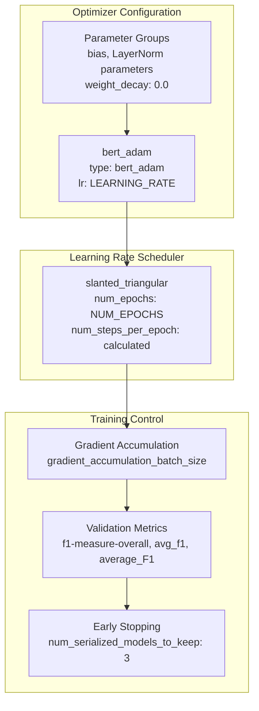

Sources: [allennlp_config/ner_finetune.json:51-56](), [allennlp_config/ner_finetune.json:62-66](), [allennlp_config/ner_finetune.json:67]()

### Task-Specific Validation Metrics

| Task | Validation Metric | Purpose |
|------|------------------|---------|
| NER | `+f1-measure-overall` | Span-based F1 score |
| PICO | `+avg_f1` | Average F1 across PICO labels |
| Text Classification | `+average_F1` | Average F1 across classes |

Sources: [allennlp_config/ner_finetune.json:58](), [allennlp_config/pico_finetune.json:55](), [allennlp_config/text_classification_finetune.json:52]()

## Configuration Files by Task

### Named Entity Recognition

Configuration: `allennlp_config/ner_finetune.json`

- Dataset Reader: `conll2003` with `BIOUL` encoding
- Model: `bert_crf_tagger` with span F1 calculation
- Validation Metric: `f1-measure-overall`

### PICO Extraction

Two configurations available:

1. **Fine-tuning version**: `allennlp_config/pico_finetune.json`
   - Model: `bert_crf_tagger` without span F1
   - Dataset Reader: `ebmnlp`

2. **LSTM version**: `allennlp_config/pico.json`  
   - Model: `pico_crf_tagger` with LSTM encoder
   - Includes bidirectional LSTM with 200 hidden units

### Text Classification

Configuration: `allennlp_config/text_classification_finetune.json`

- Dataset Reader: `classification_dataset_reader`
- Model: `bert_text_classifier` with verbose metrics
- Validation Metric: `average_F1`

Sources: [allennlp_config/ner_finetune.json:1-70](), [allennlp_config/pico_finetune.json:1-67](), [allennlp_config/pico.json:1-69](), [allennlp_config/text_classification_finetune.json:1-64]()

## Usage with AllenNLP

The configurations are used with the AllenNLP command-line interface:

```bash
allennlp train allennlp_config/ner_finetune.json \
  --serialization-dir output/ \
  --include-package scibert
```

Environment variables must be set before running the command:

```bash
export BERT_VOCAB=scibert_scivocab_uncased
export BERT_WEIGHTS=scibert_scivocab_uncased  
export LEARNING_RATE=5e-5
export NUM_EPOCHS=3
# ... other required variables
```

Sources: [allennlp_config/ner_finetune.json:1-70](), [scibert/models/bert_crf_tagger.py:18]()

---

# Page: Named Entity Recognition

# Named Entity Recognition

<details>
<summary>Relevant source files</summary>

The following files were used as context for generating this wiki page:

- [.gitignore](.gitignore)
- [allennlp_config/ner_finetune.json](allennlp_config/ner_finetune.json)
- [allennlp_config/pico_finetune.json](allennlp_config/pico_finetune.json)
- [allennlp_config/text_classification_finetune.json](allennlp_config/text_classification_finetune.json)
- [scibert/models/bert_crf_tagger.py](scibert/models/bert_crf_tagger.py)

</details>


Named Entity Recognition (NER) is a key downstream task supported by the SciBERT fine-tuning system. This page covers the configuration, model architecture, and training pipeline for NER tasks using biomedical datasets such as BC5CDR, NCBI-disease, and JNLPBA.

For PICO extraction, which is a specialized form of NER for medical literature, see [PICO Extraction](#3.3). For general text classification tasks, see [Text Classification](#3.4).

## Architecture Overview

The NER system uses a BERT-CRF architecture that combines SciBERT embeddings with a Conditional Random Field for sequence labeling.

### NER Pipeline Architecture

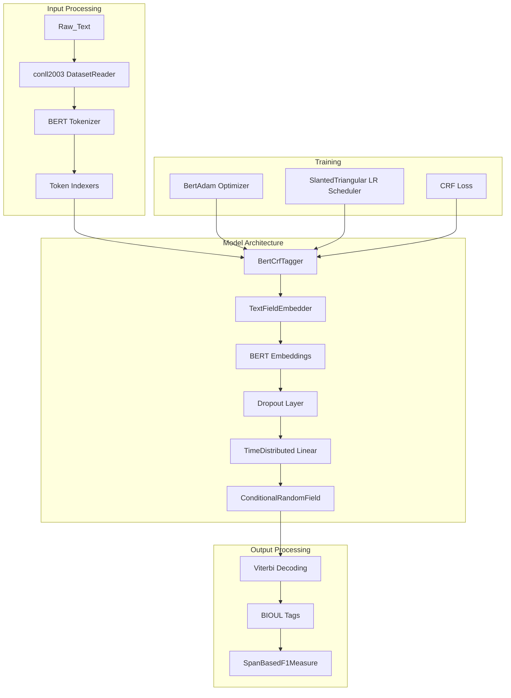

Sources: [allennlp_config/ner_finetune.json:1-70](), [scibert/models/bert_crf_tagger.py:1-233]()

### Model Component Mapping

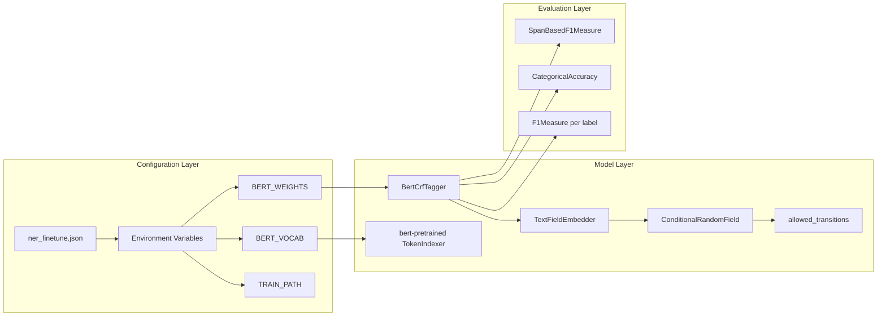

Sources: [allennlp_config/ner_finetune.json:1-70](), [scibert/models/bert_crf_tagger.py:18-233]()

## Configuration System

The NER system uses AllenNLP's configuration system with environment variable substitution. The main configuration file is `ner_finetune.json`.

### Key Configuration Parameters

| Parameter | Purpose | Default/Example |
|-----------|---------|-----------------|
| `dataset_reader.type` | Dataset format | `"conll2003"` |
| `dataset_reader.coding_scheme` | Label encoding | `"BIOUL"` |
| `model.type` | Model class | `"bert_crf_tagger"` |
| `model.label_encoding` | CRF constraints | `"BIOUL"` |
| `model.constrain_crf_decoding` | Valid sequence constraint | `true` |
| `model.calculate_span_f1` | Span-level evaluation | `true` |

### Environment Variables

The configuration uses several environment variables for flexibility:

- `BERT_WEIGHTS`: Path to pretrained BERT model weights
- `BERT_VOCAB`: Path to BERT vocabulary file  
- `TRAIN_PATH`, `DEV_PATH`, `TEST_PATH`: Dataset file paths
- `LEARNING_RATE`: Optimizer learning rate
- `NUM_EPOCHS`: Training epochs
- `GRAD_ACCUM_BATCH_SIZE`: Gradient accumulation batch size

Sources: [allennlp_config/ner_finetune.json:1-70]()

## Model Architecture

### BertCrfTagger Class

The core NER model is implemented in the `BertCrfTagger` class, which extends AllenNLP's `Model` base class.

#### Key Components

1. **Text Field Embedder**: Converts tokens to BERT embeddings
2. **Tag Projection Layer**: Maps embeddings to tag logits
3. **Conditional Random Field**: Enforces valid tag sequences
4. **Metrics**: Tracks accuracy and F1 scores

#### Model Initialization

The model accepts these key parameters:
- `text_field_embedder`: BERT-based embedding layer
- `label_encoding`: Tag encoding scheme (BIO, BIOUL, etc.)
- `constrain_crf_decoding`: Whether to enforce valid transitions
- `calculate_span_f1`: Whether to compute span-level metrics
- `dropout`: Dropout rate for regularization

Sources: [scibert/models/bert_crf_tagger.py:65-126]()

### Forward Pass

The model's forward pass follows this sequence:

1. **Embedding**: Convert input tokens to BERT embeddings
2. **Dropout**: Apply dropout for regularization  
3. **Projection**: Project embeddings to tag space
4. **CRF Decoding**: Use Viterbi algorithm to find best tag sequence
5. **Loss Computation**: Calculate negative log-likelihood loss (training only)

```python
# Key forward pass steps from BertCrfTagger.forward()
embedded_text_input = self.text_field_embedder(tokens)
mask = util.get_text_field_mask(tokens)
embedded_text_input = self.dropout(embedded_text_input)
logits = self.tag_projection_layer(embedded_text_input)
best_paths = self.crf.viterbi_tags(logits, mask)
```

Sources: [scibert/models/bert_crf_tagger.py:165-176]()

## Training Pipeline

### Training Configuration

The training pipeline uses several specialized components:

| Component | Configuration | Purpose |
|-----------|---------------|---------|
| Optimizer | `bert_adam` | BERT-optimized Adam optimizer |
| LR Scheduler | `slanted_triangular` | Triangular learning rate schedule |
| Iterator | `bucket` | Batch by sequence length |
| Validation Metric | `+f1-measure-overall` | Primary metric for model selection |

### Optimizer Configuration

The optimizer uses different weight decay settings for different parameter groups:

```json
"optimizer": {
    "type": "bert_adam",
    "lr": std.extVar("LEARNING_RATE"),
    "parameter_groups": [
        [["bias", "LayerNorm.bias", "LayerNorm.weight", "layer_norm.weight"], 
         {"weight_decay": 0.0}]
    ]
}
```

Sources: [allennlp_config/ner_finetune.json:51-56]()

### Learning Rate Scheduling

The training uses a slanted triangular learning rate schedule:

```json
"learning_rate_scheduler": {
    "type": "slanted_triangular",
    "num_epochs": std.parseInt(std.extVar("NUM_EPOCHS")),
    "num_steps_per_epoch": std.parseInt(std.extVar("DATASET_SIZE")) / 
                           std.parseInt(std.extVar("GRAD_ACCUM_BATCH_SIZE"))
}
```

Sources: [allennlp_config/ner_finetune.json:62-66]()

## Evaluation Metrics

### Metrics Computation

The `BertCrfTagger` computes multiple types of metrics:

1. **Token-level Accuracy**: `CategoricalAccuracy` for individual token predictions
2. **Per-label F1**: `F1Measure` for each entity type
3. **Span-level F1**: `SpanBasedF1Measure` for complete entity spans
4. **Average F1**: Mean F1 across all entity types

### Metric Implementation

```python
self.metrics = {
    "accuracy": CategoricalAccuracy(),
    "accuracy3": CategoricalAccuracy(top_k=3)
}
for index, label in self.vocab.get_index_to_token_vocabulary(label_namespace).items():
    self.metrics['F1_' + label] = F1Measure(positive_label=index)
```

The span-based F1 metric is configured when `calculate_span_f1=True`:

```python
if calculate_span_f1:
    self._f1_metric = SpanBasedF1Measure(vocab,
                                         tag_namespace=label_namespace,
                                         label_encoding=label_encoding)
```

Sources: [scibert/models/bert_crf_tagger.py:111-124]()

### Validation Metric

The training process uses `+f1-measure-overall` as the primary validation metric for model selection, which represents the overall span-level F1 score.

Sources: [allennlp_config/ner_finetune.json:58]()

## Label Encoding

The NER system supports multiple label encoding schemes through the `label_encoding` parameter:

- **BIO**: Begin-Inside-Outside
- **BIOUL**: Begin-Inside-Outside-Unit-Last  
- **IOB1**: Inside-Outside-Begin (variant)
- **BMES**: Begin-Middle-End-Single

The default configuration uses `BIOUL` encoding, which provides more fine-grained control over entity boundaries.

### CRF Constraints

When `constrain_crf_decoding=True`, the system enforces valid tag transitions based on the label encoding:

```python
if constrain_crf_decoding:
    labels = self.vocab.get_index_to_token_vocabulary(label_namespace)
    constraints = allowed_transitions(label_encoding, labels)
else:
    constraints = None
```

Sources: [scibert/models/bert_crf_tagger.py:96-103]()

---

# Page: PICO Extraction

# PICO Extraction

<details>
<summary>Relevant source files</summary>

The following files were used as context for generating this wiki page:

- [allennlp_config/pico.json](allennlp_config/pico.json)
- [data/pico/ebmnlp/dev.txt](data/pico/ebmnlp/dev.txt)
- [data/pico/ebmnlp/test.txt](data/pico/ebmnlp/test.txt)
- [data/pico/ebmnlp/train.txt](data/pico/ebmnlp/train.txt)
- [scibert/models/pico_crf_tagger.py](scibert/models/pico_crf_tagger.py)
- [scripts/fix_format_pico_conll2003.py](scripts/fix_format_pico_conll2003.py)

</details>


This document covers the PICO extraction system in SciBERT, which performs structured information extraction from medical literature. PICO extraction identifies Population, Intervention, Comparison, and Outcome elements from clinical research papers to support evidence-based medicine.

For general fine-tuning guidance, see [Fine-tuning Guide](#3). For other NLP tasks like named entity recognition, see [Named Entity Recognition](#3.2).

## Overview

PICO extraction is a specialized named entity recognition task that identifies four key components in clinical research:

- **Population (PAR)**: The patients or subjects being studied
- **Intervention (INT)**: The treatment or exposure being investigated  
- **Comparison (not used in this implementation)**: The control or alternative treatment
- **Outcome (OUT)**: The measured results or endpoints

The system uses a BERT-based CRF tagger to perform token-level sequence labeling on medical abstracts, extracting these structured elements to support systematic reviews and evidence synthesis.

## Data Format and Processing

### EBMNLP Dataset Format

The PICO extraction system uses the EBMNLP (Evidence-Based Medicine NLP) dataset, which follows a CoNLL-style format with four columns per token:

```
Token    POS    NER    PICO_Label
patients NN     O      I-PAR
with     NN     O      I-PAR
diabetes NN     O      I-PAR
received NN     O      O
aspirin  NN     O      I-INT
therapy  NN     O      I-INT
```

The PICO labels follow IO encoding:
- `I-PAR`: Inside Population
- `I-INT`: Inside Intervention  
- `I-OUT`: Inside Outcome
- `O`: Outside any PICO element

### Data Preprocessing Pipeline

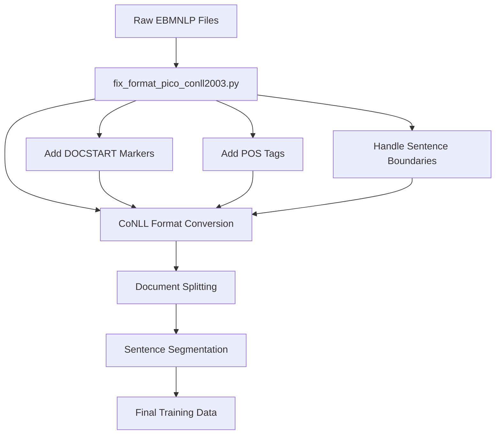

The preprocessing script handles several data format issues:
- Converts 2-column format to 4-column CoNLL format
- Concatenates individual paper files into single training files
- Adds document boundaries with `-DOCSTART-` markers
- Performs basic sentence splitting on periods

**Sources:** [scripts/fix_format_pico_conll2003.py:1-50](), [data/pico/ebmnlp/test.txt:1-100](), [data/pico/ebmnlp/dev.txt:1-100]()

## Model Architecture

### PICO CRF Tagger Components

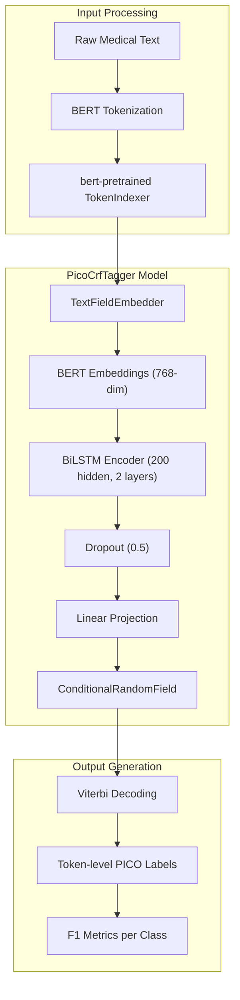

The `PicoCrfTagger` class extends AllenNLP's `Model` and implements several key components:

- **Text Field Embedder**: Converts tokens to BERT embeddings using `bert-pretrained` embedder
- **Sequence Encoder**: BiLSTM with 200 hidden units and 2 layers processes contextualized embeddings
- **CRF Layer**: `ConditionalRandomField` performs structured prediction for sequence labeling
- **Metrics**: Per-class F1 scores for PAR, INT, and OUT labels plus overall accuracy

**Sources:** [scibert/models/pico_crf_tagger.py:18-139]()

### Model Configuration

The training configuration uses several key components:

```mermaid
graph LR
    subgraph "Configuration Components"
        A["ebmnlp DatasetReader"] --> B["BERT Vocabulary"]
        B --> C["pico_crf_tagger Model"]
        C --> D["bert_adam Optimizer"]
        D --> E["F1 Validation Metric"]
    end
    
    subgraph "Training Parameters"
        F["Learning Rate"] --> G["Batch Size"]
        G --> H["Gradient Accumulation"]
        H --> I["Early Stopping"]
    end
    
    A --> F
    E --> I
```

Key configuration parameters:
- Dataset reader: `ebmnlp` with BERT token indexers
- Model: `pico_crf_tagger` with dropout=0.5
- Optimizer: `bert_adam` with configurable learning rate
- Validation metric: `avg_f1` across all PICO classes
- Early stopping: patience=10 epochs

**Sources:** [allennlp_config/pico.json:1-69]()

## Training Process

### Model Training Pipeline

```mermaid
graph TD
    A["BERT_WEIGHTS Environment"] --> B["Model Initialization"]
    B --> C["Dataset Loading"]
    C --> D["Token Embedding"]
    D --> E["BiLSTM Encoding"]
    E --> F["CRF Training"]
    F --> G["Validation"]
    G --> H{"`avg_f1 > best?`"}
    H -->|Yes| I["Save Model"]
    H -->|No| J["Continue Training"]
    I --> K["Check Patience"]
    J --> K
    K --> L{"`Patience Exceeded?`"}
    L -->|No| G
    L -->|Yes| M["Training Complete"]
```

The training process involves:

1. **Initialization**: Load pre-trained BERT weights specified by `BERT_WEIGHTS` environment variable
2. **Forward Pass**: Process tokens through BERT → BiLSTM → CRF layers
3. **Loss Calculation**: Negative log-likelihood from CRF layer
4. **Validation**: Calculate per-class F1 scores and average F1
5. **Model Selection**: Save best model based on validation `avg_f1` metric

**Sources:** [allennlp_config/pico.json:51-68]()

### Evaluation Metrics

The `PicoCrfTagger` tracks multiple evaluation metrics:

```python
# From get_metrics method
metrics_to_return = {}
for metric_name, metric_obj in self.metrics.items():
    if metric_name.startswith('F1_'):
        p, r, f1 = metric_obj.get_metric(reset)
        metrics_to_return[metric_name] = f1
        total_f1 += f1
        total_classes += 1
metrics_to_return['avg_f1'] = total_f1 / total_classes
```

Metrics include:
- `F1_I-PAR`: F1 score for Population labels
- `F1_I-INT`: F1 score for Intervention labels  
- `F1_I-OUT`: F1 score for Outcome labels
- `F1_O`: F1 score for Outside labels
- `avg_f1`: Average F1 across all classes (validation metric)
- `accuracy`: Token-level accuracy
- `accuracy3`: Top-3 accuracy

**Sources:** [scibert/models/pico_crf_tagger.py:124-139]()

## Usage and Integration

### Environment Variables

The PICO extraction system uses several environment variables for configuration:

- `BERT_WEIGHTS`: Path to pre-trained BERT model weights
- `BERT_VOCAB`: Path to BERT vocabulary file
- `IS_LOWERCASE`: Whether to use lowercase BERT model
- `TRAIN_PATH`, `DEV_PATH`, `TEST_PATH`: Dataset file paths
- `LEARNING_RATE`: Optimizer learning rate
- `NUM_EPOCHS`: Maximum training epochs
- `GRAD_ACCUM_BATCH_SIZE`: Gradient accumulation batch size
- `CUDA_DEVICE`: GPU device number

### Integration with Experiment System

The PICO extraction model integrates with the broader experiment management system for hyperparameter tuning and evaluation. For details on running experiments, see [Experiment Management](#5).

**Sources:** [allennlp_config/pico.json:2-11](), [allennlp_config/pico.json:16-18](), [allennlp_config/pico.json:32](), [allennlp_config/pico.json:48](), [allennlp_config/pico.json:54](), [allennlp_config/pico.json:58](), [allennlp_config/pico.json:65](), [allennlp_config/pico.json:67]()

---

# Page: Text Classification

# Text Classification

<details>
<summary>Relevant source files</summary>

The following files were used as context for generating this wiki page:

- [allennlp_config/ner_finetune.json](allennlp_config/ner_finetune.json)
- [allennlp_config/pico_finetune.json](allennlp_config/pico_finetune.json)
- [allennlp_config/text_classification_finetune.json](allennlp_config/text_classification_finetune.json)
- [data/text_classification/chemprot/dev.txt](data/text_classification/chemprot/dev.txt)
- [data/text_classification/chemprot/test.txt](data/text_classification/chemprot/test.txt)
- [data/text_classification/chemprot/train.txt](data/text_classification/chemprot/train.txt)
- [data/text_classification/citation_intent/dev.txt](data/text_classification/citation_intent/dev.txt)
- [data/text_classification/citation_intent/test.txt](data/text_classification/citation_intent/test.txt)
- [data/text_classification/citation_intent/train.txt](data/text_classification/citation_intent/train.txt)
- [data/text_classification/sci-cite/dev.txt](data/text_classification/sci-cite/dev.txt)
- [data/text_classification/sci-cite/test.txt](data/text_classification/sci-cite/test.txt)
- [data/text_classification/sci-cite/train.txt](data/text_classification/sci-cite/train.txt)
- [scibert/models/bert_crf_tagger.py](scibert/models/bert_crf_tagger.py)
- [scripts/chemprot_to_relation.py](scripts/chemprot_to_relation.py)

</details>


This document covers the text classification system for fine-tuning SciBERT on scientific text classification tasks. The system uses AllenNLP's framework to train BERT-based classifiers for various scientific NLP tasks including citation intent classification and chemical-protein relation extraction.

For information about named entity recognition, see [Named Entity Recognition](#3.2). For dependency parsing, see [Dependency Parsing](#3.5).

## System Architecture

The text classification system follows a standard supervised learning pipeline built on AllenNLP's framework. It takes scientific text with entity markers and classifies the relationships or intents expressed.

```mermaid
graph TB
    subgraph "Data Processing"
        A["Raw Scientific Text"] --> B["classification_dataset_reader"]
        B --> C["Tokenized Input with BERT"]
    end
    
    subgraph "Model Architecture" 
        C --> D["bert_text_classifier"]
        D --> E["BERT Embeddings"]
        E --> F["Classification Head"]
        F --> G["Predicted Labels"]
    end
    
    subgraph "Training Pipeline"
        H["text_classification_finetune.json"] --> I["AllenNLP Trainer"]
        I --> J["bert_adam Optimizer"]
        I --> K["slanted_triangular LR Scheduler"]
        J --> D
        K --> D
    end
    
    subgraph "Evaluation"
        G --> L["average_F1 Metric"]
        L --> M["Model Selection"]
    end
```

**Sources**: [allennlp_config/text_classification_finetune.json:1-64]()

## Supported Tasks and Datasets

The system supports multiple scientific text classification tasks with different label schemas:

| Task | Dataset | Labels | Description |
|------|---------|--------|-------------|
| Citation Intent | sci-cite | Background, Uses, CompareOrContrast, Motivation, Extends, Future | Classify the intent behind scientific citations |
| Chemical-Protein Relations | chemprot | INHIBITOR, AGONIST, ANTAGONIST, ACTIVATOR, SUBSTRATE, etc. | Classify relationships between chemical entities and proteins |

### Citation Intent Classification

```mermaid
graph LR
    A["Scientific Paper Text"] --> B["Citation Context"]
    B --> C["bert_text_classifier"] 
    C --> D["Intent Label"]
    
    D --> E["Background"]
    D --> F["Uses"] 
    D --> G["CompareOrContrast"]
    D --> H["Motivation"]
    D --> I["Extends"]
    D --> J["Future"]
```

**Sources**: [data/text_classification/sci-cite/train.txt:1-100](), [data/text_classification/citation_intent/train.txt:1-100]()

### Chemical-Protein Relation Classification

The system handles entity-marked text where chemicals and proteins are highlighted with special markers:

```mermaid
graph LR
    A["Text with Entity Markers"] --> B["<< Chemical >> ... [[ Protein ]]"]
    B --> C["bert_text_classifier"]
    C --> D["Relation Label"]
    
    D --> E["INHIBITOR"]
    D --> F["AGONIST"] 
    D --> G["ANTAGONIST"]
    D --> H["ACTIVATOR"]
    D --> I["SUBSTRATE"]
    D --> J["PRODUCT-OF"]
```

**Sources**: [data/text_classification/chemprot/train.txt:1-100](), [scripts/chemprot_to_relation.py:47-62]()

## Configuration System

The text classification system is configured through AllenNLP's JSON configuration format:

```mermaid
graph TB
    subgraph "Environment Variables"
        A["BERT_VOCAB"] --> B["Vocabulary Path"]
        C["BERT_WEIGHTS"] --> D["Model Weights Path"] 
        E["IS_LOWERCASE"] --> F["Lowercasing Flag"]
        G["LEARNING_RATE"] --> H["Training LR"]
    end
    
    subgraph "Configuration Components"
        I["dataset_reader"] --> J["classification_dataset_reader"]
        K["model"] --> L["bert_text_classifier"]
        M["trainer"] --> N["Training Parameters"]
    end
    
    subgraph "Model Configuration"
        L --> O["text_field_embedder"]
        O --> P["bert TokenEmbedder"]
        P --> B
        P --> D
        P --> F
    end
    
    subgraph "Training Configuration"
        N --> Q["bert_adam Optimizer"]
        N --> R["slanted_triangular Scheduler"]
        Q --> H
    end
```

**Sources**: [allennlp_config/text_classification_finetune.json:5-15](), [allennlp_config/text_classification_finetune.json:20-36](), [allennlp_config/text_classification_finetune.json:44-68]()

## Data Format and Processing

### Input Data Format

Text classification data is stored in JSON Lines format with the following structure:

```json
{
  "text": "Text content with optional entity markers",
  "label": "Classification label", 
  "metadata": {}
}
```

### ChemProt Data Conversion

The `chemprot_to_relation.py` script converts XML-formatted ChemProt data into the required JSON format:

```mermaid
graph LR
    A["ChemProt XML"] --> B["chemprot_to_relation.py"]
    B --> C["Entity Extraction"]
    C --> D["Relation Filtering"] 
    D --> E["Text Marking"]
    E --> F["JSON Output"]
    
    subgraph "Entity Marking"
        G["Chemical Entity"] --> H["<< chemical >>"]
        I["Protein Entity"] --> J["[[ protein ]]"]
    end
    
    E --> G
    E --> I
```

**Sources**: [scripts/chemprot_to_relation.py:25-65]()

## Model Architecture

The `bert_text_classifier` model implements a standard BERT-based classification architecture:

```mermaid
graph TB
    subgraph "Input Processing"
        A["Input Text"] --> B["BERT Tokenizer"]
        B --> C["Token IDs"]
    end
    
    subgraph "BERT Embedding Layer"
        C --> D["bert-pretrained TokenEmbedder"]
        D --> E["Contextual Embeddings"]
    end
    
    subgraph "Classification Head"
        E --> F["Pooling/Aggregation"]
        F --> G["Linear Classification Layer"]
        G --> H["Class Probabilities"]
    end
    
    subgraph "Training Objectives"
        H --> I["Cross-Entropy Loss"]
        I --> J["Backpropagation"]
    end
```

The model configuration specifies key parameters:
- `verbose_metrics: true` - Enables detailed per-class metrics
- `top_layer_only: true` - Only uses the top BERT layer
- `requires_grad: 'all'` - All BERT parameters are trainable

**Sources**: [allennlp_config/text_classification_finetune.json:20-36]()

## Training Process

### Optimization Configuration

The training uses specialized components optimized for BERT fine-tuning:

| Component | Configuration | Purpose |
|-----------|---------------|---------|
| Optimizer | `bert_adam` | BERT-specific Adam variant |
| LR Scheduler | `slanted_triangular` | Triangular learning rate schedule |
| Validation Metric | `+average_F1` | F1-score for model selection |
| Batch Processing | `bucket` iterator | Efficient batching by sequence length |

### Training Pipeline Flow

```mermaid
graph TB
    subgraph "Data Loading"
        A["Training Data"] --> B["classification_dataset_reader"]
        B --> C["bucket Iterator"]
    end
    
    subgraph "Model Training"
        C --> D["bert_text_classifier"]
        D --> E["Forward Pass"]
        E --> F["Loss Calculation"]
        F --> G["bert_adam Optimization"]
    end
    
    subgraph "Learning Rate Management"
        H["slanted_triangular Scheduler"] --> I["Dynamic LR Adjustment"]
        I --> G
    end
    
    subgraph "Validation and Selection"
        G --> J["Validation Evaluation"]
        J --> K["average_F1 Calculation"]
        K --> L["Best Model Selection"]
    end
```

The training configuration includes gradient accumulation and efficient memory usage through:
- `gradient_accumulation_batch_size` for handling large effective batch sizes
- `cache_instances: true` for faster data loading
- `num_serialized_models_to_keep: 3` for model checkpointing

**Sources**: [allennlp_config/text_classification_finetune.json:44-68]()

---

# Page: Dependency Parsing

# Dependency Parsing

<details>
<summary>Relevant source files</summary>

The following files were used as context for generating this wiki page:

- [allennlp_config/parsing.json](allennlp_config/parsing.json)
- [allennlp_config/parsing_finetune.json](allennlp_config/parsing_finetune.json)
- [data/parsing/genia/dev.txt](data/parsing/genia/dev.txt)
- [data/parsing/genia/test.txt](data/parsing/genia/test.txt)
- [data/parsing/genia/train.txt](data/parsing/genia/train.txt)
- [scibert/models/dummy_seq2seq.py](scibert/models/dummy_seq2seq.py)

</details>


This document covers the dependency parsing system in SciBERT, which enables syntactic parsing of scientific text using biaffine parser models. The system is built on AllenNLP and provides infrastructure for training and evaluating dependency parsers on scientific literature datasets.

For information about other fine-tuning tasks, see [Named Entity Recognition](#3.2), [PICO Extraction](#3.3), [Text Classification](#3.4), and [Relation Extraction](#3.6).

## System Overview

The dependency parsing system implements syntactic parsing for scientific text using a biaffine parser architecture. It supports both standard training and fine-tuning configurations, utilizing BERT embeddings to capture contextual representations of scientific language.

```mermaid
graph TB
    subgraph "Input Data"
        A[genia_train] --> B["universal_dependencies DatasetReader"]
        C[genia_dev] --> B
        D[genia_test] --> B
    end
    
    subgraph "Model Architecture"
        E["biaffine_parser"] --> F["bert-pretrained TextFieldEmbedder"]
        E --> G["stacked_bidirectional_lstm | dummy Encoder"]
        E --> H["Biaffine Attention"]
    end
    
    subgraph "Training"
        I["bert_adam Optimizer"] --> J["Training Loop"]
        K["LAS Validation Metric"] --> J
        L["slanted_triangular LR Scheduler"] --> J
    end
    
    B --> E
    F --> G
    G --> H
    J --> M["Trained Parser Model"]
    
    style E fill:#e3f2fd,stroke:#1976d2,stroke-width:2px
    style F fill:#f3e5f5,stroke:#7b1fa2,stroke-width:2px
    style J fill:#fff3e0,stroke:#f57c00,stroke-width:2px
```

**Sources:** [allennlp_config/parsing.json:1-72](), [allennlp_config/parsing_finetune.json:1-73]()

## Configuration System

The system provides two distinct configuration modes through AllenNLP configuration files:

### Standard Training Configuration

The standard configuration uses a full BiLSTM encoder with the following key components:

| Component | Type | Parameters |
|-----------|------|------------|
| Dataset Reader | `universal_dependencies` | CoNLL-U format parsing |
| Model | `biaffine_parser` | Arc/tag representation dims: 400 |
| Encoder | `stacked_bidirectional_lstm` | 2 layers, 400 hidden size |
| Text Embedder | `bert-pretrained` | 768-dim BERT embeddings |
| Optimizer | `bert_adam` | Configurable learning rate |

```mermaid
graph LR
    subgraph "parsing.json Configuration"
        A["universal_dependencies"] --> B["biaffine_parser"]
        C["bert-pretrained TokenIndexer"] --> D["bert-pretrained TextFieldEmbedder"]
        E["stacked_bidirectional_lstm"] --> B
        D --> E
        F["bert_adam"] --> G["Training"]
        H["+LAS ValidationMetric"] --> G
    end
    
    style B fill:#e3f2fd,stroke:#1976d2,stroke-width:2px
    style D fill:#f3e5f5,stroke:#7b1fa2,stroke-width:2px
```

### Fine-tuning Configuration

The fine-tuning configuration uses a minimal dummy encoder to rely primarily on BERT representations:

| Component | Difference from Standard |
|-----------|-------------------------|
| Encoder | `dummy` instead of BiLSTM |
| Arc/Tag Dims | 100 instead of 400 |
| Dropout | 0.1 instead of 0.5 |
| BERT Training | `requires_grad: 'all'`, `top_layer_only: true` |
| LR Scheduler | `slanted_triangular` enabled |

**Sources:** [allennlp_config/parsing.json:20-46](), [allennlp_config/parsing_finetune.json:20-44]()

## Model Components

### Biaffine Parser Architecture

The core parsing model implements a biaffine attention mechanism for dependency parsing:

```mermaid
graph TD
    subgraph "BiaffineParser Model Flow"
        A["Input Tokens"] --> B["bert-pretrained Embedder"]
        B --> C["Encoder Layer"]
        C --> D["Arc Representation (400/100 dim)"]
        C --> E["Tag Representation (400/100 dim)"]
        D --> F["Biaffine Attention"]
        E --> F
        F --> G["Dependency Arcs"]
        F --> H["Dependency Labels"]
    end
    
    subgraph "Encoder Options"
        I["stacked_bidirectional_lstm"] 
        J["dummy Encoder"]
    end
    
    I --> C
    J --> C
    
    style F fill:#e3f2fd,stroke:#1976d2,stroke-width:2px
    style B fill:#f3e5f5,stroke:#7b1fa2,stroke-width:2px
```

**Sources:** [allennlp_config/parsing.json:21-46](), [allennlp_config/parsing_finetune.json:21-44]()

### Dummy Encoder Implementation

The `DummyEncoder` provides a passthrough encoder for fine-tuning scenarios:

```python
# Key characteristics from scibert/models/dummy_seq2seq.py
@Seq2SeqEncoder.register("dummy")
class DummyEncoder(Seq2SeqEncoder):
    def forward(self, inputs: torch.Tensor, mask: torch.Tensor):
        return inputs  # Identity function
```

This encoder enables the model to rely entirely on BERT's contextual representations without additional sequence modeling.

**Sources:** [scibert/models/dummy_seq2seq.py:6-36]()

## Data Processing

### GENIA Corpus Format

The system processes dependency parsing data in CoNLL-U format from the GENIA corpus:

| Field | Position | Description |
|-------|----------|-------------|
| ID | 1 | Token index |
| FORM | 2 | Token text |
| LEMMA | 3 | Lemmatized form |
| UPOS | 4 | Universal POS tag |
| XPOS | 5 | Language-specific POS |
| HEAD | 7 | Head token index |
| DEPREL | 8 | Dependency relation |

Example data structure:
```
1	Generation	generation	NN	NN	_	0	root	_	_
2	of	of	IN	IN	_	5	case	_	_
3	CD1+RelB+	cd1+relb+	JJ	JJ	_	5	amod	_	_
```

### Dataset Reader Configuration

The `universal_dependencies` reader handles tokenization and indexing:

```mermaid
graph LR
    subgraph "DatasetReader Pipeline"
        A["CoNLL-U Files"] --> B["universal_dependencies Reader"]
        B --> C["bert-pretrained TokenIndexer"]
        C --> D["Token Indexing"]
        D --> E["Batched Instances"]
    end
    
    subgraph "Tokenization"
        F["use_starting_offsets: true"]
        G["do_lowercase: configurable"]
    end
    
    C --> F
    C --> G
    
    style B fill:#e3f2fd,stroke:#1976d2,stroke-width:2px
    style C fill:#f3e5f5,stroke:#7b1fa2,stroke-width:2px
```

**Sources:** [allennlp_config/parsing.json:5-14](), [data/parsing/genia/train.txt:1-50]()

## Training Process

### Optimization Strategy

The training process uses BERT-specific optimization with configurable parameters:

```mermaid
graph TB
    subgraph "Training Configuration"
        A["bert_adam Optimizer"] --> B["Gradient Accumulation"]
        C["LAS Validation Metric"] --> D["Model Selection"]
        E["slanted_triangular LR Schedule"] --> F["Learning Rate Decay"]
        G["Patience: 10"] --> D
    end
    
    subgraph "Hyperparameters"
        H["Learning Rate: env variable"]
        I["Batch Size: GRAD_ACCUM_BATCH_SIZE/2"]
        J["Epochs: env variable"]
        K["Dropout: 0.5 | 0.1"]
    end
    
    A --> H
    B --> I
    F --> J
    D --> K
    
    style A fill:#e3f2fd,stroke:#1976d2,stroke-width:2px
    style C fill:#f3e5f5,stroke:#7b1fa2,stroke-width:2px
```

### Environment Variables

The system relies on environment variables for flexible configuration:

| Variable | Purpose | Used In |
|----------|---------|---------|
| `BERT_VOCAB` | BERT vocabulary path | TokenIndexer |
| `BERT_WEIGHTS` | BERT model weights | TextFieldEmbedder |
| `LEARNING_RATE` | Optimizer learning rate | Training |
| `GRAD_ACCUM_BATCH_SIZE` | Batch size for training | Iterator |
| `NUM_EPOCHS` | Training epochs | Trainer |
| `IS_LOWERCASE` | Lowercase tokens | TokenIndexer |

### Validation and Metrics

The system uses Labeled Attachment Score (LAS) as the primary validation metric:

- **Validation Metric**: `+LAS` (maximization objective)
- **Model Persistence**: Keep 3 best models based on validation LAS
- **Early Stopping**: Patience of 10 epochs without improvement

**Sources:** [allennlp_config/parsing.json:54-71](), [allennlp_config/parsing_finetune.json:52-71]()

## Fine-tuning Differences

The fine-tuning configuration optimizes for transfer learning from pre-trained BERT:

```mermaid
graph LR
    subgraph "Standard Training"
        A["Full BiLSTM Encoder"] --> B["400-dim Representations"]
        C["Fixed BERT Weights"] --> D["Standard Dropout 0.5"]
    end
    
    subgraph "Fine-tuning Mode"
        E["Dummy Encoder"] --> F["100-dim Representations"]
        G["Trainable BERT (top layer)"] --> H["Light Dropout 0.1"]
        I["Slanted Triangular LR"] --> J["Adaptive Learning"]
    end
    
    style E fill:#e3f2fd,stroke:#1976d2,stroke-width:2px
    style G fill:#f3e5f5,stroke:#7b1fa2,stroke-width:2px
    style I fill:#fff3e0,stroke:#f57c00,stroke-width:2px
```

Key differences in fine-tuning mode:
- Enables BERT parameter updates with `requires_grad: 'all'`
- Uses only top BERT layer with `top_layer_only: true`
- Implements slanted triangular learning rate scheduling
- Reduces model complexity with smaller representation dimensions

**Sources:** [allennlp_config/parsing_finetune.json:35-68]()

---

# Page: Relation Extraction

# Relation Extraction

<details>
<summary>Relevant source files</summary>

The following files were used as context for generating this wiki page:

- [data/text_classification/sciie-relation-extraction/dev.txt](data/text_classification/sciie-relation-extraction/dev.txt)
- [data/text_classification/sciie-relation-extraction/test.txt](data/text_classification/sciie-relation-extraction/test.txt)
- [data/text_classification/sciie-relation-extraction/train.txt](data/text_classification/sciie-relation-extraction/train.txt)
- [scripts/sciie_to_relations.py](scripts/sciie_to_relations.py)

</details>


## Purpose and Scope

This document covers the relation extraction capabilities in the SciBERT codebase, which enables the identification of semantic relationships between entities in scientific text. The relation extraction system processes scientific literature to extract structured relationships such as "USED-FOR", "PART-OF", and "CONJUNCTION" between scientific concepts.

For general text classification tasks, see [Text Classification](#3.4). For named entity recognition, see [Named Entity Recognition](#3.2).

## Data Processing Pipeline

The relation extraction system begins with the SciIE dataset, which is converted to a standardized format using the preprocessing script. The conversion process adds entity markers to highlight the entities involved in each relation.

```mermaid
graph TB
    subgraph "Data Conversion"
        A["SciIE Dataset"] --> B["sciie_to_relations.py"]
        B --> C["Relation Extraction Format"]
    end
    
    subgraph "Output Format"
        C --> D["Entity Markers"]
        C --> E["Relation Labels"]
        C --> F["Position Metadata"]
    end
    
    subgraph "Training Data"
        D --> G["train.txt"]
        D --> H["dev.txt"]
        D --> I["test.txt"]
    end
```

The conversion script `sciie_to_relations.py` processes the original SciIE format and outputs relation instances with entity markers. The script handles entity positioning and adds visual markers to clearly delineate the entities involved in each relation.

**Sources:** [scripts/sciie_to_relations.py:1-52]()

## Dataset Format and Structure

The relation extraction dataset uses a specific format where entities are marked with distinct brackets to indicate their roles in the relationship. The format includes:

- **Entity 1**: Marked with `[[ ]]` brackets
- **Entity 2**: Marked with `<< >>` brackets  
- **Relation Label**: Indicates the semantic relationship type
- **Metadata**: Contains entity position information

```mermaid
graph LR
    subgraph "Input Processing"
        A["Raw Text"] --> B["Entity Detection"]
        B --> C["Position Mapping"]
    end
    
    subgraph "Marker Insertion"
        C --> D["Insert [[ ]] for Entity 1"]
        C --> E["Insert << >> for Entity 2"]
    end
    
    subgraph "Output Format"
        D --> F["JSON Structure"]
        E --> F
        F --> G["text: marked sentence"]
        F --> H["label: relation type"]
        F --> I["metadata: positions"]
    end
```

Each relation instance is stored as a JSON object with the following structure:
- `text`: The sentence with entity markers inserted
- `label`: The relation type (e.g., "USED-FOR", "PART-OF")
- `metadata`: Array containing entity positions `[e1_from, e1_to, e2_from, e2_to]`

**Sources:** [scripts/sciie_to_relations.py:35-48](), [data/text_classification/sciie-relation-extraction/train.txt:1-10]()

## Relation Types and Labels

The relation extraction system supports multiple semantic relationship types commonly found in scientific literature:

| Relation Type | Description | Example |
|---------------|-------------|---------|
| `USED-FOR` | Entity 1 is used for Entity 2 | `[[ algorithm ]] for << parsing >>` |
| `PART-OF` | Entity 1 is part of Entity 2 | `[[ component ]] in << system >>` |
| `CONJUNCTION` | Entities are conjoined | `[[ method ]] and << technique >>` |
| `HYPONYM-OF` | Entity 1 is a type of Entity 2 | `[[ SVM ]] is a << classifier >>` |
| `FEATURE-OF` | Entity 1 is a feature of Entity 2 | `[[ accuracy ]] of << model >>` |
| `COMPARE` | Entities are compared | `[[ method A ]] vs << method B >>` |
| `EVALUATE-FOR` | Entity 1 evaluates Entity 2 | `[[ metric ]] for << performance >>` |

**Sources:** [data/text_classification/sciie-relation-extraction/train.txt:1-50](), [data/text_classification/sciie-relation-extraction/test.txt:1-50]()

## Entity Marker Processing

The preprocessing script handles entity marker insertion based on the relative positions of entities in the text. The algorithm ensures proper marker placement regardless of entity order:

```mermaid
graph TB
    subgraph "Entity Position Analysis"
        A["Entity 1 Position"] --> C["Compare Positions"]
        B["Entity 2 Position"] --> C
    end
    
    subgraph "Marker Insertion Logic"
        C --> D{"Entity 2 > Entity 1?"}
        D -->|Yes| E["Insert Entity 2 markers first"]
        D -->|No| F["Insert Entity 1 markers first"]
    end
    
    subgraph "Final Output"
        E --> G["Properly marked text"]
        F --> G
        G --> H["JSON with metadata"]
    end
```

The script adjusts entity positions relative to sentence boundaries and handles marker insertion to avoid position conflicts when entities overlap or are adjacent.

**Sources:** [scripts/sciie_to_relations.py:30-46]()

## Integration with Fine-tuning Framework

The relation extraction task integrates with the broader SciBERT fine-tuning system through the text classification pipeline. The processed relation data can be used with standard classification models:

```mermaid
graph TB
    subgraph "Data Pipeline"
        A["sciie_to_relations.py"] --> B["Relation Dataset"]
        B --> C["ClassificationDatasetReader"]
    end
    
    subgraph "Model Training"
        C --> D["BERT Text Classifier"]
        D --> E["Relation Classification"]
    end
    
    subgraph "Evaluation"
        E --> F["Precision/Recall"]
        E --> G["F1 Score"]
    end
    
    subgraph "Configuration"
        H["AllenNLP Config"] --> D
        I["SciBERT Weights"] --> D
    end
```

The relation extraction task follows the same configuration patterns as other text classification tasks, utilizing the AllenNLP framework for model training and evaluation.

**Sources:** [scripts/sciie_to_relations.py:1-52](), [data/text_classification/sciie-relation-extraction/train.txt:1-10]()

## Usage and Implementation

To use the relation extraction system:

1. **Data Preparation**: Convert SciIE data using the preprocessing script
2. **Configuration**: Set up AllenNLP configuration for text classification
3. **Training**: Use the processed relation data for model training
4. **Evaluation**: Assess performance on relation extraction metrics

The system outputs structured relationship information that can be used for downstream tasks such as knowledge graph construction, semantic search, and scientific literature analysis.

**Sources:** [scripts/sciie_to_relations.py:10-21](), [data/text_classification/sciie-relation-extraction/]()

---

# Page: Model Architecture

# Model Architecture

<details>
<summary>Relevant source files</summary>

The following files were used as context for generating this wiki page:

- [allennlp_config/ner_finetune.json](allennlp_config/ner_finetune.json)
- [allennlp_config/pico_finetune.json](allennlp_config/pico_finetune.json)
- [allennlp_config/text_classification_finetune.json](allennlp_config/text_classification_finetune.json)
- [scibert/__init__.py](scibert/__init__.py)
- [scibert/dataset_readers/__init__.py](scibert/dataset_readers/__init__.py)
- [scibert/dataset_readers/classification_dataset_reader.py](scibert/dataset_readers/classification_dataset_reader.py)
- [scibert/dataset_readers/ebmnlp.py](scibert/dataset_readers/ebmnlp.py)
- [scibert/models/__init__.py](scibert/models/__init__.py)
- [scibert/models/bert_crf_tagger.py](scibert/models/bert_crf_tagger.py)
- [scibert/models/text_classifier.py](scibert/models/text_classifier.py)

</details>


This document provides a comprehensive overview of the SciBERT model architecture implementation, covering the core model components, their relationships, and integration patterns within the AllenNLP framework. The architecture supports multiple downstream tasks including named entity recognition, PICO extraction, text classification, and dependency parsing.

For task-specific fine-tuning procedures, see [Fine-tuning Guide](#3). For experiment management and orchestration, see [Experiment Management](#5).

## Architecture Overview

The SciBERT model architecture follows a modular design built on the AllenNLP framework. The system consists of three primary layers: dataset readers for input processing, core models for computation, and task-specific heads for output generation.

### Core Architecture Components

```mermaid
graph TD
    subgraph "Input Processing Layer"
        A["ClassificationDatasetReader"] --> B["TextField"]
        C["EBMNLPDatasetReader"] --> B
        D["CoNLL2003DatasetReader"] --> B
        B --> E["BertPretrainedTokenIndexer"]
    end
    
    subgraph "Embedding Layer"
        E --> F["BertPretrainedEmbedder"]
        F --> G["TextFieldEmbedder"]
    end
    
    subgraph "Model Layer"
        G --> H["BertCrfTagger"]
        G --> I["TextClassifier"]
        G --> J["BertTextClassifier"]
    end
    
    subgraph "Output Layer"
        H --> K["ConditionalRandomField"]
        I --> L["CrossEntropyLoss"]
        J --> M["Linear Classifier"]
        K --> N["Viterbi Decoding"]
        L --> O["Softmax Predictions"]
        M --> O
    end
    
    subgraph "Metrics"
        N --> P["SpanBasedF1Measure"]
        O --> Q["CategoricalAccuracy"]
        O --> R["F1Measure"]
    end
```

**Title: SciBERT Model Architecture Components**

The architecture implements a consistent pattern across all models: input tokenization and indexing, BERT-based text embedding, task-specific processing, and evaluation metrics computation.

Sources: [scibert/models/bert_crf_tagger.py:1-233](), [scibert/models/text_classifier.py:1-124](), [scibert/dataset_readers/ebmnlp.py:1-76](), [scibert/dataset_readers/classification_dataset_reader.py:1-61]()

## Model Configuration System

The model architecture is configured through AllenNLP's JSON-based configuration system. Each model type has specific configuration requirements that define the complete processing pipeline.

### Configuration Structure

| Component | Configuration Key | Purpose |
|-----------|------------------|---------|
| Dataset Reader | `dataset_reader` | Defines input data processing and tokenization |
| Text Embedder | `text_field_embedder` | Configures BERT embedding parameters |
| Model Type | `model.type` | Specifies which model class to instantiate |
| Training | `trainer` | Defines optimization and learning rate scheduling |
| Evaluation | `iterator` | Controls batching and data iteration |

### Model Type Mapping

```mermaid
graph LR
    subgraph "Configuration Types"
        A["bert_crf_tagger"] --> B["BertCrfTagger"]
        C["bert_text_classifier"] --> D["BertTextClassifier"]
        E["text_classifier"] --> F["TextClassifier"]
    end
    
    subgraph "Model Classes"
        B --> G["ConditionalRandomField"]
        D --> H["Linear + Softmax"]
        F --> I["Seq2SeqEncoder + Feedforward"]
    end
    
    subgraph "Use Cases"
        G --> J["NER, PICO Extraction"]
        H --> K["Text Classification"]
        I --> L["Generic Classification"]
    end
```

**Title: Model Configuration to Implementation Mapping**

Sources: [allennlp_config/ner_finetune.json:22-43](), [allennlp_config/pico_finetune.json:20-40](), [allennlp_config/text_classification_finetune.json:20-37]()

## Core Model Components

### BertCrfTagger

The `BertCrfTagger` class implements sequence labeling using BERT embeddings with a Conditional Random Field (CRF) layer for structured prediction.

**Key Components:**
- **Text Field Embedder**: Handles BERT token embedding with configurable parameters
- **Tag Projection Layer**: `TimeDistributed(Linear)` mapping embeddings to tag scores
- **CRF Layer**: `ConditionalRandomField` for sequence-level predictions
- **Metrics**: `SpanBasedF1Measure`, `CategoricalAccuracy`, per-label `F1Measure`

```mermaid
graph TD
    A["tokens: Dict[str, torch.LongTensor]"] --> B["text_field_embedder"]
    B --> C["embedded_text_input"]
    C --> D["dropout"]
    D --> E["tag_projection_layer"]
    E --> F["logits"]
    F --> G["crf.viterbi_tags"]
    G --> H["predicted_tags"]
    
    subgraph "Training Mode"
        F --> I["crf(logits, tags, mask)"]
        I --> J["loss = -log_likelihood"]
    end
    
    subgraph "Metrics Computation"
        H --> K["class_probabilities"]
        K --> L["SpanBasedF1Measure"]
        K --> M["CategoricalAccuracy"]
        K --> N["F1Measure per label"]
    end
```

**Title: BertCrfTagger Forward Pass Architecture**

Sources: [scibert/models/bert_crf_tagger.py:129-196](), [scibert/models/bert_crf_tagger.py:65-126]()

### TextClassifier and BertTextClassifier

The text classification models implement document-level classification with different architectural approaches.

**TextClassifier Architecture:**
- Uses `Seq2SeqEncoder` (e.g., BiLSTM) after embedding
- Employs `get_final_encoder_states` for sequence pooling
- Applies `FeedForward` layer before final classification

**BertTextClassifier Architecture:**
- Direct BERT embedding to classification layer
- Simplified architecture for BERT-based models
- Uses CLS token representation for classification

```mermaid
graph TD
    subgraph "TextClassifier"
        A["text_field_embedder"] --> B["text_encoder"]
        B --> C["get_final_encoder_states"]
        C --> D["classifier_feedforward"]
        D --> E["prediction_layer"]
    end
    
    subgraph "BertTextClassifier"
        F["text_field_embedder"] --> G["[CLS] token"]
        G --> H["Linear classifier"]
    end
    
    subgraph "Shared Components"
        E --> I["CrossEntropyLoss"]
        H --> I
        I --> J["F1Measure per class"]
        I --> K["CategoricalAccuracy"]
        J --> L["average_F1"]
    end
```

**Title: Text Classification Model Architectures**

Sources: [scibert/models/text_classifier.py:54-98](), [allennlp_config/text_classification_finetune.json:20-37]()

## Dataset Reader Architecture

Dataset readers implement the `DatasetReader` interface and handle task-specific data preprocessing and tokenization.

### Dataset Reader Types

| Reader Class | Registration Name | Input Format | Output Fields |
|-------------|------------------|--------------|---------------|
| `EBMNLPDatasetReader` | `ebmnlp` | CoNLL-style with PICO tags | `tokens`, `tags`, `metadata` |
| `ClassificationDatasetReader` | `classification_dataset_reader` | JSONL format | `text`, `label`, `metadata` |
| CoNLL2003DatasetReader | `conll2003` | Standard CoNLL format | `tokens`, `tags`, `metadata` |

### Data Processing Pipeline

```mermaid
graph LR
    subgraph "EBMNLPDatasetReader"
        A["CoNLL format file"] --> B["_is_divider"]
        B --> C["itertools.groupby"]
        C --> D["tokens_, pico_tags"]
        D --> E["TextField + SequenceLabelField"]
    end
    
    subgraph "ClassificationDatasetReader"
        F["JSONL file"] --> G["jsonlines.open"]
        G --> H["text, label, metadata"]
        H --> I["TextField + LabelField"]
    end
    
    subgraph "Common Processing"
        E --> J["BertPretrainedTokenIndexer"]
        I --> J
        J --> K["Instance with token_indexers"]
    end
```

**Title: Dataset Reader Processing Pipeline**

Sources: [scibert/dataset_readers/ebmnlp.py:42-75](), [scibert/dataset_readers/classification_dataset_reader.py:37-60]()

## Token Indexing and Embedding

The architecture uses BERT-specific token indexing and embedding components that integrate with AllenNLP's `TextField` system.

### Token Processing Configuration

```python
"token_indexers": {
    "bert": {
        "type": "bert-pretrained",
        "pretrained_model": std.extVar("BERT_VOCAB"),
        "do_lowercase": std.extVar("IS_LOWERCASE"),
        "use_starting_offsets": true
    }
}
```

### Embedding Configuration

```python
"text_field_embedder": {
    "allow_unmatched_keys": true,
    "embedder_to_indexer_map": {
        "bert": ["bert", "bert-offsets"]
    },
    "token_embedders": {
        "bert": {
            "type": "bert-pretrained",
            "pretrained_model": std.extVar("BERT_WEIGHTS"),
            "requires_grad": 'all',
            "top_layer_only": true
        }
    }
}
```

Sources: [allennlp_config/ner_finetune.json:9-16](), [allennlp_config/ner_finetune.json:29-42]()

## Training and Optimization

The architecture uses specialized optimizers and learning rate schedules designed for BERT fine-tuning.

### Optimization Configuration

| Component | Configuration | Purpose |
|-----------|--------------|---------|
| Optimizer | `bert_adam` | BERT-specific Adam optimizer |
| Learning Rate | Variable via `LEARNING_RATE` | Task-specific learning rates |
| Scheduler | `slanted_triangular` | Gradual learning rate increase then decrease |
| Weight Decay | Excluded for bias and LayerNorm | Prevents overfitting while preserving important parameters |

### Training Pipeline

```mermaid
graph TD
    A["Model Forward Pass"] --> B["Loss Computation"]
    B --> C["Gradient Computation"]
    C --> D["BertAdam Optimizer"]
    D --> E["Parameter Updates"]
    E --> F["Learning Rate Scheduler"]
    F --> G["Validation Metrics"]
    
    subgraph "Loss Functions"
        H["NegativeLogLikelihood (CRF)"] --> B
        I["CrossEntropyLoss"] --> B
    end
    
    subgraph "Metrics"
        G --> J["SpanBasedF1Measure"]
        G --> K["CategoricalAccuracy"]
        G --> L["F1Measure"]
    end
```

**Title: Training Pipeline Architecture**

Sources: [allennlp_config/ner_finetune.json:50-69](), [allennlp_config/text_classification_finetune.json:44-64]()

## Integration Patterns

The architecture follows consistent patterns for AllenNLP integration across all model types.

### Model Registration Pattern

All models use the `@Model.register()` decorator for automatic discovery:
- `@Model.register("bert_crf_tagger")` for `BertCrfTagger`
- `@Model.register("text_classifier")` for `TextClassifier`
- `@DatasetReader.register("ebmnlp")` for `EBMNLPDatasetReader`

### Common Interface Methods

| Method | Purpose | Return Type |
|--------|---------|-------------|
| `forward()` | Main computation with loss calculation | `Dict[str, torch.Tensor]` |
| `decode()` | Post-processing for human-readable output | `Dict[str, torch.Tensor]` |
| `get_metrics()` | Training/validation metrics computation | `Dict[str, float]` |

Sources: [scibert/models/bert_crf_tagger.py:18](), [scibert/models/text_classifier.py:14](), [scibert/dataset_readers/ebmnlp.py:32]()

---

# Page: Core Models

# Core Models

<details>
<summary>Relevant source files</summary>

The following files were used as context for generating this wiki page:

- [Dockerfile](Dockerfile)
- [allennlp_config/ner_finetune.json](allennlp_config/ner_finetune.json)
- [allennlp_config/pico_finetune.json](allennlp_config/pico_finetune.json)
- [allennlp_config/text_classification_finetune.json](allennlp_config/text_classification_finetune.json)
- [requirements.txt](requirements.txt)
- [scibert/__init__.py](scibert/__init__.py)
- [scibert/dataset_readers/__init__.py](scibert/dataset_readers/__init__.py)
- [scibert/dataset_readers/classification_dataset_reader.py](scibert/dataset_readers/classification_dataset_reader.py)
- [scibert/dataset_readers/ebmnlp.py](scibert/dataset_readers/ebmnlp.py)
- [scibert/models/__init__.py](scibert/models/__init__.py)
- [scibert/models/bert_crf_tagger.py](scibert/models/bert_crf_tagger.py)
- [scibert/models/bert_text_classifier.py](scibert/models/bert_text_classifier.py)
- [scibert/models/text_classifier.py](scibert/models/text_classifier.py)
- [scripts/run_with_beaker.py](scripts/run_with_beaker.py)

</details>


This document covers the implementation details of the core neural network models used in SciBERT fine-tuning. These models serve as the backbone for downstream scientific NLP tasks including named entity recognition, PICO extraction, and text classification. 

For information about using these models in experiments, see [Experiment Orchestration](#5.1). For dataset processing components that feed these models, see [Dataset Readers](#4.2).

## Model Architecture Overview

The SciBERT codebase implements three primary model architectures, all built on top of AllenNLP's framework and designed to work with pretrained BERT embeddings:

```mermaid
graph TD
    A["TextFieldEmbedder"] --> B["BertCrfTagger"]
    A --> C["BertTextClassifier"] 
    A --> D["TextClassifier"]
    
    B --> E["CRF Layer"]
    B --> F["Tag Projection"]
    
    C --> G["CLS Token Pooling"]
    C --> H["Linear Classifier"]
    
    D --> I["BiLSTM Encoder"]
    D --> J["Final State Pooling"]
    D --> K["Feedforward"]
    
    E --> L["NER Tasks"]
    E --> M["PICO Extraction"]
    
    H --> N["Citation Intent"]
    H --> O["ChemProt Relations"]
    
    subgraph "Sequence Labeling"
        L
        M
    end
    
    subgraph "Text Classification"
        N
        O
    end
```

*Sources: [scibert/models/bert_crf_tagger.py:18-233](), [scibert/models/bert_text_classifier.py:15-91](), [scibert/models/text_classifier.py:14-124]()*

## BertCrfTagger

The `BertCrfTagger` is the primary model for sequence labeling tasks, combining BERT embeddings with a Conditional Random Field (CRF) layer for structured prediction.

### Architecture Components

| Component | Purpose | Implementation |
|-----------|---------|----------------|
| `text_field_embedder` | Token embeddings from BERT | `TextFieldEmbedder` with BERT backend |
| `tag_projection_layer` | Projects embeddings to tag space | `TimeDistributed(Linear)` |
| `crf` | Structured prediction layer | `ConditionalRandomField` |
| `dropout` | Regularization | `torch.nn.Dropout` |

### Key Features

The model supports several advanced features for sequence labeling:

- **Label Encoding**: Supports BIO, BIOUL, IOB1, and BMES tagging schemes
- **Constrained Decoding**: CRF constraints ensure valid tag sequences
- **Span-based F1**: Calculates entity-level metrics in addition to token-level
- **Viterbi Decoding**: Finds optimal tag sequence using dynamic programming

```mermaid
graph LR
    A["Input Tokens"] --> B["BERT Embeddings"]
    B --> C["Dropout"]
    C --> D["Tag Projection"]
    D --> E["CRF Layer"]
    E --> F["Viterbi Decoding"]
    F --> G["Predicted Tags"]
    
    H["Gold Tags"] --> I["CRF Loss"]
    E --> I
    
    G --> J["Span F1 Metric"]
    H --> J
```

*Sources: [scibert/models/bert_crf_tagger.py:65-126](), [scibert/models/bert_crf_tagger.py:164-196]()*

### Configuration Usage

The model is configured through AllenNLP JSON files with the following key parameters:

```json
{
  "model": {
    "type": "bert_crf_tagger",
    "label_encoding": "BIOUL",
    "constrain_crf_decoding": true,
    "calculate_span_f1": true,
    "dropout": 0.1
  }
}
```

*Sources: [allennlp_config/ner_finetune.json:22-42](), [allennlp_config/pico_finetune.json:20-39]()*

## BertTextClassifier

The `BertTextClassifier` is designed for document-level classification tasks, using BERT's CLS token representation for classification decisions.

### Architecture Design

```mermaid
graph TD
    A["Input Text"] --> B["BERT Embeddings"]
    B --> C["CLS Token [0, :]"]
    C --> D["Dropout"]
    D --> E["Linear Classifier"]
    E --> F["Softmax"]
    F --> G["Class Probabilities"]
    
    H["Gold Labels"] --> I["CrossEntropyLoss"]
    E --> I
    
    G --> J["F1 per Class"]
    G --> K["Accuracy"]
```

### Implementation Details

The model inherits from `TextClassifier` but overrides the pooling strategy to use BERT's CLS token:

| Method | Purpose | Key Implementation |
|--------|---------|-------------------|
| `__init__` | Model initialization | Sets up linear classifier and F1 metrics |
| `forward` | Forward pass | Extracts CLS token: `embedded_text[:, 0, :]` |
| `get_metrics` | Metric calculation | Computes per-class and average F1 scores |

*Sources: [scibert/models/bert_text_classifier.py:25-91](), [scibert/models/text_classifier.py:106-123]()*

### Configuration Parameters

```json
{
  "model": {
    "type": "bert_text_classifier",
    "verbose_metrics": true,
    "text_field_embedder": {
      "token_embedders": {
        "bert": {
          "type": "bert-pretrained",
          "top_layer_only": true
        }
      }
    }
  }
}
```

*Sources: [allennlp_config/text_classification_finetune.json:20-36]()*

## TextClassifier

The base `TextClassifier` provides a more traditional approach using bidirectional LSTM encoding with final state pooling.

### Architecture Flow

```mermaid
graph LR
    A["Input Tokens"] --> B["Token Embeddings"]
    B --> C["BiLSTM Encoder"]
    C --> D["Final State Pooling"]
    D --> E["Feedforward Layer"]
    E --> F["Linear Classifier"]
    F --> G["Output Logits"]
    
    H["Gold Labels"] --> I["CrossEntropyLoss"]
    G --> I
```

### Pooling Strategy

The model uses `get_final_encoder_states` for bidirectional pooling:

```python
self.pool = lambda text, mask: util.get_final_encoder_states(text, mask, bidirectional=True)
```

This extracts the final hidden states from both directions of the BiLSTM encoder.

*Sources: [scibert/models/text_classifier.py:25-52](), [scibert/models/text_classifier.py:78-98]()*

## Model Registration and Usage

All models use AllenNLP's registration system for configuration-based instantiation:

| Model Class | Registration Name | Primary Use Cases |
|-------------|-------------------|-------------------|
| `BertCrfTagger` | `"bert_crf_tagger"` | NER, PICO extraction |
| `BertTextClassifier` | `"bert_text_classifier"` | Scientific text classification |
| `TextClassifier` | `"text_classifier"` | General text classification |

### Integration with BERT Embeddings

All models integrate with BERT through the `text_field_embedder` component:

```mermaid
graph TD
    A["BERT Vocabulary"] --> B["BertTokenIndexer"]
    B --> C["TokenField"]
    C --> D["TextFieldEmbedder"]
    D --> E["BertPretrainedEmbedder"]
    E --> F["Model Forward Pass"]
    
    G["Environment Variables"] --> H["BERT_WEIGHTS"]
    H --> E
    G --> I["BERT_VOCAB"]
    I --> B
```

*Sources: [allennlp_config/ner_finetune.json:10-15](), [allennlp_config/ner_finetune.json:29-42](), [allennlp_config/text_classification_finetune.json:7-14]()*

## Metrics and Evaluation

### Sequence Labeling Metrics

The `BertCrfTagger` computes comprehensive metrics for sequence labeling:

- **Token-level Accuracy**: Standard classification accuracy
- **Per-label F1**: F1 score for each entity type
- **Span-based F1**: Entity-level precision, recall, and F1
- **Average F1**: Mean F1 across all labels

### Classification Metrics

Both text classifiers provide:

- **Accuracy**: Overall classification accuracy
- **Per-class F1**: F1 score for each class
- **Average F1**: Macro-averaged F1 across classes

*Sources: [scibert/models/bert_crf_tagger.py:212-233](), [scibert/models/bert_text_classifier.py:106-123]()*

---

# Page: Dataset Readers

# Dataset Readers

<details>
<summary>Relevant source files</summary>

The following files were used as context for generating this wiki page:

- [allennlp_config/pico.json](allennlp_config/pico.json)
- [scibert/__init__.py](scibert/__init__.py)
- [scibert/dataset_readers/__init__.py](scibert/dataset_readers/__init__.py)
- [scibert/dataset_readers/classification_dataset_reader.py](scibert/dataset_readers/classification_dataset_reader.py)
- [scibert/dataset_readers/ebmnlp.py](scibert/dataset_readers/ebmnlp.py)
- [scibert/models/__init__.py](scibert/models/__init__.py)
- [scibert/models/pico_crf_tagger.py](scibert/models/pico_crf_tagger.py)
- [scibert/models/text_classifier.py](scibert/models/text_classifier.py)

</details>


Dataset readers are AllenNLP components that handle data loading and preprocessing for different scientific NLP tasks in the SciBERT codebase. They convert raw text data from various formats into structured `Instance` objects that can be consumed by models during training and inference.

This page covers the implementation and usage of dataset readers for scientific text processing tasks. For information about the models that consume this data, see [Core Models](#4.1). For details about experiment configuration, see [Configuration System](#3.1).

## Overview

Dataset readers in SciBERT serve as the bridge between raw scientific text data and the model training pipeline. They handle format parsing, tokenization, and field creation for different task types including named entity recognition, text classification, and PICO extraction.

```mermaid
graph TD
    subgraph "Input Data Formats"
        A["Raw Text Files"]
        B["CoNLL Format"]
        C["JSONL Format"]
        D["EBMNLP Format"]
    end
    
    subgraph "Dataset Readers"
        E["EBMNLPDatasetReader"]
        F["ClassificationDatasetReader"]
        G["CoNLL2003DatasetReader"]
    end
    
    subgraph "AllenNLP Components"
        H["TokenIndexer"]
        I["Tokenizer"]
        J["TextField"]
        K["SequenceLabelField"]
        L["LabelField"]
    end
    
    subgraph "Output"
        M["Instance Objects"]
        N["Model Training"]
    end
    
    B --> E
    C --> F
    D --> E
    
    E --> H
    F --> H
    G --> H
    
    H --> I
    I --> J
    J --> K
    J --> L
    
    K --> M
    L --> M
    M --> N
    
    E --> M
    F --> M
    G --> M
```

Sources: [scibert/dataset_readers/ebmnlp.py:1-76](), [scibert/dataset_readers/classification_dataset_reader.py:1-61]()

## Data Processing Pipeline

The dataset readers follow a consistent processing pipeline that transforms raw text into structured data for model consumption:

```mermaid
graph LR
    subgraph "Raw Data Processing"
        A["file_path"] --> B["_read()"]
        B --> C["text_to_instance()"]
    end
    
    subgraph "Field Creation"
        C --> D["TextField"]
        C --> E["SequenceLabelField"]
        C --> F["LabelField"]
        C --> G["MetadataField"]
    end
    
    subgraph "Token Processing"
        H["Token"] --> I["TokenIndexer"]
        I --> J["bert-pretrained"]
        I --> K["SingleIdTokenIndexer"]
    end
    
    subgraph "Instance Assembly"
        D --> L["Instance"]
        E --> L
        F --> L
        G --> L
    end
    
    D --> H
    L --> M["Model Training"]
    
    style B fill:#f9f,stroke:#333,stroke-width:2px
    style C fill:#f9f,stroke:#333,stroke-width:2px
    style L fill:#bbf,stroke:#333,stroke-width:2px
```

Sources: [scibert/dataset_readers/ebmnlp.py:42-61](), [scibert/dataset_readers/classification_dataset_reader.py:37-44]()

## EBMNLP Dataset Reader

The `EBMNLPDatasetReader` handles evidence-based medicine natural language processing data, specifically for PICO (Population, Intervention, Comparison, Outcome) extraction tasks.

### Implementation Details

| Component | Description | Location |
|-----------|-------------|-----------|
| Class Name | `EBMNLPDatasetReader` | [scibert/dataset_readers/ebmnlp.py:33]() |
| Registration | `@DatasetReader.register("ebmnlp")` | [scibert/dataset_readers/ebmnlp.py:32]() |
| Input Format | CoNLL-style with 4 columns: token, _, _, pico_tag | [scibert/dataset_readers/ebmnlp.py:54-57]() |
| Output Fields | `tokens`, `tags`, `metadata` | [scibert/dataset_readers/ebmnlp.py:67-74]() |

### Key Methods

The reader implements two core methods:

- `_read(file_path)`: Parses input file using `itertools.groupby()` to separate sentences by dividers
- `text_to_instance(tokens, pico_tags)`: Creates `Instance` objects with `TextField` and `SequenceLabelField`

### Data Format Processing

The reader processes files where each line contains:
```
token _ _ pico_tag
```

Lines beginning with `-DOCSTART-` or empty lines serve as sentence dividers. The reader extracts tokens and PICO tags, creating structured instances for sequence labeling.

Sources: [scibert/dataset_readers/ebmnlp.py:21-30](), [scibert/dataset_readers/ebmnlp.py:42-61](), [scibert/dataset_readers/ebmnlp.py:64-75]()

## Classification Dataset Reader

The `ClassificationDatasetReader` handles text classification tasks for scientific documents, processing data in JSONL format.

### Implementation Details

| Component | Description | Location |
|-----------|-------------|-----------|
| Class Name | `ClassificationDatasetReader` | [scibert/dataset_readers/classification_dataset_reader.py:19]() |
| Registration | `@DatasetReader.register("classification_dataset_reader")` | [scibert/dataset_readers/classification_dataset_reader.py:18]() |
| Input Format | JSONL with keys: `text`, `label`, `metadata` | [scibert/dataset_readers/classification_dataset_reader.py:24-25]() |
| Output Fields | `text`, `label`, `metadata` | [scibert/dataset_readers/classification_dataset_reader.py:52-59]() |

### Processing Pipeline

The reader processes each line as a JSON object:
1. Extracts `text`, `label`, and optional `metadata` fields
2. Tokenizes text using configurable `Tokenizer` (defaults to `WordTokenizer`)
3. Creates `TextField` with `TokenIndexer` mappings
4. Adds `LabelField` for classification target
5. Includes `MetadataField` for additional context

### Configuration Options

| Parameter | Type | Default | Purpose |
|-----------|------|---------|---------|
| `lazy` | bool | `False` | Memory-efficient reading |
| `tokenizer` | `Tokenizer` | `WordTokenizer()` | Text tokenization strategy |
| `token_indexers` | `Dict[str, TokenIndexer]` | `SingleIdTokenIndexer()` | Token to index mapping |

Sources: [scibert/dataset_readers/classification_dataset_reader.py:18-34](), [scibert/dataset_readers/classification_dataset_reader.py:37-44](), [scibert/dataset_readers/classification_dataset_reader.py:47-60]()

## Configuration Integration

Dataset readers are configured through AllenNLP's configuration system, typically in JSON files that specify the reader type and parameters.

### PICO Configuration Example

The PICO task configuration demonstrates reader integration:

```json
"dataset_reader": {
  "type": "ebmnlp",
  "token_indexers": {
    "bert": {
      "type": "bert-pretrained",
      "pretrained_model": std.extVar("BERT_VOCAB"),
      "do_lowercase": std.extVar("IS_LOWERCASE"),
      "use_starting_offsets": true
    }
  }
}
```

### Key Configuration Elements

| Element | Purpose | Example |
|---------|---------|---------|
| `type` | Specifies reader class | `"ebmnlp"`, `"classification_dataset_reader"` |
| `token_indexers` | Maps tokens to indices | `bert-pretrained`, `SingleIdTokenIndexer` |
| `label_namespace` | Namespace for labels | `"labels"` |

The configuration system allows for flexible reader selection and parameterization across different scientific NLP tasks.

Sources: [allennlp_config/pico.json:5-15]()

## Token Indexing Integration

Dataset readers work closely with AllenNLP's token indexing system to prepare text for BERT-based models:

```mermaid
graph TD
    subgraph "Token Processing Flow"
        A["Raw Text"] --> B["Tokenizer.tokenize()"]
        B --> C["Token Objects"]
        C --> D["TextField"]
        
        E["TokenIndexer"] --> F["bert-pretrained"]
        E --> G["SingleIdTokenIndexer"]
        
        F --> H["BERT Vocab Mapping"]
        G --> I["Standard Vocab Mapping"]
        
        D --> E
        H --> J["Model Input"]
        I --> J
    end
    
    subgraph "Configuration"
        K["token_indexers"] --> L["bert"]
        L --> M["pretrained_model"]
        L --> N["do_lowercase"]
        L --> O["use_starting_offsets"]
    end
    
    K --> E
    
    style F fill:#bbf,stroke:#333,stroke-width:2px
    style H fill:#bbf,stroke:#333,stroke-width:2px
```

The token indexing system enables seamless integration with SciBERT's pretrained embeddings while maintaining compatibility with standard AllenNLP workflows.

Sources: [scibert/dataset_readers/ebmnlp.py:38](), [scibert/dataset_readers/classification_dataset_reader.py:34](), [allennlp_config/pico.json:7-14]()

---

# Page: Experiment Management

# Experiment Management

<details>
<summary>Relevant source files</summary>

The following files were used as context for generating this wiki page:

- [allennlp_config/ner.json](allennlp_config/ner.json)
- [allennlp_config/text_classification.json](allennlp_config/text_classification.json)
- [scripts/exp.py](scripts/exp.py)

</details>


This system provides automated experiment orchestration for large-scale hyperparameter searches and model evaluation across multiple scientific NLP tasks. The experiment management framework handles grid search over hyperparameters, model variants, datasets, and random seeds to ensure statistically robust results.

For detailed information about individual fine-tuning tasks, see [Fine-tuning Guide](#3). For cloud training infrastructure details, see [Cloud Training](#5.2). For statistical analysis of experiment results, see [Results Analysis](#5.3).

## System Overview

The experiment management system coordinates large-scale experiments through a combination of Python orchestration scripts, AllenNLP configuration templates, and cloud execution platforms. The system automates the process of running hundreds of experiments across different hyperparameter combinations to identify optimal model configurations.

```mermaid
graph TB
    A["exp.py"] --> B["run_with_beaker.py"]
    B --> C["Beaker Cloud Platform"]
    C --> D["Docker Container"]
    D --> E["AllenNLP Train"]
    
    F["allennlp_config/*.json"] --> D
    G["Environment Variables"] --> D
    H["Dataset Files"] --> D
    I["SciBERT Models"] --> D
    
    E --> J["Model Checkpoints"]
    E --> K["Metrics CSV"]
    E --> L["Logs"]
    
    M["Multiple Seeds"] --> A
    N["Multiple Models"] --> A
    O["Multiple Datasets"] --> A
    P["Hyperparameter Grid"] --> A
```

Sources: [scripts/exp.py:1-161]()

## Experiment Orchestration

The primary orchestration is handled by `exp.py`, which generates and executes experiment commands across a comprehensive parameter space. The script defines dataset sizes, iterates through experimental conditions, and constructs Beaker execution commands.

### Dataset and Task Mapping

The experiment system supports multiple scientific NLP tasks with predefined dataset sizes:

| Dataset | Task Type | Size | Code Reference |
|---------|-----------|------|----------------|
| NCBI-disease | NER | 5,424 | [scripts/exp.py:19]() |
| bc5cdr | NER | 4,942 | [scripts/exp.py:20]() |
| JNLPBA | NER | 18,607 | [scripts/exp.py:21]() |
| chemprot | Text Classification | 4,169 | [scripts/exp.py:23]() |
| citation_intent | Text Classification | 1,688 | [scripts/exp.py:24]() |
| ebmnlp | PICO | 38,124 | [scripts/exp.py:29]() |
| genia | Parsing | 14,326 | [scripts/exp.py:30]() |

The task assignment logic automatically determines the appropriate configuration file based on dataset type:

```mermaid
graph LR
    A["Dataset Name"] --> B{"Task Assignment"}
    B --> C["NER Tasks"]
    B --> D["Text Classification"]
    B --> E["PICO Extraction"]
    B --> F["Dependency Parsing"]
    
    C --> G["allennlp_config/ner.json"]
    D --> H["allennlp_config/text_classification.json"]
    E --> I["allennlp_config/pico.json"]
    F --> J["allennlp_config/parsing.json"]
```

Sources: [scripts/exp.py:103-112]()

### Hyperparameter Grid Search

The experiment system performs systematic grid search across multiple dimensions:

**Model Variants**: [scripts/exp.py:66-76]()
- `bertbase_basevocab_uncased`
- `bertbase_basevocab_cased`
- `biobert_pmc_basevocab_cased`
- `biobert_pubmed_pmc_basevocab_cased`
- `biobert_pubmed_basevocab_cased`
- `scibert_basevocab_uncased`
- `scibert_basevocab_cased`
- `scibert_scivocab_uncased`
- `scibert_scivocab_cased`

**Random Seeds**: [scripts/exp.py:47-61]()
Multiple seeds (15370, 15570, 15680, etc.) ensure statistical significance with derived `pytorch_seed` and `numpy_seed` values.

**Training Hyperparameters**: [scripts/exp.py:87-101]()
- Number of epochs: 2, 3, 4, 5
- Learning rates: 5e-6, 1e-5, 2e-5, 5e-5
- Gradient accumulation batch size: 32

## Configuration System

The experiment system uses environment variable-based configuration to parameterize AllenNLP training runs. This approach enables dynamic configuration without modifying JSON files.

### Environment Variable Framework

Each experiment execution sets comprehensive environment variables:

```mermaid
graph TB
    A["exp.py Parameter Loop"] --> B["Environment Variables"]
    B --> C["CUDA_DEVICE"]
    B --> D["DATASET_SIZE"]
    B --> E["BERT_VOCAB"]
    B --> F["BERT_WEIGHTS"]
    B --> G["TRAIN_PATH"]
    B --> H["DEV_PATH"]
    B --> I["TEST_PATH"]
    B --> J["IS_LOWERCASE"]
    B --> K["SEED"]
    B --> L["PYTORCH_SEED"]
    B --> M["NUMPY_SEED"]
    B --> N["GRAD_ACCUM_BATCH_SIZE"]
    B --> O["NUM_EPOCHS"]
    B --> P["LEARNING_RATE"]
    
    Q["AllenNLP Config"] --> C
    Q --> D
    Q --> E
    Q --> F
    Q --> G
    Q --> H
    Q --> I
    Q --> J
    Q --> K
    Q --> L
    Q --> M
    Q --> N
    Q --> O
    Q --> P
```

Sources: [scripts/exp.py:133-152]()

### AllenNLP Configuration Templates

The configuration files use Jsonnet templating to inject environment variables into AllenNLP configurations. Key configuration patterns include:

**Random Seed Configuration**: [allennlp_config/ner.json:2-4]()
```jsonnet
"random_seed": std.parseInt(std.extVar("SEED")),
"pytorch_seed": std.parseInt(std.extVar("PYTORCH_SEED")),
"numpy_seed": std.parseInt(std.extVar("NUMPY_SEED"))
```

**BERT Model Configuration**: [allennlp_config/ner.json:10-14]()
```jsonnet
"bert": {
    "type": "bert-pretrained",
    "pretrained_model": std.extVar("BERT_VOCAB"),
    "do_lowercase": std.extVar("IS_LOWERCASE"),
    "use_starting_offsets": true
}
```

**Training Configuration**: [allennlp_config/ner.json:57-74]()
```jsonnet
"trainer": {
    "optimizer": {
        "type": "bert_adam",
        "lr": std.extVar("LEARNING_RATE")
    },
    "num_epochs": std.parseInt(std.extVar("NUM_EPOCHS")),
    "gradient_accumulation_batch_size": std.parseInt(std.extVar("GRAD_ACCUM_BATCH_SIZE")),
    "cuda_device": std.parseInt(std.extVar("CUDA_DEVICE"))
}
```

Sources: [allennlp_config/ner.json:1-76](), [allennlp_config/text_classification.json:1-77]()

## Command Generation and Execution

The experiment system generates Beaker execution commands that integrate model files, data paths, and configuration parameters:

```mermaid
graph LR
    A["exp.py"] --> B["run_with_beaker.py"]
    B --> C["--source ds_7jfhvq3h6sad:/scibert/"]
    B --> D["--include-package scibert"]
    B --> E["--env Variables"]
    B --> F["Config File Path"]
    
    G["Model Files"] --> C
    H["Environment Variables"] --> E
    I["allennlp_config/*.json"] --> F
    
    B --> J["Beaker Experiment"]
    J --> K["Docker Container"]
    K --> L["AllenNLP Training"]
```

The command structure includes:
- **Configuration file**: `allennlp_config/{task}{with_finetuning}.json`
- **Model source**: Beaker dataset `ds_7jfhvq3h6sad:/scibert/`
- **Package inclusion**: `--include-package scibert`
- **Environment variables**: All hyperparameters and paths
- **Description**: Experiment description for tracking

Sources: [scripts/exp.py:133-152]()

## Model and Data Path Resolution

The system automatically resolves model and data paths based on experimental parameters:

**BERT Model Paths**: [scripts/exp.py:125-126]()
```python
bert_vocab = f'/scibert/{model}/vocab.txt'
bert_weights = f'/scibert/{model}/weights.tar.gz'
```

**Dataset Paths**: [scripts/exp.py:129-131]()
```python
train_path = f'data/{task}/{dataset}/train.txt'
dev_path = f'data/{task}/{dataset}/dev.txt'
test_path = f'data/{task}/{dataset}/test.txt'
```

**Casing Detection**: [scripts/exp.py:116-119]()
```python
if 'uncased' in model:
    is_lowercase = 'true'
else:
    is_lowercase = 'false'
```

Sources: [scripts/exp.py:114-131]()

## Execution Control

The experiment system provides dry-run capabilities for command validation and actual execution control:

```python
@plac.annotations(
    desc=("description", "positional", None, str),
    not_dry_run=("actually run it ?", "flag", "not_dry_run", bool),
)
def main(desc: str, not_dry_run: bool = False):
```

Commands are printed for inspection, and execution only occurs when `not_dry_run` is True. This allows for command validation and selective execution during development.

Sources: [scripts/exp.py:12-16](), [scripts/exp.py:156-158]()

---

# Page: Experiment Orchestration

# Experiment Orchestration

<details>
<summary>Relevant source files</summary>

The following files were used as context for generating this wiki page:

- [Dockerfile](Dockerfile)
- [allennlp_config/ner.json](allennlp_config/ner.json)
- [allennlp_config/text_classification.json](allennlp_config/text_classification.json)
- [requirements.txt](requirements.txt)
- [scibert/models/bert_text_classifier.py](scibert/models/bert_text_classifier.py)
- [scripts/exp.py](scripts/exp.py)
- [scripts/run_with_beaker.py](scripts/run_with_beaker.py)

</details>


## Purpose and Scope

This page documents the experiment orchestration system used to run large-scale hyperparameter sweeps and model comparisons across multiple SciBERT variants and downstream tasks. The system automates the execution of training experiments on cloud infrastructure using standardized configurations and statistical analysis.

For information about individual task configurations, see [Configuration System](#3.1). For cloud platform setup and Docker environments, see [Cloud Training](#5.2). For statistical analysis of experiment results, see [Results Analysis](#5.3).

## System Overview

The experiment orchestration system centers around two main components: `exp.py` for generating experiment configurations and `run_with_beaker.py` for executing them on the Beaker cloud platform. The system supports systematic hyperparameter sweeps across multiple dimensions including datasets, models, learning rates, epochs, and random seeds.

```mermaid
flowchart TB
    subgraph "Experiment Generation"
        exp["exp.py"]
        config["AllenNLP Configs"]
        params["Hyperparameter Grid"]
    end
    
    subgraph "Execution Platform"
        beaker["run_with_beaker.py"]
        docker["Docker Container"]
        cloud["Beaker Cloud Platform"]
    end
    
    subgraph "Configuration System"
        env["Environment Variables"]
        jsonnet["Jsonnet Templates"]
        allennlp["AllenNLP Training"]
    end
    
    exp --> params
    params --> beaker
    config --> env
    env --> jsonnet
    jsonnet --> allennlp
    beaker --> docker
    docker --> cloud
    cloud --> allennlp
```

**Experiment Orchestration Architecture**

Sources: [scripts/exp.py:1-161](), [scripts/run_with_beaker.py:1-146]()

## Core Components

### Experiment Generator (`exp.py`)

The main orchestration script `exp.py` generates experiment configurations through nested loops across multiple hyperparameter dimensions. It supports systematic exploration of:

| Parameter | Options | Purpose |
|-----------|---------|---------|
| Datasets | 11 scientific NLP datasets | Task variety |
| Models | SciBERT, BioBERT, BERT variants | Model comparison |
| Seeds | 10 different random seeds | Statistical significance |
| Learning Rates | 4 rates (5e-6 to 5e-5) | Optimization tuning |
| Epochs | 2-5 epochs | Training duration |
| Batch Sizes | 32 (configurable) | Memory management |

The script maps datasets to task types automatically:

```python
if dataset in ['NCBI-disease', 'bc5cdr', 'JNLPBA', 'sciie']:
    task = 'ner'
elif dataset in ['chemprot', 'citation_intent', 'mag', 'rct-20k', 'sciie-relation-extraction', 'sci-cite']:
    task = 'text_classification'
elif dataset in ['ebmnlp']:
    task = 'pico'
elif dataset in ['genia']:
    task = 'parsing'
```

Sources: [scripts/exp.py:103-112]()

### Beaker Integration (`run_with_beaker.py`)

The `run_with_beaker.py` script handles cloud execution by:

1. Building Docker images with git commit hashes
2. Creating Beaker datasets for configurations
3. Mounting data sources and model files
4. Setting up environment variables
5. Launching AllenNLP training jobs

```mermaid
flowchart LR
    subgraph "Local Environment"
        git["Git Repository"]
        docker_build["Docker Build"]
        config_file["Config JSON"]
    end
    
    subgraph "Beaker Platform"
        image_create["beaker image create"]
        dataset_create["beaker dataset create"]
        experiment_create["beaker experiment create"]
    end
    
    subgraph "Training Environment"
        allennlp_train["allennlp train"]
        model_output["Model Output"]
        logs["Training Logs"]
    end
    
    git --> docker_build
    docker_build --> image_create
    config_file --> dataset_create
    image_create --> experiment_create
    dataset_create --> experiment_create
    experiment_create --> allennlp_train
    allennlp_train --> model_output
    allennlp_train --> logs
```

**Beaker Experiment Execution Pipeline**

Sources: [scripts/run_with_beaker.py:22-127]()

## Hyperparameter Grid Search

The orchestration system implements a comprehensive grid search across multiple dimensions. The nested loop structure in `exp.py` generates all possible combinations:

```mermaid
flowchart TD
    datasets["Datasets Loop<br/>11 datasets"]
    seeds["Seeds Loop<br/>10 random seeds"]
    models["Models Loop<br/>SciBERT variants"]
    finetuning["Fine-tuning Loop<br/>_finetune suffix"]
    batch_size["Batch Size Loop<br/>32 (default)"]
    epochs["Epochs Loop<br/>2, 3, 4, 5"]
    lr["Learning Rate Loop<br/>5e-6, 1e-5, 2e-5, 5e-5"]
    
    datasets --> seeds
    seeds --> models
    models --> finetuning
    finetuning --> batch_size
    batch_size --> epochs
    epochs --> lr
    lr --> experiment_execution["Experiment Execution"]
```

**Hyperparameter Grid Search Structure**

The system calculates derived seeds for reproducibility:
- `pytorch_seed = seed // 10`
- `numpy_seed = pytorch_seed // 10`

Sources: [scripts/exp.py:33-102](), [scripts/exp.py:63-64]()

## Environment Variable System

The orchestration system uses environment variables to parameterize AllenNLP configurations dynamically. Key variables include:

| Variable | Purpose | Example |
|----------|---------|---------|
| `BERT_VOCAB` | Vocabulary file path | `/scibert/scibert_scivocab_uncased/vocab.txt` |
| `BERT_WEIGHTS` | Model weights path | `/scibert/scibert_scivocab_uncased/weights.tar.gz` |
| `TRAIN_PATH` | Training data path | `data/ner/NCBI-disease/train.txt` |
| `LEARNING_RATE` | Optimizer learning rate | `2e-5` |
| `NUM_EPOCHS` | Training epochs | `4` |
| `SEED` | Random seed | `15370` |
| `CUDA_DEVICE` | GPU device ID | `0` |

These variables are injected into Jsonnet configuration templates using `std.extVar()`:

```jsonnet
"learning_rate": std.extVar("LEARNING_RATE"),
"num_epochs": std.parseInt(std.extVar("NUM_EPOCHS")),
"random_seed": std.parseInt(std.extVar("SEED"))
```

Sources: [scripts/exp.py:133-152](), [allennlp_config/ner.json:2-4](), [allennlp_config/text_classification.json:2-4]()

## Execution Workflow

The complete experiment execution follows this workflow:

```mermaid
sequenceDiagram
    participant User
    participant exp_py as "exp.py"
    participant run_beaker as "run_with_beaker.py"
    participant Docker
    participant Beaker
    participant AllenNLP
    
    User->>exp_py: python scripts/exp.py "description"
    
    loop For each hyperparameter combination
        exp_py->>run_beaker: Generate command with env vars
        run_beaker->>Docker: Build image with commit hash
        Docker-->>run_beaker: Image ID
        run_beaker->>Beaker: Create dataset for config
        Beaker-->>run_beaker: Dataset ID
        run_beaker->>Beaker: Create experiment
        Beaker->>AllenNLP: Launch training job
        AllenNLP-->>Beaker: Training results
    end
    
    exp_py-->>User: All experiments launched
```

**Experiment Execution Sequence**

The system supports dry-run mode for testing configurations without actual execution:

```bash
python scripts/exp.py "test_run" --not_dry_run
```

Sources: [scripts/exp.py:16](), [scripts/exp.py:156-158]()

## Configuration Templates

The system uses AllenNLP configuration templates that are parameterized through environment variables. Key configuration elements include:

### NER Configuration Structure
- **Model**: `crf_tagger` with BERT embeddings
- **Dataset Reader**: `conll2003` with BIOUL encoding
- **Optimizer**: `bert_adam` with configurable learning rate
- **Trainer**: Gradient accumulation and early stopping

### Text Classification Configuration Structure
- **Model**: `text_classifier` with BERT + LSTM encoder
- **Dataset Reader**: `classification_dataset_reader`
- **Optimizer**: `bert_adam` with configurable learning rate
- **Trainer**: Similar to NER with different validation metrics

Sources: [allennlp_config/ner.json:22-48](), [allennlp_config/text_classification.json:20-49]()

## Dataset and Model Management

The orchestration system maintains mappings for dataset sizes and model paths:

```python
dataset_sizes = {
    'NCBI-disease': 5424,
    'bc5cdr': 4942,
    'JNLPBA': 18607,
    'sciie': 2211,
    'chemprot': 4169,
    'citation_intent': 1688,
    'mag': 84000,
    'rct-20k': 180040,
    'sciie-relation-extraction': 3219,
    'sci-cite': 7320,
    'ebmnlp': 38124,
    'genia': 14326,
}
```

Model paths follow the pattern `/scibert/{model_name}/` with separate files for vocabulary (`vocab.txt`) and weights (`weights.tar.gz`).

Sources: [scripts/exp.py:18-31](), [scripts/exp.py:125-126]()

---

# Page: Cloud Training

# Cloud Training

<details>
<summary>Relevant source files</summary>

The following files were used as context for generating this wiki page:

- [Dockerfile](Dockerfile)
- [allennlp_config/ner.json](allennlp_config/ner.json)
- [allennlp_config/text_classification.json](allennlp_config/text_classification.json)
- [requirements.txt](requirements.txt)
- [scibert/models/bert_text_classifier.py](scibert/models/bert_text_classifier.py)
- [scripts/exp.py](scripts/exp.py)
- [scripts/run_with_beaker.py](scripts/run_with_beaker.py)

</details>


This document covers the cloud-based training infrastructure used to run SciBERT fine-tuning experiments at scale using the Beaker platform. The system enables distributed hyperparameter sweeps across multiple datasets, models, and configurations using Docker containers for reproducible environments.

For information about the experiment orchestration logic and hyperparameter sweep configuration, see [Experiment Orchestration](#5.1). For details on analyzing experiment results and statistical comparisons, see [Results Analysis](#5.3).

## Beaker Platform Integration

The cloud training system integrates with Beaker, a research platform for managing distributed machine learning experiments. The integration is handled through `run_with_beaker.py`, which creates Beaker experiment specifications and manages job submission.

```mermaid
graph TB
    subgraph "Local Environment"
        A[exp.py] --> B[run_with_beaker.py]
        B --> C[Dockerfile]
        B --> D[AllenNLP Config]
    end
    
    subgraph "Beaker Platform"
        E[Beaker Image] --> F[Beaker Experiment]
        F --> G[Docker Container]
        G --> H[GPU Resources]
    end
    
    subgraph "Training Process"
        I[allennlp.run train] --> J[Model Checkpoints]
        J --> K[Results Output]
    end
    
    C --> E
    D --> F
    H --> I
    
    style A fill:#f9f9f9,stroke:#333,stroke-width:2px
    style F fill:#f9f9f9,stroke:#333,stroke-width:2px
    style I fill:#f9f9f9,stroke:#333,stroke-width:2px
```

**Sources:** [scripts/run_with_beaker.py:1-146](), [scripts/exp.py:133-152]()

## Docker Environment Setup

The training environment is containerized using Docker to ensure reproducibility across different cloud instances. The container includes all necessary dependencies, data, and code for running SciBERT experiments.

### Container Configuration

The `Dockerfile` defines a complete Python 3.6 environment with CUDA support for GPU training:

```mermaid
graph TB
    subgraph "Base Image"
        A[python:3.6.8-stretch] --> B[NVIDIA CUDA Support]
        B --> C[System Dependencies]
    end
    
    subgraph "Python Environment"
        D[requirements.txt] --> E[AllenNLP Fork]
        E --> F[spacy en_core_web_sm]
    end
    
    subgraph "Code and Data"
        G[scibert/] --> H[allennlp_config/]
        H --> I[data/]
        I --> J[scripts/]
    end
    
    C --> D
    F --> G
    J --> K[/work Working Directory]
    
    style A fill:#f9f9f9,stroke:#333,stroke-width:2px
    style E fill:#f9f9f9,stroke:#333,stroke-width:2px
    style K fill:#f9f9f9,stroke:#333,stroke-width:2px
```

Key Docker configuration elements:
- **Base Image**: `python:3.6.8-stretch` with NVIDIA GPU support
- **CUDA Environment**: Environment variables for GPU access (`NVIDIA_VISIBLE_DEVICES`, `NVIDIA_DRIVER_CAPABILITIES`)
- **Dependencies**: Custom AllenNLP fork with BERT support
- **Working Directory**: `/work` contains all experiment code and data

**Sources:** [Dockerfile:1-48](), [requirements.txt:1-3]()

## Experiment Orchestration

The `exp.py` script coordinates large-scale hyperparameter sweeps by generating Beaker job configurations for different combinations of datasets, models, and training parameters.

### Hyperparameter Grid

The experiment system explores a comprehensive hyperparameter space:

| Parameter | Values | Purpose |
|-----------|--------|---------|
| `dataset` | `NCBI-disease`, `bc5cdr`, `JNLPBA`, `citation_intent`, etc. | Target task |
| `model` | `scibert_basevocab_uncased`, `scibert_scivocab_uncased`, etc. | Pre-trained model variant |
| `seed` | 15370, 15570, 15680, 15780, 15210, etc. | Random seed for reproducibility |
| `num_epochs` | 2, 3, 4, 5 | Training duration |
| `learning_rate` | 5e-6, 1e-5, 2e-5, 5e-5 | Optimizer learning rate |
| `grad_accum_batch_size` | 32 | Gradient accumulation batch size |

```mermaid
graph TB
    subgraph "Parameter Space"
        A[dataset_sizes] --> B[Dataset Selection]
        C[seed] --> D[Random Seeds]
        E[model] --> F[Model Variants]
        G[num_epochs] --> H[Training Duration]
        I[learning_rate] --> J[Optimizer Config]
    end
    
    subgraph "Task Mapping"
        K[Task Type Detection] --> L[ner]
        K --> M[text_classification]
        K --> N[pico]
        K --> O[parsing]
    end
    
    subgraph "Environment Variables"
        P[BERT_VOCAB] --> Q[BERT_WEIGHTS]
        Q --> R[TRAIN_PATH]
        R --> S[DEV_PATH]
        S --> T[TEST_PATH]
    end
    
    B --> K
    F --> P
    H --> U[AllenNLP Config]
    J --> U
    T --> U
    
    style K fill:#f9f9f9,stroke:#333,stroke-width:2px
    style U fill:#f9f9f9,stroke:#333,stroke-width:2px
```

**Sources:** [scripts/exp.py:18-31](), [scripts/exp.py:33-46](), [scripts/exp.py:47-61](), [scripts/exp.py:103-112]()

## Configuration Management

Each experiment uses environment variables to parameterize AllenNLP configuration files, allowing the same config template to be used across different experimental conditions.

### Environment Variable System

The system passes experiment parameters as environment variables that are consumed by Jsonnet configuration files:

```mermaid
graph LR
    subgraph "exp.py Variables"
        A[DATASET_SIZE] --> B[BERT_VOCAB]
        B --> C[BERT_WEIGHTS]
        C --> D[TRAIN_PATH]
        D --> E[DEV_PATH]
        E --> F[TEST_PATH]
    end
    
    subgraph "Training Parameters"
        G[IS_LOWERCASE] --> H[SEED]
        H --> I[PYTORCH_SEED]
        I --> J[NUMPY_SEED]
        J --> K[GRAD_ACCUM_BATCH_SIZE]
        K --> L[NUM_EPOCHS]
        L --> M[LEARNING_RATE]
    end
    
    subgraph "AllenNLP Config"
        N[std.extVar] --> O[ner.json]
        N --> P[text_classification.json]
        N --> Q[pico.json]
        N --> R[parsing.json]
    end
    
    F --> N
    M --> N
    
    style A fill:#f9f9f9,stroke:#333,stroke-width:2px
    style N fill:#f9f9f9,stroke:#333,stroke-width:2px
    style O fill:#f9f9f9,stroke:#333,stroke-width:2px
```

Key environment variables:
- **Model Configuration**: `BERT_VOCAB`, `BERT_WEIGHTS`, `IS_LOWERCASE`
- **Data Paths**: `TRAIN_PATH`, `DEV_PATH`, `TEST_PATH`
- **Training Parameters**: `LEARNING_RATE`, `NUM_EPOCHS`, `GRAD_ACCUM_BATCH_SIZE`
- **Reproducibility**: `SEED`, `PYTORCH_SEED`, `NUMPY_SEED`

**Sources:** [scripts/exp.py:139-151](), [allennlp_config/ner.json:2-4](), [allennlp_config/text_classification.json:2-4]()

## Resource Management

The Beaker integration provides flexible resource allocation for different experiment requirements, including GPU access, memory limits, and CPU allocation.

### Beaker Job Specification

The `run_with_beaker.py` script generates Beaker experiment specifications with configurable resource requirements:

```mermaid
graph TB
    subgraph "Resource Configuration"
        A[args.cpu] --> B[requirements.cpu]
        C[args.memory] --> D[requirements.memory]
        E[args.gpu_count] --> F[requirements.gpuCount]
    end
    
    subgraph "Dataset Mounts"
        G[args.source] --> H[datasetMounts]
        I[config_dataset_id] --> J["/config.json"]
        K["ds_7jfhvq3h6sad:/scibert/"] --> L[Model Weights]
    end
    
    subgraph "Job Configuration"
        M[config_spec] --> N[description]
        M --> O[image]
        M --> P[resultPath]
        M --> Q[args]
        M --> R[env]
    end
    
    B --> M
    D --> M
    F --> M
    H --> M
    R --> S[allennlp.run train]
    
    style M fill:#f9f9f9,stroke:#333,stroke-width:2px
    style S fill:#f9f9f9,stroke:#333,stroke-width:2px
```

Resource allocation features:
- **GPU Support**: Configurable GPU count (default: 1)
- **Memory Management**: Flexible memory allocation
- **CPU Allocation**: Fractional CPU resource allocation
- **Dataset Mounting**: Remote dataset access via Beaker datasets
- **Output Management**: Results written to `/output` path

**Sources:** [scripts/run_with_beaker.py:87-102](), [scripts/run_with_beaker.py:75-81](), [scripts/run_with_beaker.py:60-69]()

## Training Command Generation

The system generates standardized AllenNLP training commands with consistent parameters across all experiments:

```mermaid
graph LR
    subgraph "Command Structure"
        A[python] --> B["-m allennlp.run"]
        B --> C[train]
        C --> D["/config.json"]
        D --> E["-s /output"]
        E --> F["--file-friendly-logging"]
        F --> G["--include-package scibert"]
    end
    
    subgraph "Configuration Flow"
        H[param_file] --> I[Params.from_file]
        I --> J[ext_vars]
        J --> K[flat_params]
        K --> L[env]
    end
    
    subgraph "Image Management"
        M[git rev-parse HEAD] --> N[s2-research/scibert:commit]
        N --> O[docker build]
        O --> P[beaker image create]
    end
    
    G --> Q[Beaker Experiment]
    L --> Q
    P --> Q
    
    style A fill:#f9f9f9,stroke:#333,stroke-width:2px
    style I fill:#f9f9f9,stroke:#333,stroke-width:2px
    style Q fill:#f9f9f9,stroke:#333,stroke-width:2px
```

The training command structure ensures consistency across experiments:
- **Module Execution**: Uses `python -m allennlp.run` for reproducible execution
- **Configuration**: Loads `/config.json` with environment variable substitution
- **Output Directory**: Results saved to `/output` for Beaker collection
- **Logging**: File-friendly logging format for cloud environments
- **Package Integration**: Includes `scibert` package for custom models

**Sources:** [scripts/run_with_beaker.py:60-73](), [scripts/run_with_beaker.py:22-39](), [scripts/run_with_beaker.py:23-24]()

---

# Page: Results Analysis

# Results Analysis

<details>
<summary>Relevant source files</summary>

The following files were used as context for generating this wiki page:

- [misc/results.tsv](misc/results.tsv)
- [results/LOCAL_genia.txt](results/LOCAL_genia.txt)
- [results/analyze.xlsx](results/analyze.xlsx)
- [results/cls_lr2e5_epochs245.csv](results/cls_lr2e5_epochs245.csv)
- [results/finetune_genia_all.csv](results/finetune_genia_all.csv)
- [results/ner_lr2e5_epochs245.csv](results/ner_lr2e5_epochs245.csv)
- [results/ner_lr2e5_epochs3.csv](results/ner_lr2e5_epochs3.csv)
- [results/ner_lr5e61e55e5_epochs2345.csv](results/ner_lr5e61e55e5_epochs2345.csv)
- [scripts/KYLE_analyze_beaker_experiments.py](scripts/KYLE_analyze_beaker_experiments.py)
- [scripts/compute_confidence_intervals.py](scripts/compute_confidence_intervals.py)

</details>


## Purpose and Scope

This document covers the statistical analysis and interpretation of experimental results from SciBERT fine-tuning experiments. The results analysis system processes CSV output files from experiment runs, computes statistical metrics, performs model selection, and generates confidence intervals for model comparisons.

For information about running the experiments that generate these results, see [Experiment Orchestration](#5.1). For details on the cloud training infrastructure, see [Cloud Training](#5.2).

## Result Data Organization

The results analysis system processes CSV files containing experimental outputs from multiple hyperparameter sweeps and model comparisons. The primary analysis script organizes results into nested data structures for systematic processing.

```mermaid
graph TB
    subgraph "CSV Input Files"
        A["ner_lr2e5_epochs245.csv"]
        B["pico_all_lr_epochs2345_uncased.csv"] 
        C["cls_lr2e5_epochs245.csv"]
        D["finetune_genia_all.csv"]
        E["vocab_important_*.csv"]
    end
    
    subgraph "Data Organization"
        F["DATASET_TO_MODEL_TO_HYPERPARAM_TO_DEV_METRICS"]
        G["DATASET_TO_MODEL_TO_HYPERPARAM_TO_TEST_METRICS"]
    end
    
    subgraph "Processed Results"
        H["DATASET_MODEL_TO_HYPERPARAM_METRICS"]
        I["DATASET_MODEL_TO_BEST_HYPERPARAM"]
    end
    
    A --> F
    B --> F
    C --> F
    D --> F
    E --> F
    A --> G
    B --> G
    C --> G
    D --> G
    E --> G
    
    F --> H
    G --> H
    H --> I
```

The analysis script loads results from multiple CSV files and organizes them into nested dictionaries indexed by dataset path, model weights path, and hyperparameter combinations. Each hyperparameter combination stores lists of metric values across different random seeds.

**Sources:** [scripts/KYLE_analyze_beaker_experiments.py:51-112]()

## Task-Specific Metric Processing

Different downstream tasks use different evaluation metrics, which are extracted and normalized by the results processing pipeline:

| Task Type | Metric Extraction | Validation Metric | Test Metric |
|-----------|------------------|-------------------|-------------|
| NER | F1-measure-overall | `metric_best_validation_f1-measure-overall` | `metric_test_f1-measure-overall` |
| Text Classification (non-ChemProt) | Average F1 | `metric_best_validation_average_F1` | `metric_test_average_F1` |
| Text Classification (ChemProt) | Accuracy | `metric_best_validation_accuracy` | `metric_test_accuracy` |
| PICO | Average of I-PAR, I-INT, I-OUT F1 | Average of three F1 components | Average of three F1 components |
| Parsing | LAS (Labeled Attachment Score) | `metric_best_validation_LAS` | `metric_test_LAS` |

```mermaid
graph LR
    subgraph "Metric Processing Logic"
        A["CSV Row"] --> B["Dataset Path Check"]
        B --> C{"/ner/ in path?"}
        B --> D{"/text_classification/ in path?"}
        B --> E{"/pico/ in path?"}
        B --> F{"/parsing/ in path?"}
        
        C -->|Yes| G["Extract F1-measure-overall"]
        D -->|Yes| H{"'chemprot' in path?"}
        H -->|Yes| I["Extract accuracy"]
        H -->|No| J["Extract average_F1"]
        E -->|Yes| K["Compute average of I-PAR, I-INT, I-OUT F1"]
        F -->|Yes| L["Extract LAS"]
    end
```

**Sources:** [scripts/KYLE_analyze_beaker_experiments.py:78-105]()

## Conservative Argmax Model Selection

The results analysis implements a "conservative argmax" strategy for hyperparameter selection that favors simpler hyperparameter settings when performance differences are within one standard deviation.

```mermaid
graph TB
    subgraph "Conservative Argmax Algorithm"
        A["Build Performance Matrix M"] --> B["Build Standard Deviation Matrix S"]
        B --> C["For Each Learning Rate Row"]
        C --> D["Find Best Column (Epochs)"]
        D --> E["Calculate Conservative Threshold:<br/>best_value - std_dev"]
        E --> F["Select Leftmost Column Meeting Threshold"]
        F --> G["Find Best Row Across Conservative Selections"]
        G --> H["Return (best_lr, best_epochs)"]
    end
    
    subgraph "Hyperparameter Grid"
        I["Learning Rates:<br/>5e-06, 1e-05, 2e-05, 5e-05"] 
        J["Epochs: 2, 3, 4, 5"]
        I --> K["16 Combinations Total"]
        J --> K
    end
    
    K --> A
```

The `conservative_argmax` function implements this strategy by:

1. **Matrix Construction**: Building matrices `M` and `S` for mean performance and standard deviations across hyperparameter combinations
2. **Row-wise Best Selection**: For each learning rate, finding the best number of epochs
3. **Conservative Bias**: Selecting the leftmost (smallest) number of epochs that performs within one standard deviation of the best
4. **Global Selection**: Choosing the learning rate with the best conservative performance

**Sources:** [scripts/KYLE_analyze_beaker_experiments.py:8-47]()

## Statistical Analysis and Confidence Intervals

The confidence interval computation system provides bootstrap-based statistical comparisons between different models and configurations.

```mermaid
graph TB
    subgraph "Bootstrap Confidence Intervals"
        A["Model Scores"] --> B["Bootstrap Resampling<br/>(10,000 iterations)"]
        B --> C["Compute Sample Means"]
        C --> D["Calculate Percentiles<br/>(2.5%, 97.5%)"]
        D --> E["95% Confidence Interval"]
    end
    
    subgraph "Comparison Types"
        F["ci(x): Single Model CI"]
        G["diff_ci(baseline, new): Independent Difference CI"]
        H["paired_ci(baseline, new): Paired Difference CI"]
    end
    
    subgraph "Model Filtering"
        I["Task Type Check"] --> J{"Sequence Tagging?"}
        J -->|Yes| K["Use Cased Models"]
        J -->|No| L["Use Uncased Models"]
    end
    
    A --> F
    A --> G
    A --> H
    I --> A
```

The confidence interval system supports three types of statistical analysis:

- **Single Model CI**: Bootstrap confidence intervals for individual model performance using `ci(x)` function
- **Independent Difference CI**: Confidence intervals for performance differences between models using `diff_ci(baseline_scores, new_scores)`
- **Paired Difference CI**: Confidence intervals for paired differences when comparing models on the same test instances using `paired_ci(baseline_scores, new_scores)`

**Sources:** [scripts/compute_confidence_intervals.py:32-50]()

## Model Comparison Tables

The analysis system generates formatted comparison tables that filter models based on task requirements and compute statistical comparisons across different SciBERT variants.

```mermaid
graph LR
    subgraph "Model Filtering Logic"
        A["Raw Results"] --> B{"Task Type"}
        B -->|"ner, pico, parsing"| C["Filter for Cased Models"]
        B -->|"text_classification"| D["Filter for Uncased Models"]
        C --> E["BERT-Base-Cased<br/>SciBERT-BaseVocab-Cased<br/>SciBERT-SciVocab-Cased"]
        D --> F["BERT-Base-Uncased<br/>SciBERT-BaseVocab-Uncased<br/>SciBERT-SciVocab-Uncased"]
    end
    
    subgraph "Table Generation"
        G["Dataset Name"] --> H["BERT-Base Score"]
        H --> I["SciBERT-BaseVocab Score"] 
        I --> J["SciBERT-SciVocab Score"]
        J --> K["Formatted LaTeX Row"]
    end
    
    E --> G
    F --> G
```

The table generation process includes:

1. **Task-Specific Filtering**: Cased models for sequence tagging tasks (NER, PICO, parsing) and uncased models for text classification
2. **Score Extraction**: Computing mean performance across random seeds for each model variant
3. **LaTeX Formatting**: Generating publication-ready table rows with rounded scores

**Sources:** [scripts/compute_confidence_intervals.py:52-111]()

## Hyperparameter Distribution Analysis

The results analysis tracks the distribution of selected hyperparameters across different tasks and models to identify common patterns.

```mermaid
graph TB
    subgraph "Hyperparameter Counting"
        A["Best Hyperparameter Selection"] --> B["BEST_HYPERPARAM_COUNTS"]
        B --> C["Counter Object"]
        C --> D["Most Common Combinations"]
    end
    
    subgraph "Output Format"
        E["Dataset Path"] --> F["Model Name"]
        F --> G["Best Hyperparameters"]
        G --> H["Mean Test Score"]
        H --> I["Standard Deviation"]
        I --> J["Tab-Separated Output"]
    end
    
    A --> E
    D --> K["Frequency Analysis"]
```

The system tracks hyperparameter selection patterns by:

1. **Selection Recording**: Storing the best hyperparameter combination for each (dataset, model) pair
2. **Frequency Counting**: Using `Counter` to track how often each hyperparameter combination is selected as optimal
3. **Pattern Analysis**: Identifying the most frequently selected combinations across all experiments

**Sources:** [scripts/KYLE_analyze_beaker_experiments.py:145-154]()

## Implementation Architecture

The results analysis system is implemented through two main scripts that handle different aspects of statistical processing:

```mermaid
graph TB
    subgraph "KYLE_analyze_beaker_experiments.py"
        A["CSV Data Loading"] --> B["Metric Extraction"]
        B --> C["Hyperparameter Processing"]
        C --> D["Conservative Model Selection"]
        D --> E["Summary Statistics"]
    end
    
    subgraph "compute_confidence_intervals.py"
        F["Result File Parsing"] --> G["Bootstrap Resampling"]
        G --> H["Confidence Interval Calculation"]
        H --> I["Model Comparison Tables"]
    end
    
    subgraph "Data Flow"
        J["Experiment CSV Files"] --> A
        E --> K["Best Model Selection"]
        F --> L["Statistical Comparisons"]
        I --> M["Publication Tables"]
    end
```

**Key Components:**

- **`KYLE_analyze_beaker_experiments.py`**: Main analysis script that processes experimental results, implements conservative model selection, and generates summary statistics
- **`compute_confidence_intervals.py`**: Statistical analysis script that computes bootstrap confidence intervals and generates comparison tables
- **Result CSV Files**: Raw experimental outputs from Beaker experiments containing metrics, hyperparameters, and model configurations

**Sources:** [scripts/KYLE_analyze_beaker_experiments.py:1-162](), [scripts/compute_confidence_intervals.py:1-170]()

---

# Page: Data Processing

# Data Processing

<details>
<summary>Relevant source files</summary>

The following files were used as context for generating this wiki page:

- [data/text_classification/chemprot/dev.txt](data/text_classification/chemprot/dev.txt)
- [data/text_classification/chemprot/test.txt](data/text_classification/chemprot/test.txt)
- [data/text_classification/chemprot/train.txt](data/text_classification/chemprot/train.txt)
- [scripts/chemprot_to_relation.py](scripts/chemprot_to_relation.py)
- [scripts/fix_format_pico_conll2003.py](scripts/fix_format_pico_conll2003.py)
- [scripts/sciie_to_relations.py](scripts/sciie_to_relations.py)

</details>


## Purpose and Scope

The data processing system handles format conversion and preprocessing of scientific NLP datasets for fine-tuning SciBERT models. This includes converting various dataset formats to standardized formats compatible with AllenNLP dataset readers, adding entity markers for relation extraction tasks, and preparing data for specific downstream tasks like named entity recognition, PICO extraction, and text classification.

For information about model training and fine-tuning workflows, see [Fine-tuning Guide](#3). For dataset readers that consume the processed data, see [Dataset Readers](#4.2).

## Data Processing Pipeline

The data processing system consists of format conversion scripts that transform raw scientific datasets into standardized formats suitable for model training.

```mermaid
graph TD
    subgraph "Raw Datasets"
        A["PICO/EBMNLP Files<br/>📄 Token + Tag format"]
        B["SciIE Dataset<br/>📄 JSON with entities/relations"]
        C["ChemProt Dataset<br/>📄 XML format"]
    end
    
    subgraph "Processing Scripts"
        D["fix_format_pico_conll2003.py<br/>🔧 PICO to CoNLL2003 converter"]
        E["sciie_to_relations.py<br/>🔧 SciIE relation extractor"]
        F["chemprot_to_relation.py<br/>🔧 ChemProt relation extractor"]
    end
    
    subgraph "Processed Output"
        G["CoNLL2003 Format<br/>📋 4-column: Token POS Chunk Label"]
        H["Relation JSON Lines<br/>📋 text + label + metadata"]
        I["ChemProt JSON Lines<br/>📋 text + label + entity markers"]
    end
    
    subgraph "Dataset Readers"
        J["CoNLL2003DatasetReader<br/>📖 NER tasks"]
        K["ClassificationDatasetReader<br/>📖 Relation classification"]
    end
    
    A --> D
    B --> E
    C --> F
    D --> G
    E --> H
    F --> I
    G --> J
    H --> K
    I --> K
```

**Sources:** [scripts/fix_format_pico_conll2003.py:1-50](), [scripts/sciie_to_relations.py:1-52](), [scripts/chemprot_to_relation.py:1-68]()

## Format Conversion Scripts

### PICO to CoNLL2003 Converter

The `fix_format_pico_conll2003.py` script addresses three formatting issues with PICO/EBMNLP data:

1. **Column Format**: Converts 2-column (Token, Tag) to 4-column CoNLL2003 format
2. **File Consolidation**: Merges separate per-paper files into single train/dev/test files
3. **Sentence Segmentation**: Adds sentence breaks at periods to prevent BERT truncation issues

```mermaid
graph LR
    subgraph "Input: PICO Files"
        A["paper1.txt<br/>Token Tag"]
        B["paper2.txt<br/>Token Tag"]
        C["paper3.txt<br/>Token Tag"]
    end
    
    subgraph "fix_format_pico_conll2003.py"
        D["Add DOCSTART markers<br/>-DOCSTART- (paper_id)"]
        E["Convert to 4-column<br/>Token NN O Label"]
        F["Add sentence breaks<br/>Split on periods"]
    end
    
    subgraph "Output: CoNLL2003"
        G["train.txt<br/>4-column format<br/>Multiple papers"]
    end
    
    A --> D
    B --> D
    C --> D
    D --> E
    E --> F
    F --> G
```

Key implementation details:
- Adds placeholder `NN` for POS tags and `O` for chunk labels at [scripts/fix_format_pico_conll2003.py:43]()
- Inserts sentence breaks when encountering periods with `O` labels at [scripts/fix_format_pico_conll2003.py:46-47]()
- Paper IDs extracted from filenames and used in DOCSTART markers at [scripts/fix_format_pico_conll2003.py:34-36]()

**Sources:** [scripts/fix_format_pico_conll2003.py:1-50]()

### SciIE Relation Extractor

The `sciie_to_relations.py` script extracts relation information from the SciIE dataset and optionally adds entity markers for relation classification tasks.

```mermaid
graph TD
    subgraph "SciIE Input"
        A["JSON Lines<br/>sentences + relations arrays"]
    end
    
    subgraph "sciie_to_relations.py"
        B["Extract Relations<br/>e1_from, e1_to, e2_from, e2_to, rel_type"]
        C["Add Entity Markers<br/>[[ entity1 ]] << entity2 >>"]
        D["Adjust Offsets<br/>Account for sentence boundaries"]
    end
    
    subgraph "Output"
        E["JSON Lines<br/>text + label + metadata"]
    end
    
    A --> B
    B --> C
    C --> D
    D --> E
```

Entity marker placement logic handles overlapping entities by inserting markers in the correct order at [scripts/sciie_to_relations.py:35-45](). The script adjusts character offsets relative to sentence boundaries at [scripts/sciie_to_relations.py:31-34]().

**Sources:** [scripts/sciie_to_relations.py:1-52]()

### ChemProt Relation Extractor

The `chemprot_to_relation.py` script processes ChemProt XML data to extract chemical-protein relations with entity highlighting.

```mermaid
graph TD
    subgraph "ChemProt XML"
        A["XML Documents<br/>sentences + entities + interactions"]
    end
    
    subgraph "chemprot_to_relation.py"
        B["Parse XML<br/>Extract entities and relations"]
        C["Filter Relations<br/>13 valid relation types"]
        D["Add Entity Markers<br/><< chem >> [[ protein ]]"]
        E["Order Entities<br/>Based on character positions"]
    end
    
    subgraph "Output"
        F["JSON Lines<br/>Chemical-protein relations"]
    end
    
    A --> B
    B --> C
    C --> D
    D --> E
    E --> F
```

The script filters for specific relation types defined at [scripts/chemprot_to_relation.py:42-45]() and handles entity ordering based on character positions at [scripts/chemprot_to_relation.py:47-62]().

**Sources:** [scripts/chemprot_to_relation.py:1-68]()

## Output Data Formats

### CoNLL2003 Format

The processed PICO data follows the standard CoNLL2003 4-column format:

| Column | Content | Example |
|--------|---------|---------|
| Token | Word/token | `patients` |
| POS | Part-of-speech | `NN` |
| Chunk | Chunk label | `O` |
| NER | Named entity | `B-Population` |

Document boundaries are marked with `-DOCSTART- (paper_id)` lines, and sentence boundaries are indicated by blank lines.

### Relation Classification Format

Both SciIE and ChemProt outputs use JSON Lines format with entity markers:

```json
{
  "text": "<< Epidermal growth factor receptor >> inhibitors include [[ gefitinib ]]",
  "label": "INHIBITOR", 
  "metadata": []
}
```

Entity markers distinguish between the two entities in each relation:
- `<< entity1 >>` - First entity (typically chemical/drug)
- `[[ entity2 ]]` - Second entity (typically protein/gene)

**Sources:** [data/text_classification/chemprot/train.txt:1-10](), [data/text_classification/chemprot/dev.txt:1-10](), [data/text_classification/chemprot/test.txt:1-10]()

## Integration with Training Pipeline

The processed datasets integrate with the AllenNLP-based fine-tuning system through specific dataset readers:

```mermaid
graph LR
    subgraph "Processed Data"
        A["CoNLL2003 Files<br/>PICO NER data"]
        B["JSON Lines<br/>Relation data"]
    end
    
    subgraph "Dataset Readers"
        C["Conll2003DatasetReader<br/>Reads 4-column format"]
        D["ClassificationDatasetReader<br/>Reads JSON format"]
    end
    
    subgraph "Model Training"
        E["BertCrfTagger<br/>NER models"]
        F["BertTextClassifier<br/>Relation models"]
    end
    
    A --> C
    B --> D
    C --> E
    D --> F
```

The data processing scripts ensure compatibility with AllenNLP's expected input formats, enabling seamless integration with the model training pipeline described in the fine-tuning configurations.

**Sources:** [scripts/fix_format_pico_conll2003.py:1-50](), [scripts/sciie_to_relations.py:1-52](), [scripts/chemprot_to_relation.py:1-68]()

---

# Page: Pretraining Pipeline

# Pretraining Pipeline

<details>
<summary>Relevant source files</summary>

The following files were used as context for generating this wiki page:

- [.dockerignore](.dockerignore)
- [README.md](README.md)
- [scripts/cheatsheet.txt](scripts/cheatsheet.txt)
- [scripts/text_to_tfRecords.sh](scripts/text_to_tfRecords.sh)
- [scripts/tf_model_to_pytorch.sh](scripts/tf_model_to_pytorch.sh)
- [scripts/train_allennlp_local.sh](scripts/train_allennlp_local.sh)

</details>


This document covers the infrastructure and processes used to pretrain SciBERT models from scratch on scientific text corpora. The pretraining pipeline transforms raw scientific text into trained BERT models distributed in multiple formats (TensorFlow, PyTorch, HuggingFace).

For information about using pre-trained SciBERT models, see [Getting Started](#2). For fine-tuning pretrained models on downstream tasks, see [Fine-tuning Guide](#3).

## Overview

The SciBERT pretraining pipeline processes 1.14M scientific papers (3.1B tokens) from Semantic Scholar into trained language models. The pipeline supports multiple model variants across vocabulary types (`scivocab` vs `basevocab`) and casing (`cased` vs `uncased`), producing a total of 4 model combinations.

```mermaid
graph TD
    A["Raw Scientific Text\n(1.14M papers, 3.1B tokens)"] --> B["Text Processing\n& Tokenization"]
    B --> C["TFRecord Generation\ntext_to_tfRecords.sh"]
    C --> D["TPU Training\nrun_pretraining.py"]
    D --> E["TensorFlow Models\n(.ckpt format)"]
    E --> F["PyTorch Conversion\ntf_model_to_pytorch.sh"]
    F --> G["Model Distribution\n(TF, PyTorch, HuggingFace)"]
    
    H["Vocabulary Building\nSentencePiece"] --> B
    I["TPU Infrastructure\nGoogle Cloud Platform"] --> D
    J["Model Configuration\nbert_config.json"] --> D
    
    subgraph "Model Variants"
        K["scivocab_cased"]
        L["scivocab_uncased"]
        M["basevocab_cased"]
        N["basevocab_uncased"]
    end
    
    G --> K
    G --> L
    G --> M
    G --> N
```

**Sources:** [README.md:22-24](), [scripts/cheatsheet.txt:4-6](), [scripts/text_to_tfRecords.sh:3-8]()

## Data Preparation Pipeline

The data preparation phase converts raw scientific text into TensorFlow records suitable for BERT pretraining. This process handles multiple vocabulary types, sequence lengths, and casing configurations.

### TFRecord Generation

The `text_to_tfRecords.sh` script orchestrates the conversion of raw text files into TensorFlow records using Google's `create_pretraining_data.py` script. The process generates records for all combinations of vocabulary, casing, and sequence length parameters.

```mermaid
graph LR
    A["Raw Text Files\n(data/out_without_DONE/*.out)"] --> B["create_pretraining_data.py"]
    B --> C["TFRecord Files\n(tfRecords/*.tfrecord)"]
    
    subgraph "Configuration Matrix"
        D["Vocabulary Types\n(s2vocab, basevocab)"]
        E["Casing Options\n(cased, uncased)"]
        F["Sequence Lengths\n(128, 512)"]
    end
    
    D --> B
    E --> B
    F --> B
    
    subgraph "Processing Parameters"
        G["max_predictions_per_seq\n(20 for 128, 75 for 512)"]
        H["masked_lm_prob=0.15"]
        I["dupe_factor=5"]
    end
    
    G --> B
    H --> B
    I --> B
```

The script processes 251 input files (0-250) in parallel using the `sem` command for job control. Key parameters include:

| Parameter | Value | Description |
|-----------|-------|-------------|
| `max_seq_length` | 128 or 512 | Maximum sequence length for training |
| `max_predictions_per_seq` | 20 or 75 | Maximum masked tokens per sequence |
| `masked_lm_prob` | 0.15 | Probability of masking tokens |
| `dupe_factor` | 5 | Number of duplicates with different masking |

**Sources:** [scripts/text_to_tfRecords.sh:1-34]()

### Vocabulary Management

The pipeline supports two vocabulary types:
- **`scivocab`**: Custom vocabulary built specifically for scientific text
- **`basevocab`**: Original BERT vocabulary for comparison

Vocabulary generation uses SentencePiece with the following configuration:

```
spm.SentencePieceTrainer.Train('--input=combined.out --model_prefix=100B_9999_cased --vocab_size=31000 --character_coverage=0.9999 --model_type=bpe --input_sentence_size=100000000 --shuffle_input_sentence=true')
```

**Sources:** [scripts/cheatsheet.txt:4-6]()

## TPU Training Infrastructure

SciBERT pretraining uses Google Cloud TPUs for efficient large-scale training. The training process involves two phases: initial training on 128-token sequences followed by fine-tuning on 512-token sequences.

### TPU Setup and Configuration

TPU instances are created using the `ctpu` command-line tool:

```mermaid
graph TD
    A["TPU Creation\nctpu up"] --> B["TPU Instance\n(v3-8 configuration)"]
    B --> C["Training Process\nrun_pretraining.py"]
    C --> D["Model Checkpoints\n(Google Cloud Storage)"]
    
    subgraph "Training Parameters"
        E["Phase 1: 128 tokens\nbatch_size=256\nsteps=500K"]
        F["Phase 2: 512 tokens\nbatch_size=64\nsteps=800K"]
    end
    
    E --> C
    F --> C
    
    subgraph "Storage Locations"
        G["Input: gs://s2-bert/s2-tfRecords/"]
        H["Output: gs://s2-bert/s2-models/"]
    end
    
    G --> C
    C --> H
```

**Sources:** [scripts/cheatsheet.txt:8-16]()

### Training Command Examples

The training process uses different parameters for each sequence length phase:

**Phase 1 (128 tokens):**
```bash
python3 run_pretraining.py \
  --input_file=gs://s2-bert/s2-tfRecords/tfRecords_s2vocab_uncased_128/*.tfrecord \
  --output_dir=gs://s2-bert/s2-models/3B-s2vocab_uncased_128 \
  --train_batch_size=256 \
  --max_seq_length=128 \
  --max_predictions_per_seq=20 \
  --num_train_steps=500000 \
  --learning_rate=1e-4
```

**Phase 2 (512 tokens):**
```bash
python3 run_pretraining.py \
  --input_file=gs://s2-bert/s2-tfRecords/tfRecords_s2vocab_uncased_512/*.tfrecord \
  --output_dir=gs://s2-bert/s2-models/3B-s2vocab_uncased_512_finetune128 \
  --train_batch_size=64 \
  --max_seq_length=512 \
  --max_predictions_per_seq=75 \
  --num_train_steps=800000 \
  --learning_rate=1e-5
```

**Sources:** [scripts/cheatsheet.txt:11-16]()

## Model Conversion Pipeline

After TPU training produces TensorFlow checkpoints, the models are converted to PyTorch format for broader compatibility. The conversion process uses the `pytorch_pretrained_bert` library.

### TensorFlow to PyTorch Conversion

The `tf_model_to_pytorch.sh` script handles the conversion process:

```mermaid
graph LR
    A["TensorFlow Model\n(.ckpt files)"] --> B["pytorch_pretrained_bert\nconvert_tf_checkpoint_to_pytorch"]
    B --> C["PyTorch Model\n(pytorch_model.bin)"]
    
    D["BERT Config\n(bert_config.json)"] --> E["Model Archive\n(.tar.gz)"]
    C --> E
    
    subgraph "Conversion Process"
        F["Copy config to tmp/bert_config.json"]
        G["Generate pytorch_model.bin"]
        H["Create compressed archive"]
    end
    
    B --> F
    B --> G
    E --> H
```

The conversion script performs the following steps:
1. Converts TensorFlow checkpoint to PyTorch binary using `pytorch_pretrained_bert convert_tf_checkpoint_to_pytorch`
2. Copies the BERT configuration file to the temporary directory
3. Creates a compressed archive containing both the model weights and configuration

**Sources:** [scripts/tf_model_to_pytorch.sh:1-11]()

### Model Distribution Formats

The final models are distributed in three formats:

| Format | Use Case | File Structure |
|--------|----------|----------------|
| TensorFlow | Original BERT compatibility | `.ckpt` files + config |
| PyTorch AllenNLP | AllenNLP integration | `weights.tar.gz` + `vocab.txt` |
| PyTorch HuggingFace | HuggingFace Transformers | `pytorch_model.bin` + config |

**Sources:** [README.md:44-60]()

## Infrastructure Components

The pretraining pipeline relies on several infrastructure components for storage, monitoring, and development.

### Storage and Data Management

```mermaid
graph TB
    subgraph "Google Cloud Storage"
        A["gs://s2-bert/s2-tfRecords/\n(Training data)"]
        B["gs://s2-bert/s2-models/\n(Model checkpoints)"]
    end
    
    subgraph "Local Storage"
        C["raw_text_files/\n(Input text)"]
        D["tfRecords/\n(Generated records)"]
        E["bert_models/\n(Downloaded models)"]
        F["pytorch_models/\n(Converted models)"]
    end
    
    C --> A
    A --> B
    B --> E
    E --> F
    
    subgraph "Excluded from Docker"
        G[".dockerignore excludes:\nbert_models, pytorch_models\nraw_text_files, tfRecords"]
    end
```

**Sources:** [scripts/cheatsheet.txt:23-28](), [.dockerignore:1-8]()

### Monitoring and Profiling

The pipeline includes monitoring capabilities for TPU training:

- **Tensorboard Profiling**: `cloud_tpu_profiler.main.run_main()` for TPU performance analysis
- **Model Monitoring**: Tensorboard server monitoring all models at `gs://s2-bert/s2-models`

**Sources:** [scripts/cheatsheet.txt:31-36]()

### Development Environment

The pretraining pipeline is containerized for reproducible training environments. The Docker configuration excludes large model directories and temporary files to minimize image size.

**Sources:** [.dockerignore:1-8]()

---

# Page: Development Setup

# Development Setup

<details>
<summary>Relevant source files</summary>

The following files were used as context for generating this wiki page:

- [.dockerignore](.dockerignore)
- [.gitignore](.gitignore)
- [Dockerfile](Dockerfile)
- [README.md](README.md)
- [requirements.txt](requirements.txt)
- [scibert/models/bert_text_classifier.py](scibert/models/bert_text_classifier.py)
- [scripts/run_with_beaker.py](scripts/run_with_beaker.py)
- [scripts/train_allennlp_local.sh](scripts/train_allennlp_local.sh)

</details>


This page covers the infrastructure and development environment setup for the SciBERT repository. It includes local development environment configuration, Docker containerization, and cloud-based training infrastructure using Beaker. For information about running experiments and hyperparameter sweeps, see [Experiment Management](#5). For details about fine-tuning models, see [Fine-tuning Guide](#3).

## Environment Requirements

The SciBERT development environment requires Python 3.6 and specific dependencies managed through `requirements.txt`. The system supports both local development and containerized deployment.

### Python Environment
The project uses Python 3.6.8 as specified in the `Dockerfile` base image. Dependencies are managed through a custom AllenNLP fork that includes FP16 support and other optimizations.

```bash
pip install -r requirements.txt
```

### Core Dependencies
- Custom AllenNLP fork with FP16 support: `git://github.com/ibeltagy/allennlp@fp16_and_others`
- `jsonlines` for data processing
- `lxml` for XML parsing
- `spacy` with `en_core_web_sm` model

Sources: [requirements.txt:1-3](), [Dockerfile:40](), [README.md:71]()

## Local Development Setup

Local development uses shell scripts to configure environment variables and launch training jobs. The primary entry point is the `train_allennlp_local.sh` script.

### Environment Configuration Workflow

```mermaid
graph TD
    A["train_allennlp_local.sh"] --> B["Environment Variables"]
    B --> C["BERT_VOCAB"]
    B --> D["BERT_WEIGHTS"] 
    B --> E["DATASET_SIZE"]
    B --> F["Training Paths"]
    
    F --> G["TRAIN_PATH"]
    F --> H["DEV_PATH"]
    F --> I["TEST_PATH"]
    
    J["CONFIG_FILE"] --> K["allennlp_config/*.json"]
    
    L["Random Seeds"] --> M["SEED"]
    L --> N["PYTORCH_SEED"]
    L --> O["NUMPY_SEED"]
    
    P["Training Parameters"] --> Q["GRAD_ACCUM_BATCH_SIZE"]
    P --> R["NUM_EPOCHS"]
    P --> S["LEARNING_RATE"]
    
    T["allennlp.run train"] --> U["Model Training"]
    
    B --> T
    J --> T
    L --> T
    P --> T
```

### Key Environment Variables

| Variable | Purpose | Example Value |
|----------|---------|---------------|
| `BERT_VOCAB` | Path to SciBERT vocabulary file | `/path/to/scibert_scivocab_uncased/vocab.txt` |
| `BERT_WEIGHTS` | Path to SciBERT model weights | `/path/to/scibert_scivocab_uncased/weights.tar.gz` |
| `DATASET_SIZE` | Size of training dataset | `38124` |
| `TRAIN_PATH` | Training data file path | `data/pico/ebmnlp/train.txt` |
| `CUDA_DEVICE` | GPU device ID | `0` |

Sources: [scripts/train_allennlp_local.sh:10-34]()

### Training Script Execution

The local training script executes the AllenNLP training command with the scibert package included:

```bash
python -m allennlp.run train $CONFIG_FILE --include-package scibert -s "$@"
```

Sources: [scripts/train_allennlp_local.sh:35]()

## Docker Environment

The containerized development environment provides consistent deployment across different systems and cloud platforms. The Docker setup includes GPU support for NVIDIA hardware.

### Docker Container Architecture

```mermaid
graph TB
    subgraph "Container Base"
        A["python:3.6.8-stretch"]
        B["NVIDIA GPU Support"]
        C["System Packages"]
    end
    
    subgraph "Python Environment"
        D["requirements.txt"]
        E["spacy en_core_web_sm"]
        F["AllenNLP Custom Fork"]
    end
    
    subgraph "Application Files"
        G["data/"]
        H["scibert/"]
        I["scripts/"]
        J["allennlp_config/"]
    end
    
    subgraph "Runtime Configuration"
        K["WORKDIR /work"]
        L["NVIDIA_VISIBLE_DEVICES"]
        M["CUDA Environment"]
    end
    
    A --> D
    B --> L
    C --> E
    D --> F
    
    G --> K
    H --> K
    I --> K
    J --> K
    
    L --> M
```

### GPU Configuration

The Docker container includes NVIDIA GPU support with environment variables for device visibility and driver capabilities:

```dockerfile
ENV NVIDIA_VISIBLE_DEVICES all
ENV NVIDIA_DRIVER_CAPABILITIES compute,utility
```

Sources: [Dockerfile:13-15]()

### Container Build Process

The Dockerfile follows a multi-stage approach:

1. **Base System Setup**: Python 3.6.8 with system packages
2. **NVIDIA Configuration**: GPU environment variables and labels
3. **Package Installation**: System dependencies and Python packages
4. **Application Copy**: Source code and configuration files

Sources: [Dockerfile:1-47]()

## Cloud Development with Beaker

The Beaker integration provides cloud-based training capabilities through the `run_with_beaker.py` script. This system automates Docker image building, experiment configuration, and job submission.

### Beaker Workflow Architecture

```mermaid
graph LR
    subgraph "Local Development"
        A["run_with_beaker.py"]
        B["param_file"]
        C["Git Repository"]
    end
    
    subgraph "Docker Operations"
        D["docker build"]
        E["beaker image create"]
        F["Container Image"]
    end
    
    subgraph "Beaker Platform"
        G["beaker dataset create"]
        H["beaker experiment create"]
        I["Job Execution"]
    end
    
    subgraph "Experiment Configuration"
        J["config_spec"]
        K["dataset_mounts"]
        L["environment variables"]
    end
    
    A --> B
    A --> C
    C --> D
    D --> E
    E --> F
    
    B --> G
    J --> H
    K --> H
    L --> H
    
    F --> I
    G --> I
    H --> I
```

### Beaker Command Construction

The script builds AllenNLP training commands for cloud execution:

```python
allennlp_command = [
    "python", "-m", "allennlp.run", "train",
    "/config.json", "-s", "/output",
    "--file-friendly-logging"
]
```

Sources: [scripts/run_with_beaker.py:60-69]()

### Environment Variable Handling

The Beaker script processes configuration parameters and converts them to environment variables:

```python
params = Params.from_file(param_file, overrides, ext_vars)
flat_params = params.as_flat_dict()
env = {}
for k, v in flat_params.items():
    k = str(k).replace('.', '_')
    env[k] = str(v)
```

Sources: [scripts/run_with_beaker.py:34-39]()

## Development Tools and File Structure

The development environment integrates with standard tools for version control, dependency management, and code organization.

### File Organization

```mermaid
graph TD
    subgraph "Repository Structure"
        A["scibert/"]
        B["scripts/"]
        C["allennlp_config/"]
        D["data/"]
    end
    
    subgraph "Configuration Files"
        E["requirements.txt"]
        F["Dockerfile"]
        G[".gitignore"]
        H[".dockerignore"]
    end
    
    subgraph "Training Scripts"
        I["train_allennlp_local.sh"]
        J["run_with_beaker.py"]
    end
    
    A --> K["Model Classes"]
    B --> I
    B --> J
    C --> L["JSON Configurations"]
    D --> M["Task Datasets"]
    
    E --> N["Python Dependencies"]
    F --> O["Container Build"]
    G --> P["Git Exclusions"]
    H --> Q["Docker Exclusions"]
```

### Git Configuration

The `.gitignore` file excludes standard Python artifacts, IDE files, and project-specific directories:

- Python bytecode and cache files
- Distribution and build artifacts
- IDE configuration files (`.idea/`)
- macOS system files (`.DS_Store`)

Sources: [.gitignore:1-110]()

### Docker Ignore Configuration

The `.dockerignore` file excludes large model files and temporary directories from Docker builds:

- `.git` repository history
- `bert_models` and `pytorch_models` directories
- `tfRecords` and temporary files

Sources: [.dockerignore:1-8]()

## Development Workflow

### Local Development Cycle

1. **Environment Setup**: Configure Python 3.6 and install dependencies
2. **Model Download**: Extract SciBERT model weights and vocabulary
3. **Configuration**: Set environment variables in training script
4. **Execution**: Run `train_allennlp_local.sh` with serialization directory

### Container Development Cycle

1. **Image Build**: Docker builds container with all dependencies
2. **Volume Mounting**: Mount local code and data directories
3. **GPU Access**: Configure NVIDIA container runtime
4. **Training Execution**: Run training inside container

### Cloud Development Cycle

1. **Configuration**: Prepare AllenNLP configuration files
2. **Image Creation**: Build and push Docker image to Beaker
3. **Job Submission**: Submit experiment through `run_with_beaker.py`
4. **Monitoring**: Track experiment progress and retrieve results

Sources: [README.md:69-121](), [scripts/run_with_beaker.py:22-127]()