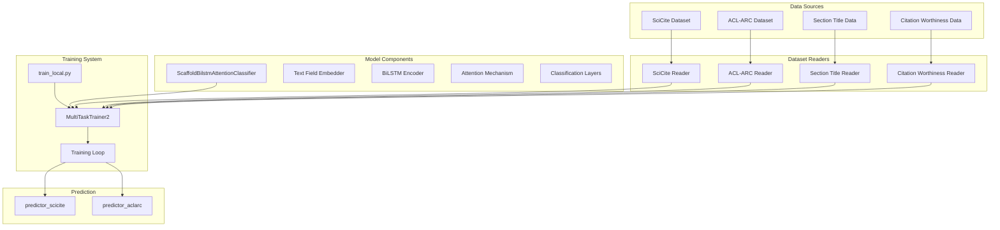
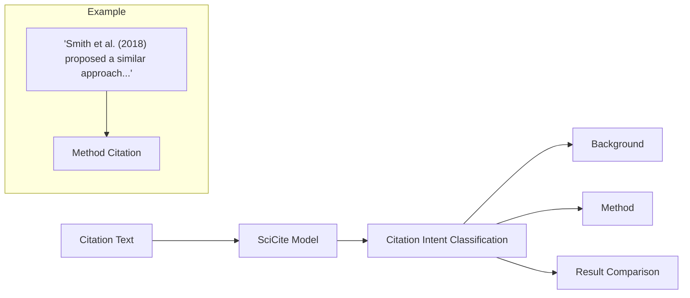
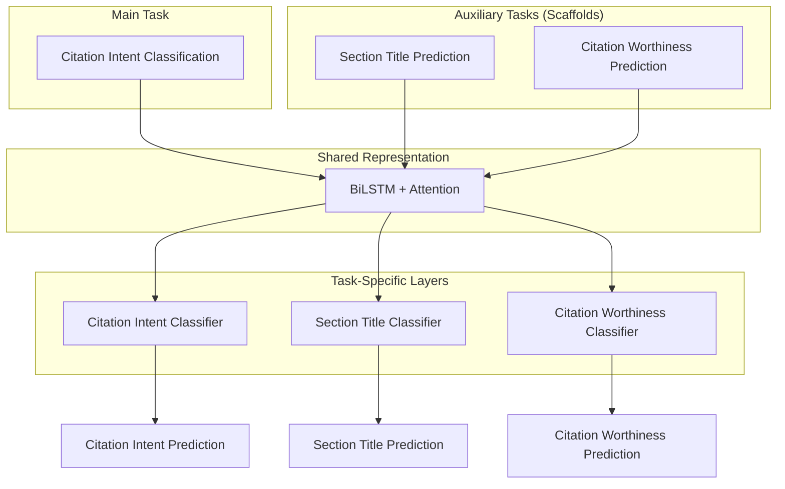
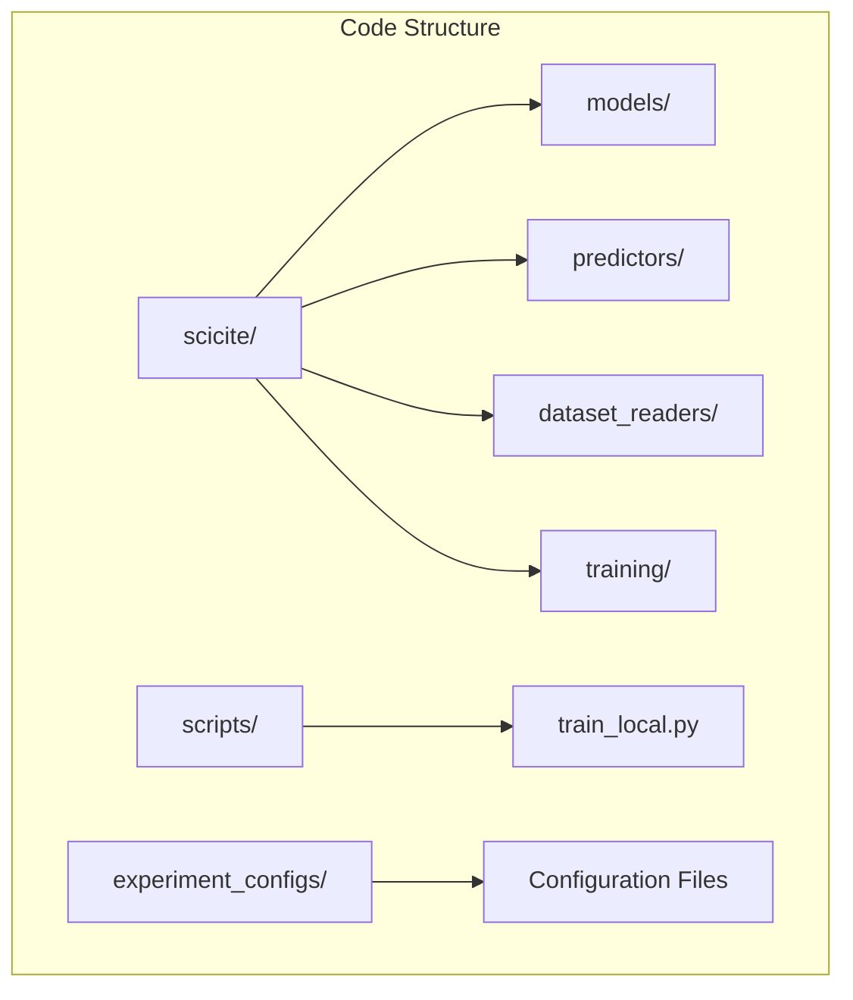

<!-- source: DeepWiki mcp.deepwiki.com · repo allenai/scicite · page 1 Overview · fetched 2026-10-26 -->

# Overview

<details>
<summary>Relevant source files</summary>

The following files were used as context for generating this wiki page:

- [README.md](README.md)

</details>


This document provides an introduction to the SciCite repository, explaining its purpose, architecture, and core functionality. SciCite is a system for classifying citation intents in academic papers, helping researchers understand the purpose of citations in scientific literature.

## Purpose and Scope

The SciCite repository contains datasets and code for training, evaluating, and deploying citation intent classification models. It implements the approach described in the NAACL 2019 paper: "Structural Scaffolds for Citation Intent Classification in Scientific Publications", which uses multi-task learning with auxiliary tasks to improve classification performance.

The system classifies citations into several intent categories:
- **Background**: Citations that provide relevant background information
- **Method**: Citations that reference methods used in the paper
- **Result Comparison**: Citations that compare or contrast results

For information on the model architecture details, see [Model Architecture](#2.1).
For training system specifics, see [Training System](#4).

Sources: [README.md:5-7]()

## System Architecture

SciCite follows a modular design based on the AllenNLP framework with components for data processing, model definition, training, and prediction.



Sources: [README.md:39-45](), [README.md:75-103]()

## Core Components

The SciCite system consists of several key components:

| Component | Description | Key Files |
|-----------|-------------|-----------|
| Datasets | SciCite and ACL-ARC datasets with citation intent annotations | Data in jsonlines format |
| Dataset Readers | Process and index data for model consumption | Readers for main and auxiliary tasks |
| Model Architecture | ScaffoldBilstmAttentionClassifier with embedding, encoding, and classification layers | Model definition files |
| Training System | Multi-task learning with auxiliary tasks | Training scripts and configuration |
| Predictors | Interface for using trained models on new data | Predictors for different dataset formats |
| Command Line Interface | Tools for training, evaluation, and prediction | Scripts for command line interaction |

Sources: [README.md:48-68]()

## Citation Intent Classification Problem

The primary goal of SciCite is to automatically determine the purpose or intent behind citations in academic papers. This helps researchers and systems:

1. Understand how scientific knowledge flows between papers
2. Identify the purpose of citations without manual analysis
3. Enable more nuanced citation metrics beyond simple citation counts
4. Improve scientific information retrieval and paper recommendation



Sources: [README.md:5-7](), [README.md:15-30]()

## Datasets

SciCite introduces two primary datasets for citation intent classification:

1. **SciCite Dataset**: A large dataset of citation intents across scientific domains
2. **ACL-ARC Dataset**: A preprocessed dataset focused on computational linguistics

Both datasets use the jsonlines format, where each line represents a citation with its context and intent label:

```
{
 'string': 'In chacma baboons, male-infant relationships can be linked to both
    formation of friendships and paternity success [30,31].'
 'sectionName': 'Introduction',
 'label': 'background',
 'citingPaperId': '7a6b2d4b405439',
 'citedPaperId': '9d1abadc55b5e0',
 ...
}
```

Sources: [README.md:9-35]()

## Multi-Task Learning Approach

What makes SciCite unique is its use of multi-task learning with "structural scaffolds" (auxiliary tasks) to improve citation intent classification:



Key parameters control the multi-task learning:
- `mixing_ratio`: Controls the influence of the section title prediction task (λ₂)
- `mixing_ratio2`: Controls the influence of the citation worthiness task (λ₃)
- `cutoff_epoch`: Determines when to stop using auxiliary tasks during training

Sources: [README.md:84-88]()

## Model Architecture Overview

The main model architecture is the ScaffoldBilstmAttentionClassifier, which includes:

- **Embedding Layer**: Combines multiple embedding types
  - ELMo contextualized embeddings (optional)
  - GloVe word embeddings
  - Lexicon features
  
- **Encoder**: BiLSTM (Bidirectional Long Short-Term Memory) network

- **Attention Mechanism**: Focuses on the most relevant parts of the citation context

- **Classification Layers**: Separate classifiers for the main task and auxiliary tasks

For more detailed information on the model architecture, see [Model Architecture](#2.1).

Sources: [README.md:91-94]()

## Using the System

### Running Pre-trained Models

SciCite provides pre-trained models for both datasets that can be used to classify new citations:

```bash
allennlp predict [path-to-model.tar.gz] [path-to-data.jsonl] \
--predictor [predictor-type] \
--include-package scicite \
--overrides "{'model':{'data_format':''}}"
```

Where `[predictor-type]` is one of:
- `predictor_scicite`: For the SciCite dataset format
- `predictor_aclarc`: For the ACL-ARC dataset format

Sources: [README.md:48-66]()

### Training New Models

To train your own models, you need to:

1. Prepare a configuration file (examples in `experiment_configs/` directory)
2. Set up environment variables (e.g., for ELMo embeddings)
3. Run the training script:

```bash
python scripts/train_local.py train_multitask_2 [path-to-config-file.json] \
-s [path-to-serialization-dir/] \
--include-package scicite
```

For detailed training instructions, see [Training System](#4).

Sources: [README.md:74-103]()

## Code Organization

The repository is organized into several key components:



Sources: [README.md]()

## System Requirements

- Python 3.6
- AllenNLP library
- Other dependencies specified in `requirements.in` and `constraints.txt`

For detailed setup instructions, see [Setup and Dependencies](#8).

Sources: [README.md:37-46]()

## Navigation

For more detailed information on specific components of the SciCite system, refer to:

- [System Architecture](#2) - High-level system architecture
- [Model Architecture](#2.1) - Details of the model architecture
- [Multi-Task Learning Framework](#2.2) - Multi-task learning approach
- [Datasets and Data Processing](#3) - Information about the datasets
- [Training System](#4) - Training system details
- [Prediction System](#6) - Using models for prediction

---

