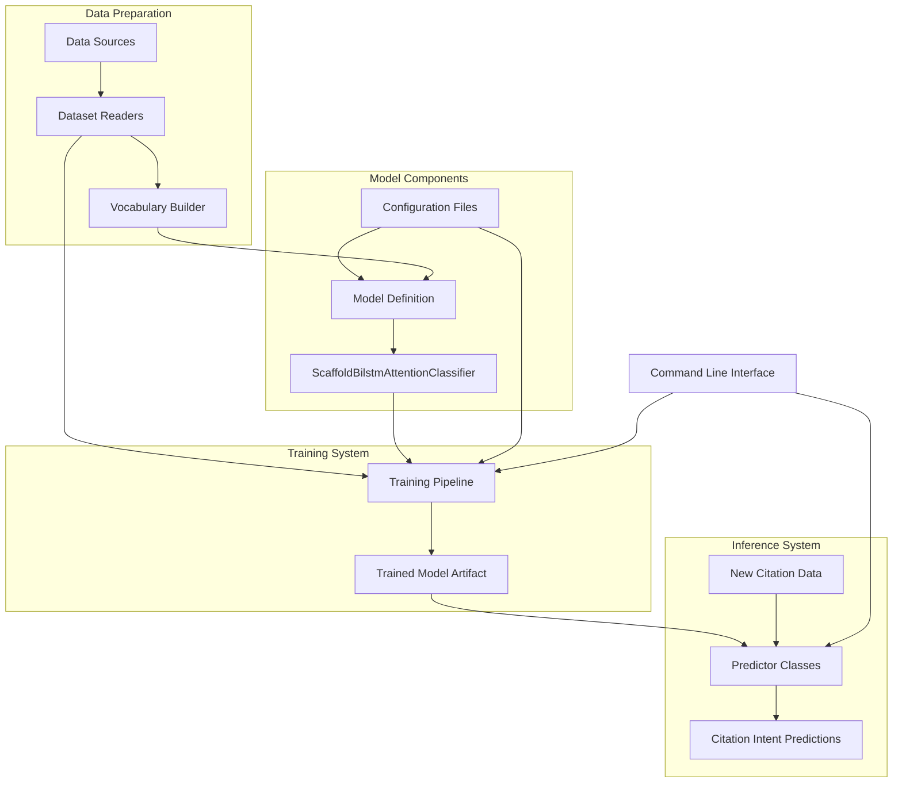
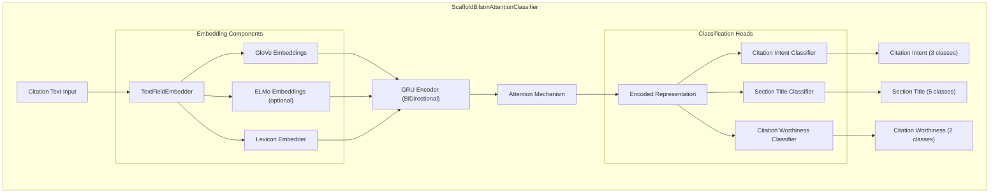
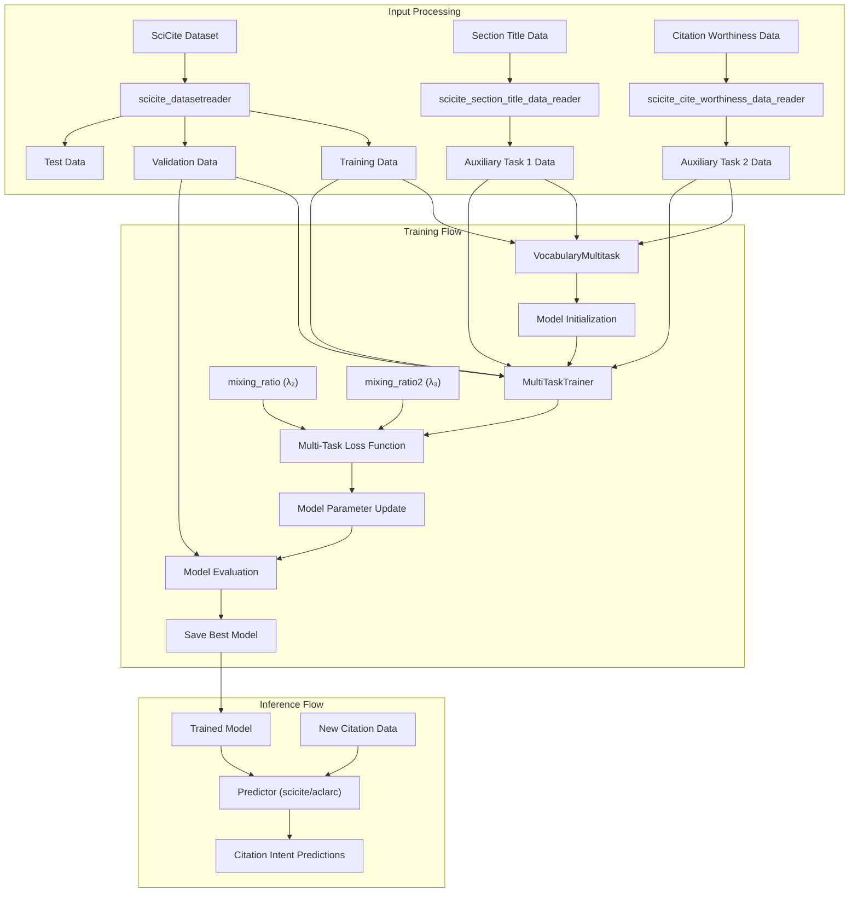
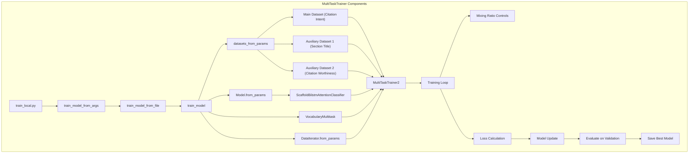
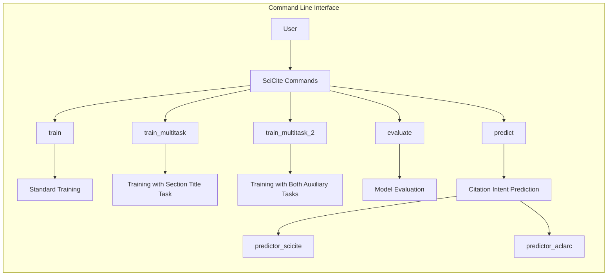
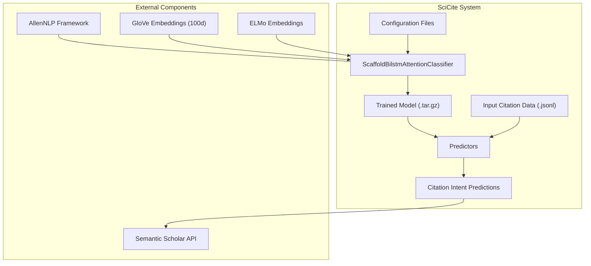

<!-- source: DeepWiki mcp.deepwiki.com · repo allenai/scicite · page 2 System Architecture · fetched 2026-10-26 -->

# System Architecture

Relevant source files

The following files were used as context for generating this wiki page:

- [README.md](README.md)
- [experiment_configs/scicite-experiment.json](experiment_configs/scicite-experiment.json)

This document provides a comprehensive overview of the SciCite system architecture, explaining how various components interact to enable citation intent classification in scientific publications. It covers the high-level system structure, data flow, model components, and integration points. For details about specific implementations, see the dedicated pages for [Model Architecture](#2.1) and [Multi-Task Learning Framework](#2.2).

## System Overview

The SciCite system is designed to classify the intent behind citations in academic papers using a multi-task learning approach with auxiliary scaffolding tasks.

Sources: [README.md:5-7](), [README.md:38-40](), [experiment_configs/scicite-experiment.json:17-36]()

## Core Components and Data Flow

The SciCite system integrates multiple specialized components for processing citation data through dataset readers, building vocabulary, training models, and making predictions.

### Dataset Readers

The system uses specialized dataset readers for different data types:

| Reader Type | Purpose | Configuration Path |
|-------------|---------|-------------------|
| `scicite_datasetreader` | Main citation intent classification data | [experiment_configs/scicite-experiment.json:17-22]() |
| `scicite_section_title_data_reader` | Section title prediction (auxiliary task) | [experiment_configs/scicite-experiment.json:23-26]() |
| `scicite_cite_worthiness_data_reader` | Citation worthiness prediction (auxiliary task) | [experiment_configs/scicite-experiment.json:27-30]() |

### Model Components

Sources: [experiment_configs/scicite-experiment.json:38-104]()

### Data Flow

Sources: [README.md:74-103](), [experiment_configs/scicite-experiment.json:17-36](), [experiment_configs/scicite-experiment.json:121-131]()

## Multi-Task Training System

The system employs a sophisticated multi-task training approach, using auxiliary tasks as scaffolds to improve the main citation intent classification task.

Sources: [README.md:74-103](), [experiment_configs/scicite-experiment.json:13-16]()

## Command Line Interface

The system provides a command-line interface for training models and making predictions:

Sources: [README.md:48-67](), [README.md:98-103]()

## Model Configuration

The model configuration is controlled via JSON configuration files, with key parameters:

| Parameter | Purpose | Example Value |
|-----------|---------|--------------|
| `train_data_path` | Path to main training data | `"data/train.jsonl"` |
| `validation_data_path` | Path to development data | `"data/dev.jsonl"` |
| `train_data_path_aux` | Path to section title auxiliary data | `"data/cite-sections.jsonl"` |
| `train_data_path_aux2` | Path to citation worthiness auxiliary data | `"data/cite-worthiness.jsonl"` |
| `mixing_ratio` | Control parameter (λ₂) for first auxiliary task | Variable |
| `mixing_ratio2` | Control parameter (λ₃) for second auxiliary task | Variable |
| `with_elmo` | Whether to use ELMo contextual embeddings | `true` or `false` |

Sources: [README.md:79-88](), [experiment_configs/scicite-experiment.json:6-16]()

## Integration with External Components

Sources: [README.md:38-40](), [README.md:48-67](), [experiment_configs/scicite-experiment.json:47-74]()

## System Requirements and Dependencies

The SciCite system requires:

- Python 3.6
- AllenNLP library
- Dependencies specified in requirements.in and constraints.txt

The system can utilize GPU acceleration if available, configured through the `cuda_device` parameter in the trainer configuration.

Sources: [README.md:39-46](), [experiment_configs/scicite-experiment.json:127]()

---

