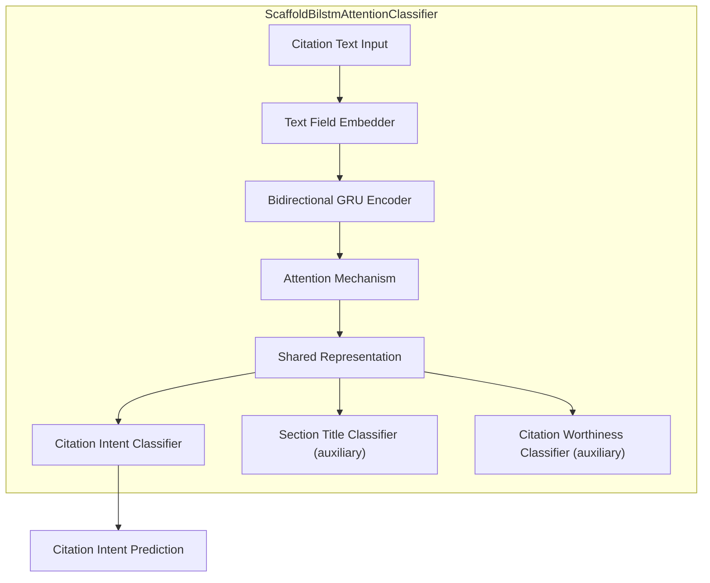
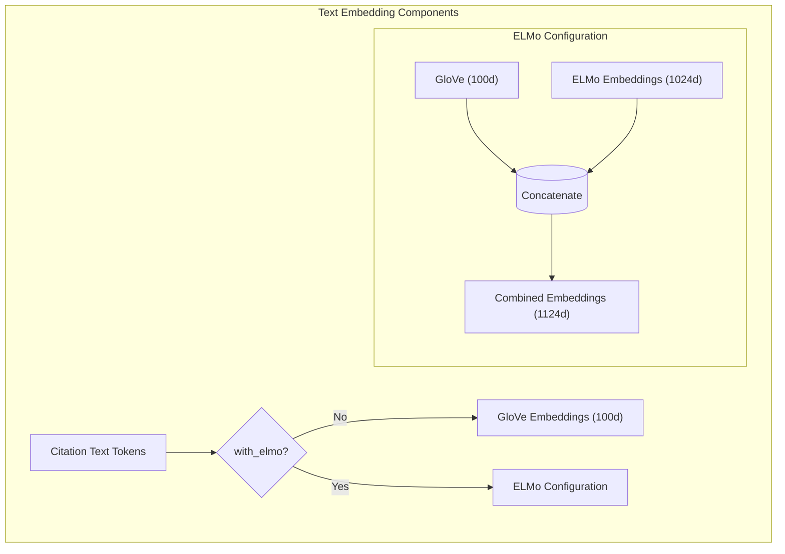
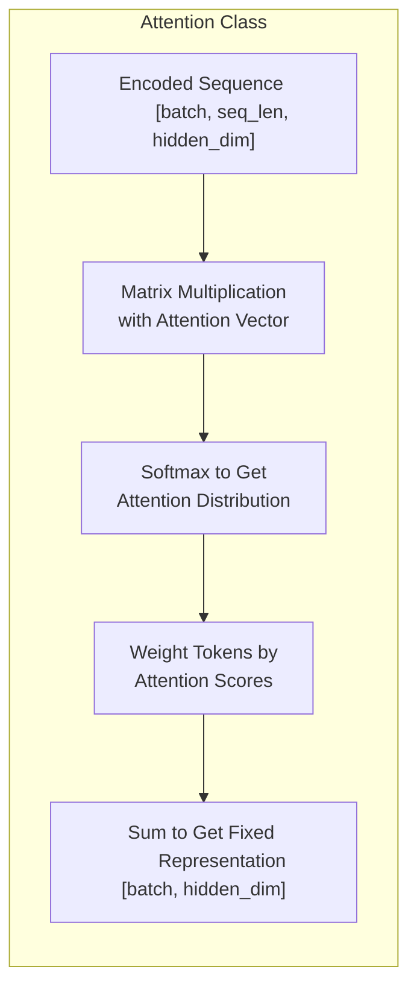
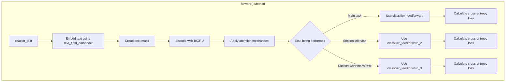
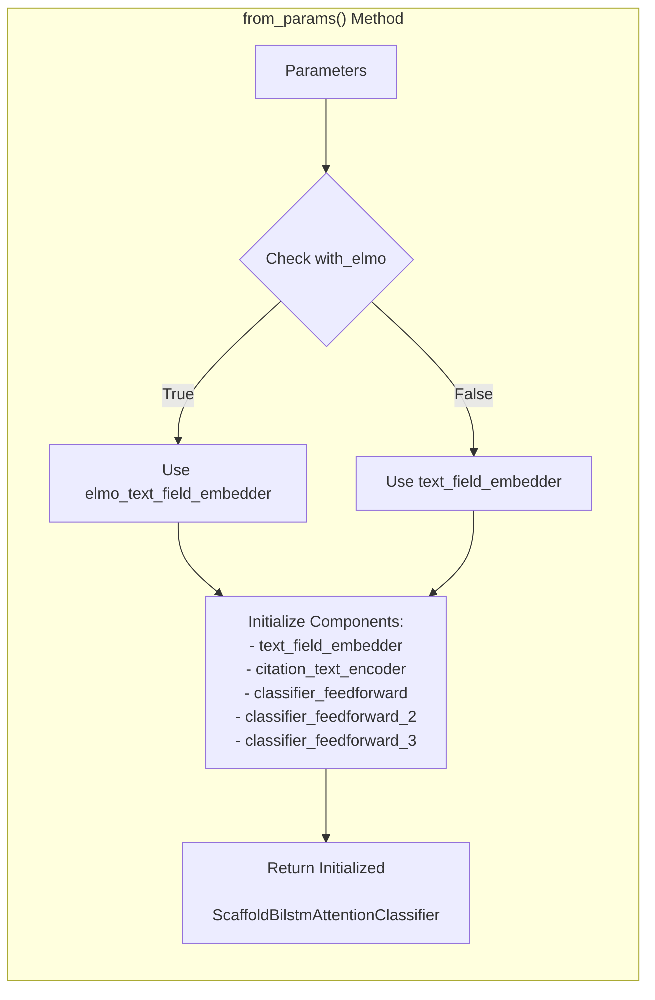

<!-- source: DeepWiki mcp.deepwiki.com · repo allenai/scicite · page 2.1 Model Architecture · fetched 2026-10-26 -->

# Model Architecture

Relevant source files

The following files were used as context for generating this wiki page:

- [experiment_configs/scicite-experiment.json](experiment_configs/scicite-experiment.json)
- [scicite/models/scaffold_bilstm_attention_classifier.py](scicite/models/scaffold_bilstm_attention_classifier.py)

This document details the `ScaffoldBilstmAttentionClassifier` model architecture used in the SciCite system for citation intent classification. For information about how this model is used within the multi-task learning framework, see [Multi-Task Learning Framework](#2.2).

## Overview

The `ScaffoldBilstmAttentionClassifier` is designed to classify the intent behind citations in academic papers. It implements a bidirectional GRU encoder with an attention mechanism, supporting both single-task and multi-task learning scenarios with auxiliary tasks.

Sources: [scicite/models/scaffold_bilstm_attention_classifier.py:31-283]()

## Model Components

### Text Embedding Layer

The model supports two embedding configurations:

1. **Standard Configuration**: Uses GloVe (100d) word embeddings
2. **ELMo Configuration**: Combines GloVe with ELMo contextual embeddings (1124d total)

The embedding choice is controlled by the `with_elmo` parameter in the configuration file.

Sources: [scicite/models/scaffold_bilstm_attention_classifier.py:59-60](), [scicite/models/scaffold_bilstm_attention_classifier.py:249-255](), [experiment_configs/scicite-experiment.json:6-10](), [experiment_configs/scicite-experiment.json:46-68]()

### BiGRU Encoder

The Bidirectional GRU encoder processes the embedded citation text:

- **Type**: GRU (Gated Recurrent Unit)
- **Layers**: 2
- **Direction**: Bidirectional
- **Hidden Size**: 100 in each direction (200 total output size)
- **Dropout**: 0.3

The encoder converts variable-length sequences into contextualized token representations.

Sources: [scicite/models/scaffold_bilstm_attention_classifier.py:63](), [experiment_configs/scicite-experiment.json:76-83]()

### Attention Mechanism

The model implements a multiplicative attention mechanism to focus on the most relevant parts of the citation text:

The `Attention` class:
1. Takes the encoded sequence from the BiGRU
2. Calculates attention scores for each token
3. Normalizes scores using softmax
4. Produces a weighted sum to create a fixed-size representation

Sources: [scicite/models/scaffold_bilstm_attention_classifier.py:87](), [scicite/models/scaffold_bilstm_attention_classifier.py:292-319]()

### Classification Heads

The model contains three separate feedforward networks for different tasks:

| Classifier | Task | Input Dim | Hidden Dim | Output Dim | Purpose |
|------------|------|-----------|------------|------------|---------|
| `classifier_feedforward` | Citation Intent | 200 | 20 | 3 | Main task |
| `classifier_feedforward_2` | Section Title | 200 | 20 | 5 | Auxiliary task 1 |
| `classifier_feedforward_3` | Citation Worthiness | 200 | 20 | 2 | Auxiliary task 2 |

Each classifier receives the same attended representation but produces different outputs corresponding to their specific tasks.

Sources: [scicite/models/scaffold_bilstm_attention_classifier.py:64-66](), [experiment_configs/scicite-experiment.json:84-104]()

## Forward Pass

The model's forward pass handles the following steps:

The `forward()` method:
1. Embeds the citation text
2. Passes it through the BiGRU encoder
3. Applies attention to get a fixed-size representation
4. Feeds this representation to the appropriate classifier based on the task
5. Calculates loss if labels are provided
6. Computes F1 metrics for each class

Sources: [scicite/models/scaffold_bilstm_attention_classifier.py:94-178]()

## Performance Metrics

The model tracks key performance metrics:

- Per-class precision, recall, and F1 scores
- Average F1 score across all classes (excluding 'none' class)
- Auxiliary task metrics (when `report_auxiliary_metrics` is enabled)

Metrics are reported separately for the main task and each auxiliary task.

Sources: [scicite/models/scaffold_bilstm_attention_classifier.py:199-246]()

## Model Initialization

The model is initialized from configuration parameters:

The `from_params()` method handles configuration from JSON files, including:
- Choosing between standard and ELMo embeddings
- Setting up encoder, attention, and classifiers
- Configuring multi-task learning parameters

Sources: [scicite/models/scaffold_bilstm_attention_classifier.py:248-283](), [experiment_configs/scicite-experiment.json:38-104]()

## Integration with Multi-Task Learning

The `ScaffoldBilstmAttentionClassifier` is designed to work within SciCite's multi-task learning framework:

- Uses shared lower layers (embedding, encoding, attention)
- Has task-specific classification heads
- Can report metrics for auxiliary tasks
- Provides a flexible interface for single or multi-task training

The multi-task approach allows the model to leverage information from auxiliary tasks to improve performance on the main citation intent classification task.

Sources: [scicite/models/scaffold_bilstm_attention_classifier.py:132-166]()

## Output and Decoding

The `decode()` method converts model outputs into human-readable format:

1. Applies softmax to logits to get probabilities
2. Identifies argmax class indices 
3. Maps indices to class labels using the vocabulary
4. Includes citation text, probabilities, and all possible labels
5. Returns a structured output dictionary for downstream use

Sources: [scicite/models/scaffold_bilstm_attention_classifier.py:181-197]()

---

