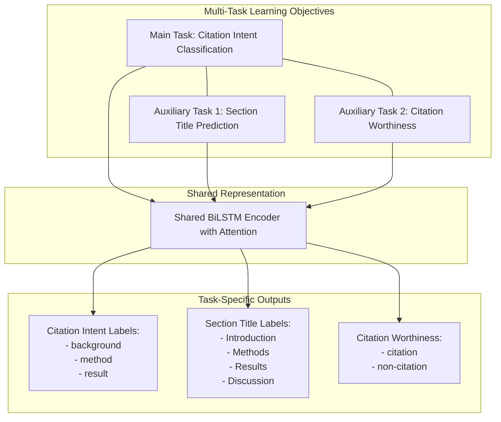
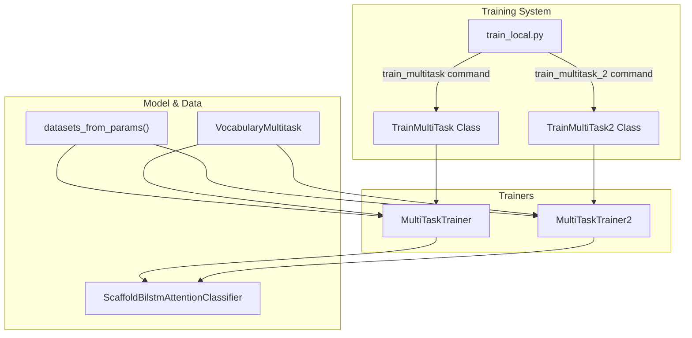
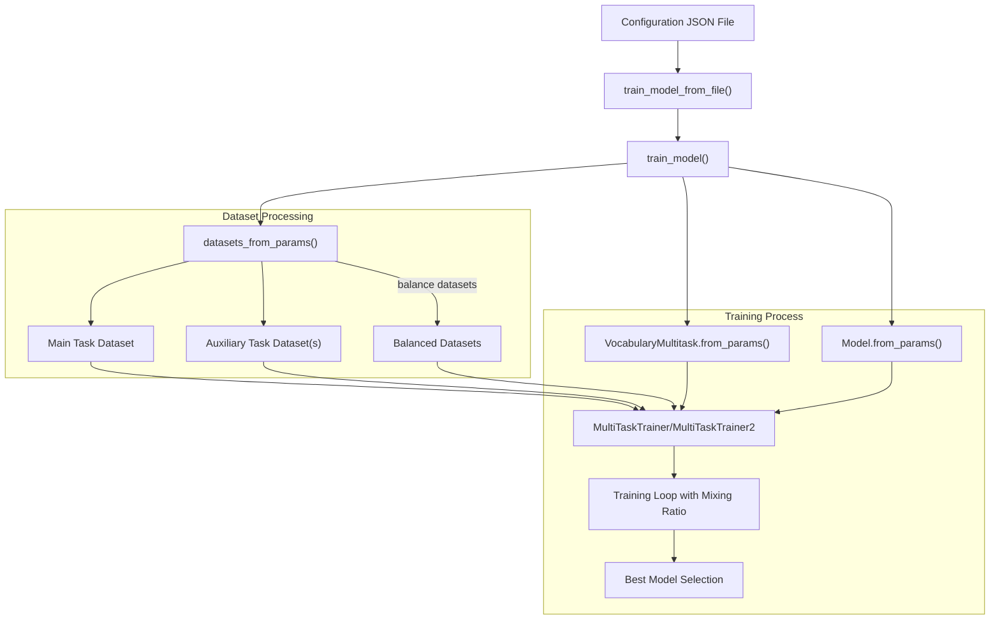
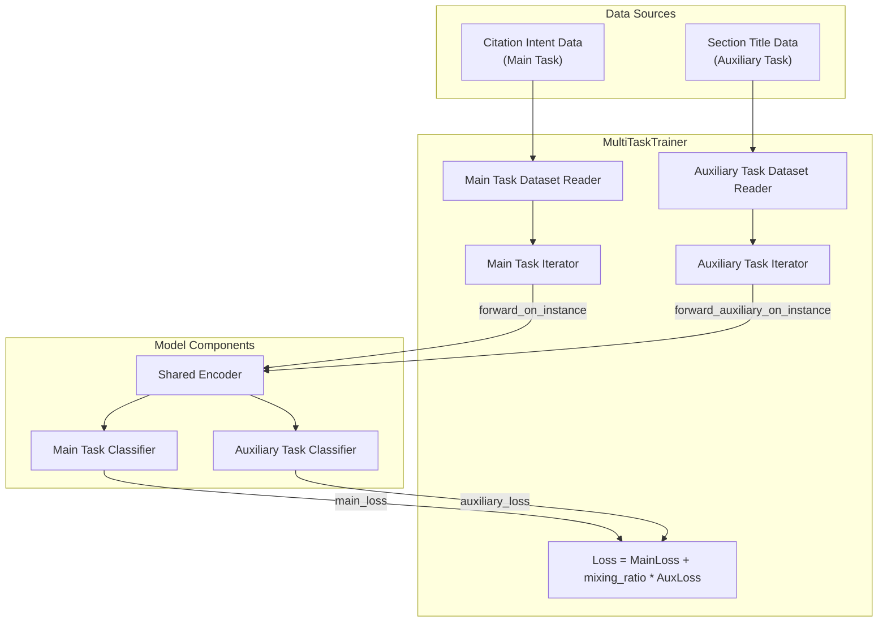
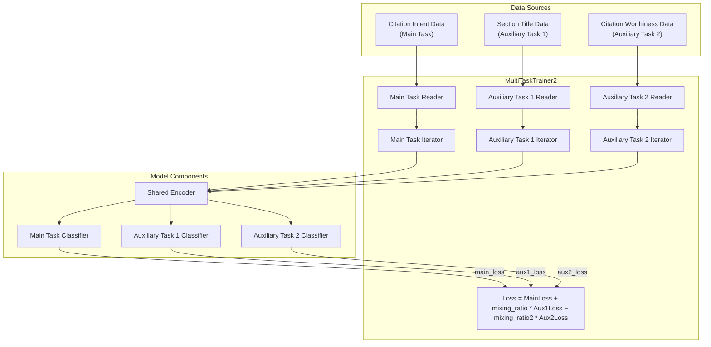
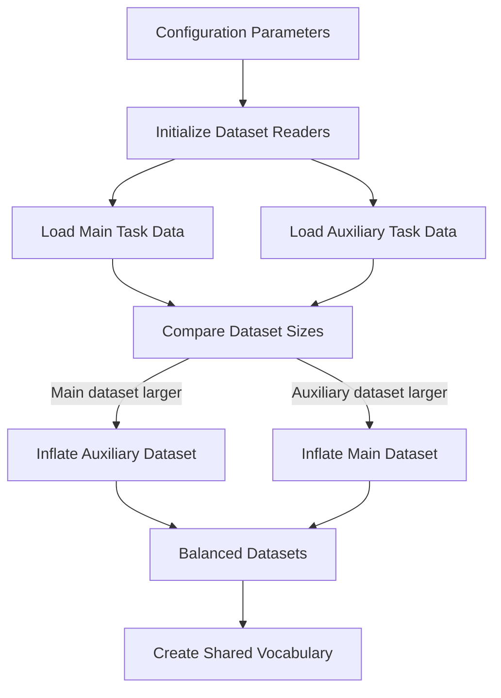
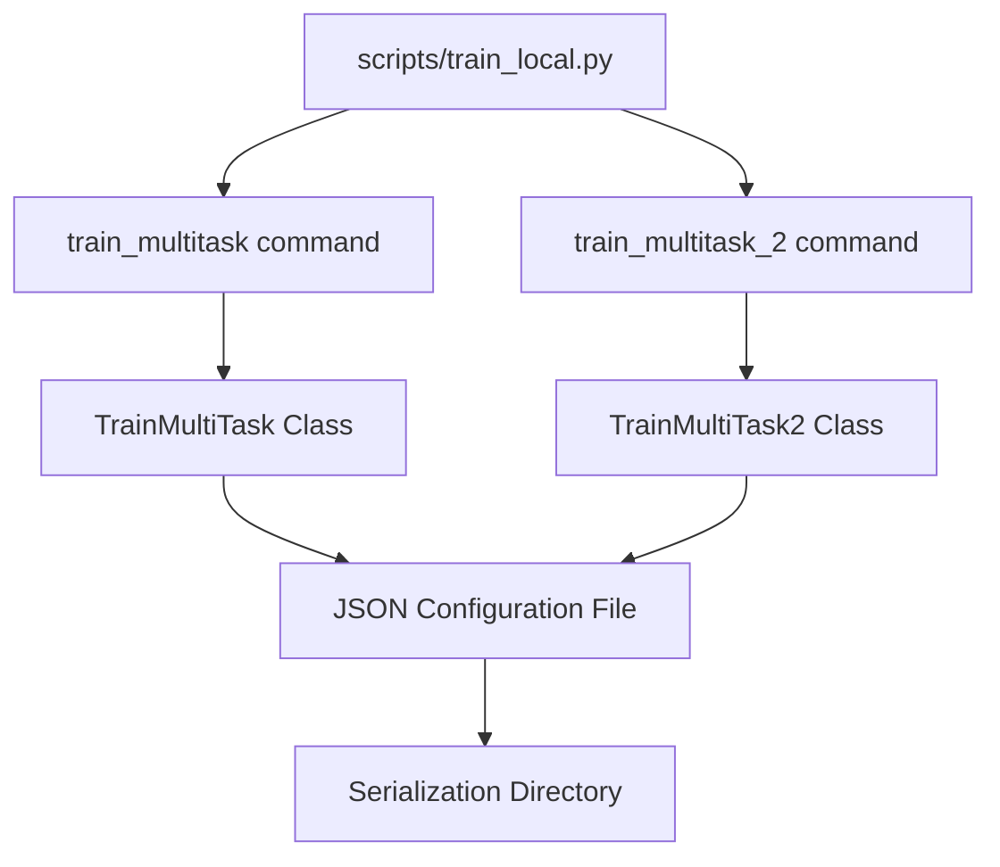

<!-- source: DeepWiki mcp.deepwiki.com · repo allenai/scicite · page 2.2 Multi-Task Learning Framework · fetched 2026-10-26 -->

# Multi-Task Learning Framework

<details>
<summary>Relevant source files</summary>

The following files were used as context for generating this wiki page:

- [README.md](README.md)
- [scicite/training/train_multitask.py](scicite/training/train_multitask.py)
- [scicite/training/train_multitask_two_tasks.py](scicite/training/train_multitask_two_tasks.py)

</details>


## Purpose and Scope

This document describes the multi-task learning framework implemented in the SciCite project for improving citation intent classification. The framework uses auxiliary tasks as "structural scaffolds" to enhance the main citation intent classification task. This page covers the architecture, data flow, training process, and configuration of the multi-task learning system. For information about the specific model architecture used with this framework, see [Model Architecture](#2.1).

## Introduction to Multi-Task Learning in SciCite

The SciCite project implements a scaffold-based multi-task learning approach where auxiliary tasks related to scientific text understanding help improve the performance of the main citation intent classification task. The system supports training with either one auxiliary task (section title prediction) or two auxiliary tasks (section title prediction and citation worthiness prediction).

The key insight is that learning to predict section titles and citation worthiness can help the model develop better representations of scientific citations, which ultimately improves citation intent classification.



Sources: [README.md:5-7]()

## Framework Architecture

The multi-task learning framework in SciCite is implemented through two primary trainer classes: `MultiTaskTrainer` for a single auxiliary task and `MultiTaskTrainer2` for two auxiliary tasks. These classes extend AllenNLP's training system to support multi-task learning.



Sources: [scicite/training/train_multitask.py:57-58](), [scicite/training/train_multitask_two_tasks.py:52-58]()

### Data Flow in Multi-Task Training

The multi-task learning framework processes data through several key functions, with a focus on dataset loading, vocabulary creation, and balanced training:



Sources: [scicite/training/train_multitask.py:134-138](), [scicite/training/train_multitask_two_tasks.py:134-138]()

## Training with One Auxiliary Task

The first approach to multi-task learning in SciCite uses a single auxiliary task (typically section title prediction) alongside the main citation intent classification task.

### Architecture and Data Flow



Sources: [scicite/training/train_multitask.py:279-442]()

### Key Parameters

The training process with one auxiliary task is controlled by two main parameters:

| Parameter      | Description                                            | Default  |
|----------------|--------------------------------------------------------|----------|
| `mixing_ratio` | Weight of auxiliary task loss relative to main task    | (required) |
| `cutoff_epoch` | Epoch after which auxiliary task training is stopped   | -1 (no cutoff) |

Sources: [scicite/training/train_multitask.py:319-320]()

## Training with Two Auxiliary Tasks

The second approach extends multi-task learning to include two auxiliary tasks (section title prediction and citation worthiness).

### Architecture and Data Flow



Sources: [scicite/training/train_multitask_two_tasks.py:305-499]()

### Additional Parameters

The training process with two auxiliary tasks adds a second mixing ratio parameter:

| Parameter       | Description                                          | Default  |
|-----------------|------------------------------------------------------|----------|
| `mixing_ratio`  | Weight of first auxiliary task loss                  | (required) |
| `mixing_ratio2` | Weight of second auxiliary task loss                 | (required) |
| `cutoff_epoch`  | Epoch after which auxiliary task training is stopped | -1 (no cutoff) |

Sources: [scicite/training/train_multitask_two_tasks.py:347-350]()

## Data Handling and Balancing

A key aspect of the multi-task training framework is how it handles and balances datasets of different sizes.

### Dataset Loading Process



Sources: [scicite/training/train_multitask.py:138-219](), [scicite/training/train_multitask_two_tasks.py:134-245]()

### Dataset Balancing Mechanism

The system balances datasets by resampling from the smaller dataset to match the size of the larger one:

1. Compare sizes of main and auxiliary datasets
2. If main dataset is larger, randomly sample from auxiliary dataset to inflate it
3. If auxiliary dataset is larger, randomly sample from main dataset to inflate it
4. For two auxiliary tasks, first balance the auxiliary datasets against each other

This ensures that during training, the model receives approximately equal amounts of data from each task.

Sources: [scicite/training/train_multitask.py:169-184](), [scicite/training/train_multitask_two_tasks.py:172-194]()

## Configuration and Usage

### Command Line Interface



Sources: [README.md:98-103]()

### Example Configuration

To use multi-task learning in SciCite, you need to set up the following configuration parameters:

```json
{
  "train_data_path": "path/to/citation/data.jsonl",
  "validation_data_path": "path/to/citation/dev.jsonl",
  "test_data_path": "path/to/citation/test.jsonl",
  
  "train_data_path_aux": "path/to/section/data.jsonl",
  "train_data_path_aux2": "path/to/worthiness/data.jsonl",
  
  "mixing_ratio": 0.10,
  "mixing_ratio2": 0.05,
  "cutoff_epoch": 10
}
```

To train with one auxiliary task:
```bash
python scripts/train_local.py train_multitask [path-to-config-file.json] -s [output-dir] --include-package scicite
```

To train with two auxiliary tasks:
```bash
python scripts/train_local.py train_multitask_2 [path-to-config-file.json] -s [output-dir] --include-package scicite
```

Sources: [README.md:80-90](), [README.md:98-103]()

## Summary

The multi-task learning framework in SciCite provides a flexible approach to improving citation intent classification through related auxiliary tasks. By sharing a representation across tasks and carefully balancing the contribution of each task through mixing ratios, the system achieves better performance than single-task learning. The framework supports both single auxiliary task and dual auxiliary task configurations, with automatic dataset balancing and shared vocabulary creation.

Sources: [README.md:5-7](), [scicite/training/train_multitask.py](), [scicite/training/train_multitask_two_tasks.py]()

---

