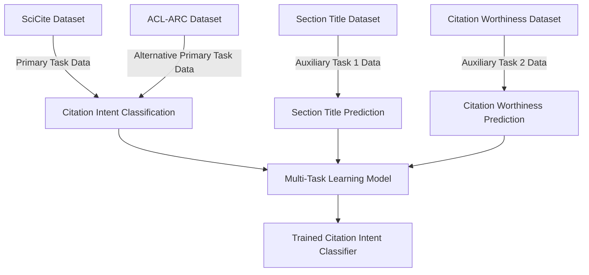
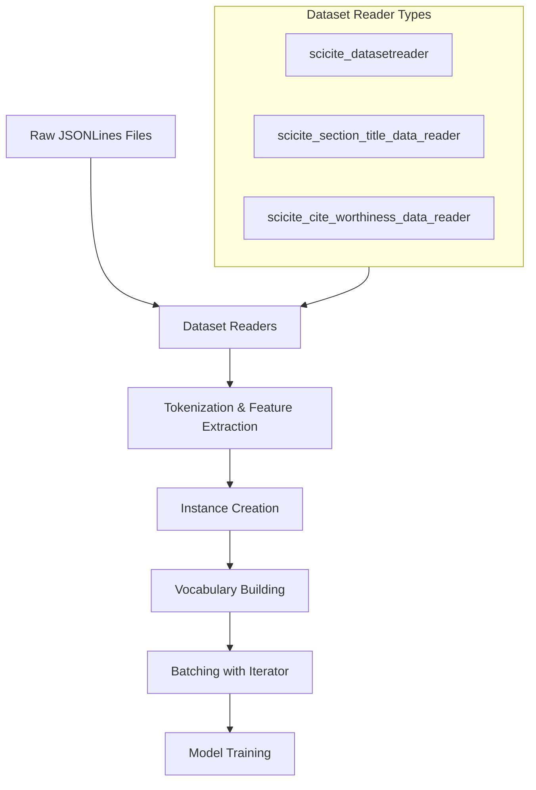
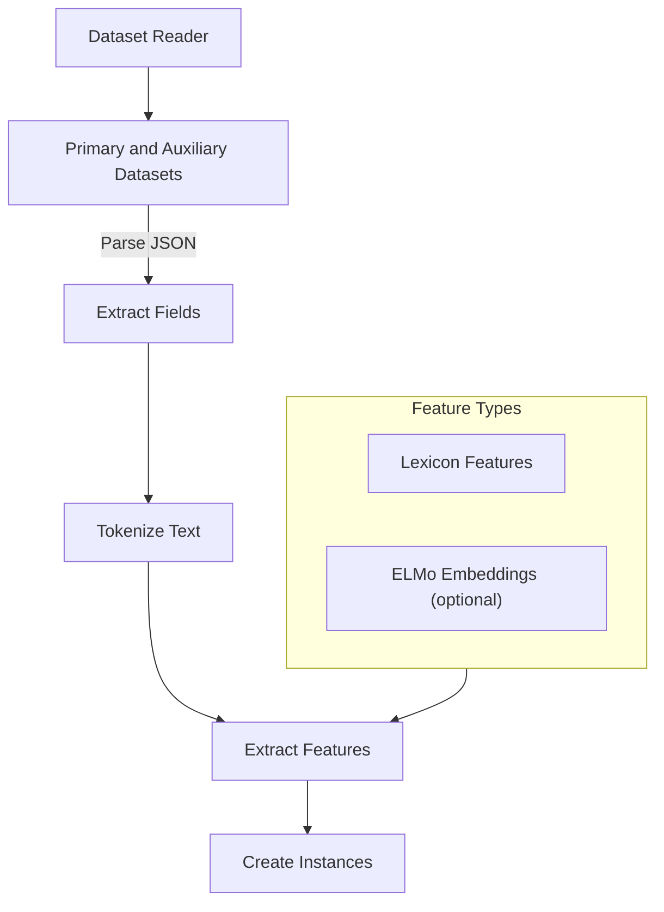
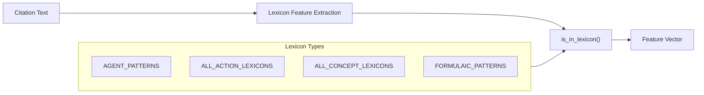

<!-- source: DeepWiki mcp.deepwiki.com · repo allenai/scicite · page 3 Datasets and Data Processing · fetched 2026-10-26 -->

# Datasets and Data Processing

<details>
<summary>Relevant source files</summary>

The following files were used as context for generating this wiki page:

- [README.md](README.md)
- [experiment_configs/scicite-experiment.json](experiment_configs/scicite-experiment.json)
- [scicite/compute_features.py](scicite/compute_features.py)

</details>


This document describes the datasets used in the SciCite project and how they are processed to train and evaluate citation intent classification models. For information about how these datasets are used in the multi-task learning architecture, see [Multi-Task Learning Framework](#2.2).

## Datasets Overview

The SciCite system uses two primary datasets for citation intent classification and two auxiliary datasets for the multi-task learning approach:



Sources: [README.md:9-35]()

## SciCite Dataset

The SciCite dataset is the primary dataset introduced by this project for citation intent classification across scientific domains. It's available as a downloadable archive (`scicite.tar.gz`) from the project repository.

### Format and Structure

The SciCite dataset is in JSONLines format, where each line is a JSON object containing information about a single citation instance. The dataset includes the following key fields:

| Field | Description |
|-------|-------------|
| string | The text containing the citation |
| sectionName | The section where the citation appears (e.g., "Introduction") |
| label | The citation intent (e.g., "background", "method", "result") |
| citingPaperId | ID of the paper making the citation |
| citedPaperId | ID of the paper being cited |

Example entry:
```json
{
 "string": "In chacma baboons, male-infant relationships can be linked to both formation of friendships and paternity success [30,31].",
 "sectionName": "Introduction",
 "label": "background",
 "citingPaperId": "7a6b2d4b405439",
 "citedPaperId": "9d1abadc55b5e0",
 ...
}
```

The dataset is split into three files:
- `train.jsonl` - For model training
- `dev.jsonl` - For model validation during training
- `test.jsonl` - For final model evaluation

Sources: [README.md:11-30](), [experiment_configs/scicite-experiment.json:33-35]()

## ACL-ARC Dataset

The ACL-ARC dataset is a pre-existing dataset of citation intents in the computational linguistics domain, introduced by Jurgens et al. (2018). The preprocessed dataset is available from the project repository as `acl-arc.tar.gz`.

This dataset follows a similar JSONLines format to the SciCite dataset but is specific to computational linguistics papers. It serves as an alternative dataset for the main citation intent classification task.

Sources: [README.md:34-35]()

## Auxiliary Datasets

In addition to the main citation intent datasets, the SciCite system uses two auxiliary datasets for multi-task learning:

### Section Title Dataset

This dataset (`cite-sections.jsonl`) is used for training the section title prediction auxiliary task. It contains examples that help the model predict which section of a paper a citation appears in (e.g., Introduction, Methods, Results).

### Citation Worthiness Dataset

This dataset (`cite-worthiness.jsonl`) is used for training the citation worthiness prediction auxiliary task. It contains examples that help the model determine whether a text span should contain a citation.

Sources: [experiment_configs/scicite-experiment.json:31-32]()

## Dataset Processing Pipeline

The SciCite system implements a complete pipeline for processing datasets from raw JSONLines files to model-ready training data:



Sources: [experiment_configs/scicite-experiment.json:17-30]()

## Dataset Readers

The SciCite system includes specialized dataset readers to process each type of dataset:

### SciCite Dataset Reader

The `scicite_datasetreader` processes the main citation intent classification dataset with these configurable options:
- `use_sparse_lexicon_features`: Determines whether to use sparse lexicon features
- `multilabel`: Controls whether the classification is multi-label
- `with_elmo`: Toggles the use of ELMo embeddings

### Section Title Dataset Reader

The `scicite_section_title_data_reader` processes data for the section title prediction task, with the `with_elmo` option to control ELMo embeddings usage.

### Citation Worthiness Dataset Reader

The `scicite_cite_worthiness_data_reader` processes data for the citation worthiness prediction task, with the `with_elmo` option to control ELMo embeddings usage.



Sources: [experiment_configs/scicite-experiment.json:17-30]()

## Feature Computation

The SciCite system extracts various features from the citation text to enhance classification performance:

### Lexicon-based Features

The system uses predefined lexicons to extract features, including:
- Agent patterns
- Action lexicons
- Concept lexicons
- Formulaic patterns

These features are computed using the functions in `compute_features.py`, which checks if words from lexicons appear in the citation text.



Sources: [scicite/compute_features.py:1-71]()

### ELMo Embeddings

When enabled via the `with_elmo` option, the system uses contextual ELMo embeddings to represent the citation text. This significantly enhances the representation of citation contexts but increases training time.

## Data Iteration

The processed data is batched for model training using bucket iterators. These iterators sort instances based on the number of tokens in the citation text with a batch size of 16, which helps optimize training efficiency by grouping similarly-sized instances together.


Sources: [experiment_configs/scicite-experiment.json:106-120]()

## Usage in Model Training

During training, the system combines data from the primary citation intent dataset with the auxiliary task datasets according to the specified mixing ratios. These ratios control how much each auxiliary task contributes to the overall learning objective. For more details on this multi-task training approach, see [Multi-Task Learning Framework](#2.2).

Sources: [experiment_configs/scicite-experiment.json:15-16]()

---

