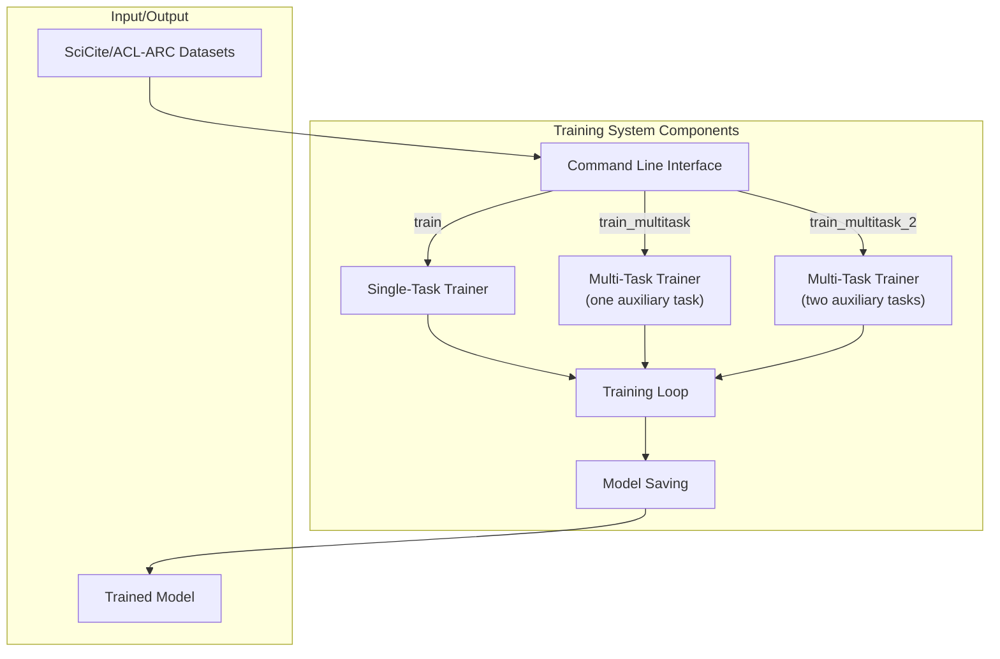
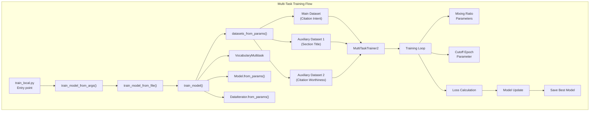
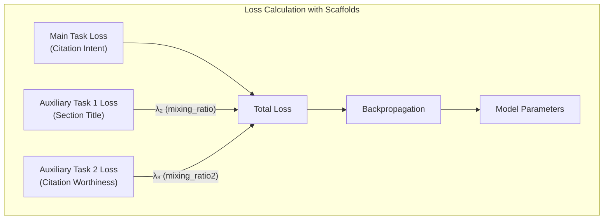
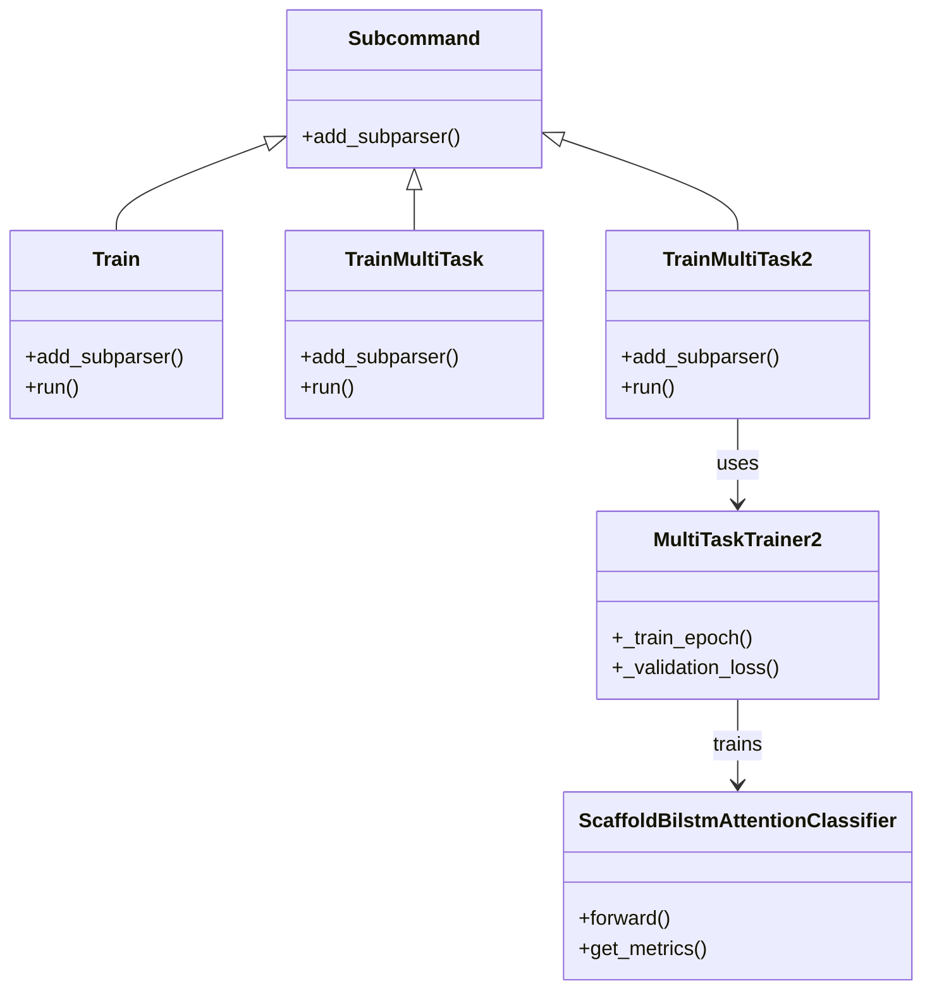
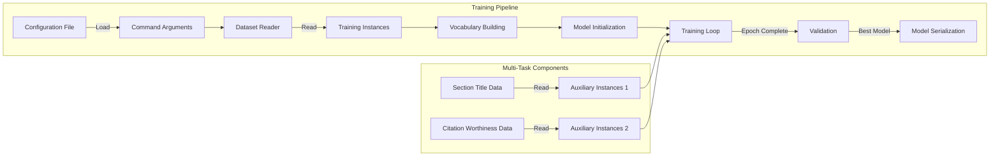

<!-- source: DeepWiki mcp.deepwiki.com · repo allenai/scicite · page 4 Training System · fetched 2026-10-26 -->

# Training System

<details>
<summary>Relevant source files</summary>

The following files were used as context for generating this wiki page:

- [README.md](README.md)
- [scicite/training/commands.py](scicite/training/commands.py)

</details>


This page documents the training system of the SciCite codebase, which handles the training of citation intent classification models. The training system provides multiple approaches for model training, from basic single-task training to advanced multi-task learning with auxiliary tasks. For information about the underlying model architecture, see [Model Architecture](#2.1). For details on datasets and data processing, see [Datasets and Data Processing](#3).

## Overview

The SciCite training system enables the training of models using both standard training and multi-task learning approaches with structural scaffolds. The system supports three training modes:

1. Single-task training (citation intent classification only)
2. Training with one auxiliary task (section title prediction)
3. Training with two auxiliary tasks (section title and citation worthiness prediction)



Sources: [scicite/training/commands.py:39-44](), [README.md:74-102]()

## Training Commands

The training system offers three main commands through the command line interface:

| Command | Class | Purpose |
|---------|-------|---------|
| `train` | `Train` | Standard AllenNLP training with a single task |
| `train_multitask` | `TrainMultiTask` | Training with section title prediction as an auxiliary task |
| `train_multitask_2` | `TrainMultiTask2` | Training with both section title and citation worthiness as auxiliary tasks |

All commands use the same basic syntax:

```bash
python scripts/train_local.py [COMMAND] [CONFIG_FILE] -s [SERIALIZATION_DIR] --include-package scicite
```

Where:
- `[COMMAND]` is one of the commands in the table above
- `[CONFIG_FILE]` is the path to a JSON configuration file
- `[SERIALIZATION_DIR]` is the directory where the trained model and logs will be saved

Sources: [scicite/training/commands.py:39-44](), [README.md:98-102]()

## Multi-Task Training Architecture

The multi-task training system is a key innovation in SciCite, implementing the "structural scaffolds" approach described in the paper.



Sources: Based on the Multi-Task Training System diagram provided

## Mixing Ratios and Scaffold Mechanism

The multi-task learning approach uses "mixing ratios" to control the influence of each auxiliary task on the main task during training. These parameters correspond to λ₂ and λ₃ in the paper.



Key configuration parameters for controlling the scaffold mechanism:

| Parameter | Description |
|-----------|-------------|
| `mixing_ratio` | Weight (λ₂) for the first auxiliary task (section title) |
| `mixing_ratio2` | Weight (λ₃) for the second auxiliary task (citation worthiness) |
| `cutoff_epoch` | Epoch after which auxiliary tasks are no longer used |

Sources: [README.md:86-88]()

## Training Configuration

Training configurations are specified in JSON files located in the `experiment_configs/` directory. The key configuration parameters include:

```
{
  "train_data_path": "path/to/train.jsonl",  
  "validation_data_path": "path/to/dev.jsonl",  
  "test_data_path": "path/to/test.jsonl",  
  "train_data_path_aux": "path/to/section_title_data.jsonl",  
  "train_data_path_aux2": "path/to/citation_worthiness_data.jsonl",  
  "mixing_ratio": 0.1,  
  "mixing_ratio2": 0.1,
  "model": {
    ...model configuration...
  },
  "iterator": {
    ...iterator configuration...
  },
  "trainer": {
    ...trainer configuration...
  }
}
```

The configuration can be customized through environment variables, for example:

```bash
export elmo=true  # Enable ELMo contextualized embeddings
```

Sources: [README.md:76-88]()

## Common Training Scenarios

### Single-Task Training

For training with just the citation intent classification task:

```bash
python scripts/train_local.py train path/to/config.json -s output_dir/ --include-package scicite
```

### Training with Section Title Scaffold

For training with the section title prediction as an auxiliary task:

```bash
python scripts/train_local.py train_multitask path/to/config.json -s output_dir/ --include-package scicite
```

### Training with Both Scaffolds

For training with both section title and citation worthiness as auxiliary tasks:

```bash
python scripts/train_local.py train_multitask_2 path/to/config.json -s output_dir/ --include-package scicite
```

Sources: [README.md:98-102]()

## Training System Implementation Details



Sources: [scicite/training/commands.py:39-44]()

## Data Flow in Training



Sources: Based on the Data Flow Architecture diagram provided

## Integration with AllenNLP

The SciCite training system extends the AllenNLP training framework:

1. It inherits the base `Train` command from AllenNLP for single-task training
2. It adds custom `TrainMultiTask` and `TrainMultiTask2` commands for multi-task training
3. It leverages AllenNLP's configuration system, serialization, and training utilities

The main components are registered with AllenNLP's registry system, allowing them to be constructed from JSON configurations.

Sources: [scicite/training/commands.py:1-17]()

## Practical Considerations

When training models with the SciCite system:

1. **Computational resources**: Using ELMo embeddings significantly increases training time and memory requirements
2. **Dataset paths**: Ensure all dataset paths in configuration files are correct
3. **Serialization directory**: Choose a directory with sufficient space for model checkpoints
4. **Auxiliary task data**: Both auxiliary tasks require their own datasets
5. **Monitoring**: Training progress can be monitored through logs in the serialization directory

The trained models can be used for prediction using the commands documented in [Prediction System](#6).

Sources: [README.md:80-88]()

---

