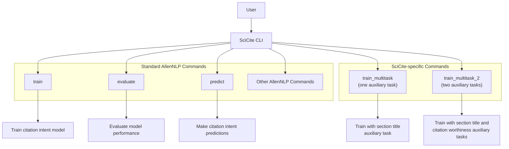
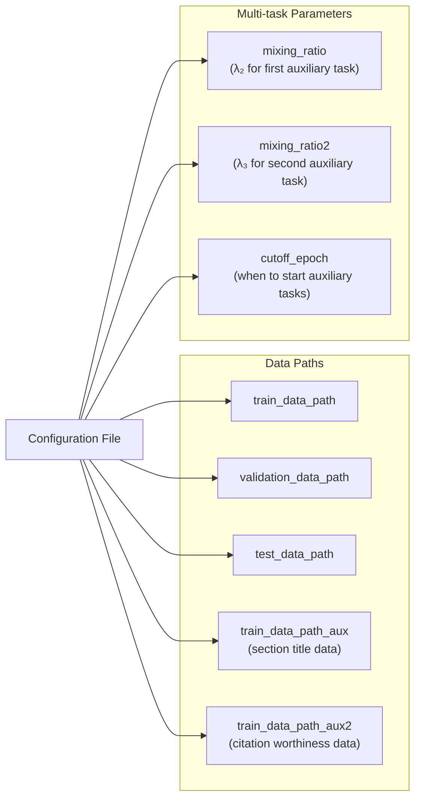
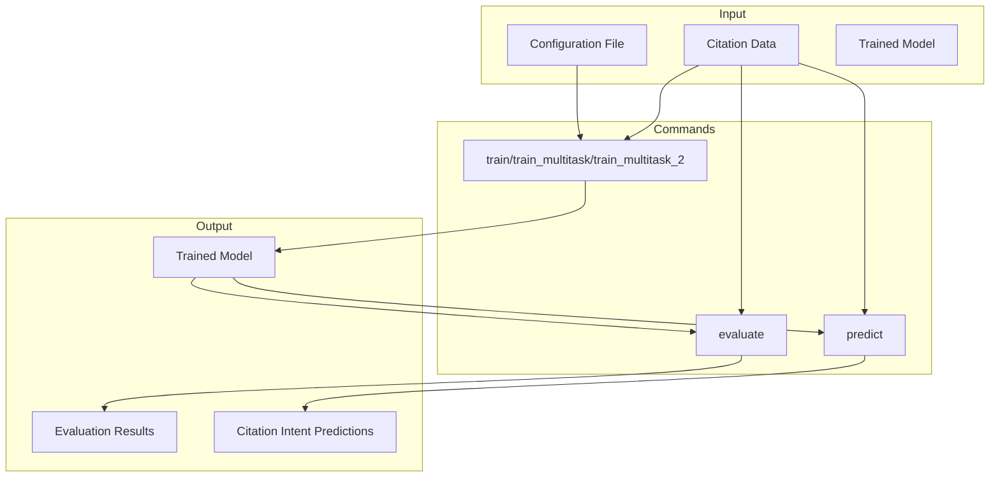
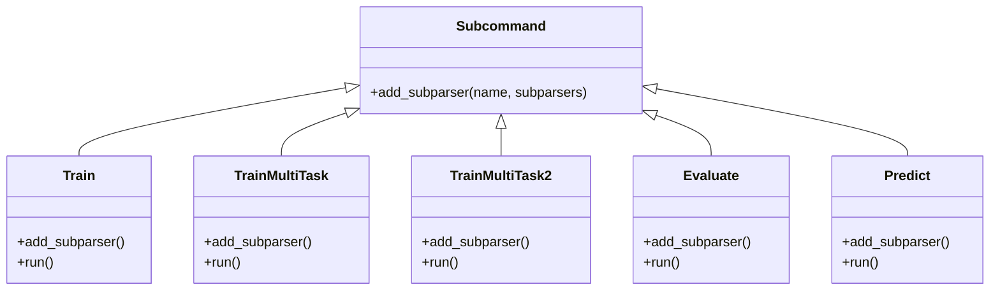

<!-- source: DeepWiki mcp.deepwiki.com · repo allenai/scicite · page 4.1 Command Line Interface · fetched 2026-10-26 -->

# Command Line Interface

<details>
<summary>Relevant source files</summary>

The following files were used as context for generating this wiki page:

- [README.md](README.md)
- [scicite/training/commands.py](scicite/training/commands.py)

</details>


This document describes the command line interface (CLI) for the SciCite system, which allows users to train models, evaluate their performance, and make predictions for citation intent classification. The CLI extends the AllenNLP command line interface with additional functionality specific to citation intent classification with multi-task learning. For information about the training system architecture, see [Training System](#4), and for details about multi-task learning implementation, see [Multi-Task Learning Framework](#2.2).

## Command Overview

The SciCite system implements a command-line interface that builds upon the standard AllenNLP CLI with custom commands for multi-task training scenarios.



Sources: [scicite/training/commands.py:38-50]()

## Available Commands

SciCite's CLI provides the following commands:

| Command | Description |
|---------|-------------|
| `train` | Train a standard citation intent classification model |
| `train_multitask` | Train a model with one auxiliary task (section title prediction) |
| `train_multitask_2` | Train a model with two auxiliary tasks (section title and citation worthiness) |
| `evaluate` | Evaluate a trained model on test data |
| `predict` | Use a trained model to make predictions on new data |
| `configure` | Generate a configuration file template |
| `make-vocab` | Build a vocabulary from a dataset |
| `elmo` | Work with ELMo embeddings |
| `fine-tune` | Fine-tune a pre-trained model |
| `dry-run` | Test a configuration file without training |
| `test-install` | Verify the installation works correctly |

Sources: [scicite/training/commands.py:38-50](), [README.md:99-103]()

## Training Commands

SciCite offers three different training commands to accommodate different experimental setups.

### Standard Training

The `train` command trains a standard citation intent classification model without auxiliary tasks:

```bash
python scripts/train_local.py train [path-to-config-file.json] \
-s [path-to-serialization-dir/] \
--include-package scicite
```

### Training with One Auxiliary Task

The `train_multitask` command trains a model that jointly learns citation intent classification along with section title prediction as an auxiliary task:

```bash
python scripts/train_local.py train_multitask [path-to-config-file.json] \
-s [path-to-serialization-dir/] \
--include-package scicite
```

This command requires the configuration file to include a `train_data_path_aux` parameter pointing to the data for the section title auxiliary task.

### Training with Two Auxiliary Tasks

The `train_multitask_2` command trains a model that jointly learns citation intent classification along with both section title prediction and citation worthiness as auxiliary tasks:

```bash
python scripts/train_local.py train_multitask_2 [path-to-config-file.json] \
-s [path-to-serialization-dir/] \
--include-package scicite
```

This command requires the configuration file to include both `train_data_path_aux` for section title data and `train_data_path_aux2` for citation worthiness data.

Sources: [README.md:99-103](), [scicite/training/commands.py:42-43]()

## Configuration Parameters

The training commands require a configuration file that specifies various parameters for the model and training process. Key parameters for multi-task learning include:



Sources: [README.md:80-88]()

## Prediction Command

After training a model, you can use it to make predictions on new data with the `predict` command:

```bash
allennlp predict [path-to-model.tar.gz] [path-to-data.jsonl] \
--predictor [predictor-type] \
--include-package scicite \
--overrides "{'model':{'data_format':''}}"
```

Where:
- `[path-to-model.tar.gz]` is the path to your trained model
- `[path-to-data.jsonl]` is the path to the data for prediction
- `[predictor-type]` is one of:
  - `predictor_scicite` for the SciCite dataset format
  - `predictor_aclarc` for the ACL-ARC dataset format
- `--output-file [out-path.jsonl]` is an optional argument to specify the output file path

Sources: [README.md:52-57]()

## Data Flow in CLI Commands

The following diagram illustrates the data flow when using the SciCite CLI commands:



Sources: [README.md:52-57](), [README.md:99-103]()

## Command Implementation Details

The CLI commands are implemented in the `scicite/training/commands.py` file, which extends AllenNLP's command infrastructure with SciCite-specific functionality.

### Command Registration

Commands are registered in a dictionary that maps command names to their implementing classes:



Sources: [scicite/training/commands.py:38-50]()

## Common Usage Patterns

### Training a Multi-task Model

To train a model with both auxiliary tasks (section title prediction and citation worthiness):

1. Prepare a configuration file with paths to your data
2. Include the mixing ratio parameters for controlling auxiliary task influence
3. Run the training command:

```bash
python scripts/train_local.py train_multitask_2 experiment_configs/scicite_elmo.json \
-s models/scicite_multitask/ \
--include-package scicite
```

### Making Predictions with a Trained Model

To use a trained model to predict citation intents in new data:

1. Ensure your data is in the correct format (SciCite or ACL-ARC)
2. Run the predict command with the appropriate predictor:

```bash
allennlp predict models/scicite_multitask/model.tar.gz data/test.jsonl \
--predictor predictor_scicite \
--include-package scicite \
--output-file predictions.jsonl
```

Sources: [README.md:52-57](), [README.md:99-103]()

## Conclusion

The SciCite command line interface provides a flexible way to train, evaluate, and use citation intent classification models. The system's unique multi-task learning capabilities are accessible through specialized commands that allow for training with auxiliary tasks to improve classification performance.

For more information on specific components:
- For details on single-task training, see [Single-Task Training](#4.2)
- For training with one auxiliary task, see [Training with One Auxiliary Task](#4.3)
- For training with two auxiliary tasks, see [Training with Two Auxiliary Tasks](#4.4)
- For prediction systems, see [Prediction System](#6)

---

