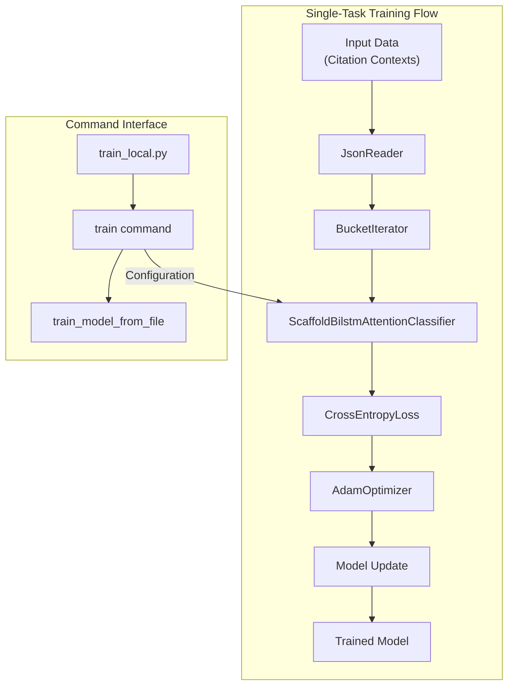
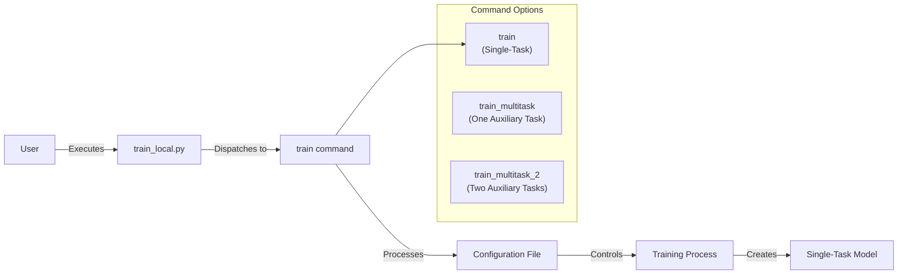
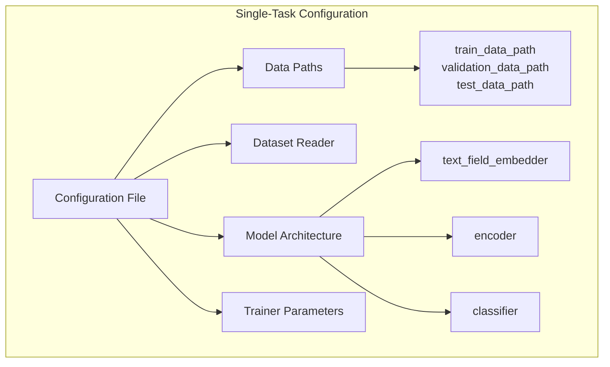
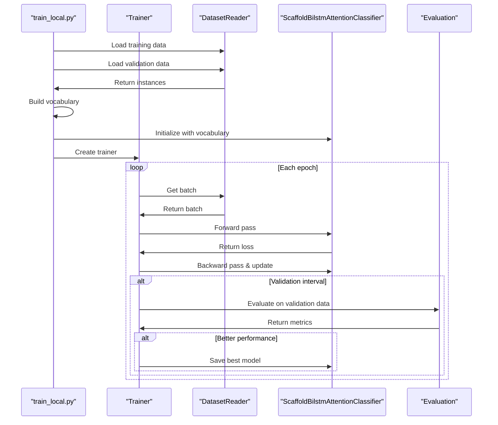
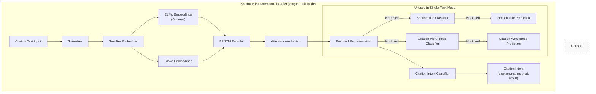

<!-- source: DeepWiki mcp.deepwiki.com · repo allenai/scicite · page 4.2 Single-Task Training · fetched 2026-10-26 -->

# Single-Task Training

<details>
<summary>Relevant source files</summary>

The following files were used as context for generating this wiki page:

- [README.md](README.md)
- [scripts/train_local.py](scripts/train_local.py)

</details>


This page documents the single-task training approach in the SciCite system, which focuses exclusively on training a model for citation intent classification without incorporating auxiliary tasks. For information about training with auxiliary tasks, see [Training with One Auxiliary Task](#4.3) and [Training with Two Auxiliary Tasks](#4.4).

## Purpose and Scope

Single-task training provides a baseline approach for training citation intent classification models. This method trains the ScaffoldBilstmAttentionClassifier model to predict citation intents (e.g., background, method, result) solely based on the main classification task. It serves as both a baseline for comparison with multi-task approaches and a simpler alternative when auxiliary task data is unavailable.

Sources: [README.md:74-104]()

## Single-Task Training Architecture

The single-task training process follows a standard supervised learning approach where the model learns to predict citation intents directly from citation contexts.



Single-task training uses only the main classifier component of the ScaffoldBilstmAttentionClassifier, ignoring the auxiliary task classifiers that would be used in multi-task training scenarios.

Sources: [scripts/train_local.py:1-26](), [README.md:74-104]()

## Command Line Interface

To train a single-task model, you use the `train` command through the training script:

```bash
python scripts/train_local.py train [path-to-config-file.json] \
-s [path-to-serialization-dir/] \
--include-package scicite
```

This differs from multi-task training commands (`train_multitask` and `train_multitask_2`), which handle one or two auxiliary tasks respectively.



Sources: [scripts/train_local.py:11-25](), [README.md:99-103]()

## Configuration for Single-Task Training

The single-task training is configured through a JSON configuration file. In contrast to multi-task configurations, single-task configuration doesn't require auxiliary task data paths or mixing ratios.

Key configuration elements for single-task training include:

| Parameter | Description | Example |
|-----------|-------------|---------|
| `train_data_path` | Path to the main training data | `"data/scicite/train.jsonl"` |
| `validation_data_path` | Path to the validation data | `"data/scicite/dev.jsonl"` |
| `test_data_path` | Path to the test data | `"data/scicite/test.jsonl"` |
| `dataset_reader` | Configuration for the dataset reader | See below |
| `model` | Model architecture definition | See below |
| `trainer` | Training parameters | Learning rate, optimizer, etc. |

A key difference from multi-task configurations is the absence of:
- `train_data_path_aux` (section title scaffold data)
- `train_data_path_aux2` (citation worthiness scaffold data)
- `mixing_ratio` and `mixing_ratio2` (sensitivity parameters for auxiliary tasks)



Sources: [README.md:80-88]()

## Training Process

The single-task training process follows a standard supervised learning workflow:

1. Data is loaded through the configured dataset reader
2. The model is initialized based on the configuration
3. A vocabulary is built from the training data
4. The trainer iterates through epochs, updating the model based on training loss
5. The model is evaluated on validation data after each epoch
6. The best model (based on validation performance) is saved



During single-task training, the model only computes loss based on the main citation intent classification task. This differs from multi-task training, where the loss would be a weighted combination of the main task and auxiliary task losses.

Sources: [README.md:74-104]()

## Model Architecture in Single-Task Mode

When trained in single-task mode, the ScaffoldBilstmAttentionClassifier still has the full architecture but only utilizes the main classification path:



In single-task mode, the model undergoes the same forward pass for encoding the citation text but only computes loss and makes predictions for the main citation intent classification task.

Sources: [README.md:74-104]()

## Comparison with Multi-Task Training

The following table summarizes the key differences between single-task and multi-task training approaches:

| Feature | Single-Task Training | Multi-Task Training |
|---------|---------------------|---------------------|
| Training Command | `train` | `train_multitask` or `train_multitask_2` |
| Required Data | Main task data only | Main + auxiliary task data |
| Configuration | Simpler, no mixing ratios | Requires auxiliary data paths and mixing ratios |
| Loss Calculation | Only main task loss | Weighted combination of main and auxiliary tasks |
| Model Usage | Only main classifier used | All classifiers used |
| Training Speed | Typically faster | Slower due to additional tasks |
| Performance | Baseline performance | Potentially improved performance through transfer learning |

Single-task training serves as a useful baseline and is appropriate when:
- Auxiliary task data is unavailable
- Computational resources are limited
- Simpler training process is preferred
- Establishing baseline performance before trying multi-task approaches

Sources: [README.md:74-104]()

## Example Configuration

Here's an example configuration structure for single-task training:

```json
{
  "dataset_reader": {
    "type": "json_reader",
    "lazy": false
  },
  "train_data_path": "path/to/train.jsonl",
  "validation_data_path": "path/to/dev.jsonl",
  "test_data_path": "path/to/test.jsonl",
  "model": {
    "type": "scaffold_classifier",
    "text_field_embedder": {
      "token_embedders": {
        "tokens": {
          "type": "embedding",
          "pretrained_file": "glove.6B.100d.txt",
          "embedding_dim": 100,
          "trainable": true
        }
      }
    },
    "encoder": {
      "type": "lstm",
      "bidirectional": true,
      "input_size": 100,
      "hidden_size": 100,
      "num_layers": 1
    },
    "classifier_feedforward": {
      "input_dim": 200,
      "num_layers": 2,
      "hidden_dims": [100, 3],
      "activations": ["relu", "linear"],
      "dropout": [0.2, 0.0]
    }
  },
  "iterator": {
    "type": "bucket",
    "sorting_keys": [["text", "num_tokens"]],
    "batch_size": 64
  },
  "trainer": {
    "num_epochs": 40,
    "patience": 10,
    "cuda_device": 0,
    "grad_clipping": 5.0,
    "optimizer": {
      "type": "adam",
      "lr": 0.001
    }
  }
}
```

Sources: [README.md:76-88]()

---

