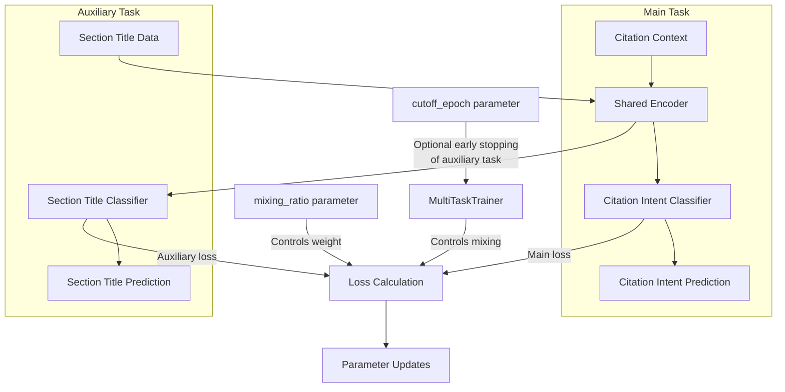
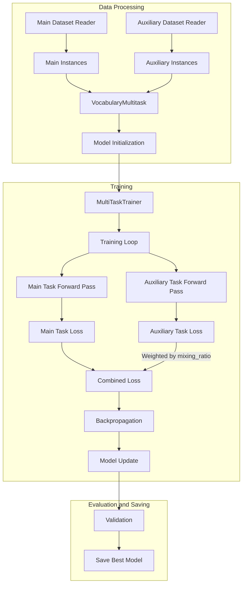
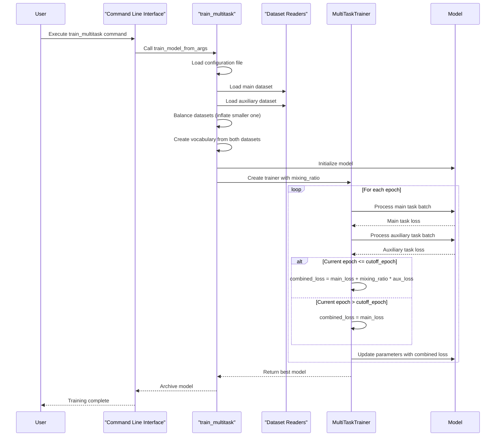
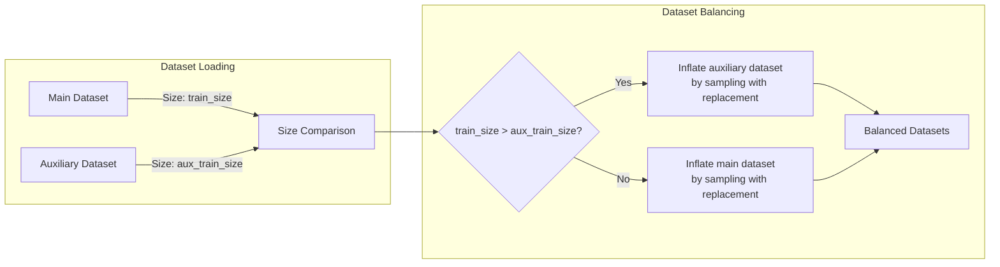

<!-- source: DeepWiki mcp.deepwiki.com · repo allenai/scicite · page 4.3 Training with One Auxiliary Task · fetched 2026-10-26 -->

# Training with One Auxiliary Task

<details>
<summary>Relevant source files</summary>

The following files were used as context for generating this wiki page:

- [README.md](README.md)
- [scicite/training/train_multitask.py](scicite/training/train_multitask.py)

</details>


## Purpose and Scope

This document describes how to train the SciCite model with a single auxiliary task (section title prediction) alongside the main citation intent classification task. This approach uses the scaffold framework to leverage information from the auxiliary task to improve performance on the main task.

For training with two auxiliary tasks (section title prediction and citation worthiness), see [Training with Two Auxiliary Tasks](#4.4). For single-task training, see [Single-Task Training](#4.2).

## System Overview

Training with one auxiliary task utilizes the scaffold multi-task learning approach, where the section title prediction task serves as a "scaffold" to improve the performance of the main citation intent classification task. The model leverages a shared encoder architecture but uses task-specific classifiers.



Sources: [scicite/training/train_multitask.py:379-391](), [README.md:80-88]()

## Key Components

The one auxiliary task training system consists of the following components:

1. **Main Dataset**: The citation intent classification dataset (SciCite or ACL-ARC)
2. **Auxiliary Dataset**: The section title prediction dataset
3. **MultiTaskTrainer**: A specialized trainer that manages the multi-task learning process
4. **VocabularyMultitask**: A vocabulary module that handles tokens from both tasks
5. **Shared Encoder**: The model architecture that encodes inputs for both tasks
6. **Task-Specific Classifiers**: Separate classifiers for citation intent and section title prediction



Sources: [scicite/training/train_multitask.py:315-339](), [scicite/training/train_multitask.py:380-391]()

## Configuration

To train with one auxiliary task, you need to include specific parameters in your configuration file:

| Parameter | Description | Example Value |
|-----------|-------------|---------------|
| `train_data_path` | Path to the main task training data | `"data/scicite/train.jsonl"` |
| `validation_data_path` | Path to the main task validation data | `"data/scicite/dev.jsonl"` |
| `test_data_path` | Path to the main task test data | `"data/scicite/test.jsonl"` |
| `train_data_path_aux` | Path to the auxiliary task (section title) data | `"data/section_title/train.jsonl"` |
| `validation_data_path_aux` | Path to the auxiliary task validation data | `"data/section_title/dev.jsonl"` |
| `test_data_path_aux` | Path to the auxiliary task test data | `"data/section_title/test.jsonl"` |
| `dataset_reader` | Configuration for the main task dataset reader | (see below) |
| `dataset_reader_aux` | Configuration for the auxiliary task dataset reader | (see below) |
| `iterator` | Configuration for the main task data iterator | (see below) |
| `iterator_aux` | Configuration for the auxiliary task data iterator | (see below) |
| `mixing_ratio` | Controls the influence of the auxiliary task loss (λ₂) | `0.1` to `0.5` |
| `cutoff_epoch` | Epoch after which to stop using the auxiliary task (optional) | `-1` (never stop) or a positive integer |

Sources: [README.md:80-88](), [scicite/training/train_multitask.py:319-320]()

## Training Mechanism

The training process with one auxiliary task works as follows:

1. **Dataset Loading**: Both the main dataset (citation intent) and auxiliary dataset (section title) are loaded.

2. **Dataset Balancing**: The system automatically balances the datasets by inflating the smaller dataset to match the size of the larger one through random sampling.

3. **Vocabulary Creation**: A shared vocabulary is created from both datasets.

4. **Model Initialization**: The model is initialized with shared encoder layers and separate classifier heads for each task.

5. **Multi-Task Training**: For each batch:
   - Forward pass for main task
   - Forward pass for auxiliary task
   - Calculate losses for both tasks
   - Combine losses using the mixing ratio: `total_loss = main_loss + mixing_ratio * aux_loss`
   - Update model parameters based on the combined loss

6. **Optional Early Cutoff**: If a cutoff epoch is specified, the auxiliary task will be ignored after that epoch.



Sources: [scicite/training/train_multitask.py:171-184](), [scicite/training/train_multitask.py:319-320](), [scicite/training/train_multitask.py:396-397]()

## Dataset Balancing

One important aspect of the auxiliary task training is how the system handles imbalanced datasets. If the main task dataset and auxiliary task dataset have different sizes, the system will automatically balance them:



Sources: [scicite/training/train_multitask.py:171-184]()

## Usage

To train a model with one auxiliary task (section title prediction), use the following command:

```bash
python scripts/train_local.py train_multitask [path-to-config-file.json] \
-s [path-to-serialization-dir/] \
--include-package scicite
```

Where the configuration file should include the parameters listed in the Configuration section above.

Example command:

```bash
export elmo=true
python scripts/train_local.py train_multitask experiment_configs/scicite_elmo_section.json \
-s output/scicite_with_section_title/ \
--include-package scicite
```

Sources: [README.md:98-103]()

## Mixing Ratio Importance

The mixing ratio (λ₂) is a crucial hyperparameter that controls how much influence the auxiliary task (section title prediction) has on the model's learning process. 

- **Higher mixing ratio**: Gives more importance to the auxiliary task, which can help when the auxiliary task provides strong signals that are helpful for the main task
- **Lower mixing ratio**: Focuses more on the main task, which may be better when the auxiliary task is only loosely related

Finding the optimal mixing ratio often requires experimentation based on your specific datasets.

| Mixing Ratio | Effect on Training |
|--------------|-------------------|
| 0.0 | Auxiliary task is ignored (equivalent to single-task training) |
| 0.1 - 0.3 | Auxiliary task has mild influence (common range) |
| 0.5 | Auxiliary task has moderate influence |
| 1.0 | Both tasks are weighted equally |
| > 1.0 | Auxiliary task has stronger influence than main task (rarely used) |

Sources: [README.md:86](), [scicite/training/train_multitask.py:319]()

## Summary

Training with one auxiliary task (section title prediction) provides a way to improve citation intent classification performance by leveraging related information. The system automatically handles dataset balancing, shared vocabulary creation, and loss weighting through the mixing ratio parameter. Optional early cutoff of the auxiliary task can be specified via the cutoff_epoch parameter.

This approach represents a middle ground between single-task training ([Single-Task Training](#4.2)) and training with two auxiliary tasks ([Training with Two Auxiliary Tasks](#4.4)), offering a good balance between model complexity and performance improvement.

---

