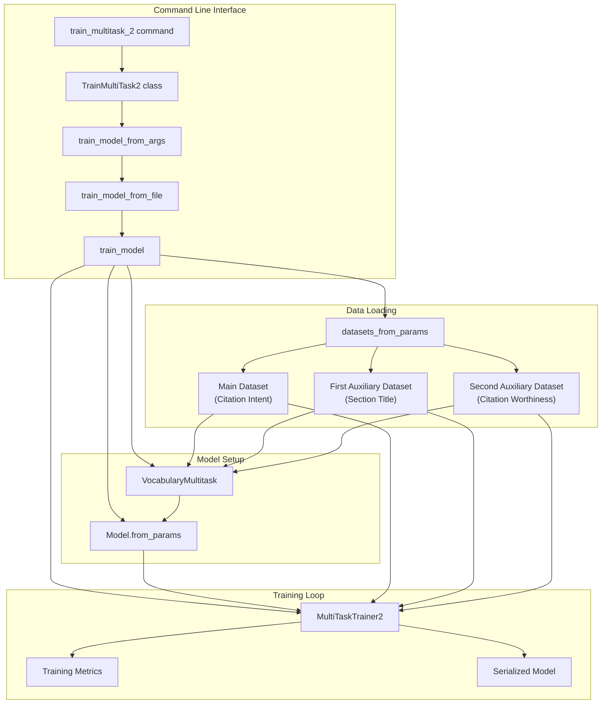
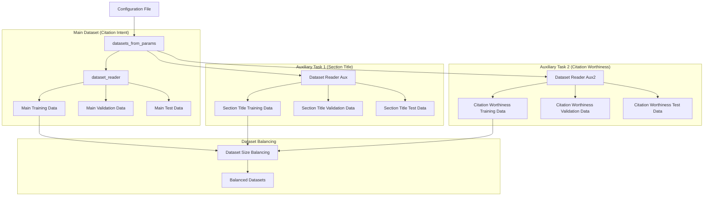
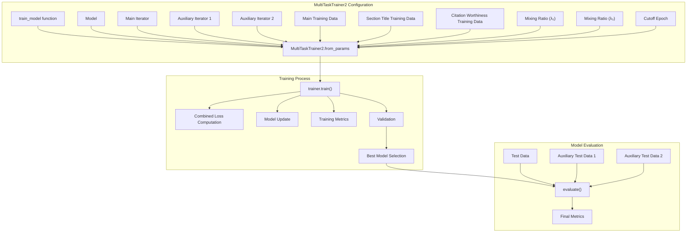
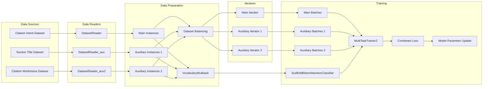

<!-- source: DeepWiki mcp.deepwiki.com · repo allenai/scicite · page 4.4 Training with Two Auxiliary Tasks · fetched 2026-10-26 -->

# Training with Two Auxiliary Tasks

<details>
<summary>Relevant source files</summary>

The following files were used as context for generating this wiki page:

- [README.md](README.md)
- [scicite/training/train_multitask_two_tasks.py](scicite/training/train_multitask_two_tasks.py)

</details>


## Purpose and Scope

This document explains how to train a citation intent classification model using two auxiliary tasks in the SciCite system. The approach leverages multi-task learning with two "scaffold" tasks (section title prediction and citation worthiness prediction) to improve the main citation intent classification performance. This page covers the command line interface, configuration parameters, training workflow, and implementation details specific to the two-auxiliary-task training mode.

For training with a single auxiliary task, see [Training with One Auxiliary Task](#4.3). For standard single-task training, see [Single-Task Training](#4.2).

Sources: [README.md:88-102]()

## Command Line Interface

The training with two auxiliary tasks is implemented as a subcommand in the SciCite CLI. The command can be run using:

```bash
python scripts/train_local.py train_multitask_2 [path-to-config-file.json] \
-s [path-to-serialization-dir/] \
--include-package scicite
```

Where:
- `train_multitask_2` is the specific subcommand for training with two auxiliary tasks
- `[path-to-config-file.json]` is the path to a configuration file specifying the model and training parameters
- `[path-to-serialization-dir/]` is the directory where model artifacts and logs will be saved

Sources: [README.md:99-102](), [scicite/training/train_multitask_two_tasks.py:58-91]()

## System Architecture

The following diagram shows the architecture of the training system with two auxiliary tasks:



Sources: [scicite/training/train_multitask_two_tasks.py:305-498]()

## Training Workflow

The training process with two auxiliary tasks follows these steps:

1. Parse command line arguments and load configuration from the specified file
2. Create serialization directory and set up logging
3. Load the main dataset and two auxiliary datasets
4. Create a shared vocabulary from all three datasets
5. Initialize the model with the shared vocabulary
6. Set up data iterators for all three tasks
7. Create the `MultiTaskTrainer2` with specified mixing ratios
8. Train the model by alternating between tasks
9. Evaluate on test data if specified
10. Archive the trained model

Sources: [scicite/training/train_multitask_two_tasks.py:305-498]()

## Dataset Loading and Processing

The system loads three different datasets:



The system automatically balances the dataset sizes to ensure fair training:

1. First, it makes both auxiliary datasets the same size (the smaller of the two)
2. Then, it inflates either the main dataset or auxiliary datasets to match sizes by resampling

Sources: [scicite/training/train_multitask_two_tasks.py:134-245]()

## Key Configuration Parameters

The following parameters are critical for training with two auxiliary tasks:

| Parameter | Description |
|-----------|-------------|
| `train_data_path` | Path to the main citation intent classification dataset |
| `validation_data_path` | Path to validation data for the main task |
| `test_data_path` | Path to test data for the main task |
| `train_data_path_aux` | Path to the first auxiliary task (section title) dataset |
| `validation_data_path_aux` | Path to validation data for the first auxiliary task |
| `test_data_path_aux` | Path to test data for the first auxiliary task |
| `train_data_path_aux2` | Path to the second auxiliary task (citation worthiness) dataset |
| `validation_data_path_aux2` | Path to validation data for the second auxiliary task |
| `test_data_path_aux2` | Path to test data for the second auxiliary task |
| `mixing_ratio` | Weight factor (λ₂) for the first auxiliary task loss |
| `mixing_ratio2` | Weight factor (λ₃) for the second auxiliary task loss |
| `cutoff_epoch` | Epoch after which auxiliary tasks are no longer used (set to -1 to always use) |
| `aux_sample_fraction` | Optional fraction of auxiliary data to use (default: 1.0) |

Sources: [README.md:80-88](), [scicite/training/train_multitask_two_tasks.py:347-350]()

## Multi-Task Training Implementation

The core of the multi-task training system is implemented by the `MultiTaskTrainer2` class. Here's how it integrates with the training system:



Sources: [scicite/training/train_multitask_two_tasks.py:425-440](), [scicite/training/train_multitask_two_tasks.py:446-496]()

## Loss Calculation and Mixing

During training, the system calculates a weighted combination of losses from all three tasks:

1. **Main task loss**: Loss from the citation intent classification task with weight 1.0
2. **Auxiliary task 1 loss**: Loss from the section title prediction task with weight `mixing_ratio`
3. **Auxiliary task 2 loss**: Loss from the citation worthiness prediction task with weight `mixing_ratio2`

The combined loss is used to update the model parameters. This approach allows the auxiliary tasks to act as "scaffolds" that help the model learn better representations for the main task.

If a `cutoff_epoch` is specified, the auxiliary tasks are only used until that epoch, after which only the main task is trained.

Sources: [scicite/training/train_multitask_two_tasks.py:347-350]()

## Example Configuration

Here's an example configuration structure for training with two auxiliary tasks:

```json
{
  "dataset_reader": { ... },
  "validation_dataset_reader": { ... },
  "dataset_reader_aux": { ... },
  "dataset_reader_aux2": { ... },
  "train_data_path": "data/scicite/train.jsonl",
  "validation_data_path": "data/scicite/dev.jsonl",
  "test_data_path": "data/scicite/test.jsonl",
  "train_data_path_aux": "data/section_title/train.jsonl",
  "validation_data_path_aux": "data/section_title/dev.jsonl",
  "train_data_path_aux2": "data/citation_worthiness/train.jsonl",
  "validation_data_path_aux2": "data/citation_worthiness/dev.jsonl",
  "model": { ... },
  "iterator": { ... },
  "iterator_aux": { ... },
  "iterator_aux2": { ... },
  "vocabulary": { ... },
  "trainer": { ... },
  "mixing_ratio": 0.1,
  "mixing_ratio2": 0.1,
  "cutoff_epoch": 15
}
```

Sources: [README.md:80-88]()

## Data Flow During Training



Sources: [scicite/training/train_multitask_two_tasks.py:305-498]()

## Practical Usage Considerations

When using the two-auxiliary-task training system, consider the following:

1. **Mixing Ratios**: The values of `mixing_ratio` and `mixing_ratio2` control how much influence each auxiliary task has. Typical values are between 0.05 and 0.2.

2. **Cutoff Epoch**: If the auxiliary tasks begin to interfere with the main task after some epochs, set `cutoff_epoch` to stop using them at that point.

3. **Dataset Balance**: The system automatically balances dataset sizes, but if you want to use only a fraction of the auxiliary data, you can set `aux_sample_fraction` to a value less than 1.0.

4. **Auxiliary Task Selection**: The two auxiliary tasks (section title prediction and citation worthiness) were chosen because they are related to the main task but provide complementary information.

5. **Resource Requirements**: Training with two auxiliary tasks requires more memory and computation time than training with one or zero auxiliary tasks.

Sources: [README.md:80-88](), [scicite/training/train_multitask_two_tasks.py:165-180]()

## Performance and Evaluation

After training, the system can evaluate the model on test data for all three tasks:

1. **Main Task Evaluation**: When `evaluate_on_test` is true, the model is evaluated on the main task test data.

2. **Auxiliary Task Evaluation**: When `evaluate_aux_on_test` is true, the model is also evaluated on both auxiliary tasks' test data.

The evaluation metrics are saved in the serialization directory as `metrics.json`.

Sources: [scicite/training/train_multitask_two_tasks.py:442-496]()

## Relation to Other Training Modes

SciCite offers three training modes:

1. **Single-Task Training**: Trains only on citation intent classification (`train` command)
2. **Training with One Auxiliary Task**: Uses section title prediction as an auxiliary task (`train_multitask` command)
3. **Training with Two Auxiliary Tasks**: Uses both section title prediction and citation worthiness prediction as auxiliary tasks (`train_multitask_2` command)

According to the paper, using two auxiliary tasks often yields the best performance, especially when training data for the main task is limited.

Sources: [README.md:88-102]()

---

