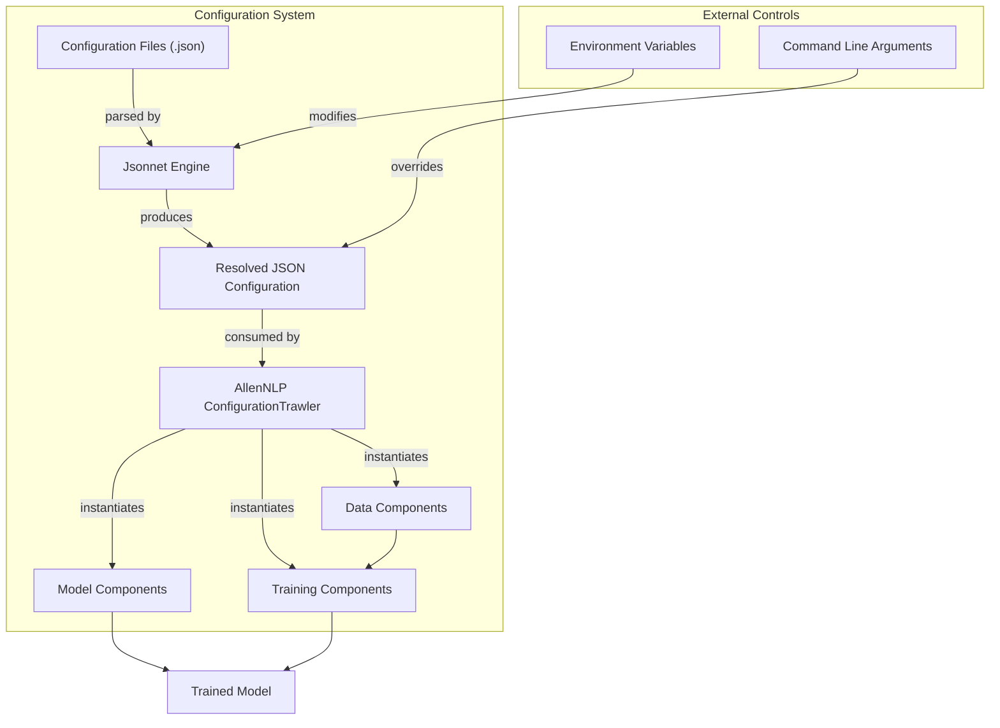
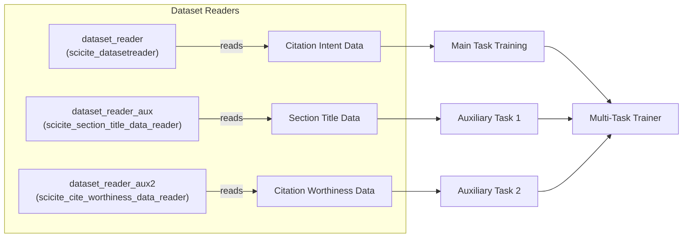
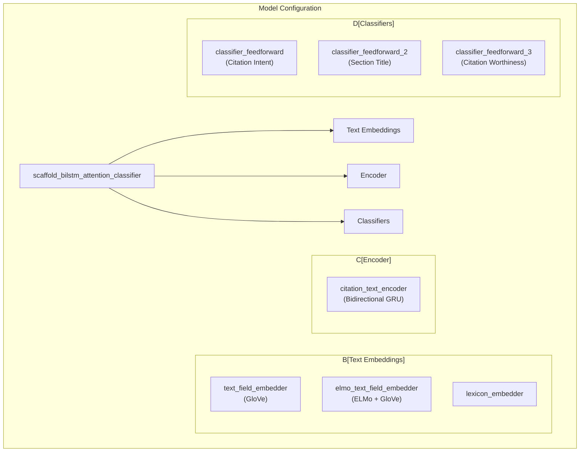
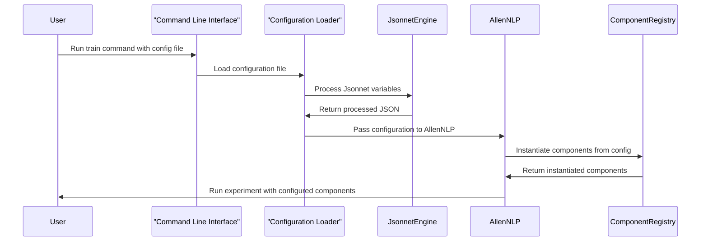

<!-- source: DeepWiki mcp.deepwiki.com · repo allenai/scicite · page 5 Configuration System · fetched 2026-10-26 -->

# Configuration System

<details>
<summary>Relevant source files</summary>

The following files were used as context for generating this wiki page:

- [README.md](README.md)
- [experiment_configs/scicite-experiment.json](experiment_configs/scicite-experiment.json)

</details>


The SciCite configuration system defines how models are built, data is processed, and training occurs. This page documents the structure and usage of configuration files in the SciCite project, which are based on the Jsonnet templating language and the AllenNLP configuration framework.

For details on specific experiment configurations for different datasets, see [SciCite Experiment Configuration](#5.1) and [ACL-ARC Experiment Configuration](#5.2).

## Configuration System Architecture

The configuration system in SciCite follows a declarative approach where all aspects of an experiment are defined in JSON-based configuration files with Jsonnet extensions. These files orchestrate the entire experiment pipeline, from data loading to model training.



Sources: [experiment_configs/scicite-experiment.json:1-132]()

## Configuration File Structure

SciCite configuration files follow a hierarchical structure with major sections defining different aspects of the experiment:

```mermaid
classDiagram
    class "Configuration File" {
        +random_seed
        +pytorch_seed
        +numpy_seed
        +mixing_ratio
        +mixing_ratio2
    }
    
    "Configuration File" *-- "Dataset Readers"
    "Configuration File" *-- "Data Paths"
    "Configuration File" *-- "Model Configuration"
    "Configuration File" *-- "Iterator Configuration"
    "Configuration File" *-- "Trainer Configuration"
    
    class "Dataset Readers" {
        +dataset_reader
        +dataset_reader_aux
        +dataset_reader_aux2
    }
    
    class "Data Paths" {
        +train_data_path
        +validation_data_path
        +test_data_path
        +train_data_path_aux
        +train_data_path_aux2
    }
    
    class "Model Configuration" {
        +type
        +data_format
        +use_lexicon_features
        +multilabel
    }
    
    "Model Configuration" *-- "Text Embedders"
    "Model Configuration" *-- "Encoders"
    "Model Configuration" *-- "Classifiers"
    
    class "Text Embedders" {
        +text_field_embedder
        +elmo_text_field_embedder
        +lexicon_embedder
    }
    
    class "Encoders" {
        +citation_text_encoder
    }
    
    class "Classifiers" {
        +classifier_feedforward
        +classifier_feedforward_2
        +classifier_feedforward_3
    }
    
    class "Iterator Configuration" {
        +type
        +sorting_keys
        +batch_size
    }
    
    class "Trainer Configuration" {
        +num_epochs
        +grad_clipping
        +patience
        +validation_metric
        +cuda_device
        +optimizer
    }
```

Sources: [experiment_configs/scicite-experiment.json:11-132]()

## Environment Variable Integration

Configuration files in SciCite support dynamic parameter adjustment through environment variables, allowing for experimentation without modifying the configuration files themselves.

| Environment Variable | Description | Used In |
|---------------------|-------------|---------|
| `elmo` | Controls whether to use ELMo contextual embeddings | Model embeddings, dataset readers |
| `SEED`, `PYTORCH_SEED`, `NUMPY_SEED` | Random seeds for reproducibility | Overall experiment |
| `mixing_ratio` | Controls weight of first auxiliary task (λ₂) | Multi-task training |
| `mixing_ratio2` | Controls weight of second auxiliary task (λ₃) | Multi-task training |

The configuration uses Jsonnet's `std.extVar()` function to access these environment variables:

```jsonnet
local stringToBool(s) =
  if s == "true" then true
  else if s == "false" then false
  else error "invalid boolean: " + std.manifestJson(s);

local DIM =
  if stringToBool(std.extVar("elmo")) then
    1124
  else
    100;
```

Sources: [experiment_configs/scicite-experiment.json:1-10](), [README.md:80-88]()

## Key Configuration Components

### Dataset Reader Configuration

The configuration defines three dataset readers: one for the main citation intent classification task and two for auxiliary tasks (section title prediction and citation worthiness prediction).



Sources: [experiment_configs/scicite-experiment.json:17-30]()

### Model Configuration

The model configuration specifies the `scaffold_bilstm_attention_classifier` architecture with all its components:



Sources: [experiment_configs/scicite-experiment.json:38-105]()

### Iterator Configuration

Iterators control how data is batched and processed during training:

```json
"iterator": {
  "type": "bucket",
  "sorting_keys": [["citation_text", "num_tokens"]],
  "batch_size": 16
}
```

Different iterators are configured for the main task and each auxiliary task.

Sources: [experiment_configs/scicite-experiment.json:106-120]()

### Trainer Configuration

The trainer configuration defines the optimization process and training parameters:

```json
"trainer": {
  "num_epochs": 10,
  "grad_clipping": 5.0,
  "patience": 4,
  "validation_metric": "+average_F1",
  "cuda_device": 0,
  "optimizer": {
    "type": "adadelta",
    "rho": 0.95
  }
}
```

Sources: [experiment_configs/scicite-experiment.json:121-132]()

## Using Configuration Files

Configuration files are used with the training scripts as follows:

```bash
python scripts/train_local.py train_multitask_2 [path-to-config-file.json] \
-s [path-to-serialization-dir/] 
--include-package scicite
```

Key environment variables should be set before running the training script:

```bash
export elmo=true  # To use ELMo embeddings
export mixing_ratio=0.5  # Weight for first auxiliary task
export mixing_ratio2=0.3  # Weight for second auxiliary task
```

Sources: [README.md:98-103](), [README.md:80-88](), [README.md:91-92]()

## Configuration Loading and Processing



Sources: [README.md:98-103]()

## Configuration Parameters for Multi-Task Learning

SciCite's multi-task learning approach uses two key parameters in the configuration:

1. `mixing_ratio` (λ₂): Controls the weight of the section title prediction task
2. `mixing_ratio2` (λ₃): Controls the weight of the citation worthiness task

These parameters balance the influence of the auxiliary tasks on the main citation intent classification task during training.

Sources: [experiment_configs/scicite-experiment.json:15-16](), [README.md:86-87]()

## Special Configurations for ELMo

The configuration system handles ELMo embedding integration through conditional logic. When ELMo is enabled:

1. The embedding dimension (`DIM`) increases from 100 to 1124
2. Additional ELMo-specific configuration is used in the text embedder
3. Dataset readers are configured to handle ELMo-compatible inputs

Sources: [experiment_configs/scicite-experiment.json:6-10](), [experiment_configs/scicite-experiment.json:54-68]()

## Conclusion

The SciCite configuration system provides a flexible, declarative way to define all aspects of model training and evaluation. By leveraging Jsonnet and AllenNLP's configuration framework, it enables reproducible experiments with clear parameter specifications and supports dynamic adjustment through environment variables.

---

