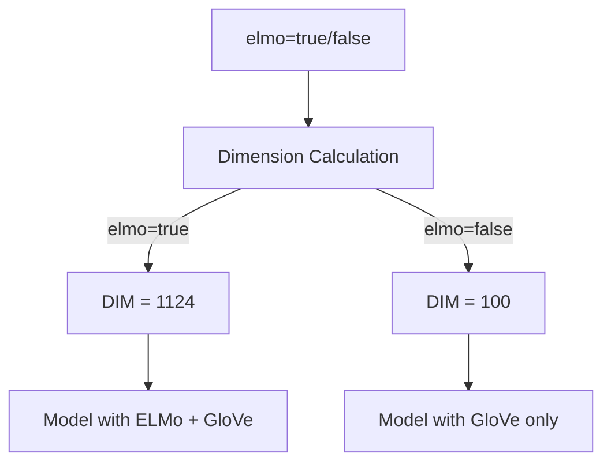
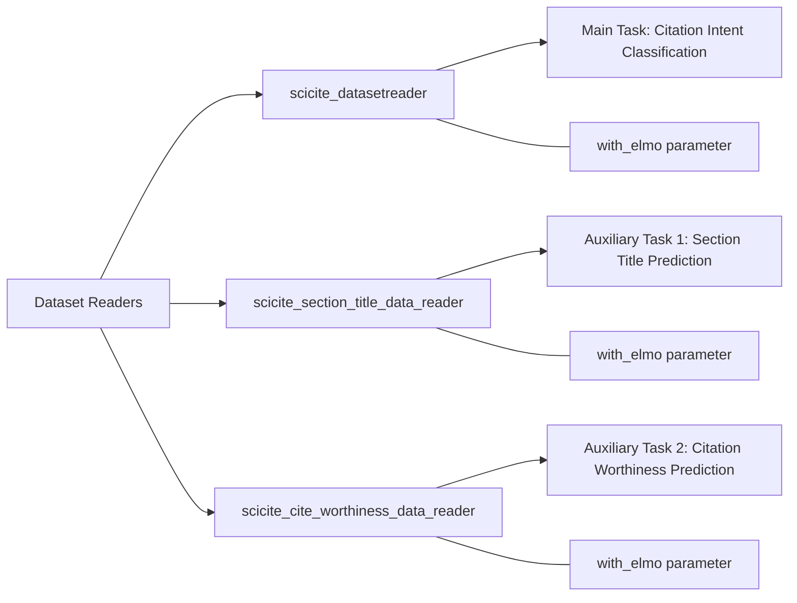
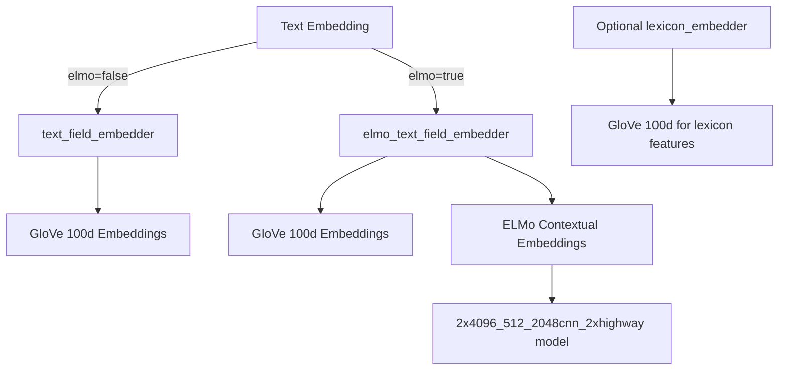
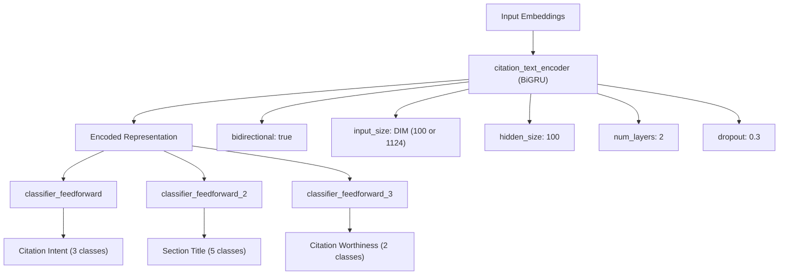
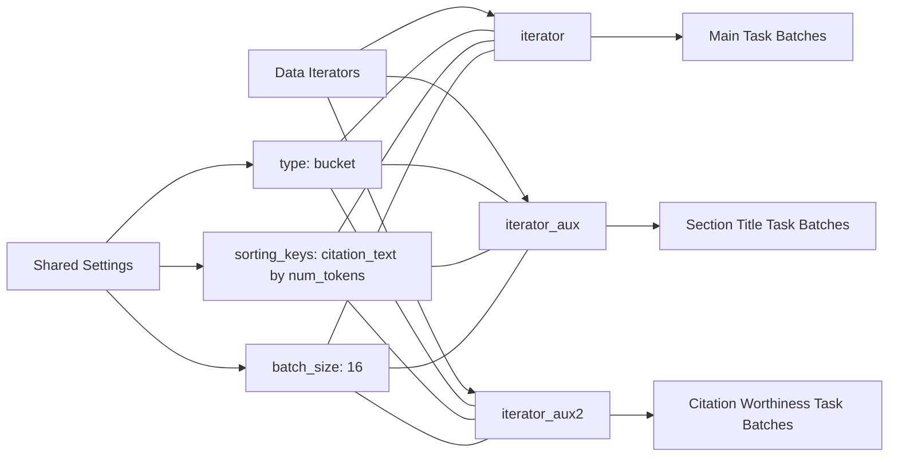
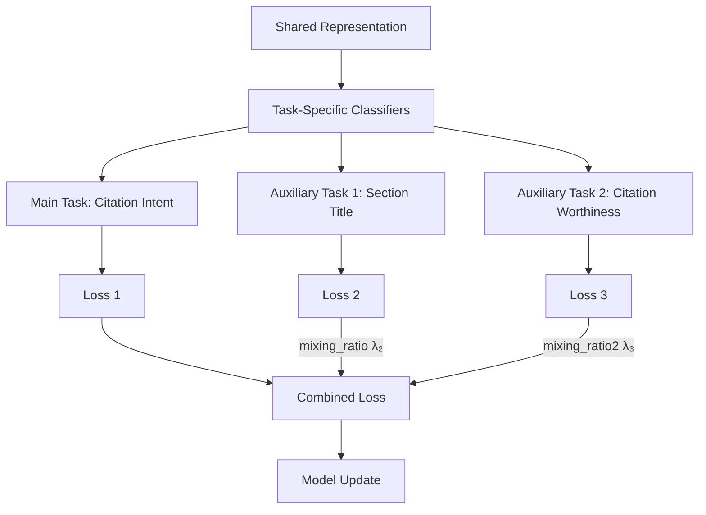
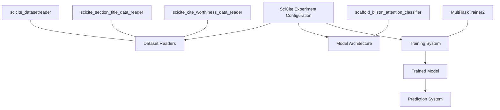

<!-- source: DeepWiki mcp.deepwiki.com · repo allenai/scicite · page 5.1 SciCite Experiment Configuration · fetched 2026-10-26 -->

# SciCite Experiment Configuration

<details>
<summary>Relevant source files</summary>

The following files were used as context for generating this wiki page:

- [README.md](README.md)
- [experiment_configs/scicite-experiment.json](experiment_configs/scicite-experiment.json)

</details>


## Purpose and Scope

This document details the configuration options and parameters specific to experiments conducted on the SciCite dataset for citation intent classification. It covers the configuration file structure, key parameters, environment variables, and how they control the model architecture, training process, and multi-task learning setup.

For configuration options specific to ACL-ARC dataset experiments, see [ACL-ARC Experiment Configuration](#5.2).

## Configuration File Structure

The SciCite experiment configuration is stored in a Jsonnet file that allows for dynamic parameter setting through environment variables.

```mermaid
graph TD
    A["SciCite Experiment Config"]
    B["Environment Variables"]
    C["Random Seeds"]
    D["Dataset Configuration"]
    E["Model Configuration"]
    F["Training Configuration"]
    G["Iterator Configuration"]
    
    A --> B
    A --> C
    A --> D
    A --> E
    A --> F
    A --> G
    
    B --> B1["elmo (use ELMo embeddings)"]
    B --> B2["mixing_ratio (first auxiliary task)"]
    B --> B3["mixing_ratio2 (second auxiliary task)"]
    
    C --> C1["random_seed"]
    C --> C2["pytorch_seed"]
    C --> C3["numpy_seed"]
    
    D --> D1["dataset_reader (main task)"]
    D --> D2["dataset_reader_aux (section title task)"]
    D --> D3["dataset_reader_aux2 (citation worthiness task)"]
    D --> D4["Data Paths (train, validation, test)"]
    
    E --> E1["text_field_embedder"]
    E --> E2["elmo_text_field_embedder"]
    E --> E3["citation_text_encoder"]
    E --> E4["classifier_feedforward (main task)"]
    E --> E5["classifier_feedforward_2 (auxiliary task 1)"]
    E --> E6["classifier_feedforward_3 (auxiliary task 2)"]
    
    F --> F1["num_epochs"]
    F --> F2["patience"]
    F --> F3["validation_metric"]
    F --> F4["optimizer"]
    
    G --> G1["iterator (main task)"]
    G --> G2["iterator_aux (auxiliary task 1)"]
    G --> G3["iterator_aux2 (auxiliary task 2)"]
```



Sources: [experiment_configs/scicite-experiment.json:1-132]()

## Environment Variables and Dynamic Configuration

The configuration file reads several environment variables to control key aspects of the experiment:

| Variable | Description | Default | Purpose |
|----------|-------------|---------|---------|
| `elmo` | Whether to use ELMo embeddings | N/A | Toggles use of contextual embeddings |
| `mixing_ratio` | Weight for section title task | N/A | Controls λ₂ in the paper |
| `mixing_ratio2` | Weight for citation worthiness task | N/A | Controls λ₃ in the paper |
| `SEED` | Random seed | N/A | Global random seed |
| `PYTORCH_SEED` | PyTorch random seed | N/A | PyTorch-specific randomization |
| `NUMPY_SEED` | NumPy random seed | N/A | NumPy-specific randomization |

The configuration uses the `elmo` variable to dynamically determine the embedding dimensions:



Sources: [experiment_configs/scicite-experiment.json:1-10](), [experiment_configs/scicite-experiment.json:13-16]()

## Dataset Configuration

### Dataset Readers

The configuration defines three dataset readers for multi-task learning:



Sources: [experiment_configs/scicite-experiment.json:17-30]()

### Data Paths

The configuration specifies the following data paths:

| Path Variable | Value | Purpose |
|---------------|-------|---------|
| `train_data_path` | "data/train.jsonl" | Main task training data |
| `validation_data_path` | "data/dev.jsonl" | Main task validation data |
| `test_data_path` | "data/test.jsonl" | Main task test data |
| `train_data_path_aux` | "data/cite-sections.jsonl" | Section title auxiliary data |
| `train_data_path_aux2` | "data/cite-worthiness.jsonl" | Citation worthiness auxiliary data |

Sources: [experiment_configs/scicite-experiment.json:31-36]()

## Model Architecture Configuration

The model type is specified as `scaffold_bilstm_attention_classifier`, which implements the multi-task citation intent classification model.

### Text Embedding Components

The configuration defines two text embedders:

1. Standard embedder (without ELMo):
   - Uses GloVe 100-dimensional embeddings
   - Non-trainable

2. ELMo-enhanced embedder (used when `elmo=true`):
   - Combines GloVe embeddings with ELMo contextual embeddings
   - Uses the 2-layer ELMo model with 4096 units



Sources: [experiment_configs/scicite-experiment.json:45-74]()

### Encoder and Classifier Components

The encoder and classifier components are defined as follows:



Sources: [experiment_configs/scicite-experiment.json:76-104]()

### Classifier Details

The configuration defines three separate feedforward networks for classification tasks:

| Classifier | Input → Hidden → Output | Purpose |
|------------|-------------------------|---------|
| `classifier_feedforward` | 200 → 20 → 3 | Main task: citation intent classification |
| `classifier_feedforward_2` | 200 → 20 → 5 | Auxiliary task 1: section title prediction |
| `classifier_feedforward_3` | 200 → 20 → 2 | Auxiliary task 2: citation worthiness prediction |

Sources: [experiment_configs/scicite-experiment.json:84-104]()

## Training Configuration

The configuration specifies the following training parameters:

| Parameter | Value | Description |
|-----------|-------|-------------|
| `num_epochs` | 10 | Maximum number of training epochs |
| `grad_clipping` | 5.0 | Gradient clipping threshold |
| `patience` | 4 | Epochs to wait before early stopping |
| `validation_metric` | "+average_F1" | Metric to optimize (maximize F1) |
| `cuda_device` | 0 | GPU device to use |
| `optimizer` | "adadelta" | Optimization algorithm |
| `optimizer.rho` | 0.95 | Adadelta decay rate |

Sources: [experiment_configs/scicite-experiment.json:121-131]()

## Iterator Configuration

The configuration defines three separate iterators for data batching:



All iterators use the bucket type, which groups samples of similar length together for efficient processing.

Sources: [experiment_configs/scicite-experiment.json:106-120]()

## Multi-Task Learning Configuration

The SciCite configuration supports multi-task learning through:



The multi-task learning is controlled by two key parameters:
- `mixing_ratio`: Controls the weight of section title prediction (λ₂ in the paper)
- `mixing_ratio2`: Controls the weight of citation worthiness prediction (λ₃ in the paper)

Sources: [experiment_configs/scicite-experiment.json:15-16](), [README.md:86-87]()

## Using the Configuration

To run an experiment with this configuration:

1. Set required environment variables:
```
export elmo=true  # or false
export mixing_ratio=0.1  # adjust as needed for λ₂
export mixing_ratio2=0.1  # adjust as needed for λ₃
export SEED=42
export PYTORCH_SEED=42
export NUMPY_SEED=42
```

2. Run the training script:
```
python scripts/train_local.py train_multitask_2 experiment_configs/scicite-experiment.json \
-s /path/to/serialization/dir/ \
--include-package scicite
```

Sources: [README.md:79-102]()

## Common Configuration Adjustments

| Parameter | Current Setting | Possible Adjustments | Effect |
|-----------|----------------|----------------------|--------|
| `elmo` | Set via environment variable | "true" or "false" | "true" for better accuracy, "false" for faster training |
| `mixing_ratio` | Set via environment variable | 0.0 to 1.0 | Higher values increase weight of section title task |
| `mixing_ratio2` | Set via environment variable | 0.0 to 1.0 | Higher values increase weight of citation worthiness task |
| `batch_size` | 16 | Increase/decrease | Balance between memory usage and training speed |
| `num_epochs` | 10 | Increase/decrease | Control maximum training time |
| `patience` | 4 | Increase/decrease | Control early stopping sensitivity |

## Relationship to Other Components

The experiment configuration connects to other components in the SciCite system:



The configuration file serves as the central reference point that connects all components of the SciCite system, defining how data is processed, how the model is structured, and how training proceeds.

Sources: [experiment_configs/scicite-experiment.json:1-132](), [README.md:75-102]()

---

