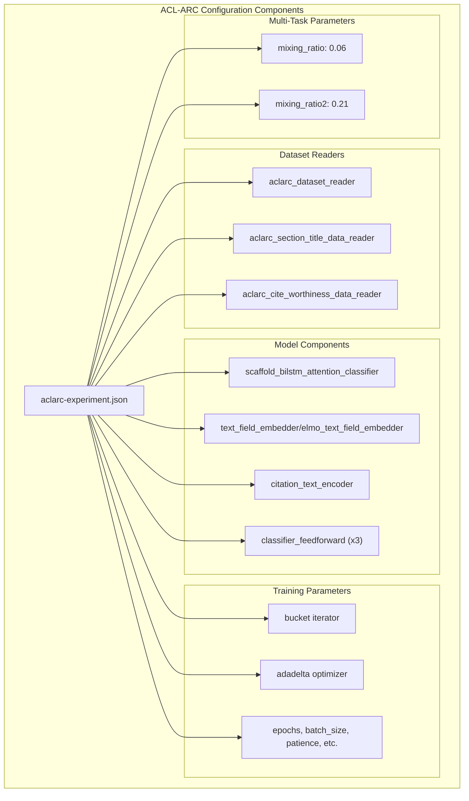
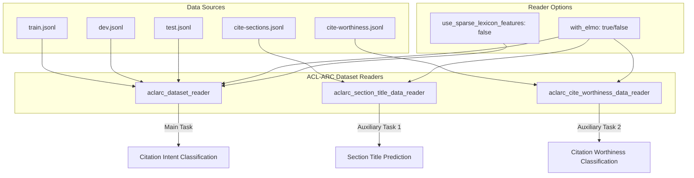
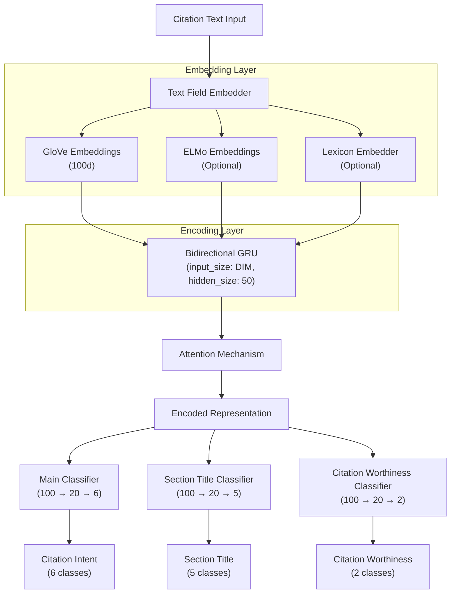

<!-- source: DeepWiki mcp.deepwiki.com · repo allenai/scicite · page 5.2 ACL-ARC Experiment Configuration · fetched 2026-10-26 -->

# ACL-ARC Experiment Configuration

<details>
<summary>Relevant source files</summary>

The following files were used as context for generating this wiki page:

- [README.md](README.md)
- [experiment_configs/aclarc-experiment.json](experiment_configs/aclarc-experiment.json)

</details>


## Purpose and Scope

This document details the configuration settings for running experiments on the ACL-ARC (Association for Computational Linguistics - Anthology Reference Corpus) dataset using the SciCite framework. The ACL-ARC dataset focuses specifically on citation intent classification in the computational linguistics domain. For information about configuration for the SciCite dataset experiments, see [SciCite Experiment Configuration](#5.1).

## Overview

The ACL-ARC experiment configuration defines all necessary parameters for training a citation intent classification model on the ACL-ARC dataset, including multi-task learning with auxiliary tasks like section title prediction and citation worthiness classification.



Sources: [experiment_configs/aclarc-experiment.json:1-129]()

## Configuration File Structure

The ACL-ARC experiment configuration is defined in the `aclarc-experiment.json` file, which uses Jsonnet format to allow for dynamic configuration based on environment variables. The configuration file is divided into several major sections:

1. **Seed configuration** - Controls random initialization
2. **Multi-task mixing ratios** - Defines weights for auxiliary tasks
3. **Dataset readers** - Configures data processing for all tasks
4. **Data paths** - Specifies locations of training/validation/test data
5. **Model configuration** - Defines the model architecture
6. **Iterator configuration** - Controls batch creation
7. **Trainer configuration** - Specifies training hyperparameters

Sources: [experiment_configs/aclarc-experiment.json:11-129]()

## Dataset Configuration

### Dataset Readers

The ACL-ARC configuration uses three specialized dataset readers:



Sources: [experiment_configs/aclarc-experiment.json:17-29]()

The configuration defines three dataset readers:

1. **Main Task Reader** (`aclarc_dataset_reader`): Processes the ACL-ARC citation intent classification data.
2. **Section Title Reader** (`aclarc_section_title_data_reader`): Processes data for the section title prediction auxiliary task.
3. **Citation Worthiness Reader** (`aclarc_cite_worthiness_data_reader`): Processes data for the citation worthiness auxiliary task.

All readers can be configured to use ELMo embeddings via the `with_elmo` parameter, which is set from an environment variable.

### Data Paths

The configuration specifies the following data paths:

| Data Type | Path | Purpose |
|-----------|------|---------|
| Main Training | `data/train.jsonl` | Main task training data |
| Validation | `data/dev.jsonl` | Development set for validation |
| Test | `data/test.jsonl` | Test set for final evaluation |
| Section Title Auxiliary | `data/cite-sections.jsonl` | Training data for section title prediction |
| Citation Worthiness Auxiliary | `data/cite-worthiness.jsonl` | Training data for citation worthiness |

Sources: [experiment_configs/aclarc-experiment.json:30-35]()

## Model Configuration

The model used for ACL-ARC experiments is the `scaffold_bilstm_attention_classifier`, which is configured with multiple components:



Sources: [experiment_configs/aclarc-experiment.json:36-101]()

### Key Model Components

1. **Text Field Embedder**:
   - Uses GloVe 100-dimensional embeddings (non-trainable)
   - Optionally includes ELMo embeddings from PubMed corpus
   - Input dimension varies based on whether ELMo is used (100d without ELMo, 1124d with ELMo)

2. **Encoder**:
   - Bidirectional GRU
   - Single layer
   - 50 hidden units per direction

3. **Classifiers**:
   - Main citation intent classifier: 100d → 20d → 6 classes
   - Section title classifier: 100d → 20d → 5 classes
   - Citation worthiness classifier: 100d → 20d → 2 classes

Sources: [experiment_configs/aclarc-experiment.json:73-101]()

## Multi-Task Learning Configuration

The ACL-ARC experiment uses a multi-task learning approach with two auxiliary tasks to improve the main citation intent classification task. The configuration specifies mixing ratios that control the contribution of each auxiliary task to the overall loss:

| Parameter | Value | Purpose |
|-----------|-------|---------|
| `mixing_ratio` | 0.06 | Weight for section title auxiliary task (λ₂ in the paper) |
| `mixing_ratio2` | 0.21 | Weight for citation worthiness auxiliary task (λ₃ in the paper) |

These mixing ratios were likely determined through hyperparameter optimization and represent the optimal balance between the main task and auxiliary tasks for the ACL-ARC dataset.

Sources: [experiment_configs/aclarc-experiment.json:15-16](), [README.md:86-87]()

## Iterator and Training Configuration

### Iterator Configuration

The configuration defines separate iterators for the main task and each auxiliary task, although they share the same configuration:

```json
"iterator": {
  "type": "bucket",
  "sorting_keys": [["citation_text", "num_tokens"]],
  "batch_size": 8
}
```

The bucket iterator sorts instances by the number of tokens in the citation text to create more efficient batches with similar sequence lengths.

Sources: [experiment_configs/aclarc-experiment.json:103-117]()

### Training Configuration

The training parameters are defined as follows:

| Parameter | Value | Purpose |
|-----------|-------|---------|
| `num_epochs` | 5 | Maximum number of training epochs |
| `grad_clipping` | 5.0 | Gradient clipping threshold to prevent exploding gradients |
| `patience` | 10 | Number of epochs with no improvement before early stopping |
| `validation_metric` | +average_F1 | Metric to monitor for early stopping |
| `cuda_device` | 0 | GPU device to use for training |
| `optimizer` | adadelta | Optimization algorithm |
| `optimizer.rho` | 0.95 | Decay rate for adadelta optimizer |

These settings are optimized for the ACL-ARC dataset based on experimentation.

Sources: [experiment_configs/aclarc-experiment.json:118-128]()

## Usage

To train a model using the ACL-ARC configuration, use the following command:

```bash
python scripts/train_local.py train_multitask_2 experiment_configs/aclarc-experiment.json \
-s [path-to-serialization-dir/] \
--include-package scicite
```

Before training, you need to set the ELMo environment variable:

```bash
export elmo=true  # or false if not using ELMo
```

You should also ensure that the data paths in the configuration file point to the correct locations of your ACL-ARC dataset files.

Sources: [README.md:99-102]()

## Performance Considerations

The configuration includes several performance considerations:

1. **ELMo Toggle**: ELMo embeddings can significantly improve performance but also slow down training. The configuration allows toggling ELMo on/off via an environment variable.

2. **Batch Size**: The batch size is set to 8, which balances between training speed and memory usage, particularly when using ELMo.

3. **Early Stopping**: The patience parameter of 10 epochs prevents overfitting and unnecessary computation.

4. **Gradient Clipping**: Setting `grad_clipping` to 5.0 prevents unstable updates due to exploding gradients.

Sources: [experiment_configs/aclarc-experiment.json:103-128](), [README.md:94]()

## Related Pages

- For configuration of SciCite dataset experiments, see [SciCite Experiment Configuration](#5.1)
- For details on the multi-task learning framework, see [Multi-Task Learning Framework](#2.2)
- For information on the model architecture, see [Model Architecture](#2.1)
- For using the trained model for prediction, see [ACL-ARC Predictor](#6.2)

---

