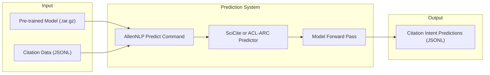
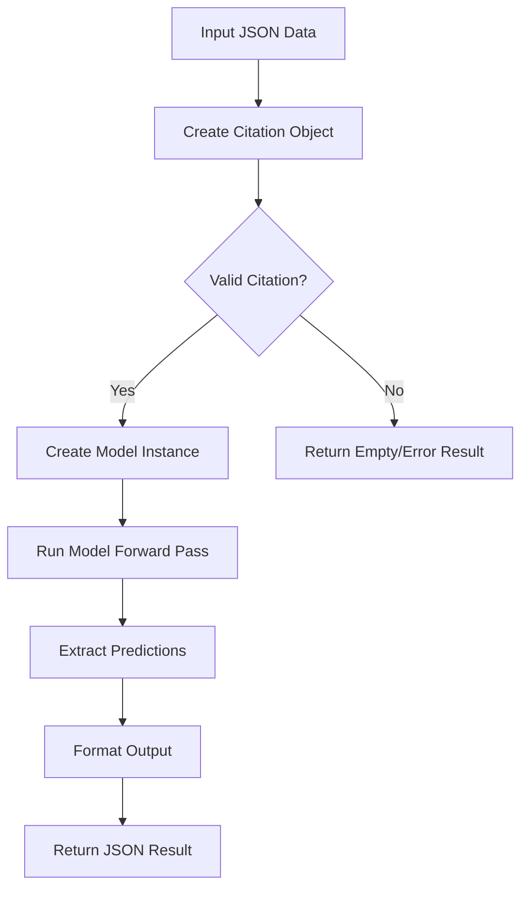
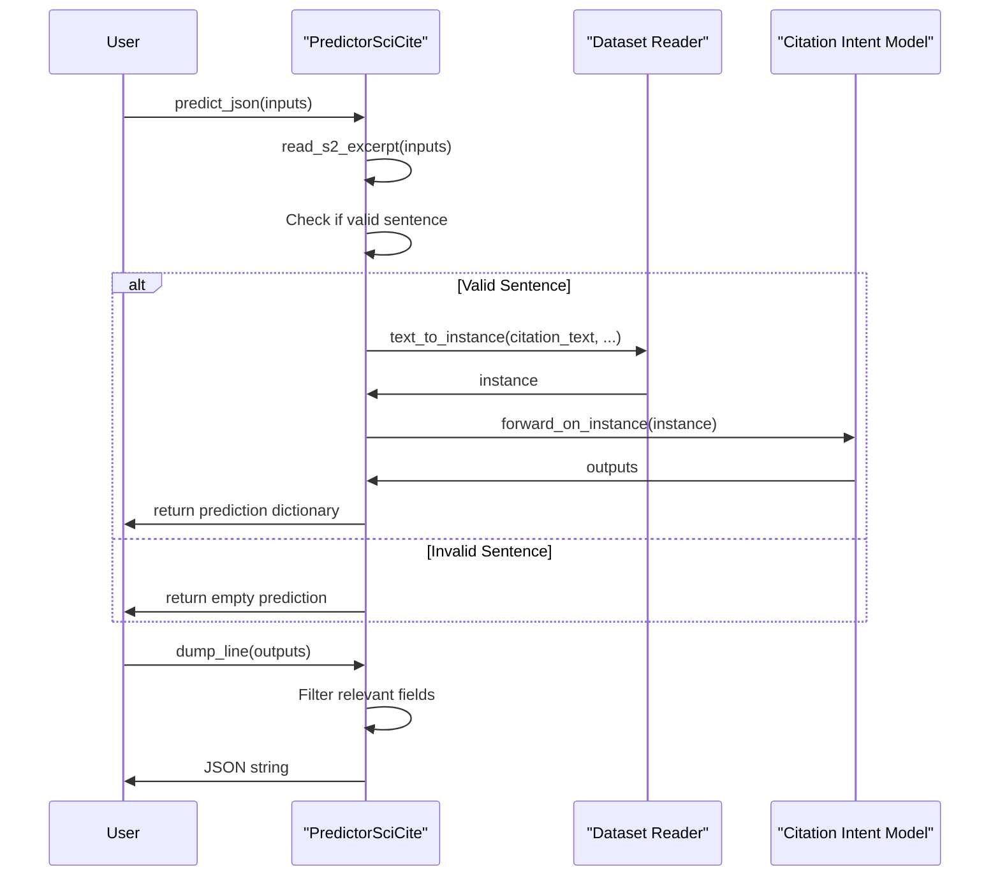

<!-- source: DeepWiki mcp.deepwiki.com · repo allenai/scicite · page 6 Prediction System · fetched 2026-10-26 -->

# Prediction System

<details>
<summary>Relevant source files</summary>

The following files were used as context for generating this wiki page:

- [README.md](README.md)
- [scicite/predictors/predictor_acl_arc.py](scicite/predictors/predictor_acl_arc.py)
- [scicite/predictors/predictor_scicite.py](scicite/predictors/predictor_scicite.py)

</details>


## Purpose and Scope

This document describes the prediction system of the SciCite repository, which enables users to apply trained citation intent classification models to new data. The prediction system provides a way to classify the intent of citations in scientific papers using models trained on either the SciCite or ACL-ARC datasets. For information on training your own models, see [Training System](#4).

## Overview

The prediction system is the component that takes a trained citation intent classification model and uses it to make predictions on new, unseen data. It serves as the interface between the trained models and end users who want to classify citation intents in their own documents.



Sources: [README.md:48-56]()

## Predictor Components

The prediction system consists of two main predictor classes that handle different dataset formats:

1. **PredictorSciCite**: Handles predictions for data in the SciCite format
2. **CitationIntentPredictorACL**: Handles predictions for data in the ACL-ARC format

Both predictors extend AllenNLP's `Predictor` class and implement the necessary methods for processing input data, running the model, and formatting the output.

```mermaid
classDiagram
    class Predictor {
        +predict_json(inputs: JsonDict): JsonDict
        +dump_line(outputs: JsonDict): str
    }
    
    class "PredictorSciCite" {
        +predict_json(inputs: JsonDict): JsonDict
        +dump_line(outputs: JsonDict): str
    }
    
    class "CitationIntentPredictorACL" {
        +predict_json(inputs: JsonDict): JsonDict
        +dump_line(outputs: JsonDict): str
    }
    
    Predictor <|-- "PredictorSciCite"
    Predictor <|-- "CitationIntentPredictorACL"
```

Sources: [scicite/predictors/predictor_scicite.py:20-22](), [scicite/predictors/predictor_acl_arc.py:16-18]()

## Using the Prediction System

### Command Syntax

To use the prediction system with a pre-trained model, you need to run the following AllenNLP command:

```bash
allennlp predict [path-to-model.tar.gz] [path-to-data.jsonl] \
--predictor [predictor-type] \
--include-package scicite \
--overrides "{'model':{'data_format':''}}" \
--output-file [out-path.jsonl]
```

Where:
- `[path-to-model.tar.gz]` is the path to the pre-trained model
- `[path-to-data.jsonl]` is the path to the input data in JSONL format
- `[predictor-type]` is either `predictor_scicite` or `predictor_aclarc`
- `--output-file [out-path.jsonl]` is an optional argument for specifying the output file path (default: standard output)

Sources: [README.md:48-64]()

### Pre-trained Models

Two pre-trained models are available:
- **SciCite Model**: For citation intent classification in general scientific literature
- **ACL-ARC Model**: For citation intent classification in computational linguistics papers

Sources: [README.md:68-72]()

## Prediction Workflow

The prediction system follows a specific workflow when processing data:



Sources: [scicite/predictors/predictor_scicite.py:24-52](), [scicite/predictors/predictor_acl_arc.py:20-41]()

## SciCite Predictor

The `PredictorSciCite` class handles data in the SciCite format. It provides two main methods:

1. `predict_json(inputs)`: Processes a single citation and returns predictions
   - Skips invalid sentences (too short or not valid sentences)
   - Creates a model instance for valid citations
   - Returns prediction results including citation IDs, probabilities, and the predicted class

2. `dump_line(outputs)`: Formats the output as a JSON string
   - Filters the output to include only relevant fields
   - Returns a JSON string representation of the prediction results



Sources: [scicite/predictors/predictor_scicite.py:24-64]()

## ACL-ARC Predictor

The `CitationIntentPredictorACL` class handles data in the ACL-ARC format. Similar to the SciCite predictor, it provides:

1. `predict_json(inputs)`: Processes a single citation in the ACL-ARC format
   - Skips empty contexts
   - Creates a model instance for valid citations
   - Returns prediction results

2. `dump_line(outputs)`: Formats the output as a JSON string
   - Filters the output to include only relevant fields
   - Returns a JSON string representation of the prediction results

The main difference between the predictors is how they parse the input data and which fields they include in the output.

Sources: [scicite/predictors/predictor_acl_arc.py:20-54]()

## Input and Output Formats

### Input Format

The input data should be in JSONL format (each line is a valid JSON object). The required fields depend on the predictor used:

#### SciCite Format
```json
{
  "string": "In chacma baboons, male-infant relationships can be linked to both formation of friendships and paternity success [30,31].",
  "sectionName": "Introduction",
  "citingPaperId": "7a6b2d4b405439",
  "citedPaperId": "9d1abadc55b5e0"
}
```

#### ACL-ARC Format
The ACL-ARC format uses a different structure with fields specific to computational linguistics papers.

### Output Format

The output is also in JSONL format. The fields included in the output depend on the predictor:

#### SciCite Output
```json
{
  "citingPaperId": "7a6b2d4b405439",
  "citedPaperId": "9d1abadc55b5e0",
  "prediction": "background",
  "probabilities": {"background": 0.85, "method": 0.10, "result": 0.05}
}
```

#### ACL-ARC Output
```json
{
  "citation_id": "citation_123",
  "prediction": "background",
  "probabilities": {"background": 0.75, "extends": 0.15, "uses": 0.10},
  "citation_text": "Smith et al. [1] introduced this approach..."
}
```

Sources: [scicite/predictors/predictor_scicite.py:54-64](), [scicite/predictors/predictor_acl_arc.py:44-54]()

## Implementation Details

### SciCite Predictor Implementation

The SciCite predictor (`PredictorSciCite`) is registered with the name 'predictor_scicite' and handles data in the SciCite format. The key method is `predict_json`, which:

1. Reads the citation excerpt using `read_s2_excerpt`
2. Validates the citation text (length > 5 and is a valid sentence)
3. Creates a model instance for valid citations
4. Runs the model on the instance to get predictions
5. Returns a dictionary with prediction results

For invalid sentences, it returns a dictionary with minimal information.

Sources: [scicite/predictors/predictor_scicite.py:24-52]()

### ACL-ARC Predictor Implementation

The ACL-ARC predictor (`CitationIntentPredictorACL`) is registered with the name 'predictor_aclarc' and handles data in the ACL-ARC format. The key method is `predict_json`, which:

1. Reads the citation using `read_jurgens_jsonline`
2. Skips empty contexts
3. Creates a model instance using the dataset reader
4. Runs the model on the instance to get predictions
5. Returns a dictionary with prediction results

Sources: [scicite/predictors/predictor_acl_arc.py:20-42]()

## Conclusion

The prediction system in SciCite provides a straightforward way to apply trained citation intent classification models to new data. By using the appropriate predictor (SciCite or ACL-ARC) and following the correct input format, users can leverage pre-trained models to classify citation intents in their own documents. The system integrates with AllenNLP's prediction infrastructure and provides convenient methods for processing input data and formatting output results.

For detailed information about the specific predictors for SciCite and ACL-ARC formats, see [SciCite Predictor](#6.1) and [ACL-ARC Predictor](#6.2) respectively.

---

