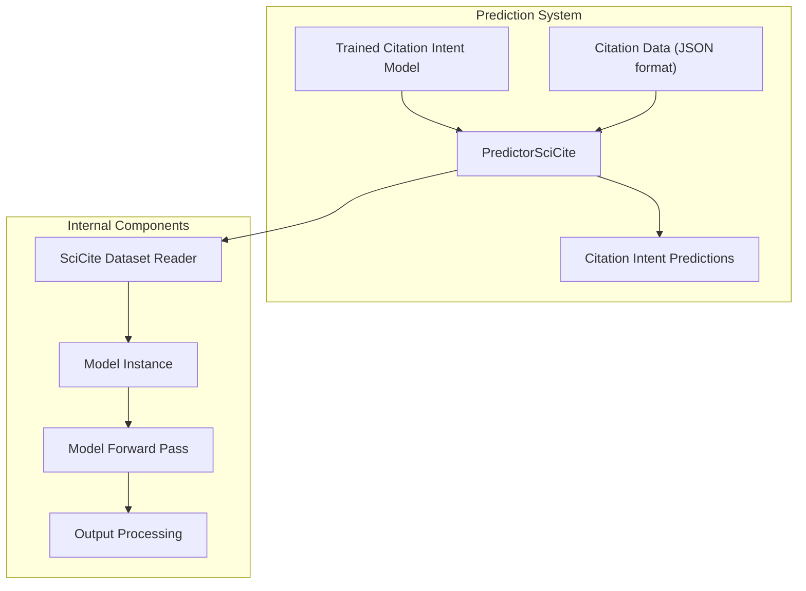
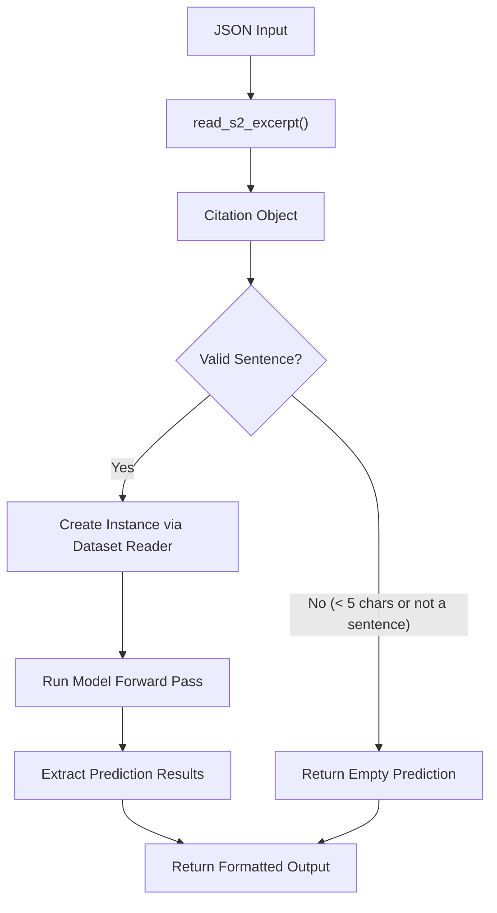
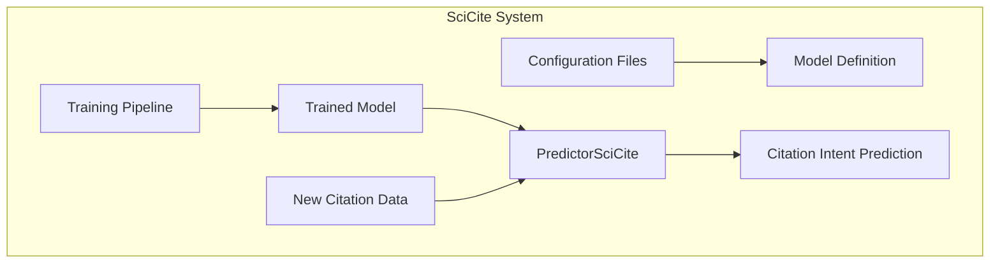

<!-- source: DeepWiki mcp.deepwiki.com · repo allenai/scicite · page 6.1 SciCite Predictor · fetched 2026-10-26 -->

# SciCite Predictor

<details>
<summary>Relevant source files</summary>

The following files were used as context for generating this wiki page:

- [README.md](README.md)
- [scicite/predictors/predictor_scicite.py](scicite/predictors/predictor_scicite.py)

</details>


## Purpose and Scope

The SciCite Predictor is a specialized component within the SciCite system that facilitates citation intent classification on new data. This document covers how the predictor processes citation text and classifies it into appropriate intent categories using trained models. For information about the ACL-ARC dataset predictor, see [ACL-ARC Predictor](#6.2).

## Architectural Overview

The SciCite Predictor bridges the gap between trained models and new citation data, serving as the inference component in the overall SciCite system.



Sources: scicite/predictors/predictor_scicite.py, README.md

## Implementation Details

The SciCite Predictor is implemented as the `PredictorSciCite` class in the codebase, which inherits from AllenNLP's `Predictor` base class and is registered under the name 'predictor_scicite'.

```mermaid
classDiagram
    Predictor <|-- "PredictorSciCite"

    class Predictor {
        +predict_json(inputs: JsonDict) -> JsonDict
        +dump_line(outputs: JsonDict) -> str
    }

    class "PredictorSciCite" {
        +predict_json(inputs: JsonDict) -> JsonDict
        +dump_line(outputs: JsonDict) -> str
    }

    "PredictorSciCite" --> "Citation": uses
    "PredictorSciCite" --> "JsonFloatEncoder": uses
    "PredictorSciCite" --> "read_s2_excerpt()": calls
    "PredictorSciCite" --> "is_sentence()": calls
```

Sources: [scicite/predictors/predictor_scicite.py:1-22]()

### Core Method: predict_json

The `predict_json` method is the primary function of the predictor, responsible for:

1. Converting input JSON to a Citation object
2. Validating the citation text as a proper sentence
3. Creating a model instance via the dataset reader
4. Running the model's forward pass
5. Formatting the prediction results



Sources: [scicite/predictors/predictor_scicite.py:24-52]()

### Output Formatting: dump_line

The `dump_line` method controls how prediction results are serialized for output. It filters the prediction output to include only the most relevant fields:

- `citedPaperId`: ID of the cited paper
- `citingPaperId`: ID of the citing paper
- `excerptCitationIntents`: Intent information
- `prediction`: The predicted citation intent

Sources: [scicite/predictors/predictor_scicite.py:54-64]()

## Input and Output Formats

### Input Format

The predictor accepts JSON input in the SciCite format:

```json
{
 "string": "In chacma baboons, male-infant relationships can be linked to both formation of friendships and paternity success [30,31].",
 "sectionName": "Introduction",
 "citingPaperId": "7a6b2d4b405439",
 "citedPaperId": "9d1abadc55b5e0",
 ...
}
```

Key required fields:
- `string`: The text containing the citation
- `citingPaperId`: ID of the paper containing the citation
- `citedPaperId`: ID of the paper being cited

Sources: [README.md:16-30]()

### Output Format

The predictor generates a JSON output with the following structure:

```json
{
  "citingPaperId": "paper_id_123",
  "citedPaperId": "paper_id_456",
  "citation_id": "citation_123_456",
  "probabilities": [0.1, 0.8, 0.1],
  "prediction": "background",
  "original_label": "background", 
  "citation_text": "The text containing the citation...",
  "attention_dist": [...]
}
```

The most important field is `prediction`, which contains the classified citation intent (background, method, or result).

Sources: [scicite/predictors/predictor_scicite.py:43-51]()

## Prediction Categories

The SciCite Predictor classifies citations into three main categories:

| Intent Category | Description |
|-----------------|-------------|
| Background | Citations that provide context or background information |
| Method | Citations that reference methods, tools, or techniques |
| Result | Citations that discuss specific findings or results |

## Usage

### Command Line Interface

The SciCite Predictor can be used via AllenNLP's command line interface:

```bash
allennlp predict [path-to-model.tar.gz] [path-to-data.jsonl] \
--predictor predictor_scicite \
--include-package scicite \
--overrides "{'model':{'data_format':''}}"
```

Where:
- `[path-to-model.tar.gz]` is the path to a trained model file
- `[path-to-data.jsonl]` is the path to your data in JSONL format
- Optional: `--output-file [out-path.jsonl]` to save results to a file

Sources: [README.md:52-63]()

### Pre-trained Models

Pre-trained models are available for immediate use:

- SciCite dataset model: Available from the project's download section
- ACL-ARC dataset model: Available from the project's download section

When using these models, ensure you select the appropriate predictor based on your dataset format.

Sources: [README.md:67-72]()

## Validation Process

The predictor performs basic validation of input citations:

1. Checks if citation text length is at least 5 characters
2. Verifies that the text is a proper sentence using the `is_sentence()` function
3. If validation fails, returns an empty prediction

This validation helps filter out malformed or incomplete citation text that would produce unreliable predictions.

Sources: [scicite/predictors/predictor_scicite.py:30-34]()

## Example Workflow

Below is a complete example workflow for using the SciCite Predictor:

1. Prepare your citation data in JSONL format:
```json
{"string": "Recent work has shown the effectiveness of this approach [1].", "citingPaperId": "paper1", "citedPaperId": "cited1"}
```

2. Run the prediction command:
```bash
allennlp predict models/scicite.tar.gz data.jsonl \
--predictor predictor_scicite \
--include-package scicite \
--output-file predictions.jsonl
```

3. Examine the output in predictions.jsonl:
```json
{"citingPaperId": "paper1", "citedPaperId": "cited1", "prediction": "method"}
```

## Integration with Other Components

The SciCite Predictor works within the broader SciCite system architecture:



The predictor relies on:
1. A properly trained model (output of the training pipeline)
2. The same dataset reader used during training
3. New citation data in the appropriate format

Sources: README.md

---

