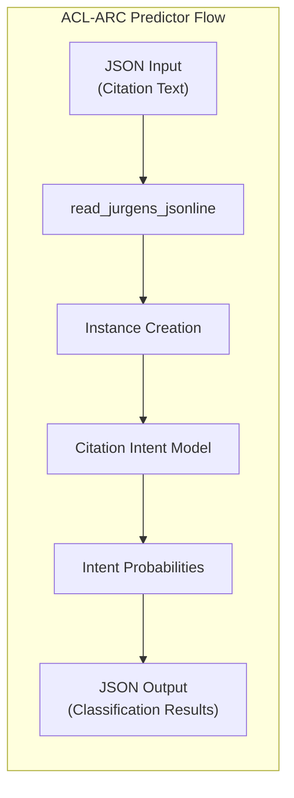
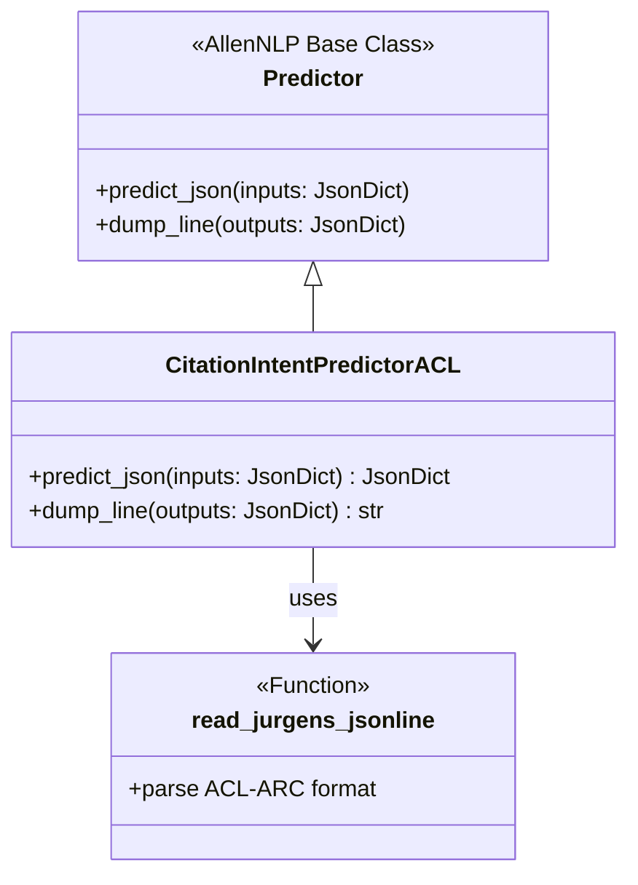
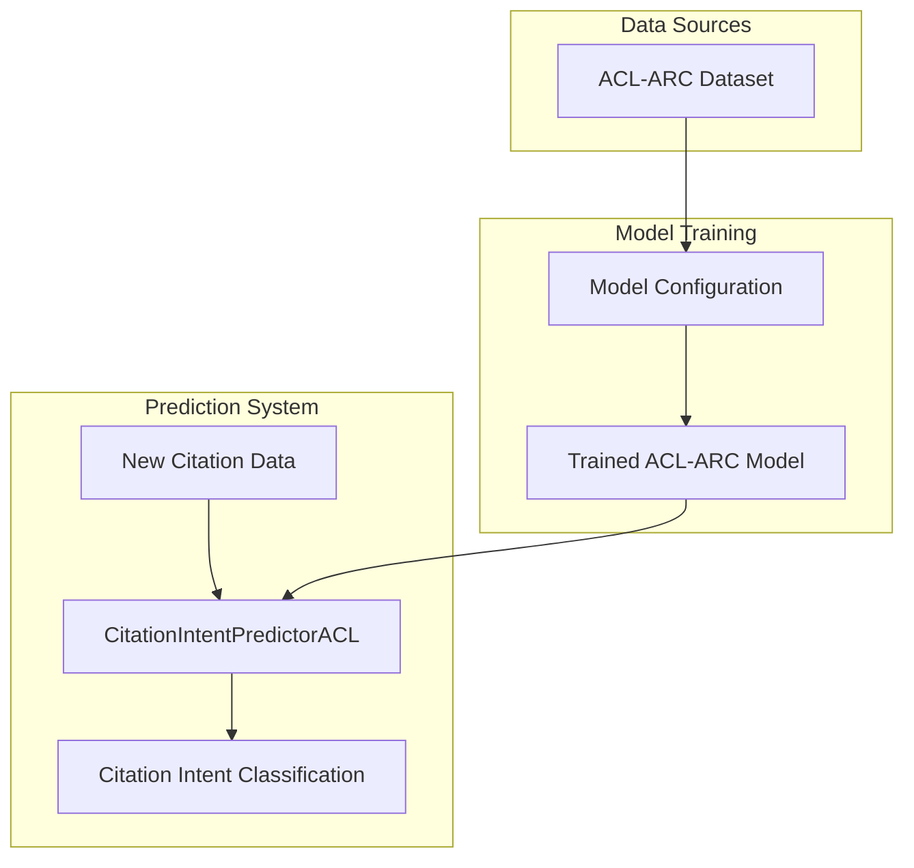

<!-- source: DeepWiki mcp.deepwiki.com · repo allenai/scicite · page 6.2 ACL-ARC Predictor · fetched 2026-10-26 -->

# ACL-ARC Predictor

<details>
<summary>Relevant source files</summary>

The following files were used as context for generating this wiki page:

- [README.md](README.md)
- [scicite/predictors/predictor_acl_arc.py](scicite/predictors/predictor_acl_arc.py)

</details>


## Purpose and Scope

The ACL-ARC Predictor is a specialized component within the SciCite system that performs citation intent classification specifically for the ACL-ARC dataset format. This predictor takes citation text from computational linguistics papers and classifies the intent behind each citation, such as background information, method comparison, or result comparison.

This document covers how the ACL-ARC Predictor works, how it fits into the overall SciCite system, and how to use it for citation intent classification. For information about the SciCite Predictor, which handles the SciCite dataset format, see [SciCite Predictor](#6.1).

## System Architecture

The ACL-ARC Predictor serves as the interface between users and the trained citation intent classification model for the ACL-ARC dataset. It handles the parsing of input data, feeds it through the model, and formats the output predictions.



Sources: [scicite/predictors/predictor_acl_arc.py:16-42](). [README.md:52-62]()

The predictor is registered in the AllenNLP framework as `predictor_aclarc` and is implemented through the `CitationIntentPredictorACL` class which extends AllenNLP's `Predictor` base class.

## Implementation Details

The `CitationIntentPredictorACL` class is defined in [scicite/predictors/predictor_acl_arc.py]() and contains two key methods:

1. `predict_json`: Processes a JSON input containing citation data
2. `dump_line`: Formats the prediction output as a JSON line



Sources: [scicite/predictors/predictor_acl_arc.py:16-54]()

### Processing Flow

When the predictor receives an input:

1. It parses the input using `read_jurgens_jsonline`
2. It checks if the citation text is empty
3. It creates an instance using the dataset reader's `text_to_instance` method
4. It forwards the instance through the model
5. It returns a dictionary with the prediction results including:
   - Citation ID
   - Citing paper ID
   - Cited paper ID
   - Classification probabilities
   - Predicted intent class

## Usage Guide

### Command Line Usage

To use the ACL-ARC predictor with a trained model:

```bash
allennlp predict [path-to-model.tar.gz] [path-to-data.jsonl] \
--predictor predictor_aclarc \
--include-package scicite \
--overrides "{'model':{'data_format':''}}"
```

Optional parameters:
- `--output-file [output-path.jsonl]`: Specifies where to save the output. If not provided, results are printed to stdout.

Sources: [README.md:52-63]()

### Input Format Requirements

The input file should be in JSONL format (one JSON object per line) following the ACL-ARC dataset structure. The specific format is processed by the `read_jurgens_jsonline` function.

### Pretrained Model

A pretrained model for ACL-ARC is available for download:

```
https://s3-us-west-2.amazonaws.com/ai2-s2-research/scicite/models/aclarc.tar.gz
```

Sources: [README.md:70-72]()

## Input and Output Formats

### Input Format

The input should be in the ACL-ARC dataset format introduced by Jurgens et al. (2018).

### Output Format

The predictor returns a JSON object with the following fields:

| Field | Description |
|-------|-------------|
| `citation_id` | Unique identifier for the citation |
| `citingPaperId` | ID of the paper containing the citation |
| `citedPaperId` | ID of the paper being cited |
| `probabilities` | List of probabilities for each intent class |
| `prediction` | The predicted intent class with highest probability |

The `dump_line` method filters the output to include only the following fields before converting to JSON:
- `citation_id`
- `prediction`
- `probabilities`
- `citation_text`

Sources: [scicite/predictors/predictor_acl_arc.py:36-42](). [scicite/predictors/predictor_acl_arc.py:44-54]()

## Integration with SciCite System

The ACL-ARC Predictor fits into the larger SciCite system as shown in the diagram below:



Sources: [README.md:34-35](). [README.md:48-63]()

## Comparison with SciCite Predictor

While both the ACL-ARC and SciCite predictors serve the same general purpose of citation intent classification, they differ in the input format they expect:

| Feature | ACL-ARC Predictor | SciCite Predictor |
|---------|-------------------|-------------------|
| Dataset | ACL-ARC (computational linguistics papers) | SciCite (broader scientific papers) |
| Data Parser | `read_jurgens_jsonline` | SciCite data reader |
| Command Line Identifier | `predictor_aclarc` | `predictor_scicite` |
| Pretrained Model | aclarc.tar.gz | scicite.tar.gz |

Sources: [README.md:52-62](). [README.md:70-72]()

## Sample Usage Workflow

1. Download the pretrained ACL-ARC model
2. Prepare citation data in the ACL-ARC format
3. Run the predictor using the command line interface
4. Process the resulting output JSON with citations classified by intent

This predictor enables researchers and developers to automatically classify citation intents in computational linguistics papers, providing valuable insights into how scientific knowledge is used and referenced in academic literature.

---

