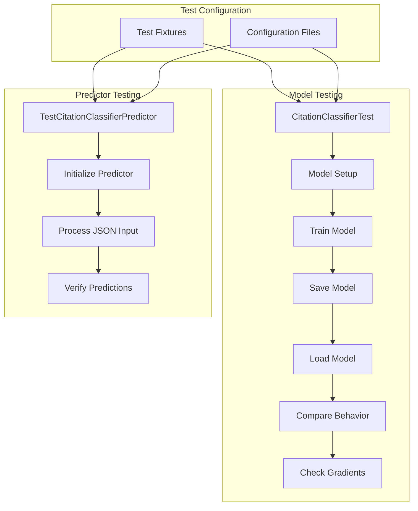
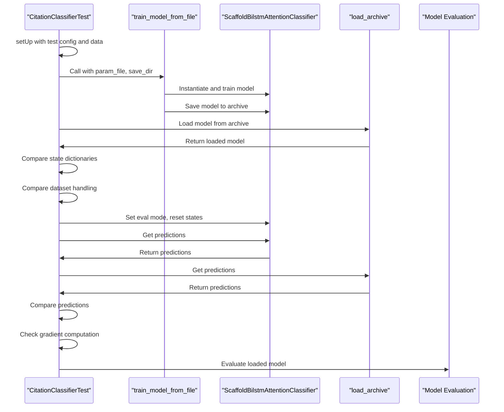
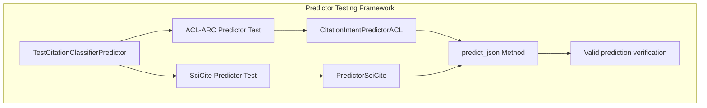
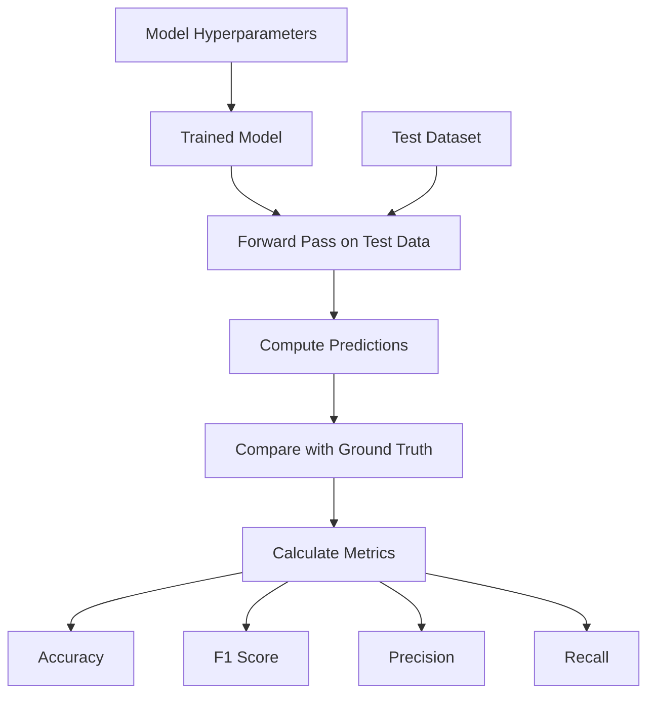
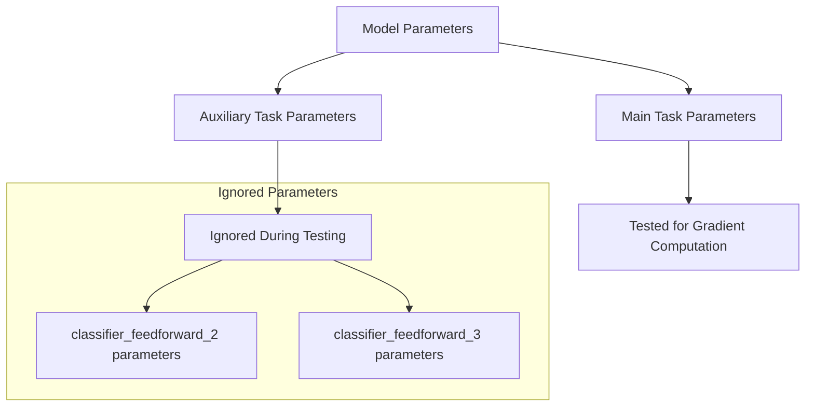
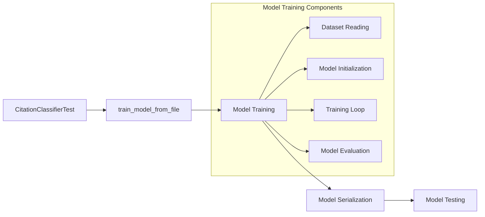

<!-- source: DeepWiki mcp.deepwiki.com · repo allenai/scicite · page 7 Testing and Evaluation · fetched 2026-10-26 -->

# Testing and Evaluation

<details>
<summary>Relevant source files</summary>

The following files were used as context for generating this wiki page:

- [tests/models/model_test_aclarc.py](tests/models/model_test_aclarc.py)
- [tests/models/model_test_scicite.py](tests/models/model_test_scicite.py)
- [tests/predictors/aclarc_predictor_test.py](tests/predictors/aclarc_predictor_test.py)

</details>


This document describes the testing and evaluation framework used in the SciCite repository. It covers how models and predictors are tested to ensure correctness and reliability, and explains the evaluation methodology used to assess model performance.

## Overview of Testing Framework

The SciCite system uses a comprehensive testing framework built on top of AllenNLP's testing utilities. The framework focuses on two main components:

1. **Model Testing** - Ensures models can be trained, saved, loaded, and used correctly
2. **Predictor Testing** - Verifies that predictors correctly process input and produce valid predictions

### Testing Architecture



Sources: [tests/models/model_test_scicite.py:28-115](), [tests/models/model_test_aclarc.py:28-115](), [tests/predictors/aclarc_predictor_test.py:33-133]()

## Model Testing

The model testing framework is implemented in the `CitationClassifierTest` classes for both SciCite and ACL-ARC datasets. These tests verify that models maintain consistent behavior before and after serialization.

### Model Testing Workflow



Sources: [tests/models/model_test_scicite.py:34-115](), [tests/models/model_test_aclarc.py:34-115]()

The model tests follow these key steps:

1. **Setup**: Initialize the test with model configuration and test data
2. **Train and Save**: Train a model and save it to an archive file
3. **Load**: Load the saved model from the archive
4. **Verify State**: Compare model parameters before and after serialization
5. **Verify Behavior**: Ensure both models produce identical predictions
6. **Check Gradients**: Verify gradient computation for trainable parameters

### Key Test Assertions

The tests make several important assertions:

1. State dictionaries of original and loaded models match
2. Models produce identical datasets when reading the same input
3. Models produce identical predictions when given the same input
4. Loaded model can continue training (loss computation and backpropagation)
5. Gradients are correctly computed for trainable parameters

```
# Checking state dictionary equality
assert state_keys == loaded_state_keys
for key in state_keys:
    assert_allclose(model.state_dict()[key].cpu().numpy(),
                   loaded_model.state_dict()[key].cpu().numpy(),
                   err_msg=key)
```

Sources: [tests/models/model_test_scicite.py:43-50](), [tests/models/model_test_aclarc.py:43-50]()

## Predictor Testing

The predictor tests ensure that trained models can be used to make predictions on new data through the predictor interface. Tests are implemented in `TestCitationClassifierPredictor`.

### Predictor Testing Architecture



Sources: [tests/predictors/aclarc_predictor_test.py:33-133]()

The predictor tests verify:

1. **Initialization**: Predictors can be initialized with a trained model
2. **Input Processing**: JSON input is correctly processed
3. **Output Validation**: Predictions fall within the expected label set

### Predictor Test Input/Output

| Dataset | Input Format | Expected Output Labels |
|---------|-------------|-----------------------|
| ACL-ARC | JSON with `text`, `citing_paper_id`, `cited_paper_id`, etc. | 'Background', 'CompareOrContrast', 'Extends', 'Future', 'Motivation', 'Uses' |
| SciCite | JSON with `string`, `sectionName`, `label`, etc. | 'background', 'method', 'result' |

Sources: [tests/predictors/aclarc_predictor_test.py:35-53](), [tests/predictors/aclarc_predictor_test.py:86-102]()

## Test Configurations

The testing framework relies on specialized configuration files and test fixtures.

### Test Configuration Files

Test-specific configuration files (`test-config-scicite.json` and `test-config-aclarc.json`) define:

- Model architecture and parameters
- Dataset reader configuration
- Training parameters 
- Evaluation metrics

These configurations are simplified versions of production configurations, designed for fast testing.

### Test Data Fixtures

Test fixtures include small samples of data:

- `scicite-train.jsonl` - Sample SciCite training data
- `aclarc-train.jsonl` - Sample ACL-ARC training data

These fixtures provide enough data to exercise the model training and evaluation pipeline without requiring the full datasets.

## Evaluation Methodology

The SciCite system evaluates model performance using standard classification metrics implemented through AllenNLP's evaluation mechanisms.

### Evaluation Process



### Evaluated Metrics

| Metric | Description | Purpose |
|--------|-------------|---------|
| Accuracy | Proportion of correct predictions | Overall model performance |
| F1 Score | Harmonic mean of precision and recall | Balance between precision and recall |
| Precision | Proportion of true positives among positive predictions | Measure of exactness |
| Recall | Proportion of true positives identified | Measure of completeness |

The evaluation metrics are calculated on:
1. A validation set during training (for monitoring progress and early stopping)
2. A held-out test set after training (for final model performance assessment)

## Parameter Handling During Testing

An important aspect of the testing framework is how it handles model parameters, particularly with multi-task learning models:



Sources: [tests/models/model_test_scicite.py:72-80](), [tests/models/model_test_aclarc.py:72-80]()

The tests specifically ignore auxiliary task parameters when checking gradient computation, since these may not be relevant for the primary citation intent classification task.

## Integration with Training Pipeline

The testing framework integrates with the training pipeline through the `train_model_from_file` function, which is used to train models for testing purposes:



Sources: [tests/models/model_test_scicite.py:41](), [tests/models/model_test_aclarc.py:41]()

By using the same training function as the production system, the tests ensure that the entire pipeline from model definition to training to serialization is tested.

## Summary

The testing and evaluation framework in SciCite ensures:

1. Models can be trained, saved, and loaded correctly
2. Model behavior remains consistent before and after serialization
3. Predictors correctly process input and produce valid predictions
4. Evaluation metrics provide meaningful assessment of model performance

This comprehensive testing approach helps maintain code quality and ensures that the SciCite system functions reliably across different datasets and use cases.

---

