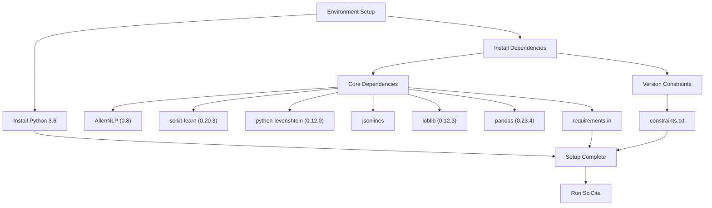
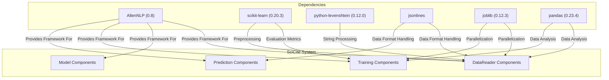

<!-- source: DeepWiki mcp.deepwiki.com · repo allenai/scicite · page 8 Setup and Dependencies · fetched 2026-10-26 -->

# Setup and Dependencies

<details>
<summary>Relevant source files</summary>

The following files were used as context for generating this wiki page:

- [README.md](README.md)
- [constraints.txt](constraints.txt)
- [requirements.in](requirements.in)

</details>


This page provides detailed instructions for setting up the SciCite environment and managing its dependencies. For information about using pre-trained models for prediction, see [Prediction System](#6), and for training your own models, see [Training System](#4).

## Overview

SciCite requires a specific environment setup to function properly. The system is built using Python 3.6 and relies on the AllenNLP framework along with several other dependencies. This guide will walk you through the setup process and explain the key dependencies.



Sources: [README.md:37-46](), [constraints.txt:1-6](), [requirements.in:1-6]()

## System Requirements

### Python Version
SciCite requires Python 3.6. Later versions may work but have not been officially tested with the codebase.

### Hardware Requirements
While not explicitly specified, the following are recommended based on the model architecture:
- RAM: At least 8GB (16GB+ recommended when using ELMo embeddings)
- Storage: Approximately 1GB for the code, models, and datasets
- GPU: Optional but recommended for faster training (especially when using ELMo embeddings)

Sources: [README.md:39]()

## Installation Process

There are two primary ways to set up the SciCite environment:

### Manual Environment Setup

1. Create a Python 3.6 environment (using venv, conda, or your preferred environment manager)
2. Clone the SciCite repository
3. Install dependencies using pip


Here's the command to install all dependencies with the correct versions:

```
pip install -r requirements.in -c constraints.txt
```

This command installs the packages listed in `requirements.in` while ensuring they comply with the version constraints specified in `constraints.txt`.

Sources: [README.md:41-45]()

## Dependencies Overview

SciCite relies on several key dependencies, each serving a specific purpose in the system.

### Core Dependencies

| Dependency | Version | Purpose |
|------------|---------|---------|
| AllenNLP | 0.8 | Main NLP framework providing model architecture components, training loops, and data processing utilities |
| scikit-learn | 0.20.3 | Used for evaluation metrics and preprocessing utilities |
| python-levenshtein | 0.12.0 | Provides string similarity metrics used in the citation processing |
| jsonlines | - | Handles the reading and writing of the jsonlines data format used by SciCite |
| joblib | 0.12.3 | Provides parallelization capabilities for data processing |
| pandas | 0.23.4 | Used for data manipulation and analysis |

Sources: [constraints.txt:1-6](), [requirements.in:1-6]()

### Dependency Structure

The following diagram illustrates how different dependencies are used by different components of the SciCite system:



Sources: [constraints.txt:1-6](), [requirements.in:1-6]()

## Optional Dependencies

### ELMo Embeddings

ELMo contextual embeddings are optional but can significantly improve model performance. To use ELMo:

1. Set the environment variable: `export elmo=true`
2. Note that using ELMo will significantly slow down training

ELMo embeddings are downloaded automatically when first used, which requires approximately 1GB of additional disk space.

Sources: [README.md:90-95]()

## Environment Variables

SciCite uses several environment variables to configure its behavior:

| Variable | Purpose | Example |
|----------|---------|---------|
| elmo | Toggle ELMo embeddings | `export elmo=true` |
| train_data_path | Path to training data | `export train_data_path=/path/to/train.jsonl` |
| validation_data_path | Path to validation data | `export validation_data_path=/path/to/dev.jsonl` |
| test_data_path | Path to test data | `export test_data_path=/path/to/test.jsonl` |
| train_data_path_aux | Path to section title scaffold data | `export train_data_path_aux=/path/to/auxiliary1.jsonl` |
| train_data_path_aux2 | Path to citation worthiness scaffold data | `export train_data_path_aux2=/path/to/auxiliary2.jsonl` |
| mixing_ratio | Sensitivity to first scaffold (λ₂) | `export mixing_ratio=0.1` |
| mixing_ratio2 | Sensitivity to second scaffold (λ₃) | `export mixing_ratio2=0.1` |

These environment variables can be set before running the training commands or can be specified directly in the configuration files.

Sources: [README.md:80-88](), [README.md:90-95]()

## Configuration for Different Experiments

SciCite uses JSON configuration files to specify model architecture, training parameters, and data paths. The repository includes example configurations in the `experiment_configs/` directory.

When running experiments, you'll need to:

1. Download the appropriate datasets
2. Update configuration file paths to point to your data
3. Set any required environment variables
4. Run the training command with your configuration file

Sources: [README.md:76-79](), [README.md:90-103]()

## Troubleshooting Common Issues

### Version Conflicts

If you encounter dependency conflicts, ensure you're using both `requirements.in` and `constraints.txt`:

```
pip install -r requirements.in -c constraints.txt
```

This ensures that specific versions are installed, preventing compatibility issues.

### CUDA/GPU Issues

If using a GPU, ensure you have compatible CUDA drivers installed. AllenNLP 0.8 works with CUDA 9.0 and 9.1. If you experience GPU-related errors, try:

1. Checking CUDA compatibility
2. Running on CPU only (slower but more reliable)

### Package Import Errors

When running SciCite commands, always include:

```
--include-package scicite
```

This ensures that the SciCite package is properly registered with AllenNLP.

Sources: [README.md:55-56](), [README.md:102]()

## Next Steps

After successfully setting up the environment and installing all dependencies:

1. For using pre-trained models, see [Prediction System](#6)
2. For training your own models, see [Training System](#4)
3. For understanding the dataset formats, see [Datasets and Data Processing](#3)

Sources: [README.md:48-72](), [README.md:74-103]()