# Page: Overview

# Overview

<details>
<summary>Relevant source files</summary>

The following files were used as context for generating this wiki page:

- [README.md](README.md)

</details>


This document provides an introduction to the SciCite repository, explaining its purpose, architecture, and core functionality. SciCite is a system for classifying citation intents in academic papers, helping researchers understand the purpose of citations in scientific literature.

## Purpose and Scope

The SciCite repository contains datasets and code for training, evaluating, and deploying citation intent classification models. It implements the approach described in the NAACL 2019 paper: "Structural Scaffolds for Citation Intent Classification in Scientific Publications", which uses multi-task learning with auxiliary tasks to improve classification performance.

The system classifies citations into several intent categories:
- **Background**: Citations that provide relevant background information
- **Method**: Citations that reference methods used in the paper
- **Result Comparison**: Citations that compare or contrast results

For information on the model architecture details, see [Model Architecture](#2.1).
For training system specifics, see [Training System](#4).

Sources: [README.md:5-7]()

## System Architecture

SciCite follows a modular design based on the AllenNLP framework with components for data processing, model definition, training, and prediction.

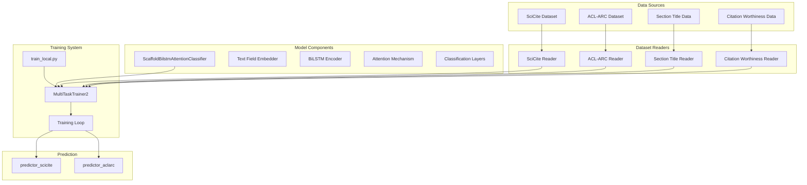

Sources: [README.md:39-45](), [README.md:75-103]()

## Core Components

The SciCite system consists of several key components:

| Component | Description | Key Files |
|-----------|-------------|-----------|
| Datasets | SciCite and ACL-ARC datasets with citation intent annotations | Data in jsonlines format |
| Dataset Readers | Process and index data for model consumption | Readers for main and auxiliary tasks |
| Model Architecture | ScaffoldBilstmAttentionClassifier with embedding, encoding, and classification layers | Model definition files |
| Training System | Multi-task learning with auxiliary tasks | Training scripts and configuration |
| Predictors | Interface for using trained models on new data | Predictors for different dataset formats |
| Command Line Interface | Tools for training, evaluation, and prediction | Scripts for command line interaction |

Sources: [README.md:48-68]()

## Citation Intent Classification Problem

The primary goal of SciCite is to automatically determine the purpose or intent behind citations in academic papers. This helps researchers and systems:

1. Understand how scientific knowledge flows between papers
2. Identify the purpose of citations without manual analysis
3. Enable more nuanced citation metrics beyond simple citation counts
4. Improve scientific information retrieval and paper recommendation

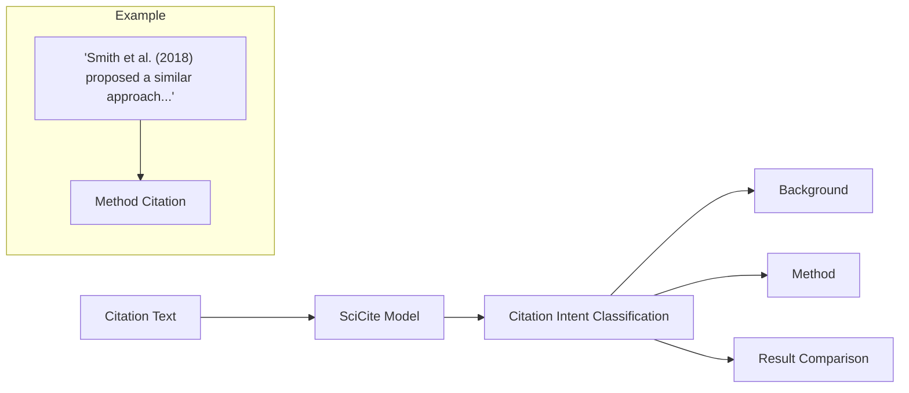

Sources: [README.md:5-7](), [README.md:15-30]()

## Datasets

SciCite introduces two primary datasets for citation intent classification:

1. **SciCite Dataset**: A large dataset of citation intents across scientific domains
2. **ACL-ARC Dataset**: A preprocessed dataset focused on computational linguistics

Both datasets use the jsonlines format, where each line represents a citation with its context and intent label:

```
{
 'string': 'In chacma baboons, male-infant relationships can be linked to both
    formation of friendships and paternity success [30,31].'
 'sectionName': 'Introduction',
 'label': 'background',
 'citingPaperId': '7a6b2d4b405439',
 'citedPaperId': '9d1abadc55b5e0',
 ...
}
```

Sources: [README.md:9-35]()

## Multi-Task Learning Approach

What makes SciCite unique is its use of multi-task learning with "structural scaffolds" (auxiliary tasks) to improve citation intent classification:

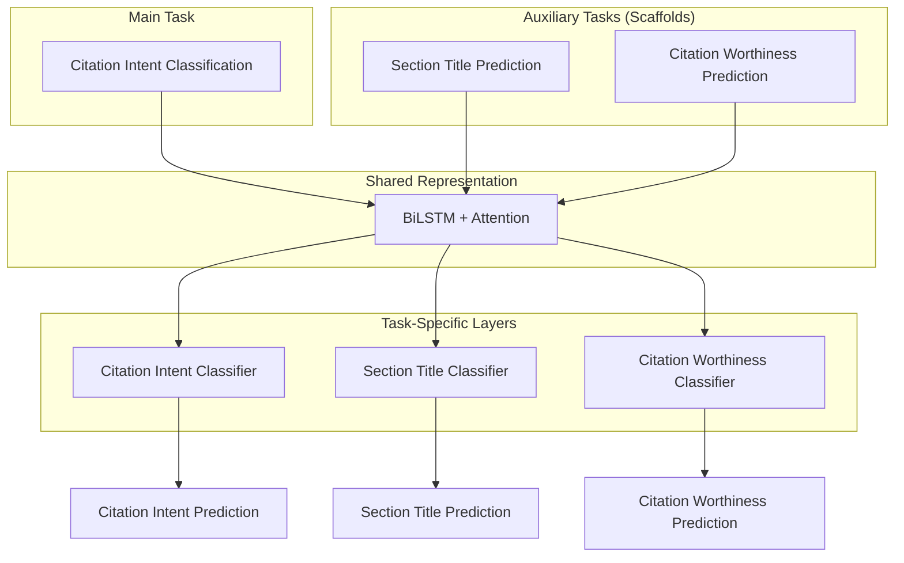

Key parameters control the multi-task learning:
- `mixing_ratio`: Controls the influence of the section title prediction task (λ₂)
- `mixing_ratio2`: Controls the influence of the citation worthiness task (λ₃)
- `cutoff_epoch`: Determines when to stop using auxiliary tasks during training

Sources: [README.md:84-88]()

## Model Architecture Overview

The main model architecture is the ScaffoldBilstmAttentionClassifier, which includes:

- **Embedding Layer**: Combines multiple embedding types
  - ELMo contextualized embeddings (optional)
  - GloVe word embeddings
  - Lexicon features
  
- **Encoder**: BiLSTM (Bidirectional Long Short-Term Memory) network

- **Attention Mechanism**: Focuses on the most relevant parts of the citation context

- **Classification Layers**: Separate classifiers for the main task and auxiliary tasks

For more detailed information on the model architecture, see [Model Architecture](#2.1).

Sources: [README.md:91-94]()

## Using the System

### Running Pre-trained Models

SciCite provides pre-trained models for both datasets that can be used to classify new citations:

```bash
allennlp predict [path-to-model.tar.gz] [path-to-data.jsonl] \
--predictor [predictor-type] \
--include-package scicite \
--overrides "{'model':{'data_format':''}}"
```

Where `[predictor-type]` is one of:
- `predictor_scicite`: For the SciCite dataset format
- `predictor_aclarc`: For the ACL-ARC dataset format

Sources: [README.md:48-66]()

### Training New Models

To train your own models, you need to:

1. Prepare a configuration file (examples in `experiment_configs/` directory)
2. Set up environment variables (e.g., for ELMo embeddings)
3. Run the training script:

```bash
python scripts/train_local.py train_multitask_2 [path-to-config-file.json] \
-s [path-to-serialization-dir/] \
--include-package scicite
```

For detailed training instructions, see [Training System](#4).

Sources: [README.md:74-103]()

## Code Organization

The repository is organized into several key components:

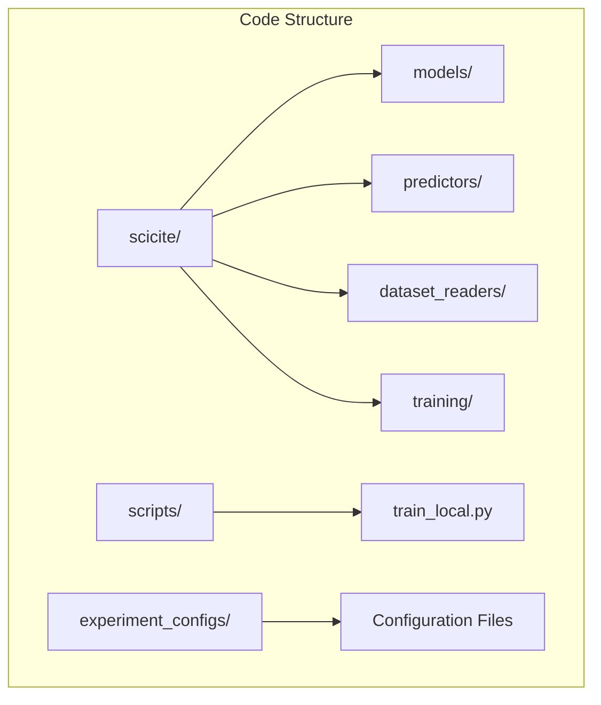

Sources: [README.md]()

## System Requirements

- Python 3.6
- AllenNLP library
- Other dependencies specified in `requirements.in` and `constraints.txt`

For detailed setup instructions, see [Setup and Dependencies](#8).

Sources: [README.md:37-46]()

## Navigation

For more detailed information on specific components of the SciCite system, refer to:

- [System Architecture](#2) - High-level system architecture
- [Model Architecture](#2.1) - Details of the model architecture
- [Multi-Task Learning Framework](#2.2) - Multi-task learning approach
- [Datasets and Data Processing](#3) - Information about the datasets
- [Training System](#4) - Training system details
- [Prediction System](#6) - Using models for prediction

---

# Page: System Architecture

# System Architecture

<details>
<summary>Relevant source files</summary>

The following files were used as context for generating this wiki page:

- [README.md](README.md)
- [experiment_configs/scicite-experiment.json](experiment_configs/scicite-experiment.json)

</details>


This document provides a comprehensive overview of the SciCite system architecture, explaining how various components interact to enable citation intent classification in scientific publications. It covers the high-level system structure, data flow, model components, and integration points. For details about specific implementations, see the dedicated pages for [Model Architecture](#2.1) and [Multi-Task Learning Framework](#2.2).

## System Overview

The SciCite system is designed to classify the intent behind citations in academic papers using a multi-task learning approach with auxiliary scaffolding tasks.

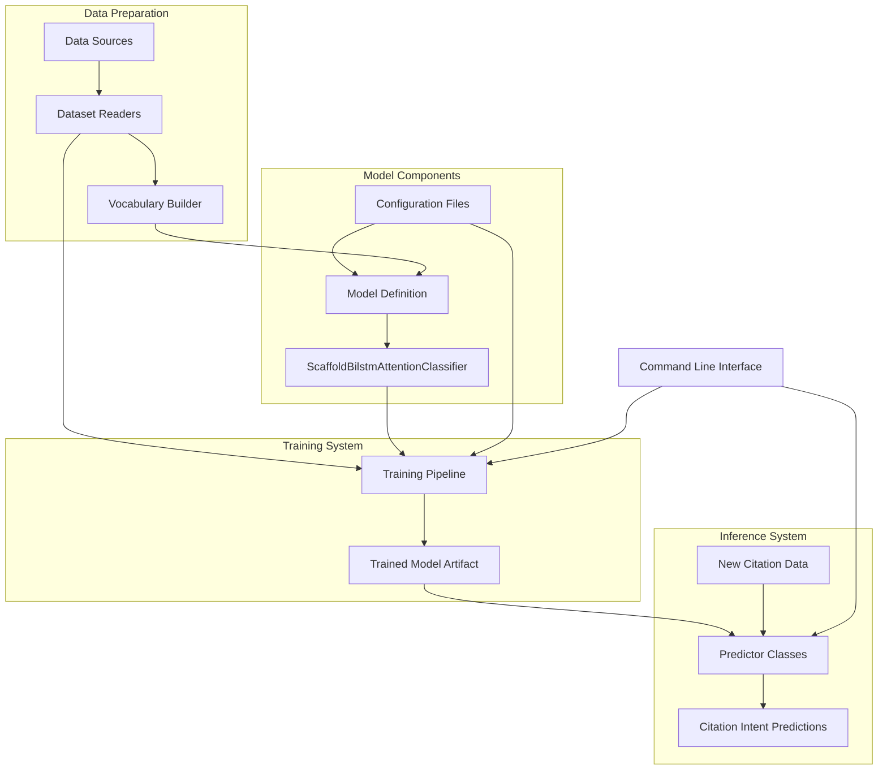

Sources: [README.md:5-7](), [README.md:38-40](), [experiment_configs/scicite-experiment.json:17-36]()

## Core Components and Data Flow

The SciCite system integrates multiple specialized components for processing citation data through dataset readers, building vocabulary, training models, and making predictions.

### Dataset Readers

The system uses specialized dataset readers for different data types:

| Reader Type | Purpose | Configuration Path |
|-------------|---------|-------------------|
| `scicite_datasetreader` | Main citation intent classification data | [experiment_configs/scicite-experiment.json:17-22]() |
| `scicite_section_title_data_reader` | Section title prediction (auxiliary task) | [experiment_configs/scicite-experiment.json:23-26]() |
| `scicite_cite_worthiness_data_reader` | Citation worthiness prediction (auxiliary task) | [experiment_configs/scicite-experiment.json:27-30]() |

### Model Components

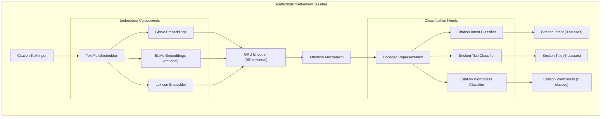

Sources: [experiment_configs/scicite-experiment.json:38-104]()

### Data Flow

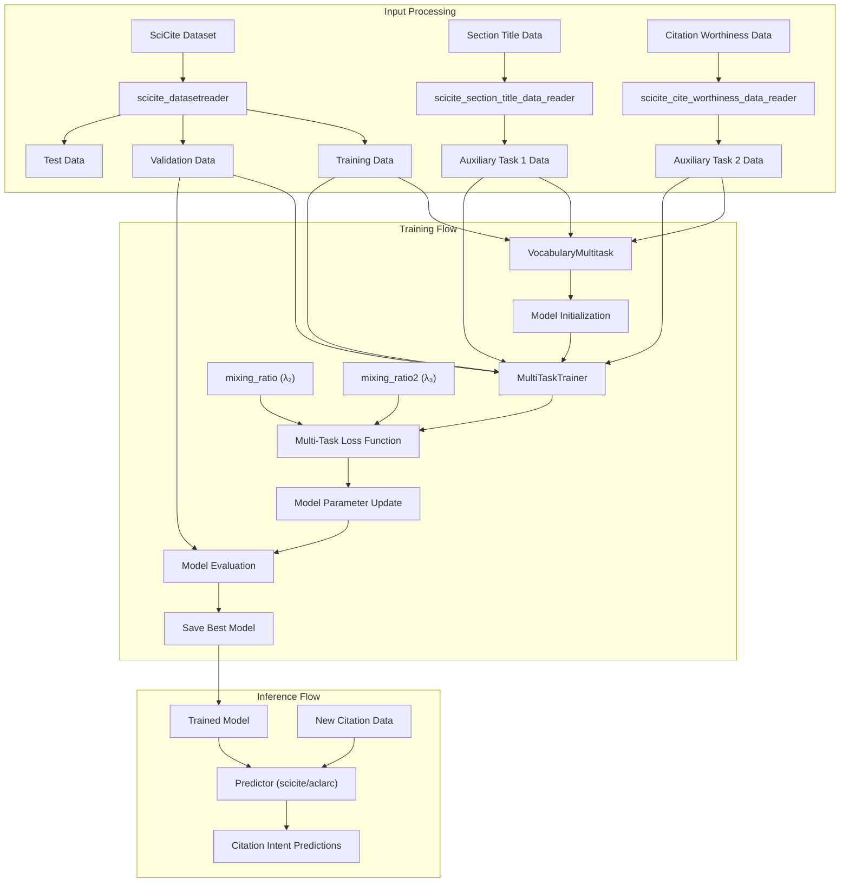

Sources: [README.md:74-103](), [experiment_configs/scicite-experiment.json:17-36](), [experiment_configs/scicite-experiment.json:121-131]()

## Multi-Task Training System

The system employs a sophisticated multi-task training approach, using auxiliary tasks as scaffolds to improve the main citation intent classification task.

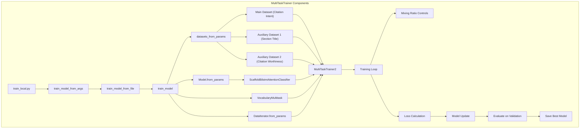

Sources: [README.md:74-103](), [experiment_configs/scicite-experiment.json:13-16]()

## Command Line Interface

The system provides a command-line interface for training models and making predictions:

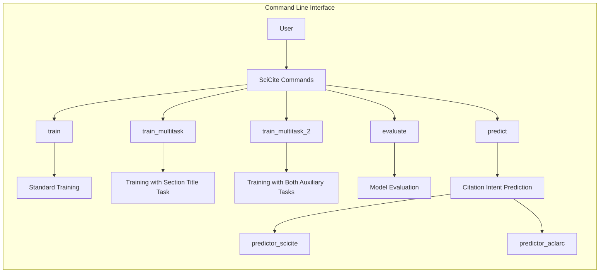

Sources: [README.md:48-67](), [README.md:98-103]()

## Model Configuration

The model configuration is controlled via JSON configuration files, with key parameters:

| Parameter | Purpose | Example Value |
|-----------|---------|--------------|
| `train_data_path` | Path to main training data | `"data/train.jsonl"` |
| `validation_data_path` | Path to development data | `"data/dev.jsonl"` |
| `train_data_path_aux` | Path to section title auxiliary data | `"data/cite-sections.jsonl"` |
| `train_data_path_aux2` | Path to citation worthiness auxiliary data | `"data/cite-worthiness.jsonl"` |
| `mixing_ratio` | Control parameter (λ₂) for first auxiliary task | Variable |
| `mixing_ratio2` | Control parameter (λ₃) for second auxiliary task | Variable |
| `with_elmo` | Whether to use ELMo contextual embeddings | `true` or `false` |

Sources: [README.md:79-88](), [experiment_configs/scicite-experiment.json:6-16]()

## Integration with External Components

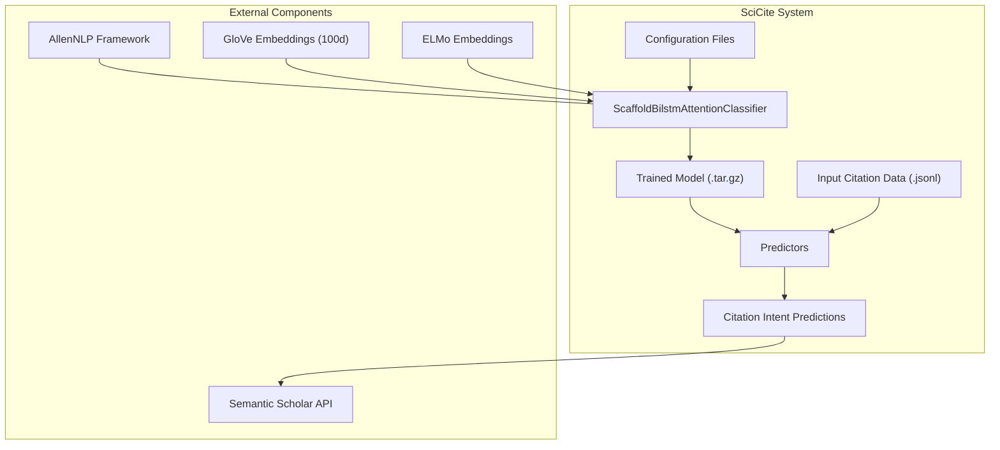

Sources: [README.md:38-40](), [README.md:48-67](), [experiment_configs/scicite-experiment.json:47-74]()

## System Requirements and Dependencies

The SciCite system requires:

- Python 3.6
- AllenNLP library
- Dependencies specified in requirements.in and constraints.txt

The system can utilize GPU acceleration if available, configured through the `cuda_device` parameter in the trainer configuration.

Sources: [README.md:39-46](), [experiment_configs/scicite-experiment.json:127]()

---

# Page: Model Architecture

# Model Architecture

<details>
<summary>Relevant source files</summary>

The following files were used as context for generating this wiki page:

- [experiment_configs/scicite-experiment.json](experiment_configs/scicite-experiment.json)
- [scicite/models/scaffold_bilstm_attention_classifier.py](scicite/models/scaffold_bilstm_attention_classifier.py)

</details>


This document details the `ScaffoldBilstmAttentionClassifier` model architecture used in the SciCite system for citation intent classification. For information about how this model is used within the multi-task learning framework, see [Multi-Task Learning Framework](#2.2).

## Overview

The `ScaffoldBilstmAttentionClassifier` is designed to classify the intent behind citations in academic papers. It implements a bidirectional GRU encoder with an attention mechanism, supporting both single-task and multi-task learning scenarios with auxiliary tasks.

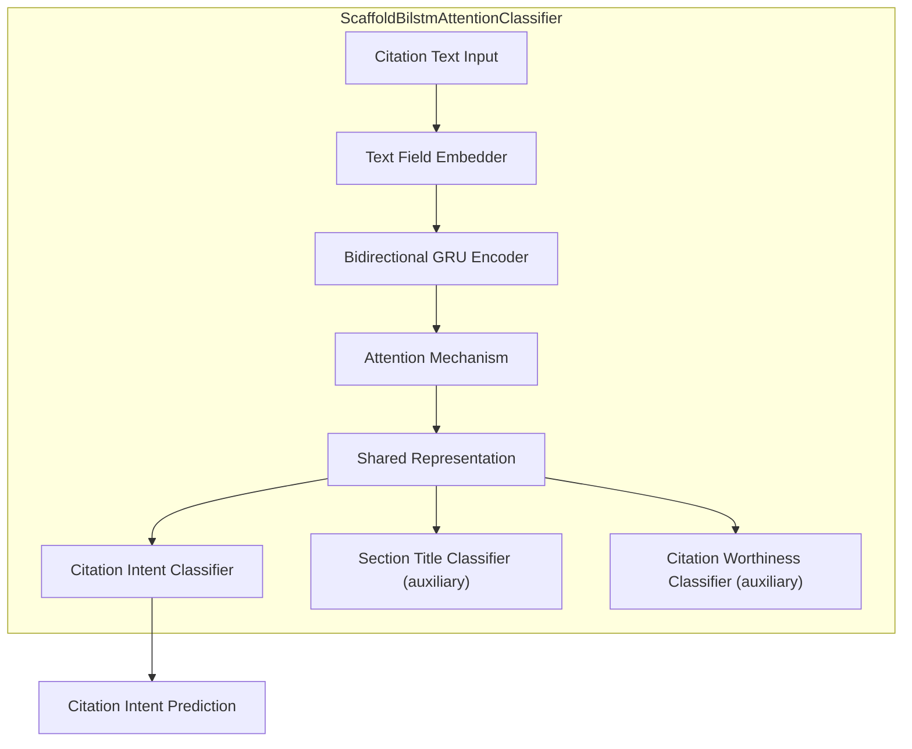

Sources: [scicite/models/scaffold_bilstm_attention_classifier.py:31-283]()

## Model Components

### Text Embedding Layer

The model supports two embedding configurations:

1. **Standard Configuration**: Uses GloVe (100d) word embeddings
2. **ELMo Configuration**: Combines GloVe with ELMo contextual embeddings (1124d total)

The embedding choice is controlled by the `with_elmo` parameter in the configuration file.

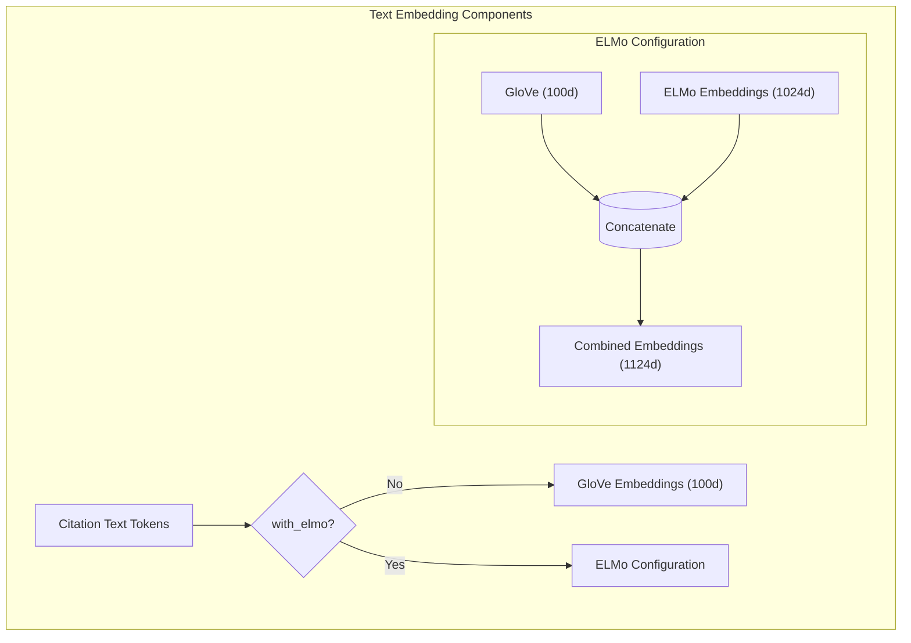

Sources: [scicite/models/scaffold_bilstm_attention_classifier.py:59-60](), [scicite/models/scaffold_bilstm_attention_classifier.py:249-255](), [experiment_configs/scicite-experiment.json:6-10](), [experiment_configs/scicite-experiment.json:46-68]()

### BiGRU Encoder

The Bidirectional GRU encoder processes the embedded citation text:

- **Type**: GRU (Gated Recurrent Unit)
- **Layers**: 2
- **Direction**: Bidirectional
- **Hidden Size**: 100 in each direction (200 total output size)
- **Dropout**: 0.3

The encoder converts variable-length sequences into contextualized token representations.

Sources: [scicite/models/scaffold_bilstm_attention_classifier.py:63](), [experiment_configs/scicite-experiment.json:76-83]()

### Attention Mechanism

The model implements a multiplicative attention mechanism to focus on the most relevant parts of the citation text:

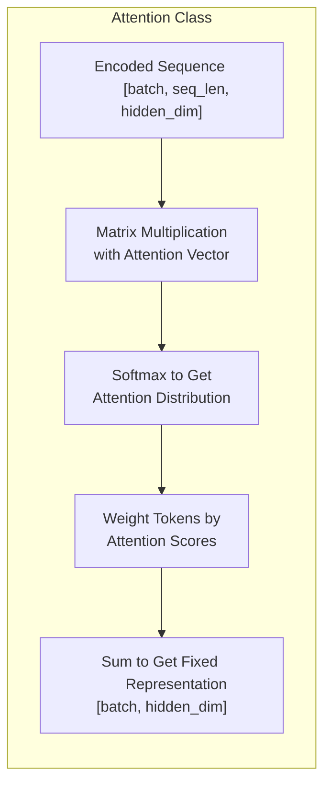

The `Attention` class:
1. Takes the encoded sequence from the BiGRU
2. Calculates attention scores for each token
3. Normalizes scores using softmax
4. Produces a weighted sum to create a fixed-size representation

Sources: [scicite/models/scaffold_bilstm_attention_classifier.py:87](), [scicite/models/scaffold_bilstm_attention_classifier.py:292-319]()

### Classification Heads

The model contains three separate feedforward networks for different tasks:

| Classifier | Task | Input Dim | Hidden Dim | Output Dim | Purpose |
|------------|------|-----------|------------|------------|---------|
| `classifier_feedforward` | Citation Intent | 200 | 20 | 3 | Main task |
| `classifier_feedforward_2` | Section Title | 200 | 20 | 5 | Auxiliary task 1 |
| `classifier_feedforward_3` | Citation Worthiness | 200 | 20 | 2 | Auxiliary task 2 |

Each classifier receives the same attended representation but produces different outputs corresponding to their specific tasks.

Sources: [scicite/models/scaffold_bilstm_attention_classifier.py:64-66](), [experiment_configs/scicite-experiment.json:84-104]()

## Forward Pass

The model's forward pass handles the following steps:

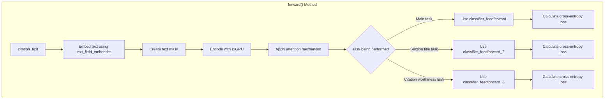

The `forward()` method:
1. Embeds the citation text
2. Passes it through the BiGRU encoder
3. Applies attention to get a fixed-size representation
4. Feeds this representation to the appropriate classifier based on the task
5. Calculates loss if labels are provided
6. Computes F1 metrics for each class

Sources: [scicite/models/scaffold_bilstm_attention_classifier.py:94-178]()

## Performance Metrics

The model tracks key performance metrics:

- Per-class precision, recall, and F1 scores
- Average F1 score across all classes (excluding 'none' class)
- Auxiliary task metrics (when `report_auxiliary_metrics` is enabled)

Metrics are reported separately for the main task and each auxiliary task.

Sources: [scicite/models/scaffold_bilstm_attention_classifier.py:199-246]()

## Model Initialization

The model is initialized from configuration parameters:

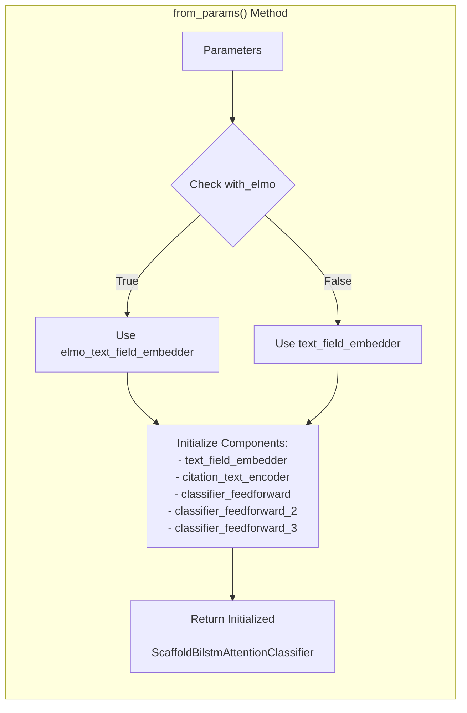

The `from_params()` method handles configuration from JSON files, including:
- Choosing between standard and ELMo embeddings
- Setting up encoder, attention, and classifiers
- Configuring multi-task learning parameters

Sources: [scicite/models/scaffold_bilstm_attention_classifier.py:248-283](), [experiment_configs/scicite-experiment.json:38-104]()

## Integration with Multi-Task Learning

The `ScaffoldBilstmAttentionClassifier` is designed to work within SciCite's multi-task learning framework:

- Uses shared lower layers (embedding, encoding, attention)
- Has task-specific classification heads
- Can report metrics for auxiliary tasks
- Provides a flexible interface for single or multi-task training

The multi-task approach allows the model to leverage information from auxiliary tasks to improve performance on the main citation intent classification task.

Sources: [scicite/models/scaffold_bilstm_attention_classifier.py:132-166]()

## Output and Decoding

The `decode()` method converts model outputs into human-readable format:

1. Applies softmax to logits to get probabilities
2. Identifies argmax class indices 
3. Maps indices to class labels using the vocabulary
4. Includes citation text, probabilities, and all possible labels
5. Returns a structured output dictionary for downstream use

Sources: [scicite/models/scaffold_bilstm_attention_classifier.py:181-197]()

---

# Page: Multi-Task Learning Framework

# Multi-Task Learning Framework

<details>
<summary>Relevant source files</summary>

The following files were used as context for generating this wiki page:

- [README.md](README.md)
- [scicite/training/train_multitask.py](scicite/training/train_multitask.py)
- [scicite/training/train_multitask_two_tasks.py](scicite/training/train_multitask_two_tasks.py)

</details>


## Purpose and Scope

This document describes the multi-task learning framework implemented in the SciCite project for improving citation intent classification. The framework uses auxiliary tasks as "structural scaffolds" to enhance the main citation intent classification task. This page covers the architecture, data flow, training process, and configuration of the multi-task learning system. For information about the specific model architecture used with this framework, see [Model Architecture](#2.1).

## Introduction to Multi-Task Learning in SciCite

The SciCite project implements a scaffold-based multi-task learning approach where auxiliary tasks related to scientific text understanding help improve the performance of the main citation intent classification task. The system supports training with either one auxiliary task (section title prediction) or two auxiliary tasks (section title prediction and citation worthiness prediction).

The key insight is that learning to predict section titles and citation worthiness can help the model develop better representations of scientific citations, which ultimately improves citation intent classification.

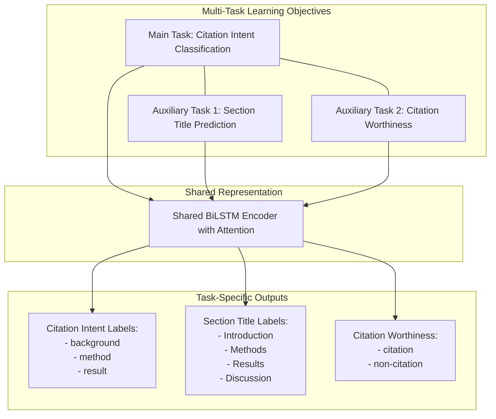

Sources: [README.md:5-7]()

## Framework Architecture

The multi-task learning framework in SciCite is implemented through two primary trainer classes: `MultiTaskTrainer` for a single auxiliary task and `MultiTaskTrainer2` for two auxiliary tasks. These classes extend AllenNLP's training system to support multi-task learning.

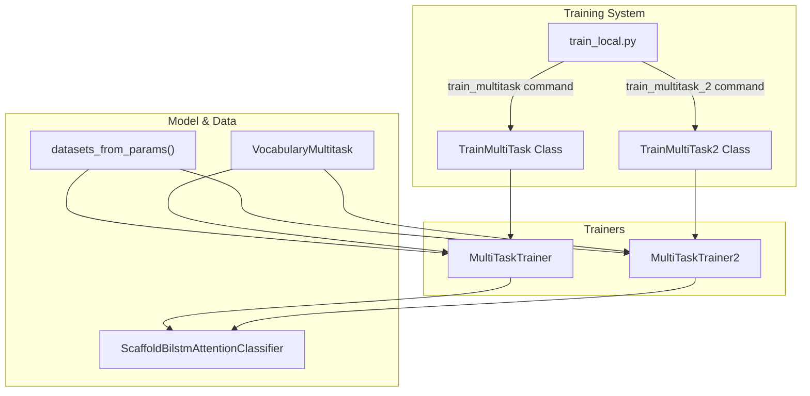

Sources: [scicite/training/train_multitask.py:57-58](), [scicite/training/train_multitask_two_tasks.py:52-58]()

### Data Flow in Multi-Task Training

The multi-task learning framework processes data through several key functions, with a focus on dataset loading, vocabulary creation, and balanced training:

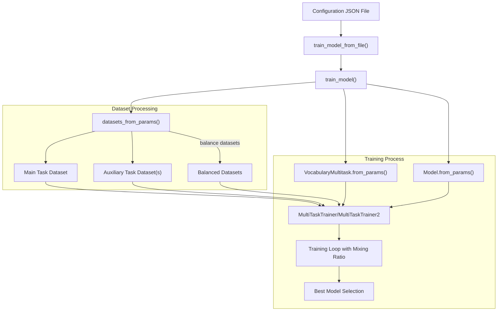

Sources: [scicite/training/train_multitask.py:134-138](), [scicite/training/train_multitask_two_tasks.py:134-138]()

## Training with One Auxiliary Task

The first approach to multi-task learning in SciCite uses a single auxiliary task (typically section title prediction) alongside the main citation intent classification task.

### Architecture and Data Flow

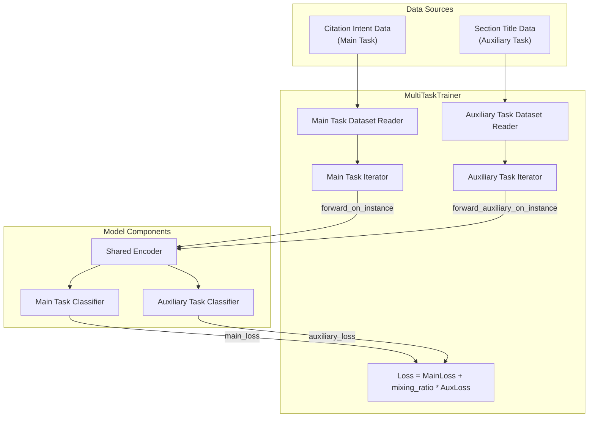

Sources: [scicite/training/train_multitask.py:279-442]()

### Key Parameters

The training process with one auxiliary task is controlled by two main parameters:

| Parameter      | Description                                            | Default  |
|----------------|--------------------------------------------------------|----------|
| `mixing_ratio` | Weight of auxiliary task loss relative to main task    | (required) |
| `cutoff_epoch` | Epoch after which auxiliary task training is stopped   | -1 (no cutoff) |

Sources: [scicite/training/train_multitask.py:319-320]()

## Training with Two Auxiliary Tasks

The second approach extends multi-task learning to include two auxiliary tasks (section title prediction and citation worthiness).

### Architecture and Data Flow

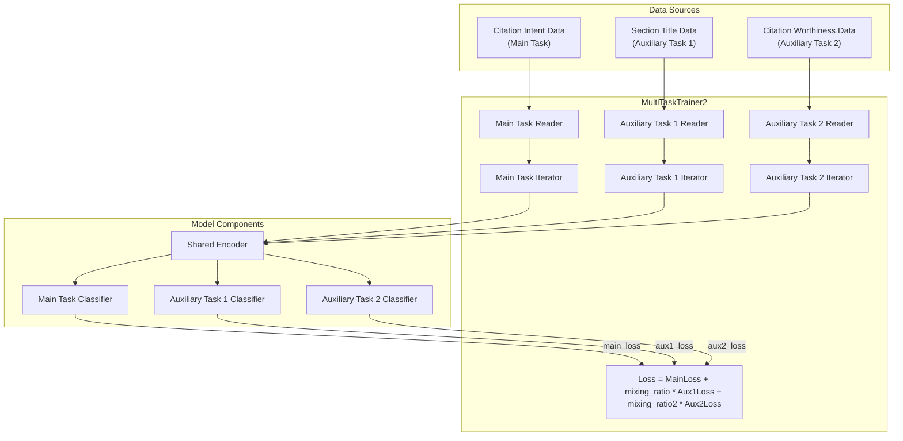

Sources: [scicite/training/train_multitask_two_tasks.py:305-499]()

### Additional Parameters

The training process with two auxiliary tasks adds a second mixing ratio parameter:

| Parameter       | Description                                          | Default  |
|-----------------|------------------------------------------------------|----------|
| `mixing_ratio`  | Weight of first auxiliary task loss                  | (required) |
| `mixing_ratio2` | Weight of second auxiliary task loss                 | (required) |
| `cutoff_epoch`  | Epoch after which auxiliary task training is stopped | -1 (no cutoff) |

Sources: [scicite/training/train_multitask_two_tasks.py:347-350]()

## Data Handling and Balancing

A key aspect of the multi-task training framework is how it handles and balances datasets of different sizes.

### Dataset Loading Process

```mermaid
flowchart TD
    ConfigParams["Configuration Parameters"] --> DatasetReaders["Initialize Dataset Readers"]
    DatasetReaders --> LoadMainData["Load Main Task Data"]
    DatasetReaders --> LoadAuxData["Load Auxiliary Task Data"]
    
    LoadMainData --> CheckSizes["Compare Dataset Sizes"]
    LoadAuxData --> CheckSizes
    
    CheckSizes --> |"Main dataset larger"| InflateAux["Inflate Auxiliary Dataset"]
    CheckSizes --> |"Auxiliary dataset larger"| InflateMain["Inflate Main Dataset"]
    
    InflateAux --> BalancedDatasets["Balanced Datasets"]
    InflateMain --> BalancedDatasets
    
    BalancedDatasets --> VocabCreation["Create Shared Vocabulary"]
```

Sources: [scicite/training/train_multitask.py:138-219](), [scicite/training/train_multitask_two_tasks.py:134-245]()

### Dataset Balancing Mechanism

The system balances datasets by resampling from the smaller dataset to match the size of the larger one:

1. Compare sizes of main and auxiliary datasets
2. If main dataset is larger, randomly sample from auxiliary dataset to inflate it
3. If auxiliary dataset is larger, randomly sample from main dataset to inflate it
4. For two auxiliary tasks, first balance the auxiliary datasets against each other

This ensures that during training, the model receives approximately equal amounts of data from each task.

Sources: [scicite/training/train_multitask.py:169-184](), [scicite/training/train_multitask_two_tasks.py:172-194]()

## Configuration and Usage

### Command Line Interface

```mermaid
flowchart TD
    CLI["scripts/train_local.py"] --> OneTask["train_multitask command"]
    CLI --> TwoTasks["train_multitask_2 command"]
    
    OneTask --> TrainOneTask["TrainMultiTask Class"]
    TwoTasks --> TrainTwoTasks["TrainMultiTask2 Class"]
    
    TrainOneTask --> Configuration["JSON Configuration File"]
    TrainTwoTasks --> Configuration
    
    Configuration --> OutputDir["Serialization Directory"]
```

Sources: [README.md:98-103]()

### Example Configuration

To use multi-task learning in SciCite, you need to set up the following configuration parameters:

```json
{
  "train_data_path": "path/to/citation/data.jsonl",
  "validation_data_path": "path/to/citation/dev.jsonl",
  "test_data_path": "path/to/citation/test.jsonl",
  
  "train_data_path_aux": "path/to/section/data.jsonl",
  "train_data_path_aux2": "path/to/worthiness/data.jsonl",
  
  "mixing_ratio": 0.10,
  "mixing_ratio2": 0.05,
  "cutoff_epoch": 10
}
```

To train with one auxiliary task:
```bash
python scripts/train_local.py train_multitask [path-to-config-file.json] -s [output-dir] --include-package scicite
```

To train with two auxiliary tasks:
```bash
python scripts/train_local.py train_multitask_2 [path-to-config-file.json] -s [output-dir] --include-package scicite
```

Sources: [README.md:80-90](), [README.md:98-103]()

## Summary

The multi-task learning framework in SciCite provides a flexible approach to improving citation intent classification through related auxiliary tasks. By sharing a representation across tasks and carefully balancing the contribution of each task through mixing ratios, the system achieves better performance than single-task learning. The framework supports both single auxiliary task and dual auxiliary task configurations, with automatic dataset balancing and shared vocabulary creation.

Sources: [README.md:5-7](), [scicite/training/train_multitask.py](), [scicite/training/train_multitask_two_tasks.py]()

---

# Page: Datasets and Data Processing

# Datasets and Data Processing

<details>
<summary>Relevant source files</summary>

The following files were used as context for generating this wiki page:

- [README.md](README.md)
- [experiment_configs/scicite-experiment.json](experiment_configs/scicite-experiment.json)
- [scicite/compute_features.py](scicite/compute_features.py)

</details>


This document describes the datasets used in the SciCite project and how they are processed to train and evaluate citation intent classification models. For information about how these datasets are used in the multi-task learning architecture, see [Multi-Task Learning Framework](#2.2).

## Datasets Overview

The SciCite system uses two primary datasets for citation intent classification and two auxiliary datasets for the multi-task learning approach:

```mermaid
graph TD
    A["SciCite Dataset"] -->|"Primary Task Data"| B["Citation Intent Classification"]
    C["ACL-ARC Dataset"] -->|"Alternative Primary Task Data"| B
    D["Section Title Dataset"] -->|"Auxiliary Task 1 Data"| E["Section Title Prediction"]
    F["Citation Worthiness Dataset"] -->|"Auxiliary Task 2 Data"| G["Citation Worthiness Prediction"]
    
    B --> H["Multi-Task Learning Model"]
    E --> H
    G --> H
    
    H --> I["Trained Citation Intent Classifier"]
```

Sources: [README.md:9-35]()

## SciCite Dataset

The SciCite dataset is the primary dataset introduced by this project for citation intent classification across scientific domains. It's available as a downloadable archive (`scicite.tar.gz`) from the project repository.

### Format and Structure

The SciCite dataset is in JSONLines format, where each line is a JSON object containing information about a single citation instance. The dataset includes the following key fields:

| Field | Description |
|-------|-------------|
| string | The text containing the citation |
| sectionName | The section where the citation appears (e.g., "Introduction") |
| label | The citation intent (e.g., "background", "method", "result") |
| citingPaperId | ID of the paper making the citation |
| citedPaperId | ID of the paper being cited |

Example entry:
```json
{
 "string": "In chacma baboons, male-infant relationships can be linked to both formation of friendships and paternity success [30,31].",
 "sectionName": "Introduction",
 "label": "background",
 "citingPaperId": "7a6b2d4b405439",
 "citedPaperId": "9d1abadc55b5e0",
 ...
}
```

The dataset is split into three files:
- `train.jsonl` - For model training
- `dev.jsonl` - For model validation during training
- `test.jsonl` - For final model evaluation

Sources: [README.md:11-30](), [experiment_configs/scicite-experiment.json:33-35]()

## ACL-ARC Dataset

The ACL-ARC dataset is a pre-existing dataset of citation intents in the computational linguistics domain, introduced by Jurgens et al. (2018). The preprocessed dataset is available from the project repository as `acl-arc.tar.gz`.

This dataset follows a similar JSONLines format to the SciCite dataset but is specific to computational linguistics papers. It serves as an alternative dataset for the main citation intent classification task.

Sources: [README.md:34-35]()

## Auxiliary Datasets

In addition to the main citation intent datasets, the SciCite system uses two auxiliary datasets for multi-task learning:

### Section Title Dataset

This dataset (`cite-sections.jsonl`) is used for training the section title prediction auxiliary task. It contains examples that help the model predict which section of a paper a citation appears in (e.g., Introduction, Methods, Results).

### Citation Worthiness Dataset

This dataset (`cite-worthiness.jsonl`) is used for training the citation worthiness prediction auxiliary task. It contains examples that help the model determine whether a text span should contain a citation.

Sources: [experiment_configs/scicite-experiment.json:31-32]()

## Dataset Processing Pipeline

The SciCite system implements a complete pipeline for processing datasets from raw JSONLines files to model-ready training data:

```mermaid
flowchart TD
    A["Raw JSONLines Files"] --> B["Dataset Readers"]
    B --> C["Tokenization & Feature Extraction"]
    C --> D["Instance Creation"]
    D --> E["Vocabulary Building"]
    E --> F["Batching with Iterator"]
    F --> G["Model Training"]
    
    subgraph ReaderTypes["Dataset Reader Types"]
        H["scicite_datasetreader"]
        I["scicite_section_title_data_reader"]
        J["scicite_cite_worthiness_data_reader"]
    end
    
    ReaderTypes --> B
```

Sources: [experiment_configs/scicite-experiment.json:17-30]()

## Dataset Readers

The SciCite system includes specialized dataset readers to process each type of dataset:

### SciCite Dataset Reader

The `scicite_datasetreader` processes the main citation intent classification dataset with these configurable options:
- `use_sparse_lexicon_features`: Determines whether to use sparse lexicon features
- `multilabel`: Controls whether the classification is multi-label
- `with_elmo`: Toggles the use of ELMo embeddings

### Section Title Dataset Reader

The `scicite_section_title_data_reader` processes data for the section title prediction task, with the `with_elmo` option to control ELMo embeddings usage.

### Citation Worthiness Dataset Reader

The `scicite_cite_worthiness_data_reader` processes data for the citation worthiness prediction task, with the `with_elmo` option to control ELMo embeddings usage.

```mermaid
graph TD
    A["Dataset Reader"] --> B["Primary and Auxiliary Datasets"]
    B --> |"Parse JSON"| C["Extract Fields"]
    C --> D["Tokenize Text"]
    D --> E["Extract Features"]
    E --> F["Create Instances"]
    
    subgraph FeatureTypes["Feature Types"]
        G["Lexicon Features"]
        H["ELMo Embeddings (optional)"]
    end
    
    FeatureTypes --> E
```

Sources: [experiment_configs/scicite-experiment.json:17-30]()

## Feature Computation

The SciCite system extracts various features from the citation text to enhance classification performance:

### Lexicon-based Features

The system uses predefined lexicons to extract features, including:
- Agent patterns
- Action lexicons
- Concept lexicons
- Formulaic patterns

These features are computed using the functions in `compute_features.py`, which checks if words from lexicons appear in the citation text.

```mermaid
flowchart LR
    A["Citation Text"] --> B["Lexicon Feature Extraction"]
    B --> C["is_in_lexicon()"]
    
    subgraph Lexicons["Lexicon Types"]
        D["AGENT_PATTERNS"]
        E["ALL_ACTION_LEXICONS"]
        F["ALL_CONCEPT_LEXICONS"]
        G["FORMULAIC_PATTERNS"]
    end
    
    Lexicons --> C
    C --> H["Feature Vector"]
```

Sources: [scicite/compute_features.py:1-71]()

### ELMo Embeddings

When enabled via the `with_elmo` option, the system uses contextual ELMo embeddings to represent the citation text. This significantly enhances the representation of citation contexts but increases training time.

## Data Iteration

The processed data is batched for model training using bucket iterators. These iterators sort instances based on the number of tokens in the citation text with a batch size of 16, which helps optimize training efficiency by grouping similarly-sized instances together.

```mermaid
flowchart LR
    A["Instances"] --> B["Bucket Iterator"]
    B --> |"Sort by num_tokens"| C["Group Similar Lengths"]
    C --> D["Create Batches (size=16)"]
    D --> E["Feed to Model"]
```

Sources: [experiment_configs/scicite-experiment.json:106-120]()

## Usage in Model Training

During training, the system combines data from the primary citation intent dataset with the auxiliary task datasets according to the specified mixing ratios. These ratios control how much each auxiliary task contributes to the overall learning objective. For more details on this multi-task training approach, see [Multi-Task Learning Framework](#2.2).

Sources: [experiment_configs/scicite-experiment.json:15-16]()

---

# Page: Training System

# Training System

<details>
<summary>Relevant source files</summary>

The following files were used as context for generating this wiki page:

- [README.md](README.md)
- [scicite/training/commands.py](scicite/training/commands.py)

</details>


This page documents the training system of the SciCite codebase, which handles the training of citation intent classification models. The training system provides multiple approaches for model training, from basic single-task training to advanced multi-task learning with auxiliary tasks. For information about the underlying model architecture, see [Model Architecture](#2.1). For details on datasets and data processing, see [Datasets and Data Processing](#3).

## Overview

The SciCite training system enables the training of models using both standard training and multi-task learning approaches with structural scaffolds. The system supports three training modes:

1. Single-task training (citation intent classification only)
2. Training with one auxiliary task (section title prediction)
3. Training with two auxiliary tasks (section title and citation worthiness prediction)

```mermaid
graph TD
    subgraph "Training System Components"
        CLI["Command Line Interface"] --> |"train"| SingleTask["Single-Task Trainer"]
        CLI --> |"train_multitask"| MultiTask1["Multi-Task Trainer<br>(one auxiliary task)"]
        CLI --> |"train_multitask_2"| MultiTask2["Multi-Task Trainer<br>(two auxiliary tasks)"]
        
        SingleTask --> TrainLoop["Training Loop"]
        MultiTask1 --> TrainLoop
        MultiTask2 --> TrainLoop
        
        TrainLoop --> ModelSave["Model Saving"]
    end
    
    subgraph "Input/Output"
        Data["SciCite/ACL-ARC Datasets"] --> CLI
        ModelSave --> TrainedModel["Trained Model"]
    end
```

Sources: [scicite/training/commands.py:39-44](), [README.md:74-102]()

## Training Commands

The training system offers three main commands through the command line interface:

| Command | Class | Purpose |
|---------|-------|---------|
| `train` | `Train` | Standard AllenNLP training with a single task |
| `train_multitask` | `TrainMultiTask` | Training with section title prediction as an auxiliary task |
| `train_multitask_2` | `TrainMultiTask2` | Training with both section title and citation worthiness as auxiliary tasks |

All commands use the same basic syntax:

```bash
python scripts/train_local.py [COMMAND] [CONFIG_FILE] -s [SERIALIZATION_DIR] --include-package scicite
```

Where:
- `[COMMAND]` is one of the commands in the table above
- `[CONFIG_FILE]` is the path to a JSON configuration file
- `[SERIALIZATION_DIR]` is the directory where the trained model and logs will be saved

Sources: [scicite/training/commands.py:39-44](), [README.md:98-102]()

## Multi-Task Training Architecture

The multi-task training system is a key innovation in SciCite, implementing the "structural scaffolds" approach described in the paper.

```mermaid
flowchart TD
    subgraph "Multi-Task Training Flow"
        Train["train_local.py<br>Entry point"] --> TrainArgs["train_model_from_args()"]
        TrainArgs --> TrainFile["train_model_from_file()"]
        TrainFile --> TrainModel["train_model()"]
        
        TrainModel --> Datasets["datasets_from_params()"]
        TrainModel --> Vocab["VocabularyMultitask"]
        TrainModel --> Models["Model.from_params()"]
        TrainModel --> Iterator["DataIterator.from_params()"]
        
        Datasets --> MainDataset["Main Dataset<br>(Citation Intent)"]
        Datasets --> AuxDataset1["Auxiliary Dataset 1<br>(Section Title)"]
        Datasets --> AuxDataset2["Auxiliary Dataset 2<br>(Citation Worthiness)"]
        
        MainDataset --> Trainer["MultiTaskTrainer2"]
        AuxDataset1 --> Trainer
        AuxDataset2 --> Trainer
        
        Trainer --> TrainingLoop["Training Loop"]
        
        TrainingLoop --> MixingRatio["Mixing Ratio<br>Parameters"]
        TrainingLoop --> CutoffEpoch["Cutoff Epoch<br>Parameter"]
        TrainingLoop --> Loss["Loss Calculation"]
        
        Loss --> ModelUpdate["Model Update"]
        ModelUpdate --> SaveBest["Save Best Model"]
    end
```

Sources: Based on the Multi-Task Training System diagram provided

## Mixing Ratios and Scaffold Mechanism

The multi-task learning approach uses "mixing ratios" to control the influence of each auxiliary task on the main task during training. These parameters correspond to λ₂ and λ₃ in the paper.

```mermaid
graph TD
    subgraph "Loss Calculation with Scaffolds"
        MainLoss["Main Task Loss<br>(Citation Intent)"] --> TotalLoss["Total Loss"]
        Aux1Loss["Auxiliary Task 1 Loss<br>(Section Title)"] --> |"λ₂ (mixing_ratio)"| TotalLoss
        Aux2Loss["Auxiliary Task 2 Loss<br>(Citation Worthiness)"] --> |"λ₃ (mixing_ratio2)"| TotalLoss
        
        TotalLoss --> Backprop["Backpropagation"]
        Backprop --> ModelParams["Model Parameters"]
    end
```

Key configuration parameters for controlling the scaffold mechanism:

| Parameter | Description |
|-----------|-------------|
| `mixing_ratio` | Weight (λ₂) for the first auxiliary task (section title) |
| `mixing_ratio2` | Weight (λ₃) for the second auxiliary task (citation worthiness) |
| `cutoff_epoch` | Epoch after which auxiliary tasks are no longer used |

Sources: [README.md:86-88]()

## Training Configuration

Training configurations are specified in JSON files located in the `experiment_configs/` directory. The key configuration parameters include:

```
{
  "train_data_path": "path/to/train.jsonl",  
  "validation_data_path": "path/to/dev.jsonl",  
  "test_data_path": "path/to/test.jsonl",  
  "train_data_path_aux": "path/to/section_title_data.jsonl",  
  "train_data_path_aux2": "path/to/citation_worthiness_data.jsonl",  
  "mixing_ratio": 0.1,  
  "mixing_ratio2": 0.1,
  "model": {
    ...model configuration...
  },
  "iterator": {
    ...iterator configuration...
  },
  "trainer": {
    ...trainer configuration...
  }
}
```

The configuration can be customized through environment variables, for example:

```bash
export elmo=true  # Enable ELMo contextualized embeddings
```

Sources: [README.md:76-88]()

## Common Training Scenarios

### Single-Task Training

For training with just the citation intent classification task:

```bash
python scripts/train_local.py train path/to/config.json -s output_dir/ --include-package scicite
```

### Training with Section Title Scaffold

For training with the section title prediction as an auxiliary task:

```bash
python scripts/train_local.py train_multitask path/to/config.json -s output_dir/ --include-package scicite
```

### Training with Both Scaffolds

For training with both section title and citation worthiness as auxiliary tasks:

```bash
python scripts/train_local.py train_multitask_2 path/to/config.json -s output_dir/ --include-package scicite
```

Sources: [README.md:98-102]()

## Training System Implementation Details

```mermaid
classDiagram
    class Train {
        +add_subparser()
        +run()
    }
    
    class TrainMultiTask {
        +add_subparser()
        +run()
    }
    
    class TrainMultiTask2 {
        +add_subparser()
        +run()
    }
    
    class Subcommand {
        +add_subparser()
    }
    
    Subcommand <|-- Train
    Subcommand <|-- TrainMultiTask
    Subcommand <|-- TrainMultiTask2
    
    class ScaffoldBilstmAttentionClassifier {
        +forward()
        +get_metrics()
    }
    
    class MultiTaskTrainer2 {
        +_train_epoch()
        +_validation_loss()
    }
    
    TrainMultiTask2 --> MultiTaskTrainer2: uses
    MultiTaskTrainer2 --> ScaffoldBilstmAttentionClassifier: trains
```

Sources: [scicite/training/commands.py:39-44]()

## Data Flow in Training

```mermaid
flowchart LR
    subgraph "Training Pipeline"
        Config["Configuration File"] --> |"Load"| Args["Command Arguments"]
        Args --> DatasetReader["Dataset Reader"]
        DatasetReader --> |"Read"| Instances["Training Instances"]
        Instances --> Vocab["Vocabulary Building"]
        Vocab --> ModelInit["Model Initialization"]
        ModelInit --> TrainLoop["Training Loop"]
        TrainLoop --> |"Epoch Complete"| Validation["Validation"]
        Validation --> |"Best Model"| Serialization["Model Serialization"]
    end
    
    subgraph "Multi-Task Components"
        AuxData1["Section Title Data"] --> |"Read"| AuxInstances1["Auxiliary Instances 1"]
        AuxData2["Citation Worthiness Data"] --> |"Read"| AuxInstances2["Auxiliary Instances 2"]
        AuxInstances1 --> TrainLoop
        AuxInstances2 --> TrainLoop
    end
```

Sources: Based on the Data Flow Architecture diagram provided

## Integration with AllenNLP

The SciCite training system extends the AllenNLP training framework:

1. It inherits the base `Train` command from AllenNLP for single-task training
2. It adds custom `TrainMultiTask` and `TrainMultiTask2` commands for multi-task training
3. It leverages AllenNLP's configuration system, serialization, and training utilities

The main components are registered with AllenNLP's registry system, allowing them to be constructed from JSON configurations.

Sources: [scicite/training/commands.py:1-17]()

## Practical Considerations

When training models with the SciCite system:

1. **Computational resources**: Using ELMo embeddings significantly increases training time and memory requirements
2. **Dataset paths**: Ensure all dataset paths in configuration files are correct
3. **Serialization directory**: Choose a directory with sufficient space for model checkpoints
4. **Auxiliary task data**: Both auxiliary tasks require their own datasets
5. **Monitoring**: Training progress can be monitored through logs in the serialization directory

The trained models can be used for prediction using the commands documented in [Prediction System](#6).

Sources: [README.md:80-88]()

---

# Page: Command Line Interface

# Command Line Interface

<details>
<summary>Relevant source files</summary>

The following files were used as context for generating this wiki page:

- [README.md](README.md)
- [scicite/training/commands.py](scicite/training/commands.py)

</details>


This document describes the command line interface (CLI) for the SciCite system, which allows users to train models, evaluate their performance, and make predictions for citation intent classification. The CLI extends the AllenNLP command line interface with additional functionality specific to citation intent classification with multi-task learning. For information about the training system architecture, see [Training System](#4), and for details about multi-task learning implementation, see [Multi-Task Learning Framework](#2.2).

## Command Overview

The SciCite system implements a command-line interface that builds upon the standard AllenNLP CLI with custom commands for multi-task training scenarios.

```mermaid
flowchart TD
    User["User"] --> CLI["SciCite CLI"]
    
    subgraph "Standard AllenNLP Commands"
        train["train"]
        evaluate["evaluate"]
        predict["predict"]
        others["Other AllenNLP Commands"]
    end
    
    subgraph "SciCite-specific Commands"
        train_multitask["train_multitask\n(one auxiliary task)"]
        train_multitask_2["train_multitask_2\n(two auxiliary tasks)"]
    end
    
    CLI --> train
    CLI --> evaluate 
    CLI --> predict
    CLI --> others
    CLI --> train_multitask
    CLI --> train_multitask_2
    
    train --> TrainFunc["Train citation intent model"]
    train_multitask --> TrainMultiTask["Train with section title\nauxiliary task"]
    train_multitask_2 --> TrainMultiTask2["Train with section title and\ncitation worthiness auxiliary tasks"]
    evaluate --> EvalFunc["Evaluate model performance"]
    predict --> PredictFunc["Make citation intent predictions"]
```

Sources: [scicite/training/commands.py:38-50]()

## Available Commands

SciCite's CLI provides the following commands:

| Command | Description |
|---------|-------------|
| `train` | Train a standard citation intent classification model |
| `train_multitask` | Train a model with one auxiliary task (section title prediction) |
| `train_multitask_2` | Train a model with two auxiliary tasks (section title and citation worthiness) |
| `evaluate` | Evaluate a trained model on test data |
| `predict` | Use a trained model to make predictions on new data |
| `configure` | Generate a configuration file template |
| `make-vocab` | Build a vocabulary from a dataset |
| `elmo` | Work with ELMo embeddings |
| `fine-tune` | Fine-tune a pre-trained model |
| `dry-run` | Test a configuration file without training |
| `test-install` | Verify the installation works correctly |

Sources: [scicite/training/commands.py:38-50](), [README.md:99-103]()

## Training Commands

SciCite offers three different training commands to accommodate different experimental setups.

### Standard Training

The `train` command trains a standard citation intent classification model without auxiliary tasks:

```bash
python scripts/train_local.py train [path-to-config-file.json] \
-s [path-to-serialization-dir/] \
--include-package scicite
```

### Training with One Auxiliary Task

The `train_multitask` command trains a model that jointly learns citation intent classification along with section title prediction as an auxiliary task:

```bash
python scripts/train_local.py train_multitask [path-to-config-file.json] \
-s [path-to-serialization-dir/] \
--include-package scicite
```

This command requires the configuration file to include a `train_data_path_aux` parameter pointing to the data for the section title auxiliary task.

### Training with Two Auxiliary Tasks

The `train_multitask_2` command trains a model that jointly learns citation intent classification along with both section title prediction and citation worthiness as auxiliary tasks:

```bash
python scripts/train_local.py train_multitask_2 [path-to-config-file.json] \
-s [path-to-serialization-dir/] \
--include-package scicite
```

This command requires the configuration file to include both `train_data_path_aux` for section title data and `train_data_path_aux2` for citation worthiness data.

Sources: [README.md:99-103](), [scicite/training/commands.py:42-43]()

## Configuration Parameters

The training commands require a configuration file that specifies various parameters for the model and training process. Key parameters for multi-task learning include:

```mermaid
flowchart LR
    Config["Configuration File"]
    
    subgraph "Data Paths"
        train_data["train_data_path"]
        val_data["validation_data_path"]
        test_data["test_data_path"]
        aux_data["train_data_path_aux\n(section title data)"]
        aux2_data["train_data_path_aux2\n(citation worthiness data)"]
    end
    
    subgraph "Multi-task Parameters"
        mixing_ratio["mixing_ratio\n(λ₂ for first auxiliary task)"]
        mixing_ratio2["mixing_ratio2\n(λ₃ for second auxiliary task)"]
        cutoff_epoch["cutoff_epoch\n(when to start auxiliary tasks)"]
    end
    
    Config --> train_data
    Config --> val_data
    Config --> test_data
    Config --> aux_data
    Config --> aux2_data
    Config --> mixing_ratio
    Config --> mixing_ratio2
    Config --> cutoff_epoch
```

Sources: [README.md:80-88]()

## Prediction Command

After training a model, you can use it to make predictions on new data with the `predict` command:

```bash
allennlp predict [path-to-model.tar.gz] [path-to-data.jsonl] \
--predictor [predictor-type] \
--include-package scicite \
--overrides "{'model':{'data_format':''}}"
```

Where:
- `[path-to-model.tar.gz]` is the path to your trained model
- `[path-to-data.jsonl]` is the path to the data for prediction
- `[predictor-type]` is one of:
  - `predictor_scicite` for the SciCite dataset format
  - `predictor_aclarc` for the ACL-ARC dataset format
- `--output-file [out-path.jsonl]` is an optional argument to specify the output file path

Sources: [README.md:52-57]()

## Data Flow in CLI Commands

The following diagram illustrates the data flow when using the SciCite CLI commands:

```mermaid
flowchart TD
    subgraph "Input"
        config["Configuration File"]
        data["Citation Data"]
        model["Trained Model"]
    end
    
    subgraph "Commands"
        train_cmd["train/train_multitask/train_multitask_2"]
        eval_cmd["evaluate"]
        predict_cmd["predict"]
    end
    
    subgraph "Output"
        trained_model["Trained Model"]
        eval_results["Evaluation Results"]
        predictions["Citation Intent Predictions"]
    end
    
    config --> train_cmd
    data --> train_cmd
    train_cmd --> trained_model
    
    trained_model --> eval_cmd
    data --> eval_cmd
    eval_cmd --> eval_results
    
    trained_model --> predict_cmd
    data --> predict_cmd
    predict_cmd --> predictions
```

Sources: [README.md:52-57](), [README.md:99-103]()

## Command Implementation Details

The CLI commands are implemented in the `scicite/training/commands.py` file, which extends AllenNLP's command infrastructure with SciCite-specific functionality.

### Command Registration

Commands are registered in a dictionary that maps command names to their implementing classes:

```mermaid
classDiagram
    class Subcommand {
        +add_subparser(name, subparsers)
    }
    
    class Train {
        +add_subparser()
        +run()
    }
    
    class TrainMultiTask {
        +add_subparser()
        +run()
    }
    
    class TrainMultiTask2 {
        +add_subparser()
        +run()
    }
    
    class Evaluate {
        +add_subparser()
        +run()
    }
    
    class Predict {
        +add_subparser()
        +run()
    }
    
    Subcommand <|-- Train
    Subcommand <|-- TrainMultiTask
    Subcommand <|-- TrainMultiTask2
    Subcommand <|-- Evaluate
    Subcommand <|-- Predict
```

Sources: [scicite/training/commands.py:38-50]()

## Common Usage Patterns

### Training a Multi-task Model

To train a model with both auxiliary tasks (section title prediction and citation worthiness):

1. Prepare a configuration file with paths to your data
2. Include the mixing ratio parameters for controlling auxiliary task influence
3. Run the training command:

```bash
python scripts/train_local.py train_multitask_2 experiment_configs/scicite_elmo.json \
-s models/scicite_multitask/ \
--include-package scicite
```

### Making Predictions with a Trained Model

To use a trained model to predict citation intents in new data:

1. Ensure your data is in the correct format (SciCite or ACL-ARC)
2. Run the predict command with the appropriate predictor:

```bash
allennlp predict models/scicite_multitask/model.tar.gz data/test.jsonl \
--predictor predictor_scicite \
--include-package scicite \
--output-file predictions.jsonl
```

Sources: [README.md:52-57](), [README.md:99-103]()

## Conclusion

The SciCite command line interface provides a flexible way to train, evaluate, and use citation intent classification models. The system's unique multi-task learning capabilities are accessible through specialized commands that allow for training with auxiliary tasks to improve classification performance.

For more information on specific components:
- For details on single-task training, see [Single-Task Training](#4.2)
- For training with one auxiliary task, see [Training with One Auxiliary Task](#4.3)
- For training with two auxiliary tasks, see [Training with Two Auxiliary Tasks](#4.4)
- For prediction systems, see [Prediction System](#6)

---

# Page: Single-Task Training

# Single-Task Training

<details>
<summary>Relevant source files</summary>

The following files were used as context for generating this wiki page:

- [README.md](README.md)
- [scripts/train_local.py](scripts/train_local.py)

</details>


This page documents the single-task training approach in the SciCite system, which focuses exclusively on training a model for citation intent classification without incorporating auxiliary tasks. For information about training with auxiliary tasks, see [Training with One Auxiliary Task](#4.3) and [Training with Two Auxiliary Tasks](#4.4).

## Purpose and Scope

Single-task training provides a baseline approach for training citation intent classification models. This method trains the ScaffoldBilstmAttentionClassifier model to predict citation intents (e.g., background, method, result) solely based on the main classification task. It serves as both a baseline for comparison with multi-task approaches and a simpler alternative when auxiliary task data is unavailable.

Sources: [README.md:74-104]()

## Single-Task Training Architecture

The single-task training process follows a standard supervised learning approach where the model learns to predict citation intents directly from citation contexts.

```mermaid
flowchart TD
    subgraph "Single-Task Training Flow"
        Input["Input Data<br>(Citation Contexts)"] --> Reader["JsonReader"]
        Reader --> Iterator["BucketIterator"]
        Iterator --> Model["ScaffoldBilstmAttentionClassifier"]
        Model --> Loss["CrossEntropyLoss"]
        Loss --> Optimizer["AdamOptimizer"]
        Optimizer --> ModelUpdate["Model Update"]
        ModelUpdate --> TrainedModel["Trained Model"]
    end

    subgraph "Command Interface"
        CLI["train_local.py"] --> TrainCommand["train command"]
        TrainCommand --> TrainModel["train_model_from_file"]
    end
    
    TrainCommand --> |"Configuration"| Model
```

Single-task training uses only the main classifier component of the ScaffoldBilstmAttentionClassifier, ignoring the auxiliary task classifiers that would be used in multi-task training scenarios.

Sources: [scripts/train_local.py:1-26](), [README.md:74-104]()

## Command Line Interface

To train a single-task model, you use the `train` command through the training script:

```bash
python scripts/train_local.py train [path-to-config-file.json] \
-s [path-to-serialization-dir/] \
--include-package scicite
```

This differs from multi-task training commands (`train_multitask` and `train_multitask_2`), which handle one or two auxiliary tasks respectively.

```mermaid
flowchart LR
    User["User"] --> |"Executes"| Script["train_local.py"]
    Script --> |"Dispatches to"| Command["train command"]
    Command --> |"Processes"| Config["Configuration File"]
    Config --> |"Controls"| Training["Training Process"]
    Training --> |"Creates"| Model["Single-Task Model"]

    subgraph "Command Options"
        Train["train<br>(Single-Task)"]
        Multitask1["train_multitask<br>(One Auxiliary Task)"]
        Multitask2["train_multitask_2<br>(Two Auxiliary Tasks)"]
    end

    Command --> Train
```

Sources: [scripts/train_local.py:11-25](), [README.md:99-103]()

## Configuration for Single-Task Training

The single-task training is configured through a JSON configuration file. In contrast to multi-task configurations, single-task configuration doesn't require auxiliary task data paths or mixing ratios.

Key configuration elements for single-task training include:

| Parameter | Description | Example |
|-----------|-------------|---------|
| `train_data_path` | Path to the main training data | `"data/scicite/train.jsonl"` |
| `validation_data_path` | Path to the validation data | `"data/scicite/dev.jsonl"` |
| `test_data_path` | Path to the test data | `"data/scicite/test.jsonl"` |
| `dataset_reader` | Configuration for the dataset reader | See below |
| `model` | Model architecture definition | See below |
| `trainer` | Training parameters | Learning rate, optimizer, etc. |

A key difference from multi-task configurations is the absence of:
- `train_data_path_aux` (section title scaffold data)
- `train_data_path_aux2` (citation worthiness scaffold data)
- `mixing_ratio` and `mixing_ratio2` (sensitivity parameters for auxiliary tasks)

```mermaid
graph TD
    subgraph "Single-Task Configuration"
        Config["Configuration File"] --> DataPaths["Data Paths"]
        Config --> Reader["Dataset Reader"]
        Config --> ModelArch["Model Architecture"]
        Config --> TrainerParams["Trainer Parameters"]
        
        DataPaths --> MainData["train_data_path<br>validation_data_path<br>test_data_path"]
        
        ModelArch --> Embedder["text_field_embedder"]
        ModelArch --> Encoder["encoder"]
        ModelArch --> Classifier["classifier"]
    end
```

Sources: [README.md:80-88]()

## Training Process

The single-task training process follows a standard supervised learning workflow:

1. Data is loaded through the configured dataset reader
2. The model is initialized based on the configuration
3. A vocabulary is built from the training data
4. The trainer iterates through epochs, updating the model based on training loss
5. The model is evaluated on validation data after each epoch
6. The best model (based on validation performance) is saved

```mermaid
sequenceDiagram
    participant Main as "train_local.py"
    participant Train as "Trainer"
    participant Reader as "DatasetReader"
    participant Model as "ScaffoldBilstmAttentionClassifier"
    participant Evaluator as "Evaluation"

    Main->>Reader: Load training data
    Main->>Reader: Load validation data
    Reader->>Main: Return instances
    Main->>Main: Build vocabulary
    Main->>Model: Initialize with vocabulary
    Main->>Train: Create trainer
    
    loop Each epoch
        Train->>Reader: Get batch
        Reader->>Train: Return batch
        Train->>Model: Forward pass
        Model->>Train: Return loss
        Train->>Model: Backward pass & update
        
        alt Validation interval
            Train->>Evaluator: Evaluate on validation data
            Evaluator->>Train: Return metrics
            alt Better performance
                Train->>Model: Save best model
            end
        end
    end
```

During single-task training, the model only computes loss based on the main citation intent classification task. This differs from multi-task training, where the loss would be a weighted combination of the main task and auxiliary task losses.

Sources: [README.md:74-104]()

## Model Architecture in Single-Task Mode

When trained in single-task mode, the ScaffoldBilstmAttentionClassifier still has the full architecture but only utilizes the main classification path:

```mermaid
graph TD
    subgraph "ScaffoldBilstmAttentionClassifier (Single-Task Mode)"
        Input["Citation Text Input"] --> Tokenizer["Tokenizer"]
        Tokenizer --> Embedder["TextFieldEmbedder"]
        
        Embedder --> ELMo["ELMo Embeddings<br>(Optional)"]
        Embedder --> GloVe["GloVe Embeddings"]
        
        ELMo --> Encoder["BiLSTM Encoder"]
        GloVe --> Encoder
        
        Encoder --> Attention["Attention Mechanism"]
        Attention --> EncodedText["Encoded Representation"]
        
        EncodedText --> MainClassifier["Citation Intent Classifier"]
        MainClassifier --> Output["Citation Intent<br>(background, method, result)"]
        
        subgraph "Unused in Single-Task Mode"
            style Unused fill:#f9f9f9,stroke:#999,stroke-dasharray: 5 5
            EncodedText --> |"Not Used"| AuxClassifier1["Section Title Classifier"]
            EncodedText --> |"Not Used"| AuxClassifier2["Citation Worthiness Classifier"]
            AuxClassifier1 --> |"Not Used"| AuxOutput1["Section Title Prediction"]
            AuxClassifier2 --> |"Not Used"| AuxOutput2["Citation Worthiness Prediction"]
        end
    end
```

In single-task mode, the model undergoes the same forward pass for encoding the citation text but only computes loss and makes predictions for the main citation intent classification task.

Sources: [README.md:74-104]()

## Comparison with Multi-Task Training

The following table summarizes the key differences between single-task and multi-task training approaches:

| Feature | Single-Task Training | Multi-Task Training |
|---------|---------------------|---------------------|
| Training Command | `train` | `train_multitask` or `train_multitask_2` |
| Required Data | Main task data only | Main + auxiliary task data |
| Configuration | Simpler, no mixing ratios | Requires auxiliary data paths and mixing ratios |
| Loss Calculation | Only main task loss | Weighted combination of main and auxiliary tasks |
| Model Usage | Only main classifier used | All classifiers used |
| Training Speed | Typically faster | Slower due to additional tasks |
| Performance | Baseline performance | Potentially improved performance through transfer learning |

Single-task training serves as a useful baseline and is appropriate when:
- Auxiliary task data is unavailable
- Computational resources are limited
- Simpler training process is preferred
- Establishing baseline performance before trying multi-task approaches

Sources: [README.md:74-104]()

## Example Configuration

Here's an example configuration structure for single-task training:

```json
{
  "dataset_reader": {
    "type": "json_reader",
    "lazy": false
  },
  "train_data_path": "path/to/train.jsonl",
  "validation_data_path": "path/to/dev.jsonl",
  "test_data_path": "path/to/test.jsonl",
  "model": {
    "type": "scaffold_classifier",
    "text_field_embedder": {
      "token_embedders": {
        "tokens": {
          "type": "embedding",
          "pretrained_file": "glove.6B.100d.txt",
          "embedding_dim": 100,
          "trainable": true
        }
      }
    },
    "encoder": {
      "type": "lstm",
      "bidirectional": true,
      "input_size": 100,
      "hidden_size": 100,
      "num_layers": 1
    },
    "classifier_feedforward": {
      "input_dim": 200,
      "num_layers": 2,
      "hidden_dims": [100, 3],
      "activations": ["relu", "linear"],
      "dropout": [0.2, 0.0]
    }
  },
  "iterator": {
    "type": "bucket",
    "sorting_keys": [["text", "num_tokens"]],
    "batch_size": 64
  },
  "trainer": {
    "num_epochs": 40,
    "patience": 10,
    "cuda_device": 0,
    "grad_clipping": 5.0,
    "optimizer": {
      "type": "adam",
      "lr": 0.001
    }
  }
}
```

Sources: [README.md:76-88]()

---

# Page: Training with One Auxiliary Task

# Training with One Auxiliary Task

<details>
<summary>Relevant source files</summary>

The following files were used as context for generating this wiki page:

- [README.md](README.md)
- [scicite/training/train_multitask.py](scicite/training/train_multitask.py)

</details>


## Purpose and Scope

This document describes how to train the SciCite model with a single auxiliary task (section title prediction) alongside the main citation intent classification task. This approach uses the scaffold framework to leverage information from the auxiliary task to improve performance on the main task.

For training with two auxiliary tasks (section title prediction and citation worthiness), see [Training with Two Auxiliary Tasks](#4.4). For single-task training, see [Single-Task Training](#4.2).

## System Overview

Training with one auxiliary task utilizes the scaffold multi-task learning approach, where the section title prediction task serves as a "scaffold" to improve the performance of the main citation intent classification task. The model leverages a shared encoder architecture but uses task-specific classifiers.

```mermaid
flowchart TD
    subgraph "Main Task"
        A1["Citation Context"] --> B1["Shared Encoder"]
        B1 --> C1["Citation Intent Classifier"]
        C1 --> D1["Citation Intent Prediction"]
    end
    
    subgraph "Auxiliary Task"
        A2["Section Title Data"] --> B1
        B1 --> C2["Section Title Classifier"]
        C2 --> D2["Section Title Prediction"]
    end
    
    E["MultiTaskTrainer"] --> |"Controls mixing"| F["Loss Calculation"]
    C1 --> |"Main loss"| F
    C2 --> |"Auxiliary loss"| F
    F --> G["Parameter Updates"]
    
    H["mixing_ratio parameter"] --> |"Controls weight"| F
    I["cutoff_epoch parameter"] --> |"Optional early stopping\nof auxiliary task"| E
```

Sources: [scicite/training/train_multitask.py:379-391](), [README.md:80-88]()

## Key Components

The one auxiliary task training system consists of the following components:

1. **Main Dataset**: The citation intent classification dataset (SciCite or ACL-ARC)
2. **Auxiliary Dataset**: The section title prediction dataset
3. **MultiTaskTrainer**: A specialized trainer that manages the multi-task learning process
4. **VocabularyMultitask**: A vocabulary module that handles tokens from both tasks
5. **Shared Encoder**: The model architecture that encodes inputs for both tasks
6. **Task-Specific Classifiers**: Separate classifiers for citation intent and section title prediction

```mermaid
graph TD
    subgraph "Data Processing"
        A1["Main Dataset Reader"] --> B1["Main Instances"]
        A2["Auxiliary Dataset Reader"] --> B2["Auxiliary Instances"]
        B1 --> C["VocabularyMultitask"]
        B2 --> C
        C --> D["Model Initialization"]
    end
    
    subgraph "Training"
        D --> E["MultiTaskTrainer"]
        E --> F["Training Loop"]
        F --> G1["Main Task Forward Pass"]
        F --> G2["Auxiliary Task Forward Pass"]
        G1 --> H1["Main Task Loss"]
        G2 --> H2["Auxiliary Task Loss"]
        H1 --> I["Combined Loss"]
        H2 --> |"Weighted by mixing_ratio"| I
        I --> J["Backpropagation"]
        J --> K["Model Update"]
    end
    
    subgraph "Evaluation and Saving"
        K --> L["Validation"]
        L --> M["Save Best Model"]
    end
```

Sources: [scicite/training/train_multitask.py:315-339](), [scicite/training/train_multitask.py:380-391]()

## Configuration

To train with one auxiliary task, you need to include specific parameters in your configuration file:

| Parameter | Description | Example Value |
|-----------|-------------|---------------|
| `train_data_path` | Path to the main task training data | `"data/scicite/train.jsonl"` |
| `validation_data_path` | Path to the main task validation data | `"data/scicite/dev.jsonl"` |
| `test_data_path` | Path to the main task test data | `"data/scicite/test.jsonl"` |
| `train_data_path_aux` | Path to the auxiliary task (section title) data | `"data/section_title/train.jsonl"` |
| `validation_data_path_aux` | Path to the auxiliary task validation data | `"data/section_title/dev.jsonl"` |
| `test_data_path_aux` | Path to the auxiliary task test data | `"data/section_title/test.jsonl"` |
| `dataset_reader` | Configuration for the main task dataset reader | (see below) |
| `dataset_reader_aux` | Configuration for the auxiliary task dataset reader | (see below) |
| `iterator` | Configuration for the main task data iterator | (see below) |
| `iterator_aux` | Configuration for the auxiliary task data iterator | (see below) |
| `mixing_ratio` | Controls the influence of the auxiliary task loss (λ₂) | `0.1` to `0.5` |
| `cutoff_epoch` | Epoch after which to stop using the auxiliary task (optional) | `-1` (never stop) or a positive integer |

Sources: [README.md:80-88](), [scicite/training/train_multitask.py:319-320]()

## Training Mechanism

The training process with one auxiliary task works as follows:

1. **Dataset Loading**: Both the main dataset (citation intent) and auxiliary dataset (section title) are loaded.

2. **Dataset Balancing**: The system automatically balances the datasets by inflating the smaller dataset to match the size of the larger one through random sampling.

3. **Vocabulary Creation**: A shared vocabulary is created from both datasets.

4. **Model Initialization**: The model is initialized with shared encoder layers and separate classifier heads for each task.

5. **Multi-Task Training**: For each batch:
   - Forward pass for main task
   - Forward pass for auxiliary task
   - Calculate losses for both tasks
   - Combine losses using the mixing ratio: `total_loss = main_loss + mixing_ratio * aux_loss`
   - Update model parameters based on the combined loss

6. **Optional Early Cutoff**: If a cutoff epoch is specified, the auxiliary task will be ignored after that epoch.

```mermaid
sequenceDiagram
    participant User
    participant CLI as "Command Line Interface"
    participant TrainMT as "train_multitask"
    participant DatasetReader as "Dataset Readers"
    participant MultiTaskTrainer
    participant Model
    
    User->>CLI: Execute train_multitask command
    CLI->>TrainMT: Call train_model_from_args
    TrainMT->>TrainMT: Load configuration file
    TrainMT->>DatasetReader: Load main dataset
    TrainMT->>DatasetReader: Load auxiliary dataset
    TrainMT->>TrainMT: Balance datasets (inflate smaller one)
    TrainMT->>TrainMT: Create vocabulary from both datasets
    TrainMT->>Model: Initialize model
    TrainMT->>MultiTaskTrainer: Create trainer with mixing_ratio
    
    loop For each epoch
        MultiTaskTrainer->>Model: Process main task batch
        Model-->>MultiTaskTrainer: Main task loss
        MultiTaskTrainer->>Model: Process auxiliary task batch
        Model-->>MultiTaskTrainer: Auxiliary task loss
        
        alt Current epoch <= cutoff_epoch
            MultiTaskTrainer->>MultiTaskTrainer: combined_loss = main_loss + mixing_ratio * aux_loss
        else Current epoch > cutoff_epoch
            MultiTaskTrainer->>MultiTaskTrainer: combined_loss = main_loss
        end
        
        MultiTaskTrainer->>Model: Update parameters with combined loss
    end
    
    MultiTaskTrainer-->>TrainMT: Return best model
    TrainMT-->>CLI: Archive model
    CLI-->>User: Training complete
```

Sources: [scicite/training/train_multitask.py:171-184](), [scicite/training/train_multitask.py:319-320](), [scicite/training/train_multitask.py:396-397]()

## Dataset Balancing

One important aspect of the auxiliary task training is how the system handles imbalanced datasets. If the main task dataset and auxiliary task dataset have different sizes, the system will automatically balance them:

```mermaid
flowchart LR
    subgraph "Dataset Loading"
        A1["Main Dataset"] --> |"Size: train_size"| C["Size Comparison"]
        A2["Auxiliary Dataset"] --> |"Size: aux_train_size"| C
    end
    
    subgraph "Dataset Balancing"
        C --> D{"train_size > aux_train_size?"}
        D -->|"Yes"| E1["Inflate auxiliary dataset\nby sampling with replacement"]
        D -->|"No"| E2["Inflate main dataset\nby sampling with replacement"]
        E1 --> F["Balanced Datasets"]
        E2 --> F
    end
```

Sources: [scicite/training/train_multitask.py:171-184]()

## Usage

To train a model with one auxiliary task (section title prediction), use the following command:

```bash
python scripts/train_local.py train_multitask [path-to-config-file.json] \
-s [path-to-serialization-dir/] \
--include-package scicite
```

Where the configuration file should include the parameters listed in the Configuration section above.

Example command:

```bash
export elmo=true
python scripts/train_local.py train_multitask experiment_configs/scicite_elmo_section.json \
-s output/scicite_with_section_title/ \
--include-package scicite
```

Sources: [README.md:98-103]()

## Mixing Ratio Importance

The mixing ratio (λ₂) is a crucial hyperparameter that controls how much influence the auxiliary task (section title prediction) has on the model's learning process. 

- **Higher mixing ratio**: Gives more importance to the auxiliary task, which can help when the auxiliary task provides strong signals that are helpful for the main task
- **Lower mixing ratio**: Focuses more on the main task, which may be better when the auxiliary task is only loosely related

Finding the optimal mixing ratio often requires experimentation based on your specific datasets.

| Mixing Ratio | Effect on Training |
|--------------|-------------------|
| 0.0 | Auxiliary task is ignored (equivalent to single-task training) |
| 0.1 - 0.3 | Auxiliary task has mild influence (common range) |
| 0.5 | Auxiliary task has moderate influence |
| 1.0 | Both tasks are weighted equally |
| > 1.0 | Auxiliary task has stronger influence than main task (rarely used) |

Sources: [README.md:86](), [scicite/training/train_multitask.py:319]()

## Summary

Training with one auxiliary task (section title prediction) provides a way to improve citation intent classification performance by leveraging related information. The system automatically handles dataset balancing, shared vocabulary creation, and loss weighting through the mixing ratio parameter. Optional early cutoff of the auxiliary task can be specified via the cutoff_epoch parameter.

This approach represents a middle ground between single-task training ([Single-Task Training](#4.2)) and training with two auxiliary tasks ([Training with Two Auxiliary Tasks](#4.4)), offering a good balance between model complexity and performance improvement.

---

# Page: Training with Two Auxiliary Tasks

# Training with Two Auxiliary Tasks

<details>
<summary>Relevant source files</summary>

The following files were used as context for generating this wiki page:

- [README.md](README.md)
- [scicite/training/train_multitask_two_tasks.py](scicite/training/train_multitask_two_tasks.py)

</details>


## Purpose and Scope

This document explains how to train a citation intent classification model using two auxiliary tasks in the SciCite system. The approach leverages multi-task learning with two "scaffold" tasks (section title prediction and citation worthiness prediction) to improve the main citation intent classification performance. This page covers the command line interface, configuration parameters, training workflow, and implementation details specific to the two-auxiliary-task training mode.

For training with a single auxiliary task, see [Training with One Auxiliary Task](#4.3). For standard single-task training, see [Single-Task Training](#4.2).

Sources: [README.md:88-102]()

## Command Line Interface

The training with two auxiliary tasks is implemented as a subcommand in the SciCite CLI. The command can be run using:

```bash
python scripts/train_local.py train_multitask_2 [path-to-config-file.json] \
-s [path-to-serialization-dir/] \
--include-package scicite
```

Where:
- `train_multitask_2` is the specific subcommand for training with two auxiliary tasks
- `[path-to-config-file.json]` is the path to a configuration file specifying the model and training parameters
- `[path-to-serialization-dir/]` is the directory where model artifacts and logs will be saved

Sources: [README.md:99-102](), [scicite/training/train_multitask_two_tasks.py:58-91]()

## System Architecture

The following diagram shows the architecture of the training system with two auxiliary tasks:

```mermaid
flowchart TD
    subgraph "Command Line Interface"
        cmd["train_multitask_2 command"]
        cmd --> TrainMultiTask2["TrainMultiTask2 class"]
        TrainMultiTask2 --> train_model_from_args
        train_model_from_args --> train_model_from_file
        train_model_from_file --> train_model
    end

    subgraph "Data Loading"
        train_model --> datasets_from_params
        datasets_from_params --> main["Main Dataset\n(Citation Intent)"]
        datasets_from_params --> aux1["First Auxiliary Dataset\n(Section Title)"]
        datasets_from_params --> aux2["Second Auxiliary Dataset\n(Citation Worthiness)"]
    end

    subgraph "Model Setup"
        train_model --> VocabularyMultitask
        train_model --> Model.from_params
        main --> VocabularyMultitask
        aux1 --> VocabularyMultitask
        aux2 --> VocabularyMultitask
        VocabularyMultitask --> Model.from_params
    end

    subgraph "Training Loop"
        train_model --> MultiTaskTrainer2
        Model.from_params --> MultiTaskTrainer2
        main --> MultiTaskTrainer2
        aux1 --> MultiTaskTrainer2
        aux2 --> MultiTaskTrainer2
        MultiTaskTrainer2 --> metrics["Training Metrics"]
        MultiTaskTrainer2 --> serialized["Serialized Model"]
    end
```

Sources: [scicite/training/train_multitask_two_tasks.py:305-498]()

## Training Workflow

The training process with two auxiliary tasks follows these steps:

1. Parse command line arguments and load configuration from the specified file
2. Create serialization directory and set up logging
3. Load the main dataset and two auxiliary datasets
4. Create a shared vocabulary from all three datasets
5. Initialize the model with the shared vocabulary
6. Set up data iterators for all three tasks
7. Create the `MultiTaskTrainer2` with specified mixing ratios
8. Train the model by alternating between tasks
9. Evaluate on test data if specified
10. Archive the trained model

Sources: [scicite/training/train_multitask_two_tasks.py:305-498]()

## Dataset Loading and Processing

The system loads three different datasets:

```mermaid
flowchart TD
    config["Configuration File"] --> datasets_from_params

    subgraph "Main Dataset (Citation Intent)"
        datasets_from_params --> dataset_reader
        dataset_reader --> train_data["Main Training Data"]
        dataset_reader --> validation_data["Main Validation Data"]
        dataset_reader --> test_data["Main Test Data"]
    end

    subgraph "Auxiliary Task 1 (Section Title)"
        datasets_from_params --> dataset_reader_aux["Dataset Reader Aux"]
        dataset_reader_aux --> train_data_aux["Section Title Training Data"]
        dataset_reader_aux --> validation_data_aux["Section Title Validation Data"]
        dataset_reader_aux --> test_data_aux["Section Title Test Data"]
    end

    subgraph "Auxiliary Task 2 (Citation Worthiness)"
        datasets_from_params --> dataset_reader_aux2["Dataset Reader Aux2"]
        dataset_reader_aux2 --> train_data_aux2["Citation Worthiness Training Data"]
        dataset_reader_aux2 --> validation_data_aux2["Citation Worthiness Validation Data"]
        dataset_reader_aux2 --> test_data_aux2["Citation Worthiness Test Data"]
    end

    subgraph "Dataset Balancing"
        train_data --> balance["Dataset Size Balancing"]
        train_data_aux --> balance
        train_data_aux2 --> balance
        balance --> balanced_datasets["Balanced Datasets"]
    end
```

The system automatically balances the dataset sizes to ensure fair training:

1. First, it makes both auxiliary datasets the same size (the smaller of the two)
2. Then, it inflates either the main dataset or auxiliary datasets to match sizes by resampling

Sources: [scicite/training/train_multitask_two_tasks.py:134-245]()

## Key Configuration Parameters

The following parameters are critical for training with two auxiliary tasks:

| Parameter | Description |
|-----------|-------------|
| `train_data_path` | Path to the main citation intent classification dataset |
| `validation_data_path` | Path to validation data for the main task |
| `test_data_path` | Path to test data for the main task |
| `train_data_path_aux` | Path to the first auxiliary task (section title) dataset |
| `validation_data_path_aux` | Path to validation data for the first auxiliary task |
| `test_data_path_aux` | Path to test data for the first auxiliary task |
| `train_data_path_aux2` | Path to the second auxiliary task (citation worthiness) dataset |
| `validation_data_path_aux2` | Path to validation data for the second auxiliary task |
| `test_data_path_aux2` | Path to test data for the second auxiliary task |
| `mixing_ratio` | Weight factor (λ₂) for the first auxiliary task loss |
| `mixing_ratio2` | Weight factor (λ₃) for the second auxiliary task loss |
| `cutoff_epoch` | Epoch after which auxiliary tasks are no longer used (set to -1 to always use) |
| `aux_sample_fraction` | Optional fraction of auxiliary data to use (default: 1.0) |

Sources: [README.md:80-88](), [scicite/training/train_multitask_two_tasks.py:347-350]()

## Multi-Task Training Implementation

The core of the multi-task training system is implemented by the `MultiTaskTrainer2` class. Here's how it integrates with the training system:

```mermaid
flowchart TD
    subgraph "MultiTaskTrainer2 Configuration"
        train_model["train_model function"] --> MT["MultiTaskTrainer2.from_params"]
        model["Model"] --> MT
        iterator["Main Iterator"] --> MT
        iterator_aux["Auxiliary Iterator 1"] --> MT
        iterator_aux2["Auxiliary Iterator 2"] --> MT
        train_data["Main Training Data"] --> MT
        train_data_aux["Section Title Training Data"] --> MT
        train_data_aux2["Citation Worthiness Training Data"] --> MT
        mixing_ratio["Mixing Ratio (λ₂)"] --> MT
        mixing_ratio2["Mixing Ratio (λ₃)"] --> MT
        cutoff_epoch["Cutoff Epoch"] --> MT
    end

    subgraph "Training Process"
        MT --> train["trainer.train()"]
        train --> loss_computation["Combined Loss Computation"]
        train --> model_update["Model Update"]
        train --> metrics["Training Metrics"]
        train --> validation["Validation"]
        validation --> best_model["Best Model Selection"]
    end

    subgraph "Model Evaluation"
        best_model --> evaluate["evaluate()"]
        test_data["Test Data"] --> evaluate
        test_data_aux["Auxiliary Test Data 1"] --> evaluate
        test_data_aux2["Auxiliary Test Data 2"] --> evaluate
        evaluate --> final_metrics["Final Metrics"]
    end
```

Sources: [scicite/training/train_multitask_two_tasks.py:425-440](), [scicite/training/train_multitask_two_tasks.py:446-496]()

## Loss Calculation and Mixing

During training, the system calculates a weighted combination of losses from all three tasks:

1. **Main task loss**: Loss from the citation intent classification task with weight 1.0
2. **Auxiliary task 1 loss**: Loss from the section title prediction task with weight `mixing_ratio`
3. **Auxiliary task 2 loss**: Loss from the citation worthiness prediction task with weight `mixing_ratio2`

The combined loss is used to update the model parameters. This approach allows the auxiliary tasks to act as "scaffolds" that help the model learn better representations for the main task.

If a `cutoff_epoch` is specified, the auxiliary tasks are only used until that epoch, after which only the main task is trained.

Sources: [scicite/training/train_multitask_two_tasks.py:347-350]()

## Example Configuration

Here's an example configuration structure for training with two auxiliary tasks:

```json
{
  "dataset_reader": { ... },
  "validation_dataset_reader": { ... },
  "dataset_reader_aux": { ... },
  "dataset_reader_aux2": { ... },
  "train_data_path": "data/scicite/train.jsonl",
  "validation_data_path": "data/scicite/dev.jsonl",
  "test_data_path": "data/scicite/test.jsonl",
  "train_data_path_aux": "data/section_title/train.jsonl",
  "validation_data_path_aux": "data/section_title/dev.jsonl",
  "train_data_path_aux2": "data/citation_worthiness/train.jsonl",
  "validation_data_path_aux2": "data/citation_worthiness/dev.jsonl",
  "model": { ... },
  "iterator": { ... },
  "iterator_aux": { ... },
  "iterator_aux2": { ... },
  "vocabulary": { ... },
  "trainer": { ... },
  "mixing_ratio": 0.1,
  "mixing_ratio2": 0.1,
  "cutoff_epoch": 15
}
```

Sources: [README.md:80-88]()

## Data Flow During Training

```mermaid
flowchart LR
    subgraph "Data Sources"
        citation["Citation Intent Dataset"]
        section["Section Title Dataset"]
        worthiness["Citation Worthiness Dataset"]
    end

    subgraph "Data Readers"
        citation --> reader["DatasetReader"]
        section --> reader_aux["DatasetReader_aux"]
        worthiness --> reader_aux2["DatasetReader_aux2"]
    end

    subgraph "Data Preparation"
        reader --> main_instances["Main Instances"]
        reader_aux --> aux_instances["Auxiliary Instances 1"]
        reader_aux2 --> aux2_instances["Auxiliary Instances 2"]
        
        main_instances --> vocab["VocabularyMultitask"]
        aux_instances --> vocab
        aux2_instances --> vocab
        
        main_instances --> balance["Dataset Balancing"]
        aux_instances --> balance
        aux2_instances --> balance
    end

    subgraph "Iterators"
        balance --> iterator["Main Iterator"]
        balance --> iterator_aux["Auxiliary Iterator 1"]
        balance --> iterator_aux2["Auxiliary Iterator 2"]
    end

    subgraph "Training"
        iterator --> batches["Main Batches"]
        iterator_aux --> aux_batches["Auxiliary Batches 1"]
        iterator_aux2 --> aux2_batches["Auxiliary Batches 2"]
        
        batches --> MT["MultiTaskTrainer2"]
        aux_batches --> MT
        aux2_batches --> MT
        
        vocab --> model["ScaffoldBilstmAttentionClassifier"]
        model --> MT
        
        MT --> combined_loss["Combined Loss"]
        combined_loss --> parameter_update["Model Parameter Update"]
    end
```

Sources: [scicite/training/train_multitask_two_tasks.py:305-498]()

## Practical Usage Considerations

When using the two-auxiliary-task training system, consider the following:

1. **Mixing Ratios**: The values of `mixing_ratio` and `mixing_ratio2` control how much influence each auxiliary task has. Typical values are between 0.05 and 0.2.

2. **Cutoff Epoch**: If the auxiliary tasks begin to interfere with the main task after some epochs, set `cutoff_epoch` to stop using them at that point.

3. **Dataset Balance**: The system automatically balances dataset sizes, but if you want to use only a fraction of the auxiliary data, you can set `aux_sample_fraction` to a value less than 1.0.

4. **Auxiliary Task Selection**: The two auxiliary tasks (section title prediction and citation worthiness) were chosen because they are related to the main task but provide complementary information.

5. **Resource Requirements**: Training with two auxiliary tasks requires more memory and computation time than training with one or zero auxiliary tasks.

Sources: [README.md:80-88](), [scicite/training/train_multitask_two_tasks.py:165-180]()

## Performance and Evaluation

After training, the system can evaluate the model on test data for all three tasks:

1. **Main Task Evaluation**: When `evaluate_on_test` is true, the model is evaluated on the main task test data.

2. **Auxiliary Task Evaluation**: When `evaluate_aux_on_test` is true, the model is also evaluated on both auxiliary tasks' test data.

The evaluation metrics are saved in the serialization directory as `metrics.json`.

Sources: [scicite/training/train_multitask_two_tasks.py:442-496]()

## Relation to Other Training Modes

SciCite offers three training modes:

1. **Single-Task Training**: Trains only on citation intent classification (`train` command)
2. **Training with One Auxiliary Task**: Uses section title prediction as an auxiliary task (`train_multitask` command)
3. **Training with Two Auxiliary Tasks**: Uses both section title prediction and citation worthiness prediction as auxiliary tasks (`train_multitask_2` command)

According to the paper, using two auxiliary tasks often yields the best performance, especially when training data for the main task is limited.

Sources: [README.md:88-102]()

---

# Page: Configuration System

# Configuration System

<details>
<summary>Relevant source files</summary>

The following files were used as context for generating this wiki page:

- [README.md](README.md)
- [experiment_configs/scicite-experiment.json](experiment_configs/scicite-experiment.json)

</details>


The SciCite configuration system defines how models are built, data is processed, and training occurs. This page documents the structure and usage of configuration files in the SciCite project, which are based on the Jsonnet templating language and the AllenNLP configuration framework.

For details on specific experiment configurations for different datasets, see [SciCite Experiment Configuration](#5.1) and [ACL-ARC Experiment Configuration](#5.2).

## Configuration System Architecture

The configuration system in SciCite follows a declarative approach where all aspects of an experiment are defined in JSON-based configuration files with Jsonnet extensions. These files orchestrate the entire experiment pipeline, from data loading to model training.

```mermaid
flowchart TD
    subgraph "Configuration System"
        A["Configuration Files (.json)"] --> |"parsed by"| B["Jsonnet Engine"]
        B --> |"produces"| C["Resolved JSON Configuration"]
        C --> |"consumed by"| D["AllenNLP ConfigurationTrawler"]
        D --> |"instantiates"| E["Model Components"]
        D --> |"instantiates"| F["Training Components"]
        D --> |"instantiates"| G["Data Components"]
    end
    
    subgraph "External Controls"
        H["Environment Variables"] --> |"modifies"| B
        I["Command Line Arguments"] --> |"overrides"| C
    end
    
    E --> J["Trained Model"]
    F --> J
    G --> F
```

Sources: [experiment_configs/scicite-experiment.json:1-132]()

## Configuration File Structure

SciCite configuration files follow a hierarchical structure with major sections defining different aspects of the experiment:

```mermaid
classDiagram
    class "Configuration File" {
        +random_seed
        +pytorch_seed
        +numpy_seed
        +mixing_ratio
        +mixing_ratio2
    }
    
    "Configuration File" *-- "Dataset Readers"
    "Configuration File" *-- "Data Paths"
    "Configuration File" *-- "Model Configuration"
    "Configuration File" *-- "Iterator Configuration"
    "Configuration File" *-- "Trainer Configuration"
    
    class "Dataset Readers" {
        +dataset_reader
        +dataset_reader_aux
        +dataset_reader_aux2
    }
    
    class "Data Paths" {
        +train_data_path
        +validation_data_path
        +test_data_path
        +train_data_path_aux
        +train_data_path_aux2
    }
    
    class "Model Configuration" {
        +type
        +data_format
        +use_lexicon_features
        +multilabel
    }
    
    "Model Configuration" *-- "Text Embedders"
    "Model Configuration" *-- "Encoders"
    "Model Configuration" *-- "Classifiers"
    
    class "Text Embedders" {
        +text_field_embedder
        +elmo_text_field_embedder
        +lexicon_embedder
    }
    
    class "Encoders" {
        +citation_text_encoder
    }
    
    class "Classifiers" {
        +classifier_feedforward
        +classifier_feedforward_2
        +classifier_feedforward_3
    }
    
    class "Iterator Configuration" {
        +type
        +sorting_keys
        +batch_size
    }
    
    class "Trainer Configuration" {
        +num_epochs
        +grad_clipping
        +patience
        +validation_metric
        +cuda_device
        +optimizer
    }
```

Sources: [experiment_configs/scicite-experiment.json:11-132]()

## Environment Variable Integration

Configuration files in SciCite support dynamic parameter adjustment through environment variables, allowing for experimentation without modifying the configuration files themselves.

| Environment Variable | Description | Used In |
|---------------------|-------------|---------|
| `elmo` | Controls whether to use ELMo contextual embeddings | Model embeddings, dataset readers |
| `SEED`, `PYTORCH_SEED`, `NUMPY_SEED` | Random seeds for reproducibility | Overall experiment |
| `mixing_ratio` | Controls weight of first auxiliary task (λ₂) | Multi-task training |
| `mixing_ratio2` | Controls weight of second auxiliary task (λ₃) | Multi-task training |

The configuration uses Jsonnet's `std.extVar()` function to access these environment variables:

```jsonnet
local stringToBool(s) =
  if s == "true" then true
  else if s == "false" then false
  else error "invalid boolean: " + std.manifestJson(s);

local DIM =
  if stringToBool(std.extVar("elmo")) then
    1124
  else
    100;
```

Sources: [experiment_configs/scicite-experiment.json:1-10](), [README.md:80-88]()

## Key Configuration Components

### Dataset Reader Configuration

The configuration defines three dataset readers: one for the main citation intent classification task and two for auxiliary tasks (section title prediction and citation worthiness prediction).

```mermaid
flowchart LR
    subgraph "Dataset Readers"
        A["dataset_reader\n(scicite_datasetreader)"] --> |"reads"| A1["Citation Intent Data"]
        B["dataset_reader_aux\n(scicite_section_title_data_reader)"] --> |"reads"| B1["Section Title Data"]
        C["dataset_reader_aux2\n(scicite_cite_worthiness_data_reader)"] --> |"reads"| C1["Citation Worthiness Data"]
    end
    
    A1 --> D["Main Task Training"]
    B1 --> E["Auxiliary Task 1"]
    C1 --> F["Auxiliary Task 2"]
    
    D --> G["Multi-Task Trainer"]
    E --> G
    F --> G
```

Sources: [experiment_configs/scicite-experiment.json:17-30]()

### Model Configuration

The model configuration specifies the `scaffold_bilstm_attention_classifier` architecture with all its components:

```mermaid
flowchart TD
    subgraph "Model Configuration"
        A["scaffold_bilstm_attention_classifier"] --> B["Text Embeddings"]
        A --> C["Encoder"]
        A --> D["Classifiers"]
        
        subgraph "B[Text Embeddings]"
            B1["text_field_embedder\n(GloVe)"]
            B2["elmo_text_field_embedder\n(ELMo + GloVe)"]
            B3["lexicon_embedder"]
        end
        
        subgraph "C[Encoder]"
            C1["citation_text_encoder\n(Bidirectional GRU)"]
        end
        
        subgraph "D[Classifiers]"
            D1["classifier_feedforward\n(Citation Intent)"]
            D2["classifier_feedforward_2\n(Section Title)"]
            D3["classifier_feedforward_3\n(Citation Worthiness)"]
        end
    end
```

Sources: [experiment_configs/scicite-experiment.json:38-105]()

### Iterator Configuration

Iterators control how data is batched and processed during training:

```json
"iterator": {
  "type": "bucket",
  "sorting_keys": [["citation_text", "num_tokens"]],
  "batch_size": 16
}
```

Different iterators are configured for the main task and each auxiliary task.

Sources: [experiment_configs/scicite-experiment.json:106-120]()

### Trainer Configuration

The trainer configuration defines the optimization process and training parameters:

```json
"trainer": {
  "num_epochs": 10,
  "grad_clipping": 5.0,
  "patience": 4,
  "validation_metric": "+average_F1",
  "cuda_device": 0,
  "optimizer": {
    "type": "adadelta",
    "rho": 0.95
  }
}
```

Sources: [experiment_configs/scicite-experiment.json:121-132]()

## Using Configuration Files

Configuration files are used with the training scripts as follows:

```bash
python scripts/train_local.py train_multitask_2 [path-to-config-file.json] \
-s [path-to-serialization-dir/] 
--include-package scicite
```

Key environment variables should be set before running the training script:

```bash
export elmo=true  # To use ELMo embeddings
export mixing_ratio=0.5  # Weight for first auxiliary task
export mixing_ratio2=0.3  # Weight for second auxiliary task
```

Sources: [README.md:98-103](), [README.md:80-88](), [README.md:91-92]()

## Configuration Loading and Processing

```mermaid
sequenceDiagram
    participant User
    participant CLI as "Command Line Interface"
    participant ConfigLoader as "Configuration Loader"
    participant JsonnetEngine
    participant AllenNLP
    participant ComponentRegistry
    
    User->>CLI: Run train command with config file
    CLI->>ConfigLoader: Load configuration file
    ConfigLoader->>JsonnetEngine: Process Jsonnet variables
    JsonnetEngine->>ConfigLoader: Return processed JSON
    ConfigLoader->>AllenNLP: Pass configuration to AllenNLP
    AllenNLP->>ComponentRegistry: Instantiate components from config
    ComponentRegistry->>AllenNLP: Return instantiated components
    AllenNLP->>User: Run experiment with configured components
```

Sources: [README.md:98-103]()

## Configuration Parameters for Multi-Task Learning

SciCite's multi-task learning approach uses two key parameters in the configuration:

1. `mixing_ratio` (λ₂): Controls the weight of the section title prediction task
2. `mixing_ratio2` (λ₃): Controls the weight of the citation worthiness task

These parameters balance the influence of the auxiliary tasks on the main citation intent classification task during training.

Sources: [experiment_configs/scicite-experiment.json:15-16](), [README.md:86-87]()

## Special Configurations for ELMo

The configuration system handles ELMo embedding integration through conditional logic. When ELMo is enabled:

1. The embedding dimension (`DIM`) increases from 100 to 1124
2. Additional ELMo-specific configuration is used in the text embedder
3. Dataset readers are configured to handle ELMo-compatible inputs

Sources: [experiment_configs/scicite-experiment.json:6-10](), [experiment_configs/scicite-experiment.json:54-68]()

## Conclusion

The SciCite configuration system provides a flexible, declarative way to define all aspects of model training and evaluation. By leveraging Jsonnet and AllenNLP's configuration framework, it enables reproducible experiments with clear parameter specifications and supports dynamic adjustment through environment variables.

---

# Page: SciCite Experiment Configuration

# SciCite Experiment Configuration

<details>
<summary>Relevant source files</summary>

The following files were used as context for generating this wiki page:

- [README.md](README.md)
- [experiment_configs/scicite-experiment.json](experiment_configs/scicite-experiment.json)

</details>


## Purpose and Scope

This document details the configuration options and parameters specific to experiments conducted on the SciCite dataset for citation intent classification. It covers the configuration file structure, key parameters, environment variables, and how they control the model architecture, training process, and multi-task learning setup.

For configuration options specific to ACL-ARC dataset experiments, see [ACL-ARC Experiment Configuration](#5.2).

## Configuration File Structure

The SciCite experiment configuration is stored in a Jsonnet file that allows for dynamic parameter setting through environment variables.

```mermaid
graph TD
    A["SciCite Experiment Config"]
    B["Environment Variables"]
    C["Random Seeds"]
    D["Dataset Configuration"]
    E["Model Configuration"]
    F["Training Configuration"]
    G["Iterator Configuration"]
    
    A --> B
    A --> C
    A --> D
    A --> E
    A --> F
    A --> G
    
    B --> B1["elmo (use ELMo embeddings)"]
    B --> B2["mixing_ratio (first auxiliary task)"]
    B --> B3["mixing_ratio2 (second auxiliary task)"]
    
    C --> C1["random_seed"]
    C --> C2["pytorch_seed"]
    C --> C3["numpy_seed"]
    
    D --> D1["dataset_reader (main task)"]
    D --> D2["dataset_reader_aux (section title task)"]
    D --> D3["dataset_reader_aux2 (citation worthiness task)"]
    D --> D4["Data Paths (train, validation, test)"]
    
    E --> E1["text_field_embedder"]
    E --> E2["elmo_text_field_embedder"]
    E --> E3["citation_text_encoder"]
    E --> E4["classifier_feedforward (main task)"]
    E --> E5["classifier_feedforward_2 (auxiliary task 1)"]
    E --> E6["classifier_feedforward_3 (auxiliary task 2)"]
    
    F --> F1["num_epochs"]
    F --> F2["patience"]
    F --> F3["validation_metric"]
    F --> F4["optimizer"]
    
    G --> G1["iterator (main task)"]
    G --> G2["iterator_aux (auxiliary task 1)"]
    G --> G3["iterator_aux2 (auxiliary task 2)"]
```

Sources: [experiment_configs/scicite-experiment.json:1-132]()

## Environment Variables and Dynamic Configuration

The configuration file reads several environment variables to control key aspects of the experiment:

| Variable | Description | Default | Purpose |
|----------|-------------|---------|---------|
| `elmo` | Whether to use ELMo embeddings | N/A | Toggles use of contextual embeddings |
| `mixing_ratio` | Weight for section title task | N/A | Controls λ₂ in the paper |
| `mixing_ratio2` | Weight for citation worthiness task | N/A | Controls λ₃ in the paper |
| `SEED` | Random seed | N/A | Global random seed |
| `PYTORCH_SEED` | PyTorch random seed | N/A | PyTorch-specific randomization |
| `NUMPY_SEED` | NumPy random seed | N/A | NumPy-specific randomization |

The configuration uses the `elmo` variable to dynamically determine the embedding dimensions:

```mermaid
graph TD
    A["elmo=true/false"] --> B["Dimension Calculation"]
    B -->|"elmo=true"| C["DIM = 1124"]
    B -->|"elmo=false"| D["DIM = 100"]
    C --> E["Model with ELMo + GloVe"]
    D --> F["Model with GloVe only"]
```

Sources: [experiment_configs/scicite-experiment.json:1-10](), [experiment_configs/scicite-experiment.json:13-16]()

## Dataset Configuration

### Dataset Readers

The configuration defines three dataset readers for multi-task learning:

```mermaid
graph LR
    A["Dataset Readers"]
    A --> B["scicite_datasetreader"]
    A --> C["scicite_section_title_data_reader"]
    A --> D["scicite_cite_worthiness_data_reader"]
    
    B --> B1["Main Task: Citation Intent Classification"]
    C --> C1["Auxiliary Task 1: Section Title Prediction"]
    D --> D1["Auxiliary Task 2: Citation Worthiness Prediction"]
    
    B --- BE["with_elmo parameter"]
    C --- CE["with_elmo parameter"]
    D --- DE["with_elmo parameter"]
```

Sources: [experiment_configs/scicite-experiment.json:17-30]()

### Data Paths

The configuration specifies the following data paths:

| Path Variable | Value | Purpose |
|---------------|-------|---------|
| `train_data_path` | "data/train.jsonl" | Main task training data |
| `validation_data_path` | "data/dev.jsonl" | Main task validation data |
| `test_data_path` | "data/test.jsonl" | Main task test data |
| `train_data_path_aux` | "data/cite-sections.jsonl" | Section title auxiliary data |
| `train_data_path_aux2` | "data/cite-worthiness.jsonl" | Citation worthiness auxiliary data |

Sources: [experiment_configs/scicite-experiment.json:31-36]()

## Model Architecture Configuration

The model type is specified as `scaffold_bilstm_attention_classifier`, which implements the multi-task citation intent classification model.

### Text Embedding Components

The configuration defines two text embedders:

1. Standard embedder (without ELMo):
   - Uses GloVe 100-dimensional embeddings
   - Non-trainable

2. ELMo-enhanced embedder (used when `elmo=true`):
   - Combines GloVe embeddings with ELMo contextual embeddings
   - Uses the 2-layer ELMo model with 4096 units

```mermaid
graph TD
    A["Text Embedding"]
    A -->|"elmo=false"| B["text_field_embedder"]
    A -->|"elmo=true"| C["elmo_text_field_embedder"]
    
    B --> D["GloVe 100d Embeddings"]
    
    C --> E["GloVe 100d Embeddings"]
    C --> F["ELMo Contextual Embeddings"]
    
    F --> G["2x4096_512_2048cnn_2xhighway model"]
    
    H["Optional lexicon_embedder"]
    H --> I["GloVe 100d for lexicon features"]
```

Sources: [experiment_configs/scicite-experiment.json:45-74]()

### Encoder and Classifier Components

The encoder and classifier components are defined as follows:

```mermaid
graph TD
    A["Input Embeddings"]
    A --> B["citation_text_encoder (BiGRU)"]
    B --> C["Encoded Representation"]
    
    C --> D["classifier_feedforward"]
    C --> E["classifier_feedforward_2"]
    C --> F["classifier_feedforward_3"]
    
    D --> G["Citation Intent (3 classes)"]
    E --> H["Section Title (5 classes)"]
    F --> I["Citation Worthiness (2 classes)"]
    
    B --> B1["bidirectional: true"]
    B --> B2["input_size: DIM (100 or 1124)"]
    B --> B3["hidden_size: 100"]
    B --> B4["num_layers: 2"]
    B --> B5["dropout: 0.3"]
```

Sources: [experiment_configs/scicite-experiment.json:76-104]()

### Classifier Details

The configuration defines three separate feedforward networks for classification tasks:

| Classifier | Input → Hidden → Output | Purpose |
|------------|-------------------------|---------|
| `classifier_feedforward` | 200 → 20 → 3 | Main task: citation intent classification |
| `classifier_feedforward_2` | 200 → 20 → 5 | Auxiliary task 1: section title prediction |
| `classifier_feedforward_3` | 200 → 20 → 2 | Auxiliary task 2: citation worthiness prediction |

Sources: [experiment_configs/scicite-experiment.json:84-104]()

## Training Configuration

The configuration specifies the following training parameters:

| Parameter | Value | Description |
|-----------|-------|-------------|
| `num_epochs` | 10 | Maximum number of training epochs |
| `grad_clipping` | 5.0 | Gradient clipping threshold |
| `patience` | 4 | Epochs to wait before early stopping |
| `validation_metric` | "+average_F1" | Metric to optimize (maximize F1) |
| `cuda_device` | 0 | GPU device to use |
| `optimizer` | "adadelta" | Optimization algorithm |
| `optimizer.rho` | 0.95 | Adadelta decay rate |

Sources: [experiment_configs/scicite-experiment.json:121-131]()

## Iterator Configuration

The configuration defines three separate iterators for data batching:

```mermaid
graph LR
    A["Data Iterators"] --> B["iterator"]
    A --> C["iterator_aux"]
    A --> D["iterator_aux2"]
    
    B --> B1["Main Task Batches"]
    C --> C1["Section Title Task Batches"]
    D --> D1["Citation Worthiness Task Batches"]
    
    E["Shared Settings"]
    E --> E1["type: bucket"]
    E --> E2["sorting_keys: citation_text by num_tokens"]
    E --> E3["batch_size: 16"]
    
    E1 --- B
    E1 --- C
    E1 --- D
    E2 --- B
    E2 --- C
    E2 --- D
    E3 --- B
    E3 --- C
    E3 --- D
```

All iterators use the bucket type, which groups samples of similar length together for efficient processing.

Sources: [experiment_configs/scicite-experiment.json:106-120]()

## Multi-Task Learning Configuration

The SciCite configuration supports multi-task learning through:

```mermaid
graph TD
    A["Shared Representation"] --> B["Task-Specific Classifiers"]
    
    B --> C1["Main Task: Citation Intent"]
    B --> C2["Auxiliary Task 1: Section Title"]
    B --> C3["Auxiliary Task 2: Citation Worthiness"]
    
    C1 --> D1["Loss 1"]
    C2 --> D2["Loss 2"]
    C3 --> D3["Loss 3"]
    
    D1 --> E["Combined Loss"]
    D2 -->|"mixing_ratio λ₂"| E
    D3 -->|"mixing_ratio2 λ₃"| E
    
    E --> F["Model Update"]
```

The multi-task learning is controlled by two key parameters:
- `mixing_ratio`: Controls the weight of section title prediction (λ₂ in the paper)
- `mixing_ratio2`: Controls the weight of citation worthiness prediction (λ₃ in the paper)

Sources: [experiment_configs/scicite-experiment.json:15-16](), [README.md:86-87]()

## Using the Configuration

To run an experiment with this configuration:

1. Set required environment variables:
```
export elmo=true  # or false
export mixing_ratio=0.1  # adjust as needed for λ₂
export mixing_ratio2=0.1  # adjust as needed for λ₃
export SEED=42
export PYTORCH_SEED=42
export NUMPY_SEED=42
```

2. Run the training script:
```
python scripts/train_local.py train_multitask_2 experiment_configs/scicite-experiment.json \
-s /path/to/serialization/dir/ \
--include-package scicite
```

Sources: [README.md:79-102]()

## Common Configuration Adjustments

| Parameter | Current Setting | Possible Adjustments | Effect |
|-----------|----------------|----------------------|--------|
| `elmo` | Set via environment variable | "true" or "false" | "true" for better accuracy, "false" for faster training |
| `mixing_ratio` | Set via environment variable | 0.0 to 1.0 | Higher values increase weight of section title task |
| `mixing_ratio2` | Set via environment variable | 0.0 to 1.0 | Higher values increase weight of citation worthiness task |
| `batch_size` | 16 | Increase/decrease | Balance between memory usage and training speed |
| `num_epochs` | 10 | Increase/decrease | Control maximum training time |
| `patience` | 4 | Increase/decrease | Control early stopping sensitivity |

## Relationship to Other Components

The experiment configuration connects to other components in the SciCite system:

```mermaid
graph TD
    A["SciCite Experiment Configuration"]
    B["Dataset Readers"]
    C["Model Architecture"]
    D["Training System"]
    E["Prediction System"]
    
    A --> B
    A --> C
    A --> D
    
    D --> F["Trained Model"]
    F --> E
    
    B1["scicite_datasetreader"] --- B
    B2["scicite_section_title_data_reader"] --- B
    B3["scicite_cite_worthiness_data_reader"] --- B
    
    C1["scaffold_bilstm_attention_classifier"] --- C
    
    D1["MultiTaskTrainer2"] --- D
```

The configuration file serves as the central reference point that connects all components of the SciCite system, defining how data is processed, how the model is structured, and how training proceeds.

Sources: [experiment_configs/scicite-experiment.json:1-132](), [README.md:75-102]()

---

# Page: ACL-ARC Experiment Configuration

# ACL-ARC Experiment Configuration

<details>
<summary>Relevant source files</summary>

The following files were used as context for generating this wiki page:

- [README.md](README.md)
- [experiment_configs/aclarc-experiment.json](experiment_configs/aclarc-experiment.json)

</details>


## Purpose and Scope

This document details the configuration settings for running experiments on the ACL-ARC (Association for Computational Linguistics - Anthology Reference Corpus) dataset using the SciCite framework. The ACL-ARC dataset focuses specifically on citation intent classification in the computational linguistics domain. For information about configuration for the SciCite dataset experiments, see [SciCite Experiment Configuration](#5.1).

## Overview

The ACL-ARC experiment configuration defines all necessary parameters for training a citation intent classification model on the ACL-ARC dataset, including multi-task learning with auxiliary tasks like section title prediction and citation worthiness classification.

```mermaid
graph TD
    subgraph "ACL-ARC Configuration Components"
        config["aclarc-experiment.json"]
        
        subgraph "Dataset Readers"
            mainReader["aclarc_dataset_reader"]
            auxReader1["aclarc_section_title_data_reader"]
            auxReader2["aclarc_cite_worthiness_data_reader"]
        end
        
        subgraph "Model Components"
            modelType["scaffold_bilstm_attention_classifier"]
            embedder["text_field_embedder/elmo_text_field_embedder"]
            encoder["citation_text_encoder"]
            classifiers["classifier_feedforward (x3)"]
        end
        
        subgraph "Training Parameters"
            iterator["bucket iterator"]
            optimizer["adadelta optimizer"]
            hyperparams["epochs, batch_size, patience, etc."]
        end
        
        subgraph "Multi-Task Parameters"
            mixingRatio1["mixing_ratio: 0.06"]
            mixingRatio2["mixing_ratio2: 0.21"]
        end
    end
    
    config --> mainReader
    config --> auxReader1
    config --> auxReader2
    config --> modelType
    config --> embedder
    config --> encoder
    config --> classifiers
    config --> iterator
    config --> optimizer
    config --> hyperparams
    config --> mixingRatio1
    config --> mixingRatio2
```

Sources: [experiment_configs/aclarc-experiment.json:1-129]()

## Configuration File Structure

The ACL-ARC experiment configuration is defined in the `aclarc-experiment.json` file, which uses Jsonnet format to allow for dynamic configuration based on environment variables. The configuration file is divided into several major sections:

1. **Seed configuration** - Controls random initialization
2. **Multi-task mixing ratios** - Defines weights for auxiliary tasks
3. **Dataset readers** - Configures data processing for all tasks
4. **Data paths** - Specifies locations of training/validation/test data
5. **Model configuration** - Defines the model architecture
6. **Iterator configuration** - Controls batch creation
7. **Trainer configuration** - Specifies training hyperparameters

Sources: [experiment_configs/aclarc-experiment.json:11-129]()

## Dataset Configuration

### Dataset Readers

The ACL-ARC configuration uses three specialized dataset readers:

```mermaid
flowchart TD
    subgraph "ACL-ARC Dataset Readers"
        mainReader["aclarc_dataset_reader"]
        sectionReader["aclarc_section_title_data_reader"]
        worthinessReader["aclarc_cite_worthiness_data_reader"]
    end
    
    mainReader -->|"Main Task"| intent["Citation Intent Classification"]
    sectionReader -->|"Auxiliary Task 1"| section["Section Title Prediction"]
    worthinessReader -->|"Auxiliary Task 2"| worthiness["Citation Worthiness Classification"]
    
    subgraph "Data Sources"
        train["train.jsonl"]
        dev["dev.jsonl"]
        test["test.jsonl"]
        sections["cite-sections.jsonl"]
        citeWorthy["cite-worthiness.jsonl"]
    end
    
    train --> mainReader
    dev --> mainReader
    test --> mainReader
    sections --> sectionReader
    citeWorthy --> worthinessReader
    
    subgraph "Reader Options"
        elmo["with_elmo: true/false"]
        lexicon["use_sparse_lexicon_features: false"]
    end
    
    elmo --> mainReader
    elmo --> sectionReader
    elmo --> worthinessReader
    lexicon --> mainReader
```

Sources: [experiment_configs/aclarc-experiment.json:17-29]()

The configuration defines three dataset readers:

1. **Main Task Reader** (`aclarc_dataset_reader`): Processes the ACL-ARC citation intent classification data.
2. **Section Title Reader** (`aclarc_section_title_data_reader`): Processes data for the section title prediction auxiliary task.
3. **Citation Worthiness Reader** (`aclarc_cite_worthiness_data_reader`): Processes data for the citation worthiness auxiliary task.

All readers can be configured to use ELMo embeddings via the `with_elmo` parameter, which is set from an environment variable.

### Data Paths

The configuration specifies the following data paths:

| Data Type | Path | Purpose |
|-----------|------|---------|
| Main Training | `data/train.jsonl` | Main task training data |
| Validation | `data/dev.jsonl` | Development set for validation |
| Test | `data/test.jsonl` | Test set for final evaluation |
| Section Title Auxiliary | `data/cite-sections.jsonl` | Training data for section title prediction |
| Citation Worthiness Auxiliary | `data/cite-worthiness.jsonl` | Training data for citation worthiness |

Sources: [experiment_configs/aclarc-experiment.json:30-35]()

## Model Configuration

The model used for ACL-ARC experiments is the `scaffold_bilstm_attention_classifier`, which is configured with multiple components:

```mermaid
flowchart TD
    input["Citation Text Input"] --> embedder

    subgraph "Embedding Layer"
        embedder["Text Field Embedder"]
        embedder --> glove["GloVe Embeddings\n(100d)"]
        embedder --> elmo["ELMo Embeddings\n(Optional)"]
        embedder --> lexicon["Lexicon Embedder\n(Optional)"]
    end

    glove --> encoder
    elmo --> encoder
    lexicon --> encoder

    subgraph "Encoding Layer"
        encoder["Bidirectional GRU\n(input_size: DIM, hidden_size: 50)"]
    end

    encoder --> attention["Attention Mechanism"]
    attention --> representation["Encoded Representation"]

    representation --> main["Main Classifier\n(100 → 20 → 6)"]
    representation --> aux1["Section Title Classifier\n(100 → 20 → 5)"]
    representation --> aux2["Citation Worthiness Classifier\n(100 → 20 → 2)"]

    main --> output["Citation Intent\n(6 classes)"]
    aux1 --> sectionOut["Section Title\n(5 classes)"]
    aux2 --> worthOut["Citation Worthiness\n(2 classes)"]
```

Sources: [experiment_configs/aclarc-experiment.json:36-101]()

### Key Model Components

1. **Text Field Embedder**:
   - Uses GloVe 100-dimensional embeddings (non-trainable)
   - Optionally includes ELMo embeddings from PubMed corpus
   - Input dimension varies based on whether ELMo is used (100d without ELMo, 1124d with ELMo)

2. **Encoder**:
   - Bidirectional GRU
   - Single layer
   - 50 hidden units per direction

3. **Classifiers**:
   - Main citation intent classifier: 100d → 20d → 6 classes
   - Section title classifier: 100d → 20d → 5 classes
   - Citation worthiness classifier: 100d → 20d → 2 classes

Sources: [experiment_configs/aclarc-experiment.json:73-101]()

## Multi-Task Learning Configuration

The ACL-ARC experiment uses a multi-task learning approach with two auxiliary tasks to improve the main citation intent classification task. The configuration specifies mixing ratios that control the contribution of each auxiliary task to the overall loss:

| Parameter | Value | Purpose |
|-----------|-------|---------|
| `mixing_ratio` | 0.06 | Weight for section title auxiliary task (λ₂ in the paper) |
| `mixing_ratio2` | 0.21 | Weight for citation worthiness auxiliary task (λ₃ in the paper) |

These mixing ratios were likely determined through hyperparameter optimization and represent the optimal balance between the main task and auxiliary tasks for the ACL-ARC dataset.

Sources: [experiment_configs/aclarc-experiment.json:15-16](), [README.md:86-87]()

## Iterator and Training Configuration

### Iterator Configuration

The configuration defines separate iterators for the main task and each auxiliary task, although they share the same configuration:

```json
"iterator": {
  "type": "bucket",
  "sorting_keys": [["citation_text", "num_tokens"]],
  "batch_size": 8
}
```

The bucket iterator sorts instances by the number of tokens in the citation text to create more efficient batches with similar sequence lengths.

Sources: [experiment_configs/aclarc-experiment.json:103-117]()

### Training Configuration

The training parameters are defined as follows:

| Parameter | Value | Purpose |
|-----------|-------|---------|
| `num_epochs` | 5 | Maximum number of training epochs |
| `grad_clipping` | 5.0 | Gradient clipping threshold to prevent exploding gradients |
| `patience` | 10 | Number of epochs with no improvement before early stopping |
| `validation_metric` | +average_F1 | Metric to monitor for early stopping |
| `cuda_device` | 0 | GPU device to use for training |
| `optimizer` | adadelta | Optimization algorithm |
| `optimizer.rho` | 0.95 | Decay rate for adadelta optimizer |

These settings are optimized for the ACL-ARC dataset based on experimentation.

Sources: [experiment_configs/aclarc-experiment.json:118-128]()

## Usage

To train a model using the ACL-ARC configuration, use the following command:

```bash
python scripts/train_local.py train_multitask_2 experiment_configs/aclarc-experiment.json \
-s [path-to-serialization-dir/] \
--include-package scicite
```

Before training, you need to set the ELMo environment variable:

```bash
export elmo=true  # or false if not using ELMo
```

You should also ensure that the data paths in the configuration file point to the correct locations of your ACL-ARC dataset files.

Sources: [README.md:99-102]()

## Performance Considerations

The configuration includes several performance considerations:

1. **ELMo Toggle**: ELMo embeddings can significantly improve performance but also slow down training. The configuration allows toggling ELMo on/off via an environment variable.

2. **Batch Size**: The batch size is set to 8, which balances between training speed and memory usage, particularly when using ELMo.

3. **Early Stopping**: The patience parameter of 10 epochs prevents overfitting and unnecessary computation.

4. **Gradient Clipping**: Setting `grad_clipping` to 5.0 prevents unstable updates due to exploding gradients.

Sources: [experiment_configs/aclarc-experiment.json:103-128](), [README.md:94]()

## Related Pages

- For configuration of SciCite dataset experiments, see [SciCite Experiment Configuration](#5.1)
- For details on the multi-task learning framework, see [Multi-Task Learning Framework](#2.2)
- For information on the model architecture, see [Model Architecture](#2.1)
- For using the trained model for prediction, see [ACL-ARC Predictor](#6.2)

---

# Page: Prediction System

# Prediction System

<details>
<summary>Relevant source files</summary>

The following files were used as context for generating this wiki page:

- [README.md](README.md)
- [scicite/predictors/predictor_acl_arc.py](scicite/predictors/predictor_acl_arc.py)
- [scicite/predictors/predictor_scicite.py](scicite/predictors/predictor_scicite.py)

</details>


## Purpose and Scope

This document describes the prediction system of the SciCite repository, which enables users to apply trained citation intent classification models to new data. The prediction system provides a way to classify the intent of citations in scientific papers using models trained on either the SciCite or ACL-ARC datasets. For information on training your own models, see [Training System](#4).

## Overview

The prediction system is the component that takes a trained citation intent classification model and uses it to make predictions on new, unseen data. It serves as the interface between the trained models and end users who want to classify citation intents in their own documents.

```mermaid
flowchart LR
    subgraph Input
        A["Pre-trained Model (.tar.gz)"] 
        B["Citation Data (JSONL)"]
    end

    subgraph "Prediction System"
        C["AllenNLP Predict Command"]
        D["SciCite or ACL-ARC Predictor"]
        E["Model Forward Pass"]
    end

    subgraph Output
        F["Citation Intent Predictions (JSONL)"]
    end

    A --> C
    B --> C
    C --> D
    D --> E
    E --> F
```

Sources: [README.md:48-56]()

## Predictor Components

The prediction system consists of two main predictor classes that handle different dataset formats:

1. **PredictorSciCite**: Handles predictions for data in the SciCite format
2. **CitationIntentPredictorACL**: Handles predictions for data in the ACL-ARC format

Both predictors extend AllenNLP's `Predictor` class and implement the necessary methods for processing input data, running the model, and formatting the output.

```mermaid
classDiagram
    class Predictor {
        +predict_json(inputs: JsonDict): JsonDict
        +dump_line(outputs: JsonDict): str
    }
    
    class "PredictorSciCite" {
        +predict_json(inputs: JsonDict): JsonDict
        +dump_line(outputs: JsonDict): str
    }
    
    class "CitationIntentPredictorACL" {
        +predict_json(inputs: JsonDict): JsonDict
        +dump_line(outputs: JsonDict): str
    }
    
    Predictor <|-- "PredictorSciCite"
    Predictor <|-- "CitationIntentPredictorACL"
```

Sources: [scicite/predictors/predictor_scicite.py:20-22](), [scicite/predictors/predictor_acl_arc.py:16-18]()

## Using the Prediction System

### Command Syntax

To use the prediction system with a pre-trained model, you need to run the following AllenNLP command:

```bash
allennlp predict [path-to-model.tar.gz] [path-to-data.jsonl] \
--predictor [predictor-type] \
--include-package scicite \
--overrides "{'model':{'data_format':''}}" \
--output-file [out-path.jsonl]
```

Where:
- `[path-to-model.tar.gz]` is the path to the pre-trained model
- `[path-to-data.jsonl]` is the path to the input data in JSONL format
- `[predictor-type]` is either `predictor_scicite` or `predictor_aclarc`
- `--output-file [out-path.jsonl]` is an optional argument for specifying the output file path (default: standard output)

Sources: [README.md:48-64]()

### Pre-trained Models

Two pre-trained models are available:
- **SciCite Model**: For citation intent classification in general scientific literature
- **ACL-ARC Model**: For citation intent classification in computational linguistics papers

Sources: [README.md:68-72]()

## Prediction Workflow

The prediction system follows a specific workflow when processing data:

```mermaid
flowchart TD
    A["Input JSON Data"] --> B["Create Citation Object"]
    B --> C{"Valid Citation?"}
    C -->|Yes| D["Create Model Instance"]
    C -->|No| I["Return Empty/Error Result"]
    D --> E["Run Model Forward Pass"]
    E --> F["Extract Predictions"]
    F --> G["Format Output"]
    G --> H["Return JSON Result"]
```

Sources: [scicite/predictors/predictor_scicite.py:24-52](), [scicite/predictors/predictor_acl_arc.py:20-41]()

## SciCite Predictor

The `PredictorSciCite` class handles data in the SciCite format. It provides two main methods:

1. `predict_json(inputs)`: Processes a single citation and returns predictions
   - Skips invalid sentences (too short or not valid sentences)
   - Creates a model instance for valid citations
   - Returns prediction results including citation IDs, probabilities, and the predicted class

2. `dump_line(outputs)`: Formats the output as a JSON string
   - Filters the output to include only relevant fields
   - Returns a JSON string representation of the prediction results

```mermaid
sequenceDiagram
    participant User
    participant Predictor as "PredictorSciCite"
    participant Reader as "Dataset Reader"
    participant Model as "Citation Intent Model"
    
    User->>Predictor: predict_json(inputs)
    Predictor->>Predictor: read_s2_excerpt(inputs)
    Predictor->>Predictor: Check if valid sentence
    
    alt Valid Sentence
        Predictor->>Reader: text_to_instance(citation_text, ...)
        Reader->>Predictor: instance
        Predictor->>Model: forward_on_instance(instance)
        Model->>Predictor: outputs
        Predictor->>User: return prediction dictionary
    else Invalid Sentence
        Predictor->>User: return empty prediction
    end
    
    User->>Predictor: dump_line(outputs)
    Predictor->>Predictor: Filter relevant fields
    Predictor->>User: JSON string
```

Sources: [scicite/predictors/predictor_scicite.py:24-64]()

## ACL-ARC Predictor

The `CitationIntentPredictorACL` class handles data in the ACL-ARC format. Similar to the SciCite predictor, it provides:

1. `predict_json(inputs)`: Processes a single citation in the ACL-ARC format
   - Skips empty contexts
   - Creates a model instance for valid citations
   - Returns prediction results

2. `dump_line(outputs)`: Formats the output as a JSON string
   - Filters the output to include only relevant fields
   - Returns a JSON string representation of the prediction results

The main difference between the predictors is how they parse the input data and which fields they include in the output.

Sources: [scicite/predictors/predictor_acl_arc.py:20-54]()

## Input and Output Formats

### Input Format

The input data should be in JSONL format (each line is a valid JSON object). The required fields depend on the predictor used:

#### SciCite Format
```json
{
  "string": "In chacma baboons, male-infant relationships can be linked to both formation of friendships and paternity success [30,31].",
  "sectionName": "Introduction",
  "citingPaperId": "7a6b2d4b405439",
  "citedPaperId": "9d1abadc55b5e0"
}
```

#### ACL-ARC Format
The ACL-ARC format uses a different structure with fields specific to computational linguistics papers.

### Output Format

The output is also in JSONL format. The fields included in the output depend on the predictor:

#### SciCite Output
```json
{
  "citingPaperId": "7a6b2d4b405439",
  "citedPaperId": "9d1abadc55b5e0",
  "prediction": "background",
  "probabilities": {"background": 0.85, "method": 0.10, "result": 0.05}
}
```

#### ACL-ARC Output
```json
{
  "citation_id": "citation_123",
  "prediction": "background",
  "probabilities": {"background": 0.75, "extends": 0.15, "uses": 0.10},
  "citation_text": "Smith et al. [1] introduced this approach..."
}
```

Sources: [scicite/predictors/predictor_scicite.py:54-64](), [scicite/predictors/predictor_acl_arc.py:44-54]()

## Implementation Details

### SciCite Predictor Implementation

The SciCite predictor (`PredictorSciCite`) is registered with the name 'predictor_scicite' and handles data in the SciCite format. The key method is `predict_json`, which:

1. Reads the citation excerpt using `read_s2_excerpt`
2. Validates the citation text (length > 5 and is a valid sentence)
3. Creates a model instance for valid citations
4. Runs the model on the instance to get predictions
5. Returns a dictionary with prediction results

For invalid sentences, it returns a dictionary with minimal information.

Sources: [scicite/predictors/predictor_scicite.py:24-52]()

### ACL-ARC Predictor Implementation

The ACL-ARC predictor (`CitationIntentPredictorACL`) is registered with the name 'predictor_aclarc' and handles data in the ACL-ARC format. The key method is `predict_json`, which:

1. Reads the citation using `read_jurgens_jsonline`
2. Skips empty contexts
3. Creates a model instance using the dataset reader
4. Runs the model on the instance to get predictions
5. Returns a dictionary with prediction results

Sources: [scicite/predictors/predictor_acl_arc.py:20-42]()

## Conclusion

The prediction system in SciCite provides a straightforward way to apply trained citation intent classification models to new data. By using the appropriate predictor (SciCite or ACL-ARC) and following the correct input format, users can leverage pre-trained models to classify citation intents in their own documents. The system integrates with AllenNLP's prediction infrastructure and provides convenient methods for processing input data and formatting output results.

For detailed information about the specific predictors for SciCite and ACL-ARC formats, see [SciCite Predictor](#6.1) and [ACL-ARC Predictor](#6.2) respectively.

---

# Page: SciCite Predictor

# SciCite Predictor

<details>
<summary>Relevant source files</summary>

The following files were used as context for generating this wiki page:

- [README.md](README.md)
- [scicite/predictors/predictor_scicite.py](scicite/predictors/predictor_scicite.py)

</details>


## Purpose and Scope

The SciCite Predictor is a specialized component within the SciCite system that facilitates citation intent classification on new data. This document covers how the predictor processes citation text and classifies it into appropriate intent categories using trained models. For information about the ACL-ARC dataset predictor, see [ACL-ARC Predictor](#6.2).

## Architectural Overview

The SciCite Predictor bridges the gap between trained models and new citation data, serving as the inference component in the overall SciCite system.

```mermaid
graph TD
    subgraph "Prediction System"
        Model["Trained Citation Intent Model"] --> Predictor["PredictorSciCite"]
        NewData["Citation Data (JSON format)"] --> Predictor
        Predictor --> Results["Citation Intent Predictions"]
    end

    subgraph "Internal Components"
        Predictor --> DatasetReader["SciCite Dataset Reader"]
        DatasetReader --> ModelInstance["Model Instance"]
        ModelInstance --> ForwardPass["Model Forward Pass"]
        ForwardPass --> OutputProcessing["Output Processing"]
    end
```

Sources: scicite/predictors/predictor_scicite.py, README.md

## Implementation Details

The SciCite Predictor is implemented as the `PredictorSciCite` class in the codebase, which inherits from AllenNLP's `Predictor` base class and is registered under the name 'predictor_scicite'.

```mermaid
classDiagram
    Predictor <|-- "PredictorSciCite"

    class Predictor {
        +predict_json(inputs: JsonDict) -> JsonDict
        +dump_line(outputs: JsonDict) -> str
    }

    class "PredictorSciCite" {
        +predict_json(inputs: JsonDict) -> JsonDict
        +dump_line(outputs: JsonDict) -> str
    }

    "PredictorSciCite" --> "Citation": uses
    "PredictorSciCite" --> "JsonFloatEncoder": uses
    "PredictorSciCite" --> "read_s2_excerpt()": calls
    "PredictorSciCite" --> "is_sentence()": calls
```

Sources: [scicite/predictors/predictor_scicite.py:1-22]()

### Core Method: predict_json

The `predict_json` method is the primary function of the predictor, responsible for:

1. Converting input JSON to a Citation object
2. Validating the citation text as a proper sentence
3. Creating a model instance via the dataset reader
4. Running the model's forward pass
5. Formatting the prediction results

```mermaid
flowchart TD
    A["JSON Input"] --> B["read_s2_excerpt()"]
    B --> C["Citation Object"]
    C --> D{"Valid Sentence?"}
    D -->|"No (< 5 chars or not a sentence)"| E["Return Empty Prediction"]
    D -->|"Yes"| F["Create Instance via Dataset Reader"]
    F --> G["Run Model Forward Pass"]
    G --> H["Extract Prediction Results"]
    H --> I["Return Formatted Output"]
    E --> I
```

Sources: [scicite/predictors/predictor_scicite.py:24-52]()

### Output Formatting: dump_line

The `dump_line` method controls how prediction results are serialized for output. It filters the prediction output to include only the most relevant fields:

- `citedPaperId`: ID of the cited paper
- `citingPaperId`: ID of the citing paper
- `excerptCitationIntents`: Intent information
- `prediction`: The predicted citation intent

Sources: [scicite/predictors/predictor_scicite.py:54-64]()

## Input and Output Formats

### Input Format

The predictor accepts JSON input in the SciCite format:

```json
{
 "string": "In chacma baboons, male-infant relationships can be linked to both formation of friendships and paternity success [30,31].",
 "sectionName": "Introduction",
 "citingPaperId": "7a6b2d4b405439",
 "citedPaperId": "9d1abadc55b5e0",
 ...
}
```

Key required fields:
- `string`: The text containing the citation
- `citingPaperId`: ID of the paper containing the citation
- `citedPaperId`: ID of the paper being cited

Sources: [README.md:16-30]()

### Output Format

The predictor generates a JSON output with the following structure:

```json
{
  "citingPaperId": "paper_id_123",
  "citedPaperId": "paper_id_456",
  "citation_id": "citation_123_456",
  "probabilities": [0.1, 0.8, 0.1],
  "prediction": "background",
  "original_label": "background", 
  "citation_text": "The text containing the citation...",
  "attention_dist": [...]
}
```

The most important field is `prediction`, which contains the classified citation intent (background, method, or result).

Sources: [scicite/predictors/predictor_scicite.py:43-51]()

## Prediction Categories

The SciCite Predictor classifies citations into three main categories:

| Intent Category | Description |
|-----------------|-------------|
| Background | Citations that provide context or background information |
| Method | Citations that reference methods, tools, or techniques |
| Result | Citations that discuss specific findings or results |

## Usage

### Command Line Interface

The SciCite Predictor can be used via AllenNLP's command line interface:

```bash
allennlp predict [path-to-model.tar.gz] [path-to-data.jsonl] \
--predictor predictor_scicite \
--include-package scicite \
--overrides "{'model':{'data_format':''}}"
```

Where:
- `[path-to-model.tar.gz]` is the path to a trained model file
- `[path-to-data.jsonl]` is the path to your data in JSONL format
- Optional: `--output-file [out-path.jsonl]` to save results to a file

Sources: [README.md:52-63]()

### Pre-trained Models

Pre-trained models are available for immediate use:

- SciCite dataset model: Available from the project's download section
- ACL-ARC dataset model: Available from the project's download section

When using these models, ensure you select the appropriate predictor based on your dataset format.

Sources: [README.md:67-72]()

## Validation Process

The predictor performs basic validation of input citations:

1. Checks if citation text length is at least 5 characters
2. Verifies that the text is a proper sentence using the `is_sentence()` function
3. If validation fails, returns an empty prediction

This validation helps filter out malformed or incomplete citation text that would produce unreliable predictions.

Sources: [scicite/predictors/predictor_scicite.py:30-34]()

## Example Workflow

Below is a complete example workflow for using the SciCite Predictor:

1. Prepare your citation data in JSONL format:
```json
{"string": "Recent work has shown the effectiveness of this approach [1].", "citingPaperId": "paper1", "citedPaperId": "cited1"}
```

2. Run the prediction command:
```bash
allennlp predict models/scicite.tar.gz data.jsonl \
--predictor predictor_scicite \
--include-package scicite \
--output-file predictions.jsonl
```

3. Examine the output in predictions.jsonl:
```json
{"citingPaperId": "paper1", "citedPaperId": "cited1", "prediction": "method"}
```

## Integration with Other Components

The SciCite Predictor works within the broader SciCite system architecture:

```mermaid
graph TD
    subgraph "SciCite System"
        Config["Configuration Files"] --> Models["Model Definition"]
        Training["Training Pipeline"] --> SavedModel["Trained Model"]
        SavedModel --> PredictorSciCite["PredictorSciCite"]
        NewData["New Citation Data"] --> PredictorSciCite
        PredictorSciCite --> Output["Citation Intent Prediction"]
    end
```

The predictor relies on:
1. A properly trained model (output of the training pipeline)
2. The same dataset reader used during training
3. New citation data in the appropriate format

Sources: README.md

---

# Page: ACL-ARC Predictor

# ACL-ARC Predictor

<details>
<summary>Relevant source files</summary>

The following files were used as context for generating this wiki page:

- [README.md](README.md)
- [scicite/predictors/predictor_acl_arc.py](scicite/predictors/predictor_acl_arc.py)

</details>


## Purpose and Scope

The ACL-ARC Predictor is a specialized component within the SciCite system that performs citation intent classification specifically for the ACL-ARC dataset format. This predictor takes citation text from computational linguistics papers and classifies the intent behind each citation, such as background information, method comparison, or result comparison.

This document covers how the ACL-ARC Predictor works, how it fits into the overall SciCite system, and how to use it for citation intent classification. For information about the SciCite Predictor, which handles the SciCite dataset format, see [SciCite Predictor](#6.1).

## System Architecture

The ACL-ARC Predictor serves as the interface between users and the trained citation intent classification model for the ACL-ARC dataset. It handles the parsing of input data, feeds it through the model, and formats the output predictions.

```mermaid
flowchart LR
    subgraph "ACL-ARC Predictor Flow"
        Input["JSON Input\n(Citation Text)"] --> Parser["read_jurgens_jsonline"]
        Parser --> Instance["Instance Creation"]
        Instance --> Model["Citation Intent Model"]
        Model --> Probabilities["Intent Probabilities"]
        Probabilities --> Output["JSON Output\n(Classification Results)"]
    end
```

Sources: [scicite/predictors/predictor_acl_arc.py:16-42](). [README.md:52-62]()

The predictor is registered in the AllenNLP framework as `predictor_aclarc` and is implemented through the `CitationIntentPredictorACL` class which extends AllenNLP's `Predictor` base class.

## Implementation Details

The `CitationIntentPredictorACL` class is defined in [scicite/predictors/predictor_acl_arc.py]() and contains two key methods:

1. `predict_json`: Processes a JSON input containing citation data
2. `dump_line`: Formats the prediction output as a JSON line

```mermaid
classDiagram
    class Predictor {
        <<AllenNLP Base Class>>
        +predict_json(inputs: JsonDict)
        +dump_line(outputs: JsonDict)
    }
    
    class CitationIntentPredictorACL {
        +predict_json(inputs: JsonDict) JsonDict
        +dump_line(outputs: JsonDict) str
    }
    
    Predictor <|-- CitationIntentPredictorACL
    
    class read_jurgens_jsonline {
        <<Function>>
        +parse ACL-ARC format
    }
    
    CitationIntentPredictorACL --> read_jurgens_jsonline : uses
```

Sources: [scicite/predictors/predictor_acl_arc.py:16-54]()

### Processing Flow

When the predictor receives an input:

1. It parses the input using `read_jurgens_jsonline`
2. It checks if the citation text is empty
3. It creates an instance using the dataset reader's `text_to_instance` method
4. It forwards the instance through the model
5. It returns a dictionary with the prediction results including:
   - Citation ID
   - Citing paper ID
   - Cited paper ID
   - Classification probabilities
   - Predicted intent class

## Usage Guide

### Command Line Usage

To use the ACL-ARC predictor with a trained model:

```bash
allennlp predict [path-to-model.tar.gz] [path-to-data.jsonl] \
--predictor predictor_aclarc \
--include-package scicite \
--overrides "{'model':{'data_format':''}}"
```

Optional parameters:
- `--output-file [output-path.jsonl]`: Specifies where to save the output. If not provided, results are printed to stdout.

Sources: [README.md:52-63]()

### Input Format Requirements

The input file should be in JSONL format (one JSON object per line) following the ACL-ARC dataset structure. The specific format is processed by the `read_jurgens_jsonline` function.

### Pretrained Model

A pretrained model for ACL-ARC is available for download:

```
https://s3-us-west-2.amazonaws.com/ai2-s2-research/scicite/models/aclarc.tar.gz
```

Sources: [README.md:70-72]()

## Input and Output Formats

### Input Format

The input should be in the ACL-ARC dataset format introduced by Jurgens et al. (2018).

### Output Format

The predictor returns a JSON object with the following fields:

| Field | Description |
|-------|-------------|
| `citation_id` | Unique identifier for the citation |
| `citingPaperId` | ID of the paper containing the citation |
| `citedPaperId` | ID of the paper being cited |
| `probabilities` | List of probabilities for each intent class |
| `prediction` | The predicted intent class with highest probability |

The `dump_line` method filters the output to include only the following fields before converting to JSON:
- `citation_id`
- `prediction`
- `probabilities`
- `citation_text`

Sources: [scicite/predictors/predictor_acl_arc.py:36-42](). [scicite/predictors/predictor_acl_arc.py:44-54]()

## Integration with SciCite System

The ACL-ARC Predictor fits into the larger SciCite system as shown in the diagram below:

```mermaid
graph TD
    subgraph "Data Sources"
        ACLARC["ACL-ARC Dataset"]
    end
    
    subgraph "Model Training"
        ModelConfig["Model Configuration"] --> TrainedModel["Trained ACL-ARC Model"]
    end
    
    subgraph "Prediction System"
        Predictor["CitationIntentPredictorACL"]
        InputData["New Citation Data"] --> Predictor
        TrainedModel --> Predictor
        Predictor --> Output["Citation Intent Classification"]
    end
    
    ACLARC --> ModelConfig
```

Sources: [README.md:34-35](). [README.md:48-63]()

## Comparison with SciCite Predictor

While both the ACL-ARC and SciCite predictors serve the same general purpose of citation intent classification, they differ in the input format they expect:

| Feature | ACL-ARC Predictor | SciCite Predictor |
|---------|-------------------|-------------------|
| Dataset | ACL-ARC (computational linguistics papers) | SciCite (broader scientific papers) |
| Data Parser | `read_jurgens_jsonline` | SciCite data reader |
| Command Line Identifier | `predictor_aclarc` | `predictor_scicite` |
| Pretrained Model | aclarc.tar.gz | scicite.tar.gz |

Sources: [README.md:52-62](). [README.md:70-72]()

## Sample Usage Workflow

1. Download the pretrained ACL-ARC model
2. Prepare citation data in the ACL-ARC format
3. Run the predictor using the command line interface
4. Process the resulting output JSON with citations classified by intent

This predictor enables researchers and developers to automatically classify citation intents in computational linguistics papers, providing valuable insights into how scientific knowledge is used and referenced in academic literature.

---

# Page: Testing and Evaluation

# Testing and Evaluation

<details>
<summary>Relevant source files</summary>

The following files were used as context for generating this wiki page:

- [tests/models/model_test_aclarc.py](tests/models/model_test_aclarc.py)
- [tests/models/model_test_scicite.py](tests/models/model_test_scicite.py)
- [tests/predictors/aclarc_predictor_test.py](tests/predictors/aclarc_predictor_test.py)

</details>


This document describes the testing and evaluation framework used in the SciCite repository. It covers how models and predictors are tested to ensure correctness and reliability, and explains the evaluation methodology used to assess model performance.

## Overview of Testing Framework

The SciCite system uses a comprehensive testing framework built on top of AllenNLP's testing utilities. The framework focuses on two main components:

1. **Model Testing** - Ensures models can be trained, saved, loaded, and used correctly
2. **Predictor Testing** - Verifies that predictors correctly process input and produce valid predictions

### Testing Architecture

```mermaid
flowchart TD
    subgraph "Model Testing"
        A["CitationClassifierTest"] --> B["Model Setup"]
        B --> C["Train Model"]
        C --> D["Save Model"]
        D --> E["Load Model"]
        E --> F["Compare Behavior"]
        F --> G["Check Gradients"]
    end
    
    subgraph "Predictor Testing"
        H["TestCitationClassifierPredictor"] --> I["Initialize Predictor"]
        I --> J["Process JSON Input"]
        J --> K["Verify Predictions"]
    end
    
    subgraph "Test Configuration"
        L["Test Fixtures"] --> A
        L --> H
        M["Configuration Files"] --> A
        M --> H
    end
```

Sources: [tests/models/model_test_scicite.py:28-115](), [tests/models/model_test_aclarc.py:28-115](), [tests/predictors/aclarc_predictor_test.py:33-133]()

## Model Testing

The model testing framework is implemented in the `CitationClassifierTest` classes for both SciCite and ACL-ARC datasets. These tests verify that models maintain consistent behavior before and after serialization.

### Model Testing Workflow

```mermaid
sequenceDiagram
    participant TestCase as "CitationClassifierTest"
    participant Train as "train_model_from_file"
    participant Model as "ScaffoldBilstmAttentionClassifier"
    participant Archive as "load_archive"
    participant Evaluation as "Model Evaluation"
    
    TestCase->>TestCase: setUp with test config and data
    TestCase->>Train: Call with param_file, save_dir
    Train->>Model: Instantiate and train model
    Train->>Model: Save model to archive
    TestCase->>Archive: Load model from archive
    Archive->>TestCase: Return loaded model
    TestCase->>TestCase: Compare state dictionaries
    TestCase->>TestCase: Compare dataset handling
    TestCase->>Model: Set eval mode, reset states
    TestCase->>Model: Get predictions
    Model->>TestCase: Return predictions
    TestCase->>Archive: Get predictions
    Archive->>TestCase: Return predictions
    TestCase->>TestCase: Compare predictions
    TestCase->>TestCase: Check gradient computation
    TestCase->>Evaluation: Evaluate loaded model
```

Sources: [tests/models/model_test_scicite.py:34-115](), [tests/models/model_test_aclarc.py:34-115]()

The model tests follow these key steps:

1. **Setup**: Initialize the test with model configuration and test data
2. **Train and Save**: Train a model and save it to an archive file
3. **Load**: Load the saved model from the archive
4. **Verify State**: Compare model parameters before and after serialization
5. **Verify Behavior**: Ensure both models produce identical predictions
6. **Check Gradients**: Verify gradient computation for trainable parameters

### Key Test Assertions

The tests make several important assertions:

1. State dictionaries of original and loaded models match
2. Models produce identical datasets when reading the same input
3. Models produce identical predictions when given the same input
4. Loaded model can continue training (loss computation and backpropagation)
5. Gradients are correctly computed for trainable parameters

```
# Checking state dictionary equality
assert state_keys == loaded_state_keys
for key in state_keys:
    assert_allclose(model.state_dict()[key].cpu().numpy(),
                   loaded_model.state_dict()[key].cpu().numpy(),
                   err_msg=key)
```

Sources: [tests/models/model_test_scicite.py:43-50](), [tests/models/model_test_aclarc.py:43-50]()

## Predictor Testing

The predictor tests ensure that trained models can be used to make predictions on new data through the predictor interface. Tests are implemented in `TestCitationClassifierPredictor`.

### Predictor Testing Architecture

```mermaid
graph TD
    subgraph "Predictor Testing Framework"
        A["TestCitationClassifierPredictor"] --> B["ACL-ARC Predictor Test"]
        A --> C["SciCite Predictor Test"]
        
        B --> D["CitationIntentPredictorACL"]
        C --> E["PredictorSciCite"]
        
        D --> F["predict_json Method"]
        E --> F
        
        F --> G["Valid prediction verification"]
    end
```

Sources: [tests/predictors/aclarc_predictor_test.py:33-133]()

The predictor tests verify:

1. **Initialization**: Predictors can be initialized with a trained model
2. **Input Processing**: JSON input is correctly processed
3. **Output Validation**: Predictions fall within the expected label set

### Predictor Test Input/Output

| Dataset | Input Format | Expected Output Labels |
|---------|-------------|-----------------------|
| ACL-ARC | JSON with `text`, `citing_paper_id`, `cited_paper_id`, etc. | 'Background', 'CompareOrContrast', 'Extends', 'Future', 'Motivation', 'Uses' |
| SciCite | JSON with `string`, `sectionName`, `label`, etc. | 'background', 'method', 'result' |

Sources: [tests/predictors/aclarc_predictor_test.py:35-53](), [tests/predictors/aclarc_predictor_test.py:86-102]()

## Test Configurations

The testing framework relies on specialized configuration files and test fixtures.

### Test Configuration Files

Test-specific configuration files (`test-config-scicite.json` and `test-config-aclarc.json`) define:

- Model architecture and parameters
- Dataset reader configuration
- Training parameters 
- Evaluation metrics

These configurations are simplified versions of production configurations, designed for fast testing.

### Test Data Fixtures

Test fixtures include small samples of data:

- `scicite-train.jsonl` - Sample SciCite training data
- `aclarc-train.jsonl` - Sample ACL-ARC training data

These fixtures provide enough data to exercise the model training and evaluation pipeline without requiring the full datasets.

## Evaluation Methodology

The SciCite system evaluates model performance using standard classification metrics implemented through AllenNLP's evaluation mechanisms.

### Evaluation Process

```mermaid
flowchart TD
    A["Trained Model"] --> B["Forward Pass on Test Data"]
    B --> C["Compute Predictions"]
    C --> D["Compare with Ground Truth"]
    D --> E["Calculate Metrics"]
    
    E --> F["Accuracy"]
    E --> G["F1 Score"]
    E --> H["Precision"]
    E --> I["Recall"]
    
    J["Model Hyperparameters"] --> A
    K["Test Dataset"] --> B
```

### Evaluated Metrics

| Metric | Description | Purpose |
|--------|-------------|---------|
| Accuracy | Proportion of correct predictions | Overall model performance |
| F1 Score | Harmonic mean of precision and recall | Balance between precision and recall |
| Precision | Proportion of true positives among positive predictions | Measure of exactness |
| Recall | Proportion of true positives identified | Measure of completeness |

The evaluation metrics are calculated on:
1. A validation set during training (for monitoring progress and early stopping)
2. A held-out test set after training (for final model performance assessment)

## Parameter Handling During Testing

An important aspect of the testing framework is how it handles model parameters, particularly with multi-task learning models:

```mermaid
graph TD
    A["Model Parameters"] --> B["Main Task Parameters"]
    A --> C["Auxiliary Task Parameters"]
    
    B --> D["Tested for Gradient Computation"]
    C --> E["Ignored During Testing"]
    
    subgraph "Ignored Parameters"
        E --> F["classifier_feedforward_2 parameters"]
        E --> G["classifier_feedforward_3 parameters"]
    end
```

Sources: [tests/models/model_test_scicite.py:72-80](), [tests/models/model_test_aclarc.py:72-80]()

The tests specifically ignore auxiliary task parameters when checking gradient computation, since these may not be relevant for the primary citation intent classification task.

## Integration with Training Pipeline

The testing framework integrates with the training pipeline through the `train_model_from_file` function, which is used to train models for testing purposes:

```mermaid
flowchart LR
    A["CitationClassifierTest"] --> B["train_model_from_file"]
    B --> C["Model Training"]
    C --> D["Model Serialization"]
    D --> E["Model Testing"]
    
    subgraph "Model Training Components"
        C --> F["Dataset Reading"]
        C --> G["Model Initialization"]
        C --> H["Training Loop"]
        C --> I["Model Evaluation"]
    end
```

Sources: [tests/models/model_test_scicite.py:41](), [tests/models/model_test_aclarc.py:41]()

By using the same training function as the production system, the tests ensure that the entire pipeline from model definition to training to serialization is tested.

## Summary

The testing and evaluation framework in SciCite ensures:

1. Models can be trained, saved, and loaded correctly
2. Model behavior remains consistent before and after serialization
3. Predictors correctly process input and produce valid predictions
4. Evaluation metrics provide meaningful assessment of model performance

This comprehensive testing approach helps maintain code quality and ensures that the SciCite system functions reliably across different datasets and use cases.

---

# Page: Setup and Dependencies

# Setup and Dependencies

<details>
<summary>Relevant source files</summary>

The following files were used as context for generating this wiki page:

- [README.md](README.md)
- [constraints.txt](constraints.txt)
- [requirements.in](requirements.in)

</details>


This page provides detailed instructions for setting up the SciCite environment and managing its dependencies. For information about using pre-trained models for prediction, see [Prediction System](#6), and for training your own models, see [Training System](#4).

## Overview

SciCite requires a specific environment setup to function properly. The system is built using Python 3.6 and relies on the AllenNLP framework along with several other dependencies. This guide will walk you through the setup process and explain the key dependencies.

```mermaid
flowchart TD
    A["Environment Setup"] --> B["Install Python 3.6"]
    A --> C["Install Dependencies"]
    C --> D["Core Dependencies"]
    C --> E["Version Constraints"]
    
    D --> F["AllenNLP (0.8)"]
    D --> G["scikit-learn (0.20.3)"]
    D --> H["python-levenshtein (0.12.0)"]
    D --> I["jsonlines"]
    D --> J["joblib (0.12.3)"]
    D --> K["pandas (0.23.4)"]
    
    E --> L["constraints.txt"]
    D --> M["requirements.in"]
    
    B --> N["Setup Complete"]
    L --> N
    M --> N
    
    N --> O["Run SciCite"]
```

Sources: [README.md:37-46](), [constraints.txt:1-6](), [requirements.in:1-6]()

## System Requirements

### Python Version
SciCite requires Python 3.6. Later versions may work but have not been officially tested with the codebase.

### Hardware Requirements
While not explicitly specified, the following are recommended based on the model architecture:
- RAM: At least 8GB (16GB+ recommended when using ELMo embeddings)
- Storage: Approximately 1GB for the code, models, and datasets
- GPU: Optional but recommended for faster training (especially when using ELMo embeddings)

Sources: [README.md:39]()

## Installation Process

There are two primary ways to set up the SciCite environment:

### Manual Environment Setup

1. Create a Python 3.6 environment (using venv, conda, or your preferred environment manager)
2. Clone the SciCite repository
3. Install dependencies using pip

```mermaid
flowchart LR
    A["Clone Repository"] --> B["Install Dependencies"]
    B --> C["pip install -r requirements.in -c constraints.txt"]
    C --> D["Import scicite Package"]
    D --> E["Ready to Use"]
```

Here's the command to install all dependencies with the correct versions:

```
pip install -r requirements.in -c constraints.txt
```

This command installs the packages listed in `requirements.in` while ensuring they comply with the version constraints specified in `constraints.txt`.

Sources: [README.md:41-45]()

## Dependencies Overview

SciCite relies on several key dependencies, each serving a specific purpose in the system.

### Core Dependencies

| Dependency | Version | Purpose |
|------------|---------|---------|
| AllenNLP | 0.8 | Main NLP framework providing model architecture components, training loops, and data processing utilities |
| scikit-learn | 0.20.3 | Used for evaluation metrics and preprocessing utilities |
| python-levenshtein | 0.12.0 | Provides string similarity metrics used in the citation processing |
| jsonlines | - | Handles the reading and writing of the jsonlines data format used by SciCite |
| joblib | 0.12.3 | Provides parallelization capabilities for data processing |
| pandas | 0.23.4 | Used for data manipulation and analysis |

Sources: [constraints.txt:1-6](), [requirements.in:1-6]()

### Dependency Structure

The following diagram illustrates how different dependencies are used by different components of the SciCite system:

```mermaid
graph TD
    subgraph "SciCite System"
        A["DataReader Components"] 
        B["Model Components"]
        C["Training Components"]
        D["Prediction Components"]
    end
    
    subgraph "Dependencies"
        E["AllenNLP (0.8)"]
        F["scikit-learn (0.20.3)"]
        G["python-levenshtein (0.12.0)"]
        H["jsonlines"]
        I["joblib (0.12.3)"]
        J["pandas (0.23.4)"]
    end
    
    E -->|"Provides Framework For"| A
    E -->|"Provides Framework For"| B
    E -->|"Provides Framework For"| C
    E -->|"Provides Framework For"| D
    
    F -->|"Evaluation Metrics"| C
    F -->|"Preprocessing"| A
    
    G -->|"String Processing"| A
    
    H -->|"Data Format Handling"| A
    H -->|"Data Format Handling"| D
    
    I -->|"Parallelization"| A
    I -->|"Parallelization"| C
    
    J -->|"Data Analysis"| A
    J -->|"Data Analysis"| C
```

Sources: [constraints.txt:1-6](), [requirements.in:1-6]()

## Optional Dependencies

### ELMo Embeddings

ELMo contextual embeddings are optional but can significantly improve model performance. To use ELMo:

1. Set the environment variable: `export elmo=true`
2. Note that using ELMo will significantly slow down training

ELMo embeddings are downloaded automatically when first used, which requires approximately 1GB of additional disk space.

Sources: [README.md:90-95]()

## Environment Variables

SciCite uses several environment variables to configure its behavior:

| Variable | Purpose | Example |
|----------|---------|---------|
| elmo | Toggle ELMo embeddings | `export elmo=true` |
| train_data_path | Path to training data | `export train_data_path=/path/to/train.jsonl` |
| validation_data_path | Path to validation data | `export validation_data_path=/path/to/dev.jsonl` |
| test_data_path | Path to test data | `export test_data_path=/path/to/test.jsonl` |
| train_data_path_aux | Path to section title scaffold data | `export train_data_path_aux=/path/to/auxiliary1.jsonl` |
| train_data_path_aux2 | Path to citation worthiness scaffold data | `export train_data_path_aux2=/path/to/auxiliary2.jsonl` |
| mixing_ratio | Sensitivity to first scaffold (λ₂) | `export mixing_ratio=0.1` |
| mixing_ratio2 | Sensitivity to second scaffold (λ₃) | `export mixing_ratio2=0.1` |

These environment variables can be set before running the training commands or can be specified directly in the configuration files.

Sources: [README.md:80-88](), [README.md:90-95]()

## Configuration for Different Experiments

SciCite uses JSON configuration files to specify model architecture, training parameters, and data paths. The repository includes example configurations in the `experiment_configs/` directory.

When running experiments, you'll need to:

1. Download the appropriate datasets
2. Update configuration file paths to point to your data
3. Set any required environment variables
4. Run the training command with your configuration file

Sources: [README.md:76-79](), [README.md:90-103]()

## Troubleshooting Common Issues

### Version Conflicts

If you encounter dependency conflicts, ensure you're using both `requirements.in` and `constraints.txt`:

```
pip install -r requirements.in -c constraints.txt
```

This ensures that specific versions are installed, preventing compatibility issues.

### CUDA/GPU Issues

If using a GPU, ensure you have compatible CUDA drivers installed. AllenNLP 0.8 works with CUDA 9.0 and 9.1. If you experience GPU-related errors, try:

1. Checking CUDA compatibility
2. Running on CPU only (slower but more reliable)

### Package Import Errors

When running SciCite commands, always include:

```
--include-package scicite
```

This ensures that the SciCite package is properly registered with AllenNLP.

Sources: [README.md:55-56](), [README.md:102]()

## Next Steps

After successfully setting up the environment and installing all dependencies:

1. For using pre-trained models, see [Prediction System](#6)
2. For training your own models, see [Training System](#4)
3. For understanding the dataset formats, see [Datasets and Data Processing](#3)

Sources: [README.md:48-72](), [README.md:74-103]()