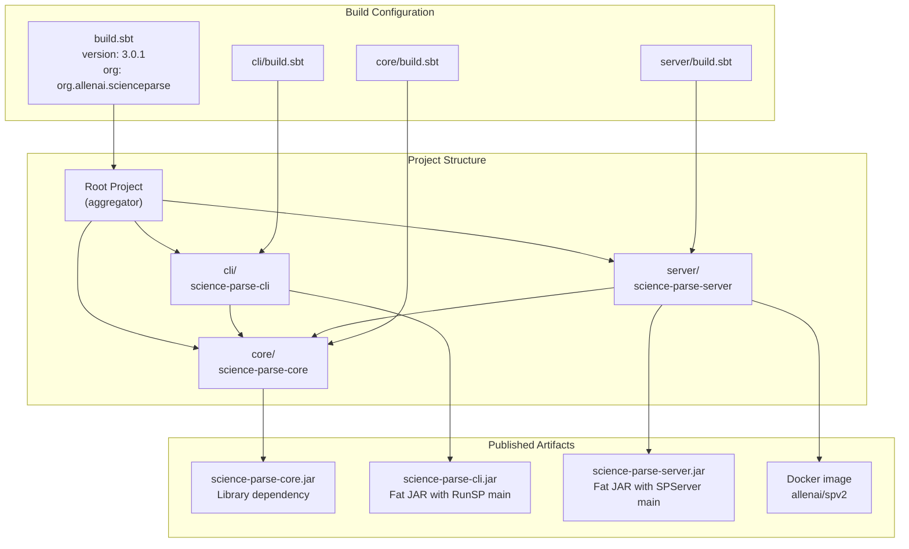
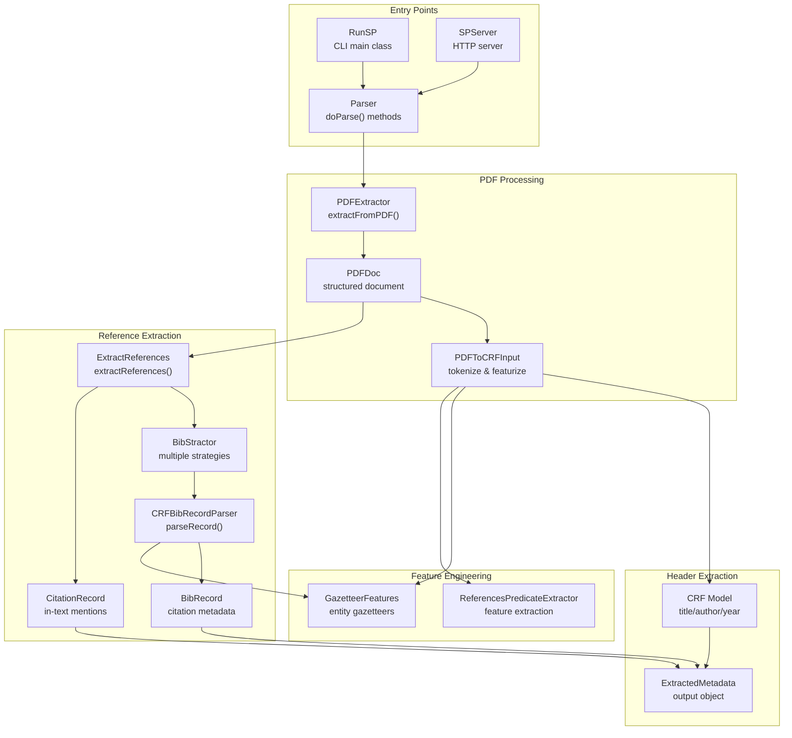

<!-- source: DeepWiki mcp.deepwiki.com · repo allenai/science-parse · page 1 Overview · fetched 2026-10-26 -->

# Overview

<details>
<summary>Relevant source files</summary>

The following files were used as context for generating this wiki page:

- [README.md](README.md)
- [build.sbt](build.sbt)
- [cli/build.sbt](cli/build.sbt)
- [core/build.sbt](core/build.sbt)
- [core/src/main/java/org/allenai/scienceparse/CRFBibRecordParser.java](core/src/main/java/org/allenai/scienceparse/CRFBibRecordParser.java)
- [core/src/main/java/org/allenai/scienceparse/GazetteerFeatures.java](core/src/main/java/org/allenai/scienceparse/GazetteerFeatures.java)
- [server/build.sbt](server/build.sbt)

</details>


## Purpose and Scope

Science Parse is a system for extracting structured metadata from scientific papers in PDF format. It uses machine learning (CRF models) and rule-based approaches to identify and extract key information from research documents. The system is designed for high-throughput batch processing as well as on-demand parsing via a REST API.

This page provides an overview of the entire Science Parse system, including its capabilities, architecture, and deployment options. For detailed information about specific components:
- For core parsing logic and library usage, see [Core Library](#2)
- For HTTP API details, see [Server Module](#3)
- For batch processing with command-line tools, see [CLI Module](#4)
- For training new models, see [Training and Evaluation](#5)

**Sources:** [README.md:1-29](), [build.sbt:8-11]()

## Extracted Metadata Fields

Science Parse extracts the following structured information from PDF documents:

| Field | Description | Data Structure |
|-------|-------------|----------------|
| **Title** | Paper title | String |
| **Authors** | List of author names | List of Strings |
| **Abstract** | Paper abstract text | String |
| **Year** | Publication year | Integer |
| **Sections** | Document sections with headings and body text | List of Section objects |
| **Bibliography** | References cited in the paper | List of `BibRecord` objects |
| **Mentions** | In-text citation locations | List of `CitationRecord` objects |
| **Venue** | Publication venue (journal/conference) | String |

Each `BibRecord` in the bibliography contains its own title, authors, venue, and year. Each `CitationRecord` links to a bibliography entry and includes the sentence context where the citation appears.

The complete output is serialized as JSON conforming to the `ExtractedMetadata` schema.

**Sources:** [README.md:3-13](), [core/src/main/java/org/allenai/scienceparse/CRFBibRecordParser.java:203-218]()

## System Modules

Science Parse is organized into three modules, each serving different use cases:

### Core Module (`science-parse-core`)

The **core** module contains all parsing logic and can be used as a library dependency in JVM applications. It includes:
- `Parser` class: Main entry point for PDF parsing
- `PDFExtractor`: Converts raw PDFs to structured `PDFDoc` objects
- `ExtractReferences`: Multi-strategy bibliography extraction
- `CRFBibRecordParser`: CRF-based citation parsing
- `GazetteerFeatures`: Entity recognition using gazetteers
- Training utilities for generating new models

The core module is published as `org.allenai.scienceparse:science-parse-core:3.0.1` and can be used directly in Scala or Java projects.

**Sources:** [build.sbt:53-58](), [core/build.sbt:7-48]()

### Server Module (`science-parse-server`)

The **server** module wraps the core parsing library in an HTTP API service running on port 8080. Key components:
- `SPServer`: Main server class with Jetty HTTP server
- REST endpoints under `/v1/` for parsing by paper ID or direct upload
- Optional `FeedbackStore`: PostgreSQL-backed system for storing corrections
- JSON serialization using spray-json

The server can be deployed as a Docker container, fat JAR, or run directly from source.

**Sources:** [build.sbt:67-72](), [server/build.sbt:1-19]()

### CLI Module (`science-parse-cli`)

The **cli** module provides a command-line interface for batch processing. Key components:
- `RunSP`: Main CLI entry point
- `PaperSource` abstraction: Supports retrieving PDFs from S3, local directories, or fallback chains
- Output to JSON files or stdout
- Suitable for large-scale batch processing

The CLI is packaged as a fat JAR that can be executed with `java -jar`.

**Sources:** [build.sbt:60-65](), [cli/build.sbt:1-18]()

## System Architecture

### Module Dependencies and Build Structure



**Sources:** [build.sbt:41-72](), [core/build.sbt:5](), [cli/build.sbt:5](), [server/build.sbt:5]()

### Core Parsing Components



This diagram maps natural language concepts to concrete code entities. The `Parser` class ([core/src/main/java/org/allenai/scienceparse/Parser.java]()) orchestrates the entire pipeline, delegating to `PDFExtractor` for layout analysis, `PDFToCRFInput` for feature engineering, and `ExtractReferences` for bibliography parsing. The `GazetteerFeatures` class ([core/src/main/java/org/allenai/scienceparse/GazetteerFeatures.java:28]()) provides entity recognition by matching token sequences against gazetteers of journal names, person names, etc.

**Sources:** [core/src/main/java/org/allenai/scienceparse/CRFBibRecordParser.java:23-29](), [core/src/main/java/org/allenai/scienceparse/GazetteerFeatures.java:28-50]()

## Deployment Options

Science Parse supports three primary deployment models:

### Library Dependency

Include the core module as a Maven or SBT dependency:

**SBT:**
```scala
libraryDependencies += "org.allenai.scienceparse" %% "science-parse-core" % "3.0.1"
```

**Maven:**
```xml
<dependency>
  <groupId>org.allenai.scienceparse</groupId>
  <artifactId>science-parse-core_2.12</artifactId>
  <version>3.0.1</version>
</dependency>
```

This is suitable for integrating Science Parse into existing JVM applications.

**Sources:** [README.md:30-46](), [build.sbt:8-11]()

### Fat JAR (Standalone Executable)

Build self-contained JAR files with all dependencies:

```bash
# Build CLI
sbt cli/assembly
java -Xmx10g -jar cli/target/scala-2.12/science-parse-cli-assembly-3.0.1.jar

# Build Server
sbt server/assembly
java -Xmx10g -jar server/target/scala-2.12/science-parse-server-assembly-3.0.1.jar
```

The CLI JAR has `RunSP` as the main class, while the Server JAR uses `SPServer`.

**Sources:** [cli/build.sbt:5](), [server/build.sbt:5](), [README.md:70-73]()

### Docker Container

The server module includes Docker deployment scripts:

```bash
cd server
./makeDocker.sh
docker run -p 8080:8080 allenai/spv2
```

This containerized deployment is suitable for cloud environments and production deployments.

**Sources:** [README.md:26]()

## Key Technologies and Dependencies

| Technology | Purpose | Version |
|------------|---------|---------|
| **Apache PDFBox** | PDF rendering and text extraction | 2.0.9 |
| **CRF Models** | Sequence labeling for metadata extraction | org.allenai:ml:0.16 |
| **pdffigures2** | Section and figure extraction | 0.1.0 |
| **OpenNLP** | Sentence tokenization for citation context | 1.7.2 |
| **AWS S3 SDK** | Paper retrieval from S3 buckets | 1.11.213 |
| **Jetty** | HTTP server for REST API | 9.4.1 |
| **PostgreSQL** | Optional feedback storage | 42.0.0 (JDBC) |
| **spray-json** | JSON serialization | 1.3.5 |

The system uses **Scala 2.12** (with 2.11 support) and **Java 8+**. The CRF models use custom feature engineering defined in `PDFToCRFInput` and `ReferencesPredicateExtractor`, with gazetteers providing entity recognition features.

**Sources:** [core/build.sbt:7-48](), [server/build.sbt:13-19](), [build.sbt:3-6]()

## Model Files and First-Run Setup

On first execution, Science Parse downloads pre-trained model files from AWS S3:
- Main CRF model for header extraction
- Bibliography CRF model for citation parsing
- Word vectors for embedding features
- Gazetteer cache (~10.2K entries)

These files are cached locally, making subsequent runs significantly faster. The models are managed through the `datastore` library and stored in `~/.ai2/datastore/` by default.

Users can train custom models using training data from DBLP, PMC, or other sources. See [Training and Evaluation](#5) for details.

**Sources:** [README.md:48](), [core/build.sbt:23]()

## Version Information

Current version: **3.0.1**

Organization: `org.allenai.scienceparse`

Published to: Bintray (`allenai/maven` repository)

Scala versions: 2.12.9 (primary), 2.11.12 (supported)

License: Apache 2.0

**Sources:** [build.sbt:8-11](), [build.sbt:21-26]()

---

