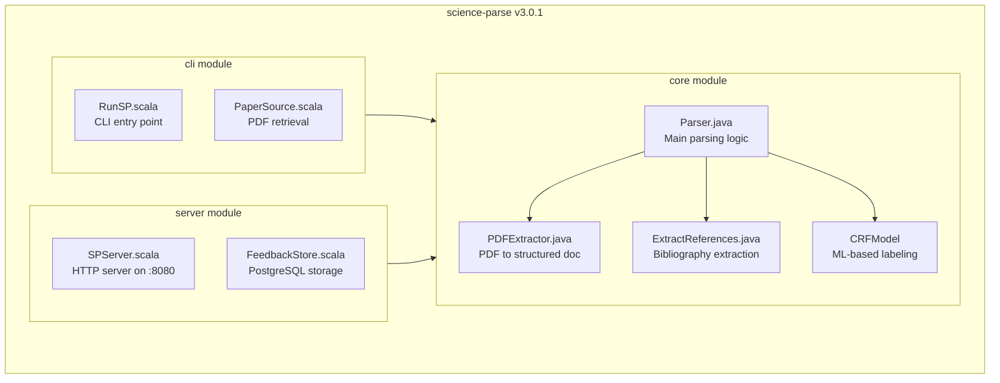
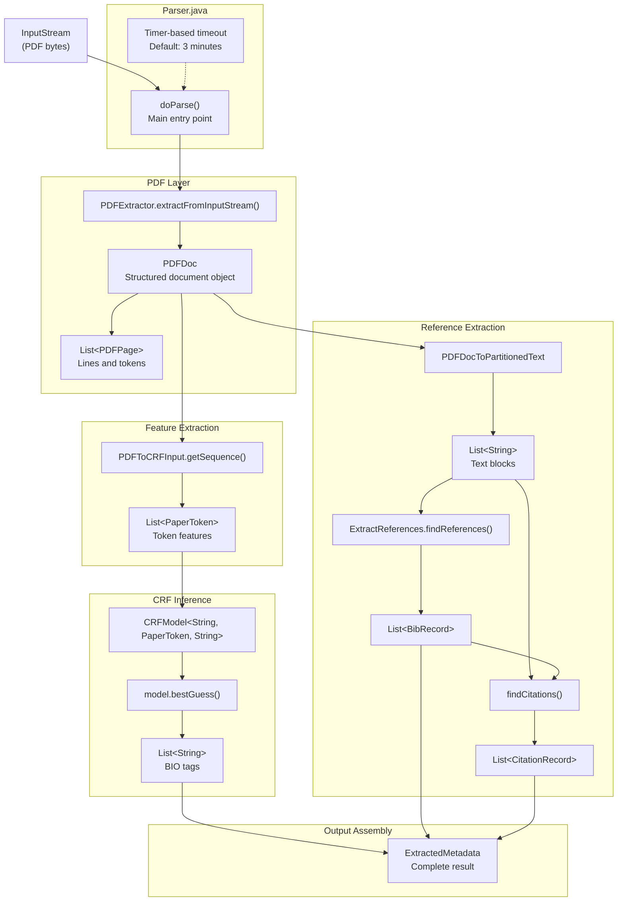
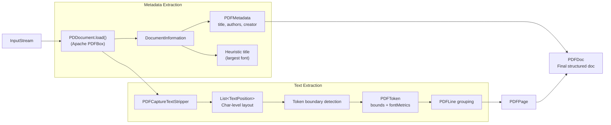
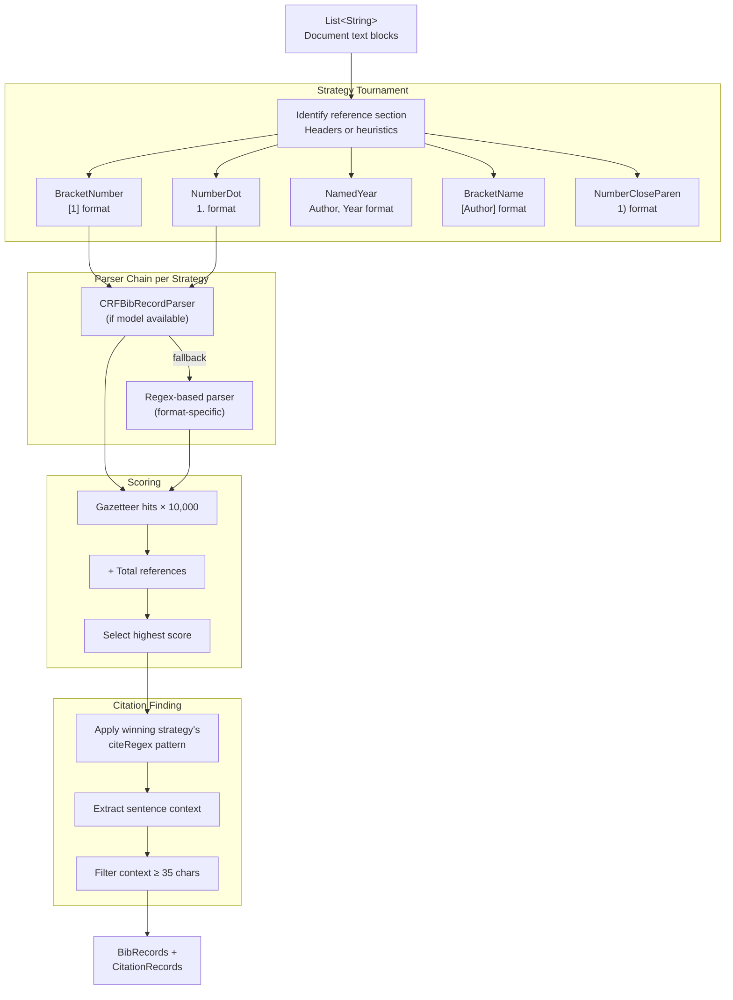
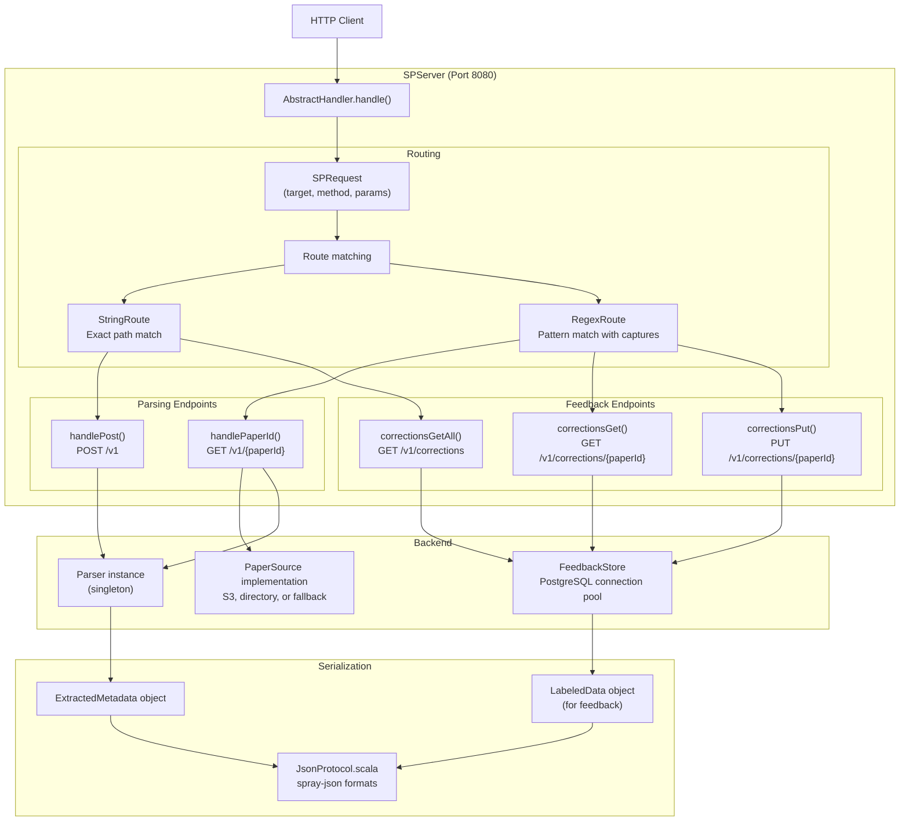

<!-- source: DeepWiki mcp.deepwiki.com · repo allenai/science-parse · page 1.1 Architecture · fetched 2026-10-26 -->

# Architecture

<details>
<summary>Relevant source files</summary>

The following files were used as context for generating this wiki page:

- [README.md](README.md)
- [build.sbt](build.sbt)
- [cli/build.sbt](cli/build.sbt)
- [core/build.sbt](core/build.sbt)
- [core/src/main/java/org/allenai/scienceparse/BibRecord.java](core/src/main/java/org/allenai/scienceparse/BibRecord.java)
- [core/src/main/java/org/allenai/scienceparse/CRFBibRecordParser.java](core/src/main/java/org/allenai/scienceparse/CRFBibRecordParser.java)
- [core/src/main/java/org/allenai/scienceparse/CheckReferences.java](core/src/main/java/org/allenai/scienceparse/CheckReferences.java)
- [core/src/main/java/org/allenai/scienceparse/CitationRecord.java](core/src/main/java/org/allenai/scienceparse/CitationRecord.java)
- [core/src/main/java/org/allenai/scienceparse/ExtractReferences.java](core/src/main/java/org/allenai/scienceparse/ExtractReferences.java)
- [core/src/main/java/org/allenai/scienceparse/GazetteerFeatures.java](core/src/main/java/org/allenai/scienceparse/GazetteerFeatures.java)
- [core/src/main/java/org/allenai/scienceparse/Parser.java](core/src/main/java/org/allenai/scienceparse/Parser.java)
- [core/src/main/java/org/allenai/scienceparse/pdfapi/PDFExtractor.java](core/src/main/java/org/allenai/scienceparse/pdfapi/PDFExtractor.java)
- [core/src/main/scala/org/allenai/scienceparse/JsonProtocol.scala](core/src/main/scala/org/allenai/scienceparse/JsonProtocol.scala)
- [core/src/main/scala/org/allenai/scienceparse/LabeledData.scala](core/src/main/scala/org/allenai/scienceparse/LabeledData.scala)
- [core/src/test/scala/org/allenai/scienceparse/JsonProtocolSpec.scala](core/src/test/scala/org/allenai/scienceparse/JsonProtocolSpec.scala)
- [server/build.sbt](server/build.sbt)
- [server/src/main/scala/org/allenai/scienceparse/FeedbackStore.scala](server/src/main/scala/org/allenai/scienceparse/FeedbackStore.scala)
- [server/src/main/scala/org/allenai/scienceparse/SPServer.scala](server/src/main/scala/org/allenai/scienceparse/SPServer.scala)

</details>


This document explains the high-level architecture of Science Parse, focusing on the system's modular structure, how components interact during PDF parsing, and the data flow between modules. For details on using the CLI or Server, see pages [4](#4) and [3](#3). For information on training models, see [5](#5).

## Module Structure

Science Parse is organized as a multi-module SBT project with three primary modules that serve different use cases while sharing a common parsing core.



**Sources:** [build.sbt:1-73](), [core/build.sbt:1-49](), [cli/build.sbt:1-19](), [server/build.sbt:1-20]()

### Core Module

The `core` module ([build.sbt:53-58]()) contains all parsing logic and can be used as a library dependency. Published to Maven Central as `org.allenai.scienceparse:science-parse-core_2.12:3.0.1`, it provides:

- `Parser` class for end-to-end PDF parsing
- PDF extraction and layout analysis via `PDFExtractor`
- CRF-based metadata extraction with trained models
- Multi-strategy reference extraction via `ExtractReferences`
- Training utilities for model generation

### CLI Module

The `cli` module ([build.sbt:60-65]()) provides batch processing capabilities through the `RunSP` command-line tool. It adds:

- Paper retrieval strategies (`PaperSource` implementations for S3, directories, fallback chains)
- Command-line argument parsing with `scopt`
- JSON output serialization

The module builds to a fat JAR via `sbt assembly` with main class `org.allenai.scienceparse.RunSP` ([cli/build.sbt:5]()).

### Server Module

The `server` module ([build.sbt:67-72]()) wraps the core parser in an HTTP API using Jetty. It provides:

- REST endpoints on port 8080 via `SPServer`
- Optional PostgreSQL-backed feedback system via `FeedbackStore`
- JSON serialization using spray-json with `JsonProtocol`

The module builds to both a fat JAR and Docker container ([server/build.sbt:5]()).

## Core Parsing Architecture

The core module orchestrates multiple subsystems to extract structured metadata from PDFs. The main entry point is the `Parser` class.



**Sources:** [core/src/main/java/org/allenai/scienceparse/Parser.java:84-852](), [core/src/main/java/org/allenai/scienceparse/pdfapi/PDFExtractor.java:1-441](), [core/src/main/java/org/allenai/scienceparse/ExtractReferences.java:1-800]()

### Parser Initialization

The `Parser` class constructor ([core/src/main/java/org/allenai/scienceparse/Parser.java:117-205]()) loads three model files:

1. **Main CRF model** (`productionModel.dat`) - Trained to identify title, authors, year, abstract from PDF headers
2. **Gazetteer** (`gazetteer.json`) - 10.2K paper titles for reference validation
3. **Bibliography model** (`productionBibModel.dat`) - CRF model for parsing citation strings

Models are downloaded on first use via the `Datastore` API and cached locally. A binary gazetteer cache is created at `$TMPDIR/{filename}-{hash}.gazetteerCache.bin` to speed up subsequent loads ([Parser.java:171-195]()).

### PDF Extraction Pipeline

The `PDFExtractor` class converts raw PDF bytes into structured documents:



**Sources:** [core/src/main/java/org/allenai/scienceparse/pdfapi/PDFExtractor.java:38-441]()

Key implementation details:
- `PDFCaptureTextStripper` ([PDFExtractor.java:337-439]()) extends PDFBox's `PDFTextStripper` to capture layout
- Token boundary detection occurs on whitespace or column breaks ([PDFExtractor.java:350-381]())
- Font metrics include family name, point size, and space width ([PDFExtractor.java:250-264]())
- Superscript detection uses vertical position thresholds, encoded with `⍐` and `⍗` markers ([PDFExtractor.java:292-328]())

### CRF Feature Engineering and Inference

The `PDFToCRFInput` class converts `PDFDoc` into sequences of `PaperToken` objects with rich features for CRF inference. Features include:

| Feature Type | Examples | Purpose |
|--------------|----------|---------|
| Lexical | Token text, normalized forms | Direct string matching |
| Orthographic | `ALL_CAPS`, `Capitalized`, punctuation patterns | Title/author format detection |
| Positional | Line number, page number, x/y coordinates | Header region identification |
| Typographic | Font family, point size, bold/italic | Emphasis detection |
| Contextual | Previous/next token features | Sequence modeling |
| Gazetteer | Presence in known paper titles | Reference validation |

The `CRFModel` applies Viterbi decoding to produce BIO-tagged labels ([Parser.java:88]()): `B_title`, `I_title`, `B_author`, `I_author`, `B_year`, `W_abstract`, etc.

**Sources:** [core/src/main/java/org/allenai/scienceparse/PDFToCRFInput.java]() (implied), [core/src/main/java/org/allenai/scienceparse/Parser.java:262-307]()

### Multi-Strategy Reference Extraction

`ExtractReferences` implements a tournament-based approach where multiple extraction strategies compete:



**Sources:** [core/src/main/java/org/allenai/scienceparse/ExtractReferences.java:59-537]()

The tournament architecture ([ExtractReferences.java:517-537]()):
1. All strategies parse the reference section in parallel
2. Each strategy produces a list of `BibRecord` objects
3. Scoring: `score = (gazetteer_hits × 10000) + total_references`
4. Winning strategy's `citeRegex` pattern is used to find in-text citations

Strategy implementations:
- `BracketNumber` and derivatives: Handle `[1]`, `[1-3]` formats ([ExtractReferences.java:110-136]())
- `NumberDot` and derivatives: Handle `1.`, `2.` formats with various author/year patterns ([ExtractReferences.java:119-127]())
- `NamedYear`: Handles author-year citations like "Etzioni et al. (2005)" ([ExtractReferences.java:113-118]())

Each strategy can use multiple `BibRecordParser` implementations in a fallback chain. The `CRFBibRecordParser` ([core/src/main/java/org/allenai/scienceparse/CRFBibRecordParser.java:23-272]()) uses a separate CRF model trained on Cora, UMass, and Kermit citation datasets. It includes a `LoadingCache` with 10-minute TTL to avoid recomputing parses ([CRFBibRecordParser.java:153-163]()).

## Server Architecture

The `SPServer` class implements a lightweight HTTP API using Jetty with custom routing:



**Sources:** [server/src/main/scala/org/allenai/scienceparse/SPServer.scala:1-395](), [server/src/main/scala/org/allenai/scienceparse/FeedbackStore.scala:1-147]()

### Routing System

The routing system uses two route types ([SPServer.scala:167-213]()):

- **StringRoute**: Exact string matching for static paths like `/v1/corrections`
- **RegexRoute**: Pattern matching with named capture groups for dynamic paths like `/v1/([a-f0-9]{40})` capturing `paperId`

Request handling flow ([SPServer.scala:233-278]()):
1. Incoming request converted to `SPRequest` with target, method, query params
2. Routes tried sequentially via `routes.iterator.flatMap(_.handle(spRequest))`
3. First matching route's handler executes
4. If no route matches, returns 404 or 405 with allowed methods

### Feedback System

The feedback system ([FeedbackStore.scala:11-146]()) is optional and disabled by default. When enabled:

**Database Schema:**
- `feedback` table: `(paperId CHAR(40), timeAdded TIMESTAMP, value JSONB)`
- `settings` table: Tracks schema version for migrations
- Versioned migrations ensure schema upgrades ([FeedbackStore.scala:52-83]())

**API Endpoints:**
- `GET /v1/corrections/{paperId}`: Retrieves latest correction for a paper ([SPServer.scala:332-343]())
- `PUT /v1/corrections/{paperId}`: Stores correction as `LabeledData` in JSONB ([SPServer.scala:345-377]())
- `GET /v1/corrections?onOrAfter=...&before=...`: Lists all corrections with time filtering ([SPServer.scala:379-393]())

Connection pooling uses ScalikeJDBC with separate connection pools for regular user and root (for schema migrations) ([FeedbackStore.scala:12-86]()).

## Data Models

The system uses several key data structures for representing parsed documents:

### ExtractedMetadata

Primary output format containing all extracted information ([core/src/main/java/org/allenai/scienceparse/ExtractedMetadata.java]()):

```
ExtractedMetadata {
    title: String
    authors: List<String>
    emails: List<String>
    year: int
    abstractText: String
    sections: List<Section>
    references: List<BibRecord>
    referenceMentions: List<CitationRecord>
    creator: String (PDF producer)
    source: enum (CRF, META, MINIMAL)
}
```

### LabeledData

Training and evaluation format supporting optional fields ([core/src/main/scala/org/allenai/scienceparse/LabeledData.scala:94-116]()):

```scala
case class LabeledData(
  id: String,
  title: Option[String],
  authors: Option[Seq[Author]],
  venue: Option[String],
  year: Option[Int],
  abstractText: Option[String],
  sections: Option[Seq[Section]],
  references: Option[Seq[Reference]],
  mentions: Option[Seq[Mention]]
)
```

### BibRecord and CitationRecord

Reference representation ([core/src/main/java/org/allenai/scienceparse/BibRecord.java:12-87]()):

```
BibRecord {
    title: String
    author: List<String>
    venue: String
    year: int
    citeRegEx: Pattern (for finding "[1]" style)
    shortCiteRegEx: Pattern (for finding "Author, 2020" style)
}

CitationRecord {
    referenceID: int (index into references list)
    context: String (surrounding sentence)
    startOffset: int
    endOffset: int
}
```

### JSON Serialization

All data models serialize via spray-json with `JsonProtocol` ([core/src/main/scala/org/allenai/scienceparse/JsonProtocol.scala:7-188]()). Custom formats handle Java collections, `Pattern` objects, and optional fields. Round-trip serialization is tested in [core/src/test/scala/org/allenai/scienceparse/JsonProtocolSpec.scala]().

## Deployment Configurations

Science Parse supports three deployment modes, each producing different artifacts:

### Library Dependency

The core module publishes to Bintray/Maven Central ([build.sbt:8-11, 26-27]()):

```
org.allenai.scienceparse:science-parse-core_2.12:3.0.1
```

Usage: Create `Parser` instance and call `doParse(InputStream)`. Models download automatically on first use.

### Command-Line Tool

Built via `sbt cli/assembly` ([cli/build.sbt:5-10]()), produces:
- `science-parse-cli-3.0.1.jar` - Runnable fat JAR with all dependencies

Run: `java -Xmx10g -jar science-parse-cli-3.0.1.jar [options]`

### Docker Container

Built via `makeDocker.sh` (references in README), produces containerized server on port 8080. The server JAR is built via `sbt server/assembly` ([server/build.sbt:5-11]()).

Environment variables:
- `--enableFeedback`: Enable PostgreSQL feedback storage
- `--useS2Bucket`: Use internal S3 bucket for paper retrieval
- `-p paperDirectory`: Local PDF directory for fallback

**Sources:** [README.md:1-104](), [build.sbt:1-73](), [server/src/main/scala/org/allenai/scienceparse/SPServer.scala:24-103]()

---

