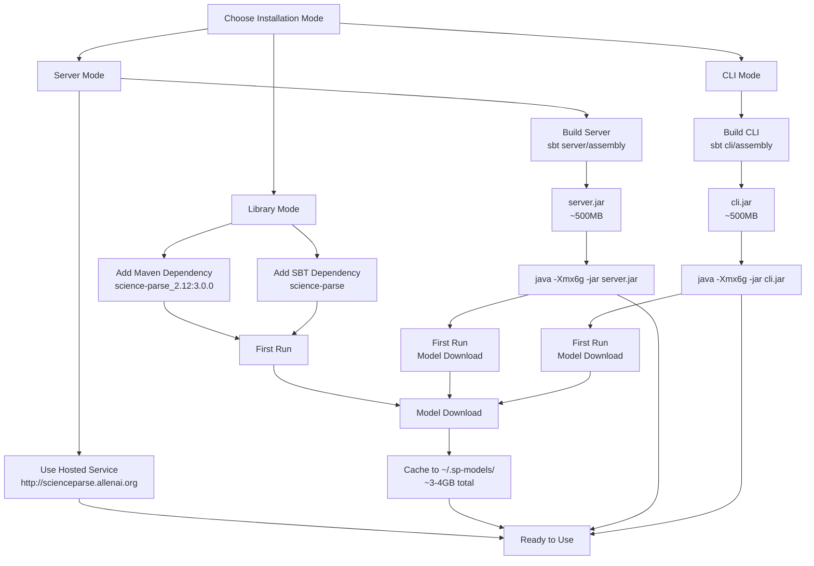
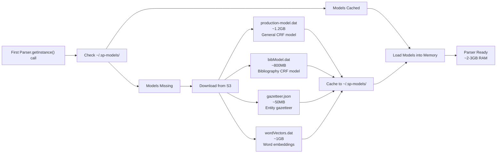

<!-- source: DeepWiki mcp.deepwiki.com · repo allenai/science-parse · page 1.2 Getting Started · fetched 2026-10-26 -->

# Getting Started

<details>
<summary>Relevant source files</summary>

The following files were used as context for generating this wiki page:

- [README.md](README.md)
- [cli/README.md](cli/README.md)
- [core/README.md](core/README.md)
- [server/README.md](server/README.md)

</details>


This page provides installation instructions, initial setup, and basic usage examples for Science Parse. It covers the three main ways to use Science Parse: as a web service, command-line tool, or library dependency. For detailed information about the underlying architecture, see [Architecture](#1.1). For module-specific details, see [Core Library](#2), [Server Module](#3), and [CLI Module](#4).

## Prerequisites

Science Parse requires:
- **JVM**: Java 8 or later
- **Memory**: Minimum 6GB heap (`-Xmx6g`), plus ~2GB off-heap
- **Disk Space**: ~3-4GB for cached model files (downloaded on first run)
- **Build Tool** (if building from source): SBT 1.2.7+

**Sources:** [README.md:48-58](), [cli/README.md:12-17](), [server/README.md:20-24]()

## Installation Options

Science Parse provides three deployment modes, each serving different use cases:

| Mode | Use Case | How to Get Started | Best For |
|------|----------|-------------------|----------|
| **Server** | Parse papers via HTTP API | Use hosted service or build with `sbt server/assembly` | Quick experimentation, production API |
| **CLI** | Batch processing | Build with `sbt cli/assembly` | Processing thousands of PDFs |
| **Library** | Programmatic integration | Add Maven/SBT dependency | Embedding in JVM applications |

**Sources:** [README.md:22-28](), [README.md:30-46]()

### Installation Flow



**Sources:** [README.md:22-58](), [server/README.md:18-22](), [cli/README.md:1-8]()

## Using the Hosted Service (Quickest Start)

The fastest way to try Science Parse is using the hosted service at `http://scienceparse.allenai.org`. No installation required.

### Parse by S2 Paper ID

```bash
# Get full output including sections
curl "http://scienceparse.allenai.org/v1/498bb0efad6ec15dd09d941fb309aa18d6df9f5f"

# Get compact output without body text
curl "http://scienceparse.allenai.org/v1/498bb0efad6ec15dd09d941fb309aa18d6df9f5f?skipFields=sections"
```

### Parse by PDF Upload

```bash
curl -v -H "Content-type: application/pdf" \
  --data-binary @paper.pdf \
  "http://scienceparse.allenai.org/v1"
```

**Important:** The URL must not have a trailing slash, and `Content-type` must be `application/pdf`.

**Sources:** [server/README.md:1-16]()

## Building from Source

### Build Server

```bash
# Clone repository
git clone https://github.com/allenai/science-parse
cd science-parse

# Build server super-jar
sbt server/assembly

# Run server (binds to port 8080)
java -Xmx6g -jar server/target/scala-2.12/server-assembly-3.0.1.jar
```

### Build CLI

```bash
# Build CLI super-jar
sbt cli/assembly

# Run CLI
java -Xmx6g -jar cli/target/scala-2.12/cli-assembly-3.0.1.jar --help
```

**Sources:** [README.md:64-73](), [server/README.md:18-22](), [cli/README.md:1-8]()

## Using as a Library

Add Science Parse as a dependency to your project:

### SBT

```scala
libraryDependencies += "org.allenai" %% "science-parse" % "3.0.0"
```

### Maven

```xml
<dependency>
  <groupId>org.allenai</groupId>
  <artifactId>science-parse_2.12</artifactId>
  <version>3.0.0</version>
</dependency>
```

### Basic Usage in Java

```java
import org.allenai.scienceparse.Parser;
import org.allenai.scienceparse.ExtractedMetadata;

// Get singleton Parser instance
final Parser parser = Parser.getInstance();

// Parse PDF without timeout
final ExtractedMetadata em = parser.doParse(inputStream);

// Parse PDF with 30-second timeout
final ExtractedMetadata em = parser.doParseWithTimeout(inputStream, 30000);
```

The `Parser` class is defined in [core/src/main/java/org/allenai/scienceparse/Parser.java](), and `ExtractedMetadata` in [core/src/main/java/org/allenai/scienceparse/ExtractedMetadata.java]().

**Sources:** [README.md:30-46](), [core/README.md:6-22]()

## First-Time Setup and Model Downloads

On first run, Science Parse downloads four model files from AWS S3:



### Model File Details

| Model File | Size | Purpose | Training Source |
|------------|------|---------|-----------------|
| `production-model.dat` | ~1.2GB | Title, author, year extraction | DBLP + PMC papers |
| `bibModel.dat` | ~800MB | Bibliography parsing | Cora, UMass, Kermit datasets |
| `gazetteer.json` | ~50MB | Entity recognition (10.2K entries) | Venue and author lists |
| `wordVectors.dat` | ~1GB | Word embeddings for CRF features | Pre-trained vectors |

**First Run Timing:**
- Download: 5-15 minutes (depending on bandwidth)
- Subsequent starts: 10-20 seconds (loading from cache)

**Sources:** [README.md:48-48](), [core/README.md:44-56]()

## Optional Image Format Dependencies

For licensing reasons, Science Parse does not bundle certain image format libraries. Without these, PDFs containing JPEG2000 or JBIG2 images cannot be processed.

### Add to SBT

```scala
libraryDependencies ++= Seq(
  "com.github.jai-imageio" % "jai-imageio-core" % "1.2.1",
  "com.github.jai-imageio" % "jai-imageio-jpeg2000" % "1.3.0",
  "com.levigo.jbig2" % "levigo-jbig2-imageio" % "1.6.5"
)
```

### Add to Maven

```xml
<dependency>
  <groupId>com.github.jai-imageio</groupId>
  <artifactId>jai-imageio-core</artifactId>
  <version>1.2.1</version>
</dependency>
<dependency>
  <groupId>com.github.jai-imageio</groupId>
  <artifactId>jai-imageio-jpeg2000</artifactId>
  <version>1.3.0</version>
</dependency>
<dependency>
  <groupId>com.levigo.jbig2</groupId>
  <artifactId>levigo-jbig2-imageio</artifactId>
  <version>1.6.5</version>
</dependency>
```

**Sources:** [README.md:50-58]()

## Basic Usage Examples

### Server Mode: Processing Papers

```bash
# Start server
java -Xmx6g -jar server-assembly.jar

# Parse by S2 ID (GET request)
curl "http://localhost:8080/v1/498bb0efad6ec15dd09d941fb309aa18d6df9f5f"

# Parse uploaded PDF (POST request)
curl -H "Content-type: application/pdf" \
  --data-binary @paper.pdf \
  "http://localhost:8080/v1"
```

The server binds to port 8080 by default. Run with `--help` to see configuration options. The `SPServer` class [server/src/main/scala/org/allenai/scienceparse/SPServer.scala]() handles routing and the `handlePaperId` and `handlePost` methods process requests.

**Sources:** [server/README.md:9-22]()

### CLI Mode: Batch Processing

```bash
# Parse single PDF
java -Xmx6g -jar cli-assembly.jar paper.pdf

# Parse by S2 ID
java -Xmx6g -jar cli-assembly.jar 18bc3569da037a6cb81fb081e2856b77b321c139

# Parse directory of PDFs
java -Xmx6g -jar cli-assembly.jar papers/

# Parse from file list
java -Xmx6g -jar cli-assembly.jar papers.txt

# Write output to directory (one JSON per input)
java -Xmx6g -jar cli-assembly.jar -o output/ papers/

# Write output to single file (one JSON per line)
java -Xmx6g -jar cli-assembly.jar -f results.jsonl papers/
```

The `RunSP` class [cli/src/main/scala/org/allenai/scienceparse/RunSP.scala]() implements the CLI with parallel processing capabilities.

**Sources:** [cli/README.md:5-38]()

### Library Mode: Programmatic Usage

```java
import org.allenai.scienceparse.Parser;
import org.allenai.scienceparse.ExtractedMetadata;
import java.io.FileInputStream;
import java.io.InputStream;

public class Example {
    public static void main(String[] args) throws Exception {
        // Initialize parser (downloads models on first run)
        final Parser parser = Parser.getInstance();
        
        // Parse PDF
        try (InputStream is = new FileInputStream("paper.pdf")) {
            ExtractedMetadata metadata = parser.doParse(is);
            
            // Access extracted fields
            System.out.println("Title: " + metadata.title);
            System.out.println("Authors: " + metadata.authors);
            System.out.println("Year: " + metadata.year);
            System.out.println("Abstract: " + metadata.abstractText);
            System.out.println("References: " + metadata.references.size());
        }
    }
}
```

**Sources:** [core/README.md:6-40]()

## Output Format

All modes produce JSON output with this structure:

```json
{
  "title": "Paper Title",
  "authors": ["Author One", "Author Two"],
  "year": 2020,
  "abstractText": "Abstract content...",
  "sections": [
    {
      "heading": "Introduction",
      "text": "Section content..."
    }
  ],
  "references": [
    {
      "title": "Reference title",
      "authors": ["Ref Author"],
      "venue": "Conference Name",
      "year": 2019
    }
  ],
  "referenceMentions": [
    {
      "referenceID": 0,
      "context": "sentence with citation [1]"
    }
  ]
}
```

The `ExtractedMetadata` class [core/src/main/java/org/allenai/scienceparse/ExtractedMetadata.java:24-37]() defines this structure. The `JsonProtocol` object [core/src/main/scala/org/allenai/scienceparse/JsonProtocol.scala]() handles JSON serialization.

**Sources:** [README.md:3-14](), [core/README.md:22-38]()

## Memory Configuration

Science Parse requires substantial memory due to CRF models and PDF processing:

| Component | Memory Usage | Notes |
|-----------|--------------|-------|
| Heap (`-Xmx`) | 6GB minimum | Some documents require more |
| Off-heap | ~2GB | Used by PDFBox and native libraries |
| Model files in RAM | ~2-3GB | Loaded at startup |
| **Total Recommended** | **10GB+** | 6GB heap + 2GB off-heap + 2GB models |

### Memory Troubleshooting

**OutOfMemoryError:** Increase `-Xmx` value:
```bash
java -Xmx10g -jar jarfile.jar  # Increase to 10GB
```

**Slow startup:** Models are downloading or loading. Subsequent runs are faster.

**Sources:** [cli/README.md:12-17](), [server/README.md:20-24]()

## Common Command-Line Options

### Server Options

```bash
java -jar server-assembly.jar [OPTIONS]

--port PORT           # Bind to specific port (default: 8080)
--model FILE          # Use custom CRF model
--bibModel FILE       # Use custom bibliography model
--gazetteer FILE      # Use custom gazetteer
--paperDirectory DIR  # Local PDF directory for paper IDs
--dbUrl URL           # PostgreSQL URL for feedback system
```

### CLI Options

```bash
java -jar cli-assembly.jar [OPTIONS] [INPUTS...]

-o, --outputDir DIR   # Write JSON files to directory
-f, --outputFile FILE # Write JSON lines to file
--model FILE          # Use custom CRF model
--bibModel FILE       # Use custom bibliography model
--timeout MS          # Per-document timeout in milliseconds
```

Run either with `--help` to see all options.

**Sources:** [server/README.md:22-22](), [cli/README.md:7-9]()

## Development Setup (IntelliJ)

If you plan to develop Science Parse:

1. **Install Lombok Plugin:**
   - Go to IntelliJ IDEA → Preferences → Plugins
   - Search for "Lombok" and install
   - Restart IntelliJ

2. **Enable Annotation Processing:**
   - Go to Preferences → Build, Execution, Deployment → Compiler → Annotation Processors
   - Check "Enable annotation processing"

3. **Import SBT Project:**
   - Open IntelliJ → File → Open
   - Select `build.sbt` file
   - Choose "Open as Project"

Lombok provides useful annotations like `@Data`, `@val` for cleaner Java code. See [README.md:75-84]() for details.

**Sources:** [README.md:75-84]()

## Next Steps

After installation and basic usage:

- **Core Library Details:** See [Parser Class](#2.1) for advanced usage, timeout handling, and customization
- **Server Deployment:** See [Server Deployment](#3.3) for Docker, production configuration, and feedback system
- **CLI Advanced Usage:** See [CLI Usage and Options](#4.1) for batch processing strategies and input formats
- **Training Models:** See [Training and Evaluation](#5) to create custom models
- **Architecture Overview:** See [Architecture](#1.1) for system design and component relationships

For questions or issues, create a GitHub issue at https://github.com/allenai/science-parse.

**Sources:** [README.md:1-104]()

---

