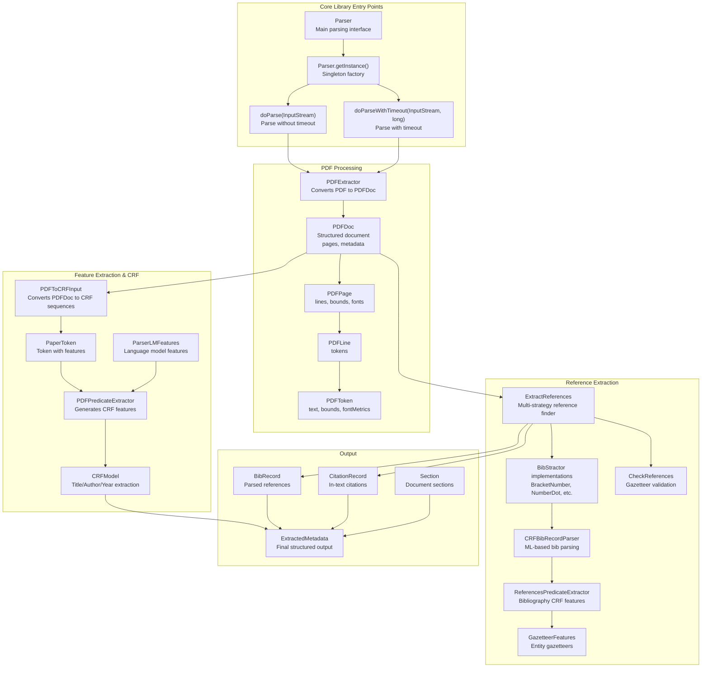
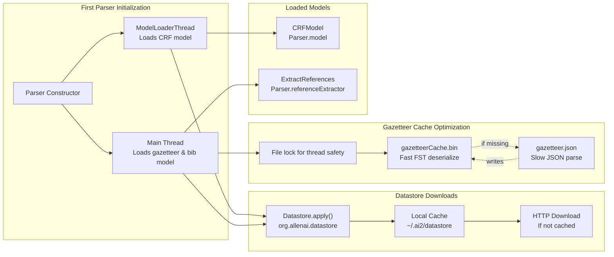
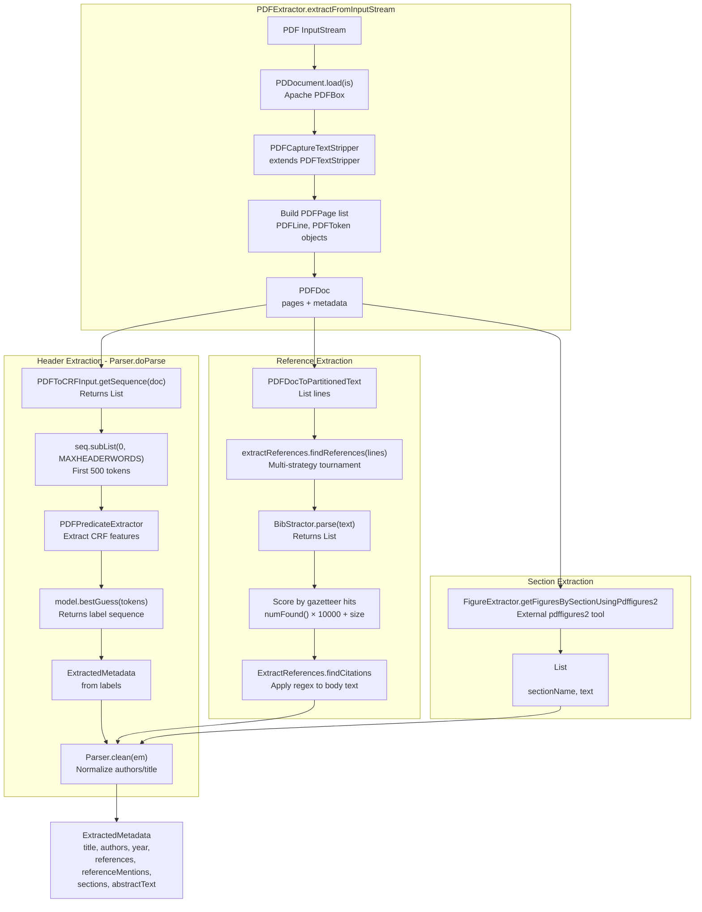
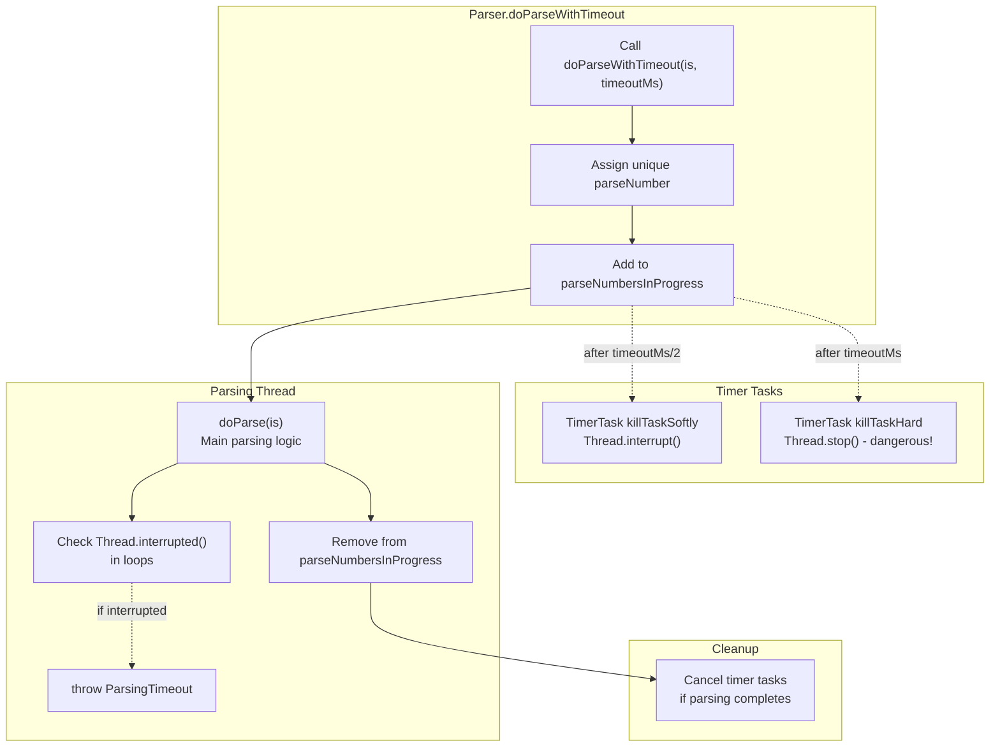

<!-- source: DeepWiki mcp.deepwiki.com · repo allenai/science-parse · page 2 Core Library · fetched 2026-10-26 -->

# Core Library

<details>
<summary>Relevant source files</summary>

The following files were used as context for generating this wiki page:

- [build.sbt](build.sbt)
- [cli/README.md](cli/README.md)
- [cli/build.sbt](cli/build.sbt)
- [core/README.md](core/README.md)
- [core/build.sbt](core/build.sbt)
- [core/src/main/java/org/allenai/scienceparse/CRFBibRecordParser.java](core/src/main/java/org/allenai/scienceparse/CRFBibRecordParser.java)
- [core/src/main/java/org/allenai/scienceparse/CheckReferences.java](core/src/main/java/org/allenai/scienceparse/CheckReferences.java)
- [core/src/main/java/org/allenai/scienceparse/ExtractReferences.java](core/src/main/java/org/allenai/scienceparse/ExtractReferences.java)
- [core/src/main/java/org/allenai/scienceparse/GazetteerFeatures.java](core/src/main/java/org/allenai/scienceparse/GazetteerFeatures.java)
- [core/src/main/java/org/allenai/scienceparse/Parser.java](core/src/main/java/org/allenai/scienceparse/Parser.java)
- [core/src/main/java/org/allenai/scienceparse/pdfapi/PDFExtractor.java](core/src/main/java/org/allenai/scienceparse/pdfapi/PDFExtractor.java)
- [server/README.md](server/README.md)
- [server/build.sbt](server/build.sbt)

</details>


The Core Library is the foundational module of Science Parse that implements all PDF parsing logic. It provides the capabilities to extract structured metadata (titles, authors, year, abstracts, sections, references, and citations) from scholarly PDF documents. This library can be used standalone as a Maven/SBT dependency in JVM applications, or wrapped by the Server and CLI modules for specific deployment scenarios.

For information about using the Server module's HTTP API, see [Server Module](#3). For command-line batch processing, see [CLI Module](#4). For training new models, see [Training and Evaluation](#5).

## Core Library Structure

The Core Library is organized around several key components that work together to transform PDFs into structured metadata:



**Sources:** [core/src/main/java/org/allenai/scienceparse/Parser.java:1-1000](), [core/src/main/java/org/allenai/scienceparse/pdfapi/PDFExtractor.java:1-441](), [core/src/main/java/org/allenai/scienceparse/ExtractReferences.java:1-850]()

## Adding as a Dependency

The Core Library is published to Maven repositories as `org.allenai.scienceparse:science-parse-core`. Add it to your project:

**SBT:**
```scala
libraryDependencies += "org.allenai.scienceparse" %% "science-parse-core" % "3.0.1"
```

**Maven:**
```xml
<dependency>
    <groupId>org.allenai.scienceparse</groupId>
    <artifactId>science-parse-core</artifactId>
    <version>3.0.1</version>
</dependency>
```

**Gradle:**
```gradle
implementation 'org.allenai.scienceparse:science-parse-core:3.0.1'
```

The Core Library requires Java 8 or higher and is cross-compiled for Scala 2.11 and 2.12.

**Sources:** [build.sbt:1-73](), [core/build.sbt:1-49]()

## Basic Usage

The primary entry point is the `Parser` class, which is typically used as a singleton:

```java
import org.allenai.scienceparse.Parser;
import org.allenai.scienceparse.ExtractedMetadata;
import java.io.FileInputStream;

// Get singleton instance (lazy-loads models on first call)
final Parser parser = Parser.getInstance();

// Parse a PDF without timeout
try (FileInputStream fis = new FileInputStream("paper.pdf")) {
    ExtractedMetadata metadata = parser.doParse(fis);
    System.out.println("Title: " + metadata.title);
    System.out.println("Authors: " + metadata.authors);
    System.out.println("Year: " + metadata.year);
}

// Parse with timeout (throws ParsingTimeout if exceeded)
try (FileInputStream fis = new FileInputStream("paper.pdf")) {
    ExtractedMetadata metadata = parser.doParseWithTimeout(fis, 30000); // 30 second timeout
}
```

**Constructor Options:**

The `Parser` class provides several constructors for custom model paths:

| Constructor | Description |
|------------|-------------|
| `Parser()` | Default constructor, uses production models from datastore |
| `Parser(Path modelFile, Path gazetteerFile, Path bibModelFile)` | Custom model file paths |
| `Parser(InputStream modelStream, InputStream gazStream, InputStream bibStream)` | Models from input streams |

**Memory Requirements:**

The Core Library requires significant memory:
- Minimum heap: 6GB (`-Xmx6g`)
- Some documents may require more
- Additional off-heap memory used (2GB+ recommended beyond `-Xmx`)

**Sources:** [core/src/main/java/org/allenai/scienceparse/Parser.java:84-219](), [core/README.md:1-71]()

## Model Files and Initialization

Science Parse uses four model files that are downloaded and cached automatically on first use:

| Model File | Purpose | Default Version | Location Method |
|-----------|---------|-----------------|-----------------|
| Production Model | CRF model for title/author/year extraction | Version 9 | `Parser.getDefaultProductionModel()` |
| Gazetteer | Entity lists for validation (10.2K entries) | Version 5 | `Parser.getDefaultGazetteer()` |
| Bibliography Model | CRF model for bibliography parsing | Version 7 | `Parser.getDefaultBibModel()` |
| Gazetteer Directory | Kermit gazetteers for entity features | Version 1 | `Parser.getDefaultGazetteerDir()` |



**Gazetteer Cache Optimization:**

The gazetteer JSON file takes significant time to parse. The Core Library creates a binary cache:
- Cache location: `/tmp/gazetteer.json-{hashcode}.gazetteerCache.bin`
- Uses FST (Fast Serialization) for rapid deserialization
- File locking ensures thread-safe creation
- Subsequent loads are ~100x faster

**Parallel Loading:**

The `Parser` constructor uses parallel loading for faster initialization:
1. Main model loads in a separate thread
2. Gazetteer and bibliography model load in the constructor thread
3. Constructor waits for both to complete before returning

**Sources:** [core/src/main/java/org/allenai/scienceparse/Parser.java:96-205](), [core/src/main/java/org/allenai/scienceparse/ExtractReferences.java:69-170]()

## Parsing Pipeline Flow

The following diagram shows the complete flow from PDF input to `ExtractedMetadata` output, with actual class and method names:



**Key Methods:**

| Method | Location | Purpose |
|--------|----------|---------|
| `Parser.doParse(InputStream)` | [Parser.java:940-979]() | Main entry point, orchestrates entire pipeline |
| `PDFExtractor.extractFromInputStream(InputStream)` | [PDFExtractor.java:119-192]() | Converts PDF bytes to `PDFDoc` structure |
| `PDFToCRFInput.getSequence(PDFDoc)` | Referenced in Parser | Converts `PDFDoc` to `List<PaperToken>` |
| `ExtractReferences.findReferences(List<String>)` | [ExtractReferences.java:517-537]() | Multi-strategy reference extraction |
| `ExtractReferences.findCitations(...)` | [ExtractReferences.java:397-460]() | Finds in-text citations |
| `Parser.clean(ExtractedMetadata)` | [Parser.java:816-819]() | Normalizes output |

**Sources:** [core/src/main/java/org/allenai/scienceparse/Parser.java:940-1060](), [core/src/main/java/org/allenai/scienceparse/pdfapi/PDFExtractor.java:119-192](), [core/src/main/java/org/allenai/scienceparse/ExtractReferences.java:397-537]()

## Component Responsibilities

### Parser Class

The `Parser` class is the main facade that coordinates all parsing operations. See [Parser Class](#2.1) for detailed documentation.

**Key Responsibilities:**
- Model loading and caching
- Timeout management for parsing operations
- Header metadata extraction using CRF models
- Coordination of reference extraction
- Result assembly into `ExtractedMetadata`

**Sources:** [core/src/main/java/org/allenai/scienceparse/Parser.java:84-1060]()

### PDFExtractor

Converts raw PDF bytes into structured `PDFDoc` objects with layout information. See [PDF Processing Pipeline](#2.2) for detailed documentation.

**Key Features:**
- Uses Apache PDFBox 2.0.9 for PDF rendering
- Extracts tokens with font metrics and bounding boxes
- Detects superscripts (e.g., citation markers)
- Handles heuristic title extraction when metadata is poor
- Outputs `PDFPage` → `PDFLine` → `PDFToken` hierarchy

**Sources:** [core/src/main/java/org/allenai/scienceparse/pdfapi/PDFExtractor.java:1-441]()

### ExtractReferences

Implements multi-strategy reference extraction with a tournament-based approach. See [Reference and Citation Extraction](#2.3) for detailed documentation.

**Strategy Implementations:**

| `BibStractor` Class | Citation Format | Example |
|---------------------|----------------|---------|
| `BracketNumber` | `[1]` | `[1] Smith, J. Title. Venue 2020.` |
| `NumberDot` | `1.` | `1. Smith, J. Title. Venue 2020.` |
| `NamedYear` | Author, Year | `Smith, J. 2020. Title. Venue.` |
| `BracketName` | `[Smith]` | `[Smith] Title. Venue 2020.` |
| `NumberCloseParen` | `1)` | `1) Smith, J. Title. Venue 2020.` |

**Sources:** [core/src/main/java/org/allenai/scienceparse/ExtractReferences.java:1-850]()

### CRFBibRecordParser

Uses CRF models to parse individual bibliography entries into structured `BibRecord` objects. See [Reference and Citation Extraction](#2.3) for detailed documentation.

**Key Features:**
- Loading cache with 10-minute TTL for parsed entries (max 10,240 entries)
- Handles Cora, UMass, and Kermit training data formats
- Extracts title, authors, venue, year from unstructured bibliography strings
- Fallback to regex-based parsers if CRF fails

**Sources:** [core/src/main/java/org/allenai/scienceparse/CRFBibRecordParser.java:1-273]()

### GazetteerFeatures

Provides entity gazetteers for feature extraction and validation. See [Gazetteer System](#2.6) for detailed documentation.

**Key Features:**
- Supports multiple gazetteer files (journals, person names, countries, etc.)
- Maximum span length: 7 words
- Uses long hash codes for memory efficiency
- Provides span-based matching over token sequences

**Sources:** [core/src/main/java/org/allenai/scienceparse/GazetteerFeatures.java:1-150]()

### CheckReferences

Validates extracted references against a known gazetteer of ~10,200 papers.

**Key Features:**
- Hash-based lookup using title + authors + year + venue
- Used for scoring in multi-strategy reference extraction
- Papers in gazetteer score 10,000× higher than unknown papers

**Sources:** [core/src/main/java/org/allenai/scienceparse/CheckReferences.java:1-54]()

## Output Data Structure

The primary output is `ExtractedMetadata`, which contains all extracted information:

```mermaid
graph TD
    subgraph "ExtractedMetadata Fields"
        Source["source: Source<br/>Where the paper came from"]
        Title["title: String<br/>Paper title"]
        Authors["authors: List<String><br/>Author names"]
        Year["year: int<br/>Publication year"]
        Abstract["abstractText: String<br/>Abstract text"]
        Creator["creator: String<br/>PDF creator software"]
        
        Sections["sections: List<Section><br/>Document sections"]
        References["references: List<BibRecord><br/>Bibliography entries"]
        Citations["referenceMentions: List<CitationRecord><br/>In-text citations"]
    end
    
    subgraph "Section Structure"
        SectionName["sectionName: String<br/>e.g., 'Introduction'"]
        SectionText["text: String<br/>Section body text"]
    end
    
    subgraph "BibRecord Structure"
        BibTitle["title: String<br/>Reference title"]
        BibAuthor["author: List<String><br/>Reference authors"]
        BibVenue["venue: String<br/>Conference or journal"]
        BibYear["year: int<br/>Publication year"]
        CiteRegex["citeRegEx: Pattern<br/>Regex to match citations"]
        ShortCiteRegex["shortCiteRegEx: Pattern<br/>For author-year style"]
    end
    
    subgraph "CitationRecord Structure"
        BibIndex["bibIndex: int<br/>Index into references list"]
        Context["context: String<br/>Sentence containing citation"]
        Start["start: int<br/>Character offset in context"]
        End["end: int<br/>Character offset in context"]
    end
    
    ExtractedMetadata --> Source
    ExtractedMetadata --> Title
    ExtractedMetadata --> Authors
    ExtractedMetadata --> Year
    ExtractedMetadata --> Abstract
    ExtractedMetadata --> Creator
    ExtractedMetadata --> Sections
    ExtractedMetadata --> References
    ExtractedMetadata --> Citations
    
    Sections --> SectionName
    Sections --> SectionText
    
    References --> BibTitle
    References --> BibAuthor
    References --> BibVenue
    References --> BibYear
    References --> CiteRegex
    References --> ShortCiteRegex
    
    Citations --> BibIndex
    Citations --> Context
    Citations --> Start
    Citations --> End
```



See [Data Models](#2.5) for detailed documentation of all data structures.

**Sources:** [core/src/main/java/org/allenai/scienceparse/ExtractedMetadata.java]() (referenced in Parser), [core/src/main/java/org/allenai/scienceparse/BibRecord.java]() (referenced in ExtractReferences), [core/src/main/java/org/allenai/scienceparse/CitationRecord.java]() (referenced in ExtractReferences)

## External Dependencies

The Core Library integrates with several key external libraries:

| Dependency | Version | Purpose |
|-----------|---------|---------|
| Apache PDFBox | 2.0.9 | PDF rendering and text extraction |
| allenai/ml | 0.16 | CRF models and machine learning infrastructure |
| allenai/pdffigures2 | 0.1.0 | Section extraction and figure detection |
| Apache OpenNLP | 1.7.2 | NLP utilities |
| allenai/datastore | 2.0.0 | Model file downloading and caching |
| GS Collections | 6.1.0 | High-performance collections |
| Lombok | 1.16.20 | Annotation processing for boilerplate |
| FST | 2.47 | Fast object serialization |

**Sources:** [core/build.sbt:1-49]()

## Thread Safety and Timeout Handling

The `Parser` class implements timeout protection for long-running parsing operations:



**Timeout Strategy:**
1. At `timeoutMs/2`: Send interrupt signal (`Thread.interrupt()`)
2. At `timeoutMs`: Force kill thread (`Thread.stop()` - dangerous but last resort)
3. Parsing code checks `Thread.interrupted()` in tight loops and throws `ParsingTimeout`

**Thread Safety:**
- `Parser.getInstance()` is synchronized for singleton creation
- `parseNumbersInProgress` uses `MutableIntSet` with synchronized access
- Model loading happens once during construction
- Parsing operations are thread-safe after initialization

**Sources:** [core/src/main/java/org/allenai/scienceparse/Parser.java:906-1060]()

## Training Support

The Core Library includes infrastructure for training new CRF models. See [Training and Evaluation](#5) for detailed documentation.

**Key Training Methods:**

| Method | Purpose |
|--------|---------|
| `Parser.trainParser(Iterator<LabeledPaper>, ParseOpts)` | Train main CRF model for title/author/year |
| `Parser.trainBibliographyCRF(File, ParseOpts)` | Train bibliography CRF model |
| `Parser.labelFromGroundTruth(...)` | Convert labeled papers to CRF training sequences |
| `Parser.saveModel(DataOutputStream, ...)` | Serialize trained models |
| `Parser.loadModel(DataInputStream)` | Deserialize models |

**Training Process:**
1. Load labeled data from ground truth sources (DBLP, PMC, etc.)
2. Convert PDFs to labeled token sequences
3. Split into train/test sets (default 90/10)
4. Train CRF model with early stopping (monitors test accuracy)
5. Serialize model with FST for fast loading

**Sources:** [core/src/main/java/org/allenai/scienceparse/Parser.java:262-706]()

---

