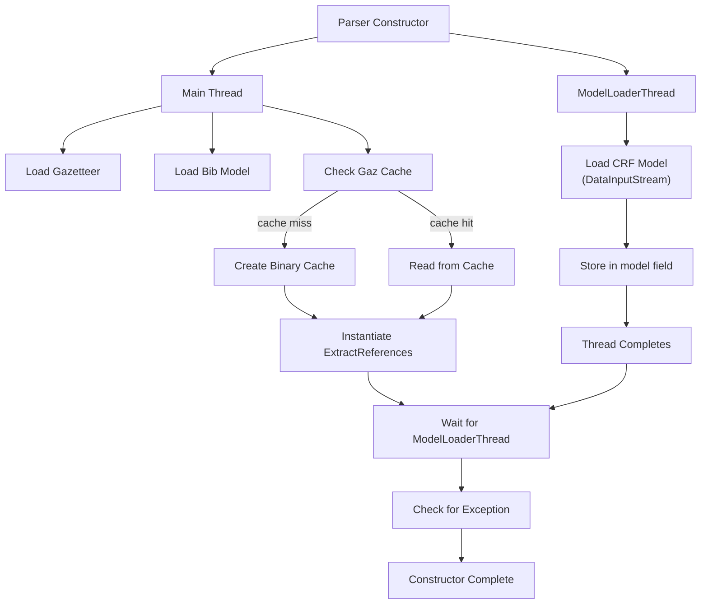
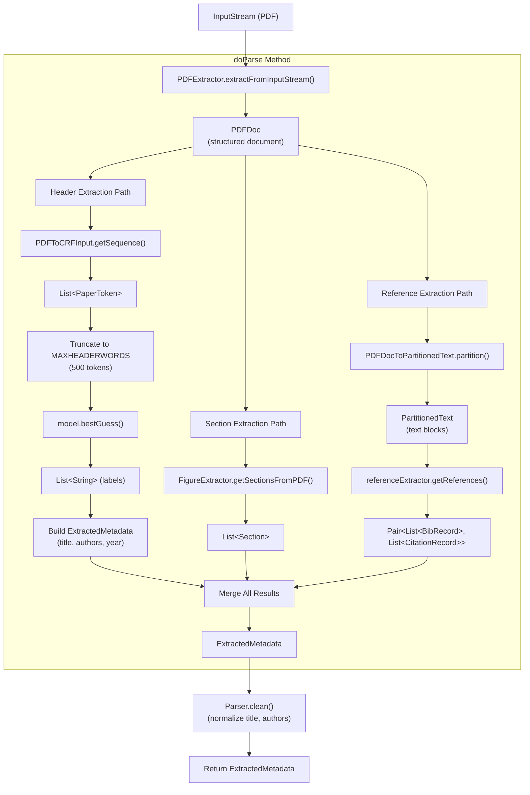
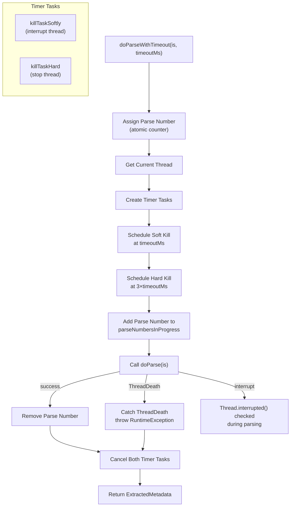
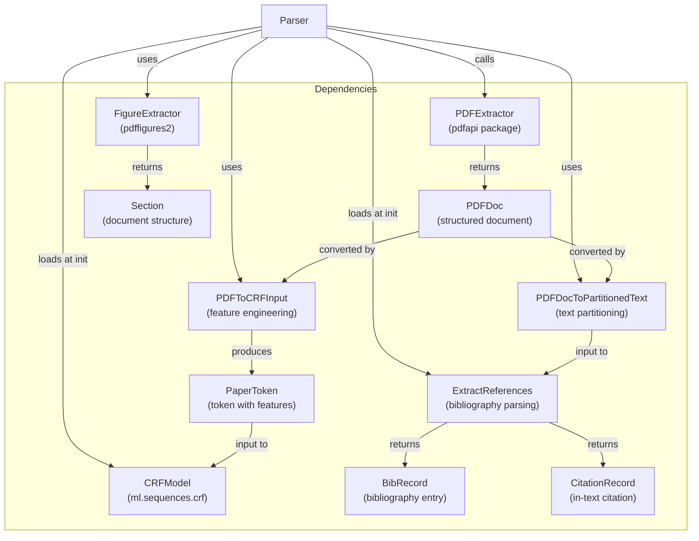

<!-- source: DeepWiki mcp.deepwiki.com · repo allenai/science-parse · page 2.1 Parser Class · fetched 2026-10-26 -->

# Parser Class

<details>
<summary>Relevant source files</summary>

The following files were used as context for generating this wiki page:

- [cli/README.md](cli/README.md)
- [core/README.md](core/README.md)
- [core/src/main/java/org/allenai/scienceparse/CheckReferences.java](core/src/main/java/org/allenai/scienceparse/CheckReferences.java)
- [core/src/main/java/org/allenai/scienceparse/ExtractReferences.java](core/src/main/java/org/allenai/scienceparse/ExtractReferences.java)
- [core/src/main/java/org/allenai/scienceparse/Parser.java](core/src/main/java/org/allenai/scienceparse/Parser.java)
- [core/src/main/java/org/allenai/scienceparse/pdfapi/PDFExtractor.java](core/src/main/java/org/allenai/scienceparse/pdfapi/PDFExtractor.java)
- [server/README.md](server/README.md)

</details>


## Purpose and Scope

This document describes the `Parser` class, the primary entry point for using Science Parse as a library. The `Parser` class coordinates PDF processing, CRF model inference, and reference extraction to produce structured metadata from academic papers. For information about the PDF processing pipeline that Parser invokes, see [PDF Processing Pipeline](#2.2). For details on reference extraction, see [Reference and Citation Extraction](#2.3). For training new models, see [Training the Main CRF Model](#5.1).

## Class Overview

The `Parser` class is located at [core/src/main/java/org/allenai/scienceparse/Parser.java:84-1106]() and serves as the facade for the entire parsing system. It loads and manages three critical model artifacts and coordinates their application to input PDFs.

**Key Responsibilities:**
- Loading CRF models for header extraction (title, authors, year)
- Loading bibliography models for reference parsing
- Loading gazetteer caches for entity recognition
- Providing synchronous and timeout-aware parsing methods
- Coordinating between `PDFExtractor`, CRF inference, and `ExtractReferences`

**Class Members:**

| Member | Type | Purpose |
|--------|------|---------|
| `model` | `CRFModel<String, PaperToken, String>` | Main CRF model for header extraction |
| `referenceExtractor` | `ExtractReferences` | Multi-strategy reference extraction system |
| `defaultParser` | `static Parser` | Singleton instance with default models |
| `parserKillerTimer` | `Timer` | Timer for enforcing parse timeouts |

Sources: [core/src/main/java/org/allenai/scienceparse/Parser.java:84-115]()

## Initialization and Model Loading

### Singleton Pattern

The `Parser` class provides a singleton accessor for the default configuration:

```java
public synchronized static Parser getInstance() throws Exception
```

This method lazy-initializes a single `Parser` instance with default model paths obtained from the datastore. The singleton pattern ensures model files are loaded only once per JVM process.

Sources: [core/src/main/java/org/allenai/scienceparse/Parser.java:110-115]()

### Model File Resolution

Default model paths are resolved through the AI2 Datastore system:

| Model | Method | Datastore Group | Version |
|-------|--------|----------------|---------|
| Production Model | `getDefaultProductionModel()` | `org.allenai.scienceparse` | 9 |
| Gazetteer | `getDefaultGazetteer()` | `org.allenai.scienceparse` | 5 |
| Bibliography Model | `getDefaultBibModel()` | `org.allenai.scienceparse` | 7 |

On first invocation, these methods download model files from the datastore and cache them locally. Subsequent calls use the cached versions.

Sources: [core/src/main/java/org/allenai/scienceparse/Parser.java:96-108]()

### Constructor and Parallel Loading



**Title:** Parser Initialization with Parallel Model Loading

The constructor [core/src/main/java/org/allenai/scienceparse/Parser.java:137-205]() implements parallel loading to reduce startup time:

1. **Model Loader Thread**: Spawned to load the main CRF model (typically 100-200 MB)
2. **Main Thread**: Loads gazetteer and bibliography model while model thread runs
3. **Gazetteer Cache Optimization**: Creates a binary serialized cache of the gazetteer JSON for faster subsequent loads
4. **Synchronization**: Constructor blocks until model loader thread completes and checks for exceptions

The gazetteer cache is stored in the system temp directory with the filename format:
```
{gazetteerFileName}-{pathHashCode}.gazetteerCache.bin
```

File locking ensures only one process creates the cache while others wait to read it.

Sources: [core/src/main/java/org/allenai/scienceparse/Parser.java:137-205]()

### Alternative Constructors

The class provides multiple constructor overloads:

| Constructor | Use Case |
|-------------|----------|
| `Parser()` | Default models from datastore |
| `Parser(String, String, String)` | Custom model file paths |
| `Parser(Path, Path, Path)` | Custom model paths as Path objects |
| `Parser(File, File, File)` | Custom model files as File objects |
| `Parser(InputStream, InputStream, InputStream)` | Custom model input streams (no caching) |

The stream-based constructor [core/src/main/java/org/allenai/scienceparse/Parser.java:207-218]() bypasses all caching mechanisms and is primarily used for testing.

Sources: [core/src/main/java/org/allenai/scienceparse/Parser.java:117-218]()

## Parsing Methods

### Core Parsing: doParse



**Title:** doParse Method Execution Flow

The `doParse` method [core/src/main/java/org/allenai/scienceparse/Parser.java:969-1046]() orchestrates three parallel extraction pipelines:

1. **Header Extraction**:
   - Converts `PDFDoc` to token sequence via `PDFToCRFInput.getSequence()`
   - Truncates to first 500 tokens (`MAXHEADERWORDS`)
   - Applies CRF model to predict labels (TITLE, AUTHOR, YEAR, etc.)
   - Constructs `ExtractedMetadata` from labeled tokens

2. **Section Extraction**:
   - Invokes `pdffigures2` via `FigureExtractor.getSectionsFromPDF()`
   - Extracts section headings and body text
   - Returns `List<Section>` with hierarchical structure

3. **Reference Extraction**:
   - Converts `PDFDoc` to `PartitionedText` (text blocks)
   - Calls `referenceExtractor.getReferences()` (see [Reference and Citation Extraction](#2.3))
   - Returns `BibRecord` list (parsed bibliography) and `CitationRecord` list (in-text citations)

The method handles exceptions gracefully, returning partial results if any extraction path fails (e.g., references might be empty while headers succeed).

Sources: [core/src/main/java/org/allenai/scienceparse/Parser.java:969-1046]()

### Timeout-Aware Parsing: doParseWithTimeout



**Title:** Timeout Enforcement Mechanism

The timeout mechanism [core/src/main/java/org/allenai/scienceparse/Parser.java:910-967]() provides two-stage protection:

1. **Soft Kill (at timeout)**: Interrupts the parsing thread via `Thread.interrupt()`. Well-behaved parsing code checks `Thread.interrupted()` and throws `ParsingTimeout`.

2. **Hard Kill (at 3× timeout)**: Forcibly stops the thread via the deprecated `Thread.stop()`. This is a last resort that can leave the JVM in an inconsistent state but prevents infinite hangs.

**Parse Number Tracking**: Each parse receives a unique ID from an atomic counter. Timer tasks check if this ID is still in `parseNumbersInProgress` before killing the thread, preventing false kills after parsing completes.

**Exception Handling**:
- `ThreadDeath` is caught and wrapped in `RuntimeException`
- The method never throws checked exceptions
- Partial results are never returned on timeout (all-or-nothing)

Sources: [core/src/main/java/org/allenai/scienceparse/Parser.java:906-967]()

### Helper Methods

| Method | Purpose | Line Reference |
|--------|---------|----------------|
| `clean(ExtractedMetadata)` | Normalizes title (removes accents, XML entities) and trims authors | [816-819]() |
| `cleanTitle(String)` | Strips accents, XML entities, trailing periods | [821-832]() |
| `trimAuthors(List<String>)` | Splits on "and", removes Jr., filters by length (2-32 chars) | [894-904]() |
| `paperToString(File)` | Extracts raw text from PDF for debugging | [234-244]() |

Sources: [core/src/main/java/org/allenai/scienceparse/Parser.java:816-904]()

## Integration with Other Components



**Title:** Parser Dependencies and Component Integration

The `Parser` class acts as a coordinator that:

1. **Owns Model Lifecycle**: Loads CRF models once during construction and reuses them for all parse operations
2. **Delegates PDF Processing**: Relies on `PDFExtractor` for low-level PDF rendering via Apache PDFBox
3. **Orchestrates Feature Engineering**: Uses `PDFToCRFInput` to transform structured documents into CRF-compatible token sequences
4. **Coordinates Multi-Strategy Reference Extraction**: Delegates to `ExtractReferences` which runs a tournament of bibliography parsers
5. **Integrates External Tools**: Invokes `pdffigures2` (Scala) via `FigureExtractor` for section detection

This architecture allows the `Parser` to remain focused on orchestration while component classes handle specialized concerns.

Sources: [core/src/main/java/org/allenai/scienceparse/Parser.java:1-83](), [core/src/main/java/org/allenai/scienceparse/Parser.java:969-1046]()

## Static Training Methods

The `Parser` class also provides static methods for training new models. These are not part of normal inference workflows but are used during model development:

| Method | Purpose | Typical Invocation |
|--------|---------|-------------------|
| `trainParser(Iterator<LabeledPaper>, ParseOpts)` | Train main CRF model | From `org.allenai.scienceparse.Training` |
| `trainBibliographyCRF(File, ParseOpts)` | Train bibliography model | From `org.allenai.scienceparse.BibTraining` |
| `labelFromGroundTruth(...)` | Generate labeled training data | Internal to training methods |
| `saveModel(DataOutputStream, ...)` | Serialize trained model | Internal to training methods |
| `loadModel(DataInputStream)` | Deserialize model | Called during initialization |

These methods are documented in detail in [Training the Main CRF Model](#5.1) and [Training the Bibliography Model](#5.2).

Sources: [core/src/main/java/org/allenai/scienceparse/Parser.java:315-815]()

## Constants and Configuration

| Constant | Value | Purpose |
|----------|-------|---------|
| `MAXHEADERWORDS` | 500 | Maximum tokens to consider for header extraction |
| `DATA_VERSION` | "0.3" | Model serialization format version |
| `MAX_AUTHOR_LENGTH` | 32 | Maximum characters in an author name |
| `MIN_AUTHOR_LENGTH` | 2 | Minimum characters in an author name |

The `MAXHEADERWORDS` limit ensures CRF inference completes in reasonable time. Empirically, titles and author lists appear within the first 500 tokens of academic papers. This constant affects both training and inference.

Sources: [core/src/main/java/org/allenai/scienceparse/Parser.java:86-87](), [core/src/main/java/org/allenai/scienceparse/Parser.java:892-893]()

---

