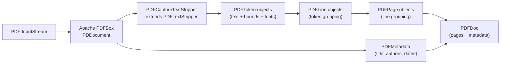
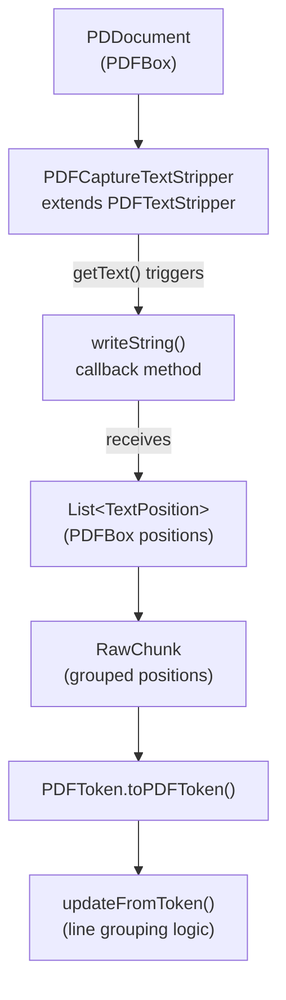
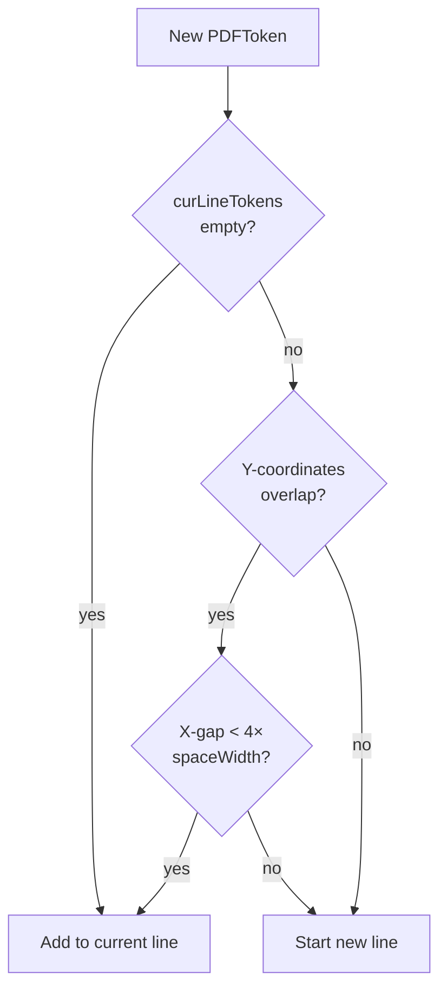
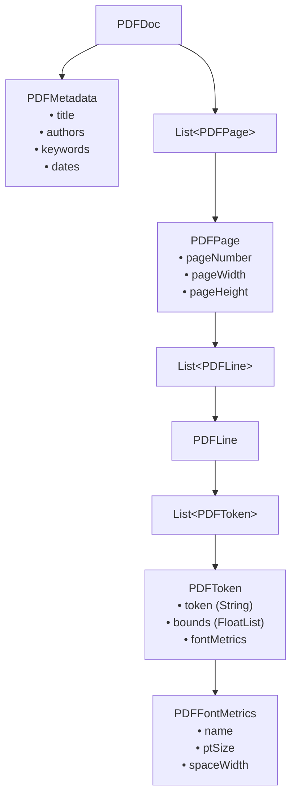
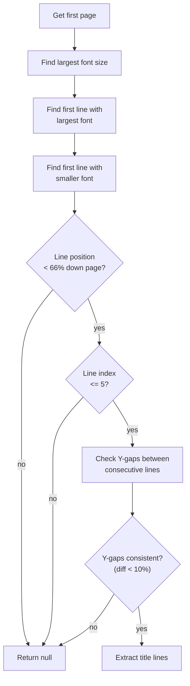
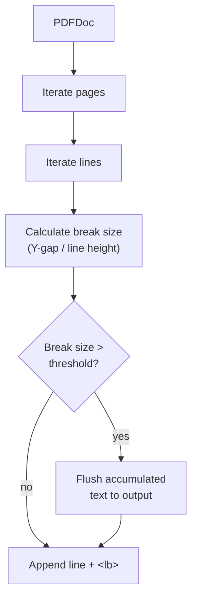

<!-- source: DeepWiki mcp.deepwiki.com · repo allenai/science-parse · page 2.2 PDF Processing Pipeline · fetched 2026-10-26 -->

# PDF Processing Pipeline

<details>
<summary>Relevant source files</summary>

The following files were used as context for generating this wiki page:

- [.circleci/config.yml](.circleci/config.yml)
- [core/src/main/java/org/allenai/scienceparse/CheckReferences.java](core/src/main/java/org/allenai/scienceparse/CheckReferences.java)
- [core/src/main/java/org/allenai/scienceparse/ExtractReferences.java](core/src/main/java/org/allenai/scienceparse/ExtractReferences.java)
- [core/src/main/java/org/allenai/scienceparse/PDFDocToPartitionedText.java](core/src/main/java/org/allenai/scienceparse/PDFDocToPartitionedText.java)
- [core/src/main/java/org/allenai/scienceparse/PDFToCRFInput.java](core/src/main/java/org/allenai/scienceparse/PDFToCRFInput.java)
- [core/src/main/java/org/allenai/scienceparse/Parser.java](core/src/main/java/org/allenai/scienceparse/Parser.java)
- [core/src/main/java/org/allenai/scienceparse/pdfapi/PDFExtractor.java](core/src/main/java/org/allenai/scienceparse/pdfapi/PDFExtractor.java)
- [core/src/main/java/org/allenai/scienceparse/pdfapi/PDFFontMetrics.java](core/src/main/java/org/allenai/scienceparse/pdfapi/PDFFontMetrics.java)
- [core/src/main/scala/org/allenai/scienceparse/InterleavingIterator.scala](core/src/main/scala/org/allenai/scienceparse/InterleavingIterator.scala)
- [core/src/main/scala/org/allenai/scienceparse/Training.scala](core/src/main/scala/org/allenai/scienceparse/Training.scala)
- [core/src/test/java/org/allenai/scienceparse/PDFToCRFInputTest.java](core/src/test/java/org/allenai/scienceparse/PDFToCRFInputTest.java)
- [core/src/test/java/org/allenai/scienceparse/ParserTest.java](core/src/test/java/org/allenai/scienceparse/ParserTest.java)

</details>


This page documents the PDF extraction layer that converts raw PDF files into structured document representations. The `PDFExtractor` class and its associated data structures (`PDFDoc`, `PDFPage`, `PDFLine`, `PDFToken`) form the foundation for all downstream processing. For information about how these structured documents are used for metadata extraction, see [Parser Class](#2.1). For details on text partitioning and reference extraction, see [Reference and Citation Extraction](#2.3).

## Overview

The PDF processing pipeline transforms binary PDF files into hierarchical document structures that preserve layout information, font metrics, and geometric positioning. This structured representation enables both CRF-based machine learning models and rule-based heuristics to extract metadata.



**Sources:** [core/src/main/java/org/allenai/scienceparse/pdfapi/PDFExtractor.java:1-440]()

## Entry Points

The `PDFExtractor` class provides three primary methods for PDF processing:

| Method | Return Type | Description |
|--------|-------------|-------------|
| `extractFromInputStream(InputStream)` | `PDFDoc` | Main entry point returning structured document |
| `extractResultFromInputStream(InputStream)` | `PdfDocExtractionResult` | Returns document plus precision flag |
| `extractResultFromPDDocument(PDDocument)` | `PdfDocExtractionResult` | Processes pre-loaded PDFBox document |

The `PdfDocExtractionResult` wrapper includes a `highPrecision` boolean flag indicating whether metadata was reliably extracted from PDF properties versus heuristically guessed.

**Sources:** [core/src/main/java/org/allenai/scienceparse/pdfapi/PDFExtractor.java:119-192]()

## Apache PDFBox Integration

The extraction process relies on Apache PDFBox's `PDDocument` and `PDFTextStripper` classes. The custom `PDFCaptureTextStripper` subclass intercepts PDFBox's text extraction callbacks to build the structured representation.



**Sources:** [core/src/main/java/org/allenai/scienceparse/pdfapi/PDFExtractor.java:337-439]()

## Text Extraction Process

### Token Construction

The `writeString()` callback receives `List<TextPosition>` from PDFBox. Each `TextPosition` represents a single character with:
- Unicode character
- X/Y coordinates
- Font information
- Width and height

Characters are grouped into tokens (words) by detecting whitespace:

[core/src/main/java/org/allenai/scienceparse/pdfapi/PDFExtractor.java:350-381]()

The `RawChunk.toPDFToken()` method handles several edge cases:

1. **Font size normalization**: PDFBox sometimes multiplies font sizes by 10; this is detected and corrected
2. **Superscript detection**: Characters above the baseline are marked with special delimiters `⍐` and `⍗`
3. **Ligand separation**: Unicode normalization (NFKC) separates ligands like "fi" into individual characters
4. **Bounding box calculation**: Min/max X/Y coordinates are computed across all character positions

[core/src/main/java/org/allenai/scienceparse/pdfapi/PDFExtractor.java:246-335]()

### Line Grouping

Tokens are grouped into lines based on Y-coordinate overlap and X-spacing. The `updateFromToken()` method implements this logic:



The Y-overlap check ensures tokens are vertically aligned:
```
(curTop >= lastTop && curTop <= lastBottom) ||
(curBottom >= lastTop && curBottom <= lastBottom)
```

The X-spacing check uses a tolerance of 4× the font's space width to handle variable-width fonts and justify-aligned text.

**Sources:** [core/src/main/java/org/allenai/scienceparse/pdfapi/PDFExtractor.java:383-409]()

### Page Grouping

Lines are grouped into pages by the `startPage()` and `endPage()` callbacks:

[core/src/main/java/org/allenai/scienceparse/pdfapi/PDFExtractor.java:413-438]()

Each page captures:
- List of `PDFLine` objects
- Page number (0-indexed)
- Page dimensions from `PDRectangle`

## Document Structure Hierarchy

The extraction produces a four-level hierarchy:



### Data Structure Specifications

**PDFToken**
```
token: String           // Unicode text including superscripts
bounds: FloatList       // [minX, minY, maxX, maxY]
fontMetrics: PDFFontMetrics
```

**PDFFontMetrics**
```
name: String            // Font family + size + space width (uniqueness)
ptSize: float           // Point size (normalized if needed)
spaceWidth: float       // Width of space character
```

**PDFLine**
```
tokens: List<PDFToken>
```

**PDFPage**
```
lines: List<PDFLine>
pageNumber: int
pageWidth: int
pageHeight: int
```

**PDFDoc**
```
pages: List<PDFPage>
meta: PDFMetadata
```

**Sources:** [core/src/main/java/org/allenai/scienceparse/pdfapi/PDFExtractor.java:245-335](), [core/src/main/java/org/allenai/scienceparse/pdfapi/PDFFontMetrics.java:1-39]()

## Metadata Extraction

Metadata extraction operates in two stages: PDF property extraction and heuristic fallbacks.

### PDF Property Extraction

The `PDDocument.getDocumentInformation()` provides structured metadata:

[core/src/main/java/org/allenai/scienceparse/pdfapi/PDFExtractor.java:127-155]()

| Property | Extraction Method | Fallback |
|----------|------------------|----------|
| Title | `info.getTitle()` | Heuristic title extraction |
| Authors | `info.getAuthor()` | Parse by semicolon or comma |
| Keywords | `info.getKeywords()` | Parse by comma |
| Creator | `info.getCreator()` | None |
| CreateDate | Custom metadata `CREATION_DATE` | Parse "Date" or "Created" fields |

Author list parsing handles two formats:
- Semicolon-separated: `"Author1; Author2; Author3"`
- Comma-separated: `"Author1, Author2, Author3"`

[core/src/main/java/org/allenai/scienceparse/pdfapi/PDFExtractor.java:57-67]()

### Title Validation

PDF titles are validated against the extracted text to filter unreliable metadata:

**Title rejection criteria:**
1. Ends with `.pdf`, `.doc` (Microsoft Word artifacts)
2. Ends with `...` (truncated)
3. Starts with `"proceedings of"` (conference metadata)
4. Starts with `"arXiv:"` (arXiv identifier, not title)
5. No capitalized words present
6. Not found on first page

[core/src/main/java/org/allenai/scienceparse/pdfapi/PDFExtractor.java:73-105]()

## Heuristic Title Extraction

When PDF metadata is missing or invalid, the system attempts heuristic title extraction from the first page.

### Algorithm

The heuristic assumes titles use the largest font on the first page:



**Implementation details:**

[core/src/main/java/org/allenai/scienceparse/pdfapi/PDFExtractor.java:194-238]()

The Y-gap validation detects multi-line titles by ensuring consistent line spacing. If consecutive lines have different spacing (normalized difference > 10%), only the first lines are used.

The position validation (66% threshold) prevents false positives from large-font text in the document body or footer.

**Sources:** [core/src/main/java/org/allenai/scienceparse/pdfapi/PDFExtractor.java:194-238]()

## Text Partitioning

The `PDFDocToPartitionedText` class converts structured `PDFDoc` objects into text representations for downstream processing.

### Raw Text Extraction

The `getRaw()` method produces a list of strings with line breaks marked by `<lb>`:



The threshold is computed from the document's break size distribution:

[core/src/main/java/org/allenai/scienceparse/PDFDocToPartitionedText.java:115-121]()

This uses the 78th percentile of line breaks (7/9 quantile) as the threshold, which empirically separates paragraph breaks from line breaks within paragraphs.

**Sources:** [core/src/main/java/org/allenai/scienceparse/PDFDocToPartitionedText.java:42-121]()

### Column Detection and Repair

Multi-column layouts require special handling. The `repairColumns()` method detects and reorders column breaks:

**Detection criteria:**
- Gap width > 5× space width
- Gap center within 50× space width of page center
- At least 10 consistent gaps with positions within 3× space width

When detected, lines are re-sorted by: `1E8 × (column number) + Y-coordinate`

This ensures left-column lines appear before right-column lines at the same Y-position.

[core/src/main/java/org/allenai/scienceparse/PDFDocToPartitionedText.java:268-332]()

### Abstract Extraction

Two strategies extract abstracts:

1. **Explicit abstract sections**: Search for lines containing "abstract" with length < 10 characters
2. **First text block**: Extract the first substantial paragraph (> 400 characters) on the first page

The first-page partition threshold uses a different quantile (50th percentile + 0.5) to detect abstract boundaries more sensitively:

[core/src/main/java/org/allenai/scienceparse/PDFDocToPartitionedText.java:123-174]()

**Cleaning rules:**
- Remove inline "Abstract:" prefix
- Remove "Keywords:", "Key Words:", etc. suffixes
- Remove "Introduction" sections
- Remove "Categories and Subject Descriptors"
- Remove continuation dashes (`-<lb>` → empty string)

[core/src/main/java/org/allenai/scienceparse/PDFDocToPartitionedText.java:177-229]()

**Sources:** [core/src/main/java/org/allenai/scienceparse/PDFDocToPartitionedText.java:147-229]()

### Reference Section Extraction

The `getRawReferences()` method extracts bibliography entries with sophisticated formatting detection.

**Section identification:**
- Header-based: Lines ending with "References", "Citations", "Bibliography"
- Lenient mode: Lines starting with `[1]` or `1.` after first quarter of document

**Column processing:**
1. Split reference lines into columns (increasing Y-coordinates)
2. Detect indentation levels within each column
3. Find the indentation that starts references (most common or pattern-matching)
4. Detect vertical spacing patterns between references
5. Group lines by indentation and/or vertical spacing

**Indentation detection:**

[core/src/main/java/org/allenai/scienceparse/PDFDocToPartitionedText.java:441-499]()

The algorithm clusters similar indentation values (within one space width) and picks the less common indentation as the reference-start marker.

**Vertical spacing detection:**

[core/src/main/java/org/allenai/scienceparse/PDFDocToPartitionedText.java:502-534]()

Break sizes are measured in line heights and clustered within 0.1 line height tolerance. Only break sizes accounting for ≥20% of breaks and occurring more than once are considered.

**Splitting heuristics:**

References are split when:
1. 6 consecutive lines grouped (maximum reference length)
2. Indentation matches reference-start level
3. Line matches reference start pattern (`\d{1,2}(\.|\\s|$)|\\[.+?\\]`)
4. Vertical spacing exceeds detected break threshold

[core/src/main/java/org/allenai/scienceparse/PDFDocToPartitionedText.java:536-577]()

**Sources:** [core/src/main/java/org/allenai/scienceparse/PDFDocToPartitionedText.java:354-597]()

## Error Handling and Edge Cases

### Font Size Anomalies

PDFBox occasionally reports font sizes 10× larger than actual. Detection and correction:

[core/src/main/java/org/allenai/scienceparse/pdfapi/PDFExtractor.java:258-263]()

### Out-of-Phase Columns

Some PDFs have X-coordinates that decrease within a line (column ordering issues). Detection:

[core/src/main/java/org/allenai/scienceparse/pdfapi/PDFExtractor.java:356-362]()

### Superscript Citations

Citation superscripts are preserved by detecting characters above the Y-threshold:

[core/src/main/java/org/allenai/scienceparse/pdfapi/PDFExtractor.java:303-325]()

Only sequences matching the citation pattern are marked as superscripts to avoid false positives.

**Sources:** [core/src/main/java/org/allenai/scienceparse/pdfapi/PDFExtractor.java:246-335]()

## Configuration Options

The `PDFExtractor.Options` builder provides configuration:

| Option | Type | Default | Description |
|--------|------|---------|-------------|
| `useHeuristicTitle` | boolean | false | Enable heuristic title extraction when metadata absent |

[core/src/main/java/org/allenai/scienceparse/pdfapi/PDFExtractor.java:240-243]()

**Sources:** [core/src/main/java/org/allenai/scienceparse/pdfapi/PDFExtractor.java:40-49](), [core/src/main/java/org/allenai/scienceparse/pdfapi/PDFExtractor.java:240-243]()

---

