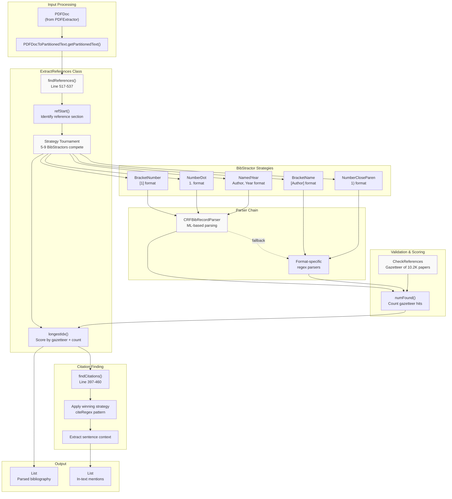
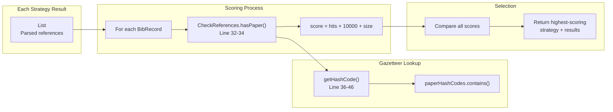
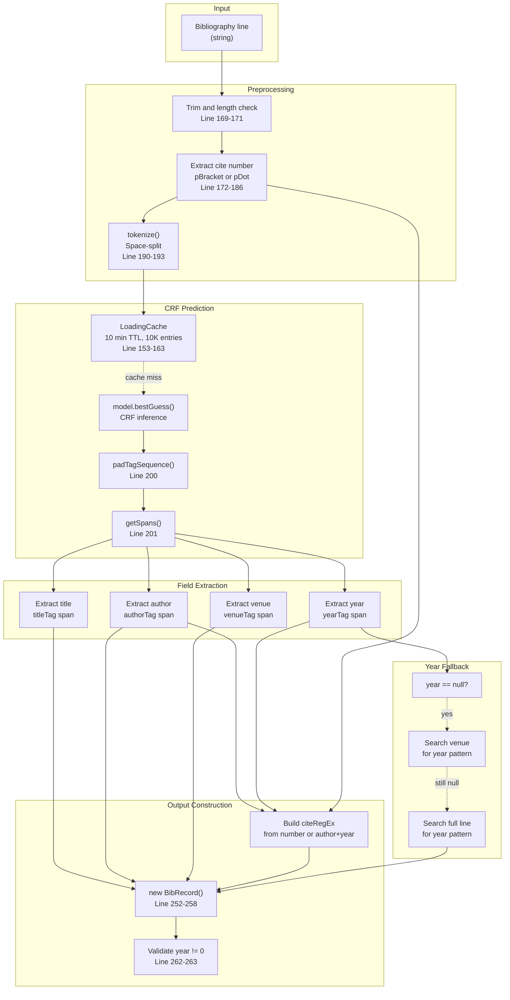
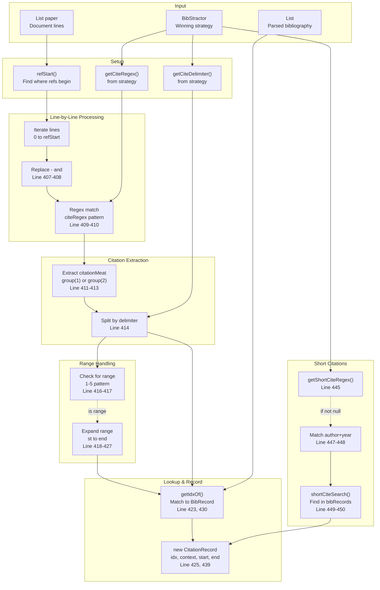
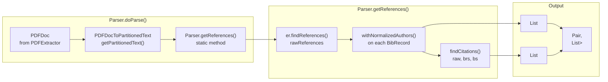

<!-- source: DeepWiki mcp.deepwiki.com · repo allenai/science-parse · page 2.3 Reference and Citation Extraction · fetched 2026-10-26 -->

# Reference and Citation Extraction

<details>
<summary>Relevant source files</summary>

The following files were used as context for generating this wiki page:

- [build.sbt](build.sbt)
- [cli/build.sbt](cli/build.sbt)
- [core/build.sbt](core/build.sbt)
- [core/src/main/java/org/allenai/scienceparse/CRFBibRecordParser.java](core/src/main/java/org/allenai/scienceparse/CRFBibRecordParser.java)
- [core/src/main/java/org/allenai/scienceparse/CheckReferences.java](core/src/main/java/org/allenai/scienceparse/CheckReferences.java)
- [core/src/main/java/org/allenai/scienceparse/ExtractReferences.java](core/src/main/java/org/allenai/scienceparse/ExtractReferences.java)
- [core/src/main/java/org/allenai/scienceparse/GazetteerFeatures.java](core/src/main/java/org/allenai/scienceparse/GazetteerFeatures.java)
- [core/src/main/java/org/allenai/scienceparse/Parser.java](core/src/main/java/org/allenai/scienceparse/Parser.java)
- [core/src/main/java/org/allenai/scienceparse/pdfapi/PDFExtractor.java](core/src/main/java/org/allenai/scienceparse/pdfapi/PDFExtractor.java)
- [server/build.sbt](server/build.sbt)

</details>


This page documents the multi-strategy reference extraction system in Science Parse Core. The system extracts bibliographic references from the reference section of papers and identifies in-text citations that link to those references. The approach uses a tournament of competing extraction strategies, each with fallback parsers, scored by a gazetteer of known papers to select the most reliable result.

For information about the CRF models used in bibliography parsing, see [Training the Bibliography Model](#5.2). For the overall parsing pipeline context, see [PDF Processing Pipeline](#2.2).

## Overview and Architecture

The reference extraction system operates in two phases: (1) **bibliography extraction** from the reference section using competing strategies, and (2) **citation finding** that locates in-text mentions using the winning strategy's patterns. The core class `ExtractReferences` orchestrates this process and maintains a gazetteer (`CheckReferences`) containing approximately 10,200 known papers for validation scoring.



**Diagram: Reference Extraction Architecture**

Sources: [core/src/main/java/org/allenai/scienceparse/ExtractReferences.java:1-1000](), [core/src/main/java/org/allenai/scienceparse/Parser.java:220-231]()

## Strategy Tournament and Scoring

The `findReferences()` method implements a tournament where multiple `BibStractor` strategies compete to parse the reference section. Each strategy attempts to parse the text, and results are scored using a weighted heuristic that heavily favors verifiable results.

### BibStractor Strategies

Science Parse includes multiple `BibStractor` implementations, each targeting a specific bibliography format:

| Strategy Class | Format Pattern | Example | Parser Chain |
|---------------|----------------|---------|--------------|
| `BracketNumber` | `[1] Authors...` | [1] Smith, J. "Title." Venue 2020. | CRF → Regex |
| `NumberDot` | `1. Authors...` | 1. Smith, J. Title. Venue 2020. | CRF → Regex |
| `NumberDotNaturalLineBreaks` | `1. Authors...` (multiline) | 1. Smith<br/>Title<br/>2020 | CRF only |
| `NamedYear` | `Smith 2020. Title...` | SMITH, M. 2020. Title. Venue. | CRF → Regex |
| `BracketName` | `[Smith] Title...` | [Smith] Title. Venue 2020. | Regex only |
| `NumberCloseParen` | `1) Authors...` | 1) Smith J. Title. Venue 2020. | Regex only |

Each `BibStractor` maintains an array of `BibRecordParser` implementations that are tried in sequence until one succeeds. The most sophisticated strategies try `CRFBibRecordParser` first, then fall back to format-specific regex parsers.

Sources: [core/src/main/java/org/allenai/scienceparse/ExtractReferences.java:59-157](), [core/src/main/java/org/allenai/scienceparse/ExtractReferences.java:543-574]()

### Scoring Mechanism

The winning strategy is selected by `longestIdx()` using this scoring formula:

```
score = (numFound × 10,000) + totalReferences
```

Where:
- `numFound`: Count of bibliography entries found in the `CheckReferences` gazetteer (10,200+ known papers)
- `totalReferences`: Total number of references parsed

The 10,000× multiplier ensures that strategies producing verifiable results are strongly preferred over those that simply extract many entries. This heavily weights quality over quantity.



**Diagram: Strategy Scoring and Selection**

Sources: [core/src/main/java/org/allenai/scienceparse/ExtractReferences.java:462-483](), [core/src/main/java/org/allenai/scienceparse/CheckReferences.java:32-46]()

## Reference Section Identification

Before extraction begins, the system must locate the reference section within the document. The `refStart()` method uses header-based heuristics:

1. **Search region**: Starts searching from 1/3 into the document (most papers have references in the back third)
2. **Header patterns**: Looks for lines ending with: "References", "Citations", "Bibliography", or their capitalized variants
3. **Line break handling**: Also detects these keywords followed by `<lb>` (line break marker)
4. **Termination**: `refEnd()` stops extraction when encountering "Appendix"

The method returns the line index where references start, or -1 if no reference section is detected.

Sources: [core/src/main/java/org/allenai/scienceparse/ExtractReferences.java:354-366](), [core/src/main/java/org/allenai/scienceparse/ExtractReferences.java:486-491]()

## Bibliography Parsing

### CRF-Based Parsing

`CRFBibRecordParser` uses a trained Conditional Random Field model to parse bibliography entries. This is the most sophisticated parser and is tried first by most strategies.

**Key features**:
- **Caching**: Uses a Guava `LoadingCache` with 10-minute TTL and 10,240 entry capacity to avoid re-parsing identical bibliography entries
- **Tokenization**: Simple space-based tokenization (unlike the main parser's more sophisticated approach)
- **Label extraction**: Identifies author, title, venue, and year using CRF predictions
- **Fallback year detection**: If CRF misses the year, regex patterns search the venue and full line



**Diagram: CRFBibRecordParser Processing Flow**

The CRF model is trained on three datasets: Cora, UMass, and Kermit citation formats. Training data is preprocessed by `getLabeledLineCora()`, `getLabeledLineUMass()`, and `getLabeledLineKermit()` which map XML-tagged bibliography entries to labeled token sequences.

Sources: [core/src/main/java/org/allenai/scienceparse/CRFBibRecordParser.java:165-266](), [core/src/main/java/org/allenai/scienceparse/CRFBibRecordParser.java:153-163]()

### Regex-Based Parsers

When CRF parsing is unavailable or fails, format-specific regex parsers provide fallback extraction. Each parser implements the `BibRecordParser` interface with a single `parseRecord()` method.

**Example regex parsers**:

| Parser Class | Regex Pattern | Field Extraction |
|--------------|---------------|------------------|
| `BracketNumberBibRecordParser` | `\[(\d+)\] (authors)\. (title)\. (venue) (year)\.` | Groups 1-5 |
| `NumberDotYearParensBibRecordParser` | `(\d+)\. (authors): (title)\. (venue) \((year)\)\.` | Groups 1-5 |
| `NamedYearBibRecordParser` | `(authors) (year)\. (title)\. (venue)\.` | Groups 1-4 |
| `NumberCloseParenBibRecordParser` | `(\d+)\) (authors)\. (title)\. (venue) (year);` | Groups 1-5 |

Each regex parser includes detailed author name patterns like `authInitialsLastList` and `authGeneralList` that handle various author formatting conventions (e.g., "Smith J." vs "J. Smith" vs "Smith, J.").

Sources: [core/src/main/java/org/allenai/scienceparse/ExtractReferences.java:576-800]()

## Citation Finding

After selecting the winning bibliography extraction strategy, `findCitations()` searches the document body for in-text citations that reference the parsed bibliography entries.

### Citation Pattern Matching

The method uses the `citeRegex` from the winning `BibStractor` strategy to find citations. Common patterns include:

- **Numbered citations**: `[1]`, `(1)`, `[1,2,3]`, `[1-5]`
- **Author-year citations**: `Smith et al. (2020)`, `(Smith, 2020)`



**Diagram: Citation Finding Process**

### Citation Context Extraction

For each matched citation, the system captures the surrounding sentence as context. The context includes text from the citation's position up to the end of the sentence, which is then filtered to ensure minimum quality:

1. **Context extraction**: Captures text from the citation to the next sentence boundary (period, question mark, exclamation)
2. **Length filtering**: Context must be ≥35 characters to be meaningful
3. **Style grouping**: When a paper uses multiple citation styles, the system identifies and keeps only citations matching the predominant style

Sources: [core/src/main/java/org/allenai/scienceparse/ExtractReferences.java:397-460](), [core/src/main/java/org/allenai/scienceparse/ExtractReferences.java:368-375]()

### Short Citations

Some strategies support "short citations" (e.g., `Etzioni et al. (2005)`). The `shortCiteSearch()` method attempts to match these by:

1. Finding the year pattern in the text
2. Searching backward from the year for author names
3. Matching against `BibRecord.shortCiteRegEx` patterns
4. Returning the best match index and position

Sources: [core/src/main/java/org/allenai/scienceparse/ExtractReferences.java:377-394]()

## Data Structures

### BibRecord

Represents a single parsed bibliography entry with fields:

| Field | Type | Description |
|-------|------|-------------|
| `title` | `String` | Paper title (cleaned) |
| `author` | `List<String>` | Author names (normalized) |
| `venue` | `String` | Publication venue |
| `year` | `int` | Publication year (MINYEAR-MAXYEAR) |
| `citeRegEx` | `Pattern` | Regex pattern for finding citations |
| `shortCiteRegEx` | `Pattern` | Regex for short citations (optional) |

The class includes utility methods like `withNormalizedAuthors()` which applies `ExtractReferences.authorStringToList()` to normalize author name formats.

Sources: References to `BibRecord` class throughout [core/src/main/java/org/allenai/scienceparse/ExtractReferences.java]()

### CitationRecord

Represents an in-text citation mention with fields:

| Field | Type | Description |
|-------|------|-------------|
| `refID` | `int` | Index into `BibRecord` list |
| `context` | `String` | Sentence containing the citation |
| `startOffset` | `int` | Character offset where citation starts |
| `endOffset` | `int` | Character offset where citation ends |

This allows mapping each in-text citation back to its full bibliography entry and provides context for understanding how the citation is used.

## Cleaning and Validation

### Bibliography Cleaning

The `clean()` method [core/src/main/java/org/allenai/scienceparse/ExtractReferences.java:493-511]() filters extracted bibliography entries:

1. **Title cleaning**: Removes leading/trailing punctuation (except closing parentheses)
2. **Empty title removal**: Discards entries without titles
3. **Length validation**: Rejects entries with absurdly long fields (>512 characters for title/venue/author)

### Author Name Normalization

The `authorStringToList()` method [core/src/main/java/org/allenai/scienceparse/ExtractReferences.java:251-343]() handles diverse author formats:

1. **Punctuation normalization**: Removes trailing/leading punctuation
2. **Separator detection**: Identifies main separator (semicolon or comma)
3. **"and" replacement**: Converts "and" or "&" to the main separator
4. **Name reordering**: Detects "Last, First" vs "First Last" patterns and normalizes
5. **Empty string filtering**: Removes empty entries from splitting

This ensures consistent author representation regardless of the original bibliography format.

## Integration with Parser

The `Parser` class calls reference extraction through `getReferences()` [core/src/main/java/org/allenai/scienceparse/Parser.java:220-231]():



**Diagram: Parser Integration**

The static method design allows reference extraction to be called independently of the main CRF-based header extraction, enabling parallel processing of different paper components.

Sources: [core/src/main/java/org/allenai/scienceparse/Parser.java:220-231]()

## Model Loading and Initialization

`ExtractReferences` requires three inputs for full functionality:

1. **Gazetteer file**: JSON file with known papers, loaded into `CheckReferences`
2. **Bibliography CRF model**: Trained model for `CRFBibRecordParser` (optional but recommended)
3. **Gazetteer cache**: Binary serialized cache created on first load for faster startup

The class supports gazetteer caching through `createAndWriteGazCache()` [core/src/main/java/org/allenai/scienceparse/ExtractReferences.java:159-170](). When the cache file exists, loading is nearly instantaneous; otherwise, parsing the JSON gazetteer takes significant time on first run.

The bibliography CRF model is loaded via `loadModel()` [core/src/main/java/org/allenai/scienceparse/ExtractReferences.java:172-210]() which reads:
- State space
- Node and edge feature indexers  
- Model weights
- Optional `ParserLMFeatures` and `GazetteerFeatures`

Sources: [core/src/main/java/org/allenai/scienceparse/ExtractReferences.java:85-157](), [core/src/main/java/org/allenai/scienceparse/ExtractReferences.java:172-210]()

## Performance Considerations

### Caching Strategies

1. **Gazetteer cache**: Binary serialization reduces load time from ~30 seconds to <1 second
2. **Bibliography parse cache**: `LoadingCache` with 10-minute expiry prevents re-parsing identical bibliography entries within a session
3. **Model singleton**: The bibliography CRF model is loaded once and reused

### Timeout Handling

Both `CRFBibRecordParser.parseRecord()` and `findCitations()` check `Thread.interrupted()` and throw `Parser.ParsingTimeout` to prevent runaway processing. This allows the calling code to enforce time limits on difficult documents.

Sources: [core/src/main/java/org/allenai/scienceparse/CRFBibRecordParser.java:166-167](), [core/src/main/java/org/allenai/scienceparse/ExtractReferences.java:421-422]()

### Parallel Execution

Reference extraction runs independently of header extraction in the main parsing pipeline, allowing parallel execution of these time-consuming operations. The reference extractor is thread-safe once initialized.

---

