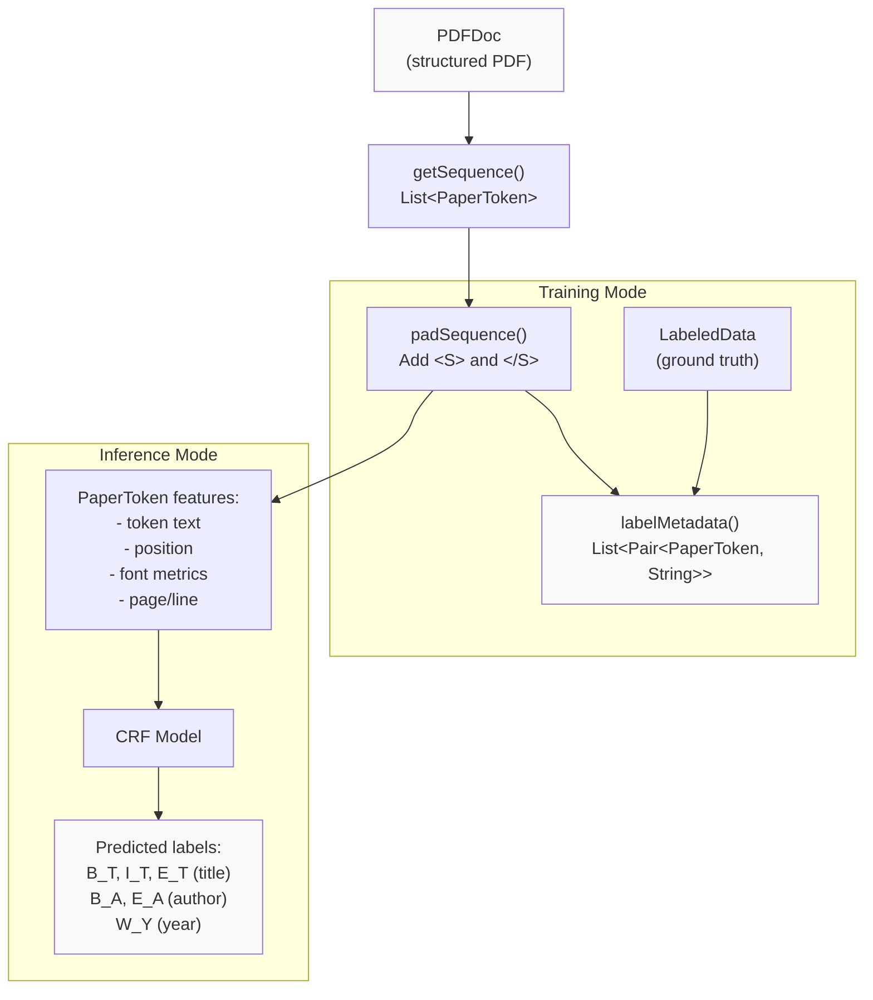
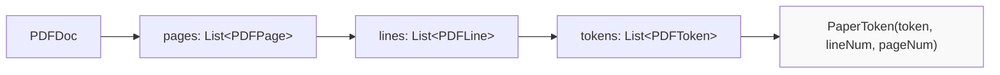
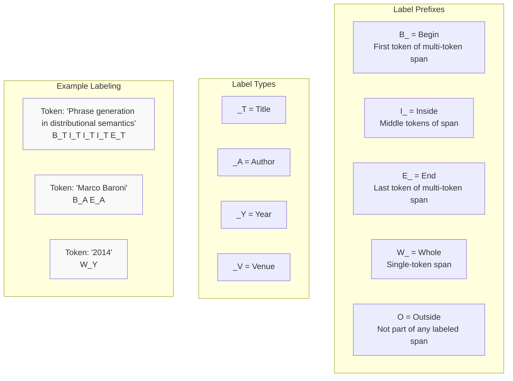
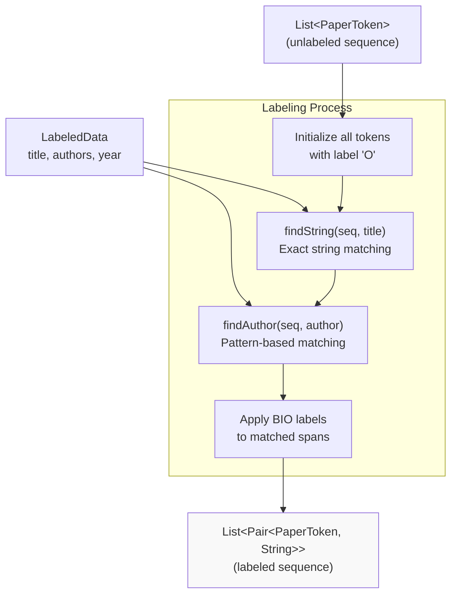
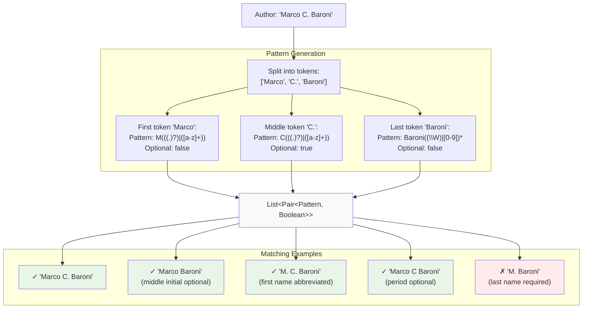
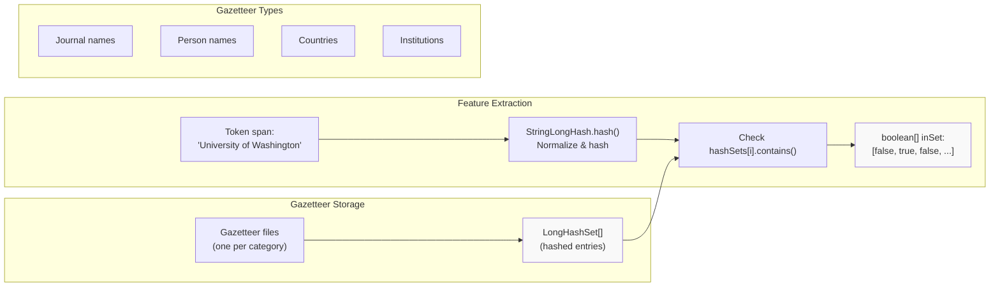
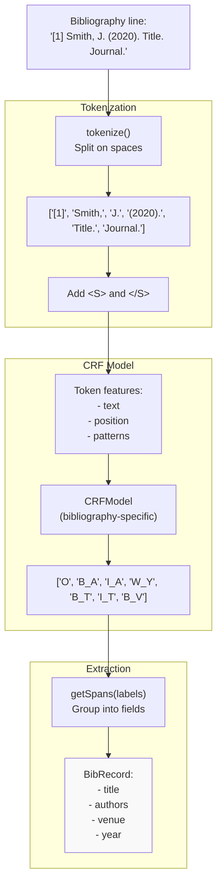
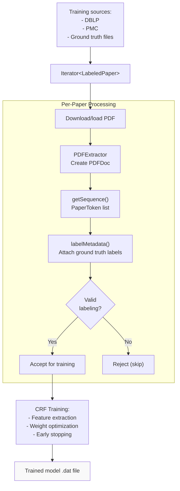

<!-- source: DeepWiki mcp.deepwiki.com · repo allenai/science-parse · page 2.4 CRF Feature Engineering · fetched 2026-10-26 -->

# CRF Feature Engineering

<details>
<summary>Relevant source files</summary>

The following files were used as context for generating this wiki page:

- [.circleci/config.yml](.circleci/config.yml)
- [build.sbt](build.sbt)
- [cli/build.sbt](cli/build.sbt)
- [core/build.sbt](core/build.sbt)
- [core/src/main/java/org/allenai/scienceparse/CRFBibRecordParser.java](core/src/main/java/org/allenai/scienceparse/CRFBibRecordParser.java)
- [core/src/main/java/org/allenai/scienceparse/GazetteerFeatures.java](core/src/main/java/org/allenai/scienceparse/GazetteerFeatures.java)
- [core/src/main/java/org/allenai/scienceparse/PDFDocToPartitionedText.java](core/src/main/java/org/allenai/scienceparse/PDFDocToPartitionedText.java)
- [core/src/main/java/org/allenai/scienceparse/PDFToCRFInput.java](core/src/main/java/org/allenai/scienceparse/PDFToCRFInput.java)
- [core/src/main/java/org/allenai/scienceparse/pdfapi/PDFFontMetrics.java](core/src/main/java/org/allenai/scienceparse/pdfapi/PDFFontMetrics.java)
- [core/src/main/scala/org/allenai/scienceparse/InterleavingIterator.scala](core/src/main/scala/org/allenai/scienceparse/InterleavingIterator.scala)
- [core/src/main/scala/org/allenai/scienceparse/Training.scala](core/src/main/scala/org/allenai/scienceparse/Training.scala)
- [core/src/test/java/org/allenai/scienceparse/PDFToCRFInputTest.java](core/src/test/java/org/allenai/scienceparse/PDFToCRFInputTest.java)
- [core/src/test/java/org/allenai/scienceparse/ParserTest.java](core/src/test/java/org/allenai/scienceparse/ParserTest.java)
- [server/build.sbt](server/build.sbt)

</details>


## Purpose and Scope

This page explains how Science Parse converts PDF documents into feature sequences suitable for Conditional Random Field (CRF) model inference and training. This includes the tokenization process, the labeling scheme, ground truth generation, and the feature extraction mechanisms that enable the CRF model to identify titles, authors, years, and other metadata fields.

For information about the CRF model training process, see [Training the Main CRF Model](#5.1). For details on how the Parser class uses these sequences, see [Parser Class](#2.1).

---

## Pipeline Overview

The CRF feature engineering pipeline transforms structured PDF documents into labeled token sequences that the CRF model can process:



**Sources:** [core/src/main/java/org/allenai/scienceparse/PDFToCRFInput.java:253-260](), [core/src/main/java/org/allenai/scienceparse/PDFToCRFInput.java:262-268](), [core/src/main/java/org/allenai/scienceparse/PDFToCRFInput.java:329-357]()

---

## Token Sequence Generation

The `PDFToCRFInput.getSequence()` method converts a `PDFDoc` into a flat sequence of `PaperToken` objects, preserving spatial and typographic information:



Each `PaperToken` wraps a `PDFToken` and adds structural context:

| Field | Type | Description |
|-------|------|-------------|
| `pdfToken` | `PDFToken` | Contains token text and font metrics |
| `line` | `int` | Line number within the page |
| `page` | `int` | Page number in the document |

The sequence is then padded with special start/stop tokens (`<S>` and `</S>`) to provide boundary markers for the CRF model.

**Key Methods:**
- [core/src/main/java/org/allenai/scienceparse/PDFToCRFInput.java:253-260]() - `getSequence()`: Converts PDF pages to token sequence
- [core/src/main/java/org/allenai/scienceparse/PDFToCRFInput.java:193-201]() - `addLineTokens()`: Helper to accumulate tokens from lines
- [core/src/main/java/org/allenai/scienceparse/PDFToCRFInput.java:262-268]() - `padSequence()`: Adds boundary tokens

**Sources:** [core/src/main/java/org/allenai/scienceparse/PDFToCRFInput.java:193-268]()

---

## Labeling Scheme

Science Parse uses a **BIO-style labeling scheme** (Begin, Inside, End) with an extension for single-token spans (Whole):



The tag constants are defined in `ExtractedMetadata`:
- `ExtractedMetadata.titleTag` = "T"
- `ExtractedMetadata.authorTag` = "A"  
- `ExtractedMetadata.yearTag` = "Y"
- `ExtractedMetadata.venueTag` = "V"

**Label Generation Logic:**

For a span from index `start` to `end`:
- If `start == end - 1`: Single token → `W_<type>`
- If `start < end - 1`: Multi-token span
  - Token at `start`: `B_<type>`
  - Tokens between: `I_<type>`
  - Token at `end - 1`: `E_<type>`

**Sources:** [core/src/main/java/org/allenai/scienceparse/PDFToCRFInput.java:304-314](), [core/src/main/java/org/allenai/scienceparse/CRFBibRecordParser.java:68-86](), [core/src/test/java/org/allenai/scienceparse/PDFToCRFInputTest.java:64-72]()

---

## Ground Truth Labeling

During training, the `labelMetadata()` method automatically labels token sequences using ground truth from `LabeledData` objects:



The labeling process handles multiple complexities:

**1. Title Labeling (Exact Match)**
- Uses `findString()` to locate exact title matches [core/src/main/java/org/allenai/scienceparse/PDFToCRFInput.java:114-135]()
- Normalizes text using `StringUtils.normalize()` for case-insensitive comparison
- Must find title successfully for training example to be valid

**2. Author Labeling (Pattern Match)**
- Uses `findAuthor()` which applies flexible pattern matching [core/src/main/java/org/allenai/scienceparse/PDFToCRFInput.java:188-191]()
- Handles abbreviations, middle initials, and name variations
- See [Author Pattern Matching](#author-pattern-matching) below for details

**3. Labeling Application**
- Uses `findAndLabelWith()` to apply labels to matched spans [core/src/main/java/org/allenai/scienceparse/PDFToCRFInput.java:287-316]()
- Only labels the **first occurrence** of each ground truth string
- Adds `<S>` and `</S>` boundary tokens

**Sources:** [core/src/main/java/org/allenai/scienceparse/PDFToCRFInput.java:329-357](), [core/src/main/java/org/allenai/scienceparse/PDFToCRFInput.java:287-316]()

---

## Author Pattern Matching

Author names require flexible matching to handle abbreviations, middle initials, and formatting variations. The system converts author names to regular expression patterns:



**Pattern Generation Rules** ([core/src/main/java/org/allenai/scienceparse/PDFToCRFInput.java:137-186]()):

| Token Position | Pattern Logic | Optional |
|---------------|---------------|----------|
| First name | Allow abbreviation to first letter | **No** (required) |
| Middle tokens | Allow abbreviation and full expansion | **Yes** (optional) |
| Last name | Require full name, allow trailing markers | **No** (required) |

**Special Cases:**
1. **Single-letter abbreviations**: `"A."` → `A(((.)?)|([a-z]+))` - matches "A", "A.", or expanded form
2. **Two-name authors**: Automatically adds optional middle initial at position 1 [line 175-184]()
3. **Footnote markers**: Last name pattern allows non-alphanumeric suffixes like superscripts
4. **Period flexibility**: All abbreviations work with or without periods

The `findPatternEnd()` recursive matcher [core/src/main/java/org/allenai/scienceparse/PDFToCRFInput.java:30-54]() handles optional patterns by trying both skip and match at each position.

**Sources:** [core/src/main/java/org/allenai/scienceparse/PDFToCRFInput.java:137-191](), [core/src/test/java/org/allenai/scienceparse/PDFToCRFInputTest.java:83-114]()

---

## String Matching and Span Location

The system provides utilities to locate strings within token sequences:

**`findString()` - Exact Matching** [core/src/main/java/org/allenai/scienceparse/PDFToCRFInput.java:114-135]()
```
Input: ["How", "to", "make", "words", "with", "vectors"]
Query: "make words with"
Output: Pair(2, 5) - span from index 2 (inclusive) to 5 (exclusive)
```

**`findPatternSequence()` - Pattern Matching** [core/src/main/java/org/allenai/scienceparse/PDFToCRFInput.java:92-105]()
```
Input: ["M.", "G.", "Baroni"]
Pattern: [M(((.)?)|([a-z]+)), optional:[A-Z](\.)?, Baroni((\\W)|[0-9])*]
Output: Pair(0, 3) - matches with optional middle initial
```

Both methods:
- Normalize text using `StringUtils.normalize()` before comparison
- Return `Pair<Integer, Integer>` representing `[start, end)` span
- Return `null` if no match is found
- Use case-insensitive matching

**Sources:** [core/src/main/java/org/allenai/scienceparse/PDFToCRFInput.java:92-135]()

---

## Gazetteer Features

Gazetteers provide additional features by checking if token spans match known entities from curated lists:



**Implementation Details:**

| Aspect | Implementation |
|--------|---------------|
| Storage | Array of `LongHashSet` - one per gazetteer category [core/src/main/java/org/allenai/scienceparse/GazetteerFeatures.java:31]() |
| Hashing | Custom `StringLongHash.hash()` for memory efficiency |
| Normalization | Lowercase, remove punctuation, trim [line 53-55]() |
| Max Length | `MAXLENGTH = 7` words [line 35]() |
| Lookup Method | `inSet(String s, int i)` checks single gazetteer [line 93]() |
| Bulk Lookup | `inSet(String s)` returns boolean array for all gazetteers [line 99]() |

**Multi-word Span Extraction** [core/src/main/java/org/allenai/scienceparse/GazetteerFeatures.java:127-147]():
- Checks all subspans from length 1 to `MAXLENGTH` 
- Uses sliding window over token sequence
- Returns `List<LabelSpan>` with all matches

The gazetteer features are particularly useful for:
1. **Reference parsing**: Identifying known journal/venue names
2. **Author disambiguation**: Checking against person name lists  
3. **Geographic information**: Matching country/city names
4. **Institutional affiliations**: Recognizing university/organization names

**Sources:** [core/src/main/java/org/allenai/scienceparse/GazetteerFeatures.java:28-149]()

---

## PaperToken Features

While the `PaperToken` class definition is not included in the provided files, its usage reveals the key features available to the CRF model:

**Spatial Features** (accessed via methods in `PDFToCRFInput`):
- `getX(PDFToken t, boolean left)` - Horizontal position [line 222-227]()
- `getY(PDFToken t, boolean upper)` - Vertical position [line 229-234]()
- `getXGap(PDFToken t1, PDFToken t2)` - Horizontal gap between tokens [line 211]()
- `getH(PDFLine l)` - Line height [line 236-244]()

**Typographic Features** (from `PDFFontMetrics`):
- Font name: `PDFFontMetrics.name` [core/src/main/java/org/allenai/scienceparse/pdfapi/PDFFontMetrics.java:17]()
- Point size: `PDFFontMetrics.ptSize` [line 18]()
- Space width: `PDFFontMetrics.spaceWidth` [line 19]()

**Structural Features**:
- Page number: Stored in `PaperToken.page`
- Line number: Stored in `PaperToken.line`
- Token text: Accessed via `PaperToken.getPdfToken().token` [core/src/main/java/org/allenai/scienceparse/PDFToCRFInput.java:360]()

These features enable the CRF model to learn patterns like:
- Titles typically appear in larger fonts
- Authors appear in specific positions relative to titles
- Line breaks indicate metadata boundaries
- Font changes signal section transitions

**Sources:** [core/src/main/java/org/allenai/scienceparse/PDFToCRFInput.java:204-244](), [core/src/main/java/org/allenai/scienceparse/pdfapi/PDFFontMetrics.java:1-38]()

---

## Bibliography CRF Features

The bibliography parsing system uses similar CRF feature engineering with domain-specific adaptations:



**Key Differences from Main Parser:**

| Aspect | Main Parser | Bibliography Parser |
|--------|-------------|---------------------|
| Input | Multi-page PDF structure | Single-line strings |
| Labels | T, A, Y | T (title), A (author), V (venue), Y (year), plus others |
| Tokenization | PDF token objects | Simple space-splitting [core/src/main/java/org/allenai/scienceparse/CRFBibRecordParser.java:147-151]() |
| Model | General metadata model | Bibliography-specific model |
| Caching | Not cached | `LoadingCache` with 10-minute TTL [line 153-163]() |

**Training Data Formats:**

The bibliography parser supports three labeled data formats:
1. **Cora format** [line 94-102]() - Uses tags like `<author>`, `<title>`, `<date>`
2. **UMass format** [line 31-41]() - Uses tags like `<authors>`, `<booktitle>`, `<year>`
3. **Kermit format** [line 105-119]() - TEI-style XML with `<title level="a">` variants

All formats are converted to the same internal BIO labeling scheme via `labelAccordingToTags()` [line 44-92]().

**Sources:** [core/src/main/java/org/allenai/scienceparse/CRFBibRecordParser.java:1-273]()

---

## Utility Methods

**String Reconstruction** [core/src/main/java/org/allenai/scienceparse/PDFToCRFInput.java:363-381]():
- `stringAt(List<PaperToken> toks, Pair<Integer, Integer> span)` - Extracts text from token span
- `stringAtForStringList(List<String> toks, Pair<Integer, Integer> span)` - String list variant
- `appendStringList(List<String> toks)` - Concatenates tokens with spaces

**Sequence Manipulation**:
- `asStringList(List<PaperToken> toks)` - Converts PaperTokens to plain strings [line 359-361]()
- `padTagSequence(List<String> seq)` - Adds boundary tags to label sequence [line 270-276]()
- `getLabelString(List<Pair<PaperToken, String>> seq)` - Extracts label sequence for debugging [line 383-385]()

**Span Extraction** (in `ExtractedMetadata`):
- `getSpans(List<String> labels)` - Converts BIO labels to span objects with tag and location

These utilities bridge between different representations (tokens, strings, labels, spans) used throughout the CRF pipeline.

**Sources:** [core/src/main/java/org/allenai/scienceparse/PDFToCRFInput.java:359-386](), [core/src/test/java/org/allenai/scienceparse/PDFToCRFInputTest.java:75-81]()

---

## Training Data Flow

During model training, labeled papers flow through the feature engineering pipeline:



**Validation Rules:**

A labeled example is accepted for training only if:
1. Title is successfully found in the document [core/src/main/java/org/allenai/scienceparse/PDFToCRFInput.java:350]()
2. At least one author is found (if authors provided)
3. Token sequence is non-empty
4. LabeledData contains required fields [line 335-342]()

**Training Configuration** [core/src/main/scala/org/allenai/scienceparse/Training.scala:18-31]():
- `maxIterations`: Maximum CRF training iterations (default: 1000)
- `trainFraction`: Train/test split ratio (default: 0.9)
- `minExpectedFeatureCount`: Minimum feature frequency threshold (default: 13)
- `maxPaperCount`: Maximum documents to use (default: 34,000)
- `backgroundSampleDocs`: Documents for background language model (default: 40,000)

Invalid examples (where labeling fails) are silently skipped, logged with `log.debug()` messages.

**Sources:** [core/src/main/java/org/allenai/scienceparse/PDFToCRFInput.java:329-357](), [core/src/main/scala/org/allenai/scienceparse/Training.scala:14-133](), [core/src/test/java/org/allenai/scienceparse/ParserTest.java:119-124]()

---

