<!-- source: DeepWiki mcp.deepwiki.com · repo allenai/science-parse · page 2.5 Data Models · fetched 2026-10-26 -->

# Data Models

<details>
<summary>Relevant source files</summary>

The following files were used as context for generating this wiki page:

- [core/src/main/java/org/allenai/scienceparse/BibRecord.java](core/src/main/java/org/allenai/scienceparse/BibRecord.java)
- [core/src/main/java/org/allenai/scienceparse/CheckReferences.java](core/src/main/java/org/allenai/scienceparse/CheckReferences.java)
- [core/src/main/java/org/allenai/scienceparse/CitationRecord.java](core/src/main/java/org/allenai/scienceparse/CitationRecord.java)
- [core/src/main/java/org/allenai/scienceparse/ExtractReferences.java](core/src/main/java/org/allenai/scienceparse/ExtractReferences.java)
- [core/src/main/java/org/allenai/scienceparse/Parser.java](core/src/main/java/org/allenai/scienceparse/Parser.java)
- [core/src/main/java/org/allenai/scienceparse/pdfapi/PDFExtractor.java](core/src/main/java/org/allenai/scienceparse/pdfapi/PDFExtractor.java)
- [core/src/main/scala/org/allenai/scienceparse/JsonProtocol.scala](core/src/main/scala/org/allenai/scienceparse/JsonProtocol.scala)
- [core/src/main/scala/org/allenai/scienceparse/LabeledData.scala](core/src/main/scala/org/allenai/scienceparse/LabeledData.scala)
- [core/src/test/scala/org/allenai/scienceparse/JsonProtocolSpec.scala](core/src/test/scala/org/allenai/scienceparse/JsonProtocolSpec.scala)
- [server/src/main/scala/org/allenai/scienceparse/FeedbackStore.scala](server/src/main/scala/org/allenai/scienceparse/FeedbackStore.scala)
- [server/src/main/scala/org/allenai/scienceparse/SPServer.scala](server/src/main/scala/org/allenai/scienceparse/SPServer.scala)

</details>


## Purpose and Scope

This page documents the core data structures used throughout Science Parse to represent academic papers, their metadata, bibliographies, and citations. These models serve as both input (ground truth) and output (parsing results) formats for the system.

For information about how these models are populated from PDFs, see [Parser Class](#2.1) and [Reference and Citation Extraction](#2.3). For PDF-level structures used during extraction, see [PDF Processing Pipeline](#2.2). For JSON serialization details for the REST API, see [REST API Endpoints](#3.1).

---

## Model Hierarchy and Relationships

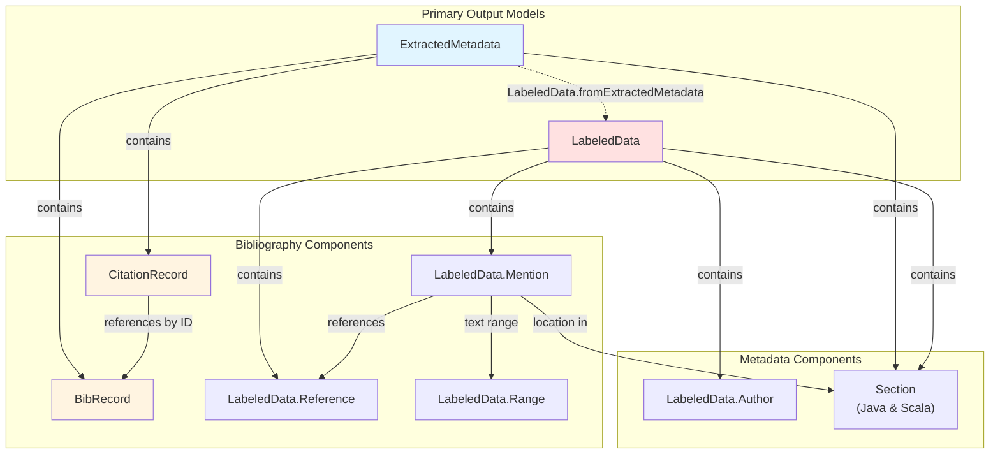

**Sources:** [core/src/main/scala/org/allenai/scienceparse/LabeledData.scala:94-145](), [core/src/main/java/org/allenai/scienceparse/BibRecord.java:1-87](), [core/src/main/java/org/allenai/scienceparse/CitationRecord.java:1-36]()

---

## Primary Output Models

### ExtractedMetadata

`ExtractedMetadata` is the main output format from the `Parser.doParse()` method. It represents the complete extracted information from a PDF, serialized as JSON for the REST API.

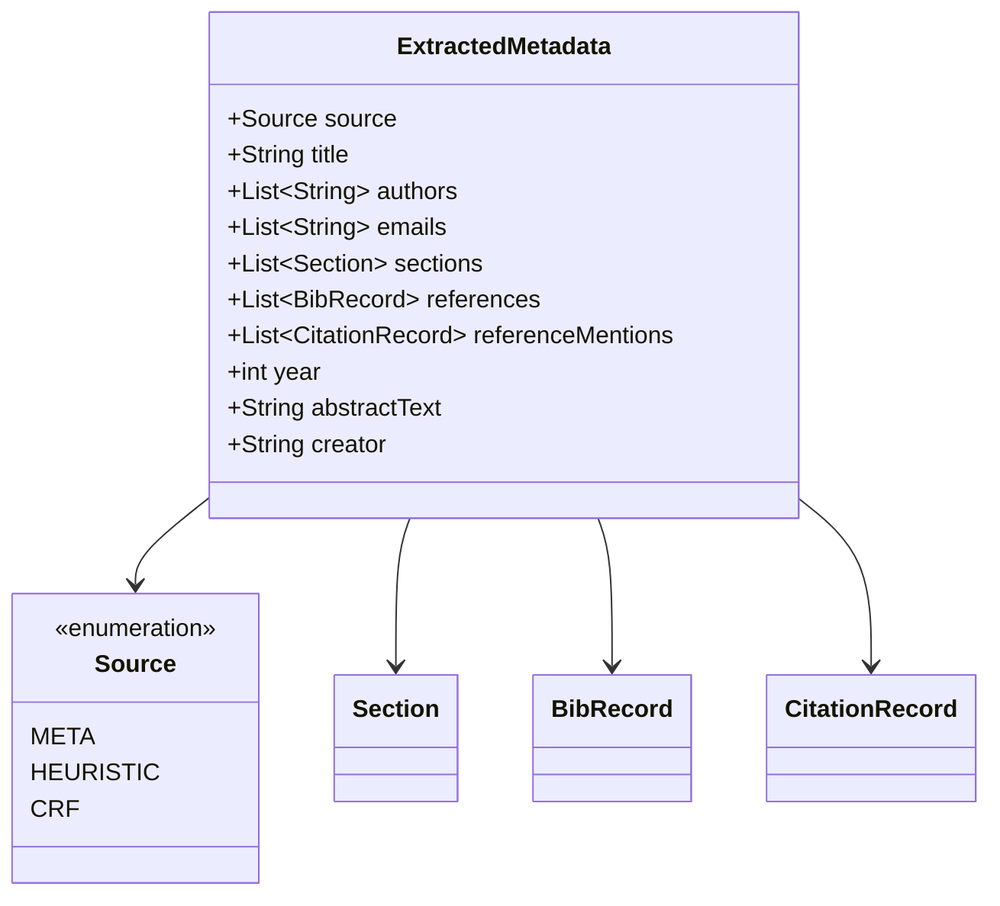

| Field | Type | Description |
|-------|------|-------------|
| `source` | `Source` enum | How the title was extracted: `META` (PDF metadata), `HEURISTIC` (font-based), or `CRF` (machine learning) |
| `title` | `String` | Paper title |
| `authors` | `List<String>` | Author names as strings |
| `emails` | `List<String>` | Author email addresses (rarely populated) |
| `sections` | `List<Section>` | Document sections with headings and text |
| `references` | `List<BibRecord>` | Bibliography entries |
| `referenceMentions` | `List<CitationRecord>` | In-text citations |
| `year` | `int` | Publication year (0 if not found) |
| `abstractText` | `String` | Abstract text |
| `creator` | `String` | PDF creator software |

**Key Methods:**
- Constructor takes title, authors, and labeled tokens/labels to populate fields automatically

**JSON Format:** See [server/src/main/scala/org/allenai/scienceparse/JsonProtocol.scala:125-178]()

**Sources:** [core/src/main/java/org/allenai/scienceparse/Parser.java:816-819](), [server/src/main/scala/org/allenai/scienceparse/SPServer.scala:285-326](), [core/src/main/scala/org/allenai/scienceparse/JsonProtocol.scala:125-178]()

---

### LabeledData

`LabeledData` is used for both ground truth (training/evaluation) and parsed output. It supports optional fields, making it suitable for partially-labeled data.

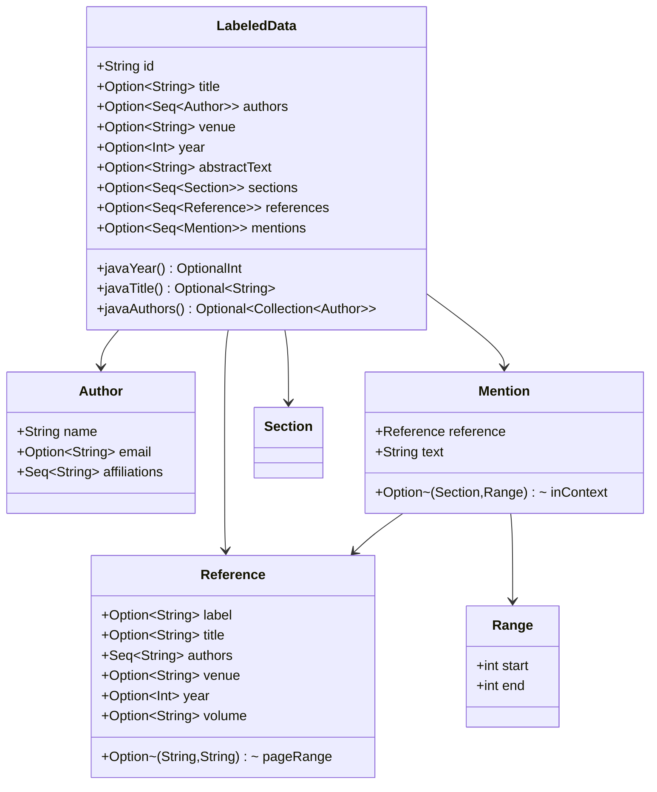

**Key Characteristics:**
- All fields except `id` are `Option` types, allowing partial labeling
- Conversion from `ExtractedMetadata` via `LabeledData.fromExtractedMetadata()`
- Used by training pipeline, evaluation, and feedback system
- Supports Java interop with `javaYear()`, `javaTitle()`, `javaAuthors()` methods

**Nested Types:**

| Type | Fields | Description |
|------|--------|-------------|
| `Author` | `name`, `email`, `affiliations` | Represents a paper author with contact and affiliation info |
| `Section` | `heading`, `text` | Document section with optional heading |
| `Reference` | `label`, `title`, `authors`, `venue`, `year`, `volume`, `pageRange` | Bibliography entry with structured fields |
| `Range` | `start`, `end` | Integer offset range in text |
| `Mention` | `reference`, `text`, `inContext` | In-text citation with context and location |

**Sources:** [core/src/main/scala/org/allenai/scienceparse/LabeledData.scala:94-145](), [core/src/main/scala/org/allenai/scienceparse/LabeledData.scala:147-178]()

---

## Bibliography and Citation Models

### BibRecord

`BibRecord` represents a bibliography entry extracted from the references section. It includes regex patterns for matching in-text citations.

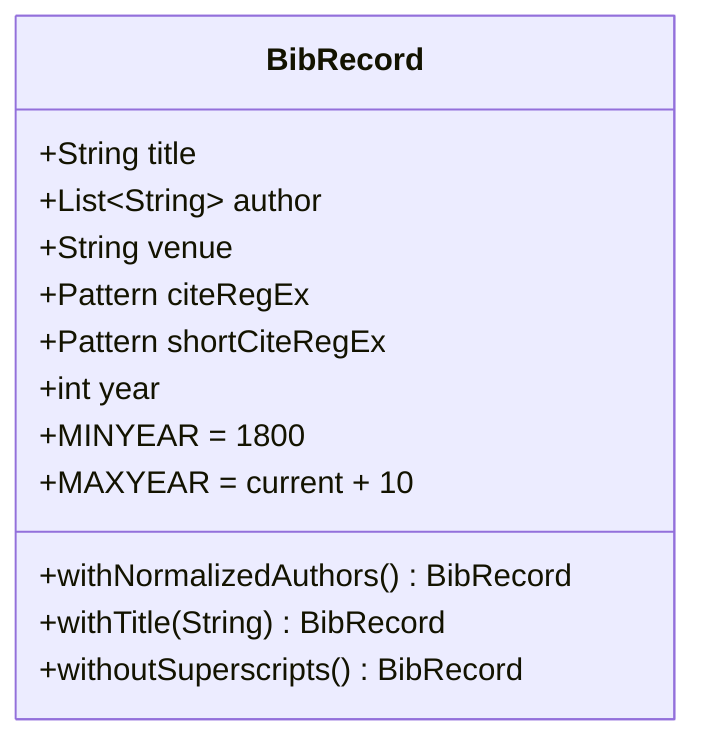

| Field | Type | Description |
|-------|------|-------------|
| `title` | `String` | Paper title |
| `author` | `List<String>` | Author names |
| `venue` | `String` | Publication venue (journal, conference, etc.) |
| `citeRegEx` | `Pattern` | Regex pattern to match full citations (e.g., `"[1]"`, `"Etzioni, 2005"`) |
| `shortCiteRegEx` | `Pattern` | Regex pattern to match short citations (e.g., `"Etzioni et al."`) |
| `year` | `int` | Publication year |

**Key Methods:**
- `withNormalizedAuthors()` - Normalizes author initials (e.g., `"C. M."` → `"C.M."`) and filters `"et al"`
- `withTitle(String)` - Returns new instance with updated title
- `withoutSuperscripts()` - Strips superscript tags (`⍐`, `⍗`) from all text fields

**Regex Pattern Usage:**
The `citeRegEx` and `shortCiteRegEx` patterns are generated by bibliography parsers based on the citation format detected. They enable `ExtractReferences.findCitations()` to locate in-text references.

**Sources:** [core/src/main/java/org/allenai/scienceparse/BibRecord.java:1-87](), [core/src/main/java/org/allenai/scienceparse/ExtractReferences.java:396-460]()

---

### CitationRecord

`CitationRecord` represents an in-text citation that references a `BibRecord` entry.

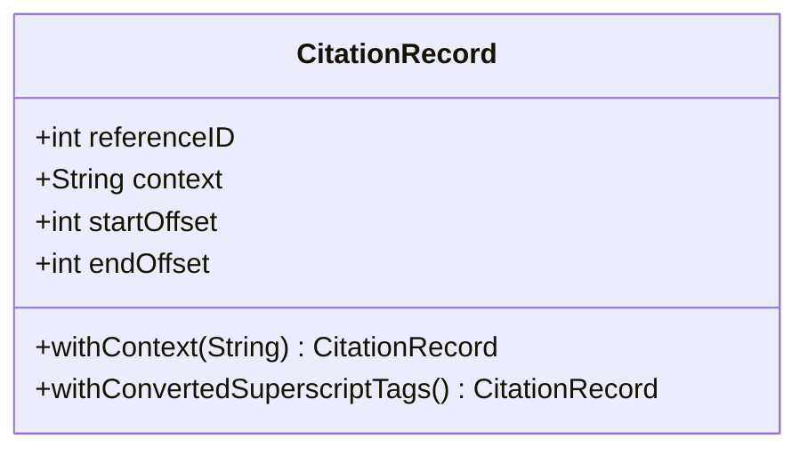

| Field | Type | Description |
|-------|------|-------------|
| `referenceID` | `int` | Index into the `references` list in `ExtractedMetadata` |
| `context` | `String` | The sentence or text containing the citation |
| `startOffset` | `int` | Character offset where citation starts in `context` |
| `endOffset` | `int` | Character offset where citation ends in `context` |

**Key Methods:**
- `withContext(String)` - Returns new instance with updated context (using Lombok's `@Wither`)
- `withConvertedSuperscriptTags()` - Converts superscript tags to parentheses for display

**Example:**
```
context: "As shown by [1], deep learning is effective."
startOffset: 14
endOffset: 17
referenceID: 0  // References the first BibRecord
```

**Sources:** [core/src/main/java/org/allenai/scienceparse/CitationRecord.java:1-36](), [core/src/main/java/org/allenai/scienceparse/ExtractReferences.java:396-460]()

---

### Section

`Section` represents a document section with optional heading. There are two implementations: Java and Scala versions that are interchangeable.

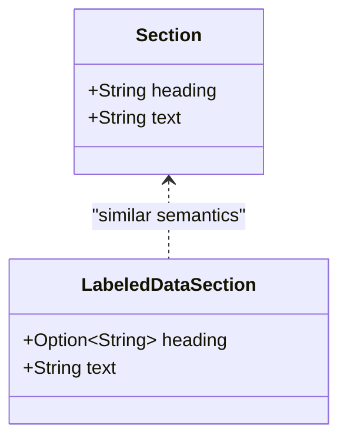

| Field | Type | Description |
|-------|------|-------------|
| `heading` | `String` or `Option[String]` | Section heading (e.g., "Introduction", "Methods") |
| `text` | `String` | Section body text |

**Usage:**
- Java `Section` is used in `ExtractedMetadata.sections`
- Scala `LabeledData.Section` is used in `LabeledData.sections`
- Both are serialized identically via `JsonProtocol`

**Sources:** [core/src/main/scala/org/allenai/scienceparse/JsonProtocol.scala:48-61](), [core/src/main/scala/org/allenai/scienceparse/LabeledData.scala:125]()

---

## Model Conversions

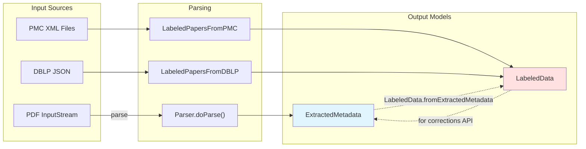

**Conversion Methods:**

| Method | Direction | Purpose |
|--------|-----------|---------|
| `LabeledData.fromExtractedMetadata(String, ExtractedMetadata)` | `ExtractedMetadata` → `LabeledData` | Convert parser output to labeled format |
| `LabeledPapersFromScienceParse.get(InputStream, Parser)` | PDF → `LabeledData` | Parse PDF and wrap in `LabeledData` |
| `JsonProtocol.toJson` / `convertTo` | Both models ↔ JSON | Serialization for REST API and storage |

**Example Conversion:**
```scala
val em: ExtractedMetadata = parser.doParse(inputStream)
val ld: LabeledData = LabeledData.fromExtractedMetadata(paperId, em)
```

**Sources:** [core/src/main/scala/org/allenai/scienceparse/LabeledData.scala:147-178](), [core/src/main/scala/org/allenai/scienceparse/LabeledData.scala:504-530](), [server/src/main/scala/org/allenai/scienceparse/SPServer.scala:285-306]()

---

## JSON Serialization

All data models support JSON serialization via Spray JSON. The `JsonProtocol` object defines implicit formatters for bidirectional conversion.

### JSON Format Examples

**ExtractedMetadata:**
```json
{
  "source": "CRF",
  "title": "Deep Learning for NLP",
  "authors": ["John Doe", "Jane Smith"],
  "year": 2020,
  "abstractText": "This paper presents...",
  "sections": [
    {"heading": "Introduction", "text": "Recently..."}
  ],
  "references": [
    {
      "title": "Neural Networks",
      "author": ["M. Johnson"],
      "venue": "ICML",
      "year": 2018
    }
  ],
  "referenceMentions": [
    {
      "referenceID": 0,
      "context": "As shown in [1], neural networks...",
      "startOffset": 16,
      "endOffset": 19
    }
  ]
}
```

**LabeledData:**
```json
{
  "id": "abc123",
  "title": "Deep Learning for NLP",
  "authors": [
    {
      "name": "John Doe",
      "email": "jdoe@example.com",
      "affiliations": ["MIT", "Google"]
    }
  ],
  "year": 2020,
  "references": [
    {
      "label": "1",
      "title": "Neural Networks",
      "authors": ["M. Johnson"],
      "venue": "ICML",
      "year": 2018,
      "pageRange": ["10", "20"]
    }
  ]
}
```

### Serialization Flow

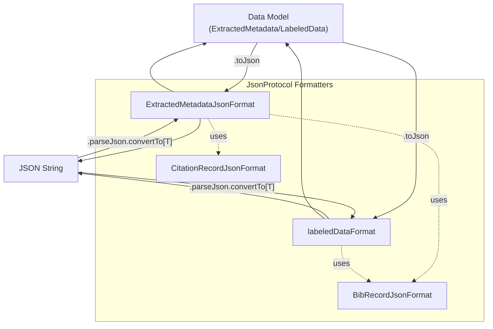

**Key Formatters:**
- `ExtractedMetadataJsonFormat` - Handles `ExtractedMetadata` serialization [core/src/main/scala/org/allenai/scienceparse/JsonProtocol.scala:125-178]()
- `labeledDataFormat` - Auto-generated for `LabeledData` case class [core/src/main/scala/org/allenai/scienceparse/JsonProtocol.scala:186]()
- `BibRecordJsonFormat` - Custom formatter for bibliography records [core/src/main/scala/org/allenai/scienceparse/JsonProtocol.scala:63-99]()
- `CitationRecordJsonFormat` - Handles citation records [core/src/main/scala/org/allenai/scienceparse/JsonProtocol.scala:101-123]()

**Usage in REST API:**
```scala
// Serialize to JSON
val em: ExtractedMetadata = parser.doParse(input)
val jsonString = em.toJson.prettyPrint

// Deserialize from JSON
val jsonAst = """{"title": "..."}""".parseJson
val em: ExtractedMetadata = jsonAst.convertTo[ExtractedMetadata]
```

**Sources:** [core/src/main/scala/org/allenai/scienceparse/JsonProtocol.scala:1-188](), [server/src/main/scala/org/allenai/scienceparse/SPServer.scala:18-19](), [server/src/main/scala/org/allenai/scienceparse/SPServer.scala:285-326]()

---

## Supporting Data Models

### CheckReferences

`CheckReferences` is an internal utility for validating bibliography extraction against a gazetteer of known papers.

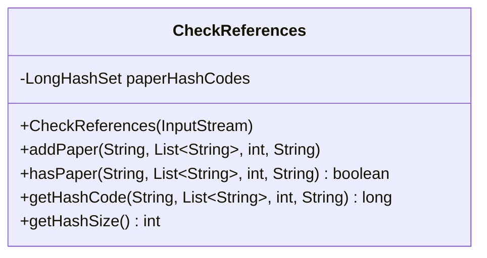

**Purpose:** Used by `ExtractReferences` to score bibliography extraction strategies. A higher count of found papers (via `hasPaper()`) indicates better extraction quality.

**Hash Function:** Combines processed title, last names, and year into a single `long` hash code for fast lookup.

**Sources:** [core/src/main/java/org/allenai/scienceparse/CheckReferences.java:1-54](), [core/src/main/java/org/allenai/scienceparse/ExtractReferences.java:462-483]()

---

## Model Usage Patterns

### In Training Pipeline

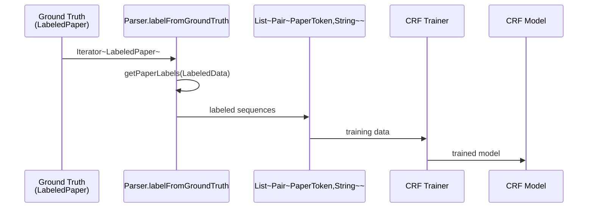

**Sources:** [core/src/main/java/org/allenai/scienceparse/Parser.java:262-307](), [core/src/main/java/org/allenai/scienceparse/Parser.java:583-706]()

### In REST API

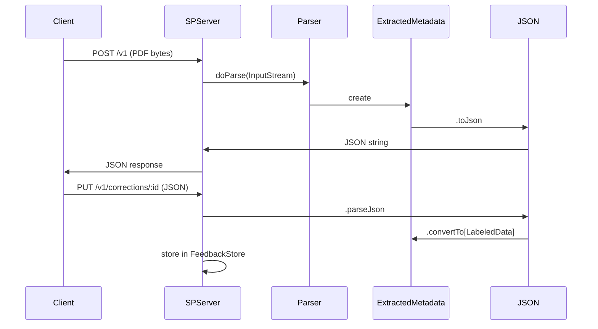

**Sources:** [server/src/main/scala/org/allenai/scienceparse/SPServer.scala:308-327](), [server/src/main/scala/org/allenai/scienceparse/SPServer.scala:345-377](), [server/src/main/scala/org/allenai/scienceparse/FeedbackStore.scala:88-115]()

### In Evaluation

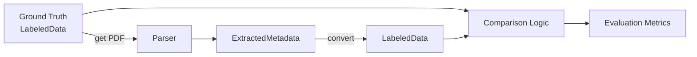

**Sources:** [core/src/main/scala/org/allenai/scienceparse/LabeledData.scala:147-178](), [core/src/main/java/org/allenai/scienceparse/Parser.java:262-307]()

---

## Model Field Validation

### BibRecord Cleaning

The `ExtractReferences.clean()` method validates and filters bibliography records:

| Validation | Action |
|------------|--------|
| Empty title | Remove record |
| Title length > 512 | Remove record |
| Venue length > 512 | Remove record |
| Any author length > 512 | Remove record |
| Leading/trailing punctuation in title | Strip |

**Sources:** [core/src/main/java/org/allenai/scienceparse/ExtractReferences.java:493-511]()

### ExtractedMetadata Cleaning

The `Parser.clean()` method normalizes output:

| Operation | Method |
|-----------|--------|
| Title normalization | `cleanTitle()` - strips accents, removes XML entities, removes trailing periods |
| Author trimming | `trimAuthors()` - removes empty strings |

**Sources:** [core/src/main/java/org/allenai/scienceparse/Parser.java:816-843]()

---

## Summary Table

| Model | Purpose | Key Fields | Used In |
|-------|---------|------------|---------|
| `ExtractedMetadata` | Parser output | title, authors, year, sections, references, referenceMentions | REST API, evaluation |
| `LabeledData` | Ground truth & parsed output | id, title, authors, year, sections, references, mentions | Training, evaluation, feedback |
| `BibRecord` | Bibliography entry | title, author, venue, year, citeRegEx, shortCiteRegEx | Reference extraction, citation finding |
| `CitationRecord` | In-text citation | referenceID, context, startOffset, endOffset | Citation extraction |
| `Section` | Document section | heading, text | Document structure |
| `LabeledData.Author` | Author info | name, email, affiliations | Author extraction |
| `LabeledData.Reference` | Ground truth reference | label, title, authors, venue, year, volume, pageRange | Training, evaluation |

**Sources:** [core/src/main/scala/org/allenai/scienceparse/LabeledData.scala:94-145](), [core/src/main/java/org/allenai/scienceparse/BibRecord.java:1-87](), [core/src/main/java/org/allenai/scienceparse/CitationRecord.java:1-36](), [core/src/main/scala/org/allenai/scienceparse/JsonProtocol.scala:1-188]()

---

